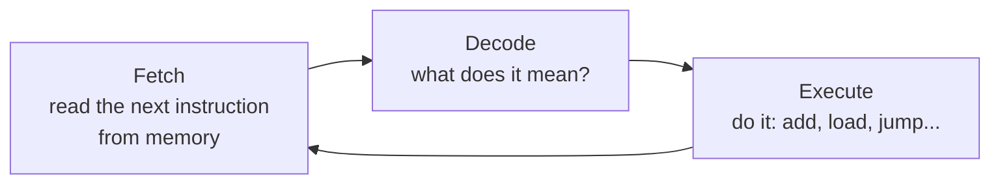

# CPU and registers

## Why care?

A teammate says: "Don't worry, the compiler inlines that." Another says: "This loop has a branch that the CPU can't predict." In a code review someone asks: "Does this allocate?"

These are CPU-level arguments. You don't need to write assembly to join them. But you need a clear picture of what the CPU does, and you need to be able to **look** at what Go produces. This page gives you both.

## The idea: a fast machine for simple instructions

A CPU works with three things:

- A few small storage slots inside the chip. These are **registers**. The CPU can only do math on values that are in registers.
- **Memory** (RAM) outside the chip. It holds everything else, but it is much slower to reach than a register.
- A **list of simple instructions**, such as "load the value at address 12 into register A", "add register B to register A", "if register A is zero, jump to instruction 40".

The CPU is very fast (billions of steps per second), but each step is very simple. Every line of Go you write becomes many of these steps.

## The fetch–decode–execute loop

The CPU runs one loop, forever:



A special register, the **instruction pointer** (`RIP` on x86-64, `PC` on ARM), holds the address of the next instruction. After each instruction, it moves forward. A **jump** instruction simply writes a new address into it. That is all an `if`, a `for` loop, or a function call is at this level: a jump.

## Registers

A **register** is a storage slot _inside_ the CPU. It is the fastest storage there is: the CPU can read it in less than one clock cycle. But there are very few of them.

On **x86-64** (Intel and AMD) there are 16 general-purpose registers of 64 bits each:

```text
RAX RBX RCX RDX RSI RDI RBP RSP R8 R9 R10 R11 R12 R13 R14 R15
```

Some have special jobs:

| Register | Job                                                                                                     |
| -------- | ------------------------------------------------------------------------------------------------------- |
| `RSP`    | **Stack pointer.** Points to the top of the current stack. See [Memory](memory.md).                     |
| `RBP`    | **Frame pointer.** Points to the start of the current function's frame. Debuggers and profilers use it. |
| `RIP`    | **Instruction pointer.** Address of the next instruction.                                               |
| `RFLAGS` | **Flags.** Bits like "the last result was zero" or "it overflowed". Used by `if`.                       |

There are also wide **vector registers** (`XMM`, `YMM`, `ZMM`, 128 to 512 bits) that do math on many numbers at once, and are used for floats.

**ARM64** (Apple Silicon, AWS Graviton, phones) has 31 general-purpose registers (`X0`–`X30`). The ideas on this page are the same; only the names change.

!!! info "Why only so few?"

    Registers sit in the hottest, most expensive part of the chip, wired straight into the
    math units. More registers means longer wires and slower access. So compilers work very hard to
    keep the _most used_ values in registers and the rest in memory. This job is called
    **register allocation**.

## Instructions

An instruction is a few bytes that the CPU understands. Common kinds:

| Kind        | Example (Go assembly) | Meaning                               |
| ----------- | --------------------- | ------------------------------------- |
| Move / load | `MOVQ 8(SP), AX`      | copy 8 bytes from memory into AX      |
| Store       | `MOVQ AX, 8(SP)`      | copy AX into memory                   |
| Math        | `ADDQ BX, AX`         | AX = AX + BX                          |
| Compare     | `CMPQ AX, $10`        | compare AX with 10, set the flags     |
| Jump        | `JLT loop`            | if "less than" flag set, jump         |
| Call        | `CALL main.add(SB)`   | save return address, jump to function |
| Return      | `RET`                 | jump back to the saved address        |

The `Q` at the end means "quad word" = 8 bytes. `L` is 4 bytes.

## Try it in Go: read your own assembly

Write this program:

```go
package main

//go:noinline
func add(a, b int) int {
	return a + b
}

func main() {
	println(add(2, 3))
}
```

The `//go:noinline` comment stops the compiler from copying `add` into `main`. Without it, the compiler would compute `5` at compile time, and there would be nothing to see.

Ask the compiler to print the assembly:

```sh
go build -gcflags=-S . 2>&1 | less
```

Here is the important part for `add` (on amd64, file paths removed):

```text
main.add STEXT nosplit size=4 args=0x10 locals=0x0
    TEXT    main.add(SB), NOSPLIT|NOFRAME|ABIInternal, $0-16
    ADDQ    BX, AX
    RET
    0x0000 48 01 d8 c3
```

And in `main`:

```text
    MOVL    $2, AX
    MOVL    $3, BX
    CALL    main.add(SB)
```

The code is very small:

- `main` puts `2` into register `AX` and `3` into `BX`, then calls `add`.
- `add` is **one instruction**: `AX = AX + BX`. Then `RET`. The result is in `AX`.
- `48 01 d8 c3` is the real machine code: 4 bytes. `48 01 d8` is `ADDQ BX, AX`, and `c3` is `RET`.

No memory was touched for the arguments. Everything happened in registers.

### The Go register ABI

The rules for "where do arguments and results go" are called the **calling convention** or **ABI** (Application Binary Interface). Since Go 1.17, on amd64 Go passes arguments and results in registers, in this order:

```text
AX, BX, CX, DI, SI, R8, R9, R10, R11
```

Before Go 1.17, all arguments went through the stack in memory. The switch to registers made typical Go programs about 5% faster, with no code changes. Details at this layer can change the speed of every program.

Two other registers have fixed jobs in Go on amd64:

- `R14` always holds a pointer to the **current goroutine** (`g`).
- `R15` is reserved for some dynamic linking cases.

You can see `R14` at the start of `main`:

```text
    CMPQ    SP, 16(R14)
```

This compares the stack pointer with a limit stored in the goroutine. If the stack is almost full, Go jumps to code that **grows the stack**. That is how goroutines can start with tiny stacks. More on that in [Memory](memory.md).

!!! tip "Better tools"

    - `go tool objdump -s 'main.add' ./yourbinary` shows the final machine code of a built binary.
    - [Compiler Explorer](https://godbolt.org) shows Go source and assembly side by side in the browser.
    - Go's assembly syntax is its own dialect (from Plan 9). Register names drop the `R` prefix:
      `AX` means `RAX`. The [Go assembler guide](https://go.dev/doc/asm) explains it.

## Why modern CPUs are faster than "one instruction per tick"

A CPU at 4 GHz does 4 billion clock **cycles** per second. But a modern core finishes _several_ instructions per cycle. Three techniques make that possible:

1. **Pipelining.** The CPU splits each instruction into stages and works on several instructions at once: while one instruction executes, the next is being decoded and the one after that is being fetched.
2. **Out-of-order execution.** If instruction 2 waits for slow memory, the CPU runs instructions 3, 4 and 5 first (when they don't depend on 2), and puts the results in the right order later.
3. **Branch prediction.** At an `if`, the CPU does not wait to know the answer. It **guesses**, and starts running that path. A right guess is free. A wrong guess means throwing away the work: about 15–20 cycles lost.

The third point has a well-known effect. A loop with an `if` over **sorted** data is often much faster than the same loop over **random** data. With sorted data the `if` gives the same answer many times in a row, so the guesses are right.

!!! note "What this means for you"

    You rarely optimize for this by hand. But it explains benchmark results that look "impossible",
    and it is why you must **measure** with `go test -bench` instead of guessing.
    We do much more with benchmarks in the Go chapter.

## Multiple cores

A modern CPU has many **cores**. Each core is a complete processor with its own registers, its own instruction pointer, and its own small caches. 8 cores can run 8 lists of instructions at the same time.

Your Go program uses this through goroutines. Go asks: "how many cores do I have?" (`runtime.NumCPU()`) and by default runs goroutines on that many threads at once. See [Processes and threads](processes-and-threads.md).

## Traps

!!! warning "Trap: \"fewer lines of Go = faster\""

    One short line like `s = append(s, x)` can mean a function call, a memory allocation and a copy.
    A long, simple loop can become five instructions. Lines of code do not measure work. Instructions,
    memory access and allocations do.

!!! warning "Trap: benchmarking code that the compiler removed"

    If the result of your computation is never used, the compiler may delete it. Your benchmark then
    measures nothing and looks very fast. Use `b.Loop()` (Go 1.24+) in benchmarks: the compiler
    will not optimize away function calls inside a `for b.Loop()` loop.

## Check yourself

??? question "1. What is a register, in one sentence?"

    A tiny, very fast storage slot inside the CPU, where the actual math happens.

??? question "2. In the `add` example, where are `a`, `b` and the result stored?"

    `a` in `AX`, `b` in `BX`, the result in `AX`. Go's register ABI put them there; no memory needed.

??? question "3. What does a `CALL` instruction do that a `JMP` does not?"

    It saves the return address (on the stack), so `RET` can come back to the right place later.

??? question "4. Why can a loop be faster over sorted data than over random data?"

    The CPU's branch predictor guesses the `if` result. With sorted data the result is the same
    for long runs, so guesses are almost always right and no work is thrown away.

## Recap

- The CPU repeats fetch → decode → execute, guided by the instruction pointer.
- Registers are few and very fast. All math happens there.
- `go build -gcflags=-S` shows you the assembly. Use it to settle arguments.
- Go (1.17+) passes function arguments in registers: `AX`, `BX`, `CX`, …
- Pipelines, out-of-order execution and branch prediction make CPUs fast, and make guessing about speed unreliable. Measure.
