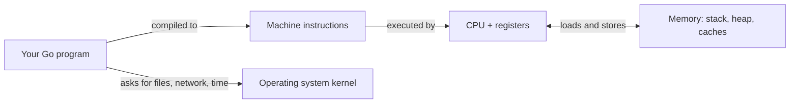

# Fundamentals

What really happens inside the machine when your program runs.

## Why start here?

You can write Go without knowing what a register is. Many people do. But some bugs make no sense at the level of your code:

- A number becomes negative when it should be very big.
- A name with an `é` in it breaks your API.
- A small change makes your service two times slower.
- Your program uses 2 GB of memory and you do not know why.

All of these bugs come from the layers _below_ your code. This chapter explains those layers. After it, you can explain these bugs to your team and fix them.

## The big picture

A running program involves four parts:

1. **Data** is only bits. Numbers, text, pictures: all bits. The _meaning_ comes from how we read them.
2. **The CPU** runs very simple instructions, one after another, on very small and very fast storage called **registers**.
3. **Memory** holds everything that does not fit in registers. Your program sees it as one long row of numbered bytes.
4. **The operating system** shares the CPU and memory between many programs, and does the dangerous work (disk, network) for you.

## Reading order

Each page builds on the one before it.

| #   | Page                                                            | You will learn                                                               |
| --- | --------------------------------------------------------------- | ---------------------------------------------------------------------------- |
| 1   | [Bits, bytes and numbers](bits-and-bytes.md)                    | Binary, hex, negative numbers, overflow, bitwise operators, floats           |
| 2   | [Encodings](encodings.md)                                       | ASCII, Unicode, UTF-8, endianness, and Go strings vs bytes vs runes          |
| 3   | [CPU and registers](cpu-and-registers.md)                       | How the CPU runs code, and how to read the assembly Go produces              |
| 4   | [From source code to bytecode](compilers-and-bytecode.md)       | How compilers translate code, what bytecode looks like, and how a VM runs it |
| 5   | [Memory: stack, heap and caches](memory.md)                     | Where your variables live, escape analysis, virtual memory, caches           |
| 6   | [Processes, threads and system calls](processes-and-threads.md) | How the OS runs programs, and how Go runs goroutines on threads              |

## How each page works

- **Why care?** A real problem first. Theory second.
- **The idea.** Plain words and a picture.
- **Under the hood.** The deep part. Take your time here.
- **Try it in Go.** Small programs you can run. The output in this book comes from real runs.
- **Traps.** Mistakes that real teams make.
- **Check yourself.** A few questions. Answers are hidden; try first.

!!! tip "Run the examples"

    Make a folder, run `go mod init demo`, paste the code into `main.go`, and run `go run .`.
    Change the code and watch what changes in the output. This helps you remember what you learned.
