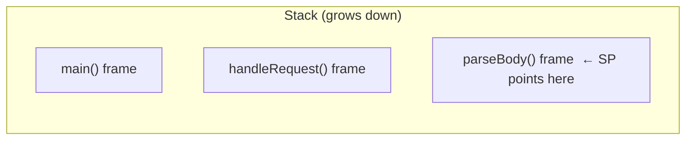
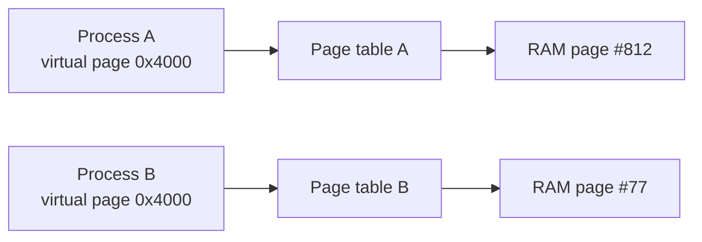

# Memory: stack, heap and caches

## Why care?

Your Go service handles 2,000 requests per second. The profiler says 30% of CPU time goes to the **garbage collector**. A senior engineer looks at the code for five minutes, changes three lines, and the GC time drops to 5%. No new algorithm. They only changed **where values live in memory**.

This page explains what they saw, so you can find the same problems.

## The idea: a long row of numbered bytes

To your program, memory looks like one very long row of bytes. Every byte has a number: its **address**. A **pointer** is a value that holds an address.

```text
address:  0x1000 0x1001 0x1002 0x1003 0x1004 ...
value:      48     65     6c     6c     6f   ...
```

A value bigger than one byte, like an `int64`, uses 8 bytes in a row. Its address is the address of the first byte.

Your program splits this address range into areas with different rules. The two that matter most are the **stack** and the **heap**.

## The stack: last in, first out

Every time a function is called, it gets a **stack frame**: a block of memory for its local variables, its arguments (when they don't fit in registers) and the return address. When the function returns, the frame is thrown away.

It works **last in, first out** (LIFO): the program only ever adds or removes the frame **on top**.



Why the stack is so fast:

- **Allocation is one instruction.** Making a new frame = moving the stack pointer `SP` (see [CPU and registers](cpu-and-registers.md)) down by N bytes.
- **Freeing is one instruction.** Move `SP` back up. Everything in the frame is gone at once.
- **No garbage collector** is involved.
- The top of the stack is almost always in the CPU cache (see below).

The limit: a value on the stack **dies when its function returns**. So it can only live there if nobody needs it later.

### Goroutine stacks are special

In C, each thread gets one big stack (often 8 MB) fixed at start. Go does something different:

- Each goroutine starts with a **tiny stack** (a few kilobytes; the runtime picks the start size, minimum 2 KiB).
- At the start of most functions, Go checks "is there enough room?". You saw that check in the assembly: `CMPQ SP, 16(R14)`.
- If not, the runtime allocates a **bigger stack** (2×), **copies** the old one into it, and fixes all the pointers into it.

This is why you can run 100,000 goroutines without problems, while 100,000 OS threads would need many gigabytes.

## The heap: shared, long-lived memory

The **heap** is memory for values that must **outlive** the function that created them, or whose size is only known at run time and is large. Any function can reach a value on the heap if it has a pointer to it.

The cost:

- Allocation is a real function call (`runtime.mallocgc`), not one instruction. It is fast, but it is work.
- Someone has to **free** it. In C you do it by hand, which often causes bugs. In Go the **garbage collector (GC)** does it: it finds values that no pointer can reach anymore, and reuses their memory.
- The GC runs **concurrently** with your program, but it uses CPU time (Go aims to give it about 25% of the CPU while it runs) and short "stop the world" pauses.

**More heap allocations = more GC work = less CPU for your requests.**

!!! info "Two knobs for the GC"

    - `GOGC` (default `100`): start a new GC cycle when the heap has grown 100% since the last one.
      Higher = fewer GC cycles, more memory.
    - `GOMEMLIMIT` (Go 1.19+): a soft memory limit, e.g. `GOMEMLIMIT=900MiB`. Very useful in
      containers: set it a bit below the container memory limit so the GC works harder _before_
      the container is killed for using too much memory.

## Escape analysis: who decides stack or heap?

In Go, **you don't choose** stack or heap. There is no `new` that means "heap" and no keyword for "stack". The **compiler** decides, with a step called **escape analysis**:

> If the compiler can **prove** a value is not used after the function returns, it goes on the stack. Otherwise it "escapes" to the heap.

### Try it in Go

```go
package main

type user struct {
	name string
	age  int
}

func onStack() int {
	u := user{name: "ana", age: 30}
	return u.age // only a copy of the int leaves the function
}

func onHeap() *user {
	u := user{name: "bob", age: 40}
	return &u // a pointer to u leaves the function!
}

func main() {
	_ = onStack()
	_ = onHeap()
}
```

Ask the compiler to explain its decisions with `-m`:

```sh
go build -gcflags=-m .
```

Output:

```text
./main.go:8:6: can inline onStack
./main.go:13:6: can inline onHeap
./main.go:18:6: can inline main
./main.go:19:13: inlining call to onStack
./main.go:20:12: inlining call to onHeap
./main.go:14:2: moved to heap: u
```

The last line is the important one: `u` in `onHeap` is **moved to heap**, because its address is returned. The `u` in `onStack` is not mentioned: it stays on the stack.

!!! note "Returning `&u` is safe in Go"

    In C, returning the address of a local variable is a classic bug: the memory is gone after
    return. In Go it is always safe, because escape analysis moves `u` to the heap. Safety first,
    speed second.

### Common reasons a value escapes

| Code pattern                                                                                 | Why it escapes                                            |
| -------------------------------------------------------------------------------------------- | --------------------------------------------------------- |
| `return &x`                                                                                  | Pointer outlives the function                             |
| Storing a pointer in a global, a map, or a slice that escapes                                | Someone else may read it later                            |
| Capturing a variable in a closure that outlives the function (e.g. `go func() { use(x) }()`) | The goroutine may run after return                        |
| Putting a value in an interface (`any`, `error`, `fmt.Println(x)`)                           | Often escapes, because the compiler can't see who uses it |
| `make([]byte, n)` where `n` is not a constant                                                | Size unknown at compile time                              |
| Very large values                                                                            | Too big for the stack                                     |

!!! tip "The enterprise way to use this"

    Do **not** write strange code to avoid every allocation. First, measure:
    `go test -bench . -benchmem` shows `allocs/op`, and `pprof` shows where allocations happen.
    Then fix only the hot paths. Typical fixes: return values instead of pointers for small structs,
    reuse buffers with `sync.Pool`, and pre-size slices with `make([]T, 0, n)`.

## Size and alignment

The CPU likes values at addresses that are a multiple of their size: an `int64` at an address divisible by 8. This is called **alignment**. To keep fields aligned, the compiler adds empty **padding** bytes inside structs.

```go
type Bad struct {
	a bool  // 1 byte + 7 padding
	b int64 // 8 bytes
	c bool  // 1 byte + 7 padding
}

type Good struct {
	b int64 // 8 bytes
	a bool  // 1 byte
	c bool  // 1 byte + 6 padding
}

fmt.Println(unsafe.Sizeof(Bad{}), unsafe.Sizeof(Good{})) // 24 16
```

Same fields, 33% less memory. For one struct it does not matter. For 10 million of them in a cache, it does. Sort fields from large to small when size matters. The `fieldalignment` analyzer (in `golang.org/x/tools`) can find these cases for you.

## Virtual memory: a private address space per process

If every program wrote to the same real memory, one bug could destroy another program. So the OS and CPU use **virtual memory**.

- Each process gets its **own** range of addresses, from 0 to a huge number. Process A's address `0x4000` and process B's address `0x4000` are different real places.
- Memory is managed in blocks called **pages**, usually **4 KiB**.
- A table (the **page table**) maps each virtual page to a real page in RAM. A part of the CPU called the **MMU** does this lookup for every memory access. A small cache, the **TLB**, makes it fast.
- A page does not need real RAM until it is used. The first touch causes a **page fault**: the CPU stops, the OS finds a free real page, maps it, and continues. Your program does not see this, except that the access is a bit slower.



This explains two numbers you will see in monitoring:

- **Virtual size (VSZ)**: all addresses the process has reserved. Go reserves a lot up front. This number is often huge and **mostly meaningless**.
- **Resident set size (RSS)**: pages that are really in RAM right now. **This is the one that matters**, and the one your container limit counts.

## Caches: why the same work can be 2× slower

RAM is slow to reach from the CPU. To hide that delay, the CPU keeps copies of recently used memory in small, fast **caches**. Typical numbers on a modern server:

| Level    | Typical size        | Typical time to read | Like…                       |
| -------- | ------------------- | -------------------- | --------------------------- |
| Register | a few hundred bytes | < 1 ns               | the paper in your hand      |
| L1 cache | 32–64 KiB per core  | ~1 ns                | a book on your desk         |
| L2 cache | 1–2 MiB per core    | ~3–5 ns              | a shelf in your room        |
| L3 cache | 16–100+ MiB, shared | ~10–20 ns            | the library down the street |
| RAM      | GBs                 | ~80–100 ns           | a library in the next city  |

The cache does not copy single bytes. It copies blocks of **64 bytes** called **cache lines** (128 bytes on Apple Silicon). When you read one `int64`, the 7 next to it are loaded at no extra cost.

So the CPU rewards two habits:

- **Spatial locality**: use memory that is close together. Walking a slice in order is the best case.
- **Temporal locality**: use the same memory again soon, while it is still in the cache.

### Try it in Go: same work, different order

Both benchmarks add up the same 16 million numbers. Only the **order** is different.

```go
package cache

import "testing"

const n = 4096

var grid = func() [][]int64 {
	g := make([][]int64, n)
	for i := range g {
		g[i] = make([]int64, n)
	}
	return g
}()

func BenchmarkRowByRow(b *testing.B) {
	for b.Loop() {
		var sum int64
		for row := 0; row < n; row++ {
			for col := 0; col < n; col++ {
				sum += grid[row][col]
			}
		}
		_ = sum
	}
}

func BenchmarkColumnByColumn(b *testing.B) {
	for b.Loop() {
		var sum int64
		for col := 0; col < n; col++ {
			for row := 0; row < n; row++ {
				sum += grid[row][col]
			}
		}
		_ = sum
	}
}
```

Result on an 8-core AMD laptop (`go test -bench .`):

```text
BenchmarkRowByRow-16          37   30851472 ns/op
BenchmarkColumnByColumn-16    20   56727063 ns/op
```

Row by row walks memory in order and uses all 8 values of each cache line. Column by column jumps 32 KiB for every step, so it uses one value per cache line and throws the rest away. Same result, same number of additions, **almost 2× slower**. On other machines and sizes the gap can be much bigger.

This is also why a **slice of structs** (`[]User`) is usually faster to loop over than a **slice of pointers** (`[]*User`): the structs sit next to each other, while the pointers can send the CPU all over the heap.

!!! warning "Trap: false sharing"

    Two goroutines on two cores update two _different_ counters. But the counters sit in the
    **same cache line**. Every write forces the other core to reload that line. The code is correct,
    but scales very badly. The fix is to put each hot counter on its own cache line (padding), or to
    give each goroutine its own counter and add them up at the end.

## Check yourself

??? question "1. Why is allocating on the stack cheaper than on the heap?"

    Stack allocation is only moving the stack pointer, and everything is freed at once when the
    function returns. Heap allocation needs the allocator, and later the GC must find and free it.

??? question "2. A function returns `*Config`. Where does the Config live?"

    On the heap (unless the call is inlined and the compiler can prove it doesn't escape).
    Check with `go build -gcflags=-m`.

??? question "3. Your container has a 1 GiB limit. Monitoring shows the Go process with 20 GiB VSZ and 700 MiB RSS. Problem?"

    VSZ is reserved address space, not real memory. RSS (700 MiB) is what counts. Consider
    `GOMEMLIMIT=900MiB` so the GC gets more aggressive before the limit is hit.

??? question "4. Why can `[]User` be faster to iterate than `[]*User`?"

    The structs are next to each other in memory, so each cache line brings in useful data.
    With pointers, each element can be anywhere on the heap: more cache misses, and more work for the GC.

## Recap

- Memory is a long row of numbered bytes. A pointer is an address.
- Stack: per goroutine, LIFO, very cheap, no GC. Values die when the function returns.
- Heap: shared, needs the GC. More allocations = more GC work.
- Go decides stack vs heap with **escape analysis**. See it with `-gcflags=-m`.
- Virtual memory gives each process its own address space. Watch RSS, not VSZ.
- Caches work with 64-byte lines. Walk memory in order, keep hot data together.
