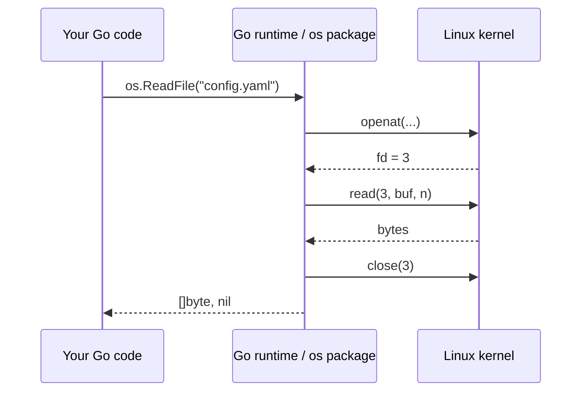
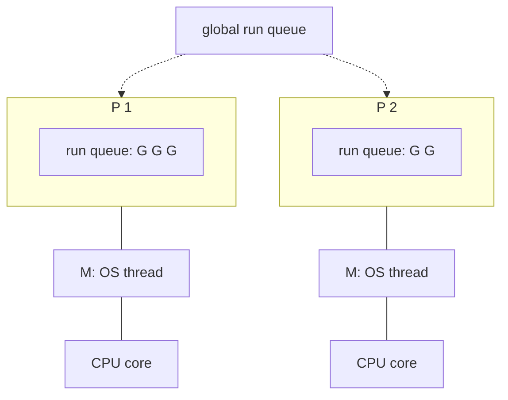

# Processes, threads and system calls

## Why care?

Three typical messages from production:

- `accept: too many open files`
- "The pod was killed during deploy and 200 requests failed."
- "We run on a 64-core machine but the container only gets 2 CPUs, and latency is terrible."

None of these are bugs in your Go logic. They are about how the **operating system** runs your program. This page explains processes, threads and system calls, and then how Go builds goroutines on top of them.

## The idea: the kernel controls access to shared resources

The operating system has four main parts that matter here:

- The **kernel** is the core of the OS. It controls the hardware: CPU time, memory, disks and the network.
- A **process** is a running program. It has its own memory and its own handles to files and network connections.
- A **thread** is a line of execution inside a process. Threads of the same process share its memory.
- A **system call** is a request from a program to the kernel, such as "write these bytes to this socket" or "open this file".

A process can't read the memory of another process. A thread can't use the hardware directly. It must ask the kernel with a system call. That is the whole safety model.

## Processes

A **process** is a running program. The OS gives each process:

- a **PID** (process ID), a number to identify it;
- its own **virtual address space** (see [Memory](memory.md)), so it can't read other processes' memory;
- a table of **file descriptors**: small numbers like `0`, `1`, `2`, `3` that point to open files, sockets and pipes;
- environment variables, a working directory, a user ID, limits;
- at least one **thread**.

On Linux you can look inside a running process in `/proc/<pid>/`. For example, `/proc/<pid>/status` shows memory and thread count, and `/proc/<pid>/fd/` lists open file descriptors.

### File descriptors and "too many open files"

`0`, `1` and `2` are always stdin, stdout and stderr. Every file you open, every TCP connection, every listening socket uses one more descriptor. The OS sets a limit per process (see `ulimit -n`, often 1024 by default on a shell).

So `too many open files` usually means one of two things:

1. You **leak** descriptors: you forget `resp.Body.Close()` or `f.Close()`. This is a bug, and the fix is to close them.
2. You really need many connections (a busy server). Then raise the limit (in systemd: `LimitNOFILE`, in Kubernetes: the container runtime setting).

Always check for (1) first.

## Threads

A **thread** is one line of execution: its own instruction pointer, its own registers, its own stack. All threads of one process **share** the same memory and file descriptors.

The kernel's **scheduler** decides which thread runs on which CPU core, and for how long. When it switches from one thread to another on a core, it does a **context switch**:

1. Save all registers of the old thread to memory.
2. Load all registers of the new thread.
3. Maybe switch the page table (if it is a different process).
4. Continue.

This costs a few microseconds of direct work. The hidden cost is bigger: the new thread finds the CPU caches full of the _other_ thread's data.

OS threads are also heavy in memory: each one gets a fixed stack, often 8 MB of reserved address space on Linux. Ten thousand threads is a lot. A hundred thousand is usually too many.

!!! warning "Shared memory = data races"

    Because threads share memory, two threads can write the same variable at the same time.
    The result is random and hard to reproduce. Goroutines have the same problem.
    Always run tests with the race detector: `go test -race ./...`.

## System calls: from user mode to kernel mode

The CPU has (at least) two modes:

- **User mode**: where your program runs. It cannot touch hardware or other processes' memory.
- **Kernel mode**: where the kernel runs. It can do everything.

To do anything outside its own memory (read a file, send a packet, get the time from the hardware, start a process), a program makes a **system call**. On x86-64 Linux this is the `SYSCALL` instruction: put the call number and arguments in registers, run `SYSCALL`, and the CPU jumps into the kernel. The kernel checks the request, does the work, and jumps back.



A system call costs much more than a normal function call (hundreds of nanoseconds or more), because of the mode switch and the checks. That's why buffering matters: `bufio.Writer` collects many small writes into one big `write` system call.

!!! tip "See the system calls"

    On Linux, `strace -f -e trace=openat,read,write ./yourprogram` prints every system call.
    It is one of the most useful debugging tools to learn. `-f` follows all threads, which matters
    for Go programs.

## Signals: notifications from the kernel

The kernel can also send a process a short message called a **signal**:

| Signal    | Meaning                 | Can you catch it? |
| --------- | ----------------------- | ----------------- |
| `SIGINT`  | Ctrl+C                  | Yes               |
| `SIGTERM` | Request to stop cleanly | Yes               |
| `SIGKILL` | Stop immediately        | **No**            |

This is the answer to the failed-requests-during-deploy problem. Kubernetes stops a pod by sending `SIGTERM`, waits a grace period (30 seconds by default), and then sends `SIGKILL`. If your service ignores `SIGTERM`, the default action kills it immediately, and every request that was in flight fails.

The fix is **graceful shutdown**:

```go
ctx, stop := signal.NotifyContext(context.Background(), os.Interrupt, syscall.SIGTERM)
defer stop()

srv := &http.Server{Addr: ":8080", Handler: mux}
go func() {
	if err := srv.ListenAndServe(); err != nil && !errors.Is(err, http.ErrServerClosed) {
		log.Fatal(err)
	}
}()

<-ctx.Done() // wait for SIGINT or SIGTERM

shutdownCtx, cancel := context.WithTimeout(context.Background(), 20*time.Second)
defer cancel()
if err := srv.Shutdown(shutdownCtx); err != nil { // stop accepting, finish running requests
	log.Printf("shutdown: %v", err)
}
```

We build this properly in the Go chapter. For now, remember: **`SIGTERM` is a request to stop. Your service must handle it.**

## How Go runs goroutines: the G-M-P model

Goroutines are not OS threads. The Go **runtime** has its own scheduler that runs many goroutines on a few threads. It uses three kinds of objects:

- **G**: a goroutine. Its stack, its instruction pointer, its state. It is cheap: a few KB.
- **M**: a "machine", which is a real **OS thread**.
- **P**: a "processor", a permission to run Go code. Each P has a queue of runnable Gs. The number of Ps is **`GOMAXPROCS`**.



The rule: **a thread (M) must hold a P to run Go code.** So at most `GOMAXPROCS` goroutines run Go code at the same moment.

How it stays fast:

- **Switching goroutines is cheap.** The runtime saves only a few registers, in user mode. The kernel is not involved. Much cheaper than an OS context switch.
- **Work stealing.** If a P's queue is empty, it steals half the work from another P. This keeps all cores busy.
- **Network I/O does not block threads.** When a goroutine waits on a socket, the runtime parks it and registers the socket with the OS (`epoll` on Linux). This is the **netpoller**. The thread goes on to run other goroutines. That's how one Go server holds 100,000 open connections on a handful of threads.
- **Blocking system calls hand off the P.** If a goroutine is stuck in a slow system call (for example, reading a file), its thread is blocked. The runtime takes the P away and gives it to another thread, so other goroutines keep running. This is why a Go program can have **more threads than `GOMAXPROCS`**.
- **Preemption.** Since Go 1.14, the runtime can interrupt a goroutine that runs a tight loop for too long (about 10 ms), using a signal. One busy goroutine can't freeze the others.

### Try it in Go

```go
package main

import (
	"fmt"
	"os"
	"runtime"
	"strings"
	"time"
)

func main() {
	fmt.Println("pid:", os.Getpid())
	fmt.Println("CPUs:", runtime.NumCPU(), "GOMAXPROCS:", runtime.GOMAXPROCS(0))

	for range 10_000 {
		go time.Sleep(time.Second)
	}
	fmt.Println("goroutines:", runtime.NumGoroutine())

	time.Sleep(100 * time.Millisecond)
	status, _ := os.ReadFile("/proc/self/status") // Linux only
	for line := range strings.Lines(string(status)) {
		if strings.HasPrefix(line, "Threads:") {
			fmt.Print(line)
		}
	}
}
```

Output on a 16-thread laptop:

```text
pid: 10932
CPUs: 16 GOMAXPROCS: 16
goroutines: 10001
Threads:	18
```

**Ten thousand goroutines, eighteen OS threads.** The G-M-P model runs all of them on a few threads.

### GOMAXPROCS in containers

Now the third production message. A container on a 64-core machine is limited to 2 CPUs by a **cgroup CPU quota**. In older Go versions, `GOMAXPROCS` was set to 64 (all cores the machine has). Go then ran 64 threads of Go code, the kernel let them use only 2 CPUs' worth of time, and threads were constantly paused by the quota. The result was large latency spikes.

Since **Go 1.25**, on Linux the runtime reads the cgroup CPU limit and sets `GOMAXPROCS` to match (here: 2), and it updates it if the limit changes. If you are on an older Go version, use the `go.uber.org/automaxprocs` package, or set `GOMAXPROCS` yourself. In both cases, **know which value your service runs with.** Log `runtime.GOMAXPROCS(0)` at start-up.

## Check yourself

??? question "1. What do two threads of the same process share? What do they not share?"

    They share memory (heap, globals) and file descriptors. Each has its own registers,
    instruction pointer and stack.

??? question "2. Your service logs `too many open files` after a few hours. What do you check first?"

    A descriptor leak: missing `Close()` calls, especially `resp.Body.Close()` on HTTP clients.
    Count with `ls /proc/<pid>/fd | wc -l` over time. If it only grows, it's a leak.

??? question "3. Why does a Go program with GOMAXPROCS=4 sometimes have 10 OS threads?"

    Threads blocked in system calls don't hold a P. The runtime starts or wakes other threads
    so 4 can keep running Go code. There are also a few runtime helper threads.

??? question "4. What happens to in-flight requests when Kubernetes stops a pod running a Go server that ignores signals?"

    `SIGTERM`'s default action ends the process at once. All in-flight requests fail. Handle
    `SIGTERM` and call `http.Server.Shutdown` to finish them first.

## Recap

- A process = isolated memory + file descriptors + threads. The kernel keeps processes apart.
- A thread = registers + stack + instruction pointer. Threads in a process share memory, so watch for races.
- A system call is how your program asks the kernel for help. It is expensive; buffer small I/O.
- Signals: handle `SIGTERM` for graceful shutdown. `SIGKILL` can't be caught.
- Go runs many goroutines (G) on a few threads (M), with `GOMAXPROCS` processors (P).
- Since Go 1.25 `GOMAXPROCS` respects container CPU limits on Linux.

## You finished the Fundamentals

You now know what is below your Go code: bits and their meaning, text encodings, the CPU and its registers, the stack, heap and caches, and how the OS and the Go runtime run your program.

You will see every one of these ideas again in the [Go chapter](../go/index.md). This time, you will know how they work.

Before that, set up your tools. The [Toolbox](../toolbox/index.md) chapter covers the terminal, tmux, Neovim and mise. Then the [Git](../git/index.md) chapter shows how Git works on the inside.
