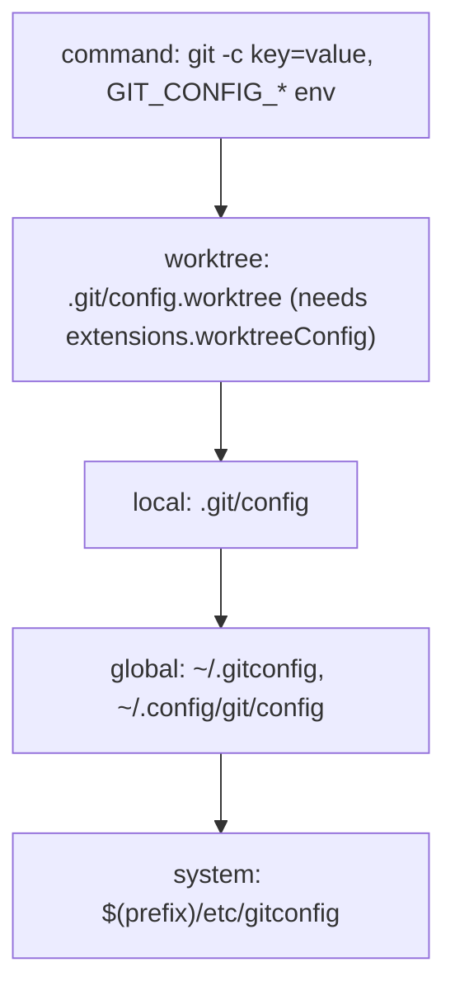
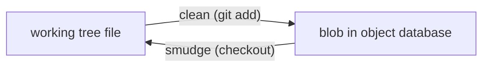

# Config, attributes, hooks and signing

## Why care?

- "I use my work email on personal projects by accident, every few months."
- "Windows colleagues commit CRLF line endings, and every diff shows the whole file as changed."
- "Where does Git LFS hide the real file? The repo only has a tiny text file."
- "We put a pre-commit hook in the repo. Why doesn't it run for new team members?"
- "Anyone can set `user.email` to the CTO's address. How do we know who really made a commit?"

The last page of the chapter is about adapting Git to your needs: config that changes by repo, attributes that change how files are stored, hooks that run your code, and signatures that prove who you are. The worked example is this book's author's real setup (the dotfiles).

## The idea: layered configuration

Git config comes from several layers, from system-wide to a single command. Each layer can set any key. For a key that is set in more than one layer, **the most specific layer wins**. A key that a layer does not set comes from a layer below.



Git reads from the bottom (system) to the top (command line). For a normal key, the **last value read wins**. For multi-value keys (like `credential.helper` or `remote.origin.fetch`), all values are collected, in that order.

## Under the hood: config layers and where a value came from

Don't guess where a setting comes from. Ask Git:

```console
$ git config list --show-scope --show-origin | grep -v "^command"
local	file:.git/config	core.repositoryformatversion=0
local	file:.git/config	core.filemode=true
local	file:.git/config	core.bare=false
local	file:.git/config	core.logallrefupdates=true
local	file:.git/config	user.name=You
```

(This sandbox runs with an empty global config, so only `local` shows.) For one key:

```console
$ git config get --show-origin --show-scope core.bare
local	file:.git/config	false
```

Run `git config list --show-scope --show-origin` on your own machine once. Most people find at least one setting they did not expect.

!!! tip "The new `git config` subcommands"

    Since Git 2.46, `git config` has subcommands: `git config get`, `set`, `unset`, `list`,
    `rename-section`, `remove-section`, `edit`. The old forms (`git config --get`, `git config key value`)
    still work. This book uses the new ones, because they are clearer.

### `include` and `includeIf`: config that depends on the repo

`[include] path = file` reads another file at that point. `[includeIf "<condition>"]` does it only if the condition is true. The conditions in 2.56:

| Condition                          | True when                                                          |
| ---------------------------------- | ------------------------------------------------------------------ |
| `gitdir:<pattern>`                 | the repo's **`.git` directory** matches (`gitdir/i:` ignores case) |
| `worktree:<pattern>`               | the **working tree** path matches (`worktree/i:` ignores case)     |
| `onbranch:<pattern>`               | the checked-out branch matches                                     |
| `hasconfig:remote.*.url:<pattern>` | any remote URL in the config matches                               |

This setup's global config uses all the ideas. Simplified:

```ini
[include]
    path = ~/.config/private/git/config          # user.name, user.email: private repo
[includeIf "hasconfig:remote.*.url:https://github.com/**"]
    path = ~/.config/git/github.gitconfig        # gh credential helper, Git Town forge
[includeIf "hasconfig:remote.*.url:https://codeberg.org/**"]
    path = ~/.config/git/forgejo.gitconfig
```

**`hasconfig:remote.*.url`** is the most useful one. It picks config **by where the code lives**, not by folder. Clone anywhere, and as soon as the repo has a GitHub remote, the GitHub settings apply. Here is a test of that idea in a sandbox home directory:

```console
$ git remote -v | head -1
origin	https://github.com/example/demo.git (fetch)
$ git config get --show-scope --show-origin --all credential.https://github.com.helper
global	file:~/.config/git/github.gitconfig
global	file:~/.config/git/github.gitconfig	!gh auth git-credential
$ git remote remove origin
$ git config get --show-scope --show-origin --all credential.https://github.com.helper; echo "exit=$?"
exit=1
```

(The sandbox home path is shortened to `~`.) Two values: the empty one resets the helper list (see [credential helpers](remotes.md)), then the `gh` helper. Remove the remote, and the whole file is no longer included. One rule: files included this way **may not contain remote URLs** themselves, to avoid a circular dependency.

The same method solves "wrong email in the wrong project": put `user.email` in a file included by `hasconfig:remote.*.url:https://github.com/your-company/**`.

### `gitdir:` vs `worktree:` for linked worktrees

This setup used to have:

```ini
[includeIf "gitdir:~/.cache/agent/worktrees/**"]
    path = ~/.config/git/agent.gitconfig    # commit.gpgSign = false for sandboxed agents
```

The goal: turn off signing in throwaway agent worktrees. But read the manual carefully: for a linked worktree, `gitdir:` matches **the real `.git` directory**, which is inside the main repository (`.git/worktrees/<name>`), not the worktree folder. Here is the test, in a sandbox home with both conditions:

```ini
[includeIf "gitdir:~/.cache/agent/worktrees/**"]
    path = by-gitdir.gitconfig        # sets demo.gitdir = matched
[includeIf "worktree:~/.cache/agent/worktrees/**"]
    path = by-worktree.gitconfig      # sets demo.worktree = matched
```

```console
$ git rev-parse --git-dir
~/src/app/.git/worktrees/app-topic
$ git rev-parse --show-toplevel
~/.cache/agent/worktrees/app-topic
$ git config list | grep ^demo
demo.worktree=matched
```

(Sandbox home shortened to `~`.) Only `worktree:` matched. A `gitdir:` pattern for a folder of **linked** worktrees never matches, and Git does not warn you. For that job, use `worktree:`. That is now the fix in this setup: `[includeIf "worktree:~/.cache/agent/worktrees/**"]`.

!!! warning "Config fails silently"

    A typo in an `includeIf` path, or a key that does not exist, is ignored. For example,
    this setup's config had `rebase.interactive = true`, but `git-config(1)` in 2.56 has no such
    key (it does have `rebase.autoSquash`, `rebase.autoStash` and `rebase.updateRefs`). Always check
    with `git config get --show-origin <key>` from inside the repo where it should apply.

## Under the hood: `.gitattributes`

Config is per user. **Attributes** are per path, and they are committed in `.gitattributes`, so the whole team gets them. They change how Git **converts, diffs and merges** files.

### Line endings

The rule: the **repository** stores LF. Conversion happens at the edges.

```gitattributes
*         text=auto       # Git decides if a file is text; text is normalised to LF in the repo
*.sh      text eol=lf     # always LF on disk, even on Windows
*.bat     text eol=crlf
*.png     binary          # = -diff -merge -text
```

`text=auto` normalises line endings for files Git detects as text. `eol=` sets what you get **on disk** at checkout. `binary` is a built-in macro for `-diff -merge -text`. Commit a `.gitattributes` like this, and the CRLF problem stops for everyone, whatever their personal config.

This setup also sets `core.autocrlf = input` globally: convert CRLF to LF on the way **into** the repo, and do no conversion on the way out. That is a good personal safety net on WSL and macOS, but it only protects your own commits. `.gitattributes` protects the repo.

### Diff drivers

`*.go diff=golang` tells Git to use its built-in Go patterns to find function names. Then hunk headers show `@@ ... @@ func Discount(total int) int`, and `git log -L :Discount:discount.go` ([History](recovery-and-history.md)) finds the function reliably. Git has built-in drivers for many languages: `golang`, `python`, `rust`, `java`, `markdown`, and more (see `gitattributes(5)`). You can also define your own: `diff.<name>.textconv` turns a binary file into text before diffing, for example to diff PDFs or SQLite files.

### Merge drivers

`merge=<driver>` controls how a file is merged. `merge=binary` never tries to merge: it keeps your version in the working tree and leaves the path conflicted for you to sort out. `merge=union` takes the lines of both sides (use with care). A custom driver (`merge.<name>.driver = command %O %A %B`) gets the base, ours and theirs as files, like the three index stages from [Merging](merging.md).

### Filters: clean and smudge

A **filter** runs a command on the content when it goes into the object database (**clean**) and when it comes out to the working tree (**smudge**):



Here is a minimal example filter that hides passwords from the repo:

```console
$ git config set filter.redact.clean "sed 's/^password=.*/password=REDACTED/'"
$ git config set filter.redact.smudge cat
$ echo "*.env filter=redact" > .gitattributes
$ git add .gitattributes db.env
$ cat db.env
user=app
password=hunter2
$ git show :db.env
user=app
password=REDACTED
$ git check-attr -a db.env
db.env: filter: redact
```

Your file on disk has the real password. The blob in the index (and so in every commit) has `REDACTED`. The filter **config** is local (each developer must set it), but the `.gitattributes` line that says "use filter `redact`" is committed.

!!! tip "Don't use this example for real secrets"

    It shows the mechanism. For real secrets, keep them out of the repo entirely: environment
    variables, a secrets manager, or an encrypted-files tool built for it.

### How Git LFS works

Git LFS is a clean/smudge filter. This setup's global config has:

```ini
[filter "lfs"]
    clean = git-lfs clean -- %f
    smudge = git-lfs smudge -- %f
    process = git-lfs filter-process
    required = true
```

`git lfs track` adds the attribute:

```console
$ git lfs track "*.bin" && cat .gitattributes
Tracking "*.bin"
*.env filter=redact
*.bin filter=lfs diff=lfs merge=lfs -text
```

And here is what the **clean** filter turns a file into:

```console
$ git lfs version
git-lfs/3.8.1 (GitHub; linux amd64; go 1.27.3)
$ printf "big binary data\n" > model.bin && git lfs clean < model.bin
version https://git-lfs.github.com/spec/v1
oid sha256:5e265d451c4bacae11c9c97bd800f19b3ef8e98d1325357182e215906ad197ee
size 16
$ printf "big binary data\n" | sha256sum
5e265d451c4bacae11c9c97bd800f19b3ef8e98d1325357182e215906ad197ee  -
```

A three-line **pointer file**. That pointer is what Git stores as the blob. The real content is stored by LFS (locally under `.git/lfs/objects/`, and on the LFS server), keyed by its SHA-256. On checkout, the smudge filter swaps the pointer for the real file. `process` runs one long-lived `git-lfs` process for all files, instead of starting one per file. `required = true` makes Git fail if the filter is missing, instead of silently checking out pointer files.

That explains LFS's typical problems: a clone without `git-lfs` installed shows pointer files; and `git log -p` on a tracked file shows pointer diffs, not content diffs.

## Under the hood: hooks

A **hook** is a program Git runs at a certain moment. If a "pre" hook exits non-zero, Git stops the operation.

The client-side hooks you meet most:

| Hook                 | When                                          | Typical use                                 |
| -------------------- | --------------------------------------------- | ------------------------------------------- |
| `pre-commit`         | before the commit message is asked            | format, lint, scan for secrets              |
| `prepare-commit-msg` | after the default message is made             | add a ticket number or a trailer            |
| `commit-msg`         | after you wrote the message                   | check Conventional Commits format           |
| `post-commit`        | after the commit                              | notifications                               |
| `pre-rebase`         | before a rebase starts                        | refuse rebasing published branches          |
| `post-checkout`      | after `switch`/`checkout`                     | rebuild generated files                     |
| `post-merge`         | after a merge (also the merge step of `pull`) | `go mod download`, install dependencies     |
| `post-rewrite`       | after `commit --amend` and `rebase`           | update notes or caches that know old hashes |
| `pre-push`           | before anything is sent                       | run tests                                   |

Server-side hooks (`pre-receive`, `update`, `post-receive`, ...) run on the server, and on hosted forges you mostly configure their equivalents through branch protection and CI.

### Where hooks live, and why they are not cloned

By default hooks are executable files in `.git/hooks/<name>`. `.git/` is never transferred by clone or fetch, so **hooks are never cloned**. That is deliberate: otherwise cloning a stranger's repo would run a stranger's code on your machine. Three ways to share hooks anyway:

1. **`core.hooksPath`**: point Git at a folder, for example a committed `.githooks/` directory. Each developer sets it once (`git config core.hooksPath .githooks`).
2. **Templates**: `git init` and `git clone` copy files from a **template directory** into the new `.git/`. This setup sets `init.templateDir = ~/.config/git/template`, so every new repo gets its `prepare-commit-msg` hook.
3. **Config-based hooks** (new in recent Git): `hook.<name>.command` and `hook.<name>.event` in any config file. See below.

The template hook of this setup, in a sandbox:

```console
$ git init -q --template="$PWD/tmpl" hooks && cd hooks && ls .git/hooks
prepare-commit-msg
$ git commit -q -m "feat: add a" && git log -1 --format=%B
feat: add a

Signed-off-by: You <you@example.com>

```

The hook reads `user.name` and `user.email` and runs `git interpret-trailers --if-exists doNothing --trailer "Signed-off-by: ..." --in-place "$1"`. `$1` is the commit message file. `--if-exists doNothing` makes it safe to run twice, for example on `--amend`.

Templates only apply when the repo is **created**. The clone below uses a different (empty) template, so it gets no hooks at all:

```console
$ git clone -q . ../hooks-clone && ls ../hooks-clone/.git/hooks
ls: cannot access '../hooks-clone/.git/hooks': No such file or directory
```

### Config-based hooks

Git 2.56 can also define hooks in config. One script can serve many repos and several events, and you can have **several hooks per event**:

```console
$ git config set hook.lint.command ../lint.sh && git config set --append hook.lint.event pre-commit
$ git hook list --show-scope pre-commit
local	lint
$ git commit -q -m "feat: add b"
lint: checking staged files
```

`git hook list` shows what will run and where it comes from. In the template repo above, the classic hook shows up like this:

```console
$ git hook list --show-scope prepare-commit-msg
hook from hookdir
```

Config hooks run in config order, and the classic hook from the hooks directory runs last.

### Trailers

**Trailers** are `Key: value` lines at the end of a commit message: `Signed-off-by`, `Co-authored-by`, `Closes`, `Reviewed-by`. Git can add and parse them:

```console
$ printf "fix: thing\n\nBody.\n" | git interpret-trailers --trailer "Closes: #42" --trailer "Signed-off-by: You <you@example.com>"
fix: thing

Body.

Closes: #42
Signed-off-by: You <you@example.com>
$ git log -1 --format="%(trailers:key=Signed-off-by,valueonly)"
You <you@example.com>

```

Scripts and release tools should use `%(trailers)` instead of grepping messages. Note: `Signed-off-by` is a **promise** (for example, the Developer Certificate of Origin), not a proof. Anyone can type it. Proof is the next section.

## Under the hood: signing commits

`user.name` and `user.email` are only text. Anyone can write any name. A **signature** proves that the holder of a private key made this exact commit.

### SSH or GPG

Git can sign with GPG (OpenPGP), with X.509 (S/MIME), or with **SSH keys** (`gpg.format = ssh`). SSH signing is the simplest choice for most teams: you already have an SSH key, there is no web of trust or key server, and the forges support it.

Set it up in a sandbox:

```sh
ssh-keygen -q -t ed25519 -N "" -C you@example.com -f keys/id_ed25519
git config set gpg.format ssh
git config set user.signingKey "$PWD/../keys/id_ed25519.pub"
```

`user.signingKey` can be a path to a key file, or `key::ssh-ed25519 AAAA...` with the key itself (the private key must then be in `ssh-agent`). Sign a commit, and look at the raw object:

```console
$ git -c commit.gpgSign=true commit -q -m "signed commit"
$ git cat-file -p HEAD | head -6
tree aaff74984cccd156a469afa7d9ab10e4777beb24
author You <you@example.com> 1767268800 +0000
committer You <you@example.com> 1767268800 +0000
gpgsig -----BEGIN SSH SIGNATURE-----
 U1NIU0lHAAAAAQAAADMAAAALc3NoLWVkMjU1MTkAAAAgHbUB6NzXzoDxYj/52TNYYuoLVa
 f+ESiDDaOdzOHUet8AAAADZ2l0AAAAAAAAAAZzaGE1MTIAAABTAAAAC3NzaC1lZDI1NTE5
$ git cat-file -p HEAD | tail -4
 t+OGnaEoxbqStYmxaFywE=
 -----END SSH SIGNATURE-----

signed commit
```

The signature is a **`gpgsig` header inside the commit object** (the name stays `gpgsig` even for SSH). Git signs the commit's content without that header. Since the header is part of the object, it is part of the hash: you can't add or remove a signature without changing the commit hash. That is why rebasing someone else's signed commits drops their signatures.

### Verifying: the allowed signers file

SSH has no trust model. You tell Git which keys belong to whom with an **allowed signers file**: one line per key, `principals [options] keytype key`:

```console
$ echo "you@example.com namespaces=\"git\" $(cut -d" " -f1,2 ../keys/id_ed25519.pub)" > ../keys/allowed_signers && cut -c1-60 ../keys/allowed_signers
you@example.com namespaces="git" ssh-ed25519 AAAAC3NzaC1lZDI
```

`namespaces="git"` limits the key to Git signatures, so a signature made for another purpose can't be replayed as a commit signature. Point Git at the file and verify:

```console
$ git config set gpg.ssh.allowedSignersFile "$PWD/../keys/allowed_signers"
$ git verify-commit HEAD
Good "git" signature for you@example.com with ED25519 key SHA256:vUsDi8Lc2+u9Q2bCshU7bKCZleM6gyxkEX7KGFCjIbM
$ git log --show-signature -1
commit 5247946face92b3fa619ca22cd91c8a7cdcbec88
Good "git" signature for you@example.com with ED25519 key SHA256:vUsDi8Lc2+u9Q2bCshU7bKCZleM6gyxkEX7KGFCjIbM
Author: You <you@example.com>
Date:   Thu Jan 1 12:00:00 2026 +0000

    signed commit
```

(The key was generated for this run, so your hash and key fingerprint will differ.) This setup sets `log.showSignature = true`, so every `git log` does this check for every commit it shows. That is good for awareness, but it costs a little time on long logs.

For scripts, use the format placeholders:

```console
$ git log -1 --format="%G? %GS %GK"
G you@example.com SHA256:vUsDi8Lc2+u9Q2bCshU7bKCZleM6gyxkEX7KGFCjIbM
```

After one more, unsigned, commit:

```console
$ git log --format="%h %G? %s"
81b2612 N unsigned
5247946 G signed commit
```

`%G?` is `G` (good), `B` (bad), `U` (good, unknown validity), `X`/`Y` (expired signature/key), `R` (revoked key), `E` (cannot check, for example a missing key) or `N` (no signature). With SSH, a key that is **not** in the allowed signers file does not give `G`: the git-config manual says the trust level is then undefined and `verify-commit` fails.

### FIDO2 security keys (`-sk`)

This setup signs with **FIDO2 hardware keys**: `ed25519-sk` SSH keys, where the private key never leaves the token. Two consequences:

- **Every signature needs a touch** (the "user presence" check), unless the key was made with `-O no-touch-required`. A rebase that rewrites 20 commits asks for 20 touches. That is why this setup's agent worktrees try to turn signing off: a sandboxed agent cannot touch your key.
- The public key can be fetched from the token. This setup sets `gpg.ssh.defaultKeyCommand = "dot ssh-sk get --git"` instead of a fixed `user.signingKey`. Git runs that command when `user.signingKey` is not set; the first line of its output must be the public key with the `key::` prefix. So whichever security key is plugged in is the one used.

### Verifying in CI

The allowed signers file can live **in the repository**: `gpg.ssh.allowedSignersFile` accepts a path relative to the top of the working tree. Then CI can check every commit of a PR:

```sh
git config gpg.ssh.allowedSignersFile .github/allowed_signers
git log --format='%H %G?' origin/main..HEAD | awk '$2 != "G" { print; bad=1 } END { exit bad }'
```

Changes to that file then need review like any other code: adding a line means "trust this key". Forges can also show a "Verified" badge for keys that users upload there; CI verification is the forge-independent version.

## Try it

1. Run `git config list --show-scope --show-origin` on your machine and explain every line that is not `local`.
2. Add `*.go diff=golang` to a Go repo's `.gitattributes`, and compare `git diff` hunk headers before and after.
3. Write a config-based `pre-commit` hook that runs `gofmt -l .` and fails if it prints anything.
4. Make a throwaway SSH key, sign a commit, and verify it with an allowed signers file. Then remove your line from the file and run `git verify-commit HEAD` again.

## Traps

- **`gitdir:` for linked worktrees.** It matches the main repo's `.git/worktrees/...`. Use `worktree:`.
- **Unknown keys and include typos** are silently ignored. Verify with `--show-origin`.
- **Line endings fixed in personal config only.** Commit a `.gitattributes`.
- **Hooks committed to `.git/hooks/`.** That folder is not versioned. Use `core.hooksPath` or config hooks, and treat hooks as a convenience, not as enforcement. Anyone can skip them with `--no-verify`. Enforce in CI and server-side rules.
- **Treating `Signed-off-by` as proof.** It is a statement. A signature is the proof.
- **An allowed signers file nobody reviews.** It is your trust root.

## Check yourself

??? question "1. A key is set in `~/.gitconfig` and in `.git/config` with different values. Which wins, and how do you check?"

    The local `.git/config`, because it is read later. `git config get --show-origin --show-scope <key>`
    shows the winning value and its file; add `--all` to see every value.

??? question "2. Why is `hasconfig:remote.*.url:` often better than `gitdir:` for work vs personal identity?"

    It matches on where the code comes from, so it works wherever you clone the repo. `gitdir:` only
    works if you always keep work repos under the same folder (and does not match linked worktree
    folders at all).

??? question "3. What does Git store in the repo for a file tracked by Git LFS?"

    A small pointer blob: `version`, `oid sha256:<hash>` and `size`. The clean filter creates it on
    `git add`; the smudge filter replaces it with the real content on checkout.

??? question "4. Why doesn't `git clone` copy the repo's hooks?"

    Hooks live in `.git/hooks`, which is never transferred, on purpose: cloning must not run someone
    else's code. Share hooks with `core.hooksPath`, templates, or config-based hooks, and enforce
    rules in CI.

??? question "5. Where is the signature of a signed commit stored, and what happens to it on rebase?"

    In a `gpgsig` header inside the commit object, so it is covered by the commit hash. A rebase makes
    new commit objects; they are only signed if you sign them again (your own key), so other people's
    signatures are lost.

## Recap

- Config layers: system → global → local → worktree → command. Last read wins. Always check with `--show-origin --show-scope`.
- `includeIf` conditions: `gitdir:`, `worktree:`, `onbranch:`, `hasconfig:remote.*.url:`. For linked worktrees, use `worktree:`.
- `.gitattributes` is committed: line endings (`text`, `eol`), diff drivers (`diff=golang`), merge drivers, and filters.
- Clean/smudge filters change content on the way in and out. Git LFS is a filter that stores a pointer.
- Hooks are not cloned. Share them with `core.hooksPath`, templates (`init.templateDir`) or config hooks (`hook.<name>.*`).
- `interpret-trailers` adds and parses `Key: value` trailers.
- SSH signing: `gpg.format=ssh`, a key or `defaultKeyCommand`, an allowed signers file to verify. The signature lives in the commit object. FIDO2 keys need a touch per signature.

## You finished the Git chapter

You now know what Git really is: an object database of blobs, trees, commits and tags; refs that move over a graph of commits; an index between your files and your next commit; packs that keep it small; and merges, rebases, fetches and pushes that are all objects being copied and refs being moved.

The next time Git does something you did not expect, open `.git/`, run `git cat-file` and `git reflog`, and look at the data. Every behaviour has a cause you can find there.

Next: put it all to work in the [Go chapter](../go/index.md).
