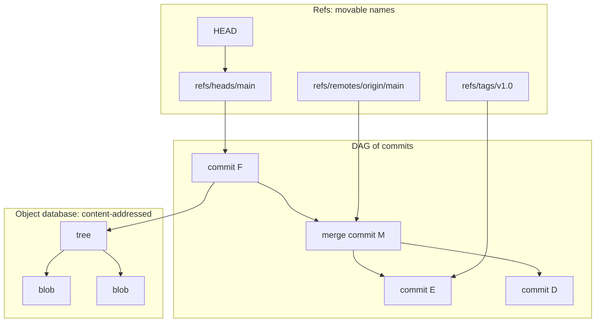

# Git

What Git really stores, and why every command does what it does.

## Why go deeper?

You already use Git every day. You add, commit, branch, merge, rebase and push. Most days that is enough. But sometimes:

- A rebase "loses" three days of work.
- `git status` takes eight seconds in the monorepo.
- A merge gives a conflict that makes no sense, in a file nobody touched.
- Somebody pushed a secret, and "just delete the file" did not remove it.
- `git pull` refuses to work, and the hint tells you to pick between two things you don't fully understand.

All of these have the same cause: we learn Git as a list of **commands**, but Git is really a small set of **data structures**. When you know the data structures, the commands make sense, and you no longer need to memorise recipes. You can predict what a command will do before you run it, and you can undo almost anything.

## The big picture

Git is three simple layers, one on top of the other:



1. **An object database.** A key-value store. The value is some content (a file, a directory listing, a commit). The key is the **hash of the content**. Same content, same key. You can never change an object; you can only add new ones.
2. **A graph of commits.** Each commit points to a tree (a snapshot of the project) and to its parent commit(s). The parents form a **DAG**: a directed acyclic graph. "Directed" because arrows point from child to parent. "Acyclic" because you can never follow the arrows back to where you started.
3. **Refs.** Human names like `main` or `v1.0` that point to a commit. Refs are the only thing in Git that **moves**. A branch is a ref that moves forward when you commit.

Everything else (the index, remotes, merges, rebases, the reflog) is built from these three pieces.

!!! tip "The one sentence to remember"

    Objects never change. Refs move. Almost every "dangerous" Git command only moves refs,
    and the old objects are still there for a while. That is why you can undo almost anything.

## Reading order

Each page builds on the one before it.

| #   | Page                                                             | You will learn                                                                                 |
| --- | ---------------------------------------------------------------- | ---------------------------------------------------------------------------------------------- |
| 1   | [Objects](objects.md)                                            | Blobs, trees, commits and tags; how hashes are made; building a commit with plumbing only      |
| 2   | [Refs and revisions](refs.md)                                    | Branches as files, `HEAD`, `packed-refs`, reftable, the reflog, and the full revision syntax   |
| 3   | [The index and the three trees](index-and-trees.md)              | What "staged" really is, the index file format, why `git status` is fast, what `reset` moves   |
| 4   | [Storage: packs and big repos](storage.md)                       | Loose objects vs packfiles, deltas, `gc` and `maintenance`, partial and shallow clones, sparse |
| 5   | [Merging and rebasing](merging.md)                               | Merge bases, three-way merge, `ort`, conflict stages, `rerere`, rebase as cherry-picks, stacks |
| 6   | [Remotes](remotes.md)                                            | Refspecs, fetch negotiation, protocol v2, safe force-push, `pull`, forks and triangular flow   |
| 7   | [Recovery and history](recovery-and-history.md)                  | Reflog rescue, dangling objects, `bisect run`, `blame -C`, pickaxe, `filter-repo`, worktrees   |
| 8   | [Config, attributes, hooks and signing](config-hooks-signing.md) | Config layers and `includeIf`, filters (how LFS works), hooks, trailers, SSH commit signing    |

## How each page works

The same shape as the [Fundamentals](../fundamentals/index.md):

- **Why care?** A real problem first.
- **The idea.** Plain words and a picture.
- **Under the hood.** The deep part. Here we open `.git/` and look at the bytes.
- **Try it.** Commands you can run. Every hash and every output in this chapter comes from a real run with Git 2.56.1.
- **Traps.** Mistakes that real teams make.
- **Check yourself.** A few questions. Answers are hidden; try first.

The examples use **plumbing** commands (`hash-object`, `cat-file`, `update-ref`, ...) next to the normal **porcelain** commands (`commit`, `switch`, `merge`, ...). Plumbing commands do one small thing and have stable output. They are the best way to see what porcelain does for you.

!!! tip "Make a throwaway repo, and get the same hashes as this book"

    A Git hash depends on the content **and** on the author, committer and dates. Pin them, and
    your hashes will match the ones on these pages:

    ```sh
    cd "$(mktemp -d)"
    export GIT_AUTHOR_NAME=You GIT_AUTHOR_EMAIL=you@example.com
    export GIT_COMMITTER_NAME=You GIT_COMMITTER_EMAIL=you@example.com
    export GIT_AUTHOR_DATE="2026-01-01T12:00:00+0000" GIT_COMMITTER_DATE="2026-01-01T12:00:00+0000"
    git -c init.defaultBranch=main init demo && cd demo
    ```

    If your global config signs commits or has a commit template hook, run the examples with
    `git -c commit.gpgSign=false` and `git init --template=` so your own setup does not change the
    hashes. Then try commands that change or break things. A throwaway repo is a safe place to learn how Git behaves.
