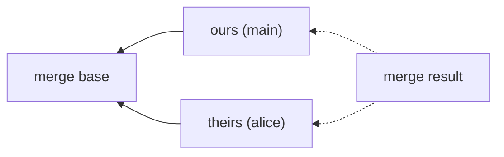

# Merging and rebasing

## Why care?

- "We resolved this exact conflict last week. Why are we resolving it again?"
- "I rebased my branch and a commit disappeared. No error, it is simply gone."
- "I have three stacked PRs. After I rebase the first one, I have to rebase the other two by hand."
- "Merge or rebase? The team argues about it every month."

Merging and rebasing look complicated, so people learn rules ("never rebase public branches") without the reason. Under the hood, both are simple. They use the same building block: the **three-way merge**.

## The idea: three versions, not two

Two branches start from the same file. On one branch, line 3 changes. On the other, line 7 changes. If Git only compares the **two branch versions**, it sees two differences, but it can't tell **which side** made each change. Was line 7 added on one side, or removed on the other?

Git needs the **original** too. With the original, the decision is simple: "line 3 changed only on our side, take ours; line 7 changed only on their side, take theirs". Only when both sides changed **the same lines** does a person need to decide. That is a conflict.

The original is the **merge base**: the best common ancestor of the two commits.



| Base | Ours | Theirs | Result                   |
| ---- | ---- | ------ | ------------------------ |
| A    | A    | A      | A                        |
| A    | B    | A      | B (only we changed it)   |
| A    | A    | C      | C (only they changed it) |
| A    | B    | B      | B (same change)          |
| A    | B    | C      | **conflict**             |

## Under the hood: the merge base

```console
$ git merge-base main alice
6adc8ceadfbdd4cbfae38e8608d339690c735697
```

Usually there is one best common ancestor. But not always. In a **criss-cross** merge, two branches merged each other:

```console
$ git log --graph --oneline --all
*   44742d2 M2: x gets B
|\
| | * a92fa43 M1: main gets C
| |/|
| |/
|/|
* | e9d87d7 C
| * 17f4774 B
|/
* 4701604 A
$ git merge-base --all main x
e9d87d76f53dd8776c2fbf25cadf6621307e2777
17f4774600a21ed443e881e97c0f68392d36296f
$ git merge-base main x
e9d87d76f53dd8776c2fbf25cadf6621307e2777
```

`B` and `C` are both "best": neither is an ancestor of the other. Plain `merge-base` shows only one. What does the merge do? The default strategy, **`ort`**, first merges the merge bases **with each other** into a virtual tree, and then uses that as the base. That is the "recursive" idea. The name `ort` is short for "Ostensibly Recursive's Twin": it was written as a replacement for the old default strategy, `recursive`.

## Under the hood: a conflict, inside the index

Both branches changed the same line of `config.ini`:

```console
$ git merge alice
Auto-merging config.ini
CONFLICT (content): Merge conflict in config.ini
Automatic merge failed; fix conflicts and then commit the result.
```

Now look at the index: Normally each path has one entry with **stage 0**. During a conflict, it has up to three:

```console
$ git ls-files -s
100644 2e0a29682b3ea01711291b63c43c4367d30aaf6f 1	config.ini
100644 98fa04768e93f8382353985447879e4adce22c54 2	config.ini
100644 43c38a8e3a7da8c94a6fe9e2c841c938f8486f52 3	config.ini
$ git show :1:config.ini | head -1; git show :2:config.ini | head -1; git show :3:config.ini | head -1
timeout = 10
timeout = 20
timeout = 30
```

- **Stage 1**: the merge base.
- **Stage 2**: ours (`HEAD`).
- **Stage 3**: theirs (the branch you merge in).

`git ls-files -u` lists only these "unmerged" entries. The file on disk is Git's attempt, with conflict markers. When you `git add config.ini`, Git replaces the three entries with one stage-0 entry. That is what "mark as resolved" means. It is also why you can't commit while unmerged entries exist, and why `git checkout --ours file` / `--theirs file` work: they copy stage 2 or 3 to the working tree.

### Conflict styles: show the base too

The default markers show only ours and theirs:

```console
$ cat config.ini
<<<<<<< HEAD
timeout = 20
=======
timeout = 30
>>>>>>> alice
retries = 3
log = info
```

Was the old value 10, 20 or 30? You can't tell. With `zdiff3`, Git adds the **base**:

```console
$ git -c merge.conflictStyle=zdiff3 merge alice >/dev/null; cat config.ini
<<<<<<< HEAD
timeout = 20
||||||| 6adc8ce
timeout = 10
=======
timeout = 30
>>>>>>> alice
retries = 3
log = info
```

Now it is clear: base was 10, we changed it to 20, they changed it to 30. You still need to decide, but you know what each side **meant**. `diff3` does the same. `zdiff3` is like `diff3`, but it also removes lines that match on both sides from the start and end of the conflict block, so the block is smaller.

!!! tip "Set this once"

    `git config --global merge.conflictStyle zdiff3`. It is the most useful single setting for resolving
    conflicts. Your editor's merge tool will show the same three sides.

## Under the hood: renames in a merge

Git does not store renames ([Objects](objects.md)). So in a merge, `ort` **detects** them between the base and each side. Here, one branch moved `util.go` to `internal/strutil.go` and changed line 1. The other branch fixed line 30 in `util.go`:

```console
$ git diff -M --summary main~1 move
 rename util.go => internal/strutil.go (93%)
$ git merge -q move -m "merge move" && git log --oneline -1 && ls -R | head
Auto-merging internal/strutil.go
8e9cf24 merge move
.:
internal

./internal:
strutil.go
$ tail -1 internal/strutil.go; head -1 internal/strutil.go
func f30 // fixed
func f1 // moved
```

Both changes landed in the new file. The file is 93% similar, above the 50% threshold. Turn rename detection off and the same merge fails:

```console
$ git merge -s ort -X no-renames move
CONFLICT (modify/delete): util.go deleted in move and modified in HEAD.  Version HEAD of util.go left in tree.
Automatic merge failed; fix conflicts and then commit the result.
```

That is the "conflict in a file nobody touched" from the chapter intro. If one side moves **and** heavily rewrites a file, it falls below the threshold, Git sees "delete + add", and you get a modify/delete conflict. Same advice as before: move in one commit, change in the next. `-X find-renames=30%` can fix such a merge with a lower threshold.

## Under the hood: rerere, reuse recorded resolution

`rerere` = "reuse recorded resolution". When turned on, Git saves the conflict (the **preimage**) and your fix (the **postimage**). Next time it sees the same conflict, it applies your fix.

```console
$ git config rerere.enabled true
$ git merge alice
Auto-merging config.ini
CONFLICT (content): Merge conflict in config.ini
Recorded preimage for 'config.ini'
Automatic merge failed; fix conflicts and then commit the result.
```

Fix the file, `git add`, commit:

```console
$ git commit -q --no-edit && git log --oneline -1
Recorded resolution for 'config.ini'.
c5d0a5b Merge branch 'alice'
```

Now abort the merge and run it again:

```console
$ git reset -q --hard HEAD~1 && git merge alice
Auto-merging config.ini
CONFLICT (content): Merge conflict in config.ini
Resolved 'config.ini' using previous resolution.
Automatic merge failed; fix conflicts and then commit the result.
$ cat config.ini && git status --short
timeout = 30
retries = 3
log = info
UU config.ini
```

The file already has your fix. Git still leaves it as unmerged (`UU`) so you can check it; `git add` and go on. (`rerere.autoUpdate=true` stages it for you.) The records live in `.git/rr-cache/`, one directory per **conflict ID** (a hash of the normalized conflict):

```console
$ ls .git/rr-cache/
31bd65793ae8b3ec8f9c42a1eedd53f488716517
```

`rerere` is most useful when you rebase a long branch many times, or when you test-merge a feature branch into main every day and then throw the merge away. That was the "same conflict again" problem.

## Under the hood: fast-forward and octopus

**Fast-forward.** If the branch you are on is an ancestor of the one you merge, there is nothing to combine. Git only moves your branch ref forward. No new commit. `--no-ff` forces a merge commit anyway, so the history shows "this was a feature branch".

**Octopus.** A merge commit can have more than two parents:

```console
$ git merge one two three -m "octopus"
Fast-forwarding to: one
Trying simple merge with two
Trying simple merge with three
Merge made by the 'octopus' strategy.
 one   | 1 +
 three | 1 +
 two   | 1 +
 3 files changed, 3 insertions(+)
 create mode 100644 one
 create mode 100644 three
 create mode 100644 two
$ git cat-file -p HEAD | head -5
tree 7d2ffe06e075ae451c03bc261dbeb87c37706b8d
parent 8ac9c78235e3bdab511ac822f16ba59f82569439
parent 60e407e857456c380967b83cd0640b302b3629f5
parent 2ff47a8aad82b36ade562f72282c4f095f20313c
author You <you@example.com> 1772452800 +0000
```

Three `parent` lines. Notice `Fast-forwarding to: one`: main had no own commits, so Git fast-forwarded to `one` first, and `one` became the first parent. Octopus refuses to merge if there are conflicts. It is for combining many independent topic branches, nothing more.

## Under the hood: rebase = a series of cherry-picks

A rebase does not "move" commits. Commits can't change. It **creates new commits**:

1. Find the commits on your branch that are not on the target (`target..HEAD`).
2. Drop commits whose change is already in the target.
3. Check out the target.
4. For each remaining commit, **cherry-pick** it: compute its diff against its parent, apply it with a three-way merge, make a new commit (new parent, new committer date, so a new hash).
5. Move your branch ref to the last new commit.

Step 2 is the "disappearing commit". Here, `topic: three` was cherry-picked to main earlier, under another message:

```console
$ git log --oneline --graph --all
* a9084ce main: nine
* 1c77d46 main: three (picked)
| * 2e14558 topic: b more
| * 2a85e65 topic: three
|/
* 1a77f86 base
$ git cherry -v main topic
- 2a85e65b286f8571d8e3cac77dec5d63467f4876 topic: three
+ 2e145582818eba7f4eadf3e17f5859925ed86343 topic: b more
```

`git cherry` marks `-` for "an equal change is already upstream". How does it know? With the **patch ID**: a hash of the diff itself, with line numbers ignored:

```console
$ git patch-id < <(git show topic~1) ; git patch-id < <(git show main~1)
bd4605e6250f38ec76afa7c0c97ccce1e63beb4a 2a85e65b286f8571d8e3cac77dec5d63467f4876
bd4605e6250f38ec76afa7c0c97ccce1e63beb4a 1c77d468973bcf1b5095c94320dcd2d57ac242f0
```

Same patch ID, different commits. So rebase skips it, and tells you:

```console
$ git rebase main
warning: skipped previously applied commit 2a85e65
hint: use --reapply-cherry-picks to include skipped commits
hint: Disable this message with "git config set advice.skippedCherryPicks false"
Successfully rebased and updated refs/heads/topic.
$ git log --oneline --graph --all
* 5f0fcaa topic: b more
* a9084ce main: nine
* 1c77d46 main: three (picked)
* 1a77f86 base
```

Nothing was lost. The change is in main already. And `topic: b more` got a new hash: `2e14558` became `5f0fcaa`. The old commits are still in the object database and in the reflog, and `ORIG_HEAD` points at the old tip.

### Review a rebase with `range-diff`

After a rebase, how do you know you did not break something while fixing conflicts? `git range-diff` compares two **versions of a series of commits**:

```console
$ git range-diff main ORIG_HEAD HEAD
1:  2a85e65 < -:  ------- topic: three
2:  2e14558 = 1:  5f0fcaa topic: b more
```

`<` = only in the old series (here: skipped). `=` = same patch. `!` = the patch changed, and range-diff shows a diff **of the diffs**. This helps reviewers after a force-push: "what did you change since my last review?"

### `--onto`: move part of a branch to a new base

`git rebase --onto <newbase> <upstream> <branch>` takes the commits in `upstream..branch` and replays them on `newbase`. Here `ui` was built on `api`, but we want only the `ui` commit on main:

```console
$ git log --oneline -1 main; git rebase --onto main api ui -q; git log --oneline main..ui
432c252 main: hotfix
6b3701c ui: add page
```

The `api` commit is left out. Use it when your branch was cut from the wrong base, or when the branch under you was squash-merged.

### `--update-refs`: stacked branches

A **stack** is a branch on top of a branch: `ui` depends on `api`, which depends on main. Main moves. Without help, you rebase `api`, then rebase `ui` with `--onto`. With `--update-refs`, one rebase moves every branch that points into the rebased range:

```console
$ git log --oneline --graph --all
* 432c252 main: hotfix
| * f89ee42 ui: add page
| * 54b8b29 api: add endpoint
|/
* 7f5c7a9 base
$ git rebase --update-refs main
Successfully rebased and updated refs/heads/ui.
Updated the following refs with --update-refs:
	refs/heads/api
$ git log --oneline --graph --all
* 8648819 ui: add page
* 21f4cb7 api: add endpoint
* 432c252 main: hotfix
* 7f5c7a9 base
```

`api` moved too. Set `rebase.updateRefs=true` to make it the default.

### `fixup!` and autosquash

Review says "fix the endpoint" on the `api` commit, but you are working on `ui`. Make a **fixup commit** for `api`:

```console
$ git commit -q --fixup=api && git log --oneline main..
bab192b fixup! api: add endpoint
8648819 ui: add page
21f4cb7 api: add endpoint
```

The message `fixup! api: add endpoint` is an instruction to rebase: "squash me into that commit". `--autosquash` moves it there in the todo list and squashes it:

```console
$ GIT_SEQUENCE_EDITOR=: git rebase -i --autosquash --update-refs main
Successfully rebased and updated refs/heads/ui.
Updated the following refs with --update-refs:
	refs/heads/api
$ git log --oneline --graph --all
* f80d0ac ui: add page
* 3dfba71 api: add endpoint
* 432c252 main: hotfix
* 7f5c7a9 base
$ git range-diff --creation-factor=100 main 8648819 f80d0ac
1:  21f4cb7 ! 1:  3dfba71 api: add endpoint
    @@ Commit message

      ## api.txt (new) ##
     @@
    -+api
    ++api v2
2:  8648819 = 2:  f80d0ac ui: add page
```

The fix is inside `api: add endpoint`, the `api` branch moved with it, and range-diff shows exactly what changed. (`GIT_SEQUENCE_EDITOR=:` accepts the todo list without opening an editor. `--creation-factor=100` tells range-diff to pair commits even when their patch changed a lot.) With `rebase.autoSquash=true`, `git rebase -i` does the autosquash part for you; this setup's git config sets it.

## Merge or rebase?

Both give the **same final tree** if there are no conflicts. They differ in **history**.

| Question                               | Merge                                      | Rebase                                           |
| -------------------------------------- | ------------------------------------------ | ------------------------------------------------ |
| Does it rewrite existing commits?      | No. Safe on shared branches.               | Yes. New hashes for every replayed commit.       |
| What does history look like?           | True: shows parallel work and when it met. | Linear: as if you wrote it all after the target. |
| Conflicts                              | Resolve once, in the merge commit.         | Possibly once **per commit** replayed.           |
| `git bisect`, `git log --first-parent` | Works well if merges go into main.         | Works well: every commit is on one line.         |
| Do tested commits stay the same?       | Yes.                                       | No. Replayed commits were never tested as-is.    |

A common team rule, and the reason behind each part:

- **Rebase your own, unpublished feature branch** onto main to keep it current. Nobody else has those commits, so rewriting them hurts no one.
- **Never rewrite a branch other people build on.** Their commits point to your old hashes. After your rewrite, they have to rebase onto your new ones, and they may re-introduce the old commits.
- **Merge (or squash-merge) the finished PR into main.** Main's history is never rewritten.

## Traps

- **Same conflict, many times.** Turn on `rerere`.
- **Conflict markers without the base.** Set `merge.conflictStyle=zdiff3`.
- **Rename + rewrite in one commit**, then a modify/delete conflict on merge.
- **Rebasing a shared branch**, then force-pushing over a colleague's work. See [safe force-push](remotes.md).
- **Thinking rebase "lost" a commit.** Read the `skipped previously applied commit` warning. If it really is gone, `ORIG_HEAD` and the reflog have it.
- **Rebasing a stack one branch at a time.** Use `--update-refs`.

## Check yourself

??? question "1. Why does Git need the merge base? Why not just compare the two branch tips?"

    With only two versions, Git can see that a line differs but not which side changed it. With the
    base, a line changed on one side only can be taken automatically. Only lines changed on both
    sides, differently, are conflicts.

??? question "2. During a conflict, what are `:1:file`, `:2:file` and `:3:file`?"

    Index stages: 1 = merge base, 2 = ours (HEAD), 3 = theirs. `git add file` replaces them with one
    stage-0 entry.

??? question "3. After `git rebase main`, one of your commits is missing and Git said 'skipped previously applied commit'. What happened?"

    Main already contained a commit with the same patch ID (the same diff), for example a
    cherry-pick. Rebase drops commits whose change is already upstream. `--reapply-cherry-picks`
    keeps them.

??? question "4. You have branches `api` and `ui` stacked on top of each other. Main moved. What single command updates both?"

    From `ui`: `git rebase --update-refs main`. It rebases `ui` and moves every branch ref that
    pointed into the rebased range, here `api`.

??? question "5. A colleague force-pushed a rebased PR. How do you see what really changed since your review?"

    `git range-diff <old-base>..<old-tip> <new-base>..<new-tip>` (or `git range-diff main old new`).
    It pairs old and new commits and shows how each patch changed.

## Recap

- A merge is a **three-way** compare: base, ours, theirs. Only changes on both sides conflict.
- `ort` is the default strategy. With several merge bases it merges them into a virtual base first.
- Conflicts live in the **index** as stages 1, 2, 3. `git add` collapses them to stage 0.
- Use `zdiff3` to see the base in conflict markers, and `rerere` to reuse resolutions.
- Renames are detected during the merge (50% similarity by default).
- Rebase = cherry-pick each commit onto the new base. New hashes. Already-applied patches (same **patch ID**) are skipped.
- `--onto` transplants, `--update-refs` moves stacks, `--fixup` + `--autosquash` cleans up, `range-diff` reviews the result.

Next: sharing all of this with other repositories. [Remotes](remotes.md).
