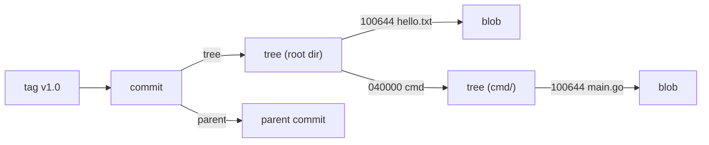

# Objects: blobs, trees, commits and tags

## Why care?

Three questions that confuse many experienced engineers:

- "I renamed a file and changed one line. Why does `git log --follow` sometimes lose the history?"
- "We have the same 2 MB logo in 40 folders. Does the repo store it 40 times?"
- "Is SHA-1 broken? Can someone forge a commit in our repo?"

You can answer all three once you know what Git actually stores. It is very little: four kinds of **objects**, each named by the hash of its own bytes.

## The idea: content-addressed storage

Git stores every piece of data as an **object**. The name of an object is not a number from a counter. The name is a **hash of the object's content**: a fixed-length value computed from the bytes.

- The same content always gives the same name. So Git stores it only once.
- Change one byte, and the name changes completely. So an object can never be changed without anyone noticing.
- If you know a name, you can check the content: compute the hash again and compare.

This is called **content-addressable storage**. Git's object database is `.git/objects/`. The hash is SHA-1 (or SHA-256, see below). There are four kinds of object:



| Type       | Holds                                                       | Like...                    |
| ---------- | ----------------------------------------------------------- | -------------------------- |
| **blob**   | The bytes of one file. No name, no permissions.             | The contents of a file     |
| **tree**   | A list of entries: mode, type, hash, name.                  | A directory listing        |
| **commit** | One tree, zero or more parents, author, committer, message. | A snapshot plus its story  |
| **tag**    | One object (usually a commit), a tag name, tagger, message. | A signed label on a commit |

## Under the hood: how a hash is made

Git does not hash the file alone. It hashes a small **header** plus the content:

```text
<type> <size in bytes>\0<content>
```

To check this, make a file and ask Git for its hash:

```console
$ echo 'hello git' > hello.txt
$ git hash-object hello.txt
8d0e41234f24b6da002d962a26c2495ea16a425f
```

Now build the same bytes by hand. `hello git\n` is 10 bytes:

```console
$ printf 'blob 10\0hello git\n' | sha1sum
8d0e41234f24b6da002d962a26c2495ea16a425f  -
```

Same hash. Your file has this hash in **every** Git repository in the world (that uses SHA-1).

### Where the object lives on disk

`hash-object -w` writes the object into the database:

```console
$ git hash-object -w hello.txt
8d0e41234f24b6da002d962a26c2495ea16a425f
$ find .git/objects -type f
.git/objects/8d/0e41234f24b6da002d962a26c2495ea16a425f
$ stat -c "%A %s %n" .git/objects/8d/*
-r--r--r-- 26 .git/objects/8d/0e41234f24b6da002d962a26c2495ea16a425f
```

Three details:

1. The first two hex characters are a **directory**, the other 38 are the file name. This keeps any one directory from getting millions of entries.
2. The file is **read-only**. Objects never change.
3. It is 26 bytes, not 18. The file is the header plus content, compressed with **zlib**.

Decompress it yourself and you see the header:

```console
$ python3 -c "import zlib,sys; print(repr(zlib.decompress(open(sys.argv[1],'rb').read())))" .git/objects/8d/0e41234f24b6da002d962a26c2495ea16a425f
b'blob 10\x00hello git\n'
```

`git cat-file` does the same for you, and is the tool you will use most on this page:

```console
$ git cat-file -t 8d0e41234f24b6da002d962a26c2495ea16a425f
blob
$ git cat-file -s 8d0e41234f24b6da002d962a26c2495ea16a425f
10
$ git cat-file -p 8d0e41234f24b6da002d962a26c2495ea16a425f
hello git
```

A file stored like this, one object per file, is a **loose object**. Later, Git packs many objects into one file. See [Storage](storage.md).

!!! tip "Two hashes worth knowing"

    The empty blob is always `e69de29bb2d1d6434b8b29ae775ad8c2e48c5391`, and the empty tree is
    always `4b825dc642cb6eb9a060e54bf8d69288fbee4904` (try `git hash-object -t tree /dev/null`).
    You will see the empty tree in scripts, for example to diff a first commit against "nothing".

## Under the hood: trees

A blob has no name. Names live in **trees**. Here is a tree with every kind of entry:

```console
$ git cat-file -p 5cadaa732af855337e66be2aa4d11ae9e6bd021a
100644 blob 8d0e41234f24b6da002d962a26c2495ea16a425f	a.txt
100644 blob 8d0e41234f24b6da002d962a26c2495ea16a425f	b.txt
040000 tree 0479003445f4e5a5ff25360c607ca79ffe4e4ea1	lib
120000 blob 8d14cbf983b3fad683171c9418998d9f68340823	link
100755 blob 4163036efa65bd4a469e752267498f01ea36a55c	run.sh
040000 tree b0988d0c0c1f5af67b746bac690f47c675edf3f4	vendor
```

The first column is the **mode**. Git knows only five:

| Mode     | Meaning                                                                         |
| -------- | ------------------------------------------------------------------------------- |
| `100644` | Normal file                                                                     |
| `100755` | Executable file                                                                 |
| `120000` | Symbolic link. The blob holds the link **target** as text                       |
| `040000` | Subdirectory: another tree                                                      |
| `160000` | **Gitlink**: a commit in _another_ repository. This is how submodules are built |

Look at `a.txt` and `b.txt`: two names, **one blob**. Identical content is stored once, whatever its name or folder. That answers the logo question: 40 copies of the same logo cost one blob.

The symlink blob holds only the path it points to:

```console
$ git cat-file -p 8d14cbf
a.txt
```

And `vendor` holds a gitlink. It records a commit hash, but Git does not have that commit here. It belongs to the submodule's own repository:

```console
$ git ls-tree 5cadaa732af855337e66be2aa4d11ae9e6bd021a:vendor
160000 commit 67c54cd340b66aab1b5c7b1f62e42a6ccf7379a5	sub
```

Notice what is **not** in a tree: no timestamps, no owner, no permissions other than "executable or not". This is why Git does not track file dates, and why `chmod 600` on a file shows no change.

### The raw bytes of a tree

`cat-file -p` pretty-prints. The real format is binary. Each entry is `<mode> <name>\0` followed by the **20 raw bytes** of the hash (not 40 hex characters):

```console
$ git cat-file tree fe58e2a | xxd
00000000: 3430 3030 3020 636d 6400 b927 0df7 070c  40000 cmd..'....
00000010: c6a5 e7db dec6 10a7 ce4f 54c4 7b20 3130  .........OT.{ 10
00000020: 3036 3434 2068 656c 6c6f 2e74 7874 008d  0644 hello.txt..
00000030: 0e41 234f 24b6 da00 2d96 2a26 c249 5ea1  .A#O$...-.*&.I^.
00000040: 6a42 5f                                  jB_
```

Read it: `40000 cmd`, a zero byte, then `b9 27 0d f7 ...` (the `cmd` tree's hash). Then `100644 hello.txt`, a zero byte, and `8d 0e 41 23 ...`: our `hello git` blob. Two details may surprise you: a tree's mode is stored as `40000` without the leading zero, and entries are always sorted by name, so the same directory always gives the same tree hash.

## Under the hood: commits

A commit is plain text:

```console
$ git cat-file -p 67c54cd340b66aab1b5c7b1f62e42a6ccf7379a5
tree fe58e2a23e81ed637e81e5b00c37673afa353f02
author You <you@example.com> 1767268800 +0000
committer You <you@example.com> 1767268800 +0000

first commit
```

- `tree`: the **whole** project snapshot. Not a diff. A commit never stores changes; diffs are computed when you ask for them.
- `parent`: missing here because this is the first commit. A normal commit has one, a merge has two or more.
- `author` and `committer`: who wrote the change, and who made this commit object. They differ after a rebase or cherry-pick, or when a maintainer applies your patch. The number is Unix time, then the time zone.
- Then an empty line and the message.

Because the commit includes the tree hash and the parent hash, **its hash covers the whole history below it**. Change one byte in one file ten commits ago, and every commit hash after it changes. That is why a rebase gives new hashes, and why nobody can change history in secret.

## Try it: build a commit with plumbing only

No `git add`, no `git commit`. Only the plumbing that they use inside. In an empty repo:

```console
$ echo "hello git" | git hash-object -w --stdin
8d0e41234f24b6da002d962a26c2495ea16a425f
$ echo "package main" | git hash-object -w --stdin
06ab7d0f9a35a7d1070711496d6ca1cb892a258f
```

Two blobs. Now put them in the **index** (the staging area, see [the index](index-and-trees.md)) with a mode and a name:

```console
$ git update-index --add --cacheinfo 100644,8d0e41234f24b6da002d962a26c2495ea16a425f,hello.txt
$ git update-index --add --cacheinfo 100644,$(echo "package main" | git hash-object --stdin),cmd/main.go
$ git ls-files -s
100644 06ab7d0f9a35a7d1070711496d6ca1cb892a258f 0	cmd/main.go
100644 8d0e41234f24b6da002d962a26c2495ea16a425f 0	hello.txt
```

Turn the index into trees. Git writes one tree per directory:

```console
$ git write-tree
fe58e2a23e81ed637e81e5b00c37673afa353f02
$ git cat-file -p fe58e2a23e81ed637e81e5b00c37673afa353f02
040000 tree b9270df7070cc6a5e7dbdec610a7ce4f54c47b20	cmd
100644 blob 8d0e41234f24b6da002d962a26c2495ea16a425f	hello.txt
```

Wrap the tree in a commit, then point a branch at it:

```console
$ echo 'first commit' | git commit-tree fe58e2a23e81ed637e81e5b00c37673afa353f02
67c54cd340b66aab1b5c7b1f62e42a6ccf7379a5
$ git update-ref refs/heads/main 67c54cd340b66aab1b5c7b1f62e42a6ccf7379a5
$ git log --oneline
67c54cd first commit
$ cat .git/refs/heads/main
67c54cd340b66aab1b5c7b1f62e42a6ccf7379a5
```

A real commit on a real branch. That is all `git commit` does: `write-tree`, `commit-tree` with the current `HEAD` as parent, and `update-ref`.

One detail: the files were never written to disk. So Git sees them as deleted:

```console
$ git status --short
 D cmd/main.go
 D hello.txt
$ git count-objects
5 objects, 20 kilobytes
```

`git restore .` copies them out of the object database into your folder. Five objects: two blobs, two trees, one commit.

## Under the hood: annotated tags

A **lightweight tag** is only a ref (see [Refs](refs.md)). An **annotated tag** is a real object with its own hash:

```console
$ git tag -a v1.0 -m "release 1.0"
$ git cat-file -t v1.0
tag
$ git cat-file -p v1.0
object 1b0b008a59b3fadc979eff0505a25c4542ae775d
type commit
tag v1.0
tagger You <you@example.com> 1767268800 +0000

release 1.0
$ git tag light
$ git cat-file -t light
commit
```

The tag object points to the commit. To go from a tag to its commit, **peel** it with `^{commit}`:

```console
$ git rev-parse v1.0 v1.0^{commit}
9f56e1e596f4466839c0494126bcada9835593e0
1b0b008a59b3fadc979eff0505a25c4542ae775d
```

Use annotated tags for releases. They have a date, a tagger and a message, and they can be signed (see [signing](config-hooks-signing.md)).

## Under the hood: renames are not stored

Rename a file and commit. Look at the two trees:

```console
$ git cat-file -p HEAD~1^{tree}; git cat-file -p HEAD^{tree}
100644 blob 96cc558853a03c5d901661af837fceb7a81f58f6	a.txt
100644 blob 96cc558853a03c5d901661af837fceb7a81f58f6	b.txt
```

The first tree has `a.txt`, the second has `b.txt`, with the same blob. There is no "rename" record anywhere. Git **detects** renames later, when it compares two trees:

```console
$ git show --stat --format=%s HEAD
two

 a.txt => b.txt | 0
 1 file changed, 0 insertions(+), 0 deletions(-)
$ git show --stat --no-renames --format=%s HEAD
two

 a.txt | 50 --------------------------------------------------
 b.txt | 50 ++++++++++++++++++++++++++++++++++++++++++++++++++
 2 files changed, 50 insertions(+), 50 deletions(-)
```

By default a deleted file and an added file count as a rename when they are at least 50% similar. So if you rename a file **and** rewrite most of it in one commit, Git sees "delete + add", and `log --follow` loses the trail. That answers the first question. The fix is a habit: **rename in one commit, change in the next.**

## Under the hood: SHA-1, SHAttered and SHA-256

In February 2017, the SHAttered attack produced two different PDF files with the same SHA-1 hash. Could someone make a bad blob with the same hash as a good one?

Git's answer has two parts.

**1. Hardened SHA-1.** Since Git 2.13, Git uses a SHA-1 version with **collision detection** (`sha1dc`). It notices the special patterns that attacks like SHAttered need, and refuses the object. You can see it in your build:

```console
$ git version --build-options
git version 2.56.1
cpu: x86_64
no commit associated with this build
sizeof-long: 8
sizeof-size_t: 8
shell-path: /bin/sh
rust: disabled
feature: fsmonitor--daemon
gettext: enabled
libcurl: 8.23.0
OpenSSL: OpenSSL 4.1.0 23 Oct 2026
zlib-ng: 2.3.3
SHA-1: SHA1_DC
SHA-256: SHA256_BLK
default-ref-format: files
default-hash: sha1
```

**2. SHA-256 repositories.** Git can already use SHA-256 for all objects:

```console
$ git init -q --object-format=sha256 s256 && cd s256
$ echo "hello git" | git hash-object --stdin
0cee7efe07c21236b086b48ae6219ee4f894e991da7faaf821aa1601faade115
$ printf "blob 10\0hello git\n" | sha256sum
0cee7efe07c21236b086b48ae6219ee4f894e991da7faaf821aa1601faade115  -
$ git rev-parse --show-object-format
sha256
$ git config get extensions.objectformat
sha256
```

Same header, same idea, a longer hash. The repository records the choice in `extensions.objectFormat`, so old Git versions refuse to open it instead of corrupting it.

What about interop? The `git init` manual in 2.56 says it plainly: _"At present, there is no interoperability between SHA-256 repositories and SHA-1 repositories."_ You cannot push a SHA-256 repo to a SHA-1 one. There is a config `extensions.compatObjectFormat` for the future, but the docs say it is incomplete and "not designed to be enabled by end users". Git's own `BreakingChanges` document plans to make SHA-256 the default for new repositories in **Git 3.0**, once forges and libraries support it.

!!! tip "What this means for you today"

    Keep using SHA-1 repos: they are protected against known collision attacks, and every forge
    supports them. Don't treat a commit hash alone as proof of who wrote it; that is what
    [signed commits](config-hooks-signing.md) are for. Know that the switch is coming, and that
    scripts which assume "a hash has 40 characters" will break. Use `git rev-parse --show-object-format`.

## Traps

- **Thinking a commit is a diff.** It is a full snapshot. Tools show diffs because they compare two snapshots. This matters for cherry-pick and rebase: they _compute_ a diff and apply it somewhere else.
- **Rename plus rewrite in one commit.** Rename detection fails below 50% similarity, and history "breaks". Split the commit.
- **Expecting file permissions or dates in Git.** Only "executable or not" is stored. Use your deploy tooling for permissions.
- **Hard-coding 40-character hashes** in scripts and database columns. SHA-256 hashes have 64.
- **Lightweight tags for releases.** They have no date, no tagger, no message, and cannot be signed. Use `git tag -a` (or `-s`).

## Check yourself

??? question "1. Two different repositories both contain a file README.md with the text `hello git` and a newline. Do the blobs have the same hash? Do the commits?"

    The blobs: yes, always (with the same hash algorithm). The hash depends only on `blob 10\0` plus
    the content. The commits: almost certainly not. A commit hash also covers the tree, the parents,
    the author, the committer, both dates and the message.

??? question "2. Where does Git store the file name `hello.txt`, and where does it store whether the file is executable?"

    Both live in the **tree** entry that points to the blob: `100644 blob <hash>	hello.txt`. The
    blob itself has no name and no mode. That is why the same content under two names is one blob.

??? question "3. You change one character in a file that was committed 100 commits ago, and rewrite history. How many commit hashes change?"

    All 100 commits after it (plus the one you changed). Each commit contains its parent's hash, so a
    change ripples up through every descendant. Trees and blobs that did not change keep their hashes.

??? question "4. What is the smallest set of plumbing commands that creates a commit on main from files on disk?"

    `git hash-object -w` (or `update-index --add`) for each file, `git write-tree`,
    `git commit-tree <tree> -p <parent> -m msg`, and `git update-ref refs/heads/main <commit>`.

??? question "5. Does SHAttered mean someone can replace a blob in your repository?"

    Not with known attacks. Since Git 2.13, Git uses hardened SHA-1 (`SHA1_DC` in
    `git version --build-options`), which detects SHAttered-style collisions. SHA-1 is still weak in
    the long term, which is why SHA-256 repositories exist and are planned as the default in Git 3.0.

## Recap

- Git stores four object types: **blob** (content), **tree** (names + modes), **commit** (tree + parents + metadata), **tag** (a named, signed pointer).
- The object name is the hash of `type size\0content`. Same content, same hash, stored once.
- Loose objects live zlib-compressed in `.git/objects/xx/yyyy...` and are read-only.
- Tree modes: `100644`, `100755`, `120000` (symlink), `040000` (tree), `160000` (gitlink / submodule).
- A commit is a snapshot, not a diff. Its hash covers the whole history below it.
- Renames are not stored. They are detected by similarity (50% by default) when trees are compared.
- Git uses collision-detecting SHA-1 today. SHA-256 repos work, but do not interoperate with SHA-1 repos yet.

Next: names that point at these objects. [Refs and revisions](refs.md).
