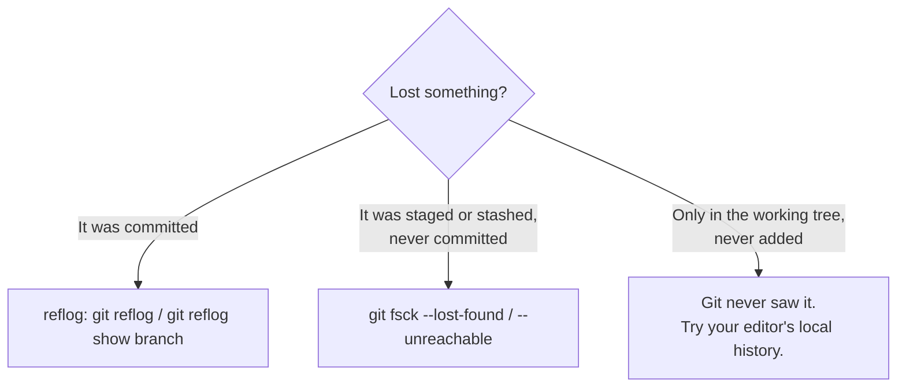

# Recovery and history

## Why care?

- "I ran `git reset --hard` on the wrong branch. Two days of commits."
- "I dropped a stash by accident."
- "Production broke somewhere in the last 300 commits. Which one?"
- "`git blame` says I wrote this whole file, because I moved it and reformatted it."
- "Someone committed an API key. We deleted the file in the next commit. Are we safe?" (The answer is no.)

This page covers the tools for when something went wrong: getting things back, finding where something changed, and rewriting history when you really must.

## The idea: lost commits still exist, only the ref moved

From [Objects](objects.md) and [Refs](refs.md) you know: objects never change, refs move. When you "lose" a commit, the commit is still in the object database. Only the **pointer** to it moved. Recovery is always the same question: **where can I find the hash?**



## Under the hood: reflog rescue

A common accident:

```console
$ git reset --hard HEAD~2
HEAD is now at d331011 step 1
$ git log --oneline
d331011 step 1
```

Two commits "gone". The reflog remembers where `HEAD` was:

```console
$ git reflog -3
d331011 HEAD@{0}: reset: moving to HEAD~2
5ca5709 HEAD@{1}: commit: step 3
c621ed3 HEAD@{2}: commit: step 2
$ git reset --hard HEAD@{1}
HEAD is now at 5ca5709 step 3
$ git log --oneline
5ca5709 step 3
c621ed3 step 2
d331011 step 1
```

The commits are back. The same works after a bad rebase (`git reflog` shows `rebase (start)` and `rebase (finish)` lines; go to the entry just before the start), a bad merge, a deleted branch (`git reflog` still has the commits it pointed to via `HEAD`), or an amend you regret.

## Under the hood: dangling objects

What if it was never committed? `git add` writes a blob ([The index](index-and-trees.md)). So staged work survives a `reset --hard` as an object that nothing points to, a **dangling** object:

```console
$ echo "unsaved idea" > idea.txt; git add idea.txt
$ git reset --hard -q && git status --short
$ git fsck --lost-found
dangling blob ce45ce9c40fe5a8f6fa7e03b4019268522441b5c
$ ls .git/lost-found/other/ && cat .git/lost-found/other/*
ce45ce9c40fe5a8f6fa7e03b4019268522441b5c
unsaved idea
```

`--lost-found` writes dangling blobs into `.git/lost-found/other/` (and commits into `.git/lost-found/commit/`). The file name is gone (names live in trees, and no tree was made), but the content is back.

A dropped stash is a commit, so it is easy to find:

```console
$ git stash drop
Dropped refs/stash@{0} (fff502e60f6485c0a188669385d67215133b5706)
$ git fsck --no-reflogs --unreachable | grep commit
unreachable commit fff502e60f6485c0a188669385d67215133b5706
unreachable commit bb5a7156aa13317957aef9da3da48173e87778b1
```

Git also printed the hash when you dropped it. `git stash apply fff502e` brings it back. (The second commit is the stash's "index" commit. `git cat-file -p fff502e` shows two `parent` lines: the commit you were on, `5ca5709`, and `bb5a715`, which holds the staged state.)

`dangling` vs `unreachable`: a dangling object is unreachable **and** no other unreachable object points to it. It is the tip of a lost chain. `--no-reflogs` makes fsck ignore the reflog, which is needed here because the reflog still referenced the stash until the drop.

You have the grace period from [Storage](storage.md): about 2 weeks for unreachable objects, longer for commits still in a reflog. After `gc` prunes them, they are really gone.

## How to undo common actions

| Situation                                          | Command                                                              |
| -------------------------------------------------- | -------------------------------------------------------------------- |
| Undo the last commit, keep the changes staged      | `git reset --soft HEAD~1`                                            |
| Undo the last commit, keep the changes unstaged    | `git reset HEAD~1`                                                   |
| Change the last commit's message or content        | `git commit --amend`                                                 |
| Undo a commit that is already pushed               | `git revert <sha>` (a new commit that does the opposite)             |
| Undo a pushed merge                                | `git revert -m 1 <merge-sha>` (keep parent 1 = main line)            |
| Unstage a file                                     | `git restore --staged file`                                          |
| Throw away unstaged changes in a file              | `git restore file` (**cannot be undone**)                            |
| Get back after `reset --hard`, bad rebase or merge | `git reflog`, then `git reset --hard HEAD@{n}` (or `ORIG_HEAD`)      |
| Restore a deleted branch                           | `git reflog`, find its last commit, `git branch name <sha>`          |
| Get a file as it was 3 commits ago                 | `git restore --source=HEAD~3 file`                                   |
| Recover a dropped stash or lost staged file        | `git fsck --unreachable` / `--lost-found`                            |
| Abort a merge, rebase or cherry-pick in progress   | `git merge --abort`, `git rebase --abort`, `git cherry-pick --abort` |

## Under the hood: `git bisect run`

Production broke. You know a good version and a bad one. **Bisect** does a binary search through history: test the middle commit, throw away half, repeat. With 16 commits, it needs about 4 tests. With 1,000 commits, about 10.

You can also let a script decide. The script's exit code is the answer:

- `0`: this commit is **good**.
- `1` to `127`, except `125`: this commit is **bad**.
- `125`: can't test this commit (for example, it does not build), **skip** it.
- anything else: stop bisecting.

```console
$ cat check.sh
#!/bin/sh
grep -q 'limit=100' conf
$ git bisect start HEAD HEAD~15
Bisecting: 7 revisions left to test after this (roughly 3 steps)
[ee1b7222890a3013558ec9d70ed193c3ce57910f] change 8
$ git bisect run ./check.sh
running './check.sh'
Bisecting: 3 revisions left to test after this (roughly 2 steps)
[e99ef56996ea7c6c03c2e38a445a81d82f498bb9] change 12
running './check.sh'
Bisecting: 1 revision left to test after this (roughly 1 step)
[b144350c8f4d1bde6c7794ea11890847b9a907e3] change 10
running './check.sh'
Bisecting: 0 revisions left to test after this (roughly 0 steps)
[018a24477b2d9a8c4f5e26480feed2dcc230db9d] change 11
running './check.sh'
018a24477b2d9a8c4f5e26480feed2dcc230db9d is the first 'bad' commit
commit 018a24477b2d9a8c4f5e26480feed2dcc230db9d
Author: You <you@example.com>
Date:   Tue Aug 11 12:00:00 2026 +0000

    change 11

 conf    | 2 +-
 log.txt | 1 +
 2 files changed, 2 insertions(+), 1 deletion(-)
bisect found first 'bad' commit
$ git bisect reset
Previous HEAD position was 018a244 change 11
Switched to branch 'main'
```

`git bisect start <bad> <good>`, then `run`. Four tests, all automatic. For a Go service, the script is often only `go test ./internal/orders -run TestDiscount` (with `go build ./... || exit 125` first). Keep the script **outside** the repo or untracked, so checkouts don't change it.

!!! tip "Bisect works best on a history where every commit builds"

    That is one more reason for small commits that each pass the tests. With many broken commits,
    bisect has to skip a lot, and may end with "the bad commit is one of these five".

## Under the hood: blame through moves and reformatting

`git blame` shows, for every line, the last commit that touched it. "Touched" is the problem. Our sample: `Discount` was written in `be2e025`, then a commit changed tabs to spaces, then a commit moved it to its own file.

```console
$ git log --oneline
eb3d84a move Discount to its own file
252ab5e style: tabs to spaces
be2e025 add Discount
111e185 add Total
$ git blame discount.go
eb3d84a (You 2026-09-04 12:00:00 +0000 1) package orders
eb3d84a (You 2026-09-04 12:00:00 +0000 2)
eb3d84a (You 2026-09-04 12:00:00 +0000 3) func Discount(total int) int {
eb3d84a (You 2026-09-04 12:00:00 +0000 4)     if total > 100 {
eb3d84a (You 2026-09-04 12:00:00 +0000 5)         return total / 10
eb3d84a (You 2026-09-04 12:00:00 +0000 6)     }
eb3d84a (You 2026-09-04 12:00:00 +0000 7)     return 0
eb3d84a (You 2026-09-04 12:00:00 +0000 8) }
```

Every line blames the move, which does not help. `-w` ignores whitespace changes, and `-C` follows lines **moved or copied from other files**:

```console
$ git blame -w -C -C -C discount.go
eb3d84a discount.go (You 2026-09-04 12:00:00 +0000 1) package orders
eb3d84a discount.go (You 2026-09-04 12:00:00 +0000 2)
be2e025 orders.go   (You 2026-09-02 12:00:00 +0000 3) func Discount(total int) int {
be2e025 orders.go   (You 2026-09-02 12:00:00 +0000 4)     if total > 100 {
be2e025 orders.go   (You 2026-09-02 12:00:00 +0000 5)         return total / 10
be2e025 orders.go   (You 2026-09-02 12:00:00 +0000 6)     }
be2e025 orders.go   (You 2026-09-02 12:00:00 +0000 7)     return 0
be2e025 orders.go   (You 2026-09-02 12:00:00 +0000 8) }
```

Now the real author commit, and even the original file name. How many `-C`s?

- `-C` once: look in other files **changed in the same commit**.
- twice: also in other files of **the commit that created the file**.
- three times: in **any** file of **any** commit. Slowest, and finds the most.

### `--ignore-revs-file`: hide formatting commits

A big `gofmt`, a lint autofix, a license header change: these commits make blame point at the wrong person for thousands of lines. List them in a file:

```console
$ cat .git-blame-ignore-revs
252ab5e9d049d1e1e027e508dd6b91ece186e8ce
$ git blame orders.go | sed -n 3,5p
^111e185 (You 2026-09-01 12:00:00 +0000 3) func Total(items []int) int {
252ab5e9 (You 2026-09-03 12:00:00 +0000 4)     sum := 0
252ab5e9 (You 2026-09-03 12:00:00 +0000 5)     for _, v := range items {
$ git blame --ignore-revs-file .git-blame-ignore-revs orders.go | sed -n 3,5p
^111e185 (You 2026-09-01 12:00:00 +0000 3) func Total(items []int) int {
^111e185 (You 2026-09-01 12:00:00 +0000 4)     sum := 0
^111e185 (You 2026-09-01 12:00:00 +0000 5)     for _, v := range items {
```

The `^` means "boundary": the line comes from the first commit. Commit the file to the repo, and have everyone set `git config blame.ignoreRevsFile .git-blame-ignore-revs`. Some forges read a file with this name in their web blame view too; check yours.

## Under the hood: searching history by content

`blame` answers "who wrote this line?". Often the question is "when did this **appear or disappear**?". That is the **pickaxe**:

```console
$ git log --oneline -S "total / 10"
eb3d84a move Discount to its own file
be2e025 add Discount
$ git log --oneline -G "^ +sum"
252ab5e style: tabs to spaces
```

- `-S <string>`: commits where the **number of occurrences** of the string changed. It was added in `be2e025`. In `eb3d84a` the count did not change in total, but per file it did (gone from `orders.go`, new in `discount.go`), so that commit shows too. Useful for "when was this function call removed?".
- `-G <regex>`: commits whose **diff** has an added or removed line matching the regex. Here: indented `sum` lines with spaces appeared in the tabs-to-spaces commit.

And to follow **one function** through history:

```console
$ git log --oneline -L :Total:orders.go | grep -E "^[0-9a-f]{7} "
252ab5e style: tabs to spaces
111e185 add Total
```

`-L :funcname:file` shows every commit that changed that function, with the diff of only that function. Git finds the function with a regex for the language. For Go, add `*.go diff=golang` to `.gitattributes` so it uses the built-in Go pattern (see [attributes](config-hooks-signing.md)). `-L 10,20:file` works with line ranges.

## Under the hood: rewriting history with filter-repo

Back to the leaked API key. Deleting the file in a new commit does **not** help. The blob is still in the old commit, in every clone, forever:

```console
$ git log --oneline --stat | grep -E "^[0-9a-f]{7}|\.env"
f1c6b13 more app
c0f404a remove .env
 .env | 1 -
27bf743 oops: add .env
 .env | 1 +
3ddb8e6 app
$ git log --all --oneline -S sk_live_123
c0f404a remove .env
27bf743 oops: add .env
```

To really remove it, you must **rewrite every commit since then** (their trees change, so their hashes change). The tool for that is **`git filter-repo`**. It is a separate tool, recommended by Git's own `filter-branch` manual instead of `filter-branch`. It refuses to run except on a fresh clone, to protect you, so clone first:

```console
$ git filter-repo --invert-paths --path .env
NOTICE: Removing 'origin' remote; see 'Why is my origin removed?'
        in the manual if you want to push back there.
...
New history written in 0.03 seconds; now repacking/cleaning...
Repacking your repo and cleaning out old unneeded objects
Completely finished after 0.09 seconds.
$ git log --oneline
55c0efa more app
3ddb8e6 app
$ git log --all --oneline -S sk_live_123
```

(Output shortened at `...`.) `--invert-paths --path .env` = "keep everything except `.env`". The two commits that only touched `.env` became empty and were dropped. `more app` got a new hash: `f1c6b13` became `55c0efa`. filter-repo also removed `origin` on purpose, so you don't push the rewrite by accident. Other useful modes: `--replace-text` (replace strings like a password in all files), `--path-rename`, `--strip-blobs-bigger-than`.

!!! warning "Rewriting is the last step, not the first"

    1. **Rotate the secret first.** Assume it was copied the moment it was pushed.
    2. Then rewrite, force-push, and make **everyone re-clone**. Old clones, forks, CI caches and
       open PRs still have the old objects. A forge may also keep old commits reachable (for
       example through PR refs); check your forge's docs for removing them.

## Under the hood: worktrees

`git worktree` gives you a second (third, ...) working folder for the **same** repository: one object database, many checkouts. No second clone, no second fetch. This setup's Neovim session picker (`<leader>fs`) lists worktrees for exactly this reason: one folder per task.

```console
$ git worktree add -q --relative-paths -b hotfix ../rescue-hotfix
$ cat ../rescue-hotfix/.git
gitdir: ../rescue/.git/worktrees/rescue-hotfix
```

In a linked worktree, `.git` is a **file**, not a folder. It points to a small admin folder inside the main repo:

```console
$ ls .git/worktrees/rescue-hotfix
HEAD
ORIG_HEAD
commondir
gitdir
index
logs
refs
$ cat .git/worktrees/rescue-hotfix/commondir; cat .git/worktrees/rescue-hotfix/HEAD
../..
ref: refs/heads/hotfix
$ cat .git/worktrees/rescue-hotfix/gitdir
../../../../rescue-hotfix/.git
```

Each worktree has its **own** `HEAD`, `index` and per-worktree refs and logs. `commondir` points (`../..`) to the **shared** part: objects, branches, tags, config. `gitdir` points back to the worktree's `.git` file, so Git can notice when a worktree folder was deleted (`git worktree prune` cleans up). `--relative-paths` stores relative links instead of absolute ones (and sets `extensions.relativeWorktrees`). The default is absolute paths; `worktree.useRelativePaths` changes it.

Ask Git which is which:

```console
$ git -C ../rescue-hotfix rev-parse --git-dir --git-common-dir
/tmp/.../rescue/.git/worktrees/rescue-hotfix
/tmp/.../rescue/.git
```

(Temporary paths shortened.) One rule follows from the shared refs: **a branch can be checked out in only one worktree at a time**. Otherwise a commit in one would silently change the other's checked-out branch:

```console
$ git switch hotfix
fatal: 'hotfix' is already used by worktree at '/tmp/.../rescue-hotfix'
```

## Under the hood: notes and replace

Two less known ref namespaces that attach data to history **without rewriting it**.

**Notes** add text to a commit after the fact (a deploy record, a review link, CI results):

```console
$ git notes add -m "Deployed to prod 2026-07-05" HEAD
$ git log -1 --format="%h %s%n%N"
5ca5709 step 3
Deployed to prod 2026-07-05

$ git ls-tree refs/notes/commits
100644 blob 71eb0ea3d5b35e98a289412770ceb772f540473d	5ca570949ce69663050ec18f9377c1ed53ff1675
```

Notes are a normal commit history on `refs/notes/commits`, whose tree maps **commit hash → note blob**. The commit itself is unchanged. They are not pushed or fetched by default; push `refs/notes/*` explicitly.

**Replace** tells Git "whenever you read object X, use object Y instead":

```console
$ git replace --graft HEAD~1 && git log --oneline
5ca5709 step 3
c621ed3 step 2
$ git for-each-ref refs/replace
e0f8c1f9f79de166f1359b4a206061e2546bdd58 commit	refs/replace/c621ed398bf2b382e964acddf80c2f4db27920fb
$ git --no-replace-objects log --oneline
5ca5709 step 3
c621ed3 step 2
d331011 step 1
```

`--graft HEAD~1` with no parents made a replacement of `c621ed3` without parents, so history looks like it starts there. The real objects did not change, and `--no-replace-objects` shows the real history. Uses: stitch an old, archived history onto a new repo, or cut history for a demo. Replace refs replace the old "grafts" file, which Git 3.0 plans to remove.

## Traps

- **"Deleted in the next commit" = still in history.** Rotate the secret, then filter-repo.
- **`git filter-branch`.** Slow and full of traps; its own manual points you to filter-repo.
- **Running `gc --prune=now` while recovering.** You may delete exactly the dangling object you need. Recover first.
- **Blame without `-w -C`** after refactors. And no `.git-blame-ignore-revs` after a big reformat.
- **Deleting a worktree folder with `rm -rf`.** Git still thinks the branch is checked out there. Use `git worktree remove`, or `git worktree prune` afterwards.
- **Bisect scripts inside the repo** that change while bisect checks out old commits.

## Check yourself

??? question "1. You ran `git reset --hard origin/main` and lost three local commits. How do you get them back?"

    `git reflog` shows the commit `HEAD` pointed to before the reset (`HEAD@{1}`). Run
    `git reset --hard HEAD@{1}`, or `git branch rescue HEAD@{1}`.

??? question "2. You staged a new file, then ran `git reset --hard`. The file was never committed. Is it gone?"

    No. `git add` wrote a blob. `git fsck --lost-found` puts dangling blobs into
    `.git/lost-found/other/`. The name is lost, the content is not. Until the grace period ends.

??? question "3. What does `git bisect run` do with exit code 125?"

    It skips that commit as "cannot be tested" (for example, it does not build). 0 = good,
    1 to 127 except 125 = bad, other codes abort the bisect.

??? question "4. What is the difference between `git log -S foo` and `git log -G foo`?"

    `-S` finds commits that change the **number of occurrences** of the string `foo`. `-G` finds
    commits whose diff has an added or removed line matching the regex `foo`, even if the count stays
    the same (for example, a line that was only changed).

??? question "5. Why can't you check out the same branch in two worktrees?"

    Branches are shared between all worktrees (they live in the common dir). A commit in one worktree
    would move the branch that the other worktree has checked out, and its index and files would no longer
    match `HEAD`.

## Recap

- Lost commits: **reflog**. Lost staged files or stashes: **`fsck --lost-found` / `--unreachable`**. Lost unstaged edits: Git never had them.
- `bisect run` + a script finds the bad commit in log2(n) steps. Exit 125 = skip.
- `blame -w -C -C -C` sees through reformatting and moves. `.git-blame-ignore-revs` hides formatting commits.
- `log -S` (count changes), `log -G` (diff matches), `log -L` (one function's history).
- Removing data from history means rewriting it: **rotate first**, then `git filter-repo`, then everybody re-clones.
- A linked worktree has a `.git` file pointing to `.git/worktrees/<name>`: own `HEAD` and index, shared objects and refs.
- Notes and replace refs add to history without changing it.

Next and last: configuring all of this. [Config, attributes, hooks and signing](config-hooks-signing.md).
