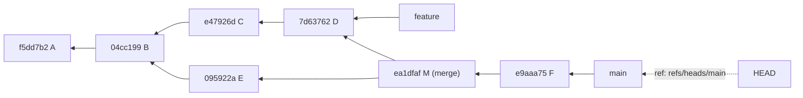

# Refs and revisions

## Why care?

- "I was in 'detached HEAD' state, made three commits, switched branch, and they are gone."
- "What is the difference between `main..feature` and `main...feature`? The PR tool uses one, my script uses the other, and they give different lists."
- "Our repo has 80,000 tags, and every `git fetch` is slow."

All three are about **refs**: the names that point into the object graph. Objects never change. Refs are the part of Git that moves, so this is where things get "lost" and found again.

## The idea: movable names for commits

The commit graph never changes: commits are only added. **Refs** are names that point to one commit each, and they can move.

- A **branch** is a ref that moves forward every time you commit.
- A **tag** is a ref that does not move.
- **`HEAD`** is a special ref that marks your current position. Usually it does not point at a commit. It points at **another ref** (a branch). That is why committing moves the branch.



This is the sample repo for the whole page. Here it is as Git draws it:

```console
$ git log --graph --oneline --all
* e9aaa75 F: after merge
*   ea1dfaf M: merge feature
|\
| * 7d63762 D: feature tests
| * e47926d C: feature work
* | 095922a E: fix typo
|/
* 04cc199 B: add config
* f5dd7b2 A: init
```

## Under the hood: refs are small files

With the default `files` backend, a ref is a text file with a hash in it:

```console
$ cat .git/refs/heads/main
e9aaa75d00460938379d0f3b2c9976d019f2e2a4
```

`HEAD` is a **symbolic ref**. It contains the _name_ of another ref:

```console
$ cat .git/HEAD
ref: refs/heads/main
$ git symbolic-ref HEAD
refs/heads/main
```

When you commit, Git reads `HEAD`, follows it to `refs/heads/main`, uses that commit as the parent, and writes the new hash into `refs/heads/main`. `HEAD` itself is not touched.

The ref namespaces:

| Prefix          | What lives there                                                     |
| --------------- | -------------------------------------------------------------------- |
| `refs/heads/`   | Local branches                                                       |
| `refs/tags/`    | Tags                                                                 |
| `refs/remotes/` | Remote-tracking refs, like `origin/main` (see [Remotes](remotes.md)) |
| `refs/notes/`   | Notes (see [Recovery and history](recovery-and-history.md))          |
| `refs/stash`    | The stash. Its history is in the reflog                              |
| `refs/replace/` | Replacement objects                                                  |

Special refs in `.git/` itself: `HEAD`, `ORIG_HEAD` (where `HEAD` was before a reset, merge or rebase), `FETCH_HEAD`, `MERGE_HEAD`, `CHERRY_PICK_HEAD`.

### Detached HEAD

Switch to a commit instead of a branch:

```console
$ git switch --detach HEAD~2
HEAD is now at 095922a E: fix typo
$ cat .git/HEAD
095922a246717addd9403e9f7497ba54663ea11d
```

Now `HEAD` holds a hash directly. If you commit, the new commit's only "name" is `HEAD`. Switch away, and **no ref points to it any more**. The commit still exists, but nothing leads to it, except the reflog (below). That is the "lost three commits" problem. The fix before you switch: `git switch -c rescue`.

### packed-refs

Thousands of small files are slow. So Git can pack them into one file:

```console
$ find .git/refs -type f | sort
.git/refs/heads/feature
.git/refs/heads/main
.git/refs/tags/v1
$ git pack-refs --all
$ find .git/refs -type f | sort
$ cat .git/packed-refs
# pack-refs with: peeled fully-peeled sorted
7d63762776c8b2038a40b5f5aa2aea6aa30babe9 refs/heads/feature
e9aaa75d00460938379d0f3b2c9976d019f2e2a4 refs/heads/main
04cc199c0f1333fdea75db7a6c1cb57fa6987069 refs/tags/v1
```

To read a ref, Git looks for a loose file first, then in `packed-refs`. To write a ref, Git writes a loose file again. `git gc` repacks them. This is why **you should never read `.git/refs/` directly in scripts**: the ref may only be in `packed-refs`. Use `git rev-parse` or `git for-each-ref`.

The `files` backend has real limits. Deleting one ref means rewriting the whole `packed-refs` file, which in big repos can be many megabytes. Updating many refs is not atomic. And on a case-insensitive file system (macOS, Windows), `Feature` and `feature` are the same file, so you can't have both.

### reftable: the new backend

Git 2.56 supports a second backend, **reftable**: a binary format with prefix compression, append-only tables and atomic updates.

```console
$ git init -q --ref-format=reftable rt && cd rt
$ git rev-parse --show-ref-format
reftable
$ ls .git .git/reftable
.git:
COMMIT_EDITMSG
HEAD
config
index
objects
refs
reftable

.git/reftable:
0x000000000001-0x000000000003-9c61d66e.ref
tables.list
$ cat .git/HEAD; cat .git/refs/heads
ref: refs/heads/.invalid
this repository uses the reftable format
```

Look closely: `.git/HEAD` and `.git/refs/heads` still exist, but only as **stubs** for old tools: `HEAD` points at an invalid branch, and `refs/heads` is a file, not a directory. The real refs are in the tables. Git commands work normally:

```console
$ git for-each-ref
8f9d01efd9d7a7e2de0fb3a5a7d53b157e711f82 commit	refs/heads/main
8f9d01efd9d7a7e2de0fb3a5a7d53b157e711f82 commit	refs/heads/topic
```

You can convert an existing repo with `git refs migrate --ref-format=reftable`. Git's `BreakingChanges` document plans reftable as the **default in Git 3.0**. The main thing holding it back is other tools: JGit, libgit2 and Gitoxide must support it. If your IDE or CI uses one of those, test before you switch.

## Under the hood: the reflog

Every time a ref moves, Git appends a line to its **reflog**:

```console
$ cat .git/logs/refs/heads/feature
0000000000000000000000000000000000000000 04cc199c0f1333fdea75db7a6c1cb57fa6987069 You <you@example.com> 1767355200 +0000	branch: Created from HEAD
04cc199c0f1333fdea75db7a6c1cb57fa6987069 e47926d8db67b8354f40e3099f92481717f03004 You <you@example.com> 1767441600 +0000	commit: C: feature work
e47926d8db67b8354f40e3099f92481717f03004 7d63762776c8b2038a40b5f5aa2aea6aa30babe9 You <you@example.com> 1767528000 +0000	commit: D: feature tests
```

Old value, new value, who, when, why. `HEAD` has its own reflog, which records every checkout too:

```console
$ git reflog
e9aaa75 HEAD@{0}: commit: F: after merge
ea1dfaf HEAD@{1}: merge feature: Merge made by the 'ort' strategy.
095922a HEAD@{2}: commit: E: fix typo
04cc199 HEAD@{3}: checkout: moving from feature to main
7d63762 HEAD@{4}: commit: D: feature tests
e47926d HEAD@{5}: commit: C: feature work
04cc199 HEAD@{6}: checkout: moving from main to feature
04cc199 HEAD@{7}: commit: B: add config
f5dd7b2 HEAD@{8}: commit (initial): A: init
```

Four facts about the reflog:

1. **It is local only.** It is never pushed or fetched. A fresh clone has an empty reflog.
2. **It expires.** By default, entries older than 90 days are removed (`gc.reflogExpire`), and entries for commits that are no longer reachable from the ref go after 30 days (`gc.reflogExpireUnreachable`).
3. **It keeps objects alive.** While a reflog entry points at a commit, `gc` will not delete it.
4. **It is per ref.** `main@{2}` is "where main was two moves ago". `HEAD@{2}` is "where HEAD was two moves ago". Those are often different commits.

The reflog lets you find commits again after a ref moved. See [Recovery and history](recovery-and-history.md).

## Under the hood: the revision syntax

Almost every Git command takes **revisions**. The parser is the same everywhere (`git rev-parse` exposes it directly), so you only need to learn it once.

### `~` and `^`: walking parents

- `X~n` means "follow the **first** parent n times".
- `X^n` means "take the **n-th** parent" (only merges have more than one).
- `X^` is `X^1`, and `X~` is `X~1`.

```console
$ git rev-parse HEAD~1 HEAD~1^1 HEAD~1^2 HEAD~2 HEAD^^
ea1dfafb96c1f7fa6e9c848b4dd1d7134e36a685
095922a246717addd9403e9f7497ba54663ea11d
7d63762776c8b2038a40b5f5aa2aea6aa30babe9
095922a246717addd9403e9f7497ba54663ea11d
095922a246717addd9403e9f7497ba54663ea11d
```

`HEAD~1` is the merge `M`. Its first parent `^1` is `E` (the branch we were on), its second parent `^2` is `D` (the branch we merged in). `HEAD~2` and `HEAD^^` are both `E`. You can chain them:

```console
$ git log --oneline -1 HEAD~1^2~1
e47926d C: feature work
```

"From the merge, go into the merged branch, then one step back."

!!! tip "First parent = the main line"

    In a merge commit, the first parent is the branch you were on. So `git log --first-parent main`
    shows only the merges and direct commits on main, and hides the inside of every feature branch.
    This only works if your team merges feature branches _into_ main, not main into features.

### `^{type}` and `rev:path`: inside objects

```console
$ git rev-parse --short "HEAD^{tree}"
4d14e32
$ git show HEAD~1:app.txt
A: init
B: add config
E: fix typo
```

`HEAD^{tree}` peels the commit to its tree. `HEAD~1:app.txt` is the blob of `app.txt` in that commit. `:app.txt` (no revision) is the version **in the index**. `:2:app.txt` and `:3:app.txt` are the two sides of a merge conflict (see [Merging](merging.md)).

### `@` forms: the reflog and friends

| Syntax                 | Meaning                                                                                     |
| ---------------------- | ------------------------------------------------------------------------------------------- |
| `@`                    | Same as `HEAD`                                                                              |
| `main@{2}`             | Where `main` was two moves ago (reflog)                                                     |
| `main@{yesterday}`     | Where `main` was at that time, according to the reflog. Any date: `main@{2026-01-05 13:00}` |
| `@{-1}`                | The branch you were on before the last switch. `git switch -` uses it                       |
| `@{u}` / `@{upstream}` | The upstream of the current branch, for example `origin/main`                               |
| `@{push}`              | Where `git push` would push the current branch to                                           |

```console
$ git rev-parse --short "main@{2}"
095922a
$ git rev-parse --short "main@{2026-01-05 13:00}"
095922a
$ git rev-parse --abbrev-ref @{-1}
feature
```

`@{u}` and `@{push}` get their own section in [Remotes](remotes.md).

### `:/text`: search by message

```console
$ git log --oneline ':/typo' -1
095922a E: fix typo
```

`:/typo` is the youngest reachable commit whose message matches `typo` (a regular expression). This is useful for a quick lookup: `git show :/hotfix`.

### `A..B` and `A...B`: ranges

This is the one that confuses people most. Think in **sets of commits**.

- `A..B` = commits reachable from `B`, **minus** commits reachable from `A`. "What does B have that A doesn't?" Same as `^A B`.
- `A...B` = commits reachable from **either** one, but **not from both**. The symmetric difference.

Before the merge, `E` (on main) and `D` (on feature) had diverged from `B`:

```console
$ git log --oneline 095922a..feature
7d63762 D: feature tests
e47926d C: feature work
$ git log --oneline 095922a...feature
095922a E: fix typo
7d63762 D: feature tests
e47926d C: feature work
$ git log --oneline --left-right 095922a...feature
< 095922a E: fix typo
> 7d63762 D: feature tests
> e47926d C: feature work
$ git merge-base 095922a feature
04cc199c0f1333fdea75db7a6c1cb57fa6987069
```

`--left-right` marks which side each commit is on. Now look at the current main:

```console
$ git log --oneline main..feature
$ git log --oneline feature..main
e9aaa75 F: after merge
ea1dfaf M: merge feature
095922a E: fix typo
```

`main..feature` is empty: feature is fully merged. That is exactly how "is this branch merged?" is answered.

!!! warning "`git diff` uses dots differently"

    For `git log`, `A..B` is a set of commits. For `git diff`, `A..B` only means "diff A and B",
    the same as `git diff A B`. And `git diff A...B` means "diff the **merge base** of A and B
    with B": only the changes made on B. That is what a pull request shows you. So `diff A...B`
    is usually what you want for review, and `log A..B` for "what will this PR bring in".

## Try it

In your throwaway repo, recreate the graph on this page, then predict each answer before you run it:

```sh
git rev-parse --short HEAD~1^2
git log --oneline HEAD~1^1..HEAD~1^2
git log --oneline --left-right HEAD~1^1...HEAD~1^2
git reflog show feature
git for-each-ref --format='%(refname) %(objectname:short)'
```

Then make a commit in detached HEAD, switch back to `main`, and find your commit again with `git reflog`.

## Traps

- **Committing on a detached HEAD and walking away.** Create a branch first: `git switch -c name`. If it is too late, the reflog has the hash.
- **Reading `.git/refs/` in scripts.** Refs can be in `packed-refs` or in reftable. Use `git rev-parse --verify` and `git for-each-ref`.
- **Mixing up `..` and `...`** between `log` and `diff`. See the warning above.
- **Thinking the reflog is a backup.** It is local and it expires. Push your work.
- **Branch names that differ only in case** (`Feature` vs `feature`) on macOS or Windows with the `files` backend. They collide. Reftable does not have this problem.

## Check yourself

??? question "1. What exactly happens to refs when you run `git commit` on branch main?"

    Git reads `HEAD` (`ref: refs/heads/main`), uses the commit in `refs/heads/main` as the parent,
    creates the new commit, and writes its hash into `refs/heads/main`. `HEAD` does not change.
    Both the `main` and `HEAD` reflogs get a new line.

??? question "2. In a merge commit M, what is the difference between `M~2` and `M^2`?"

    `M^2` is the **second parent** of M (the tip of the merged branch). `M~2` is the first parent of
    the first parent: two steps down the main line.

??? question "3. You need all commits on `feature` that are not on `main` yet. Which command?"

    `git log main..feature`. With three dots you would also get commits on main that feature does
    not have.

??? question "4. Why does a fresh clone not let you use `main@{1}`?"

    The reflog is local. A clone starts with one reflog entry per ref (the clone itself), so there is
    no earlier position to go back to.

??? question "5. Your script runs `cat .git/refs/tags/v1.2.0` and sometimes fails, even though the tag exists. Why?"

    The tag was packed into `.git/packed-refs` (by `gc` or `pack-refs`), or the repo uses reftable.
    Use `git rev-parse --verify refs/tags/v1.2.0` instead.

## Recap

- A ref is a name for a hash. Branches move, tags don't. `HEAD` is usually a symbolic ref to a branch.
- Detached HEAD means `HEAD` holds a hash. New commits there have no branch.
- Refs live as loose files, in `packed-refs`, or (new) in a **reftable**. Always go through `rev-parse`/`for-each-ref`.
- The reflog records every move of every ref. It is local, it expires (90/30 days by default), and it lets you recover lost commits.
- `~n` walks first parents. `^n` picks the n-th parent. `rev:path` reaches into a tree.
- `A..B` = in B, not in A. `A...B` = in one, not both. `git diff` reads the dots differently.

Next: the third tree that sits between your files and your commits. [The index and the three trees](index-and-trees.md).
