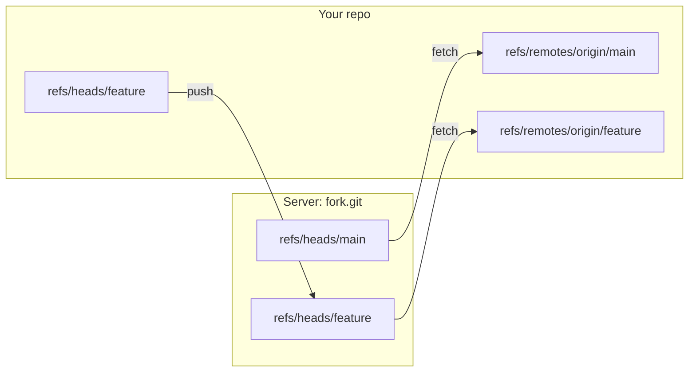
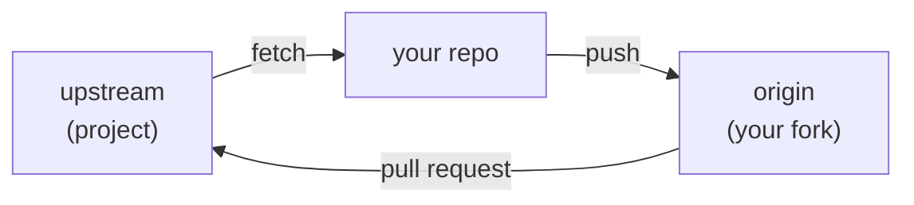

# Remotes

## Why care?

- "I ran `git push --force` after a rebase and deleted my colleague's commit."
- "`git pull` says _Not possible to fast-forward, aborting._ But I have `pull.rebase=true`!"
- "We work on a fork. Should my branch track `origin` or `upstream`? Where does `git push` go?"
- "Fetching our big repo is slow, even when nothing changed."

A remote is another repository. Everything on this page is about **copying objects** between two object databases and **moving refs** on both sides. Once you understand that, `fetch`, `push` and `pull` are simple, and you can force-push safely.

## The idea: a local record of the remote's refs

Your repository can't check the server all the time. So it keeps a **local record of where the server's refs pointed** the last time you talked to it: "at the last fetch, the server's `main` was at commit `2a341a7`". These records are your **remote-tracking refs**, such as `origin/main`.

- `git fetch` = ask the server for its refs, copy the objects you don't have, and **update your remote-tracking refs**. Your own branches don't change.
- `git push` = copy your objects to the server and ask it to move **its** ref. The server only accepts if no commits are lost.
- `git pull` = `fetch`, then combine the server's work into your branch (merge or rebase).



## Under the hood: refspecs

How does `fetch` know that the server's `refs/heads/main` goes to your `refs/remotes/origin/main`? A **refspec**, stored in your config when you clone:

```console
$ git config get --all remote.origin.fetch
+refs/heads/*:refs/remotes/origin/*
```

Read it as `source:destination`. "Take every ref under `refs/heads/` on the remote, and write it under `refs/remotes/origin/` here." The leading `+` means "update it even if it is **not a fast-forward**". That is right for remote-tracking refs: if somebody force-pushed the server's branch, your remote-tracking ref should show the server's real state.

Add a second remote and you get a second refspec:

```console
$ git remote add upstream ../upstream.git
$ git config get --all remote.upstream.fetch
+refs/heads/*:refs/remotes/upstream/*
$ git fetch -q upstream && git branch -r
  origin/HEAD -> origin/main
  origin/main
  upstream/HEAD -> upstream/main
  upstream/main
```

Remote-tracking refs are normal refs. They can be loose files or in `packed-refs`, like any other:

```console
$ find .git/refs/remotes -type f | sort; cat .git/packed-refs
.git/refs/remotes/origin/HEAD
.git/refs/remotes/upstream/HEAD
.git/refs/remotes/upstream/main
# pack-refs with: peeled fully-peeled sorted
2a341a78f4c46aafe8fd174cd7edab702b539591 refs/remotes/origin/main
```

`origin/HEAD` is a symbolic ref to the remote's default branch. Git also created `upstream/HEAD` on fetch; `fetch.followRemoteHEAD` (and `remote.<name>.followRemoteHEAD`) controls that.

Refspecs explain a lot of "why":

- **Tags and notes.** The default refspec covers only `refs/heads/*`. Tags come along by a separate rule (tags that point into fetched history). Notes (`refs/notes/*`) don't come at all unless you add a refspec.
- **Fetching a PR.** GitHub publishes pull requests as `refs/pull/<n>/head`. `git fetch origin refs/pull/123/head:pr-123` uses a one-off refspec.
- **Deleting a remote branch.** `git push origin :old-branch` pushes "nothing" to `old-branch`. Same as `git push origin --delete old-branch`.

## Under the hood: what happens during a fetch

Run a fetch with `GIT_TRACE_PACKET=1`, and you see the messages between client and server. Here, upstream has one new commit:

```console
$ GIT_TRACE_PACKET=1 git fetch upstream 2>&1 | grep -E "fetch> (want|have|done|command)|fetch< (acknowledgments|ACK|NAK|ready|packfile)" | sed -E "s/^.*packet: +//"
fetch> command=ls-refs
fetch> command=fetch
fetch> want eb0478bae4b5c6fe4813bbeb2c4aec5f6b058322
fetch> have 64cbed20f291163941e1339e3d6da17986b39958
fetch> have b9eda4df07848e633566a6ec0a1eef3a1c743069
fetch> have d2ae877a732d8e6c92a526f855f4b8f9233069ad
fetch> have 2a341a78f4c46aafe8fd174cd7edab702b539591
fetch< acknowledgments
fetch< ACK 2a341a78f4c46aafe8fd174cd7edab702b539591
fetch< ready
fetch< packfile
$ git rev-parse upstream/main~1 upstream/main
2a341a78f4c46aafe8fd174cd7edab702b539591
eb0478bae4b5c6fe4813bbeb2c4aec5f6b058322
```

Four steps:

1. **`ls-refs`**: "which refs do you have, and where do they point?"
2. **`want`**: the client asks for the tips it does not have (`eb0478b`, the new `upstream/main`).
3. **`have`**: the client lists commits it already has, newest first. This is **negotiation**.
4. The server answers `ACK 2a341a7`: "I know that one too, it's a common commit". Now it knows the client has `2a341a7` and everything below it. It says `ready` and sends a **packfile** with only the missing objects: the new commit, its tree and its blob.

This is why fetch is efficient: the server computes `want minus everything reachable from the common haves` and sends only that, often as a thin pack with deltas against objects you already have (see [Storage](storage.md)).

### Protocol v2

The trace above is **protocol version 2**. When `protocol.version` is not set, Git uses 2 and falls back to 0 if the server does not support it. The start of a v2 conversation:

```console
$ GIT_TRACE_PACKET=1 git ls-remote ../upstream.git 2>&1 | sed -n 1,25p
10:09:08.434408 pkt-line.c:85           packet:  upload-pack> version 2
10:09:08.434475 pkt-line.c:85           packet:  upload-pack> agent=git/2.56.1-Linux
10:09:08.434496 pkt-line.c:85           packet:    ls-remote< version 2
10:09:08.434534 pkt-line.c:85           packet:  upload-pack> ls-refs=unborn
10:09:08.434557 pkt-line.c:85           packet:    ls-remote< agent=git/2.56.1-Linux
10:09:08.434562 pkt-line.c:85           packet:    ls-remote< ls-refs=unborn
10:09:08.434571 pkt-line.c:85           packet:  upload-pack> fetch=shallow wait-for-done
10:09:08.434609 pkt-line.c:85           packet:  upload-pack> server-option
10:09:08.434621 pkt-line.c:85           packet:    ls-remote< fetch=shallow wait-for-done
10:09:08.434645 pkt-line.c:85           packet:  upload-pack> object-format=sha1
10:09:08.434658 pkt-line.c:85           packet:    ls-remote< server-option
10:09:08.434672 pkt-line.c:85           packet:    ls-remote< object-format=sha1
10:09:08.434672 pkt-line.c:85           packet:  upload-pack> 0000
10:09:08.434693 pkt-line.c:85           packet:    ls-remote< 0000
10:09:08.434718 pkt-line.c:85           packet:    ls-remote> command=ls-refs
10:09:08.434750 pkt-line.c:85           packet:    ls-remote> agent=git/2.56.1-Linux
10:09:08.434758 pkt-line.c:85           packet:  upload-pack< command=ls-refs
10:09:08.434795 pkt-line.c:85           packet:    ls-remote> object-format=sha1
10:09:08.434807 pkt-line.c:85           packet:  upload-pack< agent=git/2.56.1-Linux
10:09:08.434839 pkt-line.c:85           packet:    ls-remote> 0001
10:09:08.434849 pkt-line.c:85           packet:  upload-pack< object-format=sha1
10:09:08.434883 pkt-line.c:85           packet:    ls-remote> peel
10:09:08.434889 pkt-line.c:85           packet:  upload-pack< 0001
10:09:08.434927 pkt-line.c:85           packet:    ls-remote> symrefs
10:09:08.434939 pkt-line.c:85           packet:  upload-pack< peel
```

The server first lists its **capabilities** (`ls-refs`, `fetch=shallow`, `object-format=sha1`, ...). Then the client sends **commands**. The big change from v0: in v0, the server sent **every ref it has** as the first thing, before the client could say anything. With 80,000 tags, that is megabytes for every fetch, even when nothing changed. In v2, `ls-refs` accepts `ref-prefix` arguments, so `git fetch origin main` only asks about `refs/heads/main`.

### Transports: SSH and smart HTTP

The pack protocol is the same; only the pipe differs.

- **SSH**: the client runs a program on the server through SSH, for example `ssh git.example.com "git-upload-pack '/project.git'"` for a fetch, or `git-receive-pack` for a push. Then they talk over the SSH connection. Authentication is your SSH key.
- **Smart HTTP**: the client sends `GET $GIT_URL/info/refs?service=git-upload-pack`, then `POST $GIT_URL/git-upload-pack` with its wants and haves. The response is the pack. Authentication is a username and a token, given by a **credential helper** (below).
- **`file://`** and local paths (used in this book's sandbox) run `upload-pack` locally through a pipe.

## Under the hood: what push checks

`git push origin feature` sends the objects the server is missing, then asks: "please set `refs/heads/feature` from X to Y". The server checks that **Y contains X**, so that the update is a fast-forward and nobody's commits are lost. If not:

```console
$ git push origin feature
To ../fork.git
 ! [rejected]        feature -> feature (fetch first)
error: failed to push some refs to '../fork.git'
hint: Updates were rejected because the remote contains work that you do not
hint: have locally. This is usually caused by another repository pushing to
hint: the same ref. If you want to integrate the remote changes, use
hint: 'git pull' before pushing again.
hint: See the 'Note about fast-forwards' in 'git push --help' for details.
```

A reviewer had pushed a fix to our branch, and we had amended our commit. Fetch and look:

```console
$ git fetch origin
From ../fork
   d2ae877..b9eda4d  feature    -> origin/feature
$ git status -sb | head -1
## feature...origin/feature [ahead 1, behind 2]
$ git log --oneline --left-right feature...origin/feature
< 8590c6a feature work (amended)
> b9eda4d reviewer fix
> d2ae877 feature work
```

Ahead 1, behind 2: the branches **diverged**. A plain `--force` would replace `b9eda4d` with `8590c6a` and the reviewer's fix would be gone from the server.

### `--force-with-lease` and `--force-if-includes`

`--force-with-lease` is a **compare-and-swap**. It says: "set `feature` to Y, but **only if it is still at the value I expect**". The expected value is, by default, your remote-tracking ref `origin/feature`. If somebody pushed since your last fetch, the server's ref differs from your `origin/feature`, and the push is refused.

The weak spot: your `origin/feature` is updated by **every** fetch. If your editor or a background job (`git maintenance` prefetch does not count; it writes to `refs/prefetch/`) runs `git fetch`, your remote-tracking ref already shows the reviewer's commit. Now the lease matches, and you overwrite the commit you never looked at. The `git push` manual warns about exactly this.

`--force-if-includes` fixes this gap. In the words of the manual, used together with `--force-with-lease` it will "verify if updates from the remote-tracking refs that may have been implicitly updated in the background are integrated locally before allowing a forced update". So a commit you only fetched, but never brought into your local branch, blocks the push.

```sh
git push --force-with-lease --force-if-includes origin feature
```

To be fully explicit, give the expected value yourself: `git push --force-with-lease=feature:<sha-you-reviewed> origin feature`. The manual notes that this is the only form whose behaviour is not marked experimental.

!!! tip "Make it the default"

    With an alias, you never need to type `--force`:
    `git config --global alias.pushf "push --force-with-lease --force-if-includes"`.
    Many teams also turn on branch protection on the server, so main cannot be force-pushed at all.

## Under the hood: pull = fetch + merge or rebase

`git pull` runs `git fetch`, then integrates `@{u}` (the upstream of the current branch) into it. There are four ways to integrate:

| Option / config                     | Does                               |
| ----------------------------------- | ---------------------------------- |
| `--ff-only` / `pull.ff=only`        | Fast-forward or fail. The default. |
| `--rebase` / `pull.rebase=true`     | Rebase your commits onto `@{u}`    |
| `--no-rebase` / `pull.rebase=false` | Merge `@{u}` into your branch      |
| `--squash`                          | Squash-merge                       |

The `git pull` manual in 2.56 says `--ff-only` is the default "when no method for reconciling divergent histories is provided". This prevents unexpected merge commits like `Merge branch 'main' of github.com:...` in every PR.

### What happens with **both** `pull.ff=only` and `pull.rebase=true`?

This setup's dotfiles used to set both. On a diverged branch:

```console
$ git -c pull.ff=only -c pull.rebase=true pull
hint: Diverging branches can't be fast-forwarded, you need to either:
hint:
hint: 	git merge --no-ff
hint:
hint: or:
hint:
hint: 	git rebase
hint:
hint: Disable this message with "git config set advice.diverging false"
fatal: Not possible to fast-forward, aborting.
```

**`pull.ff=only` wins.** A plain `git pull` never rebases. It fast-forwards, or it stops and lets you choose. With these two settings, you rebase only when you say so on the command line:

```console
$ git pull --rebase
...
Successfully rebased and updated refs/heads/feature.
```

(The `...` hides a hint about a skipped commit.) A command-line `--rebase` beats the `pull.ff=only` config. That is a reasonable combination ("never surprise me"), but know that `pull.rebase=true` alone does nothing for diverged branches here. If you want `git pull` to rebase automatically, remove `pull.ff=only`. That is what this setup now does. With only `pull.rebase=true`, the same diverged branch:

```console
$ git -c pull.rebase=true pull
Successfully rebased and updated refs/heads/main.
```

Git Town's `git sync` (below) also rebases, branch by branch.

## Under the hood: credential helpers

For HTTPS, Git asks a **credential helper** for a username and password (or token). The protocol is simple text on stdin/stdout. You can see it with a minimal test helper:

```console
$ printf 'protocol=https\nhost=git.example.com\n\n' | git -c credential.helper='!f() { echo username=you; echo password=s3cret; }; f' credential fill
protocol=https
host=git.example.com
username=you
password=s3cret
```

Git sends what it knows (`protocol`, `host`), the helper adds `username` and `password`. Real helpers store the secret in the OS keychain (`osxkeychain`, Git Credential Manager), in memory (`cache`), or get it from another tool.

This setup uses three helpers, chosen by config:

- `credential.https://github.com.helper = !gh auth git-credential`: the GitHub CLI hands out its own token for GitHub. Only loaded for repos with a GitHub remote (see [`includeIf hasconfig`](config-hooks-signing.md)).
- On Linux (WSL), a platform file sets `cache --timeout=86400`: keep credentials in memory for a day. On macOS, Git Credential Manager.
- The empty line `helper =` before each one **resets** the list. Helpers add up across config files; an empty value clears the earlier ones, so only the next helper is used.

## Under the hood: forks and the triangular workflow

On open source, and in many companies, you can't push to the main repo. You **fork** it. Now there are two remotes:

- **`upstream`**: the real project. You **fetch** from it.
- **`origin`**: your fork. You **push** to it, and open PRs from it.



That is a **triangle**. Git supports it with two settings. A new branch from `upstream/main` tracks it (so `git status` and `git rebase` compare against the real project), and `remote.pushDefault` sends every push to your fork:

```console
$ git config set remote.pushDefault origin
$ git config set push.default current
$ git switch -q -c topic2 upstream/main
$ echo t2 > t2.txt && git add . && git commit -qm "topic2 work"
$ git push -q
$ git rev-parse --symbolic-full-name topic2@{u} topic2@{push}
refs/remotes/upstream/main
refs/remotes/origin/topic2
$ git status -sb | head -1
## topic2...upstream/main [ahead 1]
```

Two different refs: `@{u}` (where changes come **from**) is `upstream/main`, and `@{push}` (where they go **to**) is `origin/topic2`. `push.default=current` matters here: with the default `simple`, Git refuses to push a branch whose upstream has a **different name** on a different remote. Before setting it, the same question failed:

```console
$ git rev-parse --symbolic-full-name feature@{u} feature@{push}
fatal: cannot resolve 'simple' push to a single destination
refs/remotes/upstream/main
```

The resulting config, for reference:

```console
$ git config list --local | grep -E "^(branch|remote|push)\."
remote.origin.url=../fork.git
remote.origin.fetch=+refs/heads/*:refs/remotes/origin/*
branch.main.remote=origin
branch.main.merge=refs/heads/main
remote.upstream.url=../upstream.git
remote.upstream.fetch=+refs/heads/*:refs/remotes/upstream/*
remote.pushdefault=origin
branch.feature.remote=origin
branch.feature.merge=refs/heads/feature
branch.topic2.remote=upstream
branch.topic2.merge=refs/heads/main
push.default=current
```

## Git Town: a stacked-branch tool on top

Doing all of this by hand (fetch upstream, rebase each branch of a stack onto its parent, push, open a PR) is a lot of typing. **Git Town** automates it with plain Git commands. This setup uses it through aliases: `git hack`, `git append`, `git sync`, `git propose`, and more.

The one thing Git Town adds is a **parent for each branch**, stored in normal git config:

```console
$ git town hack kitchen
... (Git Town first prints the git commands it runs)
branch kitchen is now a child of main

branch kitchen is now a feature branch
$ git town append kitchen-ui
branch kitchen-ui is now a child of kitchen

branch kitchen-ui is now a feature branch
$ git config list --local | grep -i town
git-town.main-branch=main
git-town.sync-feature-strategy=rebase
git-town-branch.kitchen.parent=main
git-town-branch.kitchen.branchtype=feature
git-town-branch.kitchen-ui.parent=kitchen
git-town-branch.kitchen-ui.branchtype=feature
$ git town branch
  main
    kitchen
*     kitchen-ui
  feature
  topic2
```

With the parents known:

- `git hack x`: new feature branch `x` off the main branch.
- `git append x` / `git prepend x`: new branch on top of / below the current one in the stack.
- `git sync` (here an alias for `git town sync --all`): for each local branch, sync its ancestors, pull its own updates, bring in the parent branch, and push. Git Town's help says it **merges** the parent; this setup sets `sync-feature-strategy = rebase`, so it **rebases** onto the parent instead. With an `upstream` remote, main is also synced with upstream. This is the rebase that `pull.ff=only` does not do.
- `git propose`: sync the branch, then open the forge's new-PR page, so the PR only shows the changes against the immediate parent branch.

Everything it does is ordinary Git, so the rest of this chapter still applies. `git town undo` exists for when it does something you did not expect, and the reflog is always there too.

## Traps

- **`git push --force`.** Use `--force-with-lease --force-if-includes`, or an explicit `--force-with-lease=branch:sha`.
- **Background fetches** that silently "renew" your lease.
- **Expecting `pull.rebase=true` to rebase** when `pull.ff=only` is also set. It won't.
- **Wrong push target in a fork.** Check with `git rev-parse --symbolic-full-name @{push}` before the first push.
- **Fetching all tags of a huge repo every time.** Use protocol v2 (default) and narrower refspecs, or `--no-tags`.
- **Assuming notes and other refs are pushed.** Only what your refspec or command line names.

## Check yourself

??? question "1. What does the `+` in `+refs/heads/*:refs/remotes/origin/*` do, and why is it OK there?"

    It allows non-fast-forward updates of the destination refs. Remote-tracking refs only mirror the
    server, so if the server's branch was force-pushed, your mirror should follow.

??? question "2. In a fetch, what are `want` and `have` lines?"

    `want` = tips the client needs. `have` = commits the client already has. The server finds common
    commits (`ACK`), and sends only objects reachable from the wants but not from the common commits.

??? question "3. Why can `--force-with-lease` still overwrite a colleague's work?"

    By default it compares the server's ref to your remote-tracking ref. Any `git fetch` updates that
    ref, even one you did not look at, so the lease "matches". Add `--force-if-includes`, or give an
    explicit expected sha.

??? question "4. With `pull.ff=only` and `pull.rebase=true`, what does `git pull` do on a diverged branch?"

    It fails with "Not possible to fast-forward, aborting". `pull.ff=only` wins over the config
    `pull.rebase`. `git pull --rebase` on the command line does rebase.

??? question "5. In a fork workflow, what should `@{u}` and `@{push}` be for a feature branch?"

    `@{u}` = `upstream/main` (the real project, to rebase on). `@{push}` = `origin/<branch>` (your
    fork). Set `remote.pushDefault=origin` and `push.default=current`.

## Recap

- Remote-tracking refs (`refs/remotes/<remote>/*`) are your local record of another repo's refs. A **refspec** maps their refs to yours.
- Fetch = `ls-refs`, then `want`/`have` negotiation, then one pack of the missing objects. Protocol v2 lets the client ask only for the refs it needs.
- SSH runs `git-upload-pack`/`git-receive-pack` on the server. Smart HTTP does the same over `GET info/refs` + `POST`.
- Push must be a **fast-forward**, unless forced. Force safely: `--force-with-lease --force-if-includes`.
- `pull` = fetch + integrate. Default is `--ff-only`. Config `pull.ff=only` beats config `pull.rebase=true`.
- Credential helpers speak a tiny text protocol. An empty `helper =` resets the list.
- Forks: fetch from `upstream`, push to `origin`, via `remote.pushDefault` and `push.default=current`.
- Git Town stores a parent per branch and automates stacked rebases (`sync`) and PRs (`propose`).

Next: when things go wrong, and digging in the past. [Recovery and history](recovery-and-history.md).
