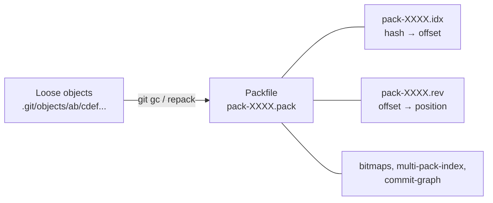
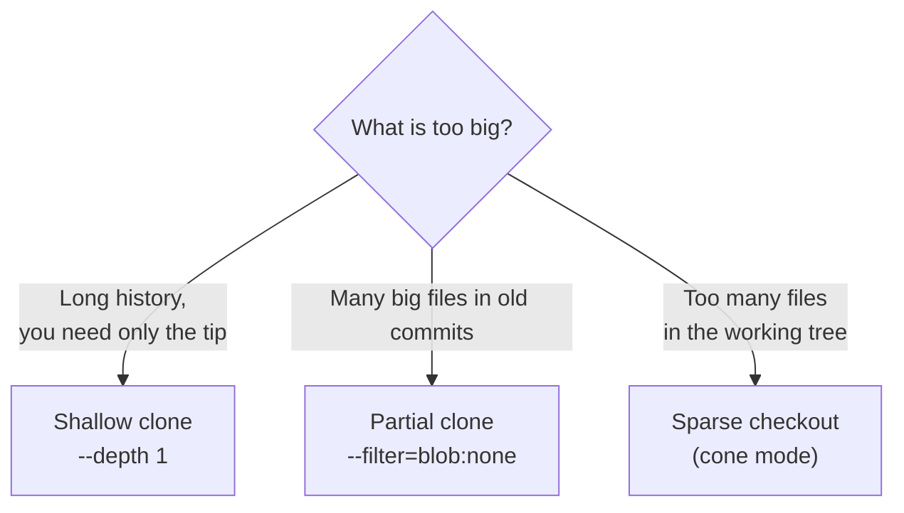

# Storage: packs and big repos

## Why care?

- "Every commit stores a full snapshot. So a 50 KB file changed 1,000 times costs 50 MB?"
- "Cloning our monorepo takes 20 minutes and 30 GB. Most people only work in one folder."
- "I deleted a branch with a leaked secret and ran `git gc`. The object is still there. Why?"

Git's object model ([Objects](objects.md)) sounds wasteful: full snapshots, one compressed file per object. In practice, Git repos are very small. This page shows the second layer that makes that true, and the tools for repos that are still too big.

## The idea: loose objects and packfiles

A new object is first stored as a **loose object**: one compressed file per object. Loose objects are easy to add, but they take a lot of room and are slow to search.

From time to time, Git moves loose objects into one big, ordered file (a **packfile**) with an index (the `.idx` file) to find objects fast. Inside a pack, when two versions of a file are almost the same, Git stores one in full and the other as **"the same as that one, except these bytes"**. That is a **delta**.



## Under the hood: loose vs packed

Make a 48 KB file and change one line at the end, five times:

```console
$ stat -c "%s %n" big.txt
48929 big.txt
$ git count-objects -v
count: 15
size: 100
in-pack: 0
packs: 0
size-pack: 0
prune-packable: 0
garbage: 0
size-garbage: 0
```

Fifteen loose objects (5 blobs, 5 trees, 5 commits), 100 KB on disk: each version of the file is stored in full, compressed. Now pack:

```console
$ git gc --quiet
$ git count-objects -v
count: 0
size: 0
in-pack: 15
packs: 1
size-pack: 13
prune-packable: 0
garbage: 0
size-garbage: 0
$ ls .git/objects/pack/
pack-e99c15ed6c42a425139cd64a6bb855e2f8492791.idx
pack-e99c15ed6c42a425139cd64a6bb855e2f8492791.pack
pack-e99c15ed6c42a425139cd64a6bb855e2f8492791.rev
```

100 KB became 13 KB. Three files:

- `.pack`: the objects themselves, one after another.
- `.idx`: a sorted table from object hash to byte offset in the pack. A lookup is a binary search.
- `.rev`: the **reverse index**, from offset in the pack back to the object. With it, Git knows where each object ends without scanning the pack.

### Deltas: look inside the pack

```console
$ git verify-pack -v .git/objects/pack/pack-*.idx
5440dd7f2af8b3a7b7fad2b20f6478c12b5a11b2 commit 193 139 12
5499f6f175eb2bd40c26864214c6b86539fa5860 commit 193 139 151
01d42f07b0a03e2c07cf26c11593be0569e9065d commit 193 139 290
dc4dfe08e6b6c6a2e0e8f2e8e75afaec98c49704 commit 193 139 429
6657778cc91cf1f9ad37a43206b8f3f71e2ec1dc commit 145 110 568
95fcae45a7176c7d1e189a30e24d9b3117e57456 blob   48929 11628 678
b8c668b323a12157f6bf817ffeff1245226a5c53 tree   35 46 12306
738f51ff18dca2fa4bf03ae7d8d3b3053107b5ba tree   35 46 12352
93bdf4051798f36947ccc8b1ed7f119de10435e6 blob   9 20 12398 1 95fcae45a7176c7d1e189a30e24d9b3117e57456
80d2f2aa0b82a8cd499b5236d8ebb65fd3ab54f2 tree   35 46 12418
4d7e069022b39f61092e1cffdee2d807d68be589 blob   9 20 12464 1 95fcae45a7176c7d1e189a30e24d9b3117e57456
568101d79b9f5e15dab0a580a643027319ee6d26 tree   35 46 12484
1fae976b7ffbac7bacae5221f6f8652e9ca1ebaf blob   9 20 12530 1 95fcae45a7176c7d1e189a30e24d9b3117e57456
f9a45d78e24d2f322d49c04f53c7ee18f892e133 tree   35 46 12550
cd9c365120f831949265f955e57b1a842eb6d844 blob   9 21 12596 1 95fcae45a7176c7d1e189a30e24d9b3117e57456
non delta: 11 objects
chain length = 1: 4 objects
.git/objects/pack/pack-e99c15ed6c42a425139cd64a6bb855e2f8492791.pack: ok
```

The columns are: hash, type, size, size in the pack, offset. Deltas have two more: **chain depth** and the **base object**.

Which blob is which version? Ask the log:

```console
$ git log --format="%h %s" --raw | grep -E "^[0-9a-f]{7} |big"
5440dd7 v5
:100644 100644 93bdf40 95fcae4 M	big.txt
5499f6f v4
:100644 100644 4d7e069 93bdf40 M	big.txt
01d42f0 v3
:100644 100644 1fae976 4d7e069 M	big.txt
dc4dfe0 v2
:100644 100644 cd9c365 1fae976 M	big.txt
6657778 v1
:000000 100644 0000000 cd9c365 A	big.txt
```

Now read the pack again:

- `95fcae4` is **v5, the newest version**. It is stored **whole**: 48,929 bytes, 11,628 compressed.
- The four **older** versions are deltas of **9 bytes** each, all based on `95fcae4`.

That is backwards from what most people expect ("v1 plus changes"). This is deliberate. You read the newest version most often (checkout, diff, blame on today's code), so it should be the fastest to get: no delta to apply. Old versions are rare, so they pay the cost.

Some more facts about deltas:

- Deltas are **only in packs**. The object model ([Objects](objects.md)) still sees full snapshots. Deltas are a storage detail, invisible to every command.
- A delta can be based on **any** object of the same type, not only "the previous version of this file". Git picks candidates with a heuristic (similar names and sizes), and tries them within a **window** (`pack.window`, default 10).
- Deltas can chain: A is a delta of B, which is a delta of C. Long chains save space but cost time to read. `pack.depth` (default 50) limits them.

!!! tip "A big `git gc --aggressive` is rarely worth it"

    `--aggressive` uses a bigger window and depth and recomputes all deltas. The manual warns it
    takes "much more time", and on a well-maintained repo it usually gains little over normal `gc`. Do it once after a large import, not on a
    schedule.

### Packs on the wire

When you push or fetch, Git does not send loose objects. It builds a pack with only the objects the other side does not have, sends it, and the receiver keeps it as a pack, or unpacks it into loose objects if it has fewer than 100 objects (`transfer.unpackLimit`). Deltas in that pack can refer to objects the receiver already has (a **thin pack**), and the receiver fixes them on arrival. More on that in [Remotes](remotes.md).

## Under the hood: gc, prune and the grace period

`git gc` does several jobs: pack loose objects and refs, expire old reflog entries, write the commit-graph, and remove **unreachable** objects. "Unreachable" means: no ref, no reflog entry and no index entry leads to it.

But Git does not delete unreachable objects at once:

```console
$ echo "secret draft" | git hash-object -w --stdin
2487061b54ff03c8eaf405b48c9b1e7838f6480d
$ git gc --quiet && ls .git/objects/pack/
pack-7686d68345dfb00569c5e3af832b5f774b4461f0.idx
pack-7686d68345dfb00569c5e3af832b5f774b4461f0.mtimes
pack-7686d68345dfb00569c5e3af832b5f774b4461f0.pack
pack-7686d68345dfb00569c5e3af832b5f774b4461f0.rev
pack-e99c15ed6c42a425139cd64a6bb855e2f8492791.idx
pack-e99c15ed6c42a425139cd64a6bb855e2f8492791.pack
pack-e99c15ed6c42a425139cd64a6bb855e2f8492791.rev
$ git fsck --unreachable --no-reflogs
unreachable blob 2487061b54ff03c8eaf405b48c9b1e7838f6480d
```

A second pack appeared, with a `.mtimes` file. That is a **cruft pack**: unreachable objects, with a time for each one (`gc.cruftPacks`, default true). They stay there until they are older than the grace period: `gc.pruneExpire`, default **2 weeks**.

Why wait? Because another Git process may be working at the same time. A `git commit` in another terminal can write a blob first and point a ref at it a moment later. If `gc` deleted that blob in between, the repo would be corrupt. The grace period makes that race very unlikely. It also means **"I ran gc" is not "the secret is gone"**. See [filter-repo](recovery-and-history.md) for really removing data.

!!! warning "`git repack -a -d` deletes unreachable objects immediately"

    `gc` is careful. Low-level `repack` is not. With the cruft pack above, this ran:

    ```console
    $ git repack -a -d --write-bitmap-index --write-midx -q && ls .git/objects/pack/
    multi-pack-index
    multi-pack-index-d692d616bddaa2e1526b8b4009795d6ed484bc62.bitmap
    pack-e99c15ed6c42a425139cd64a6bb855e2f8492791.idx
    pack-e99c15ed6c42a425139cd64a6bb855e2f8492791.pack
    pack-e99c15ed6c42a425139cd64a6bb855e2f8492791.rev
    $ git cat-file -t 2487061b54ff03c8eaf405b48c9b1e7838f6480d
    fatal: git cat-file: could not get object info
    ```

    `-a` packs only what is **referenced**, and `-d` removes the old packs. The unreachable blob is
    gone, no grace period. Use `gc` or `maintenance` in daily life.

That command also shows two more files. The next section explains them, and the other helper files Git keeps next to the packs.

## Under the hood: the speed-up files

A big repo is not only slow because of size. It is slow because many commands **walk the commit graph**: `log --graph`, `merge-base`, "is this commit in that branch?", and the server side of every fetch. Git keeps a few extra files that make those walks fast.

### commit-graph and generation numbers

To walk history, Git must parse each commit object: decompress it, read the tree and parent lines. The **commit-graph** file (`.git/objects/info/commit-graph`) stores that data for all commits in one compact, fixed-width table: tree hash, parent positions, commit date and a **generation number**. `gc` writes it by default (`gc.writeCommitGraph=true`):

```console
$ ls .git/objects/info
commit-graph
packs
```

The generation number is the key part. Its rule: **if commit A has a smaller generation number than commit B, then A cannot reach B.** (Generation v1 is the "topological level": one more than the highest parent. Generation v2, the current one, is a "corrected commit date" that also follows the rule.) So when Git asks "is B an ancestor of A?", it can stop walking as soon as all commits on its walk have a generation number below B's. Without this, Git has to guess using commit dates, which can be wrong when clocks were off.

You notice this in `git log --graph`, `git merge-base`, `git branch --contains` and `git tag --contains` on big repos. `git commit-graph write --reachable --changed-paths` also adds **Bloom filters** per commit, which make `git log -- path` much faster.

### Reachability bitmaps

A server answering a clone must find "all objects reachable from these refs". That is a walk over every commit and every tree. A **bitmap** stores the answer for selected commits: one bit per object in the pack, set if the object is reachable. Combining bitmaps is fast bit math. Bitmaps matter mostly on servers and in CI caches. `git repack -a -d --write-bitmap-index` creates them.

### multi-pack-index

Over time a repo collects many packs (each fetch can add one). Looking up an object means checking each `.idx`. The **multi-pack-index** (`.git/objects/pack/multi-pack-index`) is one index over all packs. It lets Git keep many packs without paying for it on every lookup, and lets maintenance repack a few small packs at a time instead of everything.

## Under the hood: maintenance

`git gc --auto` runs after some commands when there are "too many" loose objects. It runs in the foreground, and on a big repo it can stop you for minutes. **`git maintenance`** is the modern way: small tasks, in the background, on a schedule.

```sh
git maintenance start      # register this repo and set up the OS scheduler
```

On Linux it uses systemd timers if available, otherwise cron. On macOS, launchd. It registers the repo with the `incremental` strategy:

| Task                 | Schedule | What it does                                                                   |
| -------------------- | -------- | ------------------------------------------------------------------------------ |
| `prefetch`           | hourly   | Fetch from all remotes into `refs/prefetch/`, so your real `git fetch` is fast |
| `commit-graph`       | hourly   | Update the commit-graph incrementally                                          |
| `loose-objects`      | daily    | Pack loose objects                                                             |
| `incremental-repack` | daily    | Combine small packs using the multi-pack-index                                 |
| `pack-refs`          | weekly   | Pack loose refs                                                                |
| `gc`                 | disabled | Not run, because it rewrites everything and deletes data                       |

The `prefetch` task does not move your `origin/*` refs, so it never changes what you see. It only downloads objects early.

## Under the hood: getting less data

Sometimes even a well-packed repo is too big. Git has three different ways to have less of it. They solve **different** problems.



### Partial clone: commits and trees now, blobs later

```console
$ git clone -q --filter=blob:none "file://$PWD/server.git" partial && cd partial
$ git config get remote.origin.promisor; git config get remote.origin.partialclonefilter
true
blob:none
$ git count-objects -v | grep in-pack
in-pack: 11
$ git rev-list --objects --all --missing=print | grep "^?"
?4d7e069022b39f61092e1cffdee2d807d68be589
?cd9c365120f831949265f955e57b1a842eb6d844
?1fae976b7ffbac7bacae5221f6f8652e9ca1ebaf
?93bdf4051798f36947ccc8b1ed7f119de10435e6
```

The clone got all commits and trees, and only the blobs needed for the checkout. Four old blobs are **missing**, and that is fine: the remote is a **promisor**. It promised to give them when asked. Now ask for an old diff:

```console
$ git log --oneline -1 -p HEAD~3 -- big.txt | tail -3
 line 4999
 line 5000
+change 2
$ git rev-list --objects --all --missing=print | grep "^?"
?4d7e069022b39f61092e1cffdee2d807d68be589
?93bdf4051798f36947ccc8b1ed7f119de10435e6
```

Git fetched the two blobs it needed, on demand. Everything works; some commands only need the network. Partial clone is the **best default for big repos**: full history for `log` and `blame`, without downloading every old binary. The server must allow it (`uploadpack.allowFilter`); the big forges do.

### Shallow clone: cut the history

```console
$ git clone -q --depth 1 "file://$PWD/server.git" shallow && cd shallow
$ git log --oneline
5440dd7 v5
$ cat .git/shallow
5440dd7f2af8b3a7b7fad2b20f6478c12b5a11b2
$ git rev-parse --is-shallow-repository
true
```

`.git/shallow` lists commits whose parents Git must pretend do not exist. Shallow clones are good for **CI builds that throw the clone away**. They are bad for development: `merge-base`, `log`, `blame` and `describe` can only see the commits you have, so they give incomplete or wrong answers. Prefer `--filter=blob:none` for humans.

### Sparse checkout: fewer files on disk

Partial and shallow clones reduce what is in `.git`. **Sparse checkout** reduces what is in your **working tree**: Git only writes some folders to disk.

```console
$ git clone -q --sparse "file://$PWD/mono" sparse && cd sparse
$ ls -A | grep -v "^.git$"
go.work
$ git sparse-checkout set services/orders
$ find . -path ./.git -prune -o -type f -print | sort
./go.work
./services/orders/README
$ cat .git/info/sparse-checkout
/*
!/*/
/services/
!/services/*/
/services/orders/
$ git config get core.sparseCheckoutCone
true
```

**Cone mode** (the default) only lets you pick **directories**. The generated pattern says: all files at the top level, nothing in subfolders, except `services/` top-level files, except `services/orders/` completely. Limiting patterns to directories lets Git decide with a quick prefix check instead of matching every path against every gitignore-style pattern, which is what made the old (non-cone) mode slow.

The index still knows every file. Files outside the cone get the **skip-worktree** bit:

```console
$ git ls-files -t | head
S docs/README
H go.work
S services/billing/README
H services/orders/README
S web/README
```

`S` = skip-worktree, `H` = normal. Combine sparse checkout with a partial clone, and blobs outside your folders are never downloaded at all.

### Scalar

`scalar` ships with Git. It is a wrapper that sets all of this up for a big repo in one command:

```sh
scalar clone https://example.com/big/monorepo.git
```

According to its manual, `scalar clone` fetches only commits and trees (a partial clone), enables sparse checkout with only the top-level directory, puts the worktree in `<enlistment>/src`, and starts background maintenance. `scalar register` does the setup for an existing clone.

## Large repo advice

In order of "do this first":

1. **Measure.** `git count-objects -vH` (size), and time `git status` and `git fetch`. Know which one is the problem.
2. **Run `git maintenance start`.** Background prefetch, commit-graph and incremental repack fix most "Git is slow" complaints on big repos.
3. **Clone with `--filter=blob:none`.** Full history, much less data.
4. **Turn on `feature.manyFiles` and fsmonitor** if `git status` is slow because of many files.
5. **Use sparse checkout** if people only need a few folders.
6. **Keep big binaries out of Git**, or use Git LFS (see [filters](config-hooks-signing.md)). Packfiles delta-compress text well and binaries badly.
7. **Don't use shallow clones for development.** Use them for throwaway CI jobs.

## Traps

- **Believing `gc` removes data now.** Unreachable objects survive in cruft packs for 2 weeks by default, and reflogs keep them reachable for 30 to 90 days.
- **Running `repack -a -d` or `prune --expire=now` while other Git commands run.** That is the race the grace period protects you from.
- **Committing generated files or binaries "just this once".** Every version stays in history forever, and binaries don't delta well.
- **Shallow clones on developer machines.** Strange merge bases, missing `describe` tags, incomplete `blame`.
- **`git gc --aggressive` on a schedule.** Expensive, small gain.

## Check yourself

??? question "1. A 50 KB text file was changed 1,000 times, one line each time. Roughly how much does the history cost after `gc`?"

    Not 50 MB. In a pack, one version (the newest) is stored whole, compressed, and the others are
    small deltas. Expect a size close to one compressed copy plus about 1,000 tiny deltas.

??? question "2. Why does Git store the newest version of a file whole and old versions as deltas?"

    Because the newest version is read most often (checkout, diff, blame). Old versions are rarely
    needed, so they pay the cost of applying a delta.

??? question "3. You deleted a branch that contained a secret, then ran `git gc`. Is the secret gone?"

    Usually not. The reflog may still reference the commits, and unreachable objects are kept in a
    cruft pack until `gc.pruneExpire` (2 weeks by default). And it is still on the server and in
    every clone. Treat the secret as leaked: rotate it, then rewrite history if needed.

??? question "4. What is the difference between `--depth 1` and `--filter=blob:none`?"

    `--depth 1` cuts history: you get only the last commit, and history commands give incomplete
    answers. `--filter=blob:none` keeps the full commit and tree history but downloads file content
    only when needed. The second is the better default for development.

??? question "5. What does a generation number let Git skip?"

    If A's generation number is smaller than B's, A cannot reach B. So when looking for ancestors,
    Git can stop walking down any path once generation numbers drop below the target's.

## Recap

- New objects start **loose**. `gc` and `maintenance` move them into **packfiles** with an `.idx` (and `.rev`).
- Packs use **deltas**. The newest version is stored whole, older versions are deltas against it.
- `gc` keeps unreachable objects for a **grace period** (2 weeks) in a cruft pack. `repack -a -d` does not.
- **commit-graph** with generation numbers speeds up graph walks. **Bitmaps** speed up "what is reachable". **multi-pack-index** makes many packs cheap.
- Use **`git maintenance start`** instead of foreground `gc --auto`.
- **Partial clone** (`--filter=blob:none`) for big history, **sparse checkout** (cone mode) for big trees, **shallow** only for throwaway CI. **Scalar** sets it all up.

Next: how Git combines two lines of work. [Merging and rebasing](merging.md).
