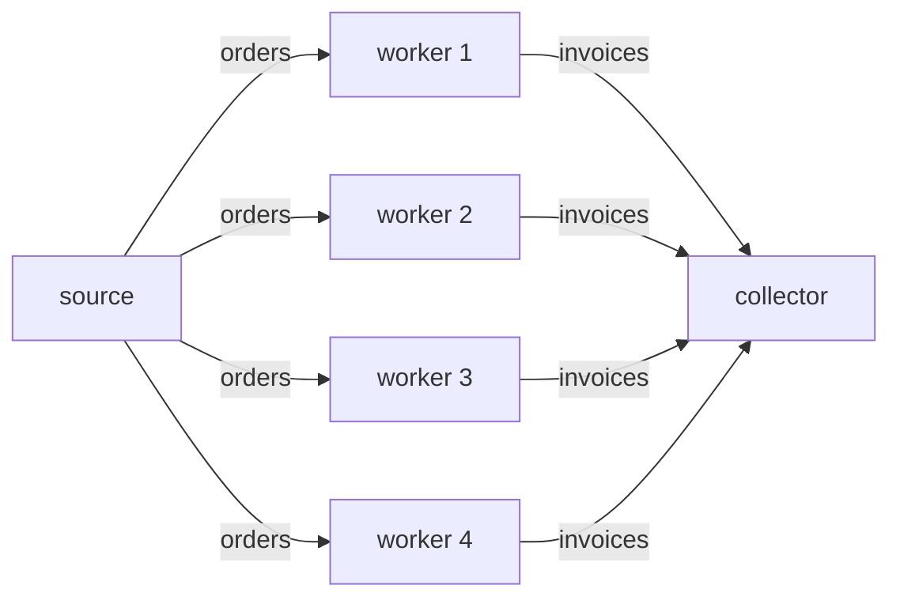

# Concurrency

## Why care?

Your order service gets a new feature: before it saves an order, it must check the price of every item with a pricing service. Each call takes 20 ms. An order with 30 items now takes **600 ms**. Customers notice.

A colleague says: "Just do the calls at the same time." Ten minutes later the code is 30× faster. It also has three new bugs: a counter that is sometimes wrong, a goroutine that never stops, and a crash that happens once a week in production.

Go makes it very **easy** to start concurrent work. It does not make it **automatically correct**. This page gives you the mental model and the patterns that real teams use, so you get the speed without the weekly crash.

## The idea: many cooks, one kitchen

Think of a restaurant kitchen.

- A **goroutine** is a cook. Hiring one is very cheap in Go.
- A **channel** is the pass: the counter where one cook puts a plate and another picks it up.
- A **mutex** is the key to the one shared fridge. Only the cook holding the key may open it.
- **Context** (next page) is the manager shouting "stop, the customer left!"

Two words people mix up:

- **Concurrency** is about _structure_: many tasks that are in progress at the same time, maybe taking turns on one CPU.
- **Parallelism** is about _execution_: tasks that really run at the same moment, on different CPU cores.

Go gives you concurrency. The runtime turns it into parallelism when there are free cores.

!!! quote "Go proverb"

    _Concurrency is not parallelism._ — Rob Pike

## Goroutines

A goroutine is a function that runs independently of the code that started it. You start one with the `go` keyword:

```go
go sendConfirmationEmail(order)
```

That line returns **immediately**. The email is sent "later", on some thread, at a time the runtime chooses.

### Under the hood: why goroutines are cheap

You learned in [Processes, threads and system calls](../fundamentals/processes-and-threads.md) that Go runs goroutines on OS threads with the **G-M-P model**: many Gs (goroutines) on a few Ms (OS threads), with GOMAXPROCS Ps (permission to run Go code). And in [Memory](../fundamentals/memory.md) you saw that a goroutine starts with a stack of a few kilobytes that grows when needed.

So a goroutine costs a few KB and a switch between goroutines happens in user space, without asking the kernel. An OS thread costs around a megabyte of reserved stack and a kernel context switch. That is why 100,000 goroutines is normal, and 100,000 threads is not.

!!! warning "Cheap is not free"

    Every goroutine holds memory, and every goroutine that is stuck forever holds it forever.
    "Cheap to start" does not mean "OK to forget about".

### The one rule that prevents most bugs

!!! abstract "Convention: know how every goroutine will stop"

    **Rule:** Never start a goroutine without knowing _when_ and _how_ it will end.
    Usually the answer is "when its input channel is closed" or "when its context is cancelled",
    and the code that started it waits for it (`sync.WaitGroup`, `errgroup`).

    **Why:** A goroutine has no owner and no handle. You can't kill it from outside. If it blocks
    forever, it leaks: its memory and everything it points to can never be freed. In a server that
    handles millions of requests, one leaked goroutine per request is an out-of-memory crash
    that takes days to appear. Clear ownership also makes shutdown work: you can only drain work
    that you know about.

### Waiting for goroutines: `sync.WaitGroup`

`main` does not wait for goroutines. When `main` returns, the program ends, finished or not. To wait, use a `sync.WaitGroup`. Since Go 1.25 it has a `Go` method that starts the goroutine **and** does the counting for you:

```go
var wg sync.WaitGroup
for _, o := range orders {
	wg.Go(func() {
		notify(o)
	})
}
wg.Wait() // blocks until every notify has returned
```

Before Go 1.25 you had to write `wg.Add(1)` before `go` and `defer wg.Done()` inside. Forgetting one of them was a classic bug. `go vet` now has a `waitgroup` check that catches `wg.Add(1)` written _inside_ the goroutine (too late).

!!! info "Loop variables are per-iteration (Go 1.22+)"

    In the code above every goroutine sees its _own_ `o`. Before Go 1.22 all goroutines shared one
    variable and often all saw the last order. If your `go.mod` says `go 1.22` or newer, you get the
    new, safe behaviour. You will still see `o := o` in old code; it is no longer needed.

## Channels

A channel is a typed pipe between goroutines. One side sends, the other side receives.

```go
ch := make(chan Invoice)     // unbuffered
ch := make(chan Invoice, 10) // buffered: room for 10 values
ch <- inv                    // send
inv := <-ch                  // receive
inv, ok := <-ch              // ok == false: channel is closed and empty
close(ch)                    // no more values will be sent
for inv := range ch { ... }  // receive until closed
```

### Unbuffered: a handshake

An unbuffered channel has no storage. A send **waits until a receiver takes the value**, and a receive waits until a sender gives one. The two goroutines meet, like handing a plate from hand to hand.

That makes an unbuffered channel a **synchronisation point**: after the send returns, you _know_ the other side has the value.

### Buffered: a mailbox

A buffered channel with capacity N can hold N values. A send only blocks when the buffer is full. It decouples the speed of sender and receiver for short bursts.

!!! abstract "Convention: buffer size is 0 or 1, unless you can explain the number"

    **Rule:** Use unbuffered channels by default. Use a buffer of 1 for "fire one result and
    don't wait" (see the leak fix below). Any other size needs a reason you can write in a
    comment, like "one slot per worker".

    **Why:** A buffer does not make a slow consumer fast. It only hides the problem until the
    buffer is full, and then you get the same blocking, but later and under load, which is harder
    to debug. A big buffer also hides **backpressure**: the natural signal "slow down, I can't keep
    up". Unbuffered channels make timing problems show up early, in tests.

### Under the hood: what a channel is

`make(chan T, n)` allocates a `runtime.hchan` struct on the heap. Simplified:

```text
hchan
├── buf      → ring buffer with n slots (nil if unbuffered)
├── sendx, recvx  positions in the ring
├── qcount   values currently in the buffer
├── sendq    queue of goroutines waiting to send
├── recvq    queue of goroutines waiting to receive
├── closed   flag
└── lock     a small mutex that protects all of the above
```

So a channel is a **queue with a lock** plus lists of sleeping goroutines. When you send and no one is waiting, your goroutine is parked on `sendq` and the scheduler runs something else. When a receiver arrives, it takes the value and marks your goroutine runnable again. No OS thread is blocked. This is why a channel operation costs tens of nanoseconds, which is fast, but slower than a plain mutex. Channels are for coordination, not for counting things in a hot loop.

### The channel rules table

Learn this table by heart. Most channel bugs are one of its cells.

| Operation      | `nil` channel  | open channel                         | closed channel                                    |
| -------------- | -------------- | ------------------------------------ | ------------------------------------------------- |
| send `ch <- v` | blocks forever | blocks until received / buffer space | **panic**                                         |
| receive `<-ch` | blocks forever | blocks until a value arrives         | returns buffered values, then zero value, `false` |
| `close(ch)`    | **panic**      | OK                                   | **panic**                                         |

Try the closed-channel row:

```go
package main

import "fmt"

func main() {
	ch := make(chan int, 2)
	ch <- 1
	close(ch)
	v, ok := <-ch
	fmt.Println(v, ok) // buffered value still arrives
	v, ok = <-ch
	fmt.Println(v, ok) // closed and empty: zero value, ok=false
	ch <- 2            // panic
}
```

Output:

```text
1 true
0 false
panic: send on closed channel

goroutine 1 [running]:
main.main()
```

And a send with nobody listening, in a program with no other goroutines:

```text
fatal error: all goroutines are asleep - deadlock!

goroutine 1 [chan send]:
main.main()
	demo/main.go:7 +0x36
exit status 2
```

The runtime can only detect this when **every** goroutine is stuck. In a server, other goroutines are always alive (the HTTP listener, timers), so a stuck goroutine just sits there quietly. That is a leak, not a crash.

!!! abstract "Convention: only the sender closes, and only when receivers need to know"

    **Rule:** The goroutine that sends on a channel is the one that closes it. Receivers never
    close. If there are many senders, a separate goroutine closes after all senders are done
    (wait with a `WaitGroup`). You don't _have_ to close a channel: close it only to tell
    receivers "no more values", for example to end a `for range`.

    **Why:** Sending on a closed channel panics. Only the sender knows when it has finished
    sending, so only the sender can close safely. A channel is not a file: an unclosed channel
    that nobody references is simply garbage collected.

!!! abstract "Convention: use channel direction in function signatures"

    **Rule:** Write `func source(...) <-chan Order` (receive-only) and
    `func worker(in <-chan Order, out chan<- Invoice)`.

    **Why:** It documents who sends and who receives, and the compiler enforces it: a function
    with a `<-chan` cannot send on it or close it. One more class of bug becomes a compile error.

## `select`: waiting on many things

`select` waits until **one** of several channel operations can go ahead, and does that one. If several are ready, it picks one **at random** (so no case can starve the others).

```go
select {
case inv := <-results:
	save(inv)
case <-ctx.Done():
	return ctx.Err() // the caller gave up
case <-time.After(2 * time.Second):
	return errors.New("no result in time")
}
```

Three useful tricks:

- **A `default` case** makes `select` non-blocking: "send if you can, otherwise drop it". Useful for best-effort metrics, dangerous for real data.
- **Always add `<-ctx.Done()`** to a `select` that might block. That is how a goroutine learns it should stop.
- **A `nil` channel is never ready.** Set a channel variable to `nil` to switch off its `case` (for example after it was closed) without restructuring the loop.

## Sharing memory safely

Channels are not the only tool. Often the simple answer is a **mutex**.

!!! quote "Go proverb"

    _Don't communicate by sharing memory; share memory by communicating._

This proverb means: _prefer designs where data has one owner at a time and is passed along_. It does **not** mean "mutexes are bad". The standard library uses mutexes everywhere.

!!! abstract "Convention: channels to coordinate, mutexes to protect state"

    **Rule:** Use a channel when goroutines hand off work or signal events ("here is the next
    job", "I'm done", "stop"). Use a `sync.Mutex` when several goroutines read and update one
    piece of state (a cache, a counter, a map). Pick whatever makes the code simplest to read.

    **Why:** A channel moves _ownership_ of a value from one goroutine to another. A mutex guards a
    value that _stays in one place_. Using a channel to protect a map ("a goroutine that owns the
    map and answers requests") works, but it is more code, slower, and easier to deadlock than
    `mu.Lock(); m[k]++; mu.Unlock()`.

### Data races and the race detector

A **data race** happens when two goroutines access the same memory at the same time, at least one of them writes, and nothing orders the accesses. Here is the classic one:

```go
package main

import (
	"fmt"
	"sync"
)

func main() {
	var wg sync.WaitGroup
	hits := 0
	for range 1000 {
		wg.Go(func() {
			hits++ // data race: many goroutines write without sync
		})
	}
	wg.Wait()
	fmt.Println("hits:", hits)
}
```

Run it twice:

```text
hits: 973
hits: 994
```

Never 1000. Why? `hits++` is three CPU steps: load `hits` into a register, add 1, store it back (remember [CPU and registers](../fundamentals/cpu-and-registers.md)). Two cores can both load 41, both add 1, both store 42. One increment is lost.

Now run it with the **race detector**: `go run -race .` (here also with `-trimpath`, to keep the paths short):

```text
==================
WARNING: DATA RACE
Read at 0x00c0000181a8 by goroutine 8:
  main.main.func1()
      demo/main.go:13 +0x2e

Previous write at 0x00c0000181a8 by goroutine 11:
  main.main.func1()
      demo/main.go:13 +0x44

Goroutine 8 (running) created at:
  sync.(*WaitGroup).Go()
      sync/waitgroup.go:238 +0x72

Goroutine 11 (finished) created at:
  sync.(*WaitGroup).Go()
      sync/waitgroup.go:238 +0x72
==================
...
hits: 877
Found 2 data race(s)
exit status 66
```

It shows the line, both goroutines, and where they were started. The race detector instruments every memory access at compile time and tracks which accesses are ordered. The Go documentation says it can use 5–10× more memory and 2–20× more CPU time, so you don't ship with it. You run your **tests** with it.

!!! abstract "Convention: `go test -race` in CI, always"

    **Rule:** Run your test suite with `-race` in CI. Treat any report as a bug, even if "it
    works".

    **Why:** A data race is not "a small inaccuracy". The Go memory model says a program with a
    race has no guaranteed behaviour: you can read half-written values, see a map in a broken
    state (`fatal error: concurrent map writes`), or get crashes far away from the bug. Races
    hide on your laptop and appear under production load. The detector only finds races in code
    that actually runs, which is another reason to have good tests.

### The fix: a mutex and an atomic

```go
package main

import (
	"fmt"
	"maps"
	"sync"
	"sync/atomic"
)

// Stats counts requests per status. Safe for concurrent use.
type Stats struct {
	mu     sync.Mutex
	byCode map[int]int
	total  atomic.Int64
}

func NewStats() *Stats {
	return &Stats{byCode: make(map[int]int)}
}

func (s *Stats) Record(code int) {
	s.total.Add(1)

	s.mu.Lock()
	defer s.mu.Unlock()
	s.byCode[code]++
}

func (s *Stats) Snapshot() (map[int]int, int64) {
	s.mu.Lock()
	defer s.mu.Unlock()
	return maps.Clone(s.byCode), s.total.Load() // a copy: callers can't race with us
}

func main() {
	s := NewStats()
	var wg sync.WaitGroup
	for i := range 1000 {
		wg.Go(func() {
			if i%10 == 0 {
				s.Record(500)
				return
			}
			s.Record(200)
		})
	}
	wg.Wait()
	fmt.Println(s.Snapshot())
}
```

`go run -race .` prints, with no warnings:

```text
map[200:900 500:100] 1000
```

Things to notice, all of which are conventions in real code:

- The mutex sits **next to the fields it protects**, and the type comment says "Safe for concurrent use". Readers know the rule without reading every method.
- `Lock` is directly followed by `defer Unlock`. Every return path unlocks, even a panic.
- `Snapshot` returns a **copy**. Returning the map itself would let callers read it without the lock: the race comes back through the back door.
- The `Stats` value is used through a pointer. A `sync.Mutex` must **never be copied** after first use; a copy is a second, unrelated lock. `go vet` has a `copylocks` check for exactly this.

### The `sync` toolbox

| Tool                                                                     | Use it for                                                                 | Watch out                                                             |
| ------------------------------------------------------------------------ | -------------------------------------------------------------------------- | --------------------------------------------------------------------- |
| `sync.Mutex`                                                             | Protecting shared state                                                    | Keep critical sections short. Never call slow I/O while holding it.   |
| `sync.RWMutex`                                                           | Many readers, rare writers, _and_ readers hold it for a while              | Slower than `Mutex` for short sections. Measure before switching.     |
| `sync.WaitGroup` (+ `Go`)                                                | Waiting for a group of goroutines                                          | Doesn't collect errors. Use `errgroup` for that.                      |
| `sync.Once`, `OnceFunc`, `OnceValue`                                     | Lazy one-time init (`OnceValue` also returns the result)                   | A panic inside is re-panicked on every call.                          |
| `sync/atomic` types (`atomic.Int64`, `atomic.Bool`, `atomic.Pointer[T]`) | Single counters, flags, swapping a config pointer                          | Only for _one_ value. Two atomics are not one atomic update.          |
| `sync.Map`                                                               | Caches where keys are written once and read many times                     | Not a general "concurrent map". A `map` + `Mutex` is usually clearer. |
| `sync.Pool`                                                              | Reusing temporary buffers on hot paths (see [Performance](performance.md)) | Objects can disappear at any GC. Not a cache.                         |
| `sync.Cond`                                                              | Rare. Waiting for a condition on shared state                              | Almost always a channel is easier to get right.                       |

## Under the hood: the memory model

Why does the mutex fix the race? Not because "only one goroutine runs at a time". Modern CPUs and compilers **reorder** memory reads and writes for speed, and each core has its own cache (see [Memory](../fundamentals/memory.md)). Without help, a write on core 1 may become visible on core 2 late, or in a different order.

The **Go memory model** defines when a write is guaranteed to be visible to a read. The key idea is **happens-before**: if event A happens before event B, then B sees everything A did. Inside one goroutine, statements happen in program order. Between goroutines, only **synchronisation** creates happens-before edges:

| Synchronisation              | Guarantee                                                          |
| ---------------------------- | ------------------------------------------------------------------ |
| `go f()`                     | The `go` statement happens before `f` starts                       |
| Channel send                 | A send happens before the matching receive completes               |
| Channel close                | `close` happens before a receive that returns because it is closed |
| Unbuffered channel           | The receive happens before the matching send completes             |
| Buffered channel, capacity C | The k-th receive happens before the (k+C)-th send completes        |
| `mu.Unlock()`                | Unlock n happens before Lock n+1 returns                           |
| `once.Do(f)`                 | `f` returning happens before any `once.Do` returns                 |
| `wg.Go(f)` / `wg.Done()`     | `f` returning happens before the `Wait` it unblocks returns        |
| `sync/atomic`                | Atomic operations are sequentially consistent, like a global order |

So in the pipeline below, the worker writes `out[i]` and then the WaitGroup tells `main` it is done. `main` reading `out` after `Wait()` is safe because of the `WaitGroup` row. Without that edge, it would be a race, even if `main` "obviously" reads later.

!!! tip "If you can't point to the edge, you have a race"

    When you share memory between goroutines, you should be able to point at the line that
    creates the happens-before edge: a channel operation, a lock, a `Wait`, an atomic. If you
    can't, run `-race` and you will probably find a report.

## Patterns that teams use

### Pipeline with fan-out and fan-in

A **pipeline** is a chain of stages connected by channels. **Fan-out** means several workers read from one channel. **Fan-in** means their results are merged into one channel.



```go
package main

import (
	"context"
	"fmt"
	"slices"
	"sync"
	"time"
)

type Item struct {
	SKU        string
	Quantity   int
	PriceCents int64
}

type Order struct {
	ID    int
	Items []Item
}

type Invoice struct {
	OrderID    int
	TotalCents int64
}

// source sends orders on a channel and closes it when done.
// It stops early if ctx is cancelled.
func source(ctx context.Context, orders []Order) <-chan Order {
	out := make(chan Order)
	go func() {
		defer close(out)
		for _, o := range orders {
			select {
			case out <- o:
			case <-ctx.Done():
				return
			}
		}
	}()
	return out
}

// invoice is one worker: it turns orders into invoices.
func invoice(ctx context.Context, in <-chan Order, out chan<- Invoice) {
	for o := range in {
		var total int64
		for _, it := range o.Items {
			total += int64(it.Quantity) * it.PriceCents
		}
		time.Sleep(10 * time.Millisecond) // pretend this is slow work
		select {
		case out <- Invoice{OrderID: o.ID, TotalCents: total}:
		case <-ctx.Done():
			return
		}
	}
}

// invoiceAll fans out to n workers and fans their results back in.
func invoiceAll(ctx context.Context, in <-chan Order, n int) <-chan Invoice {
	out := make(chan Invoice)
	var wg sync.WaitGroup
	for range n {
		wg.Go(func() { invoice(ctx, in, out) })
	}
	go func() {
		wg.Wait()  // all workers are done...
		close(out) // ...so nobody will send again: safe to close
	}()
	return out
}

func main() {
	ctx, cancel := context.WithCancel(context.Background())
	defer cancel()

	var orders []Order
	for id := range 20 {
		orders = append(orders, Order{ID: id, Items: []Item{{SKU: "MUG", Quantity: id + 1, PriceCents: 1250}}})
	}

	start := time.Now()
	var invoices []Invoice
	for inv := range invoiceAll(ctx, source(ctx, orders), 4) {
		invoices = append(invoices, inv)
	}
	slices.SortFunc(invoices, func(a, b Invoice) int { return a.OrderID - b.OrderID })

	fmt.Println("invoices:", len(invoices), "took:", time.Since(start).Round(10*time.Millisecond))
	fmt.Println("first:", invoices[0], "last:", invoices[len(invoices)-1])
}
```

Output (with `-race`, no warnings):

```text
invoices: 20 took: 50ms
first: {0 1250} last: {19 25000}
```

20 orders × 10 ms of work, split over 4 workers = 50 ms instead of 200 ms. Read the code again and check the stop rules:

- `source` stops when it ran out of orders **or** when `ctx` is cancelled, and it closes `out`.
- Each worker stops when `in` is closed **or** `ctx` is cancelled.
- One extra goroutine closes `out` only after **all** workers returned (many senders → one closer).
- Every send is inside a `select` with `ctx.Done()`. If `main` stopped reading early and called `cancel`, nothing would be stuck.
- Results arrive in random order, so `main` sorts. Concurrency usually throws away ordering; put it back on purpose if you need it.

### Bounded concurrency with `errgroup`

Most real "do these in parallel" code has three extra needs:

1. **Limit** how many run at once (the pricing service will rate-limit you).
2. **Return the first error**.
3. **Cancel the others** when one fails, so you don't waste work.

The package [`golang.org/x/sync/errgroup`](https://pkg.go.dev/golang.org/x/sync/errgroup) does exactly this. It is not in the standard library; it lives in the `golang.org/x/...` repositories, which are maintained by the Go team but released separately and without the Go 1 compatibility promise. In practice it is a standard dependency in almost every Go service. Add it with `go get golang.org/x/sync/errgroup`.

```go
package main

import (
	"context"
	"errors"
	"fmt"
	"log/slog"
	"os"
	"time"

	"golang.org/x/sync/errgroup"
)

var errUnknownSKU = errors.New("unknown SKU")

// lookupPrice pretends to call a pricing service.
func lookupPrice(ctx context.Context, sku string) (int64, error) {
	select {
	case <-time.After(20 * time.Millisecond): // network latency
	case <-ctx.Done():
		return 0, ctx.Err()
	}
	if sku == "BAD-1" {
		return 0, fmt.Errorf("lookup %q: %w", sku, errUnknownSKU)
	}
	return int64(len(sku)) * 100, nil
}

// prices looks up all SKUs, at most 3 at a time.
// The first error cancels the others.
func prices(ctx context.Context, skus []string) ([]int64, error) {
	g, ctx := errgroup.WithContext(ctx)
	g.SetLimit(3)

	out := make([]int64, len(skus)) // each goroutine writes its own index: no race
	for i, sku := range skus {
		g.Go(func() error {
			p, err := lookupPrice(ctx, sku)
			if err != nil {
				return err
			}
			out[i] = p
			return nil
		})
	}
	if err := g.Wait(); err != nil {
		return nil, err
	}
	return out, nil
}

func main() {
	ctx := context.Background()

	start := time.Now()
	p, err := prices(ctx, []string{"MUG", "T-SHIRT", "CAP", "SOCKS", "POSTER", "PIN"})
	fmt.Println(p, err, time.Since(start).Round(10*time.Millisecond))

	_, err = prices(ctx, []string{"MUG", "BAD-1", "CAP", "SOCKS", "POSTER", "PIN"})
	fmt.Println(err, errors.Is(err, errUnknownSKU))
	if err != nil {
		slog.Error("price lookup failed", "err", err)
		os.Exit(1)
	}
}
```

Output:

```text
[300 700 300 500 600 300] <nil> 40ms
lookup "BAD-1": unknown SKU true
2026/11/26 08:23:57 ERROR price lookup failed err="lookup \"BAD-1\": unknown SKU"
exit status 1
```

Six lookups of 20 ms, three at a time: 40 ms. The error is wrapped with `%w`, so the caller can still check it with `errors.Is` (see [Errors](errors.md)).

Two details make this correct:

- Writing to `out[i]` from many goroutines is **not** a race, because each goroutine writes a **different** element. Different elements are different memory. `g.Wait()` creates the happens-before edge before `main` reads `out`.
- `g.Go` **blocks** when 3 are already running. That is the limit. Goroutines are cheap, but the service on the other side is not: always limit fan-out to external systems.

!!! info "Worker pool or just a limit?"

    In other languages you build a "thread pool" because threads are expensive. In Go, starting
    a goroutine per task with a limit (`errgroup.SetLimit`, or a `chan struct{}` with N slots
    used as a semaphore) is usually simpler than a fixed pool. Use a fixed set of workers, like
    the pipeline above, when each worker holds something expensive (a DB connection, a big
    buffer) or when work arrives as a stream.

!!! abstract "Convention: let the caller decide about concurrency"

    **Rule:** Write functions that do their work **synchronously** and return the result. Let the
    caller add `go` (or an `errgroup`) if they want it in the background. Don't start goroutines
    inside a library function and return before they finish.

    **Why:** A synchronous function is easy to test, easy to reason about, and its errors have
    somewhere to go. If the caller wants concurrency, adding it is one line. If your function
    secretly starts goroutines, the caller can't wait for them, can't stop them, and can't get
    their errors. `prices` above is concurrent _inside_, but it waits for everything before it
    returns, so from the outside it is a normal function.

## Goroutine leaks

A **leak** is a goroutine that is blocked forever. It never finishes, and nothing can free it. Here is the most common leak in Go, found in many real codebases:

```go
package main

import (
	"errors"
	"fmt"
	"os"
	"runtime"
	"runtime/pprof"
	"time"
)

// fetch asks a slow backend and gives up after timeout.
func fetch(timeout time.Duration) (string, error) {
	result := make(chan string) // unbuffered: the bug
	go func() {
		time.Sleep(50 * time.Millisecond) // slow backend
		result <- "data"                  // blocks forever if nobody receives
	}()
	select {
	case r := <-result:
		return r, nil
	case <-time.After(timeout):
		return "", errors.New("timeout")
	}
}

func main() {
	for range 100 {
		_, _ = fetch(10 * time.Millisecond)
	}
	time.Sleep(100 * time.Millisecond)
	runtime.GC()
	fmt.Println("goroutines:", runtime.NumGoroutine())
	if err := pprof.Lookup("goroutineleak").WriteTo(os.Stdout, 1); err != nil {
		fmt.Println(err)
	}
}
```

Output:

```text
goroutines: 101
goroutineleak profile: total 100
100 @ 0x47f0ca 0x41421c 0x413e17 0x4e0816 0x484f21
#	0x4e0815	main.fetch.func1+0x35	demo/main.go:17
```

What happened: `fetch` timed out and returned. Nobody will ever read `result` again. The inner goroutine wakes up, tries to send, and waits for a receiver **forever**. 100 calls, 100 leaked goroutines. In a server, that is one leak per slow request, until the pod runs out of memory.

The fix is one character: `make(chan string, 1)`. Now the send always has room, the goroutine finishes, and the channel becomes garbage. Same program, after the fix:

```text
goroutines: 1
goroutineleak profile: total 0
```

!!! info "The `goroutineleak` profile"

    The Go 1.27 runtime has a `goroutineleak` profile in `runtime/pprof` (and on the
    `/debug/pprof/goroutineleak` endpoint of `net/http/pprof`). It uses the garbage collector's
    view of memory: if a goroutine is blocked on a channel or lock that **no running goroutine can
    reach anymore**, nobody can ever wake it up, so it is reported as leaked. It can't find every
    leak (a goroutine waiting on a channel that is still reachable but never used looks fine),
    but it finds the common ones with no extra code.

How teams prevent leaks:

1. **Every blocking send or receive has a way out**: a `case <-ctx.Done()`, or a buffer that guarantees the send can't block.
2. **Every goroutine has an owner who waits for it** (`WaitGroup`, `errgroup`). If you can't name the owner, that's a design smell.
3. **Tests check for leaks.** `testing/synctest` (see [Testing](testing.md)) runs concurrent code in a bubble with a fake clock. The test waits for every goroutine in the bubble to exit, and fails if they are deadlocked, so a leaked goroutine makes the test fail instead of hiding. Many teams also use `go.uber.org/goleak` in `TestMain`.
4. **Production watches the numbers.** Export `runtime.NumGoroutine()` as a metric. A line that only goes up is a leak.

## Traps

- **`time.After` in a long loop.** Each call makes a timer. In a `for { select { case <-time.After(d): ... } }` loop, prefer one `time.NewTimer` or `time.Ticker` that you `Reset` or `Stop`. (Since Go 1.23 unreferenced timers are collected, so it's no longer a leak, but it is still wasted work in hot loops.)
- **Ranging over a channel nobody closes.** `for v := range ch` only ends on `close`. If the sender just returns, the receiver blocks forever.
- **Holding a lock during I/O.** `mu.Lock(); http.Get(...); mu.Unlock()` makes every other goroutine wait for the network. Copy what you need, unlock, then do the slow call.
- **Concurrent map writes.** A plain `map` is not safe for concurrent writes. The runtime detects some cases and crashes with `fatal error: concurrent map writes`, which can't be recovered.
- **"It passed with `-race`, so it's safe."** The detector only sees races in code that ran. No test for the concurrent path means no report.
- **Panics in goroutines.** A panic in any goroutine kills the **whole program**, and `recover` in `main` can't catch it. If a goroutine runs code you don't trust, recover inside that goroutine and turn the panic into an error.
- **Unbounded fan-out.** `for _, x := range million { go call(x) }` opens a million connections. Always limit.

## Check yourself

??? question "1. What is the difference between concurrency and parallelism? Which one does `go f()` give you?"

    Concurrency is structure: several tasks in progress at once. Parallelism is execution:
    tasks running at the same instant on different cores. `go f()` gives you concurrency. The
    runtime runs goroutines in parallel when GOMAXPROCS > 1 and cores are free.

??? question "2. A function starts a goroutine that sends its result on an unbuffered channel, and then the function returns early on a timeout. What happens, and what are two fixes?"

    The goroutine blocks on the send forever: a goroutine leak. Fix 1: make the channel
    buffered with capacity 1, so the send never blocks. Fix 2: send inside a `select` that also
    has `case <-ctx.Done(): return`, and cancel the context when the function returns.

??? question "3. Ten goroutines each write `results[i]` for their own `i`. Then `main` calls `wg.Wait()` and reads `results`. Is that a data race?"

    No. Each goroutine writes a different element, which is different memory. And `wg.Wait()`
    returning happens after every goroutine's work, so `main` sees all writes. It _would_ be a
    race if they all `append`ed to the same slice, because `append` reads and writes the shared
    slice header.

??? question "4. Who should close a channel when four workers send results into it?"

    None of the workers, because each one doesn't know whether the others are done. A separate
    goroutine waits for all four (`wg.Wait()`) and then closes the channel. Rule: the sending side
    closes, and only once all senders are done.

??? question "5. Your teammate wraps a shared counter in a channel-owning goroutine \"because channels are the Go way\". What do you suggest?"

    For protecting a single piece of state, a `sync.Mutex` or an `atomic.Int64` is simpler,
    faster and harder to deadlock. The proverb is about designing ownership, not about banning
    mutexes. Channels are for handing off work and signalling.

## Recap

- Goroutines are cheap to start but not free to forget. **Know how each one stops**, and have an owner wait for it.
- Unbuffered channels are a handshake; buffered channels are a small mailbox. Default to 0 or 1.
- Only the sender closes. Use channel directions in signatures.
- `select` + `ctx.Done()` gives every blocking operation a way out.
- Use **mutexes for state**, **channels for coordination**. Never copy a mutex.
- The **memory model** says only synchronisation makes writes visible. Run **`-race`** in CI.
- For "do these in parallel", reach for **`errgroup`** with `SetLimit`.
- Find leaks with the `goroutineleak` profile, `synctest`, and a goroutine-count metric.

Next: [Context and cancellation](context.md), the tool that tells all those goroutines when to stop.
