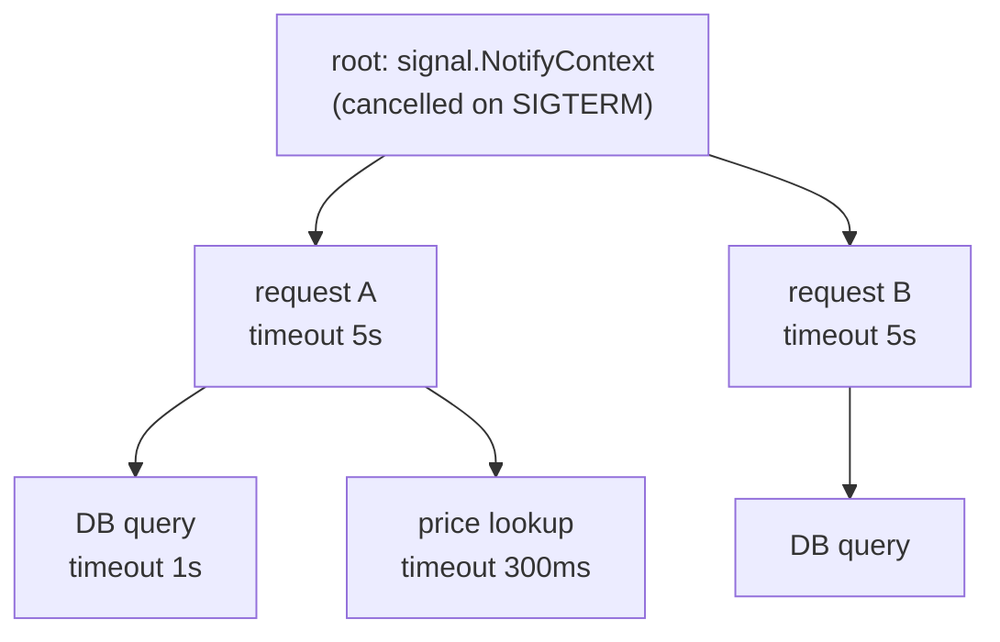

# Context and cancellation

## Why care?

A customer opens the "my orders" page. Your service starts a big database query. After 2 seconds the customer's browser gives up and closes the connection. Your service doesn't notice. The query runs for 30 seconds more, holding a database connection, and then your code carefully renders a response that nobody will ever read.

Now imagine a slow day at the database: every request becomes slow, users press refresh, and each refresh starts **another** query. Work for people who already left piles up until the database falls over. This is a **cascading failure**, and it is one of the most common ways real services go down.

The fix is a way to say "**stop, nobody needs this anymore**" that reaches every goroutine, query and HTTP call doing work for that request. In Go, that is `context.Context`.

## The idea: a job ticket

Think of a context as the **ticket** attached to a job in a busy workshop. The ticket says:

- **When the job must be finished** (a deadline).
- **Whether the job is cancelled** (someone tore up the order).
- **A few labels** that belong to this job only (the request ID, who asked for it).

Every worker who touches the job gets the ticket. When a worker hands part of the job to a helper, the helper gets a **copy** of the ticket, maybe with a shorter deadline. If the main ticket is torn up, every copy is torn up too.

That gives you a **tree**:



Cancellation flows **down** the tree, never up. Cancel request A, and its DB query and price lookup stop. Request B doesn't care. Shut down the server (cancel the root), and **everything** stops.

## The interface

`context.Context` is a small interface:

```go
type Context interface {
	Deadline() (deadline time.Time, ok bool) // when will this be cancelled automatically?
	Done() <-chan struct{}                   // closed when the work should stop
	Err() error                              // nil, context.Canceled or context.DeadlineExceeded
	Value(key any) any                       // request-scoped values
}
```

You never implement it yourself. You start from a root and **derive** children:

| Function                                        | Gives you                                                                        |
| ----------------------------------------------- | -------------------------------------------------------------------------------- |
| `context.Background()`                          | The empty root. Never cancelled. Use it in `main`, at startup, and in tests.     |
| `context.TODO()`                                | Same as `Background`, but says "I haven't wired the real context here yet".      |
| `WithCancel(parent)`                            | A child plus a `cancel` function                                                 |
| `WithCancelCause(parent)`                       | Same, but `cancel(err)` records **why**; read it with `context.Cause(ctx)`       |
| `WithTimeout(parent, d)` / `WithDeadline`       | A child that cancels itself after `d` (or at a time)                             |
| `WithTimeoutCause` / `WithDeadlineCause`        | Same, with a custom cause when the time runs out                                 |
| `WithValue(parent, key, val)`                   | A child that carries one extra value                                             |
| `WithoutCancel(parent)`                         | A child that keeps the parent's **values** but is **not** cancelled with it      |
| `AfterFunc(ctx, f)`                             | Runs `f` in its own goroutine when `ctx` is cancelled                            |
| `signal.NotifyContext(parent, os.Interrupt, …)` | A child that is cancelled when the process gets a signal (the root of a service) |

A child's deadline can only be **the same or earlier** than its parent's. If the parent has 100 ms left, `WithTimeout(parent, time.Hour)` still ends in 100 ms. A helper can't give itself more time than the job has.

## Try it in Go: a cancellation tree

```go
package main

import (
	"context"
	"errors"
	"fmt"
	"time"
)

var errShutdown = errors.New("server shutting down")

// query pretends to be a database call that takes d.
func query(ctx context.Context, name string, d time.Duration) error {
	select {
	case <-time.After(d):
		fmt.Printf("%-8s done\n", name)
		return nil
	case <-ctx.Done():
		fmt.Printf("%-8s stopped: err=%v cause=%v\n", name, ctx.Err(), context.Cause(ctx))
		return ctx.Err()
	}
}

func main() {
	// The root: lives as long as the program.
	root, shutdown := context.WithCancelCause(context.Background())

	// A request with a 100ms budget.
	req, cancel := context.WithTimeout(root, 100*time.Millisecond)
	defer cancel()

	// A child step with a smaller budget of its own.
	step, cancelStep := context.WithTimeoutCause(req, 30*time.Millisecond, errors.New("price lookup too slow"))
	defer cancelStep()

	_ = query(step, "prices", 50*time.Millisecond) // child deadline hits first
	_ = query(req, "stock", 10*time.Millisecond)   // parent still fine

	shutdown(errShutdown) // cancel the root: every child is cancelled too
	_ = query(req, "save", time.Second)
}
```

Output:

```text
prices   stopped: err=context deadline exceeded cause=price lookup too slow
stock    done
save     stopped: err=context canceled cause=server shutting down
```

Three lessons in three lines:

1. The child `step` timed out, but its parent `req` was **not** affected: `stock` still ran.
2. Cancelling the root reached `req`, two levels down. `save` stopped at once instead of waiting a second.
3. `ctx.Err()` only says **what kind** of stop (`Canceled` or `DeadlineExceeded`). `context.Cause` says **why**. In logs, "server shutting down" is much more useful than "context canceled".

## Under the hood: how cancellation reaches everyone

Each `WithCancel` creates a small struct (`cancelCtx` in the `context` package). Simplified:

```text
cancelCtx
├── parent    the Context it was derived from
├── mu        a mutex
├── done      a chan struct{}, created lazily on first Done() call
├── children  set of child contexts that must be cancelled with it
├── err       nil until cancelled
└── cause     the cause error, if any
```

When you derive a child, it **registers itself** in its parent's `children` set. When `cancel` runs:

1. Lock, set `err` and `cause`.
2. **Close** the `done` channel.
3. Cancel every child (and they cancel theirs).
4. Remove itself from its parent's `children`.

Step 2 is the clever part. Remember from [Concurrency](concurrency.md) that a receive on a **closed** channel returns immediately, for **every** receiver, forever. So closing one channel is a **broadcast**: any number of goroutines doing `<-ctx.Done()` in a `select` all wake up at once. That's why `Done()` is a channel and not a method like `IsCancelled()`: a channel works inside `select`, next to the channel you are actually waiting on.

A `WithTimeout` context is a `cancelCtx` plus a `time.AfterFunc` timer that calls `cancel` when the time is up. Step 4 explains why you must always call `cancel`: until you do, the child stays in the parent's `children` set and its timer stays alive. For a long-lived parent (like the server root), forgetting `cancel` on every request is a memory leak.

!!! abstract "Convention: always `defer cancel()`"

    **Rule:** Right after `ctx, cancel := context.WithTimeout(...)` (or `WithCancel`), write
    `defer cancel()`. Even if the timeout will fire anyway.

    **Why:** `cancel` releases the timer and removes the child from its parent. It is safe to
    call more than once and safe to call after the deadline. `go vet` checks this with its
    `lostcancel` analyzer:

    ```text
    main.go:9:7: the cancel function returned by context.WithTimeout should be called, not discarded, to avoid a context leak
    ```

`Value` works differently. `WithValue` makes a node with one key and one value. `ctx.Value(k)` checks its own key, and if it doesn't match, asks its parent, and so on up to the root. That is a **linked list walk**: fast for a few values, slow if you put dozens in. A context is not a map, and that is on purpose (see below).

## Cancellation is cooperative

A context never **stops** your code. It only **tells** your code to stop. Your code must listen:

- **Blocking on channels:** add `case <-ctx.Done(): return ctx.Err()` to the `select`.
- **Calling I/O:** pass `ctx` to functions that accept it. The standard library listens for you: `http.NewRequestWithContext`, `db.QueryContext`, `net.Dialer.DialContext`, `exec.CommandContext`.
- **Long CPU loops:** check `ctx.Err()` every N iterations, so a cancelled request doesn't burn the CPU for another minute.

```go
for i, row := range rows {
	if i%1000 == 0 {
		if err := ctx.Err(); err != nil {
			return fmt.Errorf("export stopped after %d rows: %w", i, err)
		}
	}
	// ... heavy work on row ...
}
```

Wrap the error with `%w`, so callers can still check `errors.Is(err, context.DeadlineExceeded)` (see [Errors](errors.md)).

## Try it in Go: a server that notices when the client leaves

In an HTTP server, every request comes with a context: `r.Context()`. The server cancels it when the client disconnects, when the request finishes, or when the server shuts down.

```go
package main

import (
	"context"
	"errors"
	"fmt"
	"log/slog"
	"net/http"
	"net/http/httptest"
	"os"
	"time"
)

// slowReport pretends to run an expensive database query.
func slowReport(ctx context.Context) (string, error) {
	select {
	case <-time.After(2 * time.Second):
		return "report", nil
	case <-ctx.Done():
		return "", fmt.Errorf("build report: %w", ctx.Err())
	}
}

func reportHandler(log *slog.Logger) http.HandlerFunc {
	return func(w http.ResponseWriter, r *http.Request) {
		// r.Context() is cancelled when the client goes away
		// or the server shuts down.
		rep, err := slowReport(r.Context())
		if err != nil {
			log.WarnContext(r.Context(), "report aborted", "err", err)
			if errors.Is(err, context.Canceled) {
				return // client is gone: nobody to answer
			}
			http.Error(w, "timeout", http.StatusGatewayTimeout)
			return
		}
		fmt.Fprintln(w, rep)
	}
}

func main() {
	log := slog.New(slog.NewTextHandler(os.Stdout, &slog.HandlerOptions{
		ReplaceAttr: func(_ []string, a slog.Attr) slog.Attr {
			if a.Key == slog.TimeKey {
				return slog.Attr{} // stable output for the book
			}
			return a
		},
	}))
	srv := httptest.NewServer(reportHandler(log))
	defer srv.Close()

	// The client is only willing to wait 100ms.
	ctx, cancel := context.WithTimeout(context.Background(), 100*time.Millisecond)
	defer cancel()
	req, err := http.NewRequestWithContext(ctx, http.MethodGet, srv.URL, nil)
	if err != nil {
		log.Error("new request", "err", err)
		os.Exit(1)
	}

	start := time.Now()
	_, err = http.DefaultClient.Do(req)
	fmt.Println("client:", err, "after", time.Since(start).Round(50*time.Millisecond))
	time.Sleep(50 * time.Millisecond) // let the server log
}
```

Output:

```text
client: Get "http://127.0.0.1:45828": context deadline exceeded after 100ms
level=WARN msg="report aborted" err="build report: context canceled"
```

The client's **deadline** became a closed TCP connection, and on the server side that became a **cancelled** `r.Context()`. The 2-second "query" was stopped after 100 ms. Multiply by thousands of requests during an incident, and this is the difference between a slow day and an outage.

!!! warning "Deadlines don't travel over the network by themselves"

    Inside one process, a deadline flows down the tree automatically. Between processes it does
    not. Over HTTP, the server only learns "the client left" (cancellation), not "the client has
    300 ms left". gRPC does send the deadline in a header (`grpc-timeout`), so the server gets the
    same deadline. For plain HTTP between your own services, set a timeout on the server side too
    (see [Building a service](services.md)), and consider a header if you need the exact budget.

## Values: what belongs in a context

`WithValue` is the most misused part of the package. The rule from the package docs:

> Use context Values only for request-scoped data that transits processes and APIs, not for passing optional parameters to functions.

| Good fit (request-scoped, cross-cutting)        | Bad fit (pass it explicitly instead)             |
| ----------------------------------------------- | ------------------------------------------------ |
| Request ID / correlation ID                     | Database handle, HTTP client, repository         |
| Trace and span (OpenTelemetry stores them here) | Logger as a hidden dependency of business logic  |
| The authenticated user / principal              | Configuration, feature flags as function options |
| Deadline-related metadata                       | Anything a function needs to do its main job     |

!!! abstract "Convention: values are for metadata, never for dependencies"

    **Rule:** If a function **needs** something to do its job, make it a parameter or a struct
    field. Only put **metadata about the request** in a context.

    **Why:** `ctx.Value` is invisible in the function signature and typed as `any`. If
    `CreateOrder(ctx)` secretly pulls a DB handle out of `ctx`, the compiler can't tell you it's
    missing, tests have to know a magic key, and readers can't see the dependency. Explicit
    parameters make the code honest. Metadata like a request ID is different: every layer passes
    it through, but almost none of them use it, so threading it through every signature would be
    noise.

### Try it in Go: typed keys, `WithoutCancel` and `AfterFunc`

```go
package main

import (
	"context"
	"fmt"
	"time"
	"uuid"
)

// ctxKey is unexported, so no other package can make the same key.
type ctxKey struct{}

// WithRequestID returns a copy of ctx that carries id.
func WithRequestID(ctx context.Context, id uuid.UUID) context.Context {
	return context.WithValue(ctx, ctxKey{}, id)
}

// RequestID returns the request ID in ctx, if there is one.
func RequestID(ctx context.Context) (uuid.UUID, bool) {
	id, ok := ctx.Value(ctxKey{}).(uuid.UUID)
	return id, ok
}

func audit(ctx context.Context, msg string) {
	id, _ := RequestID(ctx)
	select {
	case <-time.After(20 * time.Millisecond): // write to audit store
		fmt.Printf("audit ok   id=%s msg=%q\n", id, msg)
	case <-ctx.Done():
		fmt.Printf("audit LOST id=%s err=%v\n", id, ctx.Err())
	}
}

func main() {
	ctx, cancel := context.WithCancel(context.Background())
	ctx = WithRequestID(ctx, uuid.MustParse("0196f1c2-7a3b-7c4d-8e5f-a1b2c3d4e5f6"))

	stop := context.AfterFunc(ctx, func() { fmt.Println("AfterFunc: request finished, releasing lock") })
	defer stop()

	done := make(chan struct{}, 2)
	go func() { // dies with the request
		audit(ctx, "order paid")
		done <- struct{}{}
	}()
	go func() { // survives the request, but still has its own limit
		bg, cancel := context.WithTimeout(context.WithoutCancel(ctx), 5*time.Second)
		defer cancel()
		audit(bg, "order paid")
		done <- struct{}{}
	}()

	cancel() // the handler returned: request context is cancelled
	<-done
	<-done
	time.Sleep(10 * time.Millisecond)
}
```

Output (the order of the first two lines can change between runs):

```text
AfterFunc: request finished, releasing lock
audit LOST id=0196f1c2-7a3b-7c4d-8e5f-a1b2c3d4e5f6 err=context canceled
audit ok   id=0196f1c2-7a3b-7c4d-8e5f-a1b2c3d4e5f6 msg="order paid"
```

What to take from it:

- **The key type is an unexported empty struct.** Keys are compared with `==` on type _and_ value. Because `ctxKey` is unexported, no other package can create an equal key, so no collisions. A plain string key like `"requestID"` can collide with another library's key. `staticcheck` (included in `golangci-lint`, see [Tooling and code quality](tooling-and-quality.md)) warns about built-in types as keys for that reason (check `SA1029`).
- **Accessor functions** (`WithRequestID`, `RequestID`) hide the key. Callers get a typed API; the `any` stays inside your package.
- **`WithoutCancel`** is for work that must finish even though the request is over, like writing an audit record after the response was sent. It keeps the values (the request ID is still there for logs and traces) but drops the cancellation. Always give it **its own timeout**, or you have created work with no limit at all.
- **`AfterFunc`** runs cleanup when a context ends, without you starting a goroutine that sits in `<-ctx.Done()`. Typical use: close a connection or release a lock that doesn't know about contexts. `stop()` unregisters it if you finish normally.

## The context conventions

These are the rules you will see in every serious Go codebase. They are checked in code review, and several are checked by linters.

!!! abstract "Convention: `ctx context.Context` is the first parameter"

    **Rule:** Any function that does I/O, may block, or calls something that does, takes
    `ctx context.Context` as its **first** parameter, named `ctx`:
    `func (s *Service) Create(ctx context.Context, o Order) (Order, error)`.

    **Why:** Consistency makes it mechanical. You never have to look up where the context goes,
    reviewers spot a missing one at a glance, and it reads like "this call happens on behalf of
    _this_ request". Being first also means it's never hidden among optional arguments.

!!! abstract "Convention: don't store a context in a struct"

    **Rule:** Pass `ctx` to each method call. Don't write `type Service struct { ctx context.Context }`.

    **Why:** A context belongs to **one** operation, and a struct usually lives much longer and is
    shared by many operations. A stored context is either already cancelled (the request that
    created it is over) or never cancelled (it was `Background`), and in both cases callers lose
    control over their own call. The rare exceptions (a type that _is_ one operation, like
    `http.Request`) are documented as such.

!!! abstract "Convention: never pass `nil`; use `context.TODO()`"

    **Rule:** If you don't have a context yet, pass `context.TODO()`. Never `nil`.

    **Why:** Any function may call `ctx.Done()` or `ctx.Value()` on it, and on `nil` that panics.
    `TODO` behaves like `Background` but is searchable: `grep context.TODO` gives you the list of
    places where a real context still needs to be threaded through.

!!! abstract "Convention: the context ends with the call"

    **Rule:** When a function returns, it must not leave goroutines still using its `ctx`. If
    work must outlive the call, it gets a new context (`WithoutCancel` + its own timeout), and
    someone owns and waits for it.

    **Why:** The caller usually cancels the context right after the call returns (`defer
    cancel()`). Work that keeps using that context dies at a random moment. This is the context
    version of "know how every goroutine will stop" from [Concurrency](concurrency.md).

## Where the root context comes from

In a CLI or service, the root is created **once**, in `main`, and tied to the OS signals that ask the program to stop:

```go
ctx, stop := signal.NotifyContext(context.Background(), os.Interrupt, syscall.SIGTERM)
defer stop()
```

Kubernetes sends `SIGTERM` before it kills a pod (see [Processes, threads and system calls](../fundamentals/processes-and-threads.md)). With this root, a `SIGTERM` cancels `ctx`, which reaches every derived context in the program. [Building a CLI](cli.md) and [Building a service](services.md) build on exactly this line.

In tests, use `t.Context()` (Go 1.24+). It is cancelled just before the test ends, so goroutines started by the test get the stop signal.

## Traps

- **Checking `err == context.Canceled`.** Errors are usually wrapped. Use `errors.Is(err, context.Canceled)`.
- **Logging every cancellation as an error.** A client hanging up is normal. Log `context.Canceled` at debug or info level, and alert on `DeadlineExceeded` (that one means _you_ were too slow).
- **Using `context.Background()` deep inside a handler** "because the request context got cancelled". You just made work that ignores shutdown and timeouts. Use `WithoutCancel` with a timeout, and only for work that really must finish.
- **One timeout for everything.** A 30-second request timeout with a 30-second DB timeout inside it means the DB call can use the whole budget and leave nothing for the rest. Give inner steps smaller budgets.
- **Putting the logger in the context and pulling it out in business code.** Pass the logger as a dependency. Use `slog`'s `...Context` methods (`InfoContext`) so a handler can _add_ request metadata from the context to log lines.
- **Ignoring `ctx` in a goroutine you started.** The goroutine must select on `ctx.Done()`, or the context is just decoration.

## Check yourself

??? question "1. A parent context has 200 ms left. A function calls `context.WithTimeout(parent, 5*time.Second)`. When is the child cancelled?"

    After 200 ms at most, when the parent is. A child's deadline can never be later than its
    parent's. The 5 s only matters if the parent lives longer.

??? question "2. Why is `Done()` a channel instead of a method that returns a bool?"

    Because a channel can be used in `select`, next to the real work you are waiting for, and
    closing a channel wakes **all** receivers at once (a broadcast). A bool would force you to
    poll in a loop.

??? question "3. Your team wants to put the `*sql.DB` in the request context so handlers don't need a struct. What do you say?"

    No. The DB is a dependency that handlers need to do their job. Put it in the handler's
    struct (or pass it as a parameter) so the dependency is visible, typed and easy to replace in
    tests. Context values are for request metadata like IDs and trace spans.

??? question "4. After sending the response, a handler must still write an audit record, which takes up to 1 s. Which context do you use?"

    `context.WithTimeout(context.WithoutCancel(r.Context()), time.Second)`, with `defer cancel()`.
    `WithoutCancel` keeps request ID and trace values but isn't cancelled when the request ends;
    the timeout makes sure the work still has a limit. Someone must also wait for this work
    during shutdown.

??? question "5. What does `go vet`'s `lostcancel` check protect you from?"

    Forgetting to call the `cancel` function. Until `cancel` runs (or the parent is cancelled),
    the child stays registered in its parent and a timeout's timer stays alive. On a long-lived
    parent that leaks memory per call.

## Recap

- A context carries **cancellation, a deadline and request metadata** down a **tree**. Cancel flows down, never up.
- Closing the `Done` channel is a **broadcast**; that's why it works with `select`.
- Cancellation is **cooperative**: pass `ctx` to I/O, select on `Done()`, check `Err()` in long loops.
- Always **`defer cancel()`**. Use `Cause` to record _why_ something stopped.
- Values: **metadata only**, with unexported key types and accessor functions.
- Conventions: `ctx` first, never in a struct, never `nil`, done when the call returns.
- The root comes from `signal.NotifyContext` in `main`, or `t.Context()` in tests.

Next: [Performance](performance.md): how to find out where the time and memory really go.
