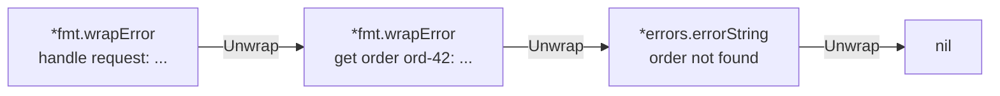
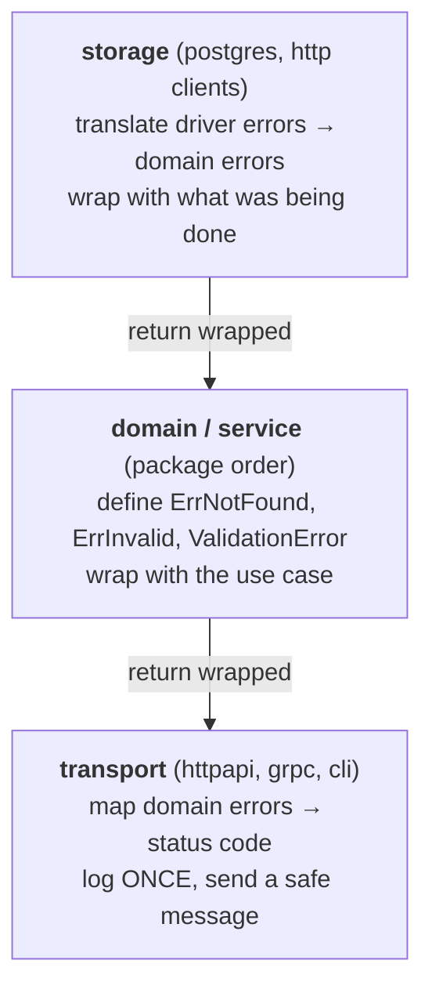

# Errors

## Why care?

It is 3 a.m. Your phone rings. The orders service returns `500 Internal Server Error` for 4% of requests. You open the logs and find this:

```text
ERROR not found
ERROR not found
ERROR failed to get order: not found
ERROR error: not found
```

Four log lines for one failed request. None of them says _which_ order, _which_ layer, or _why_. And worse: "not found" should never be a 500. It should be a `404`, and nobody should be woken up for it.

Nothing here is a bug in one line of code. It is a missing **error strategy**. This page teaches Go's error model from the ground up, and ends with a strategy for a whole service that gives you one clear log line, the right HTTP status, and no 3 a.m. calls for a missing order.

## The idea: an error is just a value

Most languages you may know (Java, C#, Python, JavaScript) use **exceptions**. When something fails, the code _throws_, and the error jumps up the call stack, past many functions, until some `catch` block far away handles it (or nobody does, and the program crashes).

Go has no exceptions. In Go, an error is a **normal value** that a function **returns**, like any other result:

```go
f, err := os.Open("orders.csv")
if err != nil {
	return fmt.Errorf("open orders file: %w", err)
}
defer f.Close()
```

That is the whole model. The function tells you "this can fail" in its signature. You decide, right there, what to do about it.

### What is `error`?

`error` is not magic. It is a tiny interface, built into the language:

```go
type error interface {
	Error() string
}
```

Any type with an `Error() string` method **is** an error. `nil` means "no error". (Interfaces are explained in [Methods and interfaces](methods-and-interfaces.md); for now, read it as "anything that can describe itself as a string".)

!!! abstract "Convention: error is the last return value"

    **Rule:** a function that can fail returns `error` as its **last** result: `func Get(id string) (Order, error)`.
    When `err != nil`, the other results are not meaningful (usually zero values), and the caller must not use them.

    **Why:** every Go programmer reads the same shape the same way, without thinking. Tools also rely on it:
    linters like `errcheck` find ignored errors because the position is always the same.

## Why Go chose values over exceptions

This is the most criticized decision in Go. "So much `if err != nil`!" Here is why the designers still chose it, and why most teams who use Go for some years agree.

**1. You can see every place where the code can fail.** With exceptions, any function call _might_ jump away. When you read a 30-line Java method, you cannot tell which lines can throw. In Go, every failure point has an `if err != nil` right under it. The "unhappy path" is as visible as the happy path. In a service where failure handling is half the work, that is a feature.

**2. Errors are part of the API.** `func Parse(s string) (Config, error)` says, in the type system, "this can fail". A function without `error` in its result promises it cannot fail (or that failure is a bug, see [`panic`](#panic-for-bugs-not-for-errors)).

**3. Errors are values, so you can program with them.** You can store them, compare them, wrap them, collect many into one, put them in a channel, retry on some and not others. Rob Pike's proverb is: _"Errors are values."_ It means: use the full language on them, not a special mechanism.

**4. No hidden cost.** Exceptions need stack unwinding machinery. A Go error is a normal return: one register or two (see [CPU and registers](../fundamentals/cpu-and-registers.md)). Fast and predictable.

The price is more lines. Go accepts that price, because code is read many more times than it is written.

!!! quote "Go proverb"

    _Don't just check errors, handle them gracefully._

## Creating errors

There are two everyday tools:

```go
// A fixed message. Creates a new, unique error value.
err := errors.New("order has no items")

// A formatted message, optionally wrapping another error with %w.
err := fmt.Errorf("create order for customer %s: %w", customerID, err)
```

!!! abstract "Convention: error strings are lowercase, no final punctuation"

    **Rule:** `errors.New("order not found")`, not `errors.New("Order not found.")`.

    **Why:** errors get **wrapped**. Each layer adds a prefix with `": "`. Your message usually ends up in the
    _middle_ of a sentence:

    `create order: reserve stock: sku BOOK-1: not enough items`

    A capital letter or a `.` in the middle of that line looks broken. (Exception: proper nouns and acronyms,
    like `"HTTP request failed"`, keep their capitals.) Enforced by `staticcheck` (`ST1005`).

!!! abstract "Convention: no \"failed to\", no \"error:\""

    **Rule:** write `fmt.Errorf("load config: %w", err)`, not `fmt.Errorf("failed to load config: %w", err)`.

    **Why:** every error is already a failure. After four layers you get
    `failed to handle: failed to get order: failed to query: ...`. Only the noun phrase carries information.
    Say **what you were doing**, the error says what went wrong.

## Handling errors: the shape of Go code

The standard pattern is: call, check immediately, return early.

```go
func (s *Service) Place(ctx context.Context, o Order) (Order, error) {
	if err := o.Validate(); err != nil {
		return Order{}, fmt.Errorf("place order: %w", err)
	}

	reserved, err := s.stock.Reserve(ctx, o.Items)
	if err != nil {
		return Order{}, fmt.Errorf("place order: reserve stock: %w", err)
	}

	o.Status = StatusPending
	if err := s.repo.Create(ctx, o); err != nil {
		s.stock.Release(ctx, reserved) // undo what we did
		return Order{}, fmt.Errorf("place order: save: %w", err)
	}
	return o, nil
}
```

Look at the shape. The **happy path runs straight down the left edge**. Each error is handled and leaves the function. There is no `else`.

!!! abstract "Convention: line of sight — happy path on the left"

    **Rule:** handle the error and `return` early. Don't wrap the success path in `if err == nil { ... }` or in `else` blocks.

    **Why:** a reader can follow the normal flow by reading only the left-most code. Deep nesting forces you to keep
    many open conditions in your head. Linters (`revive`'s `indent-error-flow`, `gocritic`) flag `else` after `return`.

### Three choices for every error

When you get an error, you have exactly three good options:

| Option                        | When                                                   | Example                                       |
| ----------------------------- | ------------------------------------------------------ | --------------------------------------------- |
| **Return it** (often wrapped) | You can't fix it here. Most errors, in most functions. | `return fmt.Errorf("load customer: %w", err)` |
| **Handle it**                 | You can recover: retry, use a default, try another way | Cache miss → read from the database           |
| **Log it and stop it**        | You are at the top: the HTTP handler, `main`, a worker | Write a 500 response and one log line         |

And one **bad** option: **log it and also return it.** Then the caller logs it again, and its caller again. That is how one failure becomes four log lines at 3 a.m.

!!! abstract "Convention: handle an error once"

    **Rule:** either return the error **or** log it. Never both.

    **Why:** logging is a way of _handling_. If you log and return, the error is handled twice (or five times),
    logs are flooded with duplicates, and nobody can tell how many failures really happened.

## Wrapping: adding context without losing the original

An error like `connection refused` is useless on its own. Connection to _what_? While doing _what_? Each layer should add what it knows. That is **wrapping**.

### Try it in Go: walk the chain

```go
package main

import (
	"errors"
	"fmt"
)

// ErrNotFound means the order does not exist.
var ErrNotFound = errors.New("order not found")

func loadRow(id string) error {
	return ErrNotFound
}

func getOrder(id string) error {
	if err := loadRow(id); err != nil {
		return fmt.Errorf("get order %s: %w", id, err)
	}
	return nil
}

func handle(id string) error {
	if err := getOrder(id); err != nil {
		return fmt.Errorf("handle request: %w", err)
	}
	return nil
}

func main() {
	err := handle("ord-42")
	fmt.Println(err)
	fmt.Println("is not found:", errors.Is(err, ErrNotFound))
	fmt.Println("== works:    ", err == ErrNotFound)

	// Walk the chain by hand, the way errors.Is does.
	for e := err; e != nil; e = errors.Unwrap(e) {
		fmt.Printf("  %T: %q\n", e, e)
	}

	lost := fmt.Errorf("handle request: %v", ErrNotFound)
	fmt.Println("with %v, is not found:", errors.Is(lost, ErrNotFound))
}
```

Output:

```text
handle request: get order ord-42: order not found
is not found: true
== works:     false
  *fmt.wrapError: "handle request: get order ord-42: order not found"
  *fmt.wrapError: "get order ord-42: order not found"
  *errors.errorString: "order not found"
with %v, is not found: false
```

Four things to notice:

1. The message reads like a **path**: from the outside in. You see the whole story in one line.
2. `errors.Is` finds `ErrNotFound` **two layers deep**.
3. `==` does **not** work anymore. The outer error is a different value.
4. With `%v` instead of `%w`, the text is the same, but the **link is gone**. `errors.Is` cannot find it.

### Under the hood: a linked list of errors

`fmt.Errorf` with `%w` returns a small struct, `*fmt.wrapError`, with two fields: the full message and a pointer to the inner error. It has one extra method:

```go
func (e *wrapError) Unwrap() error { return e.err }
```

So a wrapped error is a **linked list**. `errors.Is(err, target)` is a simple loop: compare `err` with `target`; if not equal, call `Unwrap()` and try again; stop at `nil`.



When one error wraps **several** errors (with `errors.Join`, or `fmt.Errorf` with two `%w` verbs), it has `Unwrap() []error` instead, and the list becomes a **tree**. `errors.Is` and `errors.As` walk the tree depth-first.

!!! abstract "Convention: `%w` or `%v`? Wrapping is an API decision"

    **Rule:** use `%w` when callers should be able to inspect the cause. Use `%v` when the cause is an
    implementation detail you don't want to promise.

    **Why:** once you wrap with `%w`, callers will write `errors.Is(err, sql.ErrNoRows)`. Now you can never switch
    to another database without breaking them. The cause has become part of your public API. Inside one service
    (`internal/` packages), `%w` everywhere is fine and common. At a **library** or **layer boundary**, translate
    instead: turn `sql.ErrNoRows` into your own `ErrNotFound` (see the [strategy](#a-whole-service-error-strategy) below).

## Three kinds of errors

Callers need to make decisions: retry? return 404? show a message to the user? Go gives you three ways to let them, from simplest to richest.

### 1. Sentinel errors: "which error is this?"

A **sentinel** is a package-level error value that callers compare against:

```go
package order

import "errors"

var (
	// ErrNotFound is returned when an order does not exist.
	ErrNotFound = errors.New("order not found")
	// ErrInvalid is returned when an order fails validation.
	ErrInvalid = errors.New("invalid order")
)
```

Callers check with `errors.Is(err, order.ErrNotFound)`. The standard library is full of them: `io.EOF`, `sql.ErrNoRows`, `os.ErrNotExist`, `context.Canceled`, `context.DeadlineExceeded`.

!!! abstract "Convention: names `ErrXxx` and `XxxError`"

    **Rule:** sentinel values are named `ErrSomething`. Error **types** are named `SomethingError`.

    **Why:** you can tell at a glance if you're looking at a value (compare with `errors.Is`) or a type
    (extract with `errors.As`/`errors.AsType`). `staticcheck` (`ST1012`) checks the `Err` prefix.

!!! warning "Always `errors.Is`, never `==`"

    `err == io.EOF` only works if nobody wrapped the error. One day, somebody adds context with `%w` in a layer
    below you, and your check silently stops matching. `errors.Is` works in both cases. The `errorlint` linter
    finds `==` comparisons on errors.

### 2. Error types: "tell me more"

Sometimes "it was invalid" is not enough. The caller wants to know **which field**. Then make a type:

```go
// ValidationError reports which field of an order is invalid.
type ValidationError struct {
	Field  string
	Reason string
}

func (e *ValidationError) Error() string {
	return "invalid " + e.Field + ": " + e.Reason
}
```

To get it back out of a chain, use `errors.AsType` (new in Go 1.26):

```go
if ve, ok := errors.AsType[*ValidationError](err); ok {
	fmt.Println("bad field:", ve.Field)
}
```

You will also see the older form everywhere. It does the same thing, but needs a variable and a pointer to it:

```go
var ve *ValidationError
if errors.As(err, &ve) {
	fmt.Println("bad field:", ve.Field)
}
```

!!! tip "Prefer `errors.AsType` in new code"

    It is type-checked at compile time (`errors.As` panics at run time if you pass the wrong kind of pointer),
    the result is scoped to the `if`, and it reads better. `go fix` in Go 1.26+ can modernize old `errors.As`
    calls for you.

### 3. Behaviour: "can I retry?"

The most flexible option: don't check _what_ the error is, check what it _can do_. The `net` package does this:

```go
type Error interface {
	error
	Timeout() bool // Is the error a timeout?
}
```

```go
if ne, ok := errors.AsType[net.Error](err); ok && ne.Timeout() {
	// retry with backoff
}
```

Now any error type from any package can say "I'm a timeout", without importing `net`. This is the loosest coupling of the three.

### Which one should I use?

| You want the caller to…                          | Use                   | Coupling      |
| ------------------------------------------------ | --------------------- | ------------- |
| Only show or log it                              | plain `fmt.Errorf`    | none          |
| Make a yes/no decision (404? stop the loop?)     | sentinel + `Is`       | value is API  |
| Read details (which field, which limit)          | error type + `AsType` | type is API   |
| Decide based on a property (retryable? timeout?) | interface + `AsType`  | method is API |

Start with the simplest. Every sentinel and every exported error type is a **promise** you must keep for as long as the package exists.

### Bonus: make a type match a sentinel

You can have both: rich details _and_ a simple check. Give the type an `Is` method:

```go
// Is makes errors.Is(err, ErrInvalid) true for every *ValidationError.
func (e *ValidationError) Is(target error) bool { return target == ErrInvalid }
```

Now an HTTP layer can just ask `errors.Is(err, order.ErrInvalid)`, while a UI layer can still extract the field name.

## Many errors at once: `errors.Join`

Validation should report **all** problems, not only the first. A user fixing one field, resubmitting, then hearing about the next field, will hate your API. `errors.Join` combines errors into one:

```go
func validateItem(i int, it Item) error {
	var errs []error
	if strings.TrimSpace(it.SKU) == "" {
		errs = append(errs, &ValidationError{Field: fmt.Sprintf("items[%d].sku", i), Reason: "must not be empty"})
	}
	if it.Quantity <= 0 {
		errs = append(errs, &ValidationError{Field: fmt.Sprintf("items[%d].quantity", i), Reason: "must be positive"})
	}
	return errors.Join(errs...) // nil when errs is empty
}

func createOrder(items []Item) error {
	var errs []error
	for i, it := range items {
		errs = append(errs, validateItem(i, it))
	}
	if err := errors.Join(errs...); err != nil {
		return fmt.Errorf("create order: %w", err)
	}
	return nil
}
```

With one good item and one bad one:

```text
create order: invalid items[1].sku: must not be empty
invalid items[1].quantity: must be positive
---
first bad field: items[1].sku
errors.As found: items[1].sku
<nil>
```

Two details make this pleasant: `errors.Join` **skips `nil` values** (so you can append every result without checking), and it **returns `nil` if all inputs are `nil`**. The joined messages are separated by newlines. `errors.AsType` finds the first match in the tree.

## Errors and `defer`: don't lose the `Close` error

When you **write** a file, `Close` can fail (the disk is full, the network file system went away). The data may be lost. A plain `defer f.Close()` throws that error away. The fix uses a **named result**, so the deferred function can change what the caller gets:

```go
// WriteReport writes the report atomically enough for a batch job.
func WriteReport(path string, orders []Order) (err error) {
	f, err := os.Create(path)
	if err != nil {
		return fmt.Errorf("create report: %w", err)
	}
	defer func() {
		err = errors.Join(err, f.Close()) // keep both errors if both fail
	}()

	w := bufio.NewWriter(f)
	for _, o := range orders {
		if _, err := fmt.Fprintf(w, "%s,%s\n", o.ID, o.Status); err != nil {
			return fmt.Errorf("write report: %w", err)
		}
	}
	return w.Flush()
}
```

For files you only **read**, `defer f.Close()` is fine: nothing can be lost.

## `panic`: for bugs, not for errors

Go does have a crash mechanism: `panic`. It stops the normal flow, runs deferred functions, and (unless something calls `recover`) crashes the program with a stack trace.

The rule is simple:

- **Error**: something that can happen in a correct program. File missing, network down, user typed nonsense. → return `error`.
- **Panic**: the program itself is wrong. An index out of range, a nil map write, an "impossible" `switch` case. → it's a bug; crash loudly so someone fixes it.

!!! abstract "Convention: don't panic across a package boundary"

    **Rule:** a package must not panic on bad input from its callers or from the outside world. Return an error.

    **Why:** a panic in a library kills the caller's whole program, maybe a server with 10,000 open connections.
    The caller cannot see from the signature that it can happen. Panic only for real programmer bugs, inside your own code.

### The `Must` exception

There is one accepted pattern: `MustXxx` functions that panic on error, used **only at program start** with constant input:

```go
var orderPath = regexp.MustCompile(`^/orders/[0-9a-f-]{36}$`)
var defaultNamespace = uuid.MustParse("6ba7b810-9dad-11d1-80b4-00c04fd430c8")
```

If this panics, it panics on startup, in every test run, every time. You will see it before it reaches production. Never call `Must` with input from users or the network.

### `recover` in services

`recover()` inside a deferred function stops a panic. `net/http` already does this for you: a panicking handler is logged and that one connection is closed, but the server keeps running. In your own goroutines, nobody does it for you: **a panic in any goroutine crashes the whole process.** Worker pools often add a small recover-and-log at the top of each worker. Don't use `recover` as a `try/catch` for normal errors.

## Traps

!!! warning "Trap 1: the typed nil that is not nil"

    ```go
    func validate(qty int) error {
    	var verr *ValidationError
    	if qty <= 0 {
    		verr = &ValidationError{Field: "quantity"}
    	}
    	return verr // never a nil interface!
    }

    func main() {
    	err := validate(3)
    	fmt.Println(err == nil)
    	fmt.Printf("%T %v\n", err, err == (*ValidationError)(nil))
    }
    ```

    Output:

    ```text
    false
    *main.ValidationError true
    ```

    The quantity is valid, but `err != nil`! An interface value is two words: a **type** and a **pointer**.
    Here the type is `*ValidationError` and the pointer is nil. An interface is only `nil` when **both** are nil.
    (`go vet` does not catch this; `nilnil`/`nilerr` linters catch some cases.) **Fix:** always `return nil`
    explicitly for "no error", and never return a concrete error pointer type from a function whose result is `error`.
    Details in [Methods and interfaces](methods-and-interfaces.md).

!!! warning "Trap 2: shadowing `err`"

    ```go
    func (s *Service) Refresh(ctx context.Context) error {
    	var err error
    	if s.cacheEnabled {
    		orders, err := s.repo.List(ctx) // := makes a NEW err, only inside this block
    		if err == nil {
    			s.cache.Store(orders)
    		}
    	}
    	return err // always nil, even when List failed!
    }
    ```

    `:=` inside a block makes a new variable that hides (shadows) the outer one. The outer `err` is never assigned.
    The `shadow` analyzer finds this; turn it on in `golangci-lint` with `govet: enable: [shadow]`
    (see [Tooling and code quality](tooling-and-quality.md)). Better still: write the code so you don't need a
    shared `err` at all — return inside the block.

!!! warning "Trap 3: comparing error strings"

    `if strings.Contains(err.Error(), "not found")` breaks the day someone fixes a typo in a message.
    Messages are for humans. Use `errors.Is` / `errors.AsType` for code.

!!! warning "Trap 4: ignoring errors with `_`"

    `_ = json.NewEncoder(w).Encode(v)` hides real problems. If you truly can't do anything, at least make it a
    conscious decision with a comment. `errcheck` (on by default in `golangci-lint`) finds silently ignored errors.

## A whole-service error strategy

Now the big picture. A service has **layers** (see [Project layout](project-layout.md)). Each layer has one job with errors:



### Rule 1: the storage layer translates

The domain must not know you use PostgreSQL. So the repository turns driver errors into **domain** errors:

```go
func (r *Repository) Get(ctx context.Context, id uuid.UUID) (order.Order, error) {
	var o order.Order
	err := r.db.QueryRowContext(ctx, selectOrder, id).Scan(&o.ID, &o.CustomerID, &o.Status, &o.CreatedAt)
	if errors.Is(err, sql.ErrNoRows) {
		return order.Order{}, fmt.Errorf("select order %s: %w", id, order.ErrNotFound)
	}
	if err != nil {
		return order.Order{}, fmt.Errorf("select order %s: %w", id, err)
	}
	return o, nil
}
```

The "no rows" case becomes `order.ErrNotFound`. Other errors (network, timeout) are wrapped with context but are not translated: they mean "something broke", and the top layer will treat them as a 500.

### Rule 2: the domain defines what callers can check

Package `order` exports a **small, stable** set: `ErrNotFound`, `ErrInvalid`, `*ValidationError`. That set is the contract. The service layer wraps with the use case (`"get order: %w"`) and returns. It does **not** log.

### Rule 3: the transport layer decides, logs once, and hides details

One function turns any error into a response. Every handler calls it. Here is a condensed, runnable version (all layers in one file so you can try it):

```go
// writeError is the ONE place that turns an error into a response and a log line.
func (a *API) writeError(w http.ResponseWriter, r *http.Request, err error) {
	status, msg := http.StatusInternalServerError, "internal error"
	if ve, ok := errors.AsType[*ValidationError](err); ok {
		status, msg = http.StatusBadRequest, ve.Error()
	} else if errors.Is(err, ErrNotFound) {
		status, msg = http.StatusNotFound, "order not found"
	} else if errors.Is(err, context.Canceled) {
		status, msg = 499, "client closed request" // nginx convention; nobody reads it
	}

	level := slog.LevelInfo
	if status >= 500 {
		level = slog.LevelError // only 5xx wakes somebody up
	}
	a.log.LogAttrs(r.Context(), level, "request failed",
		slog.String("path", r.URL.Path),
		slog.Int("status", status),
		slog.String("error", err.Error()), // full chain, for us
	)
	http.Error(w, msg, status) // short, safe message, for them
}

func (a *API) getOrder(w http.ResponseWriter, r *http.Request) {
	o, err := a.svc.Get(r.Context(), r.PathValue("id"))
	if err != nil {
		a.writeError(w, r, err)
		return
	}
	fmt.Fprintf(w, "order %s\n", o.ID)
}
```

Three requests: a bad ID, a missing order, and a database that is down. The output (log lines and responses):

```text
level=INFO msg="request failed" path=/orders/42 status=400 error="invalid id: must be a UUID"
bad id   -> 400 invalid id: must be a UUID
level=INFO msg="request failed" path=/orders/0195d0f8-5f6b-7c2a-9d3e-1a2b3c4d5e6f status=404 error="get order: select order 0195d0f8-5f6b-7c2a-9d3e-1a2b3c4d5e6f: order not found"
missing  -> 404 order not found
level=ERROR msg="request failed" path=/orders/0195d0f8-5f6b-7c2a-9d3e-1a2b3c4d5e6f status=500 error="get order: select order 0195d0f8-5f6b-7c2a-9d3e-1a2b3c4d5e6f: dial tcp 10.0.0.5:5432: connection refused"
db down  -> 500 internal error
```

Compare that with the 3 a.m. logs from the start of the page:

- **One** log line per failed request, written at the top.
- The log has the **full chain**: which use case, which query, which ID, which host.
- The client gets a **short, safe message**. The internal IP `10.0.0.5:5432` is never sent to the outside world (it would help an attacker).
- A 404 is logged at `INFO`. Only the 500 is `ERROR`, so your alerting only fires for real problems.

!!! tip "In the reference project"

    The `internal/httpapi` package of `examples/orders` uses exactly this pattern, with JSON error bodies.
    See [Building a service](services.md).

### The strategy on one card

1. **Return errors**, don't log them, until you reach the top.
2. **Wrap with what you were doing** (`"reserve stock: %w"`), lowercase, no "failed to".
3. **Translate at the boundary** of a dependency: driver errors → domain errors.
4. **Export few** sentinels and types. Each one is a promise.
5. **Decide at the top**: map to status, log once with structured fields, send a safe message.
6. **Panic only for bugs.** Recover only at goroutine tops.

## Check yourself

??? question "1. Why does `err == ErrNotFound` sometimes fail even when the error is \"not found\"?"

    Because a layer wrapped it with `fmt.Errorf("...: %w", err)`. The outer value is a different error that only
    _contains_ `ErrNotFound`. `errors.Is` follows the `Unwrap` chain; `==` does not.

??? question "2. You wrap with `%v` instead of `%w`. What changes?"

    The message text is the same, but the chain is broken: `errors.Is` and `errors.AsType` can't find the inner error.
    Use `%v` on purpose when you don't want callers to depend on the cause.

??? question "3. Your function returns `error`, but `err != nil` is true even when nothing failed. What is the likely cause?"

    It returns a nil **pointer** of a concrete type (e.g. `var e *MyError; return e`). The interface holds a type
    and a nil pointer, so it is not nil. Return the literal `nil` instead.

??? question "4. A repository returns `sql.ErrNoRows` wrapped with `%w` all the way up to the HTTP handler. What is wrong with that design?"

    The handler now depends on `database/sql`. If you switch to another store, the 404 mapping silently breaks.
    Translate `sql.ErrNoRows` into a domain error like `order.ErrNotFound` in the repository.

??? question "5. Where in a service should errors be logged, and why only there?"

    At the top (HTTP handler, worker loop, `main`), once. Lower layers return errors with context. Logging in many
    layers creates duplicate lines and makes it impossible to count failures.

## Recap

- An error is a value: anything with `Error() string`. It is the **last** return value; `nil` means success.
- Check right away, return early, keep the happy path on the left.
- Wrap with `fmt.Errorf("doing X: %w", err)`. Messages: lowercase, no "failed to".
- Wrapped errors form a chain (or tree). Inspect with `errors.Is` (values) and `errors.AsType` (types). Never `==` or string matching.
- Sentinels (`ErrXxx`), types (`XxxError`) and behaviour interfaces are API. Export few.
- `errors.Join` collects many errors. Named result + `defer` keeps `Close` errors.
- `panic` is for bugs. `Must` only at startup.
- In a service: translate at the bottom, wrap in the middle, **log once and map to a status at the top**.
