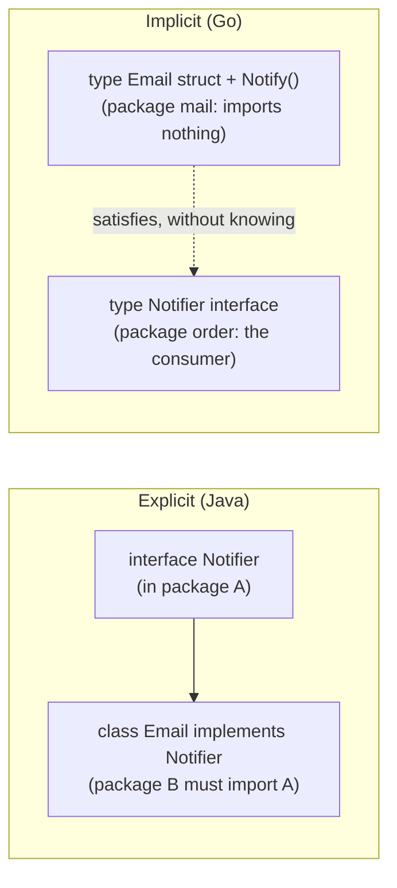

# Methods and interfaces

## Why care?

Your service sends an email when an order ships. In tests, you don't want to send real emails. In Java you would typically use a mocking framework, an `implements EmailSender` clause, and maybe a dependency injection container.

In Go, you write this, in the package that _needs_ the email:

```go
type Notifier interface {
	Notify(ctx context.Context, msg string) error
}
```

That is the whole declaration. The real email client never mentions `Notifier`. Your test fake never mentions it either. They both have a `Notify` method, and that is enough. There is no `implements` clause and no framework.

This small idea, **interfaces are satisfied implicitly**, shapes how all Go code is designed. It is why Go codebases have small interfaces, few dependencies between packages, and tests without mock libraries. This page shows how methods and interfaces work, what happens in memory, and the conventions that come from them.

## Methods: functions with a receiver

A method is a function with a special first parameter, the **receiver**, written before the name:

```go
type Money int64 // cents

// String formats m as a decimal amount, for example "12.99".
func (m Money) String() string {
	sign := ""
	if m < 0 {
		sign, m = "-", -m
	}
	return fmt.Sprintf("%s%d.%02d", sign, m/100, m%100)
}
```

You can define methods on **any named type you declare** in the same package: structs, but also `int64`, `string`, slices, maps, even functions. You can't add methods to types from other packages (like `time.Time`) or to built-in types directly. Make a named type instead.

Under the hood, a method is just a function. `m.String()` compiles to the same code as `Money.String(m)`. There is no hidden `this`, no virtual table for structs. The receiver is an ordinary parameter, so it follows the ordinary rule: **it is copied**.

### Value receivers vs pointer receivers

```go
type Cart struct {
	items []Item
}

func (c Cart) Total() Money { /* reads only */ }   // value receiver: gets a copy
func (c *Cart) Add(it Item) { c.items = append(c.items, it) } // pointer receiver: can modify
```

With a value receiver, `Add` would append to a **copy** of the cart, and the change would disappear (same reason as `appendOne` in [Types and data](types-and-data.md)).

Go helps at the call site: if `cart` is an addressable variable, `cart.Add(x)` automatically becomes `(&cart).Add(x)`. And a pointer `p.Total()` automatically becomes `(*p).Total()`. So you rarely type `&` or `*` for method calls.

!!! abstract "Convention: choosing the receiver type"

    **Rule:** Use a **pointer receiver** if the method changes the receiver, if the type contains a
    `sync.Mutex` (or anything that must not be copied), or if the type is large or has identity
    (a service, a server, a client). Use a **value receiver** for small, immutable values like
    `Money`, `time.Time` or a `Point`. **Don't mix**: if any method needs a pointer receiver, give
    all methods of that type pointer receivers.

    **Why:** Mixing makes the **method set** (next section) confusing: some methods are available on
    a value and some aren't, so a type may satisfy an interface as `*T` but not as `T`, and callers
    must remember which. One receiver kind per type removes that confusion. And pointer receivers on
    types with mutexes are required for correctness: a value receiver would lock a copy.
    Source: [Go Code Review Comments: Receiver Type](https://go.dev/wiki/CodeReviewComments#receiver-type).

!!! abstract "Convention: receiver names are short and consistent"

    **Rule:** Name the receiver with one or two letters from the type: `func (c *Cart)`,
    `func (s *Server)`, `func (o Order)`. Use the same name in every method of the type. Never `this`
    or `self`.

    **Why:** The receiver appears on almost every line of a method. A short, predictable name keeps
    lines short and lets the reader recognise it immediately. `this`/`self` suggest a special
    object, but in Go the receiver is an ordinary parameter, and the name should show that.

## Method sets: the rule behind "does not implement"

Most Go beginners meet this compile error at some point:

```go
type Notifier interface {
	Notify(msg string) error
}

type EmailNotifier struct {
	sent int
}

func (e *EmailNotifier) Notify(msg string) error {
	e.sent++
	fmt.Println("email:", msg)
	return nil
}

func main() {
	var n Notifier = EmailNotifier{}
	_ = n
}
```

```text
./main.go:20:19: cannot use EmailNotifier{} (value of struct type EmailNotifier) as Notifier value in variable declaration: EmailNotifier does not implement Notifier (method Notify has pointer receiver)
```

The **method set** of a type is the list of methods you can call through an interface holding that type:

| Type stored in the interface | Methods in its method set                    |
| ---------------------------- | -------------------------------------------- |
| `T` (a value)                | only methods with **value** receivers        |
| `*T` (a pointer)             | methods with value **and** pointer receivers |

**Why this rule?** When you put a value `EmailNotifier{}` into an interface, the interface holds **its own copy** of that value. If Go let you call `Notify` (which modifies `e.sent`) on it, the method would change that hidden copy, and your change would be lost. Changes that are lost without any error are hard to find. So the compiler refuses. With `&EmailNotifier{}`, the interface holds a pointer to the real value, and changes stick.

The fix is `var n Notifier = &EmailNotifier{}`.

## Interfaces: a set of methods

An interface type lists method signatures. Any type that has those methods **is** that interface. No declaration needed.

```go
// From the standard library, package io:
type Reader interface {
	Read(p []byte) (n int, err error)
}

type Writer interface {
	Write(p []byte) (n int, err error)
}
```

`*os.File`, `*bytes.Buffer`, `*strings.Reader`, `net.Conn`, `*gzip.Writer`, an HTTP response body: all of them are readers or writers. None of them say so. That is why you can plug them into each other freely: `io.Copy(dst, src)` works for files, sockets, buffers and compressors alike.

### Try it in Go: your own `io.Writer`

```go
package main

import (
	"fmt"
	"io"
	"os"
	"strings"
)

// CountingWriter wraps an io.Writer and counts the bytes written through it.
type CountingWriter struct {
	W io.Writer
	N int64
}

func (c *CountingWriter) Write(p []byte) (int, error) {
	n, err := c.W.Write(p)
	c.N += int64(n)
	return n, err
}

// Compile-time check: *CountingWriter must implement io.Writer.
var _ io.Writer = (*CountingWriter)(nil)

func main() {
	cw := &CountingWriter{W: os.Stdout}
	src := strings.NewReader("order 7f3a shipped\n")
	if _, err := io.Copy(cw, src); err != nil {
		fmt.Fprintln(os.Stderr, "copy:", err)
		os.Exit(1)
	}
	fmt.Fprintf(cw, "total=%d cents\n", 2598)
	fmt.Println("bytes written:", cw.N)
}
```

Output:

```text
order 7f3a shipped
total=2598 cents
bytes written: 36
```

`CountingWriter` works with `io.Copy` and `fmt.Fprintf` without knowing anything about them, and they know nothing about it. This **wrap a reader/writer to add behaviour** pattern is everywhere: compression, hashing, rate limiting, metrics, HTTP middleware (which wraps `http.Handler` the same way; see [Building a service](services.md)).

The line `var _ io.Writer = (*CountingWriter)(nil)` is a **compile-time assertion**. It costs nothing at run time. If someone changes the `Write` signature by mistake, the build fails right here, with a clear message, instead of somewhere far away where the type is used.

### Why interfaces are implicit

In Java or C#, a class must say `implements Reader`. That means the **producer** must know about the interface in advance. Go reverses this:



Consequences, and why they matter in big codebases:

1. **Interfaces can be defined after the fact.** You can write an interface that describes a type from a third-party library, and the library's type satisfies it. You never need to fork or wrap it.
2. **Dependencies point one way.** The `mail` package doesn't import the `order` package. No circular imports (which Go forbids anyway), no "shared interfaces" package that everybody depends on.
3. **Interfaces stay small.** Each consumer declares only the methods _it_ calls. The order service needs `Notify`, not the 14 methods of the full email client.
4. **Testing is easy.** A fake is any type with the right methods.

!!! abstract "Convention: define interfaces where they are used, not where they are implemented"

    **Rule:** The package that **calls** the methods declares the interface. The package that
    **implements** them returns a concrete type (a struct pointer).

    ```go
    // package order (the consumer)
    type Repository interface {
    	Get(ctx context.Context, id uuid.UUID) (Order, error)
    	Create(ctx context.Context, o Order) error
    }

    // package memory (the producer): no interface here
    func New() *Store { ... }
    ```

    **Why:** The consumer knows exactly which methods it needs, so its interface is minimal. The
    producer can add methods later without breaking anyone. And you avoid the Java-style habit of
    writing an interface for every struct "just in case", which adds a layer of indirection that
    makes code harder to navigate (in an editor, "go to definition" on an interface method takes you
    to the interface, not the code that runs).
    Source: [Go Code Review Comments: Interfaces](https://go.dev/wiki/CodeReviewComments#interfaces).

This leads to one of the most quoted Go guidelines: **"Accept interfaces, return structs."** Functions take the smallest interface they need (so callers can pass anything that fits) and return concrete types (so callers get the full, documented API and can choose their own interface). See [Conventions](conventions.md#accept-interfaces-return-structs).

!!! abstract "Convention: small interfaces, named with -er"

    **Rule:** One-method interfaces are named after the method plus `-er`: `Reader`, `Writer`,
    `Closer`, `Stringer`, `Notifier`. Bigger interfaces are built by **embedding** small ones:

    ```go
    type ReadCloser interface {
    	Reader
    	Closer
    }
    ```

    **Why:** "The bigger the interface, the weaker the abstraction" (a Go proverb). A one-method
    interface can be satisfied by many types, including a plain function adapter
    (`http.HandlerFunc`), so it is very reusable. A 10-method interface usually has exactly one real
    implementation and makes every fake hard to write.

## Under the hood: what an interface value is

An interface value is **two words** (16 bytes on 64-bit, which you saw in [Types and data](types-and-data.md)):

```text
interface value
┌──────────────┬──────────────┐
│ tab  *itab   │ data pointer │
└──────┬───────┴──────┬───────┘
       │              └──► the concrete value (often on the heap)
       ▼
itab: ┌──────────────────────────────┐
      │ interface type (io.Writer)   │
      │ concrete type (*CountingWriter) │
      │ method table: [Write → addr] │
      └──────────────────────────────┘
```

- The **itab** ("interface table") pairs the interface with the concrete type, and holds pointers to the concrete type's methods. The runtime builds it once per (interface, type) pair and caches it.
- Calling `w.Write(p)` loads the method address from the itab and calls it: an **indirect call**. That is a few nanoseconds; it also stops the compiler from **inlining** the call, unless it can prove the concrete type (devirtualisation, which profile-guided optimisation helps with; see [Performance](performance.md)).
- Putting a value that isn't pointer-shaped (like a `Money` or a struct) into an interface usually means the value is **copied to the heap** so the data pointer has something to point at. That is why `fmt.Println(x)` often shows up in escape analysis output ([Memory](../fundamentals/memory.md)). For hot paths this matters; for most code it doesn't.
- The empty interface `any` (an alias for `interface{}`) has no methods, so instead of an itab it holds just a pointer to the type information.

### The nil interface trap

This trap causes real production bugs.

```go
package main

import "fmt"

// ValidationError reports which field of an order is invalid.
type ValidationError struct {
	Field string
}

func (e *ValidationError) Error() string { return "invalid " + e.Field }

func validate(qty int) error {
	var verr *ValidationError // nil pointer
	if qty <= 0 {
		verr = &ValidationError{Field: "quantity"}
	}
	return verr // BUG: returns a non-nil interface holding a nil pointer
}

func validateFixed(qty int) error {
	if qty <= 0 {
		return &ValidationError{Field: "quantity"}
	}
	return nil
}

func main() {
	err := validate(3)
	fmt.Printf("err == nil: %t, value: %v, type: %T\n", err == nil, err, err)
	err = validateFixed(3)
	fmt.Printf("err == nil: %t\n", err == nil)
}
```

Output:

```text
err == nil: false, value: <nil>, type: *main.ValidationError
err == nil: true
```

The quantity is valid, yet `err != nil`, so the caller reports a failure. Why?

An interface is `nil` only when **both words are nil**: no type and no data. `return verr` puts a typed pointer into the `error` interface. The data word is `nil`, but the type word says `*ValidationError`. Two words, one of them set: not nil.

```text
validate(3):       [ tab: *ValidationError | data: nil ]   → err != nil  (!)
validateFixed(3):  [ tab: nil              | data: nil ]   → err == nil
```

!!! abstract "Convention: return `nil` explicitly for \"no error\""

    **Rule:** Functions that return `error` should `return nil` literally on success. Never return a
    variable of a concrete error type (`*MyError`) through an `error` result. Declare your error
    variables as type `error`, not `*MyError`.

    **Why:** The nil interface trap is invisible in code review: `return verr` looks correct. The only
    reliable defence is a habit that makes it impossible. Note that `go vet` does **not** catch the
    example above. `staticcheck` (check SA4023, part of [golangci-lint](tooling-and-quality.md))
    finds some cases, where a comparison with `nil` can never be true, but not all.

## Type assertions and type switches

You can ask an interface what it holds:

```go
w, ok := v.(io.Writer)  // ok == false if v doesn't hold an io.Writer
s := v.(string)         // panics if v doesn't hold a string — avoid
```

Always use the **comma-ok** form unless a panic really means "bug in this program". To branch on many types, use a **type switch**:

```go
package main

import (
	"fmt"
	"io"
	"os"
)

func describe(v any) string {
	switch x := v.(type) {
	case nil:
		return "nil"
	case int, int64:
		return fmt.Sprintf("integer %v", x)
	case string:
		return fmt.Sprintf("string of %d bytes", len(x))
	case fmt.Stringer:
		return "Stringer: " + x.String()
	case error:
		return "error: " + x.Error()
	default:
		return fmt.Sprintf("other %T", x)
	}
}

func main() {
	fmt.Println(describe(42))
	fmt.Println(describe("héllo"))
	fmt.Println(describe(os.ErrNotExist))
	fmt.Println(describe(3.5))
	fmt.Println(describe(nil))

	if w, ok := any(os.Stdout).(io.StringWriter); ok {
		w.WriteString("stdout is a StringWriter\n")
	}
}
```

Output:

```text
integer 42
string of 6 bytes
error: file does not exist
other float64
nil
stdout is a StringWriter
```

The last part shows a useful pattern: **optional interfaces** (also called interface upgrades). `io.Copy` checks if the source has a `WriteTo` method or the destination has `ReadFrom`, and uses the faster path if so. `http.ResponseWriter` may also be an `http.Flusher`. You accept a small interface, and check for a bigger one when it helps.

!!! warning "Trap: type switches on errors"

    Don't write `switch err.(type)` or `err.(*ValidationError)` to check for an error type. Errors
    are often **wrapped** (`fmt.Errorf("create order: %w", err)`), and an assertion only looks at the
    outer layer. Use `errors.As` or the generic `errors.AsType` (Go 1.26), which unwrap the chain.
    See [Errors](errors.md).

## Embedding: composition instead of inheritance

Go has no classes and no inheritance. Instead, a struct can **embed** another type, by naming the type without a field name:

```go
package main

import (
	"fmt"
	"sync"
)

// Counter counts events per key. Its zero value is ready to use.
type Counter struct {
	mu     sync.Mutex
	counts map[string]int
}

func (c *Counter) Inc(key string) {
	c.mu.Lock()
	defer c.mu.Unlock()
	if c.counts == nil {
		c.counts = make(map[string]int)
	}
	c.counts[key]++
}

func (c *Counter) Get(key string) int {
	c.mu.Lock()
	defer c.mu.Unlock()
	return c.counts[key]
}

type Logger struct{ prefix string }

func (l Logger) Log(msg string) { fmt.Println(l.prefix + msg) }

// Service embeds Logger: Log is promoted to Service.
type Service struct {
	Logger
	hits Counter
}

func (s *Service) Handle(path string) {
	s.hits.Inc(path)
	s.Log(fmt.Sprintf("handled %s (%d)", path, s.hits.Get(path)))
}

func main() {
	s := &Service{Logger: Logger{prefix: "[orders] "}}
	s.Handle("/orders")
	s.Handle("/orders")
	s.Logger.Log("explicit call works too")
}
```

Output:

```text
[orders] handled /orders (1)
[orders] handled /orders (2)
[orders] explicit call works too
```

- `Service` **embeds** `Logger`. The field is named after the type (`s.Logger`), and its methods are **promoted**: `s.Log(...)` works as if `Service` had a `Log` method. So `Service` now also satisfies any interface with `Log(string)`.
- `hits Counter` is a normal named field. Its methods are **not** promoted. Notice that `Counter` has a useful zero value (it creates the map on first use), so `Service` needs no constructor for it.

**This is not inheritance.** When `s.Log` runs, the receiver is `s.Logger`, not `s`. `Logger` has no idea it is inside a `Service`. There is no `super`, no overriding of methods called from inside the embedded type, no "fragile base class" problem. It is pure **delegation**, done by the compiler: `s.Log(m)` is just short for `s.Logger.Log(m)`.

!!! abstract "Convention: prefer composition; embed only to share an API on purpose"

    **Rule:** Use named fields (`hits Counter`) by default. Embed only when you _want_ the embedded
    type's methods to become part of your type's public API.

    **Why:** Embedding exports everything. If `Service` embeds `*sql.DB` "to save typing", every
    caller can now call `service.Exec(...)` and bypass your service's rules, and you can never remove
    that without breaking them. Embedding a `sync.Mutex` in an exported type has the same problem:
    callers can `Lock` your struct. A named field keeps the internals private. Go's designers chose
    composition over inheritance because class hierarchies tend to get deep and tightly coupled;
    small parts you plug together are easier to change.

Embedding also works in **interfaces** (to combine them, as with `io.ReadCloser`) and is common in tests: a fake can embed the interface it fakes, then implement only the methods the test needs. (Calling a method it didn't implement panics with a nil pointer, which in a test is acceptable.)

## Function types can have methods

This is a common Go pattern. From `net/http`:

```go
type Handler interface {
	ServeHTTP(ResponseWriter, *Request)
}

// HandlerFunc lets an ordinary function be used as a Handler.
type HandlerFunc func(ResponseWriter, *Request)

func (f HandlerFunc) ServeHTTP(w ResponseWriter, r *Request) { f(w, r) }
```

Now any function with the right signature can become a `Handler` with a conversion: `http.HandlerFunc(myFunc)`. This **adapter** pattern only works because interfaces are small and implicit. You will use it for middleware in [Building a service](services.md).

## Putting it together: the orders service

Here is the shape used in the reference project. The `order` package declares what it needs; the storage package provides a concrete type; `main` wires them together.

```go
// package order

// Repository stores orders. It is implemented by the storage packages.
type Repository interface {
	Get(ctx context.Context, id uuid.UUID) (Order, error)
	Create(ctx context.Context, o Order) error
	List(ctx context.Context) ([]Order, error)
}

// Service holds the business rules for orders.
type Service struct {
	repo Repository
	now  func() time.Time
}

// NewService returns a Service that stores orders in repo.
func NewService(repo Repository) *Service {
	return &Service{repo: repo, now: time.Now}
}
```

```go
// package main
repo := memory.New()        // *memory.Store, a concrete type
svc := order.NewService(repo)         // accepts the interface
```

- `NewService` **accepts an interface** (`Repository`) and **returns a struct** (`*Service`).
- `Service` uses a pointer receiver for its methods and has no exported fields: callers can only use it through methods.
- `now func() time.Time` is a one-method "interface" in function form; tests replace it with a fixed clock.
- A test can pass a tiny in-memory fake. No mocking library needed. See [Testing](testing.md).

## Check yourself

??? question "1. Why doesn't `EmailNotifier{}` satisfy an interface whose method has a pointer receiver?"

    The interface would hold its own copy of the value. Calling a pointer method on that copy would
    modify the hidden copy and lose the change. To prevent silent lost writes, only `*T` has
    pointer-receiver methods in its method set. Use `&EmailNotifier{}`.

??? question "2. A function returns `error`. It does `var e *MyErr; ...; return e` on success. What does the caller see?"

    `err != nil`, even though `e` is a nil pointer. The interface holds a type (`*MyErr`) and a nil
    data pointer, so it is not a nil interface. Always `return nil` literally.

??? question "3. Where should the `Repository` interface for the order service be declared, and why?"

    In the `order` package, the consumer. It lists only the methods the service calls. The storage
    package returns a concrete type and doesn't import `order`'s interface, so dependencies point one
    way and the storage type can grow without breaking anyone.

??? question "4. What is the difference between embedding `*sql.DB` in `Service` and having a field `db *sql.DB`?"

    Embedding promotes all of `*sql.DB`'s methods into `Service`'s public API, so callers can run SQL
    directly and bypass the service. A named field keeps the database private to the service.

??? question "5. Why does `var _ io.Writer = (*CountingWriter)(nil)` exist, and what does it cost?"

    It is a compile-time check that `*CountingWriter` implements `io.Writer`. If the method
    signature drifts, the build fails at that line with a clear message. It costs nothing at run
    time: it is a blank variable of a nil pointer, removed by the compiler.

## Recap

- A method is a function with a receiver. The receiver is copied like any parameter.
- Pointer receivers to mutate, for mutexes, and for types with identity. Don't mix receiver kinds on one type.
- Method sets: `T` has value-receiver methods; `*T` has both. That's why pointer-receiver types need `&` to satisfy interfaces.
- Interfaces are satisfied **implicitly**. Define them in the consumer package, keep them small, name one-method interfaces with `-er`.
- An interface value is (type, data). It is nil only if both are nil. Return `nil` literally.
- Use comma-ok assertions and type switches; for errors, use `errors.As`/`errors.AsType`.
- Embedding is delegation, not inheritance. Prefer named fields; embed only to share an API on purpose.

Next: [Errors](errors.md), where you see how Go turns failure into ordinary values.
