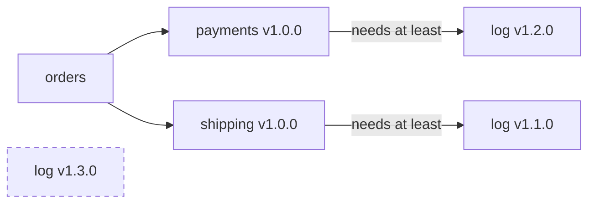

# Modules and dependencies

## Why care?

On Monday the build is green. On Tuesday, with no change in your code, it is red. A dependency of a dependency published a new version overnight, and your build picked it up. Or worse: the build is still green, but someone took over that package and added code that sends your environment variables to a server.

Dependency management is not boring plumbing. It decides whether your builds are **reproducible** and whether your supply chain is **safe**. Go's module system makes some unusual choices here. Once you understand _why_, you will see that they are some of the best ideas in the language.

## The idea: two small files

A **module** is a tree of Go packages that is versioned and released together. It is defined by two files at its root:

| File     | Contains                                                                            | Who edits it               |
| -------- | ----------------------------------------------------------------------------------- | -------------------------- |
| `go.mod` | The module's name, the Go version, and the **minimum** versions of its dependencies | You, through `go` commands |
| `go.sum` | Cryptographic **fingerprints** of every dependency version used                     | Only the `go` command      |

There is no separate lock file, no `node_modules` folder, and no central registry like npm or PyPI. Let's see how that can work.

## Starting a module

```sh
mkdir orders && cd orders
go mod init github.com/acme/orders
```

```text
go: creating new go.mod: module github.com/acme/orders
```

```text
module github.com/acme/orders

go 1.27.4
```

The **module path** `github.com/acme/orders` is the prefix of every import path in the module. Package `internal/order` in this module is imported as `github.com/acme/orders/internal/order`.

!!! abstract "Convention: the module path is where the code lives"

    **Rule:** name a module after its repository URL, like `github.com/acme/orders` or
    `gitlab.acme.com/platform/orders`. Never use a short name like `orders` for real code.

    **Why:** Go has **no central registry**. The import path _is_ the address: to download
    `github.com/acme/orders`, the `go` command asks `https://github.com/acme/orders?go-get=1`
    (or a proxy) where the code is. That makes Go **decentralized**: anyone can publish a module
    just by pushing to a Git server, and nobody can "squat" your name on a registry. A short
    path like `orders` works for a throwaway experiment, but nobody else can ever import it.

## Adding a dependency

Write code that imports a package, then run `go mod tidy`:

```go
package main

import (
	"fmt"

	"golang.org/x/sync/errgroup"
)

func main() {
	var g errgroup.Group
	g.Go(func() error { return nil })
	fmt.Println(g.Wait())
}
```

```sh
go mod tidy
```

```text
go: finding module for package golang.org/x/sync/errgroup
go: downloading golang.org/x/sync v0.25.0
go: found golang.org/x/sync/errgroup in golang.org/x/sync v0.25.0
```

`go.mod` now has a `require` line:

```text
module github.com/acme/orders

go 1.27.4

require golang.org/x/sync v0.25.0
```

And `go.sum` has two lines:

```text
golang.org/x/sync v0.25.0 h1:dJnifr0nMV8/SBnBvdo4eSGGnrc3O4FFx6IqvtLcmRs=
golang.org/x/sync v0.25.0/go.mod h1:sUUOizhqBxiL6pEWpqNLUiaJn1ShEbZ6BBqskPbjZm0=
```

The first line is a SHA-256 hash of the module's complete file tree. The second is a hash of only its `go.mod` file (Go sometimes needs a module's requirements without downloading all its code).

`go mod tidy` does two jobs: it **adds** missing requirements and **removes** ones you no longer import. Run it before every commit. In CI, check that it changes nothing:

```sh
go mod tidy -diff   # prints a diff and fails if go.mod/go.sum are not tidy
```

Dependencies that you do not import directly, but that are needed by your dependencies, appear with an `// indirect` comment. They are listed so that `go.mod` alone fully describes the build.

## `go.sum`: trust on first use, checked by the world

Imagine an attacker changes the code of `golang.org/x/sync v0.25.0` on the server, or intercepts your download. To show what happens, here is a `go.sum` with the hash changed by hand:

```text
go: downloading golang.org/x/sync v0.25.0
verifying golang.org/x/sync@v0.25.0: checksum mismatch
	downloaded: h1:dJnifr0nMV8/SBnBvdo4eSGGnrc3O4FFx6IqvtLcmRs=
	go.sum:     h1:AAAAfr0nMV8/SBnBvdo4eSGGnrc3O4FFx6IqvtLcmRs=

SECURITY ERROR
This download does NOT match an earlier download recorded in go.sum.
The bits may have been replaced on the origin server, or an attacker may
have intercepted the download attempt.

For more information, see 'go help module-auth'.
```

The build stops. Once a version is in `go.sum`, its content can **never change** for your project.

But what about the _first_ download? The `go` command also checks every new hash against the **checksum database** `sum.golang.org` (`GOSUMDB`). It is a public, append-only log (a Merkle tree, like Certificate Transparency for TLS). Everyone in the world gets the same hash for the same version. An attacker cannot serve you a special version without the whole world being able to see it.

!!! abstract "Convention: always commit `go.sum`"

    **Rule:** `go.mod` and `go.sum` are both committed. Never edit `go.sum` by hand. If it
    conflicts in a merge, take either side and run `go mod tidy`.

    **Why:** `go.sum` is your project's memory of exactly which bits it trusts. Without it, every
    machine trusts whatever it downloads first. `go mod verify` checks that the files in your
    module cache still match it:

    ```text
    all modules verified
    ```

## Versions: semantic versioning, strictly

Go modules use **semantic versioning**: `vMAJOR.MINOR.PATCH`.

| Change         | Example                            | Promise to users                           |
| -------------- | ---------------------------------- | ------------------------------------------ |
| Patch          | v1.4.2 → v1.4.3                    | Bug fixes only                             |
| Minor          | v1.4.3 → v1.5.0                    | New features, **nothing breaks**           |
| Major          | v1.5.0 → v2.0.0                    | May break your code                        |
| `v0.x.y`       | v0.25.0                            | No promise: anything may change            |
| Pseudo-version | v0.0.0-20261116191925-e77a43154acb | A commit without a tag: time + commit hash |

A version is a **Git tag** on the repository, like `v1.5.0`. That is all "publishing" means in Go: push a tag. The proxy picks it up on first request.

## Minimal version selection: why Go picks the _oldest_ version

This is the most surprising idea in Go modules, so let's run a real experiment. Three modules:

- `example.com/log` has versions **v1.1.0, v1.2.0 and v1.3.0**.
- `example.com/payments v1.0.0` requires `log v1.2.0`.
- `example.com/shipping v1.0.0` requires `log v1.1.0`.

Our `orders` module imports both `payments` and `shipping`. Which `log` version do we get?

```sh
go get example.com/payments@v1.0.0 example.com/shipping@v1.0.0
go run .
```

```text
go: added example.com/log v1.2.0
go: added example.com/payments v1.0.0
go: added example.com/shipping v1.0.0
log v1.2.0
```

**v1.2.0**, even though v1.3.0 exists. The graph shows why:

```sh
go mod graph
```

```text
github.com/acme/orders example.com/log@v1.2.0
github.com/acme/orders example.com/payments@v1.0.0
github.com/acme/orders example.com/shipping@v1.0.0
example.com/payments@v1.0.0 example.com/log@v1.2.0
example.com/shipping@v1.0.0 example.com/log@v1.1.0
```



This algorithm is called **minimal version selection (MVS)**:

> Every `require` line means "**at least** this version". Go picks, for each module, the **highest of the minimums** in the whole graph. Never anything newer.

`payments` needs at least v1.2.0, `shipping` at least v1.1.0. The smallest version that satisfies both is v1.2.0. Done.

### Why is this a brilliant idea?

Compare with npm, pip or Maven ranges, which pick the **newest** version that matches (`^1.1.0` means "newest 1.x"):

1. **Reproducible without a lock file.** With "newest", the result changes every time someone publishes. That is why other ecosystems _need_ lock files. With MVS, the answer depends only on the `go.mod` files, which never change for a published version. The build is the same today and in five years.
2. **No surprise upgrades.** A new release of `log` cannot enter your build until _someone_ (you, or a dependency's author) decides to require it. That closes the Monday/Tuesday problem and slows down supply-chain attacks: a malicious new version is not pulled in automatically.
3. **High-fidelity builds.** You build with the versions your dependencies' authors actually tested with, not with newer versions nobody tested together.
4. **Simple and fast.** Version selection with ranges is an NP-complete problem (a SAT solver). MVS is a simple graph walk that a human can follow, like we just did.

### Upgrading and downgrading

Upgrades are **explicit**. First, see what is available:

```sh
go list -m -u all
```

```text
github.com/acme/orders
example.com/log v1.2.0 [v1.3.0]
example.com/payments v1.0.0
example.com/shipping v1.0.0
```

`[v1.3.0]` means "a newer version exists". Upgrade one module on purpose:

```sh
go get example.com/log@latest
```

```text
go: upgraded example.com/log v1.2.0 => v1.3.0
```

Now try to downgrade `log` below what `payments` needs:

```sh
go get example.com/log@v1.1.0
```

```text
go: downgraded example.com/log v1.3.0 => v1.1.0
go: removed example.com/payments v1.0.0
```

Go **removed `payments`**, because no version of `payments` works with `log v1.1.0`. It never builds a graph that breaks a minimum. (Your code still imports `payments`, so the build now fails, loudly, instead of silently using a version that `payments` was never tested with.)

| Command                 | Effect                                                     |
| ----------------------- | ---------------------------------------------------------- |
| `go get pkg@latest`     | Upgrade one module to its newest release                   |
| `go get pkg@v1.5.0`     | Upgrade or downgrade to an exact version                   |
| `go get -u ./...`       | Upgrade all direct and indirect dependencies (minor/patch) |
| `go get -u=patch ./...` | Only patch upgrades: the safe weekly update                |
| `go get pkg@none`       | Remove a requirement                                       |
| `go mod why -m pkg`     | Show the import chain that needs `pkg`                     |
| `go mod graph`          | The full requirement graph                                 |

!!! abstract "Convention: upgrade deliberately and often"

    **Rule:** let a bot (Dependabot or Renovate) open small upgrade PRs every week, and let CI
    test them. Do not run `go get -u ./...` on a Friday afternoon across 80 dependencies.

    **Why:** MVS never upgrades for you, so if nobody upgrades, you slowly collect old versions
    with known vulnerabilities. Small, frequent upgrades are easy to review and easy to roll back.

## Major versions: the import compatibility rule

What if `log` releases **v2.0.0** with breaking changes? Go has a strict rule:

> **If an old package and a new package have the same import path, the new package must be backwards compatible with the old one.**

So a breaking version must have a **different import path**. From v2 on, the major version is part of the module path:

```text
module example.com/log/v2
```

```go
import (
	logv1 "example.com/log"
	"example.com/log/v2"
)
```

Why so strict? Think of the **diamond problem**: `payments` uses `log` v1 and `shipping` was upgraded to `log` v2. In most languages you are stuck: you can only have one version of `log`, and one of them breaks. In Go, `example.com/log` and `example.com/log/v2` are simply **two different modules**. Both are in the binary, and both dependencies work. A big migration can happen package by package, over months, instead of in one huge "upgrade day".

!!! warning "Breaking changes in v0 and v1"

    `v0.x` versions may break at any time, which is why many popular Go libraries stay on v0 for
    years. Once you tag `v1.0.0`, you promise to never break users until `v2`. Tools like
    [`gorelease`](https://pkg.go.dev/golang.org/x/exp/cmd/gorelease) and `apidiff` can check a
    library's API for accidental breaking changes before you tag.

## `replace`, `exclude` and `retract`

Three more directives for special cases:

```text
// Use a local copy or a patched fork of a module.
replace example.com/log => ../log
replace example.com/log v1.3.0 => github.com/acme/log v1.3.1-acme.1

// Never use this version (only in the main module).
exclude example.com/log v1.2.1

// Tell users: do not use these versions of *this* module.
retract v1.0.1 // broken database migration
```

`replace` and `exclude` **only work in the main module**: the one you are building. They are ignored when your module is used as a dependency by someone else. That is on purpose: a library cannot secretly redirect its users to a fork.

!!! abstract "Convention: `replace` is temporary"

    **Rule:** do not commit `replace` lines that point to local folders (`../log`). Use
    `go.work` for local development instead. A `replace` to a patched fork is fine if it has a
    comment and a ticket to remove it.

    **Why:** a `replace => ../log` works only on the machine where `../log` exists. CI and
    teammates get a confusing error. And forks that nobody tracks slowly become a security risk.

## Workspaces: `go.work`

You are changing two modules at the same time: the `orders` service and the shared `money` library. Without help, `orders` uses the released `money v0.3.0` from the proxy, not your local changes. A **workspace** fixes that, without touching any `go.mod`:

```sh
go work init ./orders ./money
cat go.work
```

```text
go 1.27.4

use (
	./money
	./orders
)
```

```sh
cd orders && go run .
```

```text
EUR 12.99
```

Now `orders` builds against the local `./money` folder. `go env GOWORK` shows which workspace file is active (or nothing).

!!! abstract "Convention: usually don't commit `go.work`"

    **Rule:** in a set of separate repositories, `go.work` is a personal file: add it to your
    global gitignore. In a monorepo with several modules, committing one `go.work` at the root
    can be fine, if the whole team agrees.

    **Why:** each module's `go.mod` must build _alone_, because that is how CI and your users
    build it. A committed `go.work` can hide that a module depends on unreleased code in its
    neighbour. Run CI with `GOWORK=off` to be sure.

## Proxies and private code: the enterprise setup

By default, `GOPROXY=https://proxy.golang.org,direct`. The `go` command downloads every module from Google's **module proxy**, which caches every public version forever. Even if the author deletes the repository, your build still works. `direct` means "if the proxy does not have it, fetch from the Git server".

In a company, two extra needs appear:

1. **Private modules** (`github.com/acme/...` in private repos) must not go through the public proxy or the public checksum database. The public servers cannot see them, and you do not want to leak your module names.
2. **A company proxy** (for example Artifactory, Nexus or [Athens](https://github.com/gomods/athens)), so builds do not depend on the internet and security can approve and scan what enters.

The settings:

```sh
# Download everything through the company proxy.
GOPROXY=https://goproxy.acme.internal,off

# These modules are private: no public proxy, no public checksum database.
GOPRIVATE=github.com/acme/*,gitlab.acme.com/*
```

`GOPRIVATE` is a shortcut that sets both `GONOPROXY` (fetch directly from Git) and `GONOSUMDB` (do not ask `sum.golang.org`). `off` at the end of `GOPROXY` means "never fall back to direct downloads from the internet". For authentication to Git servers, `go` uses Git, so the usual Git credentials work (SSH keys, `.netrc`, or a `url.insteadOf` rule). For proxies, `GOAUTH` configures credentials (`go help goauth`).

Put these settings in the repository (`mise.toml` `[env]`, CI config), as explained in [The Go toolchain](toolchain.md#settings-go-env-w-and-why-to-avoid-it-in-teams).

## Tools: the `tool` directive

Projects need tools: code generators, linters, `govulncheck`. You want every developer and CI to use the **same version**. Since Go 1.24, tools are tracked in `go.mod` like dependencies:

```sh
go get -tool golang.org/x/vuln/cmd/govulncheck@latest
```

```text
go: added golang.org/x/vuln v1.10.0
```

`go.mod` gets a `tool` line (and the tool's own dependencies as `// indirect`):

```text
tool golang.org/x/vuln/cmd/govulncheck
```

Run it with `go tool`:

```sh
go tool govulncheck ./...
```

```text
No vulnerabilities found.
```

The version is pinned in `go.mod`, verified by `go.sum`, and compiled from source through the build cache. No "please install version X first" in the README. (Before Go 1.24, people used a `tools.go` file with blank imports. You will still see it in older repos.)

!!! warning "Tools share your dependency graph"

    A tool's dependencies are part of your module's graph, so through MVS they can raise the
    versions your own code uses. For big tools with many dependencies (like `golangci-lint`),
    teams often install them separately (with mise or a pinned binary) instead of with `tool`.

## `govulncheck`: vulnerability scanning that reads your code

Most vulnerability scanners say "you depend on library X version Y, which has CVE-123". Often the CVE is in a function you never call, so teams drown in false alarms and start ignoring the scanner.

`govulncheck` uses the Go vulnerability database and **analyzes your call graph**. It reports a vulnerability as affecting you only if your code can actually **reach** the vulnerable function. It can also scan a compiled binary (`govulncheck -mode=binary ./ordersd`), using the build info from [`go version -m`](toolchain.md#know-what-is-running-version-stamping).

Run it in CI on every PR **and** on a schedule (new vulnerabilities are found in old code).

## Other `go.mod` directives you will meet

```text
module github.com/acme/orders

go 1.27

// Keep the old behaviour of a runtime setting for this program.
godebug http2client=0

// Folders the go command should ignore (Go 1.25+), e.g. a frontend inside the repo.
ignore ./web/node_modules
```

- `godebug` sets [GODEBUG](https://go.dev/doc/godebug) defaults. When Go changes a behaviour (for compatibility reasons, often behind a setting), you can keep the old one while you migrate.
- `ignore` tells `./...` patterns to skip folders. Useful in repos where a JavaScript frontend lives next to the Go code.

## Vendoring

`go mod vendor` copies all dependency source code into a `vendor/` folder in your repository. Builds then use only that folder.

| For vendoring                                        | Against vendoring                              |
| ---------------------------------------------------- | ---------------------------------------------- |
| Builds work fully offline / air-gapped               | Big diffs on every upgrade                     |
| Every line of third-party code is visible in reviews | Repository grows a lot                         |
| No dependency on any proxy                           | A company proxy gives the same safety, cleaner |

Most teams today use a company proxy instead. Vendoring is still common in regulated environments and in some big projects (Kubernetes vendors).

## Choosing dependencies

!!! abstract "Convention: a little copying is better than a little dependency"

    **Rule:** prefer the standard library. Add a third-party module only when it saves real,
    ongoing work. For a 20-line helper, copy the idea (with credit) instead of importing a module.

    **Why:** every dependency is code you ship but did not review, a new path for supply-chain
    attacks, and future upgrade work. Its dependencies come too. Go's standard library is unusually
    complete (HTTP server and client, JSON, crypto, testing, structured logging, UUIDs since 1.27),
    so Go services often have only a handful of dependencies. That is a feature.

Before adding a module, check:

- Is it maintained? Recent releases, issues answered, more than one maintainer.
- Is it v1+ or at least stable in practice?
- How many dependencies does it bring? (`go mod graph | grep '^example.com/thing'`)
- Is the license allowed by your company?
- Does `govulncheck` report anything?

## Traps

- **Editing `go.mod` by hand and forgetting `go mod tidy`.** CI fails with "missing go.sum entry" or "updates to go.mod needed". Always finish with `go mod tidy`.
- **Tagging `v2.0.0` without changing the module path to `/v2`.** Users cannot `go get` it: the `go` command rejects the version with `invalid version: should be v0 or v1, not v2`, because the module path does not end in `/v2`. (Very old repositories without any `go.mod` show up as `v2.0.0+incompatible`, a leftover from before modules.)
- **Deleting a tag after publishing.** The proxy and checksum database remember it forever. Fix mistakes with a new version and a `retract`.
- **Private modules leaking to the public proxy.** Without `GOPRIVATE`, the `go` command asks `proxy.golang.org` for `github.com/acme/secret-thing`, which tells the outside world the name exists.
- **A forgotten `go.work`** makes your local build use local copies. "It works for me" and fails in CI. Check `go env GOWORK`.

## Check yourself

??? question "1. Your module requires `lib v1.2.0`. A dependency of yours requires `lib v1.4.0`. v1.7.0 is the newest. Which version is built?"

    v1.4.0: the highest of the minimums in the graph. Never v1.7.0 unless someone requires it.

??? question "2. Why does Go not need a separate lock file?"

    With minimal version selection, the selected versions depend only on the `go.mod` files in
    the graph, and published `go.mod` files never change. So the result is already reproducible.
    `go.sum` then fixes the exact content (hashes) of each version.

??? question "3. Why must v2 of a module have a different import path?"

    The import compatibility rule: the same import path must always be backwards compatible.
    With a new path (`.../v2`), v1 and v2 are separate modules, so both can be used in one build.
    That solves the diamond dependency problem and allows gradual migrations.

??? question "4. What does `GOPRIVATE=github.com/acme/*` change?"

    Modules under that path are fetched directly from Git (not via `GOPROXY`) and their hashes are
    not checked against or published to the public checksum database.

??? question "5. Why is `govulncheck` less noisy than a plain dependency scanner?"

    It analyzes the call graph and reports a vulnerability only when your code can reach the
    vulnerable function, not just because the module is in `go.mod`.

## Recap

- `go.mod` lists **minimum** versions; `go.sum` holds fingerprints. Commit both, run `go mod tidy`.
- Minimal version selection gives reproducible builds without lock files and no surprise upgrades. Upgrade on purpose, in small steps.
- Breaking changes need a new major version **and** a new import path (`/v2`).
- `replace` is for the main module only and should be temporary. Use `go.work` for local multi-module work.
- In a company: `GOPROXY` to an internal proxy, `GOPRIVATE` for your own code, `govulncheck` in CI.
- Every dependency is a liability. The standard library goes a long way.

Next: [Project layout](project-layout.md), where we organise the packages inside a module.
