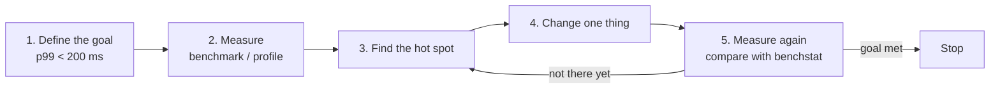

# Performance

## Why care?

The invoice endpoint of the orders service is slow. In the team chat, five people have five theories: "it's the JSON", "it's the database", "Go's GC is slow", "we need a cache", "rewrite it in Rust". Two days later someone runs a profiler. The real cause is one line that builds a string in a loop. Fixing it makes the endpoint **29× faster**. None of the five theories was right.

This happens all the time, and it teaches the most important rule of performance work:

> **Measure first. Guess never.**

Go has excellent measuring tools built in: benchmarks, `pprof`, the execution trace, GC traces. This page teaches you how to use them, how to read what they say, and what to change once you know.

## The idea: a doctor, not a mechanic

A good doctor doesn't start by operating. They take measurements, find the cause, treat it, and measure again to see if it worked. Performance work is the same loop:



Step 1 matters more than it looks. "Faster" is not a goal. "The invoice endpoint answers in under 200 ms for 99% of requests at 500 requests per second" is a goal. Without one, you never know when to **stop**, and over-optimised code is harder to read and change.

!!! abstract "Convention: clear code first, fast code where measured"

    **Rule:** Write the simple, readable version first. Optimise only code that a profile shows
    is hot, and keep a benchmark that proves the change helped.

    **Why:** Most code is not on the hot path. In a typical service, a few functions use most
    of the CPU. Making the other 95% "fast" costs readability and gains nothing measurable. And
    intuition about performance is wrong very often, even for experts, because CPUs, caches and
    the Go compiler are complicated (see [Fundamentals](../fundamentals/index.md)). The benchmark
    also protects the win: if someone "cleans up" your fast code later, the benchmark shows the
    regression.

## Step 1: a benchmark

Here is the slow invoice code. It looks completely normal:

```go
// Package invoice renders order invoices as text.
package invoice

import "fmt"

type Item struct {
	SKU        string
	Quantity   int
	PriceCents int64
}

// Render returns one line per item, like "MUG x3 = 37.50".
func Render(items []Item) string {
	out := ""
	for _, it := range items {
		total := int64(it.Quantity) * it.PriceCents
		out += fmt.Sprintf("%s x%d = %d.%02d\n", it.SKU, it.Quantity, total/100, total%100)
	}
	return out
}
```

A benchmark lives in a `_test.go` file next to the code, starts with `Benchmark`, and takes a `*testing.B`. **Before** you benchmark, have a test that proves the output is right: a fast wrong answer is worthless.

```go
package invoice

import (
	"fmt"
	"testing"
)

func TestRender(t *testing.T) {
	got := Render([]Item{{SKU: "MUG", Quantity: 3, PriceCents: 1250}, {SKU: "PIN", Quantity: 1, PriceCents: 199}})
	want := "MUG x3 = 37.50\nPIN x1 = 1.99\n"
	if got != want {
		t.Fatalf("Render() = %q, want %q", got, want)
	}
}

func BenchmarkRender(b *testing.B) {
	items := make([]Item, 200)
	for i := range items {
		items[i] = Item{SKU: fmt.Sprintf("SKU-%04d", i), Quantity: i%5 + 1, PriceCents: int64(100 + i)}
	}
	for b.Loop() {
		Render(items)
	}
}
```

`for b.Loop()` (Go 1.24+) is the modern way to write a benchmark loop. The testing package runs the body as many times as needed to get a stable measurement. Two things make it better than the old `for i := 0; i < b.N; i++`:

- The setup above the loop (building `items`) is **not** timed. With `b.N` you had to remember `b.ResetTimer()`.
- The compiler is not allowed to optimise away the call inside the loop, even though we ignore the result. With `b.N`, a clever compiler could delete `Render(items)` entirely and you'd measure an empty loop.

Run it. `-run='^$'` skips the normal tests, `-bench` picks benchmarks by regex, `-benchmem` adds memory numbers, `-count=10` repeats for statistics:

```sh
go test -run='^$' -bench=Render -benchmem -count=10 ./invoice | tee old.txt
```

```text
goos: linux
goarch: amd64
pkg: github.com/acme/orders/invoice
cpu: AMD Ryzen 7 5800H with Radeon Graphics
BenchmarkRender-16    	    8029	    157291 ns/op	  418549 B/op	     599 allocs/op
BenchmarkRender-16    	    8025	    157555 ns/op	  418547 B/op	     599 allocs/op
BenchmarkRender-16    	    7818	    158102 ns/op	  418546 B/op	     599 allocs/op
BenchmarkRender-16    	    8383	    164369 ns/op	  418550 B/op	     599 allocs/op
...
```

How to read one line:

| Column          | Meaning                                                             |
| --------------- | ------------------------------------------------------------------- |
| `-16`           | GOMAXPROCS during the run                                           |
| `8029`          | How many times the loop body ran                                    |
| `157291 ns/op`  | Time per call: 157 µs to render 200 lines. That is a lot.           |
| `418549 B/op`   | Bytes allocated on the heap per call: 409 KiB for ~4 KiB of output! |
| `599 allocs/op` | Heap allocations per call: 3 per line                               |

The numbers already tell a story. The output is about 4 KB, but we allocate **100 times** that.

## Step 2: profile to find **where**

A benchmark says **how much**. A profile says **where**. The same `go test` command can write a CPU profile and a memory profile:

```sh
go test -run='^$' -bench=Render -benchmem -cpuprofile cpu.out -memprofile mem.out ./invoice
```

Then open it with `go tool pprof`. `-top -cum` sorts by **cumulative** time: the time spent in a function **including** everything it calls.

```sh
go tool pprof -top -cum invoice.test cpu.out
```

```text
      flat  flat%   sum%        cum   cum%
         0     0%     0%      0.61s 46.92%  github.com/acme/orders/invoice.BenchmarkRender
     0.01s  0.77%  0.77%      0.61s 46.92%  github.com/acme/orders/invoice.Render
         0     0%  0.77%      0.61s 46.92%  testing.(*B).run1.func1
         0     0%  0.77%      0.61s 46.92%  testing.(*B).runN
     0.02s  1.54%  2.31%      0.47s 36.15%  runtime.systemstack
         0     0%  2.31%      0.35s 26.92%  runtime.concatstring2
     0.01s  0.77%  3.08%      0.35s 26.92%  runtime.concatstrings
         0     0%  3.08%      0.28s 21.54%  runtime.gcBgMarkWorker
     0.01s  0.77%  3.85%      0.23s 17.69%  runtime.mallocgc
     0.22s 16.92% 20.77%      0.22s 16.92%  runtime.futex
```

- **flat** = time spent in the function's own code. **cum** = flat + everything it called.
- `runtime.concatstrings` (27%) is the `out += ...` line: string concatenation.
- `runtime.gcBgMarkWorker` (22%) is the **garbage collector**, cleaning up after us.
- `runtime.mallocgc` (18%) is heap allocation.

So less than half of the CPU goes to `Render` itself, and most of _that_ is copying strings and allocating. The memory profile confirms it. `-sample_index=alloc_space` means "total bytes allocated", and `-list` shows them per source line:

```sh
go tool pprof -sample_index=alloc_space -list 'invoice.Render' invoice.test mem.out
```

```text
    2.13GB     2.16GB (flat, cum) 99.73% of Total
         .          .     13:func Render(items []Item) string {
         .          .     14:	out := ""
         .          .     15:	for _, it := range items {
         .          .     16:		total := int64(it.Quantity) * it.PriceCents
    2.13GB     2.16GB     17:		out += fmt.Sprintf("%s x%d = %d.%02d\n", it.SKU, it.Quantity, total/100, total%100)
         .          .     18:	}
         .          .     19:	return out
         .          .     20:}
```

One line, 2.13 GB during the benchmark. Now we know **exactly** what to fix.

!!! tip "The web UI"

    `go tool pprof -http=:8080 cpu.out` opens a browser with a **flame graph**, a call graph,
    and source views. Wide boxes in the flame graph are where the time goes. For real work, this
    is usually faster than reading the text output.

### Under the hood: why this line is so expensive

Two separate problems hide in that one line.

**Problem 1: `+=` on a string copies everything.** Strings in Go are immutable (see [Types and data](types-and-data.md)). `out += line` can't grow `out` in place. It allocates a **new** string of `len(out) + len(line)` bytes and copies both into it. Line 1 copies 20 bytes, line 2 copies 40, line 200 copies 4000. In total that's about 20 + 40 + … + 4000 ≈ **400 KB of copying** for 4 KB of output. That is the ~418550 B/op. The cost grows with the **square** of the number of lines: double the items, four times the work.

**Problem 2: `fmt.Sprintf` boxes its arguments.** `Sprintf` takes `...any`. Each argument is put into an interface value, which often means a heap allocation. The compiler tells us, with the escape analysis output you know from [Memory: stack, heap and caches](../fundamentals/memory.md):

```sh
go build -gcflags=-m ./invoice
```

```text
invoice/invoice.go:13:13: leaking param content: items
invoice/invoice.go:17:21: ... argument does not escape
invoice/invoice.go:17:46: it.SKU escapes to heap
invoice/invoice.go:17:54: it.Quantity escapes to heap
invoice/invoice.go:17:70: total / int64(100) escapes to heap
invoice/invoice.go:17:81: total % int64(100) escapes to heap
```

Four values per line go to the heap, just to be formatted. Then the formatted string itself, then the concatenation. That's where the allocations come from.

## Step 3: fix one thing, measure again

The fix: allocate **one** buffer of about the right size, and **append** into it with `strconv`, which formats numbers without interfaces.

```go
// Package invoice renders order invoices as text.
package invoice

import "strconv"

type Item struct {
	SKU        string
	Quantity   int
	PriceCents int64
}

// lineSize is a guess of the bytes per line, used to size the buffer once.
const lineSize = 32

// Render returns one line per item, like "MUG x3 = 37.50".
func Render(items []Item) string {
	buf := make([]byte, 0, len(items)*lineSize)
	for _, it := range items {
		total := int64(it.Quantity) * it.PriceCents
		buf = append(buf, it.SKU...)
		buf = append(buf, " x"...)
		buf = strconv.AppendInt(buf, int64(it.Quantity), 10)
		buf = append(buf, " = "...)
		buf = strconv.AppendInt(buf, total/100, 10)
		buf = append(buf, '.')
		if total%100 < 10 {
			buf = append(buf, '0')
		}
		buf = strconv.AppendInt(buf, total%100, 10)
		buf = append(buf, '\n')
	}
	return string(buf)
}
```

`TestRender` still passes. Benchmark again into a second file:

```sh
go test -run='^$' -bench=Render -benchmem -count=10 ./invoice > new.txt
```

```text
BenchmarkRender-16    	  193960	      5791 ns/op	   10624 B/op	       2 allocs/op
BenchmarkRender-16    	  203707	      5860 ns/op	   10624 B/op	       2 allocs/op
BenchmarkRender-16    	  212356	      5743 ns/op	   10624 B/op	       2 allocs/op
BenchmarkRender-16    	  204414	      5700 ns/op	   10624 B/op	       2 allocs/op
```

| Metric        | Before    | After   | Change          |
| ------------- | --------- | ------- | --------------- |
| time per call | ~165 µs   | ~5.7 µs | **~29× faster** |
| bytes / call  | ~418550 B | 10624 B | ~39× less       |
| allocs / call | 599       | 2       | ~300× fewer     |

The two allocations left are the buffer and the final `string(buf)` conversion (which must copy, because strings are immutable and `buf` is not). The escape analysis now says `make([]byte, ...) does not escape` and the `strconv.AppendInt` calls are inlined. Fewer allocations also means less GC work, so the **whole service** gets faster, not only this function.

!!! info "Is the new code worse to read?"

    A little. That's the trade-off, and it's why you only do this on measured hot paths. In a
    function called once per hour, keep the `fmt.Sprintf` version. Here the profile justified it,
    the test guards correctness, and the benchmark guards the speed.

### Comparing properly: `benchstat`

Eyeballing numbers is fine for a 29× change. For a 5% change it is not: benchmark results are **noisy** (other programs, CPU frequency scaling, the GC). The Go team's tool [`benchstat`](https://pkg.go.dev/golang.org/x/perf/cmd/benchstat) reads both files and does the statistics for you:

```sh
go tool benchstat old.txt new.txt   # with benchstat added as a tool in go.mod (see Modules)
```

For each benchmark it prints the median of the old and the new runs, the variation (`±`), the change in percent, and a **p-value**. The p-value answers: "how likely is a difference this big if nothing really changed?" If it's above 0.05, benchstat prints `~`, meaning "no significant difference". This is why you run `-count=10`: with one run per side, you can't tell signal from noise.

Here is the real output for our two files:

```text
          │    old.txt    │               new.txt               │
          │    sec/op     │   sec/op     vs base                │
Render-16   165.477µ ± 5%   5.745µ ± 1%  -96.53% (p=0.000 n=10)

          │    old.txt    │               new.txt                │
          │     B/op      │     B/op      vs base                │
Render-16   408.74Ki ± 0%   10.38Ki ± 0%  -97.46% (p=0.000 n=10)

          │   old.txt    │              new.txt               │
          │  allocs/op   │ allocs/op   vs base                │
Render-16   599.000 ± 0%   2.000 ± 0%  -99.67% (p=0.000 n=10)
```

How to read the first table:

| Part            | Meaning                                                                                    |
| --------------- | ------------------------------------------------------------------------------------------ |
| `165.477µ ± 5%` | The **median** of the 10 old runs, and how far most runs were from it (the noise).         |
| `5.745µ ± 1%`   | The same for the 10 new runs. The new code is also steadier: less noise.                   |
| `-96.53%`       | The change. The new time is 3.47% of the old time, which is the ~29× from the table above. |
| `p=0.000`       | The chance of seeing a difference this big by luck alone. Almost zero: the change is real. |
| `n=10`          | Runs used per side. Benchstat may drop outliers, and then this number is lower.            |

The memory tables say `± 0%`: allocation counts don't depend on timing, so they are the same in every run.

To see what "no change" looks like, run the **same** new code a second time into `new2.txt` and compare it with `new.txt`:

```text
          │   new.txt   │           new2.txt            │
          │   sec/op    │   sec/op     vs base          │
Render-16   5.745µ ± 1%   5.804µ ± 1%  ~ (p=0.118 n=10)

          │   new.txt    │             new2.txt             │
          │     B/op     │     B/op      vs base            │
Render-16   10.38Ki ± 0%   10.38Ki ± 0%  ~ (p=1.000 n=10) ¹
¹ all samples are equal

          │  new.txt   │            new2.txt            │
          │ allocs/op  │ allocs/op   vs base            │
Render-16   2.000 ± 0%   2.000 ± 0%  ~ (p=1.000 n=10) ¹
¹ all samples are equal
```

The second run looks 1% slower (5.804 µs vs 5.745 µs), but benchstat prints `~` with `p=0.118`: a difference that size happens by chance too often to mean anything. Without benchstat, it is easy to "see" a 1% regression here that does not exist. `all samples are equal` means every run gave exactly the same number, so there is nothing to test.

!!! tip "Pin benchstat as a tool"

    Since Go 1.24 you can track tools in `go.mod` with
    `go get -tool golang.org/x/perf/cmd/benchstat` and run them with `go tool benchstat`. Everyone
    on the team, and CI, uses the same version. See [Modules and dependencies](modules.md).

## Reducing allocations: the usual moves

Most Go performance work in services is **allocation work**, because allocations cost twice: once to allocate, and again in the GC. The common fixes, in the order you should try them:

1. **Pre-size slices and maps.** `make([]T, 0, n)` and `make(map[K]V, n)` when you know `n`. Avoids repeated grow-and-copy (see [Types and data](types-and-data.md)).
2. **Append instead of concatenating.** `strings.Builder`, `bytes.Buffer`, or `strconv.Append*` into a `[]byte`.
3. **Avoid interfaces on hot paths.** `fmt`, `any` parameters, and logging calls with many fields box values. On a hot path, format with `strconv` or use `slog` with typed attributes like `slog.Int`.
4. **Return values, not pointers, for small structs.** Returning `*T` usually forces `T` onto the heap; returning `T` copies a few bytes on the stack. Check with `-gcflags=-m`.
5. **Reuse buffers with `sync.Pool`** for big temporary objects in very hot code:

```go
// bufPool reuses buffers between requests to cut allocations on a hot path.
var bufPool = sync.Pool{New: func() any { return new(bytes.Buffer) }}

func render(name string) string {
	buf := bufPool.Get().(*bytes.Buffer)
	defer func() {
		buf.Reset() // always reset before putting back
		bufPool.Put(buf)
	}()
	fmt.Fprintf(buf, "hello %s", name)
	return buf.String() // copies, so it is safe to reuse buf
}
```

!!! warning "`sync.Pool` rules"

    - The pool can drop objects at any GC. It's for **temporary** objects, never a cache.
    - Always `Reset` before `Put`. Old data from one request must never leak into another.
    - Never keep a reference to a pooled object after `Put` (here `buf.String()` copies, so that's fine;
      `buf.Bytes()` would not be).
    - It's a global, shared, mutable thing. Only use it where a benchmark proves it pays off.

## Profiling in production

Benchmarks measure one function. Production shows how the **whole system** behaves with real traffic. The `net/http/pprof` package serves the same profiles over HTTP. Put it on a **separate, private port**, never on the public API:

```go
// newAdminServer serves pprof on a private port. Never expose it to the internet.
func newAdminServer(addr string) *http.Server {
	mux := http.NewServeMux()
	mux.HandleFunc("GET /debug/pprof/", pprof.Index)
	mux.HandleFunc("GET /debug/pprof/profile", pprof.Profile)
	mux.HandleFunc("GET /debug/pprof/trace", pprof.Trace)
	mux.HandleFunc("GET /debug/pprof/symbol", pprof.Symbol)
	return &http.Server{
		Addr:              addr,
		Handler:           mux,
		ReadHeaderTimeout: 5 * time.Second,
	}
}
```

Then, from your machine (through a port-forward, for example `kubectl port-forward`):

```sh
go tool pprof -http=:8080 'http://localhost:6060/debug/pprof/profile?seconds=30'  # CPU, 30 s
go tool pprof -http=:8080 'http://localhost:6060/debug/pprof/heap'                 # live heap
curl -s 'http://localhost:6060/debug/pprof/goroutine?debug=1' | head               # goroutines
curl -s 'http://localhost:6060/debug/pprof/goroutineleak?debug=1'                  # leaks (see Concurrency)
```

!!! abstract "Convention: debug endpoints are private"

    **Rule:** Don't register `net/http/pprof` on `http.DefaultServeMux` or on the public
    server. Use an explicit mux on an internal address (`127.0.0.1:6060`, or a port only the
    cluster can reach).

    **Why:** `import _ "net/http/pprof"` silently adds routes to `http.DefaultServeMux`. If your
    public server also uses the default mux, anyone on the internet can download your goroutine
    stacks (which leak internal details) and start 30-second CPU profiles (a cheap way to slow
    you down). Explicit wiring means you can see in `main` exactly what is exposed. The same idea
    is why Go code avoids hidden global state in general.

Many teams also run **continuous profiling** (Grafana Pyroscope, Datadog, Google Cloud Profiler, …): an agent takes a short profile every minute. Then "why was it slow yesterday at 14:03?" has an answer.

### Which profile for which question?

| Question                                           | Profile                                                                                  |
| -------------------------------------------------- | ---------------------------------------------------------------------------------------- |
| Where does the CPU time go?                        | `profile` (CPU)                                                                          |
| What is using memory **right now**?                | `heap`, `-sample_index=inuse_space`                                                      |
| What creates the most **garbage** (GC pressure)?   | `heap` / `allocs`, `-sample_index=alloc_space`                                           |
| How many goroutines, and where are they stuck?     | `goroutine`, `goroutineleak`                                                             |
| Where do goroutines **wait** on channels or locks? | `block`, `mutex` (enable with `runtime.SetBlockProfileRate` / `SetMutexProfileFraction`) |
| Why is latency high, but CPU low?                  | The **execution trace** (below)                                                          |

## The execution trace: what happened, and when

A CPU profile is a **summary**: "40% of time in X". It can't show you that a request waited 80 ms for the scheduler, or that the GC paused at the wrong moment, or that only one of 16 cores was busy. The **execution trace** records **events over time**: every goroutine start, block, unblock, syscall, GC phase, per P.

```sh
go test -run='^$' -bench=Render -trace trace.out ./invoice
go tool trace trace.out   # opens a browser with a timeline per P and per goroutine
```

You look at the timeline. Gaps where Ps sit idle while work is waiting point to too little parallelism or lock contention. Long blocks point to I/O or channel waits.

The problem in production is that slow requests are **rare**, and a full trace of hours is enormous. The **flight recorder** (`runtime/trace`, Go 1.25+) solves this: it keeps only the **last few seconds** of trace in memory, and you write them out when something interesting just happened.

```go
fr := trace.NewFlightRecorder(trace.FlightRecorderConfig{
	MinAge:   5 * time.Second, // keep at least the last 5s
	MaxBytes: 4 << 20,         // but no more than ~4 MiB
})
if err := fr.Start(); err != nil {
	slog.Error("start flight recorder", "err", err)
	os.Exit(1)
}
defer fr.Stop()

// ... later, in a middleware that sees a request took > 1 s:
f, err := os.Create("slow.trace")
if err != nil {
	return fmt.Errorf("create trace file: %w", err)
}
defer f.Close()
if _, err := fr.WriteTo(f); err != nil {
	return fmt.Errorf("write trace: %w", err)
}
```

Now `go tool trace slow.trace` shows exactly the seconds before the slow request. Only one `WriteTo` can run at a time, so in a real service you rate-limit it (for example, at most one snapshot per minute).

## Profile-guided optimisation (PGO)

The compiler has to guess which functions are hot, for example to decide what to **inline** (copy a small function's body into the caller to save the call). With **PGO** you give it a real CPU profile, and it optimises the hot paths more aggressively. The Go team reports typical gains of a few percent up to around 14% in CPU, for no code change.

The workflow is simple:

1. Collect a CPU profile from **production** (for example 30 s from `/debug/pprof/profile`), ideally merged from several instances.
2. Save it as `default.pgo` in the directory of the **main package** (`cmd/ordersd/default.pgo`). Commit it.
3. Build as normal. `go build` uses `-pgo=auto` by default and picks the file up.

You can check that a binary was built with PGO:

```sh
go version -m invoicer | grep pgo
```

```text
	build	-pgo=/…/cmd/invoicer/default.pgo
```

!!! info "Do profiles go stale?"

    Slowly. PGO is designed to work with profiles from older versions of the code: functions
    that were renamed or moved are simply ignored. Refreshing `default.pgo` every release or two
    is enough for most teams. A profile from a benchmark is worse than one from production,
    because it shows the benchmark's hot paths, not your users'.

## The GC: two knobs, used rarely

Go's garbage collector is **concurrent**: it does most of its work while your program runs, with very short pauses. You can't choose a different GC, and that's on purpose: one GC, tuned by the Go team, with only **two knobs**. (Compare the JVM, where GC tuning flags are a career.)

You can watch it work with `GODEBUG=gctrace=1`:

```sh
GODEBUG=gctrace=1 ./invoicer
```

```text
gc 1 @0.002s 4%: 0.16+1.7+0.009 ms clock, 2.6+0.21/2.3/0+0.15 ms cpu, 3->4->1 MB, 4 MB goal, 0 MB stacks, 0 MB globals, 16 P
gc 2 @0.005s 6%: 0.086+0.22+0.19 ms clock, 1.3+0/0.24/0.035+3.1 ms cpu, 3->3->0 MB, 4 MB goal, 0 MB stacks, 0 MB globals, 16 P
```

Read it left to right: GC cycle number, time since start, **% of CPU used by GC so far**, then wall-clock times of the phases (a short stop, concurrent marking, a short stop), and `3->4->1 MB`: heap size at start, at end, and **live** heap after marking. `4 MB goal` is where the next cycle will start.

### Knob 1: `GOGC`

`GOGC=100` (the default) means "start the next GC when the heap has grown 100% over the live heap of the last cycle". Live heap 100 MB → next GC at about 200 MB (plus a little for stacks and globals). Small programs like this one get a minimum goal of 4 MB, which is why the trace above says `4 MB goal` with only 1 MB live. Higher values mean fewer GC cycles and more memory. Here's the same program (it does 20,000 renders with the _old_ code, so lots of garbage):

| Setting                     | GC cycles |
| --------------------------- | --------- |
| `GOGC=100` (default)        | 65        |
| `GOGC=400`                  | 13        |
| `GOGC=off GOMEMLIMIT=64MiB` | 3         |

### Knob 2: `GOMEMLIMIT`

`GOMEMLIMIT` (Go 1.19+) is a **soft memory limit** for the whole Go runtime. When the heap gets close to it, the GC runs more often, whatever `GOGC` says. With `GOGC=off GOMEMLIMIT=64MiB`, the GC does nothing until memory approaches 64 MiB: only 3 cycles.

!!! abstract "Convention: set `GOMEMLIMIT` in containers, leave `GOGC` alone"

    **Rule:** In a container with a memory limit, set `GOMEMLIMIT` to about 80–90% of that
    limit. Leave `GOGC` at the default unless a profile shows GC as a real cost **and** you have
    memory to spare.

    **Why:** The kernel kills a container that goes over its memory limit (OOMKilled), with no
    warning and no graceful shutdown. Without `GOMEMLIMIT`, Go doesn't know about that limit and
    may let the heap grow past it before collecting. With it, the GC works harder _before_ the
    kill. The 10–20% headroom is for memory the GC doesn't control (goroutine stacks, cgo,
    the binary itself). Don't use `GOGC=off` with a limit unless you understand the risk: if the
    live heap really needs more than the limit, the GC runs almost all the time (the runtime caps
    it at about 50% of CPU to avoid a total "death spiral"), so the service becomes very slow
    instead of failing fast.

The best GC tuning is still **fewer allocations**. The invoice fix above cut GC work by 99% without touching a knob.

## `GOMAXPROCS` in containers

`GOMAXPROCS` is the number of Ps: how many goroutines can run Go code at the same time (see [Processes, threads and system calls](../fundamentals/processes-and-threads.md)). For a long time it defaulted to the number of CPUs on the **machine**. In Kubernetes, a pod limited to 2 CPUs on a 64-core node got `GOMAXPROCS=64`, and the kernel's CPU quota then throttled it hard, causing ugly latency spikes. Teams fixed this with the `go.uber.org/automaxprocs` package.

Since **Go 1.25** this is built in. If your `go.mod` says `go 1.25` or newer, the default `GOMAXPROCS` takes into account:

- the number of logical CPUs,
- the process's **CPU affinity** mask,
- on Linux, the **cgroup CPU limit** (the container's CPU limit).

And the runtime **updates** it if the limit changes while running. You can see the affinity part with `taskset`:

```sh
go run ./cmd/invoicer              # GOMAXPROCS: 16 NumCPU: 16
taskset -c 0,1 go run ./cmd/invoicer  # GOMAXPROCS: 2 NumCPU: 2
GOMAXPROCS=3 go run ./cmd/invoicer    # GOMAXPROCS: 3 NumCPU: 16
```

!!! tip "What to do in your service"

    Use Go 1.25+, set `go 1.25` or newer in `go.mod`, **remove** `automaxprocs` if you had it,
    and don't set `GOMAXPROCS` yourself. Setting the environment variable turns off the
    automatic updates.

## Traps

- **Benchmarking the wrong thing.** A benchmark with 3 items when production has 300 hides the quadratic `+=` problem completely. Use realistic sizes.
- **Benchmarking on a busy laptop.** Close other programs, plug in the power, use `-count=10` and `benchstat`. Never compare numbers from two different machines.
- **Optimising without a test.** The fast version must produce the **same** result. Write the test first.
- **Reading `flat` instead of `cum`.** `runtime.memmove` at the top of `flat` doesn't mean "memmove is slow"; it means someone calls it a lot. Use `cum` and `-list` to find the caller.
- **Profiling the debug build.** Benchmark and profile with the same flags you ship with. `-race` and `-gcflags=-N -l` (no optimisations) change everything.
- **Micro-optimising code that waits.** If a request spends 190 of its 200 ms waiting on the database, making the Go code 2× faster saves 5 ms. Look at the trace or your tracing spans first.
- **`GOGC=off` without a limit.** The heap grows until the container is killed.

## Check yourself

??? question "1. Why should you not write `for i := 0; i < b.N; i++` in new benchmarks?"

    `for b.Loop()` (Go 1.24+) excludes setup before the loop from timing automatically, and
    prevents the compiler from optimising away the measured call. With `b.N` you need
    `b.ResetTimer()` and tricks to keep results alive, and it's easy to get wrong.

??? question "2. In a CPU profile, what's the difference between `flat` and `cum`?"

    `flat` is time spent in the function's own instructions. `cum` (cumulative) also includes
    the time of all functions it calls. To find which of **your** functions is expensive,
    sort by `cum`.

??? question "3. Why is `s += x` in a loop slow in Go, and what's the fix?"

    Strings are immutable, so every `+=` allocates a new string and copies all bytes so far. For
    n pieces that's O(n²) copying. Fix: build into one growing buffer (`strings.Builder`,
    `bytes.Buffer`, or `append` on a pre-sized `[]byte`), then convert once.

??? question "4. A pod has a 1 GiB memory limit and gets OOMKilled during traffic peaks. GC CPU usage is low. What do you set first?"

    `GOMEMLIMIT` at around 850–900 MiB, so the GC collects more aggressively near the limit
    instead of letting the heap grow past it. Then look at a heap profile to see what is live at
    the peak.

??? question "5. What does PGO need from you, and where do you put it?"

    A representative CPU profile, ideally from production, saved as `default.pgo` in the main
    package's directory and committed. `go build` uses it automatically (`-pgo=auto`).

## Recap

- **Measure first**: define a goal, benchmark, profile, change one thing, measure again.
- Write benchmarks with **`for b.Loop()`**, run with `-benchmem -count=10`, compare with **`benchstat`**.
- **`pprof`**: CPU for time, heap with `alloc_space` for garbage, `-list` for the exact line, `-http` for flame graphs.
- Most wins are **fewer allocations**: pre-size, append, avoid boxing, check escape analysis, pool only where proven.
- Serve pprof on a **private** admin port. Use the **execution trace** and the **flight recorder** for latency problems.
- **PGO**: commit `default.pgo` next to `main`, get free CPU wins.
- GC: leave `GOGC`, set **`GOMEMLIMIT`** in containers. `GOMAXPROCS` is container-aware since Go 1.25.

Next: [Building a CLI](cli.md), where everything so far comes together in a real program.
