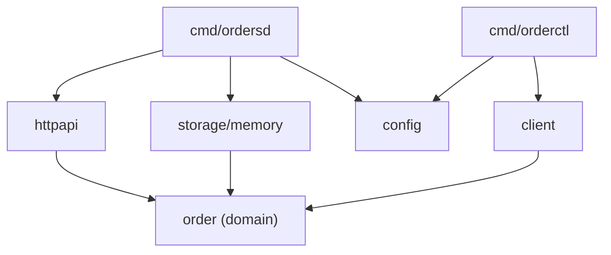

# Project layout

## Why care?

You join a team. The service has a package called `utils` with 60 files. There is also `common`, `helpers` and `models`. Everything imports everything. You want to move one function, and the compiler says `import cycle not allowed`. Every exported name is used by some other team, so you cannot change anything without a meeting.

None of the code is "wrong". The problem is the **structure**. In Go, structure means **packages**: how you cut the code into folders, what each package is allowed to see, and which way the imports point. Get this right, and a codebase of 200,000 lines still feels small.

## The idea: a package is a small product

In Go, a **package** is one folder of `.go` files. It is the unit of:

- **compilation**: the compiler builds one package at a time;
- **visibility**: names starting with a capital letter (`Service`) are visible outside the package, lowercase names (`validate`) are not;
- **design**: other code sees only the package's exported API.

So think of every package as a **small product** with users (the code that imports it). A good product does one thing, has a clear name, and has a small, stable API.

!!! quote "Go proverb"

    _Design the architecture, name the components, document the details._ — Rob Pike

## Package rules you must know

- **One folder = one package.** All `.go` files in a folder must have the same `package` line. (The exception: test files may use `package order_test`, see [Testing](testing.md).)
- **The import path is the folder path:** module path + folder. The folder `internal/order` in module `github.com/acme/orders` is imported as `github.com/acme/orders/internal/order`.
- **The package name should be the last part of the path**: folder `internal/order` has `package order`. Callers then write `order.Service`, `order.ErrNotFound`.
- **`package main`** is special: it builds an executable, and it must have a `func main()`. It cannot be imported.
- **No import cycles.** If `a` imports `b`, then `b` (and everything `b` imports) can never import `a`.

Here is what a cycle looks like:

```text
package example.com/cycle/a
	imports example.com/cycle/b from a.go
	imports example.com/cycle/a from b.go: import cycle not allowed
```

Other languages allow cycles. Go forbids them, for two reasons: builds stay fast (packages compile in a clear order, see [The Go toolchain](toolchain.md#under-the-hood-why-go-compiles-so-fast)), and **design stays clean**. A cycle means two packages are really one package, or a third concept is hiding between them. The compiler forces you to find it.

## Start flat, grow when it hurts

!!! abstract "Convention: start with the simplest layout"

    **Rule:** a small tool starts as `go.mod` + `main.go` in one folder. Add packages when a part
    of the code gets its own clear purpose, or when you need a second binary. Do not start a new
    project by copying a big template with 15 empty folders.

    **Why:** folders are not free. Every package boundary is a decision about API and visibility.
    Empty folders made "just in case" lock you into a structure before you understand the problem.
    In Go, moving code between packages later is easy, because tools like `gopls` rename and move
    symbols for you.

A small CLI:

```text
mytool/
├── go.mod
├── main.go
└── main_test.go
```

When it grows, you split it. The rest of this page is the shape that real, mid-size Go services grow into.

## The reference project: `examples/orders`

This is the layout of the orders system used in Part 5 of this chapter:

```text
examples/orders/
├── go.mod                  # module github.com/acme/orders
├── Makefile                # help, fmt, lint, test, build, pr
├── .golangci.yml           # linter configuration
├── Dockerfile              # multi-stage build, distroless, non-root
├── cmd/
│   ├── ordersd/            # the HTTP service (package main)
│   │   └── main.go
│   └── orderctl/           # the command-line client (package main)
│       └── main.go
└── internal/
    ├── order/              # the domain: Order, Item, Status, Service, Repository, errors
    ├── storage/
    │   └── memory/         # a Repository implementation, in memory
    ├── httpapi/            # HTTP handlers, routes, middleware
    ├── client/             # HTTP client for the API, used by orderctl
    └── config/             # configuration from flags and environment
```

Every choice in this tree has a reason. Let's go through them.

### `cmd/<name>/`: one folder per binary, and keep `main` thin

The project builds **two programs**: a server (`ordersd`, the `d` is for daemon) and a CLI (`orderctl`). Each needs its own `package main`, and one folder can only hold one package, so each gets a folder under `cmd/`. The folder name becomes the binary name: `go build ./cmd/ordersd` produces `ordersd`.

`main` packages should be **thin**: they read configuration, build the objects, connect them, and start. No business logic. A typical shape (you will build the real one in [Building a CLI](cli.md) and [Building a service](services.md)):

```go
package main

import (
	"context"
	"fmt"
	"os"
	"os/signal"
	"syscall"
)

func main() {
	ctx, stop := signal.NotifyContext(context.Background(), os.Interrupt, syscall.SIGTERM)
	defer stop()

	if err := run(ctx, os.Args[1:], os.Getenv); err != nil {
		fmt.Fprintln(os.Stderr, "ordersd:", err)
		os.Exit(1)
	}
}

// run wires the application together. It returns instead of exiting,
// so it can be tested and so deferred cleanup always runs.
func run(ctx context.Context, args []string, getenv func(string) string) error {
	// 1. Load config from args and environment (internal/config).
	// 2. Build dependencies: repository, service, HTTP handler.
	// 3. Start the server and wait for ctx to be cancelled.
	_, _, _ = ctx, args, getenv
	return nil
}
```

Why thin?

- `package main` **cannot be imported**, so code in it cannot be reused, and is hard to test.
- `os.Exit` skips deferred functions. If logic lives in `main`, cleanup gets skipped in error paths. With `run() error`, `main` is the only place that exits.
- Wiring in one place makes the whole architecture readable in one screen: "this service uses _this_ repository, _this_ logger, _these_ handlers".

### `internal/`: privacy enforced by the compiler

Any package under a folder called `internal` can **only be imported by code inside the parent of that `internal` folder**. Here, only code in `github.com/acme/orders/...` can import `github.com/acme/orders/internal/order`.

This is not a convention. The **compiler enforces it**. Another team's module tries:

```go
import "github.com/acme/orders/internal/order"
```

```text
package github.com/acme/billing
	main.go:6:2: use of internal package github.com/acme/orders/internal/order not allowed
```

!!! abstract "Convention: put everything in `internal/` by default"

    **Rule:** in an application (service or CLI), all non-`main` packages live under `internal/`.
    Only move something out when you _decide_ to offer it to other modules.

    **Why:** an exported package is a **promise**. Once other teams import it, every change can
    break them, and in a company that means meetings, migration plans and versioning. Code under
    `internal/` has no outside users, so you can rename, split and rewrite it freely. You get the
    freedom of a private codebase with the convenience of capital-letter exports between your own
    packages. Freedom to change is the most valuable property of a codebase.

`internal` works at any depth: `internal/order/internal/pricing` can only be imported by code under `internal/order/`.

### Why there is no `pkg/` folder

Many repositories have a `pkg/` folder, often because of a popular GitHub repository called `golang-standards/project-layout`. Despite the name, it is **not** an official Go standard. The Go team has said so publicly, and in 2023 published its own short guide, [Organizing a Go module](https://go.dev/doc/modules/layout), which does not use `pkg/`.

What does `pkg/` add? Nothing the compiler understands. It makes every import path longer (`github.com/acme/orders/pkg/order`) and it tells the reader only "this is a Go package", which is true of every folder.

!!! abstract "Convention: no `pkg/`, no `src/`"

    **Rule:** public packages go at the module root or in a descriptive folder
    (`github.com/acme/orders/client`), private ones under `internal/`. Do not add `pkg/` or `src/`.

    **Why:** an import path is read thousands of times. Every part of it should carry meaning.
    `internal/` carries meaning (the compiler enforces it). `pkg/` and `src/` do not.

    If you join a team that already uses `pkg/`, follow the team. Consistency within a codebase
    beats a slightly better layout.

### Package by feature, not by layer

Look at what is **not** in the tree: no `models/`, `controllers/`, `services/`, `repositories/`. That is the "layered" style from many MVC frameworks:

```text
models/order.go           controllers/order.go      services/order.go
models/customer.go        controllers/customer.go   services/customer.go
```

In Go, this style hurts:

- To understand "orders", you open four packages.
- `services` imports `models` and `repositories`; soon `models` needs a helper from `services`: **import cycle**.
- Names stutter or lie: `services.OrderService`, `models.Order`.
- Nothing can be unexported, because every layer needs the other layers' internals.

Instead, group code by **what it is about**. Package `order` holds the type `Order`, the `Service` that applies the business rules, the `Repository` interface it needs, and its errors. Everything about orders, in one place, with unexported helpers that nobody else can see.

The other packages are cut by **technical boundary**, each wrapping one outside system: `httpapi` (the HTTP world), `storage/memory` (a data store), `client` (calling the API over the network), `config` (the environment).

### Dependency direction: the domain imports nothing

The most important rule is **which way the imports point**:



- `order` is at the bottom. It imports only the standard library. It knows nothing about HTTP, JSON on the wire, databases or environment variables.
- Everything else points **toward** the domain.
- Only the `main` packages know about everything, because they do the wiring.

But wait: the `order.Service` needs to save orders, and saving is done by `storage/memory`. If `order` imported `memory`, the arrow would point the wrong way. The solution is an **interface, defined in the package that uses it**:

```go
// Package order is the orders domain: types, business rules and the
// storage contract they need.
package order

import (
	"context"

	"uuid"
)

// Repository stores orders. Implementations live in other packages,
// for example storage/memory.
type Repository interface {
	Get(ctx context.Context, id uuid.UUID) (Order, error)
	Create(ctx context.Context, o Order) error
	List(ctx context.Context) ([]Order, error)
}

// Service applies the business rules for orders.
type Service struct {
	repo Repository
}

// NewService returns a Service that stores orders in repo.
func NewService(repo Repository) *Service {
	return &Service{repo: repo}
}
```

`storage/memory` imports `order` and implements `order.Repository`. It never has to say so: Go interfaces are satisfied **implicitly** (see [Methods and interfaces](methods-and-interfaces.md)). `cmd/ordersd` creates a `memory.Store` and passes it to `order.NewService`. A PostgreSQL store later is one new package and one changed line in `main`.

!!! abstract "Convention: define interfaces where they are used"

    **Rule:** the package that _needs_ a behaviour defines the (small) interface. The package that
    _provides_ the behaviour returns a concrete type.

    **Why:** the consumer knows exactly which methods it needs, so the interface stays small. The
    dependency arrow points toward the domain, so the domain stays free of infrastructure. And
    tests can pass a tiny fake without any mocking framework. This is the Go version of the
    "dependency inversion principle", without a framework.

### No `util`, `common`, `helpers`, `misc`

!!! abstract "Convention: name packages for what they provide"

    **Rule:** a package name says what the package _gives_ you: `order`, `httpapi`, `money`,
    `retry`. Never `util`, `common`, `helpers`, `shared`, `base`, `misc`, `lib`, `types`.

    **Why:** the package name is part of every call: `retry.Do(...)` tells the reader something;
    `util.Do(...)` does not. A vague name also has no boundary, so _anything_ can go in, and it
    becomes the package that everybody imports and that imports everybody: the perfect place for
    import cycles. If you have a helper and no good package for it, keep it unexported next to the
    code that uses it, or give it a small package with a real name.

Good package names, from the standard library: `bytes`, `context`, `errors`, `http`, `json`, `slog`, `time`. Short, lowercase, one word, no underscores, no `mixedCaps`. Details and the reasons behind them are on [Conventions](conventions.md).

Two more naming effects of package-by-feature:

- **Avoid stutter.** The caller already writes the package name, so `order.Service` beats `order.OrderService`, and `httpapi.NewHandler` beats `httpapi.NewHTTPAPIHandler`.
- **The package's main type can share its name**, like `time.Time` or `order.Order`. That is fine: there is no better name.

## Files inside a package

How you split files inside a package does not matter to the compiler. For people, follow these habits:

- One file per main concept: `order.go` (types), `service.go`, `errors.go`, `status.go`.
- A `doc.go` with the package comment, for packages with a longer explanation.
- Tests next to the code: `service_test.go`. Test data in a folder called `testdata/`, which the `go` command ignores when building.
- No file per function, no 3,000-line files. If you scroll a lot to find something, split.

The `go` command also ignores folders and files starting with `.` or `_`.

## Non-Go files

Real projects have more than Go code. Common, widely understood folders:

| Path                    | Holds                                                         |
| ----------------------- | ------------------------------------------------------------- |
| `api/` or `openapi/`    | API definitions (OpenAPI YAML, protobuf files)                |
| `migrations/`           | Database schema migrations (often embedded with `//go:embed`) |
| `deploy/`               | Kubernetes manifests, Helm charts, Terraform                  |
| `docs/`                 | Architecture decisions, runbooks                              |
| `testdata/`             | Test fixtures (ignored by the build, inside any package)      |
| `Makefile`, `mise.toml` | Standard entry points: `make test`, `make lint`, `make pr`    |

## Layouts for different kinds of projects

### A library

A library's users import it, so its **root package is the product**:

```text
money/
├── go.mod          # module github.com/acme/money
├── money.go        # package money: the main API
├── format.go
├── money_test.go
├── example_test.go # runnable examples, shown in the docs
└── internal/
    └── round/      # helpers the library uses but does not promise
```

Users write `import "github.com/acme/money"` and call `money.Format(...)`. Keep the public API small; everything else in `internal/`. Every exported name is something you must support until `v2`.

### A service with several binaries

Exactly the `orders` shape: `cmd/` for each binary (server, CLI, worker, migration tool), `internal/` for everything else.

### A monorepo

A company repo with many services. Two options:

| One module for the whole repo                                      | One module per service                                 |
| ------------------------------------------------------------------ | ------------------------------------------------------ |
| `go.mod` at the root, services in `services/orders/cmd/...`        | `go.mod` in every `services/<name>/`                   |
| One set of dependency versions. Upgrades happen everywhere at once | Each service upgrades on its own schedule              |
| Simple: no `replace`, no `go.work`, `go test ./...` tests all      | Needs `go.work` or tags to share code between services |
| Best when services are released together, by one org               | Best when teams are independent                        |

!!! abstract "Convention: one module per repository, unless you have a reason"

    **Rule:** start with a single module. Split into several modules only when parts must be
    **versioned and released separately** (for example, a public client library inside a service
    repo).

    **Why:** a module is a unit of versioning. Several modules in one repo means several version
    tags, `replace` or `go.work` to develop across them, and CI that must test each one. That
    overhead is only worth it when you really need independent releases.

## Traps

- **Everything exported "just in case".** Exported names in `internal/` are fine, but in a library every capital letter is a promise. Start unexported; export when someone needs it.
- **`models` package with every struct.** It soon causes cycles and leaks persistence details (database tags, JSON tags) into everything.
- **Interfaces next to the implementation** (`type OrderRepository interface` in `storage/memory`). The domain then imports storage to get the interface, which reverses the arrow. Define it in the consumer.
- **Logic in `main`.** Untestable, and `os.Exit` skips your `defer`s. Keep `main` to wiring.
- **Deep nesting** like `internal/app/core/domain/order/entity`. Go prefers broad and shallow. Each extra level is extra reading in every import.

## Check yourself

??? question "1. What exactly does the compiler enforce for `internal/`?"

    A package under `.../x/internal/...` can only be imported by code whose path starts with
    `.../x/`. Imports from anywhere else fail with "use of internal package ... not allowed".

??? question "2. Package `order` needs to save orders, and `storage/postgres` saves them. Where does the interface go, and which package imports which?"

    The `Repository` interface goes in `order` (the consumer). `storage/postgres` imports `order`
    (to use the `Order` type) and implements the interface. `order` never imports
    `storage/postgres`. `main` connects them.

??? question "3. Why is `util` a bad package name, even for a small project?"

    It says nothing at the call site (`util.Parse`), it has no boundary so everything ends up in
    it, and because everyone imports it, it causes import cycles as soon as it needs anything.

??? question "4. Why does `main` call `run()` instead of doing the work itself?"

    `run` returns an error, so it can be tested and its deferred cleanup always runs. `main` is
    then the only place that calls `os.Exit`, which would skip deferred functions.

??? question "5. Your service repo also ships a small public Go client for other teams. How do you structure it?"

    Put the client in a non-internal package, e.g. `github.com/acme/orders/client`, with a small,
    documented API. If it must be versioned independently from the service, give it its own module
    (`client/go.mod`). Everything else stays in `internal/`.

## Recap

- A package is a small product: one purpose, a clear name, a small API. Folder = package.
- `cmd/<binary>/` holds thin `main` packages that only wire things together.
- `internal/` is enforced privacy. Use it for everything you have not decided to share.
- No `pkg/`, no `util`. Organise by feature (`order`), and wrap each outside system in its own package.
- Imports point toward the domain. Interfaces live with the code that uses them.
- Start flat. One module per repo, until you need separate releases.

Next: [Tooling and code quality](tooling-and-quality.md), the tools that keep this structure clean.
