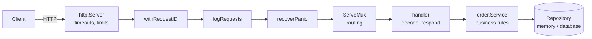
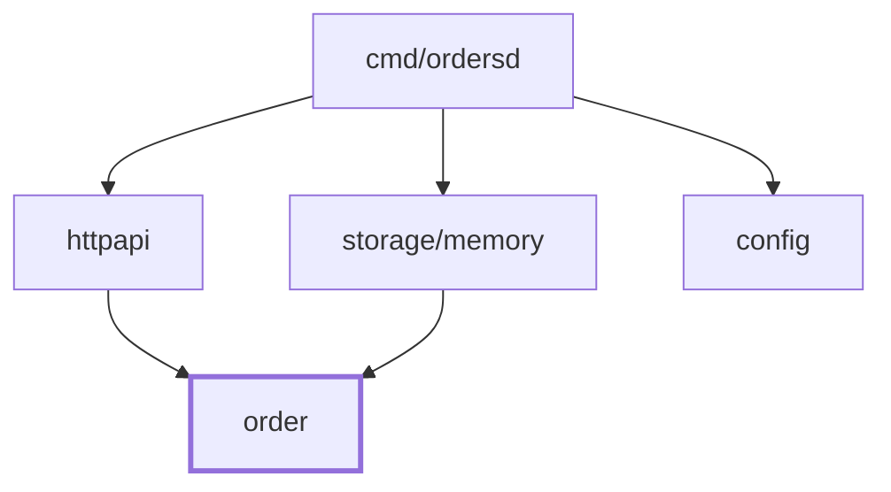
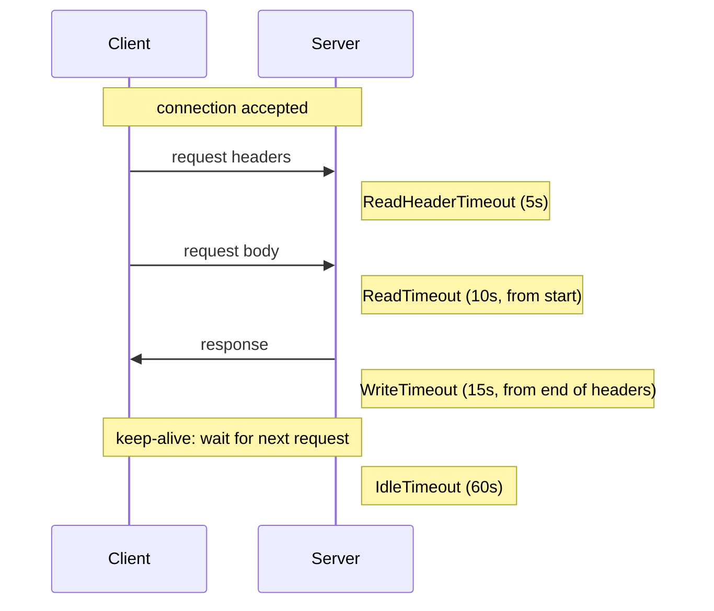
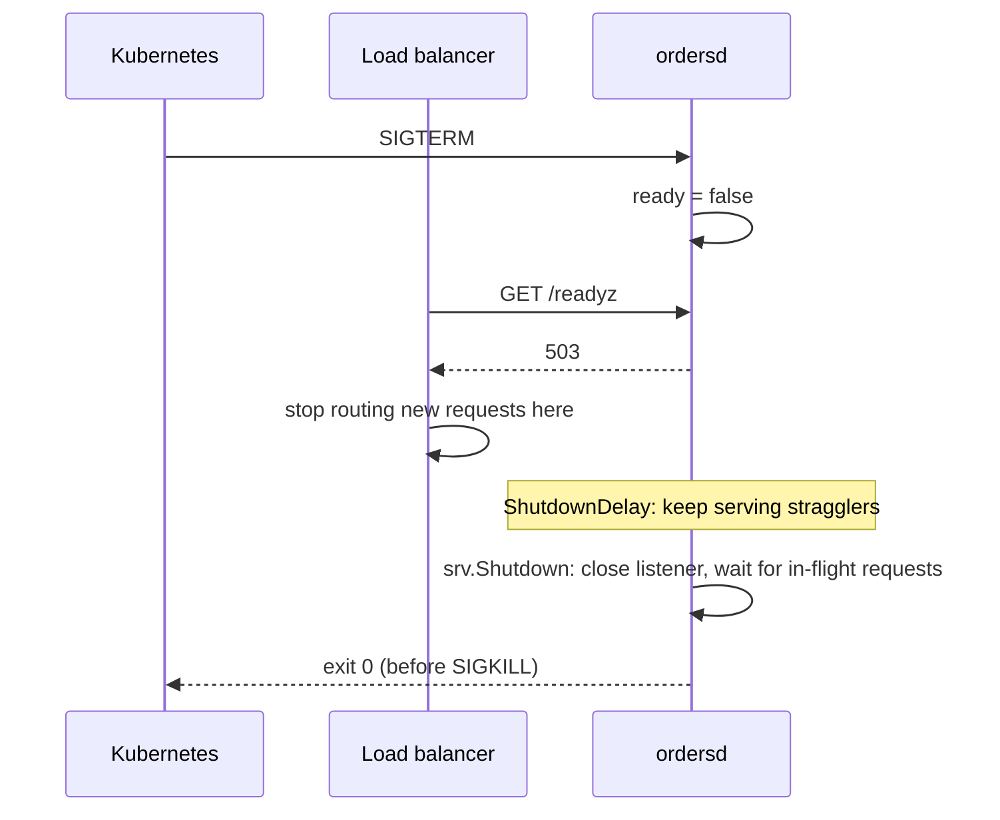

# Building a service

## Why care?

A small HTTP service in Go can be 20 lines. You will find that version in many tutorials:

```go
http.HandleFunc("/orders", handleOrders)
log.Fatal(http.ListenAndServe(":8080", nil))
```

It works at first. In production, it fails in ways that are hard to see:

- A client opens 10,000 connections and sends headers one byte per minute. The server never times out. It runs out of memory.
- Kubernetes deploys a new version. It sends `SIGTERM`, the process dies instantly, and 200 in-flight requests get "connection reset". Customers see errors on every deploy.
- A database error message, with the internal hostname and SQL, is sent straight to the browser.
- Something is slow. The logs say `GET /orders 500`. Which request? Which user? Nobody knows.
- Nobody can test the handlers without starting the whole program.

This page builds `ordersd`, the service half of the orders project, and fixes each of these. It uses **only the standard library**. Every decision comes with its reason, so you can make the same decisions in your own services.

The code lives in `examples/orders/` in this repository. CI vets, lints and race-tests it. All output on this page comes from real runs.

## The big picture

One request travels through these layers:



And the code is organized by **what it knows about**:

```text
examples/orders/
├── cmd/ordersd/main.go         ← wiring: build everything, start, stop
└── internal/
    ├── config/                 ← flags + environment → validated Config
    ├── order/                  ← domain: types, rules, Service, Repository interface
    ├── storage/memory/         ← one implementation of order.Repository
    ├── httpapi/                ← HTTP ↔ domain translation, middleware
    └── buildinfo/              ← version of the running binary
```

### The dependency rule

Arrows point **inward**, towards the domain:



The `order` package imports nothing from this project. It does not know HTTP exists, or JSON, or which database we use. That gives three big benefits:

1. **Business rules are easy to test.** No server, no database, no mocks of HTTP.
2. **You can change the edges.** Swap the in-memory store for PostgreSQL, or add a gRPC API next to HTTP, without touching a single rule.
3. **The compiler enforces it.** Go forbids import cycles. If someone tries to make `order` import `httpapi`, the build fails, because `httpapi` already imports `order`.

!!! abstract "Convention: define interfaces where they are used, not where they are implemented"

    **Rule:** the `order` package declares `Repository`, the interface it _needs_. The `memory` package just has a `Store` type with the right methods; it never mentions an interface. Likewise, `httpapi` declares the `OrderService` interface it needs.

    **Why:** in Go, a type satisfies an interface automatically, just by having the methods (see [Methods and interfaces](methods-and-interfaces.md)). So the _consumer_ can describe exactly the small set of methods it uses. The consumer stays in control, interfaces stay small, and the implementing package has no dependency on the consumer. This is the opposite of Java or C#, where the implementation must name the interface, so interfaces are usually defined next to the implementation.

## The domain: `internal/order`

The core of the service has no I/O at all:

```go
// Item is one line of an order. Money is stored in integer cents: floats
// cannot represent 0.10 exactly, and rounding errors in money are bugs.
type Item struct {
	SKU        string
	Quantity   int
	PriceCents int64
}

// Order is a customer's order.
type Order struct {
	ID         uuid.UUID
	CustomerID string
	Items      []Item
	Status     Status
	CreatedAt  time.Time
}
```

`uuid.UUID` comes from the standard library `uuid` package, new in Go 1.27. Before, every project imported a third-party UUID library.

### Validation reports everything at once

```go
func (n NewOrder) Validate() error {
	var errs []error
	if n.CustomerID == "" {
		errs = append(errs, errors.New("customer ID is required"))
	}
	// ... more checks, each appending to errs ...
	if len(errs) == 0 {
		return nil
	}
	return fmt.Errorf("%w: %w", ErrInvalid, errors.Join(errs...))
}
```

Two details:

- **`errors.Join`** combines many errors into one. A client that sends three mistakes gets three messages in **one** response, instead of fixing them one round trip at a time.
- **`%w` twice.** Since Go 1.20 `fmt.Errorf` can wrap several errors. The result matches `errors.Is(err, ErrInvalid)` _and_ keeps every detail. The HTTP layer uses that `ErrInvalid` to choose status 400. See [Errors](errors.md).

### A Service you can control in tests

```go
// Service applies the domain rules on top of a Repository.
// It is safe for concurrent use if the Repository is.
type Service struct {
	repo  Repository
	now   func() time.Time
	newID func() uuid.UUID
}

// NewService returns a Service backed by repo.
func NewService(repo Repository) *Service {
	return &Service{
		repo:  repo,
		now:   time.Now,
		newID: uuid.NewV7,
	}
}
```

The clock and the ID generator are **fields**, not direct calls to `time.Now()` and `uuid.NewV7()`. Production uses the real ones. Tests in the same package replace them with fixed values, so assertions like "`CreatedAt` is 2026-11-26 09:30" are exact, with no `time.Sleep` and no flakiness.

!!! info "Why UUID version 7?"

    A v7 UUID starts with a millisecond timestamp, then random bits. IDs created later sort later. This helps databases: new rows go at the end of the index instead of random places, which keeps B-tree indexes compact and inserts fast. Random v4 UUIDs scatter writes all over the index.

`Create` also copies the caller's slice with `slices.Clone(n.Items)`. A slice is a view on a shared backing array (see [Types and data](types-and-data.md)). Without the copy, the caller could change the stored order later by changing their own slice. The test `TestServiceCreate` checks this exact case.

## Storage: `internal/storage/memory`

```go
// Store is an order.Repository that keeps orders in a map.
// The zero value is not usable; call New.
type Store struct {
	mu     sync.RWMutex
	orders map[uuid.UUID]order.Order
}

// Compile-time proof that Store satisfies the interface.
var _ order.Repository = (*Store)(nil)
```

- **`sync.RWMutex`.** HTTP handlers run in many goroutines at once. A Go map is not safe for concurrent writes: the runtime detects it and crashes the program with `fatal error: concurrent map writes`. `RWMutex` allows many readers _or_ one writer. See [Concurrency](concurrency.md).
- **`var _ order.Repository = (*Store)(nil)`.** This line compiles only if `*Store` has every method of `Repository`. It costs nothing at run time. Without it, a missing method shows up as a confusing error in `main.go`, far away from the cause.
- **Defensive copies.** `Get` and `List` return clones, so no caller can change stored data through a shared slice.
- **`ctx.Err()` first.** If the request is already cancelled, do no work. A real database driver does this for you.

### What a database store would look like

The project uses the memory store so it has no external dependencies. A PostgreSQL store implements the **same interface**, and `main.go` changes one line. A sketch (not part of the project, so not compiled in CI):

```go
// Sketch: a database/sql implementation of order.Repository.
func (s *Store) Get(ctx context.Context, id uuid.UUID) (order.Order, error) {
	o := order.Order{ID: id}
	err := s.db.QueryRowContext(ctx,
		`SELECT customer_id, status, created_at FROM orders WHERE id = $1`, id.String(),
	).Scan(&o.CustomerID, &o.Status, &o.CreatedAt)
	if errors.Is(err, sql.ErrNoRows) {
		return order.Order{}, order.ErrNotFound
	}
	if err != nil {
		return order.Order{}, fmt.Errorf("query order %s: %w", id, err)
	}
	// ... load items with a second query ...
	return o, nil
}
```

The important parts: always the `...Context` methods (so a cancelled request stops its query), always `$1` placeholders (never string concatenation, which is SQL injection), and translate the driver's "not found" into the **domain's** `ErrNotFound`. Also set pool limits on the `*sql.DB`: `SetMaxOpenConns`, `SetMaxIdleConns` and `SetConnMaxLifetime`. The defaults (unlimited open connections) can overwhelm a database during a traffic spike.

## Routing with `http.ServeMux`

Since Go 1.22, the standard router understands **methods** and **path wildcards**. Most services no longer need a third-party router:

```go
	mux := http.NewServeMux()
	mux.HandleFunc("POST /v1/orders", a.createOrder)
	mux.HandleFunc("GET /v1/orders", a.listOrders)
	mux.HandleFunc("GET /v1/orders/{id}", a.getOrder)
	mux.HandleFunc("GET /healthz", a.healthz)
	mux.HandleFunc("GET /readyz", a.readyz)
```

- `{id}` matches one path segment. The handler reads it with `r.PathValue("id")`.
- `GET` patterns also match `HEAD` requests.
- A request with the wrong method gets **405 Method Not Allowed** and an `Allow` header, automatically:

```text
$ curl -si -X DELETE localhost:8080/v1/orders
HTTP/1.1 405 Method Not Allowed
Allow: GET, HEAD, POST
Content-Type: text/plain; charset=utf-8
X-Content-Type-Options: nosniff
X-Request-Id: 01a216c6-d3c2-7914-9b44-1015644a5788
Date: Thu, 26 Nov 2026 07:34:18 GMT
Content-Length: 19

Method Not Allowed
```

!!! note "A known limitation"

    The 405 (and 404 for unknown paths) bodies come from `ServeMux` itself, as plain text, not in our JSON problem format. For most APIs this is fine. If you need JSON everywhere, register a catch-all `"/"` handler for 404s, and wrap the mux to rewrite 405 responses.

!!! abstract "Convention: version the API in the path"

    **Rule:** routes start with `/v1/`.

    **Why:** one day you need a breaking change. With a version in the path, `/v2/orders` can run next to `/v1/orders` while clients migrate. Without it, every breaking change breaks every client at once.

## Handlers: decode, call, respond

Every handler has the same three steps. Here is the whole `createOrder`:

```go
func (a *api) createOrder(w http.ResponseWriter, r *http.Request) {
	var req createOrderRequest
	if !a.decodeJSON(w, r, &req) {
		return
	}
	n := order.NewOrder{CustomerID: req.CustomerID, Items: make([]order.Item, len(req.Items))}
	for i, it := range req.Items {
		n.Items[i] = order.Item(it)
	}

	o, err := a.svc.Create(r.Context(), n)
	if err != nil {
		a.writeError(w, r, err)
		return
	}
	w.Header().Set("Location", "/v1/orders/"+o.ID.String())
	a.writeJSON(w, r, http.StatusCreated, toResponse(o))
}
```

There is no business logic here. The handler only **translates**: JSON to domain types, domain result to JSON, domain error to HTTP status. That is why it is short.

`order.Item(it)` is a type **conversion** from the wire type `itemJSON` to the domain type. Go allows it because both structs have the same fields in the same order; struct tags are ignored for conversions. If someone adds a field to one and not the other, this line stops compiling, which is exactly the warning you want.

### Wire types are separate from domain types

```go
type orderResponse struct {
	ID         uuid.UUID  `json:"id"`
	CustomerID string     `json:"customer_id"`
	Items      []itemJSON `json:"items"`
	Status     string     `json:"status"`
	TotalCents int64      `json:"total_cents"`
	CreatedAt  time.Time  `json:"created_at"`
}
```

!!! abstract "Convention: do not put JSON tags on domain types"

    **Rule:** the HTTP package has its own request and response structs. The domain types have no `json:"..."` tags.

    **Why:** the JSON is a **public contract** with clients you do not control. The domain is **internal** and should be free to change. If they are the same struct, renaming a Go field changes the API, and adding an internal field (say, `FraudScore`) leaks it to every client. Separate types cost a few lines of mapping and make every API change a deliberate one. Note how the response adds `total_cents`, a computed value the domain type does not store.

A real response:

```text
$ curl -si localhost:8080/v1/orders/01a216c6-d393-716c-832e-f6ca26fc5788
HTTP/1.1 200 OK
Content-Type: application/json
X-Content-Type-Options: nosniff
X-Request-Id: 01a216c6-d3af-7378-ac96-8c4840dd7f4f
Date: Thu, 26 Nov 2026 07:34:18 GMT
Content-Length: 255

{"id":"01a216c6-d393-716c-832e-f6ca26fc5788","customer_id":"c-42","items":[{"sku":"BOOK-1","quantity":2,"price_cents":1250},{"sku":"MUG","quantity":1,"price_cents":899}],"status":"pending","total_cents":3399,"created_at":"2026-11-26T07:34:18.771091084Z"}
```

### Decoding safely

```go
func (a *api) decodeJSON(w http.ResponseWriter, r *http.Request, dst any) bool {
	if mt, _, err := mime.ParseMediaType(r.Header.Get("Content-Type")); err != nil || mt != "application/json" {
		a.writeProblem(w, r, http.StatusUnsupportedMediaType, "Content-Type must be application/json")
		return false
	}
	body := http.MaxBytesReader(w, r.Body, maxBodyBytes)
	err := json.UnmarshalRead(body, dst, json.RejectUnknownMembers(true))
	if err == nil {
		return true
	}
	if _, ok := errors.AsType[*http.MaxBytesError](err); ok {
		a.writeProblem(w, r, http.StatusRequestEntityTooLarge, "request body must not exceed 1 MiB")
		return false
	}
	a.writeProblem(w, r, http.StatusBadRequest, "malformed JSON: "+err.Error())
	return false
}
```

- **`mime.ParseMediaType`** accepts `application/json; charset=utf-8` too. A plain string compare would reject it.
- **`http.MaxBytesReader`** stops reading after 1 MiB. Without a limit, one request with a 10 GB body can take down the server.
- **`json.RejectUnknownMembers(true)`**. A client sending `{"customer": "c-1"}` (a typo for `customer_id`) gets a clear 400 instead of a confusing "customer ID is required". The JSON v2 package (`encoding/json/v2`, stable in Go 1.27) also rejects duplicate keys and invalid UTF-8 by default, and matches field names case-sensitively. These defaults close real security holes that v1 had.
- **Returns `bool`**, and writes the error response itself. Handlers stay at `if !a.decodeJSON(w, r, &req) { return }`.

## Errors to HTTP: one place

Domain errors become HTTP statuses in **exactly one** function:

```go
func (a *api) writeError(w http.ResponseWriter, r *http.Request, err error) {
	switch {
	case errors.Is(err, order.ErrNotFound):
		a.writeProblem(w, r, http.StatusNotFound, "order not found")
	case errors.Is(err, order.ErrInvalid):
		// Validation messages are written for clients, so they are safe to show.
		a.writeProblem(w, r, http.StatusBadRequest, strings.ReplaceAll(err.Error(), "\n", "; "))
	case errors.Is(err, context.Canceled):
		// The client went away. Nobody will read a response; just note it.
		a.logger.InfoContext(r.Context(), "request canceled by client", slog.String("request_id", requestIDFrom(r.Context())))
	default:
		// Unknown errors are logged in full but never shown: they may contain
		// internal details such as hostnames or SQL.
		a.logger.ErrorContext(r.Context(), "request failed",
			slog.String("request_id", requestIDFrom(r.Context())),
			slog.Any("error", err))
		a.writeProblem(w, r, http.StatusInternalServerError, "")
	}
}
```

!!! abstract "Convention: log internal errors in full, show clients only what is safe"

    **Rule:** known, client-caused errors (not found, invalid input) are explained to the client. Everything else becomes a generic 500, and the full error goes to the logs with the request ID.

    **Why:** an error like `dial tcp 10.0.0.7:5432: connection refused` tells an attacker your network layout and database. The client can do nothing useful with it anyway. The test `TestInternalErrorIsHidden` checks that the IP address appears in the log and **not** in the response.

The error body follows **RFC 9457 "Problem Details"**, a standard JSON shape for HTTP errors:

```text
$ curl -si localhost:8080/v1/orders/019ac0de-0000-7000-8000-000000000001
HTTP/1.1 404 Not Found
Content-Type: application/problem+json
X-Content-Type-Options: nosniff
X-Request-Id: 01a216c6-d3b5-7cf5-8d92-93bff9133acc
Date: Thu, 26 Nov 2026 07:34:18 GMT
Content-Length: 135

{"type":"about:blank","title":"Not Found","status":404,"detail":"order not found","request_id":"01a216c6-d3b5-7cf5-8d92-93bff9133acc"}
```

Using a standard means API gateways, client libraries and other teams already know how to read your errors. Validation errors list every problem at once, as designed in the domain:

```text
$ orderctl create -customer "" -item BOOK:0:-5
orderctl: create order: orders API: 400 Bad Request: invalid order: customer ID is required; item 0: quantity must be between 1 and 1000, got 0; item 0: price must not be negative, got -5 (request 01a216c6-d3c7-730a-877c-639208c5c2e1)
```

One more detail in the response writer: it **marshals first, then writes**:

```go
// write marshals v fully before sending anything. If marshaling fails we can
// still send a clean 500, instead of a 200 with half a body.
func (a *api) write(w http.ResponseWriter, r *http.Request, status int, contentType string, v any) {
	body, err := json.Marshal(v)
```

Once `w.WriteHeader(200)` is called, the status is on its way to the client and cannot be changed. Streaming JSON directly into `w` would mean a failure halfway produces "200 OK" with broken JSON.

## Middleware: plain functions

Middleware in Go is a function that takes a handler and returns a handler:

```go
func(next http.Handler) http.Handler
```

No framework needed. `NewHandler` stacks three of them around the mux:

```go
	// Outermost first: every request gets an ID, then is logged, and a
	// panic anywhere inside becomes a 500 instead of a dropped connection.
	return withRequestID(logRequests(logger, recoverPanic(logger, mux)))
```

The **order matters**. The request ID must exist before the log line is written. The panic recovery must be _inside_ the logger, so a panic is still logged as a request with status 500.

### Request IDs

```go
func withRequestID(next http.Handler) http.Handler {
	return http.HandlerFunc(func(w http.ResponseWriter, r *http.Request) {
		id := r.Header.Get("X-Request-ID")
		if !validRequestID(id) {
			id = uuid.NewV7().String()
		}
		w.Header().Set("X-Request-ID", id)
		ctx := context.WithValue(r.Context(), requestIDKey, id)
		next.ServeHTTP(w, r.WithContext(ctx))
	})
}
```

If a gateway in front already set an ID, we keep it, so one ID follows the request through every service. But only if it is **short printable ASCII**: otherwise a client could send `"abc\nlevel=ERROR msg=hacked"` and inject fake lines into text logs. `TestRequestID` checks exactly that.

The ID is stored in the request's `context.Context` with a **private key type**:

```go
type ctxKey int

const requestIDKey ctxKey = iota
```

Because `ctxKey` is unexported, no other package can create the same key, so there can be no collisions. See [Context and cancellation](context.md) for when context values are (and are not) a good idea. A request ID is a typical good case: it is request-scoped, and it is not a function input that changes behavior.

### Access logs

```go
// statusRecorder remembers the status code and body size for logging.
type statusRecorder struct {
	http.ResponseWriter
	status int
	bytes  int
}
```

`http.ResponseWriter` does not tell you which status was written. So the logger wraps it in a struct that **embeds** the real writer (all its methods are promoted, see [Methods and interfaces](methods-and-interfaces.md)) and overrides `WriteHeader` and `Write` to record what passes through.

It also has an `Unwrap() http.ResponseWriter` method. `http.ResponseController` uses `Unwrap` to reach the original writer for features like `Flush` or per-request deadlines. Without it, any wrapper silently hides those features.

The log line uses `r.Pattern`, the **route pattern** that matched (Go 1.23+):

```text
{"time":"2026-11-26T08:34:18.799263936+01:00","level":"INFO","msg":"http request","service":"ordersd","request_id":"01a216c6-d3af-7378-ac96-8c4840dd7f4f","method":"GET","path":"/v1/orders/01a216c6-d393-716c-832e-f6ca26fc5788","route":"GET /v1/orders/{id}","status":200,"bytes":255,"duration":38513}
```

Why log both `path` and `route`? `path` is unique per order, so you cannot group by it. `route` has a handful of values, so dashboards can say "p99 latency of `GET /v1/orders/{id}`". For metrics, always use the route: a label with millions of distinct values (high **cardinality**) can take down a metrics system.

!!! warning "Trap: `duration` is in nanoseconds"

    `slog`'s JSON handler writes a `time.Duration` as an integer number of nanoseconds: `38513` means 38.5 µs. Your log platform must know this. Some teams log `duration_ms` as a float instead. Pick one and use it in every service.

### Panic recovery

```go
func recoverPanic(logger *slog.Logger, next http.Handler) http.Handler {
	return http.HandlerFunc(func(w http.ResponseWriter, r *http.Request) {
		defer handlePanic(logger, w, r)
		next.ServeHTTP(w, r)
	})
}
```

`net/http` already recovers panics in handlers, but it then just closes the connection and prints a stack trace to stderr, outside your structured logs. Our version logs the panic and stack with the request ID and answers with a proper 500.

`handlePanic` re-panics with `http.ErrAbortHandler`: that special value means "abort this response on purpose", and `net/http` handles it silently.

!!! abstract "Convention: panics are for bugs, not for errors"

    **Rule:** never use `panic` for expected failures (bad input, missing rows, timeouts). Return an `error`.

    **Why:** a panic means "the program is in a state the author did not think possible", like a nil map write. The recovery middleware is a **safety net** so one bug in one handler does not crash the service for everybody. It is not a control-flow tool. See [Errors](errors.md).

## Health checks: liveness vs readiness

```go
// healthz is the liveness probe: "the process is not stuck". It must not
// check dependencies, or a database outage would make the orchestrator
// restart every healthy pod.
func (a *api) healthz(w http.ResponseWriter, r *http.Request) {
	a.writeJSON(w, r, http.StatusOK, map[string]string{"status": "ok"})
}

// readyz is the readiness probe: "send me traffic". It turns false during
// shutdown so load balancers stop routing to this instance.
func (a *api) readyz(w http.ResponseWriter, r *http.Request) {
	if !a.ready() {
		a.writeJSON(w, r, http.StatusServiceUnavailable, map[string]string{"status": "shutting down"})
		return
	}
	a.writeJSON(w, r, http.StatusOK, map[string]string{"status": "ready"})
}
```

| Probe                 | Question                      | On failure, the orchestrator...       |
| --------------------- | ----------------------------- | ------------------------------------- |
| Liveness (`/healthz`) | "Is the process stuck?"       | **restarts** the container            |
| Readiness (`/readyz`) | "Should I send you requests?" | **removes** it from the load balancer |

Mixing them up causes outages. If liveness checked the database, a 30-second database outage would make Kubernetes restart _every_ pod at once, turning a small problem into a full outage.

## Configuration: `internal/config`

The service reads its settings from defaults, then environment variables, then flags (the same precedence as the [CLI](cli.md)):

```go
func Load(args []string, getenv func(string) string, output io.Writer) (Config, error) {
	cfg := Default()
	if err := cfg.applyEnv(getenv); err != nil {
		return Config{}, err
	}

	fs := flag.NewFlagSet("ordersd", flag.ContinueOnError)
	fs.SetOutput(output)
	fs.StringVar(&cfg.Addr, "addr", cfg.Addr, "listen `address` (env ORDERS_ADDR)")
	fs.TextVar(&cfg.LogLevel, "log-level", cfg.LogLevel, "minimum log `level`: debug, info, warn, error (env ORDERS_LOG_LEVEL)")
	// ... more flags ...
	if err := fs.Parse(args); err != nil {
		return Config{}, err
	}
	// ...
	if err := cfg.Validate(); err != nil {
		return Config{}, err
	}
	return cfg, nil
}
```

- **`fs.TextVar`** works with any type that implements `encoding.TextUnmarshaler`. `slog.Level` does, so `-log-level debug` parses straight into the right type, with no custom code.
- **Validation happens once, at startup.** The rest of the program receives a `Config` it can trust.
- **All problems at once**, again with `errors.Join`:

```text
$ ORDERS_LOG_FORMAT=xml ordersd -addr nope -shutdown-timeout 0s
ordersd: invalid config: addr "nope": address nope: missing port in address
log format "xml": must be json or text
shutdown timeout 0s: must be positive
```

!!! abstract "Convention: fail fast on bad configuration"

    **Rule:** validate all configuration before starting anything. Refuse to start if it is wrong.

    **Why:** a typo in a timeout should fail the deploy in the first second, with a clear message, not cause strange behavior days later. Orchestrators show a crashing container immediately; a "running but wrong" container can stay hidden for weeks.

`ordersd -h` documents every environment variable next to its flag, so operators never need to read the code:

```text
$ ordersd -h
Usage of ordersd:
  -addr address
    	listen address (env ORDERS_ADDR) (default ":8080")
  -log-format format
    	log format: json or text (env ORDERS_LOG_FORMAT) (default "json")
  -log-level level
    	minimum log level: debug, info, warn, error (env ORDERS_LOG_LEVEL) (default INFO)
  -shutdown-delay duration
    	serve this long after turning not-ready (env ORDERS_SHUTDOWN_DELAY)
  -shutdown-timeout duration
    	max time to drain requests (env ORDERS_SHUTDOWN_TIMEOUT) (default 15s)
```

## Wiring it together: `cmd/ordersd`

`main` has the same shape as in the CLI: catch signals, call `run`, report the error.

```go
func main() {
	// SIGTERM is what Kubernetes, systemd and Docker send to stop a process.
	ctx, stop := signal.NotifyContext(context.Background(), os.Interrupt, syscall.SIGTERM)
	go func() {
		// After the first signal, restore default handling: a second Ctrl-C
		// kills the process at once instead of waiting for shutdown.
		<-ctx.Done()
		stop()
	}()

	err := run(ctx, os.Args[1:], os.Getenv, os.Stdout, os.Stderr)
	// ...
}
```

The goroutine helps during development: the first Ctrl-C starts a graceful shutdown; a second one kills the process immediately.

`run` builds every piece by hand:

```go
	// Wiring: build every dependency here, explicitly, and pass it down.
	// Swapping the store for a database means changing this one line.
	svc := order.NewService(memory.New())
	var ready atomic.Bool

	srv := &http.Server{
		Handler:           httpapi.NewHandler(svc, logger, ready.Load),
		ReadHeaderTimeout: readHeaderTimeout,
		ReadTimeout:       readTimeout,
		WriteTimeout:      writeTimeout,
		IdleTimeout:       idleTimeout,
		MaxHeaderBytes:    maxHeaderBytes,
		ErrorLog:          slog.NewLogLogger(logger.Handler(), slog.LevelWarn),
	}
```

!!! abstract "Convention: wire dependencies by hand in `main`; no DI framework, no globals"

    **Rule:** construct everything in one place (`run`), and pass dependencies as constructor parameters. No package-level `var db *sql.DB`, no `init()` that connects to things, no dependency-injection container.

    **Why:** reading `run` top to bottom tells you _everything_ the service is made of, in the order it is built. The compiler checks every connection. A DI framework hides this behind reflection or code generation, and errors appear at run time instead of compile time. Globals make tests share state and make the order of `init()` functions matter. For services with many dependencies, this function grows to maybe 100 lines. That is fine: the code is simple and explicit.

Note `ready.Load`: a **method value**. It is a `func() bool` bound to this specific `ready` variable. The HTTP package only sees a function; it does not know about atomics at all.

## Server timeouts

```go
// HTTP server limits. These protect the process from slow or hostile
// clients; they are engineering decisions, not deployment settings.
const (
	readHeaderTimeout = 5 * time.Second  // slow-header ("Slowloris") attacks
	readTimeout       = 10 * time.Second // slow request bodies
	writeTimeout      = 15 * time.Second // slow readers of our responses
	idleTimeout       = 60 * time.Second // idle keep-alive connections
	maxHeaderBytes    = 64 << 10         // 64 KiB of request headers
)
```

Every `http.Server` timeout defaults to **zero, which means no limit**. `http.ListenAndServe(":8080", h)` uses those defaults. Here is what each limit protects against:



- **ReadHeaderTimeout** stops the "Slowloris" attack: a client opens many connections and sends headers very slowly, so each one holds a goroutine and memory forever. The `gosec` linter reports a server without it (rule G112).
- **ReadTimeout / WriteTimeout** bound slow uploads and slow downloads.
- **IdleTimeout** closes keep-alive connections nobody uses, so they do not pile up.

!!! info "WriteTimeout does not stop your handler"

    When `WriteTimeout` fires, the server closes the connection, but your handler goroutine keeps running until it returns. To stop _work_, use the request's context: pass `r.Context()` to every database call and HTTP call, as this project does. They return as soon as the client is gone or the server shuts down.

`ErrorLog` sends the server's own messages (like TLS handshake errors) through `slog`, so every log line from the process has the same JSON format.

## Graceful shutdown

When Kubernetes (or Docker, or systemd) stops the service, it sends `SIGTERM`, waits a grace period (30 seconds by default in Kubernetes), then sends `SIGKILL`, which cannot be caught. The service has that window to finish cleanly.

```go
	serveErr := make(chan error, 1)
	go func() { serveErr <- srv.Serve(ln) }()
	ready.Store(true)
	logger.InfoContext(ctx, "listening", slog.String("addr", ln.Addr().String()))

	select {
	case err := <-serveErr:
		return fmt.Errorf("serve: %w", err)
	case <-ctx.Done():
	}

	return shutdown(ctx, cfg, logger, srv, &ready, serveErr)
```

`Serve` runs in its own goroutine; `run` waits for whichever happens first: the server fails (port problem, say), or a signal arrives. The channel has a buffer of 1, so the goroutine can always send its result and exit, even if nobody is reading anymore. Without the buffer it would leak (see [Concurrency](concurrency.md)).

Then the shutdown, in three steps:

```go
func shutdown(ctx context.Context, cfg config.Config, logger *slog.Logger, srv *http.Server, ready *atomic.Bool, serveErr <-chan error) error {
	logger.InfoContext(ctx, "shutting down",
		slog.Duration("delay", cfg.ShutdownDelay),
		slog.Duration("timeout", cfg.ShutdownTimeout))
	ready.Store(false)
	time.Sleep(cfg.ShutdownDelay)

	// ctx is already cancelled. WithoutCancel keeps its values but not its
	// cancellation, so the shutdown gets its own, fresh deadline.
	shutdownCtx, cancel := context.WithTimeout(context.WithoutCancel(ctx), cfg.ShutdownTimeout)
	defer cancel()

	if err := srv.Shutdown(shutdownCtx); err != nil {
		closeErr := srv.Close()
		return errors.Join(fmt.Errorf("graceful shutdown: %w", err), closeErr)
	}
	if err := <-serveErr; !errors.Is(err, http.ErrServerClosed) {
		return fmt.Errorf("serve: %w", err)
	}
	logger.InfoContext(ctx, "shutdown complete")
	return nil
}
```



Why each step:

1. **Turn not-ready, then wait (`ShutdownDelay`).** Load balancers learn about the change only at their next probe, a few seconds later. If we stopped accepting connections at once, requests already on their way would fail. In Kubernetes, 5–10 seconds is typical. Locally, it defaults to 0.
2. **`srv.Shutdown`** stops accepting new connections, closes idle ones, and **waits** for active requests to finish.
3. **Bounded by `ShutdownTimeout`.** If a request hangs, we give up after 15 seconds and `Close` everything hard. That must be shorter than the orchestrator's grace period, so we exit on our own terms.

`context.WithoutCancel(ctx)` (Go 1.21) is subtle but important: `ctx` is already cancelled (that is _why_ we are shutting down). A timeout derived from it directly would be cancelled immediately. `WithoutCancel` keeps the values but drops the cancellation.

### Watching it work

Start the service with a 2 second delay, then send `SIGTERM`:

```text
$ ORDERS_SHUTDOWN_DELAY=2s ordersd -addr 127.0.0.1:8080 &
$ kill -TERM %1
$ curl -s localhost:8080/readyz
{"status":"shutting down"}
$ curl -s localhost:8080/healthz
{"status":"ok"}
```

During the delay, readiness is `503` but the process is alive and still serving. The log shows the delay exactly:

```text
{"time":"2026-11-26T08:34:32.818803842+01:00","level":"INFO","msg":"shutting down","service":"ordersd","delay":2000000000,"timeout":15000000000}
{"time":"2026-11-26T08:34:34.824901271+01:00","level":"INFO","msg":"shutdown complete","service":"ordersd"}
```

The probe requests themselves do not appear: `logRequests` logs `/healthz` and `/readyz` at `DEBUG` level, because orchestrators call them every few seconds and they would hide the log lines of real traffic.

## Logging with `slog`

```go
func newLogger(cfg config.Config, w io.Writer) *slog.Logger {
	opts := &slog.HandlerOptions{Level: cfg.LogLevel}
	var h slog.Handler = slog.NewJSONHandler(w, opts)
	if cfg.LogFormat == "text" {
		h = slog.NewTextHandler(w, opts)
	}
	return slog.New(h).With(slog.String("service", "ordersd"))
}
```

JSON for production, because log platforms parse it into searchable fields. Text for your terminal (`make run`):

```text
time=2026-11-26T08:34:49.276+01:00 level=INFO msg=starting service=ordersd version=aea3486-dirty revision=aea3486d8a844022a3d22d541bfaf71213e422ec go_version=go1.27.4
time=2026-11-26T08:34:49.299+01:00 level=INFO msg=listening service=ordersd addr=127.0.0.1:8080
```

The very first line says **which version** is running. During an incident, that is the first thing you want to know.

!!! abstract "Convention: inject the logger; log to stdout; never log secrets"

    **Rule:** pass a `*slog.Logger` to the components that need it. Do not use the global `slog.Info`. Write logs to stdout. Never log passwords, tokens, or full request bodies.

    **Why:** an injected logger can be replaced in tests (they use a buffer or `slog.DiscardHandler`), and its attributes (`service=ordersd`) are attached everywhere. Containers collect stdout automatically; log files inside containers fill disks and get lost. Logs are copied to many systems and kept for months, so a secret in a log is a leaked secret. The `sloglint` linter in `.golangci.yml` enforces "no global logger" and "use the `...Context` methods".

!!! tip "Beyond logs: metrics, traces, profiles"

    This project stops at logs to stay dependency-free. A production service usually adds:

    - **Metrics and traces** with OpenTelemetry (`go.opentelemetry.io/otel`). Both plug in as one more middleware next to `logRequests`, using `r.Pattern` as the route label.
    - **Profiling** with `net/http/pprof`, on a **separate, internal-only** port, never on the public one. See [Performance](performance.md).

## Testing the service

The tests mirror the layers.

**Handlers** are tested with `httptest.NewRecorder`, a fake `ResponseWriter`, against the **real** service and memory store:

```go
func newTestHandler(t *testing.T) (http.Handler, *bytes.Buffer) {
	t.Helper()
	var logs bytes.Buffer
	logger := slog.New(slog.NewJSONHandler(&logs, &slog.HandlerOptions{Level: slog.LevelDebug}))
	svc := order.NewService(memory.New())
	return NewHandler(svc, logger, func() bool { return true }), &logs
}
```

Why not mock the service? Because the real one is fast (everything is in memory) and a test against real behavior catches real bugs. A mock only checks that you call what you think you call. One table test covers every error path, from "unknown order" to "body too large".

**Failures the real service cannot produce** use a tiny hand-written fake. This is why `OrderService` is an interface:

```go
// errService fails every call with err. It shows why OrderService is an
// interface: we can simulate a database outage in three lines.
type errService struct{ err error }
```

Its three methods each just return `s.err`.

**The whole program** is tested by calling `run` with `-addr 127.0.0.1:0`. Port 0 asks the OS for any free port, and the test reads the real address from the JSON log line:

```go
	go func() {
		err := run(ctx, []string{"-addr", "127.0.0.1:0"}, func(string) string { return "" }, logW, io.Discard)
		_ = logW.Close()
		done <- err
	}()

	lines := bufio.NewScanner(logs)
	addr := waitForLog(t, lines, "listening")["addr"].(string)
```

It then calls `/readyz` over real TCP, cancels the context (exactly what `SIGTERM` does through `NotifyContext`), and checks that `run` logs "shutdown complete" and returns `nil`. That is a full start-serve-stop cycle in about 50 milliseconds, with no `time.Sleep`.

The memory store has a test that runs 50 goroutines at once. On its own it proves little. Under the **race detector**, it finds data races:

```text
$ go test -race -count=1 ./...
ok  	github.com/acme/orders/cmd/orderctl	1.103s
ok  	github.com/acme/orders/cmd/ordersd	1.076s
ok  	github.com/acme/orders/internal/buildinfo	1.017s
ok  	github.com/acme/orders/internal/client	1.083s
ok  	github.com/acme/orders/internal/config	1.023s
ok  	github.com/acme/orders/internal/httpapi	1.054s
ok  	github.com/acme/orders/internal/order	1.023s
ok  	github.com/acme/orders/internal/storage/memory	1.025s
```

Remove the mutex from `Store` and this run fails with `WARNING: DATA RACE` and both stack traces. See [Testing](testing.md) for more on the race detector.

## The project's quality gate

`make help` lists everything a developer can do:

```text
$ make help
  help       Show this help
  fmt        Format all Go code
  fmt-check  Fail if any Go file is not formatted
  vet        Run go vet
  lint       Run golangci-lint
  test       Run all tests with the race detector
  cover      Write an HTML coverage report to coverage.html
  vuln       Check dependencies and the standard library for known vulnerabilities
  build      Build both binaries into ./bin
  run        Run the service locally with readable logs
  docker     Build the container image
  pr         Everything CI runs; must pass before a pull request
  clean      Remove build output
```

`make pr` runs the same checks as CI: format check, `go vet`, `golangci-lint` (with the linters in `.golangci.yml`, explained in [Tooling and code quality](tooling-and-quality.md)) and the race-enabled tests. When it is green locally, CI is green too. In this repository, `mise run check` also runs these checks for `examples/orders`.

## Containers

```dockerfile
# ---- Stage 1: build ---------------------------------------------------------
# Pin images by digest in production (image@sha256:...) so builds are
# reproducible and a re-tagged image cannot change what you ship.
FROM golang:1.27 AS build
WORKDIR /src

# Download modules in their own layer: it is cached until go.mod/go.sum
# change, so code-only changes rebuild in seconds.
COPY go.mod go.sum ./
RUN go mod download

COPY . .
ARG VERSION=dev
# CGO_ENABLED=0: a static binary with no libc dependency, so it runs on a
# minimal base image. -trimpath removes local paths from the binary.
RUN CGO_ENABLED=0 go build -trimpath \
      -ldflags="-s -w -X github.com/acme/orders/internal/buildinfo.version=${VERSION}" \
      -o /out/ordersd ./cmd/ordersd

# ---- Stage 2: run -----------------------------------------------------------
# distroless/static: no shell, no package manager, only CA certificates,
# timezone data and /etc/passwd. Fewer files = fewer vulnerabilities.
# The :nonroot tag runs as UID 65532, never as root.
FROM gcr.io/distroless/static-debian12:nonroot
COPY --from=build /out/ordersd /ordersd
USER nonroot:nonroot
EXPOSE 8080
ENTRYPOINT ["/ordersd"]
```

A **multi-stage** build: the first stage has the whole Go toolchain (hundreds of megabytes); the final image has only our binary on a minimal base. The result, from a real build:

```text
$ docker images acme/ordersd --format '{{.Repository}}:{{.Tag}} {{.Size}}'
acme/ordersd:v0.1.0 16MB

$ docker exec ordersd-test /bin/sh -c id
OCI runtime exec failed: exec failed: unable to start container process: exec: "/bin/sh": stat /bin/sh: no such file or directory
```

No shell at all. If an attacker finds a bug in the service, there are no tools in the container to use. And `docker stop` (which sends `SIGTERM`) gives a clean shutdown and exit code 0:

```text
{"time":"2026-11-26T07:36:20.948114181Z","level":"INFO","msg":"starting","service":"ordersd","version":"v0.1.0","revision":"","go_version":"go1.27.4"}
{"time":"2026-11-26T07:36:20.970949385Z","level":"INFO","msg":"listening","service":"ordersd","addr":"[::]:8080"}
{"time":"2026-11-26T07:36:21.249475113Z","level":"INFO","msg":"shutting down","service":"ordersd","delay":0,"timeout":15000000000}
{"time":"2026-11-26T07:36:21.24959982Z","level":"INFO","msg":"shutdown complete","service":"ordersd"}
```

The version is `v0.1.0`, passed with `--build-arg VERSION=v0.1.0`, because the build context has no `.git` folder (see `.dockerignore`) for the toolchain to read. `revision` is empty for the same reason.

!!! tip "Faster builds with BuildKit"

    With BuildKit (the default builder in current Docker with `buildx`), add
    `RUN --mount=type=cache,target=/root/.cache/go-build` to the build step. The Go build cache then
    survives between image builds, and rebuilds after a small change take seconds instead of minutes.

### The Go runtime inside a container

Two runtime settings matter in containers:

- **`GOMAXPROCS`**, the number of threads running Go code at once (see [Processes, threads and system calls](../fundamentals/processes-and-threads.md)). Since Go 1.25, the runtime reads the container's **CPU limit** (cgroup) and sets `GOMAXPROCS` to match, and updates it if the limit changes. Before 1.25, a container limited to 2 CPUs on a 64-core machine would run 64 threads and get throttled. If you maintain older services, that is why they import `go.uber.org/automaxprocs`.
- **`GOMEMLIMIT`** is **not** set automatically. Set it a little below the container's memory limit, for example `GOMEMLIMIT=450MiB` for a 512 MiB container, so the garbage collector works harder _before_ the kernel kills the container for using too much memory. See [Memory](../fundamentals/memory.md) and [Performance](performance.md).

## Production checklist

| Concern            | In this project                                      | Why                                              |
| ------------------ | ---------------------------------------------------- | ------------------------------------------------ |
| Server timeouts    | All four set, plus `MaxHeaderBytes`                  | Zero means infinite; slow clients exhaust memory |
| Body size limit    | `http.MaxBytesReader`, 1 MiB                         | One request must not take down the server        |
| Graceful shutdown  | Not-ready → delay → `Shutdown` → `Close`             | No errors during deploys                         |
| Health probes      | `/healthz` (no dependencies), `/readyz` (shutdown)   | Correct restarts and routing                     |
| Error hygiene      | One mapping function; internal errors logged, hidden | No leaks; consistent API                         |
| Request IDs        | Accepted if valid, generated otherwise, in every log | Follow one request across services               |
| Structured logs    | `slog` JSON, version logged at startup               | Searchable; know what runs                       |
| Config             | Defaults < env < flags, validated at startup         | Fail fast, operator-friendly                     |
| Panic safety       | Recovery middleware with stack trace                 | One bug does not kill the service                |
| Concurrency safety | Mutex in store; tests under `-race`                  | Data races are found before production           |
| Container          | Static binary, distroless, non-root, 16 MB           | Small attack surface                             |

## Traps

| Trap                                        | What goes wrong                                                | Fix                                                       |
| ------------------------------------------- | -------------------------------------------------------------- | --------------------------------------------------------- |
| `http.ListenAndServe(addr, h)`              | No timeouts at all                                             | Build an `http.Server` with every timeout set             |
| Using `http.DefaultServeMux`                | Any imported package can register routes (e.g. `/debug/pprof`) | Always `http.NewServeMux()`                               |
| `os.Exit` / `log.Fatal` on `SIGTERM`        | In-flight requests are cut off on every deploy                 | `signal.NotifyContext` + `srv.Shutdown`                   |
| Liveness probe checks the database          | A short DB outage restarts every pod                           | Liveness = "process alive"; readiness = "send traffic"    |
| Shutdown timeout derived from cancelled ctx | `Shutdown` returns immediately; nothing drains                 | `context.WithTimeout(context.WithoutCancel(ctx), ...)`    |
| `err.Error()` in 500 responses              | Leaks hostnames, SQL, stack details                            | Log the error; send a generic message with the request ID |
| Domain structs with JSON tags               | Internal renames break clients; internal fields leak           | Separate wire types                                       |
| Writing the status before marshaling        | "200 OK" with broken JSON                                      | Marshal first, then `WriteHeader` + `Write`               |
| `path` as a metrics label                   | Millions of label values crash the metrics backend             | Use `r.Pattern`                                           |
| Unbuffered result channel from `Serve`      | The goroutine leaks if `run` returns early                     | `make(chan error, 1)`                                     |

## Check yourself

??? question "1. Why does the `order` package declare the `Repository` interface, instead of the `memory` package?"

    Because `order` is the consumer: it knows which methods it needs. The implementation (`memory.Store`)
    satisfies the interface automatically just by having the methods, so it does not need to import or
    mention it. This keeps the domain independent of storage, keeps interfaces small, and lets any
    package provide a new implementation without changing the domain.

??? question "2. Kubernetes sends SIGTERM to `ordersd`. List what happens, in order, until the process exits."

    `signal.NotifyContext` cancels `ctx`, so `run`'s `select` wakes up and calls `shutdown`. It logs
    "shutting down", sets `ready` to false (so `/readyz` returns 503 and the load balancer stops sending
    traffic), sleeps for `ShutdownDelay`, then calls `srv.Shutdown` with a fresh `ShutdownTimeout`
    deadline. `Shutdown` closes the listener and waits for in-flight requests. Then `Serve` returns
    `http.ErrServerClosed`, `run` logs "shutdown complete" and returns `nil`, and `main` exits with 0.

??? question "3. A handler calls a slow external API. `WriteTimeout` is 15 seconds. The client gives up after 5 seconds. Does the handler stop?"

    Not by itself. Neither the client leaving nor `WriteTimeout` stops a goroutine. But when the client
    disconnects, `r.Context()` is cancelled. If the handler passed `r.Context()` to the outgoing HTTP call
    (with `http.NewRequestWithContext`), that call returns with `context.Canceled` and the handler can
    stop. This is why every call in the project takes a `ctx`.

??? question "4. Why does the service keep serving for a few seconds after it turns not-ready, instead of stopping at once?"

    Load balancers learn about readiness only at their next probe. Between the SIGTERM and that probe,
    new requests are still being routed to this instance. If it stopped accepting connections at once,
    those requests would fail. The delay lets the load balancer catch up first.

??? question "5. Your colleague wants to return `err.Error()` in every 500 response, \"to make debugging easier\". What do you say?"

    Internal errors can contain hostnames, IP addresses, SQL, file paths and other details useful to an
    attacker, and clients cannot act on them. Instead, log the full error with the request ID and return
    the request ID in the response. Debugging is just as easy: search the logs for the ID.

## Recap

- Organize by knowledge: the domain knows nothing about HTTP or storage. Imports point inward.
- Define interfaces where they are used. Satisfy them implicitly.
- `ServeMux` handles methods, wildcards and 405s. Handlers only translate; rules live in the domain.
- Separate wire types from domain types. Limit, validate and strictly decode every request body.
- Map errors to statuses in one place. Show clients only safe details; log the rest with a request ID.
- Middleware is `func(http.Handler) http.Handler`. Order matters.
- Wire everything by hand in `run`. No globals, no DI framework.
- Set every server timeout. Shut down in three steps: not-ready, drain, force.
- Log JSON to stdout with `slog`, version first. Liveness and readiness are different questions.
- Ship a static binary in a distroless, non-root image. Know `GOMAXPROCS` and `GOMEMLIMIT`.

You now have a complete, production-shaped Go project. Go back to any earlier page and you will see its ideas here, in real code.

## You finished Go

You have built the `orders` project from an empty module to a tested, observable service that ships as a container image. The rest of the site looks at the systems around that service, starting with the [Linux](../linux/index.md) kernel it runs on.
