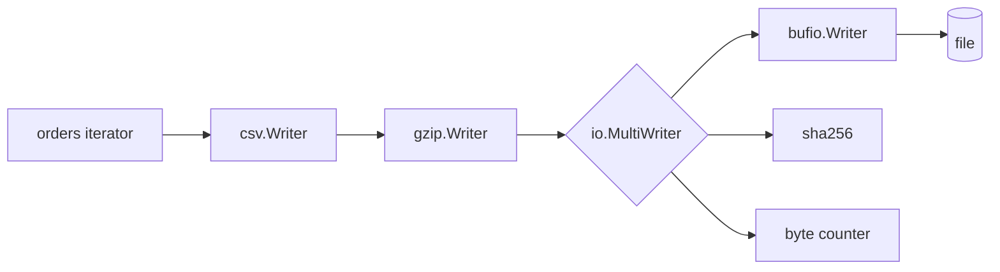

# Standard library essentials

## Why care?

Two common incidents:

1. **An export that runs out of memory.** A nightly job exports all orders as CSV. It reads every order into a slice, builds the CSV in a `bytes.Buffer`, compresses it, and uploads it. With 200,000 orders it was fine. With 9 million it used 14 GB of memory and the container was killed.
2. **A service that stops responding.** The orders service calls the payment provider with `http.Get(url)`. One day the provider stops answering, but keeps the TCP connections open. `http.Get` has **no timeout**. Every request to the orders service waits forever. After a few minutes all goroutines are stuck, and the service is down, even though only payments were broken.

Neither needed a library. Both are fixed with the standard library, used the way it is designed to be used. Go's standard library is big, high-quality and stable: in many teams, a service has only a handful of third-party dependencies. This page covers the parts you use every day, and the design ideas behind them.

!!! abstract "Convention: standard library first"

    **Rule:** reach for the standard library before a third-party package. Add a dependency when it gives you
    something substantial that the standard library doesn't (a database driver, OpenTelemetry, a cloud SDK).

    **Why:** the standard library has the Go 1 **compatibility promise** (code that compiles today compiles
    in ten years), gets security fixes with every Go release, and every Go developer already knows it. Each
    dependency is code you must review, update and trust (see [Modules and dependencies](modules.md)).

## `io.Reader` and `io.Writer`: the most important interfaces in Go

Almost everything that moves bytes in Go uses one of two small interfaces:

```go
type Reader interface {
	Read(p []byte) (n int, err error)
}

type Writer interface {
	Write(p []byte) (n int, err error)
}
```

- **`Read`** fills `p` with up to `len(p)` bytes and says how many (`n`). At the end it returns `io.EOF`.
- **`Write`** writes the bytes from `p` and says how many it wrote. If `n < len(p)`, `err` must say why.

Because the interfaces are so small, almost **every** type that handles bytes implements them:

| Reads (`io.Reader`)                          | Writes (`io.Writer`)                  |
| -------------------------------------------- | ------------------------------------- |
| `*os.File`, `os.Stdin`                       | `*os.File`, `os.Stdout`               |
| `http.Request.Body`, `http.Response.Body`    | `http.ResponseWriter`                 |
| `*gzip.Reader`, `*bufio.Reader`              | `*gzip.Writer`, `*bufio.Writer`       |
| `strings.NewReader(s)`, `bytes.NewReader(b)` | `*bytes.Buffer`, `*strings.Builder`   |
| `net.Conn`                                   | `net.Conn`, `hash.Hash` (e.g. sha256) |

### Why this design matters: composition

Because every piece implements the same interface, you can **connect them** like pipes. Data flows through in small chunks. Nothing ever holds the whole file.



### Try it in Go: export millions of orders with flat memory

This is the fix for incident 1. The orders come from an iterator (see [Generics and iterators](generics.md)), so they are never all in memory either.

```go
// ExportCSV writes orders as gzip-compressed CSV to w.
// It works for 10 orders or 10 million: memory use stays flat.
func ExportCSV(w io.Writer, orders iter.Seq[Order]) error {
	zw := gzip.NewWriter(w)
	cw := csv.NewWriter(zw)
	if err := cw.Write([]string{"id", "customer_id", "total_cents"}); err != nil {
		return fmt.Errorf("write header: %w", err)
	}
	for o := range orders {
		if err := cw.Write([]string{o.ID, o.CustomerID, strconv.FormatInt(o.TotalCents, 10)}); err != nil {
			return fmt.Errorf("write order %s: %w", o.ID, err)
		}
	}
	cw.Flush()
	if err := cw.Error(); err != nil {
		return fmt.Errorf("flush csv: %w", err)
	}
	if err := zw.Close(); err != nil { // Close writes the gzip footer
		return fmt.Errorf("close gzip: %w", err)
	}
	return nil
}

// countingWriter counts the bytes that pass through it.
type countingWriter struct{ n int64 }

func (c *countingWriter) Write(p []byte) (int, error) {
	c.n += int64(len(p))
	return len(p), nil
}

func main() {
	f, err := os.Create("orders.csv.gz")
	if err != nil {
		log.Fatal(err)
	}

	bw := bufio.NewWriter(f)
	hash := sha256.New()
	var size countingWriter

	// One stream, three destinations: the file, the hash and the counter.
	if err := ExportCSV(io.MultiWriter(bw, hash, &size), fakeOrders(1_000_000)); err != nil {
		log.Fatal(err)
	}
	if err := bw.Flush(); err != nil {
		log.Fatal(err)
	}
	if err := f.Close(); err != nil { // a failed Close on write can mean lost data
		log.Fatal(err)
	}
	fmt.Printf("wrote %d bytes, sha256 %x\n", size.n, hash.Sum(nil)[:8])
}
```

Measured with `/usr/bin/time` for 1 million and for 10 million orders:

```text
wrote 5232267 bytes, sha256 06e37ba5f1017638
max RSS: 12920 KB, 0.48 s

wrote 52324542 bytes, sha256 c19a58b67ce4283c
max RSS: 13892 KB, 4.95 s
```

Ten times more data uses **the same 13 MB of memory**. Notice also what `ExportCSV` does **not** know: it doesn't know about files, hashes or byte counters. It takes an `io.Writer`. In a test you pass a `bytes.Buffer`. In an HTTP handler you pass the `http.ResponseWriter`, and the export streams straight to the browser. In a job you pass an S3 upload writer. Same function.

!!! abstract "Convention: accept `io.Reader`/`io.Writer`, not files or byte slices"

    **Rule:** a function that consumes or produces a stream of bytes takes an `io.Reader` or `io.Writer`, not a
    file name, `*os.File`, `string` or `[]byte`.

    **Why:** the caller decides where the bytes come from and go to. The function becomes testable without touching
    the disk, works with any size of data, and composes with compression, hashing, encryption and the network.

### Useful helpers in `io`

| Helper                      | Use it for                                                         |
| --------------------------- | ------------------------------------------------------------------ |
| `io.Copy(dst, src)`         | move all bytes from a reader to a writer, in chunks                |
| `io.MultiWriter(w1, w2, …)` | write the same bytes to several writers                            |
| `io.TeeReader(r, w)`        | read from `r`, and copy what you read to `w` (e.g. hash an upload) |
| `io.LimitReader(r, n)`      | stop after `n` bytes: never trust a size from outside              |
| `io.ReadAll(r)`             | read everything into memory. Only for **small, bounded** input.    |
| `io.NopCloser(r)`           | turn a `Reader` into a `ReadCloser` with a no-op `Close`           |
| `io.Pipe()`                 | connect a writer in one goroutine to a reader in another           |

### `bufio`: fewer system calls

Every `Write` on an `*os.File` is a **system call** (see [Processes, threads and system calls](../fundamentals/processes-and-threads.md)), which is expensive. Writing a CSV line by line straight to a file would make millions of them. `bufio.Writer` collects writes in a 4 KiB buffer and makes one system call per full buffer. **Always call `Flush()`** at the end, and check its error: whatever is still in the buffer is lost otherwise.

For reading lines, use `bufio.Scanner`:

```go
sc := bufio.NewScanner(r)
sc.Buffer(make([]byte, 0, 64*1024), 1024*1024) // allow lines up to 1 MiB
for sc.Scan() {
	line := sc.Text()
	// ...
}
if err := sc.Err(); err != nil { // don't forget: Scan returns false on errors too
	return fmt.Errorf("read import file: %w", err)
}
```

!!! warning "Trap: `bufio.Scanner` and long lines"

    By default a `Scanner` fails on lines longer than **64 KiB** with `bufio.Scanner: token too long`. A JSON-lines
    file with one big order will hit that in production. Set `sc.Buffer` with a sensible maximum, and always check `sc.Err()`.

## JSON: `encoding/json/v2`

JSON is the most common data format for web APIs. Go 1.27 ships a new JSON package, `encoding/json/v2`, next to the classic `encoding/json`. The classic package is not going away (the compatibility promise), and it is now built on top of the same engine. But new code should use v2, because its **defaults are safer**.

### Struct tags

```go
// Order is the API representation of an order.
type Order struct {
	ID         uuid.UUID `json:"id"`
	CustomerID string    `json:"customer_id"`
	Items      []Item    `json:"items"`
	Status     string    `json:"status"`
	CreatedAt  time.Time `json:"created_at"`
	PaidAt     time.Time `json:"paid_at,omitzero"`
	Note       string    `json:"note,omitempty"`
}
```

The text in backticks is a **struct tag**: metadata the JSON package reads with reflection.

- `json:"customer_id"` sets the name in JSON. Without it, the Go field name (`CustomerID`) is used.
- `omitzero` leaves the field out when it is the **zero value** (for `time.Time`: when `IsZero()` is true). This is the right choice for times and structs.
- `omitempty` leaves it out when the JSON would be **empty**: `""`, `null`, `[]`, `{}`.
- Only **exported** (capitalized) fields are encoded. Unexported fields are invisible to other packages, including `encoding/json`.

### What changed in v2, and why it matters

Here is the same struct and the same inputs through v1 and v2:

```go
b1, _ := jsonv1.Marshal(o)
b2, err := json.Marshal(o)
```

```text
v1: {"id":"0195d0f8-5f6b-7c2a-9d3e-1a2b3c4d5e6f","customer_id":"cus-1","items":null,"status":"pending","created_at":"2026-11-26T09:30:00Z"}
v2: {"id":"0195d0f8-5f6b-7c2a-9d3e-1a2b3c4d5e6f","customer_id":"cus-1","items":[],"status":"pending","created_at":"2026-11-26T09:30:00Z"}
```

Decoding four tricky inputs with both:

```text
input "{\"CUSTOMER_ID\":\"cus-2\"}"
  v1: customer="cus-2" err=<nil>
  v2: customer="" err=<nil>

input "{\"customer_id\":\"cus-1\",\"customer_id\":\"cus-evil\"}"
  v1: customer="cus-evil" err=<nil>
  v2: customer="cus-1" err=jsontext: duplicate object member name "customer_id"

input "{\"customer_id\":\"cus-1\",\"discount_cents\":999999}"
  v1: customer="cus-1" err=<nil>
  v2: customer="cus-1" err=<nil>

input "{\"customer_id\":\"cus-\xff\"}"
  v1: customer="cus-�" err=<nil>
  v2: customer="" err=jsontext: invalid UTF-8 within "/customer_id" after offset 20
```

| Behaviour      | v1                         | v2                         | Why v2 changed it                                                                 |
| -------------- | -------------------------- | -------------------------- | --------------------------------------------------------------------------------- |
| nil slice      | `null`                     | `[]`                       | JavaScript clients crash on `null.length`. An empty list is a list.               |
| name matching  | case-**insensitive**       | case-**sensitive**         | Faster, and no surprises where `"Id"` and `"ID"` fill the same field.             |
| duplicate keys | last one wins              | **error**                  | Security: a proxy might check the first `customer_id`, your service use the last. |
| invalid UTF-8  | silently replaced with `�` | **error**                  | Garbage in should be rejected, not quietly changed.                               |
| unknown fields | ignored                    | ignored (opt-in to reject) | Same default; v2 makes strict mode easy.                                          |

The duplicate-key case is a real attack class. Two systems parse the same JSON differently; an attacker sends `{"customer_id":"me","customer_id":"victim"}`, the gateway authorizes "me", and the backend acts on "victim". v2 refuses the request.

### Strict decoding for APIs

For **requests into** your service, also reject unknown fields. A client that sends `discount_cents` (which you don't support) should get an error, not a silent "OK, ignored":

```go
var strict Order
err = json.Unmarshal(body, &strict, json.RejectUnknownMembers(true))
```

```text
strict: json: cannot unmarshal JSON string into Go main.Order: unknown object member name "discount_cents"
```

In a handler, combine it with a size limit, and decode straight from the stream:

```go
r.Body = http.MaxBytesReader(w, r.Body, 1<<20) // 1 MiB: never trust the client
var req CreateOrderRequest
if err := json.UnmarshalRead(r.Body, &req, json.RejectUnknownMembers(true)); err != nil {
	// 400 Bad Request
}
```

`json.MarshalWrite(w, v)` and `json.UnmarshalRead(r, &v)` work on `io.Writer` and `io.Reader`, so they compose with the readers and writers above.

!!! abstract "Convention: separate API types from domain types"

    **Rule:** the struct with `json` tags that your HTTP API sends (`httpapi.OrderResponse`) is a different type from
    your domain type (`order.Order`). Convert between them in the transport layer.

    **Why:** your API is a contract with clients; your domain model changes when the business changes. If they are
    the same struct, renaming a field in the domain silently breaks every client, and an internal field (a cost
    price, a fraud score) can leak into a response just because someone exported it. Keep the `order` package free of
    JSON tags. The [reference project](services.md) does exactly this.

## `time`: instants, zones and durations

Time causes many production bugs. The `time` package gets the hard parts right, if you know four rules.

### Rule 1: the layout is a reference date, not `YYYY-MM-DD`

Go doesn't use `%Y-%m-%d` or `yyyy-MM-dd`. You write the **reference time** in the format you want:

```text
Mon Jan 2 15:04:05 MST 2006
```

Why that date? Read it as numbers: month **1**, day **2**, hour **3** (15), minute **4**, second **5**, year **6** (2006), zone **-7** (MST). It is "1 2 3 4 5 6 7". Every part is unique, so Go can tell which is which.

```go
created := time.Date(2026, 11, 26, 9, 30, 0, 0, time.UTC)
ams, err := time.LoadLocation("Europe/Amsterdam")
if err != nil {
	log.Fatal(err)
}
fmt.Println(created.Format(time.RFC3339))
fmt.Println(created.In(ams).Format("Mon 2 Jan 2006, 15:04 MST"))
fmt.Println(created.In(ams).Format("2006-01-02")) // a date layout, not a date!
```

```text
2026-11-26T09:30:00Z
Thu 26 Nov 2026, 10:30 CET
2026-11-26
```

For APIs and logs, always use `time.RFC3339` (or `RFC3339Nano`). It includes the time zone offset, so there is no doubt what moment it means.

### Rule 2: store and compute in UTC, convert only for humans

Store `time.Time` values in UTC (`t.UTC()`), in the database and in APIs. Convert to a local zone only at the edge, when you show a time to a person. Otherwise daylight saving time will give you an hour that happens twice and an hour that never happens.

`time.LoadLocation` reads the zone database from the OS. Minimal containers (distroless, scratch) may not have it. Add `import _ "time/tzdata"` to `main` to embed it in the binary (about 450 KB).

### Rule 3: compare with `Equal`, not `==`

```go
t, err := time.Parse(time.RFC3339, "2026-11-26T10:30:00+01:00")
fmt.Println("same instant:", t.Equal(created), "| == :", t == created, err)
```

```text
same instant: true | == : false <nil>
```

Same moment, but `==` compares the struct fields, including the location. `t.Equal(u)`, `t.Before(u)`, `t.After(u)` and `t.Compare(u)` compare the **instant**.

### Rule 4: `time.Now()` has two clocks inside

The value from `time.Now()` contains the **wall clock** (date and time, which can jump when NTP corrects it) and a **monotonic clock** reading (which only moves forward). `time.Since(start)` and `t.Sub(u)` use the monotonic part when both values have it. So durations you measure are correct even if the system clock jumps. Operations like `t.UTC()`, `t.Round(0)` or a database round trip strip the monotonic reading.

Also, inject the clock. A service that calls `time.Now()` deep inside is hard to test. Pass a `now func() time.Time` (see [Testing](testing.md)), or use `testing/synctest`.

### `time.Duration`

`time.Duration` is an `int64` count of nanoseconds, with constants like `time.Second`. Write `15 * time.Minute`, never `900` with a comment. Config values like `"15m"` or `"1h30m"` parse with `time.ParseDuration`.

## Structured logging: `log/slog`

Logs are read by **machines** first (Loki, Elasticsearch, Datadog) and by humans second. A line like `order 42 placed by cus-1 total 41.48` must be parsed with a regex. A structured log is already data:

```go
logger := slog.New(slog.NewJSONHandler(os.Stdout, &slog.HandlerOptions{
	Level:       slog.LevelInfo,
	ReplaceAttr: noTime, // only for stable book output; keep the time in production
})).With(slog.String("service", "ordersd"), slog.String("version", "1.4.2"))

reqLog := logger.With(slog.String("request_id", "req-7f3a"))

reqLog.InfoContext(ctx, "order placed",
	slog.String("order_id", "0195d0f8-5f6b-7c2a-9d3e-1a2b3c4d5e6f"),
	slog.Int64("total_cents", 4148),
	slog.Any("customer", Customer{ID: "cus-1", Email: "ana@example.com", Card: "4111111111111111"}),
)
reqLog.DebugContext(ctx, "cache miss", slog.String("key", "order:42")) // below Info: not printed
reqLog.ErrorContext(ctx, "charge failed",
	slog.Any("error", errors.New("psp: card declined")),
	slog.Any("card", Secret("4111111111111111")),
)
```

```text
{"level":"INFO","msg":"order placed","service":"ordersd","version":"1.4.2","request_id":"req-7f3a","order_id":"0195d0f8-5f6b-7c2a-9d3e-1a2b3c4d5e6f","total_cents":4148,"customer":{"id":"cus-1"}}
{"level":"ERROR","msg":"charge failed","service":"ordersd","version":"1.4.2","request_id":"req-7f3a","error":"psp: card declined","card":"[REDACTED]"}
```

What to notice:

- **The message is constant**: `"order placed"`, not `"order 0195… placed"`. Everything that varies is an attribute. You can now search for all `msg="order placed"` and graph `total_cents`.
- **`With`** returns a child logger that adds attributes to every line. Create one per request with the request ID, and every line in that request can be correlated.
- **The Debug line is not printed**: its level is below the handler's `Level`. Make the level configurable, so you can turn on debug logs during an incident without a new build.
- **No secrets leaked.** `Customer` and `Secret` implement `slog.LogValuer`. slog calls `LogValue()` instead of printing the raw value:

```go
// Secret is a string that must never appear in logs.
type Secret string

// LogValue implements slog.LogValuer: slog calls it instead of printing the value.
func (Secret) LogValue() slog.Value { return slog.StringValue("[REDACTED]") }

// LogValue logs a Customer as a group with only safe fields.
func (c Customer) LogValue() slog.Value {
	return slog.GroupValue(slog.String("id", c.ID))
}
```

The email address and card number never reach the log system. The type system enforces this rule for GDPR and PCI compliance, so it does not depend on every developer remembering it.

!!! tip "One logger, several outputs (Go 1.26)"

    `slog.NewMultiHandler(h1, h2)` sends every record to several handlers, for example JSON to stdout for the platform
    and text to a local debug file:

    ```text
    {"level":"WARN","msg":"disk almost full","percent_used":91}
    level=WARN msg="disk almost full" percent_used=91
    ```

!!! abstract "Convention: pass the logger in; use the `...Context` methods"

    **Rule:** give components their `*slog.Logger` through their constructor, not through the global
    `slog.Default()`. Log with `InfoContext(ctx, ...)` and the other `...Context` methods.

    **Why:** explicit dependencies make tests quiet and easy (pass a logger that writes to a buffer, or
    `slog.New(slog.DiscardHandler)`), and each component can carry its own attributes. The `ctx` lets a handler add
    trace IDs from OpenTelemetry automatically (see [Building a service](services.md)). `main` may still call
    `slog.SetDefault` so that libraries that use the global logger end up in the same output.

## HTTP clients that don't hang

This is the fix for incident 2.

!!! danger "`http.Get` and `http.DefaultClient` have no timeout"

    `http.Get`, `http.Post` and `http.DefaultClient` use a client with `Timeout: 0`, which means **wait forever**.
    One slow dependency can freeze your whole service. Never use them in production code.

Build one client per dependency, with timeouts, and **reuse** it (it holds a pool of connections; creating a new client per request throws the pool away):

```go
// NewHTTPClient returns a client with production timeouts.
func NewHTTPClient() *http.Client {
	return &http.Client{
		Timeout: 10 * time.Second, // whole request, including reading the body
		Transport: &http.Transport{
			Proxy:                 http.ProxyFromEnvironment,
			DialContext:           (&net.Dialer{Timeout: 3 * time.Second, KeepAlive: 30 * time.Second}).DialContext,
			TLSHandshakeTimeout:   3 * time.Second,
			ResponseHeaderTimeout: 5 * time.Second,
			IdleConnTimeout:       90 * time.Second,
			MaxIdleConns:          100,
			MaxIdleConnsPerHost:   10, // default is 2: too low for a busy service
			ForceAttemptHTTP2:     true,
		},
	}
}
```

There are two layers of protection, and you want both:

- **`Client.Timeout`**: an upper limit for the whole request. It is a fallback.
- **A `context` deadline per request** (`http.NewRequestWithContext`): the real limit, taken from the incoming request's remaining time budget (see [Context and cancellation](context.md)). When the user gives up, the outgoing call stops too.

Against a server that never answers:

```text
client timeout after 200ms: Get "http://127.0.0.1:PORT": context deadline exceeded (Client.Timeout exceeded while awaiting headers)
context deadline after 100ms: Get "http://127.0.0.1:PORT": context deadline exceeded
```

Both fail fast, with a clear error. The service stays healthy, and only the payment feature degrades.

Three more rules for every response:

1. **Always close the body**: `defer resp.Body.Close()`. Otherwise the connection can't be reused, and you leak file descriptors.
2. **Check the status code.** A `500` response is **not** an error for `http.Client`: `err` is `nil`. You must check `resp.StatusCode` yourself.
3. **Limit what you read**: `io.LimitReader(resp.Body, maxBytes)` when reading an error body or any response you don't fully trust.

The `client` package in [Testing](testing.md#testing-http-httptest) and in the reference project follows all of these.

## `embed`: ship files inside the binary

A Go service is one static binary. With `//go:embed`, SQL migrations, templates and static web files become part of it:

```go
//go:embed migrations/*.sql
var migrations embed.FS
```

```go
files, err := fs.Glob(migrations, "migrations/*.sql")
if err != nil {
	log.Fatal(err)
}
for _, name := range files {
	body, err := migrations.ReadFile(name)
	// ...
}
```

```text
migrations/0001_orders.sql: CREATE TABLE orders (id uuid PRIMARY KEY);
migrations/0002_status.sql: ALTER TABLE orders ADD COLUMN status text NOT NULL;
```

`embed.FS` implements `fs.FS`, the file system interface. So `http.FileServerFS(static)`, `template.ParseFS(templates, "*.html")` and most migration tools accept it directly. The files can't go missing because a Docker image did not copy a folder. The paths are relative to the Go source file, and can't go up (`..`) or outside the module.

## Files and paths: `os`, `path/filepath`, `os.Root`

- **`path/filepath`** for paths on disk (`filepath.Join("data", name)`): uses `\` on Windows. **`path`** only for slash-separated paths like URLs and `embed`/`fs.FS` paths.
- **`os.ReadFile` / `os.WriteFile`** for small files. For big ones, `os.Open` / `os.Create` plus `io` streaming.
- **`os.CreateTemp` + `os.Rename`** to write a file **atomically**: readers see the old file or the new one, never half of one.

### `os.Root`: when a user chooses the file name

A user asks for `GET /invoices/{name}`. You do `os.Open(filepath.Join("uploads", name))`. An attacker asks for `../../etc/passwd`. This is **path traversal**, one of the most common security bugs. `os.Root` (Go 1.24) makes it impossible:

```go
root, err := os.OpenRoot("uploads")
if err != nil {
	log.Fatal(err)
}
defer root.Close()
for _, name := range []string{"invoice-1.pdf", "../go.mod", "/etc/passwd"} {
	f, err := root.Open(name)
	if err != nil {
		fmt.Println("open:", err)
		continue
	}
	fmt.Println("opened", name)
	f.Close()
}
```

```text
opened invoice-1.pdf
open: openat ../go.mod: path escapes from parent
open: openat /etc/passwd: path escapes from parent
```

Every path is resolved **inside** the root, also through symbolic links. Use it whenever any part of a file path comes from outside.

## Small, common packages

### `uuid` (Go 1.27)

UUIDs are now in the standard library. For database primary keys, use **version 7**:

```text
v7: 01a216ca-5286-7e1c-b9c4-17ae8f619b80
v7: 01a216ca-5289-7274-a1ed-d543d5b1bb68
v7: 01a216ca-528b-7632-abe7-757c363bcad5
v4: 3ce1554e-de1b-4b97-be9a-488f8c627af5
v4: e984e259-a942-4576-9adf-809b87f99108
```

A v7 UUID starts with a millisecond **timestamp**, so new IDs sort after old ones. New rows go to the end of the database's B-tree index, which keeps inserts fast and the index compact. Random v4 IDs land all over the index, causing page splits and cache misses (see [Memory: stack, heap and caches](../fundamentals/memory.md)). `uuid.New()` currently returns v4; call `uuid.NewV7()` explicitly for keys. `uuid.Parse` returns an error for invalid input: use it on every ID from a request.

### `strings` and `bytes`

| Function                          | Instead of                                                   |
| --------------------------------- | ------------------------------------------------------------ |
| `strings.Cut(s, "=")`             | `strings.Index` + slicing by hand                            |
| `strings.CutLast(s, "/")` (1.27)  | `strings.LastIndex` + slicing                                |
| `strings.CutPrefix(s, "Bearer ")` | `HasPrefix` + `TrimPrefix`                                   |
| `strings.EqualFold(a, b)`         | `strings.ToLower(a) == strings.ToLower(b)` (allocates twice) |
| `strings.Builder`                 | `s += part` in a loop (allocates every time)                 |
| `strings.SplitSeq`, `Lines`       | `strings.Split` when you only loop once (no slice allocated) |

```go
key, value, ok := strings.Cut("region=eu-west-1", "=")
dir, file, _ := strings.CutLast("exports/2026/11/orders.csv", "/") // Go 1.27
```

```text
region eu-west-1 true
exports/2026/11 orders.csv
```

`go fix` (Go 1.26+) rewrites many old patterns to these automatically (`stringscut`, `stringscutprefix`, `stringsseq`, `stringsbuilder`). See [Tooling and code quality](tooling-and-quality.md).

## Traps

!!! warning "Trap 1: `io.ReadAll` on input you don't control"

    `io.ReadAll(r.Body)` with no limit lets one client send 10 GB and kill your service. Wrap with
    `http.MaxBytesReader` (server side) or `io.LimitReader` (client side) first.

!!! warning "Trap 2: forgetting `Flush` or `Close` on writers"

    `bufio.Writer`, `gzip.Writer`, `csv.Writer` and `tabwriter.Writer` keep data in a buffer. Without `Flush`/`Close`
    the end of your file is missing, and nobody gets an error. `gzip.Writer.Close` also writes the footer; without it
    the file is corrupt.

!!! warning "Trap 3: a new `http.Client` per request"

    Each new client (with a new `Transport`) opens new TCP and TLS connections. Under load you run out of ports and
    pay a TLS handshake per request. Create clients once at startup and share them; they are safe for concurrent use.

!!! warning "Trap 4: `time.Time` in maps or with `==`"

    Two `time.Time` values for the same instant can differ in location and monotonic reading, so `==` and map
    keys behave unexpectedly. Use `t.Equal`, and for map keys use `t.UTC()` (which also strips the monotonic reading) or `t.UnixNano()`.

!!! warning "Trap 5: `float64` for money in JSON"

    `{"price": 19.99}` decoded into a `float64` is not exactly 19.99; the nearest binary value is
    19.989999999999998436… (see [Bits, bytes and numbers](../fundamentals/bits-and-bytes.md)). Add up a few thousand
    of those and the cents are wrong. Use integer cents (`"price_cents": 1999`) in your API, or a decimal string.

## Check yourself

??? question "1. Your export function takes a `filename string`. Why would a reviewer ask you to change it to `io.Writer`?"

    The caller then decides the destination: a file, an HTTP response, a buffer in a test, a gzip or S3 writer.
    The function becomes testable without the disk, and can be composed with compression and hashing.

??? question "2. A client sends `{\"customer_id\":\"me\",\"customer_id\":\"victim\"}`. What do v1 and v2 do, and why does it matter?"

    v1 silently takes the last value ("victim"); v2 returns an error. If another component (a gateway) reads the
    first value, the two disagree, which an attacker can abuse. v2 removes the ambiguity.

??? question "3. Why is `http.Get(url)` dangerous in a service?"

    It uses `http.DefaultClient`, which has no timeout. If the server never answers, the goroutine waits forever.
    Under load, all goroutines get stuck. Use a shared client with timeouts and a context deadline per request.

??? question "4. What does `\"2006-01-02\"` mean in Go's time formatting, and why that date?"

    It is a layout: year-month-day. Go formats by example, using the reference time `Mon Jan 2 15:04:05 MST 2006`,
    whose parts are 1, 2, 3, 4, 5, 6, 7, so each part is unambiguous.

??? question "5. How do you make sure a customer's email never appears in logs, even when someone logs the whole `Customer` struct?"

    Implement `slog.LogValuer` on `Customer` and return only the safe fields. slog calls `LogValue()` instead of
    printing the struct.

## Recap

- `io.Reader` and `io.Writer` are tiny, so everything implements them. Compose them to stream any amount of data with flat memory.
- `bufio` saves system calls. Always `Flush`, always check `Scanner.Err()`, set a max line size.
- Use `encoding/json/v2`: `[]` for nil slices, case-sensitive names, no duplicate keys, valid UTF-8 only. Add `RejectUnknownMembers` and a size limit for requests. Keep API types separate from domain types.
- Time: layouts by example (`2006-01-02`), store UTC, compare with `Equal`, durations with `time.Duration`, inject the clock.
- `slog`: constant messages, attributes for data, `With` for request context, `LogValuer` for secrets. Pass loggers in.
- HTTP clients: never `http.DefaultClient`. One client per dependency, with timeouts, plus a context deadline per request. Close bodies, check status codes.
- `embed` for files in the binary, `os.Root` for user-chosen paths, `uuid.NewV7` for database keys.
