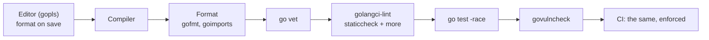

# Tooling and code quality

## Why care?

A code review with 34 comments. Twenty are about spaces, import order and line breaks. Ten are "please check this error". Three are "this name is confusing". **One** is about the real problem: the new endpoint can be called without authentication. It was easy to miss between the other 33.

Humans are bad at finding missing spaces and unchecked errors, and good at judging design. Machines are the opposite. So Go teams follow one rule: **everything a tool can check, a tool checks**, in the editor and in CI, before a human looks. Reviewers then spend their attention on design and correctness.

Go makes this easy, because it ships strong tools and has one accepted style. This page builds the quality pipeline for the [`orders`](project-layout.md#the-reference-project-examplesorders) project, layer by layer.

## The idea: a pipeline of checks, fast ones first



Each layer catches a different class of problems. They all run on your laptop through **one command** (`make pr`), and CI runs exactly the same command. If it passes locally, it passes in CI.

## Layer 1: `gofmt`, one standard format

`gofmt` rewrites Go source into **the** standard format. There are no options to choose tabs or spaces, brace style, or alignment. Here is what it does to untidy code:

```sh
gofmt -d item.go
```

```text
diff item.go.orig item.go
--- item.go.orig
+++ item.go
@@ -1,11 +1,11 @@
 package order

-type Item struct{
-  SKU string
-  Quantity int
-    PriceCents int64 // in cents
+type Item struct {
+	SKU        string
+	Quantity   int
+	PriceCents int64 // in cents
 }

 func (i Item) Total() int64 {
-    return int64(i.Quantity)*i.PriceCents
+	return int64(i.Quantity) * i.PriceCents
 }
```

Tabs for indentation, fields aligned in columns, spaces around operators that bind loosely.

!!! abstract "Convention: all Go code is `gofmt`-formatted. No exceptions."

    **Rule:** format on save in your editor. CI fails if any file is not formatted.

    **Why:** Rob Pike: _"Gofmt's style is no one's favorite, yet gofmt is everyone's favorite."_
    The value is not in the style itself. It is that **there is only one**:

    - no review comments or team wiki pages about style;
    - every Go file looks the same, so you can read any codebase quickly;
    - diffs contain only real changes, never "reformatted the file";
    - tools can safely rewrite code (`go fix`, refactorings), because the output format is known.

    The language was designed for this. For example, the required `{` on the same line is
    needed because Go inserts semicolons automatically at line ends. One fixed format makes that
    rule simple.

Two stricter formatters build on `gofmt`, and most teams use both:

- **`goimports`** does everything `gofmt` does, **plus** adds missing imports, removes unused ones, and groups them (example below).
- **`gofumpt`** is a strict superset of `gofmt` with a few extra rules (no empty lines at the start of a block, grouped `var` declarations, and so on). Its output is still valid `gofmt` output.

The import groups `goimports` produces: standard library first, then third-party modules, then (with the `local-prefixes` setting) your own module:

```go
import (
	"context"
	"net/http"

	"golang.org/x/sync/errgroup"

	"github.com/acme/orders/internal/order"
)
```

## Layer 2: `go vet`, bugs the compiler allows

The compiler checks that code is _legal_. `go vet` checks that it is _probably what you meant_. A program with four real bugs that compiles fine:

```go
package main

import (
	"fmt"
	"log/slog"
	"sync"
)

type Counter struct {
	mu sync.Mutex
	n  int
}

func report(c Counter) {
	fmt.Printf("orders: %d\n", c.n, "extra")
}

func main() {
	var c Counter
	report(c)
	slog.Info("order created", "id")
	fmt.Printf("total: %s\n", 1299)
}
```

```sh
go vet ./...
```

```text
main.go:15:2: fmt.Printf call needs 1 arg but has 2 args
main.go:22:21: fmt.Printf format %s has arg 1299 of wrong type int
main.go:21:2: call to slog.Info missing a final value
main.go:14:15: report passes lock by value: example.com/vet.Counter contains sync.Mutex
main.go:20:9: call of report copies lock value: example.com/vet.Counter contains sync.Mutex
```

The last two are the dangerous ones: copying a struct that contains a `sync.Mutex` copies the lock, so two goroutines can each hold "the" lock at the same time. You will see why in [Concurrency](concurrency.md).

`go test` **runs a high-confidence subset of vet automatically** (`atomic`, `bools`, `buildtag`, `directive`, `errorsas`, `ifaceassert`, `nilfunc`, `printf`, `stdversion`, `stringintconv`, `tests`). If one fails, the tests do not run. Run the full `go vet ./...` (or the `govet` linter, below) in CI as well.

## Layer 3: `go fix`, keep up with modern Go

Go adds better APIs every six months: `any` instead of `interface{}`, `for i := range n`, `strings.SplitSeq`, `errors.AsType`, `wg.Go`. Old code still compiles (the compatibility promise), so it never gets updated by itself.

Since Go 1.26, `go fix` contains **modernizers**: analyzers that rewrite old patterns into current ones, safely. Given this old-style code:

```go
// Tags returns the sorted, unique tags in a comma-separated list.
func Tags(list string) []string {
	var out []string
	seen := map[string]bool{}
	for _, t := range strings.Split(list, ",") {
		t = strings.TrimSpace(t)
		if t == "" || seen[t] {
			continue
		}
		seen[t] = true
		out = append(out, t)
	}
	sort.Strings(out)
	return out
}

// Contains reports whether tags contains want.
func Contains(tags []string, want string) bool {
	for i := 0; i < len(tags); i++ {
		if tags[i] == want {
			return true
		}
	}
	return false
}

// Describe formats any value.
func Describe(v interface{}) string {
	return "value"
}
```

```sh
go fix -diff ./...
```

```text
@@ -9,7 +9,7 @@
 func Tags(list string) []string {
 	var out []string
 	seen := map[string]bool{}
-	for _, t := range strings.Split(list, ",") {
+	for t := range strings.SplitSeq(list, ",") {
 		t = strings.TrimSpace(t)
 		if t == "" || seen[t] {
 			continue
@@ -23,7 +23,7 @@

 // Contains reports whether tags contains want.
 func Contains(tags []string, want string) bool {
-	for i := 0; i < len(tags); i++ {
+	for i := range tags {
 		if tags[i] == want {
 			return true
 		}
@@ -32,6 +32,6 @@
 }

 // Describe formats any value.
-func Describe(v interface{}) string {
+func Describe(v any) string {
 	return "value"
 }
```

`SplitSeq` returns an iterator instead of building a whole slice (see [Generics and iterators](generics.md)), which saves an allocation. `go tool fix help` lists all fixers, for example `errorsastype`, `waitgroupgo`, `testingcontext`, `newexpr`, `omitzero`, `minmax`, `slicescontains`.

!!! abstract "Convention: run `go fix` after every Go upgrade"

    **Rule:** after raising the `go` line in `go.mod`, run `go fix ./...`, review the diff, and
    commit it as its own change (`refactor: apply go fix modernizers for Go 1.27`).

    **Why:** the fixers only use features allowed by your `go` line, and they are designed to keep
    behaviour identical. A separate commit keeps real changes easy to review. Code that uses
    current idioms is easier for new team members, who learned current Go.

## Layer 4: `golangci-lint`, many linters, one config

`go vet` is deliberately conservative: it only reports things that are almost always bugs. Teams want more checks: unchecked errors, security problems, missing `context`, unclosed HTTP bodies. There are dozens of good Go linters. **golangci-lint** runs them all in one process, shares the parsing and type-checking work between them, and reads one config file.

```sh
golangci-lint --version
```

```text
golangci-lint has version 2.15.0 built with go1.27.0 from 25c5369a on 2026-10-16T11:03:09Z
```

### The default set: `standard`

With no configuration, golangci-lint v2 runs five linters. They are worth knowing by name:

| Linter        | Finds                                                                             |
| ------------- | --------------------------------------------------------------------------------- |
| `errcheck`    | Errors you ignored: `f.Close()` without looking at the result                     |
| `govet`       | Everything `go vet` finds (and more passes, if you enable them)                   |
| `ineffassign` | Assignments that are never used                                                   |
| `staticcheck` | Hundreds of checks: bugs, deprecated APIs, simplifications, style (`ST1005`, ...) |
| `unused`      | Unused functions, types, fields and constants                                     |

`staticcheck` is the most important of these. It is the most respected Go linter, written by Dominik Honnef, and it is precise: when it reports something, it is almost always right.

### A realistic enterprise configuration

This is the `.golangci.yml` for the `orders` project (golangci-lint **v2** format: note `version: "2"`):

```yaml
version: "2"

run:
  timeout: 5m

linters:
  # The standard set: errcheck, govet, ineffassign, staticcheck, unused.
  default: standard
  enable:
    - bodyclose # HTTP response bodies must be closed
    - contextcheck # pass the incoming context on, don't start a new one
    - errorlint # wrap with %w, compare with errors.Is/As
    - exhaustive # switch on an enum must handle every value
    - gocritic # many small correctness and style checks
    - gosec # security problems (SQL injection, weak crypto, ...)
    - misspell # spelling in comments and strings
    - nilerr # returning nil after checking err != nil
    - noctx # HTTP requests and SQL queries without a context
    - nolintlint # //nolint must name the linter and give a reason
    - revive # style rules from Effective Go and Code Review Comments
    - rowserrcheck # check rows.Err() after a SQL loop
    - sqlclosecheck # close sql.Rows and sql.Stmt
    - unconvert # unnecessary type conversions
    - unparam # function parameters that are always the same
    - usestdlibvars # http.MethodGet instead of "GET", etc.
    - wrapcheck # errors from other packages must get context
  settings:
    errcheck:
      check-type-assertions: true
    exhaustive:
      default-signifies-exhaustive: true
    govet:
      enable-all: true
      disable:
        - fieldalignment # memory layout tweaks: noisy, rarely worth it
    nolintlint:
      require-explanation: true
      require-specific: true
    revive:
      rules:
        - name: context-as-argument
        - name: error-naming
        - name: error-strings
        - name: exported
        - name: package-comments
        - name: receiver-naming
        - name: var-naming
    wrapcheck:
      ignore-package-globs:
        - github.com/acme/orders/*
  exclusions:
    generated: strict
    presets:
      - std-error-handling
    rules:
      - path: _test\.go
        linters:
          - gosec
          - wrapcheck

formatters:
  enable:
    - gofumpt
    - goimports
  settings:
    goimports:
      local-prefixes:
        - github.com/acme/orders

issues:
  max-issues-per-linter: 0 # 0 = no limit: show everything
  max-same-issues: 0
  uniq-by-line: false # show every issue, not only the first one per line
```

`golangci-lint config verify` checks the file against the official schema. Run it once after every change to the config.

The choices explained:

- **`default: standard` + a list of extras** instead of `default: all`. New golangci-lint versions add linters. With `all`, an upgrade can suddenly fail every build. With an explicit list, upgrades are predictable.
- **`errorlint`, `wrapcheck`, `nilerr`** enforce the error strategy from [Errors](errors.md): errors crossing a package boundary get context, and are compared with `errors.Is`/`errors.As`. `wrapcheck` ignores our own packages (they already add context).
- **`bodyclose`, `noctx`, `contextcheck`, `rowserrcheck`, `sqlclosecheck`** catch resource leaks and missing cancellation. These bugs often cause production outages (see [Context](context.md)).
- **`gosec`** is a basic security scanner. Disabled in tests, where things like fixed file paths are fine.
- **`exhaustive`** makes sure a `switch` over `order.Status` handles every status, or has a `default`. Add a new status, and the linter shows every place you must update.
- **`revive`** enforces naming and doc-comment conventions from [Conventions](conventions.md).
- **`exclusions.presets: std-error-handling`** skips the classic false positives, like not checking the error of `fmt.Println` or a deferred `Close` on a read-only file.
- **`formatters`**: `golangci-lint fmt` formats code; `golangci-lint run` fails if a file is not formatted. So formatting is checked by the same tool.

### See it work

Here is a first version of the API client, written quickly and without care:

```go
// Package client talks to the orders API.
package client

import (
	"errors"
	"fmt"
	"io"
	"net/http"
)

var ErrNotFound = errors.New("Order not found.")

// Get fetches one order.
func Get(url string) ([]byte, error) {
	resp, err := http.Get(url)
	if err != nil {
		return nil, err
	}
	if resp.StatusCode == 404 {
		return nil, ErrNotFound
	}
	body, err := io.ReadAll(resp.Body)
	if err != nil {
		return nil, fmt.Errorf("read body: %v", err)
	}
	return body, nil
}
```

It compiles, and `go vet` reports nothing. golangci-lint reports ten issues:

```sh
golangci-lint run ./...
```

```text
internal/client/client.go:15:23: response body must be closed (bodyclose)
internal/client/client.go:24:43: non-wrapping format verb for fmt.Errorf. Use `%w` to format errors (errorlint)
internal/client/client.go:15:15: G107: Potential HTTP request made with variable url (gosec)
internal/client/client.go:15:23: net/http.Get must not be called. use net/http.NewRequestWithContext and (*net/http.Client).Do(*http.Request) (noctx)
internal/client/client.go:11:5: exported: exported var ErrNotFound should have comment or be unexported (revive)
internal/client/client.go:11:30: error-strings: error strings should not be capitalized or end with punctuation or a newline (revive)
internal/client/client.go:11:19: ST1005: error strings should not end with punctuation or newlines (staticcheck)
internal/client/client.go:11:19: ST1005: error strings should not be capitalized (staticcheck)
internal/client/client.go:19:24: "404" can be replaced by http.StatusNotFound (usestdlibvars)
internal/client/client.go:17:15: error returned from external package is unwrapped: sig: func net/http.Get(url string) (resp *net/http.Response, err error) (wrapcheck)
10 issues:
* bodyclose: 1
* errorlint: 1
* gosec: 1
* noctx: 1
* revive: 2
* staticcheck: 2
* usestdlibvars: 1
* wrapcheck: 1
```

Ten findings in 25 lines, and at least three are real production bugs:

1. **The body is never closed**: every call leaks a network connection. Under load, the service runs out of connections or file descriptors.
2. **`http.Get` has no context and uses `http.DefaultClient`, which has no timeout**: if the server hangs, this call hangs forever.
3. **`%v` instead of `%w`**: callers can no longer use `errors.Is` to find out _what_ went wrong.

The fixed version, as it appears in the real client:

```go
// Package client talks to the orders API.
package client

import (
	"context"
	"errors"
	"fmt"
	"io"
	"net/http"
)

// ErrNotFound is returned when the order does not exist.
var ErrNotFound = errors.New("order not found")

// Client fetches orders from the orders API.
type Client struct {
	baseURL string
	http    *http.Client
}

// New returns a Client for the API at baseURL.
func New(baseURL string, hc *http.Client) *Client {
	return &Client{baseURL: baseURL, http: hc}
}

// Get fetches the raw JSON of one order.
func (c *Client) Get(ctx context.Context, id string) ([]byte, error) {
	req, err := http.NewRequestWithContext(ctx, http.MethodGet, c.baseURL+"/v1/orders/"+id, nil)
	if err != nil {
		return nil, fmt.Errorf("build request: %w", err)
	}
	resp, err := c.http.Do(req)
	if err != nil {
		return nil, fmt.Errorf("get order %s: %w", id, err)
	}
	defer resp.Body.Close()

	if resp.StatusCode == http.StatusNotFound {
		return nil, ErrNotFound
	}
	body, err := io.ReadAll(resp.Body)
	if err != nil {
		return nil, fmt.Errorf("read body: %w", err)
	}
	return body, nil
}
```

```text
0 issues.
```

The `*http.Client` is passed in, so `main` decides the timeout, and tests can pass a client that talks to an `httptest` server (see [Testing](testing.md)).

!!! info "Why `uniq-by-line: false`?"

    By default golangci-lint shows only **the first issue per line**. In the output above, line
    15 has three problems (`gosec`, `bodyclose`, `noctx`). With the default, you would see only
    one, fix it, and then find the next one only on the next run. Showing everything saves time.

### Silencing a linter: `//nolint` with a reason

Sometimes a linter is wrong for one line. Then you silence it **for that line, for that linter, with a reason**:

```go
resp, err := http.Get(healthURL) //nolint:noctx // one-shot startup probe; process exits on failure
```

`nolintlint` with `require-specific` and `require-explanation` rejects a bare `//nolint`. The reason for this strict rule: a `//nolint` without a reason is a decision nobody can review later. With the reason, a reviewer can say "that is not true anymore" a year from now.

!!! abstract "Convention: linter config is code"

    **Rule:** the linter config lives in the repo, is reviewed like code, and changes in its own
    PR. Turn on a new linter only after fixing (or explicitly excluding) its existing findings.
    Never let CI run with known lint failures.

    **Why:** if a lint step always has some failures, everybody learns to ignore it, and then it
    catches nothing. If the baseline has no failures, every new finding gets attention.

## Layer 5: tests with the race detector

Tests are the topic of their own page ([Testing](testing.md)). For the pipeline, two flags matter:

```sh
go test -race -shuffle=on ./...
```

- **`-race`** builds the program with the **race detector**, which watches every memory access at run time and reports when two goroutines touch the same memory without synchronization. It finds bugs no linter can. It makes tests slower (often 2–10×) and needs cgo, so CI runners need a C compiler (the standard GitHub runners have one).
- **`-shuffle=on`** runs tests in random order, so you discover tests that only pass because another test ran first. When a shuffled run fails, the output prints the seed; rerun with `-shuffle=<seed>` to reproduce.

## Layer 6: `govulncheck`

Covered in [Modules](modules.md#govulncheck-vulnerability-scanning-that-reads-your-code). In the pipeline: run `go tool govulncheck ./...` on every PR, and also **on a schedule**, because new vulnerabilities are published for old code all the time.

## The editor: `gopls`

`gopls` (say "go please") is the official Go **language server**. VS Code (with the Go extension), GoLand-like editors, Neovim and others all talk to it. It gives:

- format and organize imports on save (the same result as `goimports`);
- go to definition, find references, **rename across the whole module**, move code;
- the same `go vet` analyzers and modernizers as you type, with quick fixes;
- inlay hints for parameter names and types.

Set your editor to **format on save**. Then you do not need to think about formatting, and CI does not fail on it.

## One entry point: `make pr`

Every project needs one command that runs **everything CI checks**. In the `orders` project it is a `Makefile`:

```makefile
.DEFAULT_GOAL := help

VERSION ?= $(shell git describe --tags --always --dirty 2>/dev/null || echo dev)
LDFLAGS := -s -w -X main.version=$(VERSION)

.PHONY: help
help: ## Show this help
	@awk 'BEGIN {FS = ":.*## "} /^[a-z-]+:.*## / {printf "  %-8s %s\n", $$1, $$2}' $(MAKEFILE_LIST)

.PHONY: fmt
fmt: ## Format all code
	golangci-lint fmt ./...

.PHONY: tidy
tidy: ## Check go.mod and go.sum are tidy
	go mod tidy -diff

.PHONY: lint
lint: ## Run linters and the vulnerability check
	golangci-lint run ./...
	go tool govulncheck ./...

.PHONY: test
test: ## Run all tests with the race detector
	go test -race -shuffle=on -coverprofile=cover.out ./...

.PHONY: build
build: ## Build all binaries into bin/
	CGO_ENABLED=0 go build -trimpath -ldflags "$(LDFLAGS)" -o bin/ ./cmd/...

.PHONY: pr
pr: tidy lint test build ## Everything CI checks: run before every PR
```

```sh
make help
```

```text
  help     Show this help
  fmt      Format all code
  tidy     Check go.mod and go.sum are tidy
  lint     Run linters and the vulnerability check
  test     Run all tests with the race detector
  build    Build all binaries into bin/
  pr       Everything CI checks: run before every PR
```

!!! abstract "Convention: the same checks locally and in CI"

    **Rule:** `make pr` (or `mise run check`) runs exactly what CI runs. CI calls the same targets
    or the same commands with the same versions.

    **Why:** pushing and waiting 10 minutes for the CI result is slow. When the local command is
    the CI command, a passing `make pr` means a passing PR, and a CI failure can always be
    reproduced on a laptop.

## The CI pipeline

A complete GitHub Actions workflow for a Go service. Other CI systems (GitLab, Jenkins, Azure DevOps) have the same steps:

```yaml
name: CI

on:
  pull_request:
  push:
    branches: [main]
  schedule:
    - cron: "0 6 * * 1" # weekly: catch newly published vulnerabilities

permissions:
  contents: read

jobs:
  check:
    runs-on: ubuntu-latest
    timeout-minutes: 15
    env:
      GOTOOLCHAIN: local # use the Go we installed, never download one
    steps:
      - uses: actions/checkout@v5

      - uses: actions/setup-go@v6
        with:
          go-version-file: go.mod # one source of truth for the Go version
          cache: true # caches GOMODCACHE and GOCACHE

      - name: Modules are tidy
        run: go mod tidy -diff

      - name: Lint (includes gofmt/goimports and go vet)
        uses: golangci/golangci-lint-action@v8
        with:
          version: v2.15.0

      - name: Vulnerabilities
        run: go tool govulncheck ./...

      - name: Test
        run: go test -race -shuffle=on -coverprofile=cover.out ./...

      - name: Build
        run: CGO_ENABLED=0 go build -trimpath -o bin/ ./cmd/...
```

Why each part is there:

| Part                          | Reason                                                                                                             |
| ----------------------------- | ------------------------------------------------------------------------------------------------------------------ |
| `permissions: contents: read` | Least privilege: a compromised step cannot push code or create releases                                            |
| `timeout-minutes`             | A hanging test should fail fast, not block a runner for 6 hours                                                    |
| `GOTOOLCHAIN: local`          | The build uses the audited Go version; no surprise downloads                                                       |
| `go-version-file: go.mod`     | The Go version is defined once, in `go.mod`                                                                        |
| cache                         | Warm builds take seconds instead of minutes (see [toolchain](toolchain.md#under-the-hood-why-go-compiles-so-fast)) |
| `go mod tidy -diff`           | `go.mod`/`go.sum` match the code; nobody forgot to commit them                                                     |
| fast checks first             | Lint fails in seconds; there is no reason to wait for slow tests to learn about a typo                             |
| `schedule`                    | Vulnerabilities are found in code that has not changed                                                             |

!!! tip "Pin actions to a commit in real repos"

    `actions/checkout@v5` points to a tag that its owner can move. For supply-chain safety, many
    companies pin third-party actions to a full commit SHA (`actions/checkout@<40-char-sha> # v5`)
    and let Dependabot or Renovate update them.

## Traps

- **Different tool versions locally and in CI.** golangci-lint 2.10 on your laptop, 2.15 in CI: different findings. Pin the version in one place (`mise.toml`, `go.mod` `tool`, or the CI file) and use it everywhere.
- **`default: all` in the linter config.** Every golangci-lint upgrade can fail the build with dozens of new linters. Enable linters explicitly.
- **Bare `//nolint`.** Silences everything on that line, forever, with no explanation. Require a linter name and a reason.
- **Skipping `-race` because it is slow.** Run it in CI at least. Data races are the hardest bugs to find in production.
- **A CI that passes only "most of the time".** Flaky tests (tests that sometimes pass and sometimes fail without a code change) teach the team to press "re-run". Fix or quarantine flaky tests immediately; `-shuffle=on` and `-race` help to find why.

## Check yourself

??? question "1. Why does Go have one official format with no options, when other languages let teams choose?"

    The value is that there is only one format: no style debates, every codebase reads the same,
    diffs show only real changes, and tools can rewrite code safely. Which style was chosen
    matters much less than everyone using the same one.

??? question "2. `go vet` passes, but golangci-lint reports `response body must be closed`. Why didn't vet catch it?"

    `go vet` only includes very high-confidence checks that are part of the Go distribution.
    `bodyclose` is a separate, more specialized linter. golangci-lint bundles many such linters,
    including `staticcheck`, in one run.

??? question "3. Why list linters explicitly instead of using `default: all`?"

    New releases of golangci-lint add linters. With `all`, upgrading the tool can suddenly break
    every build. An explicit list makes upgrades predictable and each new linter a conscious choice.

??? question "4. What does `go test -race` find that no linter can?"

    Data races that happen at run time: two goroutines accessing the same memory without
    synchronization, with at least one write. Linters analyze source; the race detector watches
    real memory accesses while the tests run.

??? question "5. When should you run `go fix`, and how should you commit the result?"

    After raising the `go` version in `go.mod` (and from time to time). Review the diff and commit
    it separately from feature changes, so reviewers can check it is purely mechanical.

## Recap

- Tools check everything they can; humans review design and correctness.
- `gofmt`/`goimports` (format), `go vet` (likely bugs), `go fix` (modern idioms), golangci-lint (many linters, one config), `go test -race`, `govulncheck`.
- Keep the linter config in the repo, explicit, and green. `//nolint` needs a linter name and a reason.
- One command (`make pr`) runs locally exactly what CI runs.
- CI: least privileges, a timeout, cached builds, fast checks first, and a weekly vulnerability scan.

This finishes Part 1. Your tools are set up. Next, the language itself: [Basics](basics.md).
