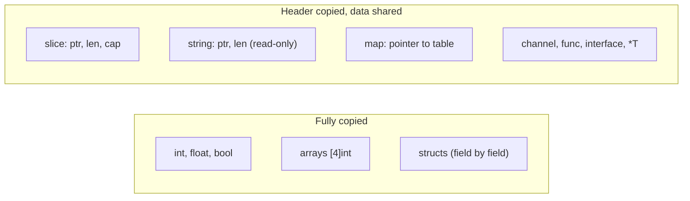

# Types and data

## Why care?

A bug report: _"Sometimes, when two customers order at the same time, one order shows the other customer's items."_

The team searches for a week. The cause is in these lines:

```go
base := defaultItems[:n]
orderA.Items = append(base, itemA)
orderB.Items = append(base, itemB)
```

`orderA` and `orderB` ended up **sharing the same memory**. Writing `itemB` overwrote `itemA`. There is no data race and no visible pointer. The code only uses a slice.

You can only avoid this kind of bug if you know what a slice _is_ in memory. This page opens up Go's built-in data types (arrays, slices, maps, strings, structs and pointers) so you can see exactly what is copied, what is shared, and what it costs.

## The main idea: everything is copied, but some things contain pointers

Go has one simple rule:

> **Assignment and function calls always copy the value.**

There is no "pass by reference" in Go. But some values are small **headers** that contain a pointer to data somewhere else. When you copy the header, you copy the pointer, so two headers point to the **same** data.



This program measures the size of these headers:

```go
package main

import (
	"fmt"
	"unsafe"
)

func main() {
	var (
		s   []int
		str string
		m   map[string]int
		a   [4]int64
		i   any
	)
	fmt.Println("slice:   ", unsafe.Sizeof(s))
	fmt.Println("string:  ", unsafe.Sizeof(str))
	fmt.Println("map:     ", unsafe.Sizeof(m))
	fmt.Println("[4]int64:", unsafe.Sizeof(a))
	fmt.Println("any:     ", unsafe.Sizeof(i))

	nums := []int{10, 20, 30, 40, 50}
	mid := nums[1:3]
	fmt.Println(mid, "len", len(mid), "cap", cap(mid))
	fmt.Println("same memory:", &nums[1] == &mid[0])
}
```

Output (64-bit machine):

```text
slice:    24
string:   16
map:      8
[4]int64: 32
any:      16
[20 30] len 2 cap 4
same memory: true
```

- A slice is **3 words** (pointer, length, capacity) = 24 bytes, no matter if it holds 2 or 2 million elements.
- A string is **2 words** (pointer, length).
- A map is **1 word**: just a pointer to a table on the heap.
- An array is **all its elements**: 4 × 8 = 32 bytes. Copy an array, copy everything.
- An interface (`any`) is 2 words. More in [Methods and interfaces](methods-and-interfaces.md).

`unsafe.Sizeof` is fine for learning. Don't use the `unsafe` package in business code.

## Arrays: fixed size, value semantics

```go
var a [3]int          // three ints, all zero
b := [...]string{"x", "y"} // compiler counts: [2]string
```

The length is **part of the type**: `[3]int` and `[4]int` are different types. Arrays are values: assigning or passing one copies all elements.

You rarely use arrays directly in business code. They matter because **every slice is a window onto an array**. Arrays do show up for fixed-size data, like a SHA-256 hash (`[32]byte`) or a UUID (`type UUID [16]byte` in Go 1.27's standard `uuid` package). Because they are values and comparable, you can use them as map keys.

## Slices: a window onto an array

A slice is this struct (from the Go runtime, simplified):

```go
type slice struct {
	array unsafe.Pointer // where element 0 of this slice is
	len   int            // how many elements you can read
	cap   int            // how many elements exist from array to the end of the backing array
}
```

In the example above, `mid := nums[1:3]` did **not** copy anything. It made a new header:

```text
backing array:  [ 10 | 20 | 30 | 40 | 50 ]
                  ▲    ▲
nums            ──┘    │      len 5, cap 5
mid             ───────┘      len 2, cap 4  (from index 1 to the end)
```

`len(mid)` is 2: you can read `mid[0]` and `mid[1]`. `cap(mid)` is 4: there are 4 slots from `mid`'s start to the end of the backing array. That hidden capacity is the root of the bug from the start of this page.

### How `append` works

`append(s, x)` does this:

1. If `len(s) < cap(s)`: put `x` in the next free slot **of the same backing array**, return a header with `len+1`. No allocation.
2. Otherwise: allocate a **new, bigger** array, copy all elements, put `x` at the end, return a header pointing to the new array.

That is why you must always write `s = append(s, x)`: the result may point to a different array.

This program prints the capacity each time it grows:

```go
package main

import "fmt"

func main() {
	var s []int
	last := -1
	for i := range 2000 {
		s = append(s, i)
		if cap(s) != last {
			fmt.Printf("len=%4d cap=%4d\n", len(s), cap(s))
			last = cap(s)
		}
	}
}
```

Output (Go 1.27, amd64):

```text
len=   1 cap=   4
len=   5 cap=   8
len=   9 cap=  16
len=  17 cap=  32
len=  33 cap=  64
len=  65 cap= 128
len= 129 cap= 256
len= 257 cap= 512
len= 513 cap= 848
len= 849 cap=1280
len=1281 cap=1792
len=1793 cap=2560
```

Small slices **double**. From 256 elements on, the growth factor slowly drops towards 1.25×, so a huge slice doesn't waste huge memory. The exact numbers (like `848`) come from rounding up to the memory allocator's **size classes**: the runtime asks for a bigger block and uses all of it. The exact rules are a runtime detail and change between versions; don't depend on them.

Two lessons:

- Appending in a loop is **amortised O(1)**: copies happen, but rarely.
- If you **know the size**, say so up front. That is one allocation instead of twelve:

```go
ids := make([]string, 0, len(orders)) // len 0, cap len(orders)
for _, o := range orders {
	ids = append(ids, o.ID.String())
}
```

### The aliasing trap, explained

```go
package main

import (
	"fmt"
	"slices"
)

func main() {
	base := make([]string, 3, 10)
	copy(base, []string{"a", "b", "c"})

	x := append(base, "x")
	y := append(base, "y")
	fmt.Println("x:", x, "y:", y)

	safe := slices.Clip(base) // cap == len, so the next append must copy
	p := append(safe, "p")
	q := append(safe, "q")
	fmt.Println("p:", p, "q:", q)

	full := base[0:2:2] // three-index slice: len 2, cap 2
	fmt.Println(len(full), cap(full))

	orig := []int{1, 2, 3}
	view := orig[:2]
	view[0] = 99
	fmt.Println("orig:", orig)

	clone := slices.Clone(orig)
	clone[0] = 1
	fmt.Println("orig:", orig, "clone:", clone)
}
```

Output:

```text
x: [a b c y] y: [a b c y]
p: [a b c p] q: [a b c q]
2 2
orig: [99 2 3]
orig: [99 2 3] clone: [1 2 3]
```

What happened on the first line:

```text
base:  len 3, cap 10 → [ a | b | c | _ | _ ... ]
append(base, "x") → room left, writes "x" into slot 3, returns len 4  (x)
append(base, "y") → room left, writes "y" into slot 3, returns len 4  (y)
x and y point to the SAME array. Slot 3 now holds "y".
```

The fixes:

| Tool              | What it does                                                     | Use when                                              |
| ----------------- | ---------------------------------------------------------------- | ----------------------------------------------------- |
| `slices.Clone(s)` | New backing array with a copy of the elements                    | You hand a slice to someone who may keep or change it |
| `slices.Clip(s)`  | Same array, but `cap = len`, so the next `append` must copy      | You return a sub-slice and want appends to be safe    |
| `s[low:high:max]` | Three-index slice: sets the capacity to `max - low`              | Same as `Clip`, in one expression                     |
| `copy(dst, src)`  | Copies `min(len(dst), len(src))` elements into an existing slice | You already have a destination buffer                 |

!!! abstract "Convention: copy slices and maps at API boundaries"

    **Rule:** When a type stores a slice or map it got from a caller, or returns an internal one,
    copy it (`slices.Clone`, `maps.Clone`).

    **Why:** A slice is a shared window. If your `Order` keeps the caller's `[]Item`, the caller can
    change your order's items later without calling any method, and your validation is bypassed.
    The Go Code Review Comments and the Google style guide both call this out for exactly this
    reason. Inside one package, where you control all the code, copying is usually not needed.

!!! warning "Trap: a small slice keeps a big array alive"

    ```go
    data, _ := os.ReadFile("huge.log") // 500 MB
    header := data[:64]                // keeps all 500 MB alive
    ```

    The garbage collector frees **whole** backing arrays, not parts of them. As long as `header` is
    alive, so are all 500 MB. Use `header := slices.Clone(data[:64])` to keep only what you need.
    See [Memory](../fundamentals/memory.md).

### `nil` slice vs empty slice

```go
var a []int    // nil:   ptr=nil, len 0, cap 0
b := []int{}   // empty: ptr=non-nil, len 0, cap 0
```

They behave the same for `len`, `range` and `append`. Prefer the `nil` form (`var a []int`) in code. The difference shows up in a few places, mainly JSON: classic `encoding/json` writes `nil` as `null` and `[]int{}` as `[]`. `encoding/json/v2` writes both as `[]` by default. If your API promises `[]`, test it. Never check emptiness with `s == nil`; use `len(s) == 0`.

### The `slices` package

Since Go 1.21, the standard library has generic helpers. Use them instead of hand-written loops:

```go
slices.Contains(statuses, StatusPaid)
slices.Index(ids, "7f3a")
slices.Sort(skus)
slices.SortFunc(orders, func(a, b Order) int { return a.CreatedAt.Compare(b.CreatedAt) })
slices.BinarySearch(skus, "MUG-01")
slices.Equal(a, b)
slices.DeleteFunc(items, func(it Item) bool { return it.Quantity == 0 })
```

More on these in [Generics and iterators](generics.md).

## Maps: a hash table behind a pointer

```go
stock := map[string]int{"MUG-01": 3}
stock["TEE-02"] = 5
delete(stock, "MUG-01")
qty, ok := stock["CAP-03"] // ok == false if the key is missing
```

### Under the hood: Swiss tables

Since Go 1.24, maps use a design called **Swiss tables** (from Google's C++ library Abseil). Simplified:

- The table is split into **groups of 8 slots**. Each group also has 8 **control bytes**, one per slot.
- A key's hash is split in two: the high bits pick the group, the low 7 bits are stored in the control byte.
- To find a key, Go loads the 8 control bytes of a group **at once** and compares all 8 with the 7-bit hash in one operation (a SIMD-style technique, see [CPU and registers](../fundamentals/cpu-and-registers.md)). Only slots that match are checked for the full key.
- Big maps are split into several tables, so growing a map only rebuilds one table at a time instead of the whole map. That keeps latency smooth.

You don't need to remember the details. Remember the consequences:

1. Lookups, inserts and deletes are **O(1) on average**.
2. A map variable is **one pointer**. Passing a map to a function lets it change your map.
3. The **order of iteration is random** on purpose.
4. Maps are **not safe for concurrent writes**. Two goroutines writing at the same time crash the program with `fatal error: concurrent map writes` (and that one can't be recovered). Use a `sync.Mutex`; see [Concurrency](concurrency.md).

### Try it in Go: random order

```go
package main

import "fmt"

func main() {
	m := make(map[int]bool)
	for i := range 20 {
		m[i] = true
	}
	for range 3 {
		n := 0
		for k := range m {
			fmt.Print(k, " ")
			if n++; n == 6 {
				break
			}
		}
		fmt.Println()
	}
}
```

Two runs:

```text
0 4 9 11 12 13
12 13 14 15 19 1
1 5 8 10 16 17
```

```text
7 12 13 18 1 6
1 6 8 15 17 0
19 2 5 9 10 11
```

Even within one run, each `range` starts at a random place.

**Why random on purpose?** Before Go 1, map order was "whatever the hash table happens to do", and it was mostly stable. People wrote code and tests that silently depended on it. Then a runtime change broke them. So the Go team made the order **deliberately unpredictable**, so nobody _can_ depend on it. This is a pattern you will see again: Go protects the future by making wrong code fail early.

When you need a stable order (output, tests, hashing), sort the keys:

```go
for _, sku := range slices.Sorted(maps.Keys(stock)) {
	fmt.Println(sku, stock[sku])
}
```

### More map behaviour, with real output

```go
package main

import (
	"fmt"
	"maps"
	"slices"
)

type Item struct {
	SKU      string
	Quantity int
}

func main() {
	stock := map[string]int{"MUG-01": 3, "TEE-02": 0, "CAP-03": 7, "BAG-04": 1}

	for _, sku := range slices.Sorted(maps.Keys(stock)) {
		fmt.Print(sku, "=", stock[sku], " ")
	}
	fmt.Println()

	qty, ok := stock["TEE-02"]
	fmt.Println("TEE-02:", qty, ok)
	qty, ok = stock["NOPE-99"]
	fmt.Println("NOPE-99:", qty, ok)

	byID := map[string]Item{"a": {SKU: "MUG-01", Quantity: 1}}
	it := byID["a"]
	it.Quantity++
	byID["a"] = it
	fmt.Println(byID["a"])

	defer func() { fmt.Println("recovered:", recover()) }()
	var nilMap map[string]int
	nilMap["x"] = 1
}
```

Output:

```text
BAG-04=1 CAP-03=7 MUG-01=3 TEE-02=0
TEE-02: 0 true
NOPE-99: 0 false
{MUG-01 2}
recovered: assignment to entry in nil map
```

- **Comma-ok** (`v, ok := m[k]`) is how you tell "key exists with value 0" from "key missing". `TEE-02` has stock 0 but exists.
- You can't change a field of a struct **inside** a map: `byID["a"].Quantity++` does not compile (`cannot assign to struct field byID["a"].Quantity in map`). Why? Map values move around when the table grows, so Go never gives you their address. Read, change, write back, as above. Or store pointers: `map[string]*Item`.
- Writing to a `nil` map panics. Always `make` a map (or use a literal) before writing. Reading a `nil` map is fine.

!!! info "Map keys must be comparable"

    Keys can be any type that supports `==`: numbers, strings, bools, pointers, channels, arrays,
    and structs made only of those. Slices, maps and functions can't be keys. A struct key is a clean
    way to build a composite key: `map[struct{ Customer, SKU string }]int`.

## Strings: read-only bytes

A string is a **read-only** slice of bytes: pointer + length. It is usually (but not required to be) UTF-8. The details of bytes, runes and UTF-8 are in [Encodings](../fundamentals/encodings.md). Here are the parts that matter for everyday Go:

```go
package main

import (
	"fmt"
	"strings"
	"unicode/utf8"
)

func main() {
	s := "Zoë's café"
	fmt.Println(len(s), utf8.RuneCountInString(s))
	fmt.Println(s[2], string(s[2]), []rune(s)[2], string([]rune(s)[2]))

	var b strings.Builder
	for i := range 3 {
		fmt.Fprintf(&b, "line %d\n", i)
	}
	fmt.Print(b.String())

	head, tail, ok := strings.Cut("orders/v1/list", "/")
	fmt.Println(head, tail, ok)
	dir, file, ok := strings.CutLast("orders/v1/list", "/")
	fmt.Println(dir, file, ok)
}
```

Output:

```text
12 10
195 Ã 235 ë
line 0
line 1
line 2
orders v1/list true
orders/v1 list true
```

- `len(s)` is **bytes** (12), not characters (10). Never use `len` to limit "characters" in user input.
- `s[2]` is a **byte** (`195`, the first half of `ë`). Turning that one byte into a string gives `Ã`: a broken character. Index by rune when you mean characters.
- Strings are immutable, so `s += "x"` in a loop copies the whole string each time: O(n²). Use `strings.Builder`.
- `strings.Cut` (first separator) and `strings.CutLast` (last separator, new in Go 1.27) replace most `Index` + slicing code, and can't get the indexes wrong.

Because strings are immutable, they are safe to share between goroutines, and substrings (`s[3:7]`) are free: they share the same bytes. Like with slices, a tiny substring keeps a big string alive; `strings.Clone` fixes that.

## Structs

A struct groups named fields:

```go
type Order struct {
	ID         uuid.UUID
	CustomerID string
	Items      []Item
	Status     Status
	CreatedAt  time.Time
}

o := Order{CustomerID: "c-42", Status: StatusPending} // other fields: zero
```

!!! abstract "Convention: always use field names in struct literals"

    **Rule:** Write `Item{SKU: "MUG-01", Quantity: 2}`, not `Item{"MUG-01", 2, 1299}`, for types
    from other packages. `go vet` warns about unkeyed literals of imported struct types.

    **Why:** Positional literals break silently when someone adds or reorders a field. Worse, if two
    fields have the same type (`Quantity int`, `MaxQuantity int`), swapping them still compiles.
    Named fields keep working when fields are added or reordered, and they document the values for the reader.

Structs are compared with `==` field by field, if all fields are comparable. A struct with a slice field can't be compared with `==` (use a method, or `slices.Equal` on the field).

### Field order and padding

The CPU works best with values aligned to their size (an `int64` at an address divisible by 8). So the compiler inserts **padding** between fields:

```go
type Bad struct {
	Paid     bool
	Total    int64
	Shipped  bool
	Quantity int32
	Gift     bool
}

type Good struct {
	Total    int64
	Quantity int32
	Paid     bool
	Shipped  bool
	Gift     bool
}
```

Output of `unsafe.Sizeof`:

```text
Bad:  32
Good: 16
```

Same fields, half the size. For one struct, the difference does not matter. For 10 million of them in a cache, that is 160 MB. Order fields from big to small when memory matters; otherwise, order them so they **read well** (group related fields). The `fieldalignment` analyzer can report this. See [Memory](../fundamentals/memory.md) for why alignment exists.

### Anonymous structs

Anonymous structs (structs without a type name) are useful in tests and for one-off JSON shapes:

```go
var req struct {
	CustomerID string `json:"customer_id"`
	Items      []Item `json:"items"`
}
```

The text in backticks is a **struct tag**: metadata that packages like `encoding/json` read with reflection. More in [Standard library essentials](stdlib-essentials.md).

## Pointers

A pointer holds the address of a value. `&x` takes the address; `*p` reads or writes through it.

```go
package main

import "fmt"

type Item struct {
	SKU        string
	Quantity   int
	PriceCents int64
}

func addOneByValue(it Item) { it.Quantity++ }
func addOneByPtr(it *Item)  { it.Quantity++ }
func zeroFirst(xs []int)    { xs[0] = 0 }
func appendOne(xs []int)    { xs = append(xs, 4); _ = xs }
func resetArray(a [3]int)   { a[0] = 0 }

func main() {
	it := Item{SKU: "MUG-01", Quantity: 1, PriceCents: 1299}
	addOneByValue(it)
	fmt.Println("by value:  ", it.Quantity)
	addOneByPtr(&it)
	fmt.Println("by pointer:", it.Quantity)

	arr := [3]int{1, 2, 3}
	resetArray(arr)
	fmt.Println("array:", arr)

	xs := []int{1, 2, 3}
	zeroFirst(xs)
	fmt.Println("slice elem:", xs)
	appendOne(xs)
	fmt.Println("slice append:", xs)

	a := Item{SKU: "MUG-01", Quantity: 1}
	b := Item{SKU: "MUG-01", Quantity: 1}
	fmt.Println("structs equal:", a == b)

	p := new(int)
	q := new(42) // Go 1.26: new with an expression
	fmt.Println(*p, *q)
}
```

Output:

```text
by value:   1
by pointer: 2
array: [1 2 3]
slice elem: [0 2 3]
slice append: [0 2 3]
structs equal: true
0 42
```

Read each line against the "everything is copied" rule:

- `addOneByValue` changed **its copy** of the struct. The caller saw nothing.
- `addOneByPtr` got a copy of the **address**, and changed the original through it.
- `resetArray` changed its copy of the whole array.
- `zeroFirst` got a copy of the slice **header**. Both headers point to the same array, so the change is visible.
- `appendOne` appended to its copy of the header. The caller's header still says `len 3`, so the caller never sees the `4`. (This is why functions that grow a slice **return** it, like `append` itself.)

`new(T)` returns a pointer to a new zero `T`. Since **Go 1.26**, `new` also takes an expression: `new(42)` gives a `*int` pointing at `42`. That replaces the old helper functions people wrote for optional fields, like `func ptr[T any](v T) *T { return &v }`.

There is no pointer arithmetic in Go (outside `unsafe`). A pointer can only point at a real, live value, and the garbage collector keeps that value alive as long as a pointer to it exists. Returning `&local` is safe: escape analysis moves it to the heap ([Memory](../fundamentals/memory.md)).

### `make` vs `new`

| Builtin             | Works on            | Returns                                |
| ------------------- | ------------------- | -------------------------------------- |
| `make(T, args)`     | slice, map, channel | an **initialised** `T` (not a pointer) |
| `new(T)` / `new(v)` | any type            | a `*T` pointing at zero (or `v`)       |

Slices, maps and channels need internal setup (a backing array, a hash table, a queue), so they have their own builtin. In practice you rarely call `new`; `&Order{...}` is more common because it also sets fields.

### Value or pointer? The decision

This is one of the most important design choices in Go code. Use this table, top to bottom:

| Question                                                                 | If yes                                |
| ------------------------------------------------------------------------ | ------------------------------------- |
| Must the function change the caller's value?                             | Pointer                               |
| Does the type contain a `sync.Mutex` or other "must not copy" field?     | Pointer (always)                      |
| Is it a "thing with identity" (a service, a connection pool, a server)?  | Pointer                               |
| Is it a small value (a few words), like `time.Time`, `Money`, a `Point`? | Value                                 |
| Is it a slice, map, channel, func or interface?                          | Value (it already contains a pointer) |
| Not sure?                                                                | Value, until a profile says otherwise |

!!! abstract "Convention: don't use pointers to save copying, use them for meaning"

    **Rule:** Choose pointer vs value by **semantics** (does it need to be shared or mutated? does it
    have identity?), not by a guess about speed. Never use a pointer to a slice, map or interface
    unless you have to change the header itself.

    **Why:** Copying a 64-byte struct is extremely fast; it stays in registers and CPU cache. A
    pointer often makes the value **escape to the heap**, which means an allocation and more work
    for the garbage collector. So "pointers are faster" is often false. Meanwhile a pointer changes
    what the reader must think about: "who else can change this?". Values are easier to reason about,
    especially with goroutines. Measure before you optimise ([Performance](performance.md)).

!!! warning "Trap: copying a struct that holds a mutex"

    ```go
    type Cache struct {
    	mu   sync.Mutex
    	data map[string]Order
    }

    func (c Cache) Get(id string) Order { // value receiver: copies the mutex!
    	c.mu.Lock()
    	defer c.mu.Unlock()
    	return c.data[id]
    }
    ```

    Each call locks a **copy** of the mutex, so it protects nothing. `go vet` catches this
    (`copylocks`: "Get passes lock by value"). Types with a mutex use pointer receivers and are
    passed as pointers. More in [Methods and interfaces](methods-and-interfaces.md).

## Named types and conversions

```go
type Cents int64
type CustomerID string
```

`Cents` has the same memory layout as `int64` but is a **different type**. You can't add a `Cents` to an `int64` without an explicit conversion `Cents(x)`. This is cheap (zero cost at run time) and catches real bugs: you can't pass a `CustomerID` where an `OrderID` is expected.

Go **never** converts between number types automatically, not even `int` to `int64`. Every conversion is visible, so every possible overflow or precision loss is visible in code review.

A **type alias** is different: `type Celsius = float64` (with `=`) is just a second name for the _same_ type. Aliases exist for moving types between packages during big refactors. Don't use them for domain types.

## Check yourself

??? question "1. What do `x` and `y` contain, and why?"

    ```go
    s := make([]int, 2, 4)
    x := append(s, 1)
    y := append(s, 2)
    ```

    Both are `[0 0 2]`. `s` has spare capacity, so both appends write into the same slot 2 of the
    same backing array. Use `slices.Clip(s)` or `s[:2:2]` before appending if they must be separate.

??? question "2. Why must you write `s = append(s, x)` and not just `append(s, x)`?"

    `append` returns a new header. If the array was full, the new header points to a new, bigger
    array. If you drop the result, you lose the element (and the compiler tells you: the result of
    `append` must be used).

??? question "3. Your test compares the JSON output of a map. It passes on your laptop and fails in CI. Why?"

    Map iteration order is random. If your code builds output by ranging over a map, the order
    changes between runs. Sort the keys (`slices.Sorted(maps.Keys(m))`). Note: `encoding/json`
    already sorts map keys when marshalling; the bug is usually in hand-built output.

??? question "4. Why can't you write `m[k].Field = 1` for a `map[string]Item`?"

    Map values have no stable address: they move when the table grows. So Go doesn't let you
    address them. Read the value, change it, write it back, or store `*Item` in the map.

??? question "5. A colleague changes every `func f(o Order)` to `func f(o *Order)` \"for performance\". What do you say?"

    Ask for a benchmark. Pointers can make values escape to the heap, adding allocations and GC
    work, so it may be slower. And it changes meaning: now `f` can modify the caller's order.
    Choose by semantics; optimise only with a profile.

## Recap

- Assignment always **copies**. Slices, strings, maps, channels and interfaces are small headers, so copying them **shares** the data.
- A slice is `ptr + len + cap`. `append` reuses spare capacity, which can alias. Use `slices.Clone`, `slices.Clip` or three-index slicing at boundaries.
- Pre-size with `make([]T, 0, n)` when you know `n`.
- Maps are Swiss tables behind a pointer: O(1), random order by design, not safe for concurrent writes, values not addressable.
- Strings are read-only bytes; `len` counts bytes. Use `strings.Builder` to build them.
- Struct literals with field names. Field order affects size.
- Pointer or value: decide by meaning, not by guesses about speed.

Next: [Conventions: the Go way](conventions.md), where we collect all the rules and, more importantly, the reasons behind them.
