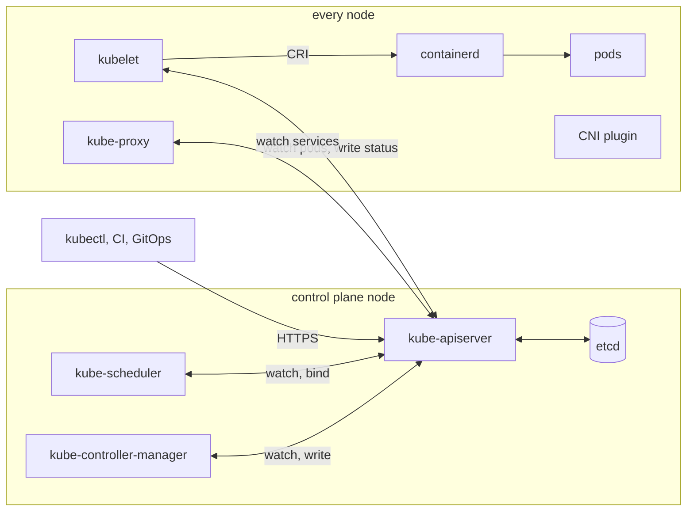
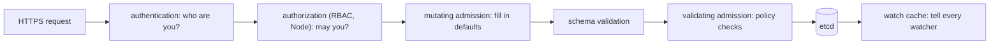

# Architecture

## Why care?

Four messages from a team that just moved to Kubernetes:

- "The API server was down for ten minutes, and our app kept serving traffic. How?"
- "We restored etcd from last night's backup, and now half our Deployments are gone."
- "I put a YAML file on the node by hand, and a pod appeared. Nobody ran `kubectl apply`."
- "The pod is `Pending`. Which part of Kubernetes is supposed to move it?"

Each one is easy once you know the parts of a cluster and, more important, **how they talk to each other**. Kubernetes is not one program. It is a small database with an HTTP API in front of it, and a handful of programs that read and write that database. Nobody calls anybody else. Everyone goes through the API.

On this page you take a real cluster apart: you create it with `kind`, list the processes, read the raw bytes in etcd, and watch each component do its one job for one pod.

## The idea: a restaurant with one ticket rail

Picture a busy restaurant kitchen.

- **The pass** (the counter between the dining room and the kitchen) is the **API server**. Every order comes in here, written on a ticket. The person at the pass checks it: is this a real waiter, may they order this, is the ticket filled in correctly? Only then does it go on the rail.
- **The ticket rail** is **etcd**. It is the only record of what was ordered and what is done. If it isn't on the rail, it didn't happen.
- **The head chef** is the **scheduler**. They look at new tickets with no station written on them, and write one: "grill", "cold kitchen". That's all they do. They don't cook.
- **The managers** are the **controllers**. One watches desserts: "the table ordered three, the rail says two are out, start one more." Each manager has one kind of ticket and keeps comparing what was ordered with what is done.
- **The cook at each station** is the **kubelet**. It watches the rail for tickets with its station name, cooks them (starts the containers), and writes back "plated" or "burnt".

Nobody shouts across the kitchen. The chef never walks over to the grill. Everybody reads the rail, does their part, and writes the result back on the rail, through the pass. That one rule explains most of Kubernetes.



## Under the hood: who is who

### The parts, and where they run

| Component                 | Job                                                         | Runs as (in `kind`)                           | Talks to            |
| ------------------------- | ----------------------------------------------------------- | --------------------------------------------- | ------------------- |
| `kube-apiserver`          | The only door: checks, stores, serves and watches resources | Static pod on the control plane               | etcd, and everyone  |
| `etcd`                    | Key-value store that holds every resource                   | Static pod on the control plane               | Only the API server |
| `kube-scheduler`          | Picks a node for each new pod                               | Static pod on the control plane               | API server          |
| `kube-controller-manager` | About 50 control loops in one process                       | Static pod on the control plane               | API server          |
| `kubelet`                 | Makes the pods for its node really run                      | **systemd service** on every node             | API server, CRI     |
| `containerd`              | Container runtime, behind the CRI socket                    | systemd service on every node                 | `runc`, the kernel  |
| `kube-proxy`              | Turns Services into iptables rules on the node              | DaemonSet pod on every node                   | API server          |
| CNI plugin (`kindnet`)    | Gives each pod a network interface and an IP                | Binary called by containerd, plus a DaemonSet | kernel              |

The control plane is just a set of programs on a normal Linux machine (here, a Docker container). In a managed cluster (EKS, AKS, GKE), the cloud runs the top four for you and you never see them. The bottom four are on every node you pay for.

### The API server: the only door

Every component, and you, speak HTTPS to the API server. Nobody else opens etcd. You can check that on the control plane node, with `ss` (`ss` is explained in [TCP](../networking/tcp.md)). Who has a connection to etcd's client port, 2379?

```console
$ docker exec tutor-control-plane ss -tnp state established '( dport = :2379 )' | awk 'NR>1{print $NF}' | sed 's/,pid.*//' | sort | uniq -c
     69 users:(("kube-apiserver"
```

69 connections, all from `kube-apiserver`. And who talks to the API server's port, 6443, on the same node?

```console
$ docker exec tutor-control-plane ss -tnp state established '( dport = :6443 )' | awk 'NR>1{print $NF}' | sed 's/,pid.*//' | sort | uniq -c
      1 users:(("kindnetd"
      1 users:(("kube-apiserver"
      2 users:(("kube-controller"
      1 users:(("kube-proxy"
      2 users:(("kube-scheduler"
      1 users:(("kubelet"
```

The scheduler, the controller manager, the kubelet, `kube-proxy` and the CNI daemon. Each one has a kubeconfig file that points at the same address:

```console
$ docker exec tutor-control-plane grep -h 'server:' /etc/kubernetes/scheduler.conf /etc/kubernetes/controller-manager.conf /etc/kubernetes/kubelet.conf
    server: https://172.18.0.3:6443
    server: https://172.18.0.3:6443
    server: https://172.18.0.3:6443
```

A request to the API server goes through a fixed pipeline before anything is stored:



In this cluster the API server's flags show part of it: `--authorization-mode=Node,RBAC` (the `Node` authorizer lets a kubelet read only the pods and secrets of its own node), `--enable-admission-plugins=NodeRestriction`, and `--etcd-servers=https://127.0.0.1:2379`. [Config and secrets](config-and-secrets.md) goes into RBAC; [Writing an operator](operators.md) adds your own resource types to this same pipeline.

The API server keeps **no state of its own**. You can run three of them behind a load balancer, and kill any one. That's how a production control plane survives a node failure.

### etcd: the only state

etcd is a key-value database that keeps its data consistent across an odd number of members (1, 3 or 5) with the **Raft** consensus algorithm: a write counts only when a majority (a **quorum**) has it on disk. With three members you can lose one. With five, two. `kind` runs one member, so it can lose none.

The `etcd` image ships `etcdctl`, and kubeadm made client certificates for it. A small wrapper saves typing:

```sh
#!/bin/sh
# etcdctl.sh: run etcdctl inside the etcd static pod, with kubeadm's certificates.
exec kubectl -n kube-system exec etcd-tutor-control-plane -- etcdctl \
  --endpoints=https://127.0.0.1:2379 \
  --cacert=/etc/kubernetes/pki/etcd/ca.crt \
  --cert=/etc/kubernetes/pki/etcd/server.crt \
  --key=/etc/kubernetes/pki/etcd/server.key "$@"
```

```console
$ ./etcdctl.sh version
etcdctl version: 3.7.0
API version: 3.7
$ ./etcdctl.sh member list -w simple
23da9c3f2594532a, started, tutor-control-plane, https://172.18.0.3:2380, https://172.18.0.3:2379, false
$ ./etcdctl.sh endpoint status -w simple
https://127.0.0.1:2379, 23da9c3f2594532a, 3.7.0, 3.7.0, 3.1 MB, 3.1 MB, 1%, 2.1 GB, true, false, 2, 1408, 1408, , , false
```

One member, it is the leader (`true`), the database is 3.1 MB, and the quota is 2.1 GB. When the database reaches the quota, etcd refuses every write and the whole cluster becomes read-only. Big objects (huge ConfigMaps, thousands of old ReplicaSets) eat that space.

Every resource is one key under `/registry/<resource>/<namespace>/<name>`. Create a ConfigMap and look for it:

```console
$ kubectl -n tutor-architecture create configmap tutor-hello --from-literal=greeting=hallo
configmap/tutor-hello created
$ ./etcdctl.sh get /registry --prefix --keys-only | grep tutor-architecture
/registry/configmaps/tutor-architecture/kube-root-ca.crt
/registry/configmaps/tutor-architecture/tutor-hello
/registry/namespaces/tutor-architecture
/registry/serviceaccounts/tutor-architecture/default
```

Four keys, and you made two of them (the namespace and the ConfigMap). The other two are already the work of controllers: one put the cluster's CA certificate in every namespace, another made the `default` service account. Now the value:

```console
$ ./etcdctl.sh get /registry/configmaps/tutor-architecture/tutor-hello | cat -v
/registry/configmaps/tutor-architecture/tutor-hello
k8s^@
^O
^Bv1^R	ConfigMap^RM-K^A
M-5^A
^Ktutor-hello^R^@^Z^Rtutor-architecture"^@*$90c2752d-6467-4a4e-8c3e-10e64bd7d9bc2^@8^@B^H^HM-8M-OM-"M-X^F^P^@M-^J^AY
^Nkubectl-create^R^FUpdate^Z^Bv1"^H^HM-8M-OM-"M-X^F^P^@2^HFieldsV1:%
#{"f:data":{".":{},"f:greeting":{}}}B^@^R^Q
^Hgreeting^R^Ehallo^Z^@"^@
```

Not JSON, not YAML: the bytes `k8s` and a zero, then **Protocol Buffers**. The API server stores built-in types as protobuf because it is smaller and faster to decode. You can still read `ConfigMap`, `tutor-hello`, `greeting` and `hallo` in plain text. There is no encryption here; [Config and secrets](config-and-secrets.md) shows what that means for Secrets.

!!! warning "etcd is the cluster"

    Everything you see in `kubectl` lives in these keys. A backup of etcd **is** a backup of
    the cluster's desired state, and nothing else is (your container images and volume data
    live elsewhere). Restoring an old etcd snapshot puts the whole cluster back in time:
    Deployments created after the snapshot are gone, and controllers start "fixing" the
    world to match the old state. Back up etcd often, and keep your manifests in Git anyway.

### The scheduler: it writes one field

The scheduler watches for pods with an empty `spec.nodeName`. For each one it **filters** the nodes (enough free CPU and memory requests? taints tolerated? affinity rules met?), then **scores** the survivors and picks the best. Then it writes the node's name into the pod with a `Binding`. It never starts a container and never talks to a node.

You can see the "before" by holding a pod back from the scheduler with a **scheduling gate**. A gated pod is skipped until every gate is removed:

```yaml
apiVersion: v1
kind: Pod
metadata:
  name: tutor-gated
  namespace: tutor-architecture
spec:
  schedulingGates:
    - name: tutor.example.com/wait
  containers:
    - name: ordersd
      image: tutor-ordersd:dev
      imagePullPolicy: Never
```

```console
$ kubectl apply -f tutor-gated.yaml
pod/tutor-gated created
$ kubectl -n tutor-architecture get pod tutor-gated -o wide
NAME          READY   STATUS            RESTARTS   AGE   IP       NODE     NOMINATED NODE   READINESS GATES
tutor-gated   0/1     SchedulingGated   0          2s    <none>   <none>   <none>           <none>
$ kubectl -n tutor-architecture get pod tutor-gated -o jsonpath='nodeName="{.spec.nodeName}"{"\n"}'
nodeName=""
$ kubectl -n tutor-architecture patch pod tutor-gated --type=json -p='[{"op":"remove","path":"/spec/schedulingGates"}]'
pod/tutor-gated patched
$ kubectl -n tutor-architecture get pod tutor-gated -o wide
NAME          READY   STATUS    RESTARTS   AGE   IP            NODE           NOMINATED NODE   READINESS GATES
tutor-gated   1/1     Running   0          6s    10.244.1.50   tutor-worker   <none>           <none>
```

The pod object existed for seconds with no node, and nothing happened. The moment the scheduler wrote `tutor-worker` into it, the kubelet on `tutor-worker` saw it and started the container. Why the worker and not the control plane? The control plane node has a `node-role.kubernetes.io/control-plane:NoSchedule` **taint**, and the pod has no toleration for it. [Scheduling and resources](scheduling-and-resources.md) covers the filters and scores in detail.

### The controller manager: many loops in one process

`kube-controller-manager` is one binary with 49 controllers inside: `deployment-controller`, `replicaset-controller`, `namespace-controller`, `garbage-collector-controller`, `node-lifecycle-controller`, `endpointslice-controller`, `job-controller` and so on (`kube-controller-manager --help` lists them under `--controllers`). Each one watches one or two resource types and keeps the world in line with them. The next page, [Reconciliation](reconciliation.md), is all about how such a loop works.

With three control plane nodes you have three controller managers, but two loops fighting over the same ReplicaSet would be chaos. So they hold an election: whoever holds a **Lease** object is the leader, and renews it every few seconds. The others wait. The same goes for the scheduler:

```console
$ kubectl -n kube-system get leases
NAME                                   HOLDER                                                                      AGE
apiserver-3zzz7itbxkmluyzrlvntdoalx4   apiserver-3zzz7itbxkmluyzrlvntdoalx4_d5661703-d38a-40d5-9662-a1624ca6366b   3m1s
kube-controller-manager                tutor-control-plane_8dff8b8c-1b25-4f15-a5a2-cbb779c66e31                    2m59s
kube-scheduler                         tutor-control-plane_7d52f377-ecde-4f2d-a566-c360600669b7                    2m58s
$ kubectl -n kube-node-lease get leases
NAME                  HOLDER                AGE
tutor-control-plane   tutor-control-plane   2m59s
tutor-worker          tutor-worker          2m40s
```

Even leader election goes through the API: a Lease is just another resource in etcd. The leases in `kube-node-lease` are the kubelets' **heartbeats**. When a node stops renewing its lease (`--node-monitor-grace-period`, 50 seconds by default), `node-lifecycle-controller` marks the node `NotReady` and, later, evicts its pods.

### The kubelet: the node's agent

The kubelet is not a pod. It is a plain systemd service on the node (see [systemd](../linux/systemd.md)), because it is the thing that starts pods:

```console
$ docker exec tutor-control-plane systemctl status kubelet --no-pager | head -6
● kubelet.service - kubelet: The Kubernetes Node Agent
     Loaded: loaded (/etc/systemd/system/kubelet.service; enabled; preset: enabled)
    Drop-In: /etc/systemd/system/kubelet.service.d
             └─10-kubeadm.conf, 11-kind.conf
     Active: active (running) since Thu 2026-11-26 21:39:43 UTC; 2min 59s ago
 Invocation: d3751c8a1d4d4236a81daa72d600a7f0
```

It watches the API for pods with its node name, and for each one asks containerd, over the **CRI** (Container Runtime Interface, a gRPC API on a Unix socket), to create a pod sandbox and the containers in it. containerd then runs `runc`, which you met in [Runtimes](../containers/runtimes.md). The kubelet also runs the probes, mounts volumes, and writes the pod's status back to the API.

Look at the process list on the control plane node. Every pod is a `containerd-shim` with a `pause` process and the real program:

```console
$ docker exec tutor-control-plane ps -eo pid,comm | head -20
    PID COMMAND
      1 systemd
    161 systemd-journal
    203 containerd
    375 containerd-shim
    407 containerd-shim
    433 containerd-shim
    442 pause
    465 containerd-shim
    483 pause
    509 pause
    516 pause
    651 kube-apiserver
    658 kube-scheduler
    733 etcd
    740 kube-controller
    839 kubelet
    959 containerd-shim
    980 containerd-shim
   1015 pause
```

The `pause` processes are the subject of [Pods](pods.md). For now: the first four shims, four `pause` processes and four control plane programs are the four static pods. The shims from PID 959 on belong to the pods that came later (kube-proxy, kindnet, CoreDNS...).

### Static pods: how the control plane starts itself

There is a chicken-and-egg problem. The API server runs in a pod, but pods are created through the API server. Who starts the API server?

The kubelet does, from **files**. It watches a directory, `staticPodPath`, and runs every pod manifest it finds there, with no API server needed:

```console
$ docker exec tutor-control-plane grep -n 'staticPodPath\|failCgroupV1' /var/lib/kubelet/config.yaml
28:failCgroupV1: false
53:staticPodPath: /etc/kubernetes/manifests
$ docker exec tutor-control-plane ls -l /etc/kubernetes/manifests
total 16
-rw------- 1 root root 2606 Nov 26 21:39 etcd.yaml
-rw------- 1 root root 3968 Nov 26 21:39 kube-apiserver.yaml
-rw------- 1 root root 3265 Nov 26 21:39 kube-controller-manager.yaml
-rw------- 1 root root 1726 Nov 26 21:39 kube-scheduler.yaml
```

When the API server is up, the kubelet also creates a read-only **mirror pod** in the API for each static pod, so `kubectl get pods` can show it. The annotations give it away:

```console
$ kubectl -n kube-system get pod kube-scheduler-tutor-control-plane -o jsonpath='{.metadata.annotations}{"\n"}{.metadata.ownerReferences}{"\n"}'
{"kubernetes.io/config.hash":"bfdef728b440723a01dc93e63169f8ec","kubernetes.io/config.mirror":"bfdef728b440723a01dc93e63169f8ec","kubernetes.io/config.seen":"2026-11-26T21:39:36.797219502Z","kubernetes.io/config.source":"file"}
[{"apiVersion":"v1","controller":true,"kind":"Node","name":"tutor-control-plane","uid":"62d69e61-af62-465b-a485-66e953abe40c"}]
```

`config.source: file`, and the owner is the **Node**, not a ReplicaSet. To upgrade the API server, kubeadm edits `kube-apiserver.yaml`, and the kubelet restarts the pod.

### kube-proxy and the CNI plugin: the network parts

Two more pieces live on every node, and both get their own page later:

**The CNI plugin** gives each pod its network. When containerd creates a pod sandbox, it runs the plugins listed in `/etc/cni/net.d/` (here `ptp` for a veth pair, `host-local` to hand out an IP from the node's range, `portmap` for host ports). The `kindnet` DaemonSet writes that config and adds a route to every other node's pod range:

```console
$ docker exec tutor-worker ip route | head -3
default via 172.18.0.1 dev eth0
10.244.0.0/24 via 172.18.0.3 dev eth0
10.244.1.2 dev vethc637b939 scope host
```

Pods on the control plane are in `10.244.0.0/24`, reached via that node's IP. Each local pod gets a `/32` route to its own veth. That's the veth-and-route plumbing from [Container networking](../containers/networking.md), done by a plugin.

**kube-proxy** watches Services and EndpointSlices and writes iptables rules (`mode: iptables` in its ConfigMap here), so that a Service's virtual IP leads to a real pod. It is not a proxy any more in the data path; the kernel does the work. See [Services and cluster DNS](services-and-dns.md).

## Try it: a cluster with `kind`, taken apart

### Create it

[`kind`](https://kind.sigs.k8s.io/) ("Kubernetes in Docker") runs each node as a Docker container. Inside each container is a full systemd, containerd and kubelet. It's the best way to see real Kubernetes on a laptop. This chapter's cluster has one control plane node and one worker:

```yaml
# kind-config.yaml
kind: Cluster
apiVersion: kind.x-k8s.io/v1alpha4
name: tutor
nodes:
  - role: control-plane
    kubeadmConfigPatches:
      - |
        kind: KubeletConfiguration
        failCgroupV1: false
  - role: worker
    kubeadmConfigPatches:
      - |
        kind: KubeletConfiguration
        failCgroupV1: false
```

```sh
kind create cluster --config kind-config.yaml
```

`kind` writes a context `kind-tutor` into `~/.kube/config`. Then:

```console
$ kind version
kind v0.33.0 go1.27.4 linux/amd64
$ docker ps --format '{{.Names}}\t{{.Image}}\t{{.Ports}}' | grep tutor
tutor-control-plane	kindest/node:v1.37.0	127.0.0.1:46318->6443/tcp
tutor-worker	kindest/node:v1.37.0
$ kubectl get nodes -o wide
NAME                  STATUS   ROLES           AGE    VERSION   INTERNAL-IP   EXTERNAL-IP   OS-IMAGE                       KERNEL-VERSION                               CONTAINER-RUNTIME
tutor-control-plane   Ready    control-plane   113s   v1.37.0   172.18.0.3    <none>        Debian GNU/Linux 13 (trixie)   5.15.167.4-microsoft-standard-WSL2 (amd64)   containerd://2.3.4
tutor-worker          Ready    <none>          101s   v1.37.0   172.18.0.2    <none>        Debian GNU/Linux 13 (trixie)   5.15.167.4-microsoft-standard-WSL2 (amd64)   containerd://2.3.4
```

The API server listens on port 6443 inside the container, published on `127.0.0.1:46318` on the host. Both nodes share the host's kernel (WSL2, 5.15).

**Why the `failCgroupV1` patch?** This machine is a cgroup v1 hybrid (see [Namespaces and cgroups](../linux/namespaces-and-cgroups.md#this-machine-hybrid-and-honest-about-it)), and the kind nodes inherit it:

```console
$ docker exec tutor-control-plane stat -fc %T /sys/fs/cgroup
tmpfs
```

`tmpfs` means a directory of v1 hierarchies; a pure v2 host shows `cgroup2fs`. Since Kubernetes 1.35, the kubelet refuses to start on cgroup v1 unless you set `failCgroupV1: false`. Here is what happens without the patch: a throw-away cluster, `tutor-archv1`, with the default config. `--retain` keeps the failed node container so you can read its logs, and `--kubeconfig` keeps it out of your main kubeconfig. (The output is shortened where kubeadm prints a few hundred lines of progress.)

```console
$ kind create cluster --name tutor-archv1 --kubeconfig archv1.kubeconfig --retain
cgroup v1 is deprecated in Kubernetes and will not be supported in a future kind release, please upgrade to cgroup v2
Creating cluster "tutor-archv1" ...
 • Ensuring node image (kindest/node:v1.37.0) 🖼️  ...
 ✓ Ensuring node image (kindest/node:v1.37.0) 🖼️
 • Preparing nodes 📦   ...
 ✓ Preparing nodes 📦
 • Writing configuration 📜  ...
 ✓ Writing configuration 📜
 • Starting control-plane 🕹️  ...
 ✗ Starting control-plane 🕹️
ERROR: failed to create cluster: failed to init node with kubeadm: command "docker exec --privileged tutor-archv1-control-plane kubeadm init --config=/kind/kubeadm.conf --skip-token-print --v=6" failed with error: exit status 1
...
error: error execution phase wait-control-plane: cannot obtain client without bootstrap: could not bootstrap the admin user in file admin.conf: unable to create ClusterRoleBinding: context deadline exceeded
$ docker exec tutor-archv1-control-plane journalctl -u kubelet --no-pager | grep -m1 'cgroup v1'
Nov 26 21:43:12 tutor-archv1-control-plane kubelet[314]: E1126 21:43:12.443633     314 run.go:72] "command failed" err="failed to validate kubelet configuration, error: kubelet is configured to not run on a host using cgroup v1. cgroup v1 support is unsupported and will be removed in a future release, path: &TypeMeta{Kind:,APIVersion:,}"
```

Read it from the bottom up, the way you debug any cluster. kubeadm wrote the static pod manifests, started the kubelet, and then waited a minute for the API server. But the kubelet exited at once, so **nobody read the manifests**, so there was never an API server to answer. One component's refusal looks like a timeout in another. The patch says "yes, I know". Production nodes should run cgroup v2; this is a laptop workaround, not a recommendation. (Delete such a test cluster with `kind delete cluster --name tutor-archv1`.)

### Talk HTTP to the API

`kubectl` is an HTTP client. `-v=6` prints each request and its status; `-v=8` adds headers and bodies:

```console
$ kubectl -n tutor-architecture create configmap tutor-hello --from-literal=greeting=hallo -v=6 2>&1 | grep -v 'Feature gate\|loader.go'
I1126 22:42:16.275007  392488 round_trippers.go:632] "Response" verb="POST" url="https://127.0.0.1:46318/api/v1/namespaces/tutor-architecture/configmaps?fieldManager=kubectl-create&fieldValidation=Strict" status="201 Created" milliseconds=9
configmap/tutor-hello created
```

```console
$ kubectl -n tutor-architecture get pods -v=8 2>&1 | grep -v 'Feature gate'
I1126 22:42:10.404401  391879 loader.go:408] Config loaded from file:  /home/you/.kube/config
I1126 22:42:10.408265  391879 helper.go:113] "Request Body" body=""
I1126 22:42:10.408413  391879 round_trippers.go:527] "Request" verb="GET" url="https://127.0.0.1:46318/api/v1/namespaces/tutor-architecture/pods?limit=500" headers=<
	Accept: application/json;as=Table;v=v1;g=meta.k8s.io,application/json;as=Table;v=v1beta1;g=meta.k8s.io,application/json
	User-Agent: kubectl/v1.37.3 (linux/amd64) kubernetes/f81a9c5
 >
I1126 22:42:10.415919  391879 round_trippers.go:632] "Response" status="200 OK" headers=<
	Audit-Id: fa958c91-76d2-4030-8410-0a6f2226543d
	Cache-Control: no-cache, private
	Content-Length: 3201
	Content-Type: application/json
	Date: Thu, 26 Nov 2026 21:42:10 GMT
	X-Kubernetes-Pf-Flowschema-Uid: 92bd967f-dc1c-40b7-ba40-030f086ef3f7
	X-Kubernetes-Pf-Prioritylevel-Uid: 2391b68d-01b0-4a7d-85b4-590f10b45372
 > milliseconds=7
I1126 22:42:10.415994  391879 helper.go:113] "Response Body" body="{\"kind\":\"Table\",\"apiVersion\":\"meta.k8s.io/v1\",\"metadata\":{\"resourceVersion\":\"902\"},\"columnDefinitions\":[{\"name\":\"Name\", ... [truncated 2177 chars]"
No resources found in tutor-architecture namespace.
```

Three things to notice:

1. `kubectl get` asks for `as=Table`: the **server** decides which columns `kubectl get` shows. That's why `kubectl get` works for resource types `kubectl` has never heard of.
2. `limit=500`: lists are paged. A client that lists 50,000 pods gets them 500 at a time, with a `continue` token.
3. `X-Kubernetes-Pf-*`: **API Priority and Fairness** put this request in a queue class. A runaway controller cannot starve `kubectl` or the kubelets.

The URL has a fixed shape. The core group (Pods, ConfigMaps, Services, Nodes) lives under `/api/v1`; every other group under `/apis/<group>/<version>`:

```text
/api/v1/namespaces/{ns}/pods/{name}              core group, namespaced
/api/v1/nodes/{name}                              core group, cluster-scoped
/apis/apps/v1/namespaces/{ns}/deployments/{name}  group "apps"
/api/v1/namespaces/{ns}/pods/{name}/log           a subresource
```

`kubectl get --raw` sends a plain GET to any path:

```console
$ kubectl get --raw /version
{
  "major": "1",
  "minor": "37",
  "emulationMajor": "1",
  "emulationMinor": "37",
  "minCompatibilityMajor": "1",
  "minCompatibilityMinor": "36",
  "gitVersion": "v1.37.0",
  "gitCommit": "f54c212e3a2f75d674b717a9b29052b20b60aefc",
  "gitTreeState": "clean",
  "buildDate": "2026-08-26T10:44:25Z",
  "goVersion": "go1.26.6",
  "compiler": "gc",
  "platform": "linux/amd64"
}
$ kubectl get --raw '/readyz?verbose' | tail -3
[+]poststarthook/apiservice-openapiv3-controller ok
[+]shutdown ok
readyz check passed
$ kubectl get --raw /api/v1/namespaces/default
{"kind":"Namespace","apiVersion":"v1","metadata":{"name":"default","uid":"1b95d614-10c1-4615-b93e-687e88317348","resourceVersion":"24","creationTimestamp":"2026-11-26T21:39:40Z","labels":{"kubernetes.io/metadata.name":"default"},"managedFields":[{"manager":"kube-apiserver","operation":"Update","apiVersion":"v1","time":"2026-11-26T21:39:40Z","fieldsType":"FieldsV1","fieldsV1":{"f:metadata":{"f:labels":{".":{},"f:kubernetes.io/metadata.name":{}}}}}]},"spec":{"finalizers":["kubernetes"]},"status":{"phase":"Active"}}
```

The API server is written in Go and has `/readyz` and `/livez` endpoints, just like `ordersd` (see [Building a service](../go/services.md#health-checks-liveness-vs-readiness)). Its static pod's probes use them.

Which resources exist? The API tells you; this is **discovery**:

```console
$ kubectl api-resources | head -5
NAME                                SHORTNAMES   APIVERSION                        NAMESPACED   KIND
bindings                                         v1                                true         Binding
componentstatuses                   cs           v1                                false        ComponentStatus
configmaps                          cm           v1                                true         ConfigMap
endpoints                           ep           v1                                true         Endpoints
$ kubectl api-resources | wc -l
72
$ kubectl api-resources --namespaced=false | wc -l
38
$ kubectl api-versions | head -4
admissionregistration.k8s.io/v1
apiextensions.k8s.io/v1
apiregistration.k8s.io/v1
apps/v1
```

Minus the header line: 71 resource types in a fresh 1.37 cluster, 37 of them not namespaced (Nodes, Namespaces, ClusterRoles, PersistentVolumes...). `kubectl explain` reads the schema of each one, from the same API:

```console
$ kubectl explain pod.spec.containers.imagePullPolicy | sed -n '/DESCRIPTION/,/updating-images/p'
DESCRIPTION:
    Image pull policy. One of Always, Never, IfNotPresent. Defaults to Always if
    :latest tag is specified, or IfNotPresent otherwise. Cannot be updated. More
    info: https://kubernetes.io/docs/concepts/containers/images#updating-images
```

### Follow one pod through the parts

Now put it together. Start `ordersd` and watch who does what:

```console
$ kubectl -n tutor-architecture run tutor-ordersd --image=tutor-ordersd:dev --image-pull-policy=Never --port=8080
pod/tutor-ordersd created
$ kubectl -n tutor-architecture get pod tutor-ordersd -o custom-columns=NAME:.metadata.name,NODE:.spec.nodeName,PHASE:.status.phase,IP:.status.podIP -w
NAME            NODE           PHASE     IP
tutor-ordersd   tutor-worker   Pending   <none>
tutor-ordersd   tutor-worker   Pending   <none>
tutor-ordersd   tutor-worker   Running   10.244.1.49
$ kubectl -n tutor-architecture events --for pod/tutor-ordersd
LAST SEEN   TYPE     REASON      OBJECT              MESSAGE
6s          Normal   Scheduled   Pod/tutor-ordersd   Successfully assigned tutor-architecture/tutor-ordersd to tutor-worker
5s          Normal   Pulled      Pod/tutor-ordersd   Container image "tutor-ordersd:dev" already present on machine and can be accessed by the pod
5s          Normal   Created     Pod/tutor-ordersd   Container created
5s          Normal   Started     Pod/tutor-ordersd   Container started
```

1. `kubectl` POSTed a Pod. The API server checked it and stored it in etcd. No node yet.
2. The **scheduler** (watching) saw a pod without a node, and bound it: event `Scheduled`.
3. The **kubelet on tutor-worker** (watching pods for its node) saw it, asked containerd for a sandbox, the CNI plugin gave it `10.244.1.49`, then the container: events `Pulled`, `Created`, `Started`.
4. The kubelet wrote `phase: Running` and the IP back to the API.

The events are objects too, written by the component that did the work. Nobody called anybody.

### Make a static pod by hand

Put a pod manifest in the worker's `staticPodPath`:

```yaml
# tutor-static.yaml
apiVersion: v1
kind: Pod
metadata:
  name: tutor-static
  namespace: tutor-architecture
spec:
  containers:
    - name: ordersd
      image: tutor-ordersd:dev
      imagePullPolicy: Never
```

```console
$ docker cp tutor-static.yaml tutor-worker:/etc/kubernetes/manifests/tutor-static.yaml
$ kubectl -n tutor-architecture get pods -o wide
NAME                        READY   STATUS    RESTARTS   AGE   IP            NODE           NOMINATED NODE   READINESS GATES
tutor-static-tutor-worker   1/1     Running   0          7s    10.244.1.27   tutor-worker   <none>           <none>
$ kubectl -n tutor-architecture delete pod tutor-static-tutor-worker
pod "tutor-static-tutor-worker" deleted from tutor-architecture namespace
$ kubectl -n tutor-architecture get pods
NAME                        READY   STATUS    RESTARTS   AGE
tutor-static-tutor-worker   1/1     Running   0          3s
$ docker exec tutor-worker crictl pods --name tutor-static
POD ID              CREATED              STATE               NAME                        NAMESPACE            ATTEMPT             RUNTIME
21a1c73e3f391       About a minute ago   Ready               tutor-static-tutor-worker   tutor-architecture   0                   (default)
```

The kubelet added the node name to the pod name. `kubectl delete` removed only the **mirror**; the kubelet made a new mirror at once, and `crictl` shows the same sandbox kept running all along. The file is the truth for a static pod. Delete the file, and the pod is gone:

```console
$ docker exec tutor-worker rm /etc/kubernetes/manifests/tutor-static.yaml
$ kubectl -n tutor-architecture get pods
NAME            READY   STATUS    RESTARTS   AGE
tutor-gated     1/1     Running   0          13m
tutor-ordersd   1/1     Running   0          13m
```

Only the two pods from earlier are left.

That's the third message from the top of the page. And the first one: while the API server is down, the kubelets keep running the pods they have, and kube-proxy's iptables rules stay in the kernel. Traffic flows. Only **changes** stop: no new pods, no rescheduling, no scaling.

Clean up with `kubectl delete namespace tutor-architecture`.

## Traps

- **Thinking the control plane is in the data path.** It isn't. Requests to your service go pod to pod, through rules in the kernel. An API server outage stops changes, not traffic. But it also stops self-healing: a pod that crashes on a dead node is not replaced.
- **Old etcd backups.** Restoring etcd rewinds the whole cluster. Practise a restore before you need one, and keep desired state in Git as well.
- **A full etcd.** At the quota (2 GB by default) etcd raises an alarm and refuses writes. Watch the database size. Big objects and lots of history (old ReplicaSets, Events) fill it.
- **Even numbers of etcd members.** Four members tolerate one failure, the same as three, and need more votes for each write. Use 3 or 5.
- **Editing a static pod with `kubectl`.** The mirror is read-only, and deleting it does nothing useful. Edit the file on the node.
- **Talking to etcd directly from your tools.** Everything must go through the API server, or you skip validation, admission, RBAC and the watch notifications that controllers depend on.
- **Pinning `kubectl` far from the server.** `kubectl` supports one minor version up and down from the API server. Here it is 1.37.3 against 1.37.0, fine.
- **cgroup v1 nodes.** Kubernetes 1.35+ refuses them by default for good reasons (cgroup v1 is in maintenance mode). The `failCgroupV1: false` patch is for this laptop only.

## Check yourself

??? question "1. The API server crashes. Which of these still works: existing pods serving traffic, `kubectl get pods`, a crashed container being restarted, a new Deployment being rolled out?"

    Existing pods keep serving: the data path is pod-to-pod and kernel rules. The kubelet
    restarts a crashed container on its own node, because it already knows the pod spec.
    `kubectl get pods` fails, and so does a rollout: both need the API. So does replacing a
    pod on a dead node, because the scheduler and controllers can't read or write anything.

??? question "2. Why does `ss` on the control plane show only `kube-apiserver` connected to etcd?"

    Because the API server is the only component allowed to read and write etcd. The
    scheduler, controllers, kubelets and `kubectl` all go through the API server, which does
    authentication, authorization, admission and validation, and notifies watchers. Direct
    etcd access would skip all of that.

??? question "3. A pod has `status.phase: Pending` and an empty `spec.nodeName`. Which component should act next, and which should not?"

    The scheduler: it watches for pods without a node, picks one, and writes the binding. No
    kubelet will touch the pod until `nodeName` is set. If the scheduler cannot find a node,
    it writes an event (`FailedScheduling`) and a condition that tells you why.

??? question "4. Who starts `kube-apiserver` on a kubeadm or kind cluster, and how do you change its flags?"

    The kubelet, from the static pod manifest `/etc/kubernetes/manifests/kube-apiserver.yaml`.
    Edit that file on the node, and the kubelet restarts the pod. Changing the mirror pod
    with `kubectl` does nothing.

??? question "5. You see `k8s` followed by binary data in etcd. What is it, and what does it mean for secrets?"

    It is a Protocol Buffers encoding of the object, with a `k8s\0` magic prefix. Protobuf is
    an encoding, not encryption: field values such as strings are readable as plain text.
    Without encryption at rest configured on the API server, a Secret's value is in etcd (and
    in every etcd backup) in the clear.

??? question "6. The kind cluster fails with \"timed out waiting for the API server\", and the kubelet log says it refuses cgroup v1. Why does a kubelet problem look like an API server problem?"

    The API server is a static pod: only the kubelet starts it. If the kubelet exits at
    start-up, the manifests in `/etc/kubernetes/manifests` are never read, so the API server
    never comes up, and kubeadm times out waiting for it. Always check the kubelet first
    (`journalctl -u kubelet`) when the control plane doesn't start.

## Recap

- A cluster is an **API server**, an **etcd** behind it, and programs that **watch** the API: scheduler, controller manager, a kubelet and kube-proxy on each node.
- **Only the API server talks to etcd.** Everything else, including other control plane parts, is an HTTPS client of the API.
- **etcd** is the cluster's only state: Raft, odd number of members, one key per object under `/registry`, values in protobuf. Back it up.
- The **scheduler** writes `spec.nodeName`. The **kubelet** on that node runs the pod through containerd (CRI) and reports status back.
- The **controller manager** is ~50 control loops in one process; leader election uses a **Lease** object.
- The control plane itself runs as **static pods**, started by the kubelet from `/etc/kubernetes/manifests`.
- `kubectl -v=6` / `-v=8` show the HTTP calls; `kubectl get --raw` calls any path; `kubectl api-resources` and `kubectl explain` read discovery and schemas.
- On this cgroup v1 machine, the kubelet needs `failCgroupV1: false`, or the control plane never starts.

Next: [Reconciliation](reconciliation.md), the loop every one of these components runs.
