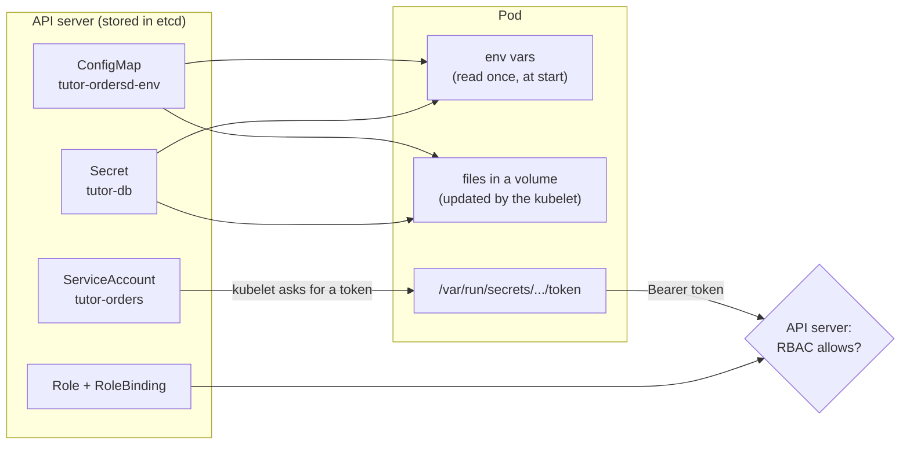

# Config and secrets

## Why care?

Four messages from one team's chat, in one week:

- "I changed the log level in the ConfigMap an hour ago. The service still logs at `info`."
- "The security audit found our database password in plain text, in last night's etcd backup."
- "`ordersd` starts, but it can't read its own password file. The file is right there."
- "A CI job had a 'read-only' token. It deleted pods in production."

None of these is a bug. Kubernetes gives you three simple tools: **ConfigMaps** for settings, **Secrets** for credentials, and **service accounts with RBAC** for "who may do what". Each one is simpler than its name suggests, and each one has traps. On this page you deploy `ordersd` with all three, read a Secret straight out of etcd, decode a pod's token, and lock a service account into one namespace.

## The idea: settings, credentials and identity, all from the API

- A **ConfigMap** holds plain settings, such as a log level. Every process in the pod can read it. When the ConfigMap changes, files made from it are replaced, but an environment variable that was set at start-up does not change.
- A **Secret** holds credentials, such as a password. Its value is encoded, not encrypted: anyone who can read the object can read the value. The protection is access control on who may read it.
- A **service account** is the pod's identity. Every pod has one. The pod gets a token that says who it is, and the token stops working when the pod is deleted.
- **RBAC** (role-based access control) is the set of rules that says what each identity may do. The token alone allows nothing. The API server checks the rules on every request.



ConfigMaps and Secrets are just objects in the API, like everything else (see [Architecture](architecture.md)). The **kubelet** on the node reads them and puts them into the container, as environment variables or as files. That one sentence explains most of the traps.

## Under the hood: ConfigMaps

### Two ways in: environment and files

A ConfigMap is a map of string keys to string values. Keys may be names like `ORDERS_LOG_LEVEL` or file names like `features.yaml`:

```yaml
apiVersion: v1
kind: ConfigMap
metadata:
  name: tutor-orders-config
  namespace: tutor-config
data:
  ORDERS_LOG_LEVEL: info
  ORDERS_LOG_FORMAT: json
  features.yaml: |
    discounts: false
    maxItems: 50
```

A pod can use it in two ways:

```yaml
spec:
  containers:
    - name: app
      image: busybox:1.37
      command: ["sh", "-c", "sleep 3600"]
      env:
        - name: LOG_LEVEL # 1. one key as an environment variable
          valueFrom:
            configMapKeyRef:
              name: tutor-orders-config
              key: ORDERS_LOG_LEVEL
      volumeMounts:
        - name: config # 2. keys as files
          mountPath: /etc/orders
          readOnly: true
  volumes:
    - name: config
      configMap:
        name: tutor-orders-config
        items:
          - key: features.yaml
            path: features.yaml
```

`envFrom` with a `configMapRef` turns **every** key into a variable at once. That is what `ordersd` uses, because it reads `ORDERS_*` variables (see [Services in Go](../go/services.md)).

Inside the container, the file is there, but look at how:

```console
$ kubectl -n tutor-config exec tutor-cm-demo -- ls -la /etc/orders
total 12
drwxrwxrwx    3 root     root          4096 Nov 26 21:42 .
drwxr-xr-x    1 root     root          4096 Nov 26 21:42 ..
drwxr-xr-x    2 root     root          4096 Nov 26 21:42 ..2026_11_26_21_42_24.3498899173
lrwxrwxrwx    1 root     root            32 Nov 26 21:42 ..data -> ..2026_11_26_21_42_24.3498899173
lrwxrwxrwx    1 root     root            20 Nov 26 21:42 features.yaml -> ..data/features.yaml
```

`features.yaml` is a symlink to `..data/features.yaml`, and `..data` is a symlink to a directory with a timestamp in its name. This is the atomic rename technique from [Filesystems](../linux/filesystems.md#under-the-hood-fsync-and-the-atomic-rename): to update, the kubelet writes a **new** timestamped directory, then swaps the `..data` symlink with one `rename`. A reader sees the old files or the new files, never half of each.

### Files update, environment variables don't

Change both the variable and the file in one patch, then wait:

```console
$ date +%T
22:42:30
$ kubectl -n tutor-config patch configmap tutor-orders-config --type merge \
    -p '{"data":{"ORDERS_LOG_LEVEL":"debug","features.yaml":"discounts: true\nmaxItems: 50\n"}}'
configmap/tutor-orders-config patched
```

About a minute later (the pod's clock is UTC, one hour behind the laptop):

```console
$ kubectl -n tutor-config exec tutor-cm-demo -- sh -c 'echo LOG_LEVEL=$LOG_LEVEL; ls -la /etc/orders; cat /etc/orders/features.yaml'
LOG_LEVEL=info
total 12
drwxrwxrwx    3 root     root          4096 Nov 26 21:43 .
drwxr-xr-x    1 root     root          4096 Nov 26 21:42 ..
drwxr-xr-x    2 root     root          4096 Nov 26 21:43 ..2026_11_26_21_43_32.799407177
lrwxrwxrwx    1 root     root            31 Nov 26 21:43 ..data -> ..2026_11_26_21_43_32.799407177
lrwxrwxrwx    1 root     root            20 Nov 26 21:42 features.yaml -> ..data/features.yaml
discounts: true
maxItems: 50
```

- The **file** changed, 62 seconds after the patch. A new timestamped directory, and `..data` points to it. The kubelet does not watch ConfigMaps for each pod; it re-syncs them every minute or so, through a cache. Expect "up to a minute or two", never "now".
- The **variable** is still `info`. Environment variables are copied into the process when it starts (see [Signals and processes](../linux/signals-and-processes.md)). Nothing outside the process can change them afterwards, including the kubelet.

So for `ordersd`, which reads only variables, a ConfigMap change does nothing until the pod is **replaced**. Do it on purpose, with a rollout:

```console
$ kubectl -n tutor-config patch configmap tutor-ordersd-env --type merge -p '{"data":{"ORDERS_LOG_LEVEL":"debug"}}'
configmap/tutor-ordersd-env patched
$ kubectl -n tutor-config rollout restart deploy/tutor-ordersd
deployment.apps/tutor-ordersd restarted
$ kubectl -n tutor-config rollout status deploy/tutor-ordersd
Waiting for deployment "tutor-ordersd" rollout to finish: 1 old replicas are pending termination...
deployment "tutor-ordersd" successfully rolled out
```

`rollout restart` only adds an annotation with the time to the pod template. The template changed, so the Deployment rolls out new pods (see [Workloads](workloads.md)):

```console
$ kubectl -n tutor-config get pod tutor-ordersd-5c5bc4f6f4-2nnx7 -o jsonpath='{.metadata.annotations}'
{"kubectl.kubernetes.io/restartedAt":"2026-11-26T22:48:04+01:00"}
```

`ordersd` runs on distroless, with no shell, so to see its environment you attach a debug container that shares its process namespace, and read `/proc/1/environ` (PID 1 is `ordersd`):

```console
$ kubectl -n tutor-config debug tutor-ordersd-5c5bc4f6f4-2nnx7 --image=busybox:1.37 \
    --target=ordersd --profile=general -c tutor-debug -- sleep 600
$ kubectl -n tutor-config exec tutor-ordersd-5c5bc4f6f4-2nnx7 -c tutor-debug -- \
    sh -c "tr '\0' '\n' < /proc/1/environ | grep LOG_LEVEL"
ORDERS_LOG_LEVEL=debug
```

A better habit than `rollout restart` by hand: put a **hash of the config** in the pod template. Then any config change is a template change, and a normal rollout (with history and `rollout undo`). Kustomize's `configMapGenerator` does this by adding a hash suffix to the ConfigMap's name, and Helm charts often put a checksum annotation on the template. See [Packaging](packaging.md).

### `subPath` never updates

If you want one file in an existing directory (say `/etc/orders/features.yaml` in an image that already has `/etc/orders`), you use `subPath`. It mounts the file directly, without the symlinks:

```yaml
volumeMounts:
  - name: config
    mountPath: /etc/orders/features.yaml
    subPath: features.yaml
```

```console
$ kubectl -n tutor-config exec tutor-subpath-demo -- ls -l /etc/orders/
total 4
-rw-r--r--    1 root     root            29 Nov 26 21:48 features.yaml
$ kubectl -n tutor-config patch configmap tutor-orders-config --type merge \
    -p '{"data":{"features.yaml":"discounts: false\nmaxItems: 99\n"}}'
configmap/tutor-orders-config patched
```

Ninety seconds later, the `subPath` pod and the normal volume pod disagree:

```console
$ kubectl -n tutor-config exec tutor-subpath-demo -- cat /etc/orders/features.yaml
discounts: true
maxItems: 50
$ kubectl -n tutor-config exec tutor-cm-demo -- cat /etc/orders/features.yaml
discounts: false
maxItems: 99
```

A `subPath` mount is a bind mount of **one file** (one inode) at container start. The kubelet's symlink swap happens next to it, and the container never sees it. It will see the new file only after a restart.

### Immutable ConfigMaps

Set `immutable: true`, and the API server refuses changes to `data`. Two good reasons:

- **Safety.** Nobody changes production config in place. A change is a new ConfigMap (a new name) and a rollout.
- **Load.** The kubelet stops checking immutable ConfigMaps and Secrets for changes. With thousands of pods, that is a lot less work for the API server.

With the hash-suffix pattern above, every ConfigMap is used by exactly one version of the template, so making them immutable costs nothing.

## Under the hood: Secrets

### Base64 is not encryption

A Secret looks like a ConfigMap, with one difference you can see: the values are base64.

```console
$ kubectl -n tutor-config create secret generic tutor-db --from-literal=username=orders --from-literal=password='s3cr3t-Passw0rd'
secret/tutor-db created
$ kubectl -n tutor-config get secret tutor-db -o yaml
apiVersion: v1
data:
  password: czNjcjN0LVBhc3N3MHJk
  username: b3JkZXJz
kind: Secret
metadata:
  creationTimestamp: "2026-11-26T21:43:43Z"
  name: tutor-db
  namespace: tutor-config
  resourceVersion: "1651"
  uid: 4565c3f5-c517-4234-b3f1-bad22cba8190
type: Opaque
$ kubectl -n tutor-config get secret tutor-db -o jsonpath='{.data.password}' | base64 -d; echo
s3cr3t-Passw0rd
```

Base64 is an **encoding**, like hex. It exists so that a Secret can hold binary data (a keystore, a certificate) in JSON. It hides nothing. Anyone who can `get` the Secret has the password.

So what makes a Secret different from a ConfigMap?

- **RBAC.** The built-in `view` role can read ConfigMaps but **not** Secrets. You can give a team "read everything" without giving them the passwords. You will see this below.
- **Handling.** The kubelet keeps Secret volumes in **tmpfs** (memory), never on the node's disk. A kubelet may only read the Secrets of pods on its own node (that is the `Node` in `--authorization-mode=Node,RBAC`). `kubectl describe` doesn't print values.
- **Encryption at rest**, if the cluster admin turns it on. By default it is off.

### In etcd, in plain text

On [Architecture](architecture.md#etcd-the-only-state) you read a ConfigMap's raw bytes out of etcd. Do the same for the Secret:

```console
$ kubectl -n kube-system exec etcd-tutor-control-plane -- etcdctl \
    --cacert /etc/kubernetes/pki/etcd/ca.crt \
    --cert /etc/kubernetes/pki/etcd/server.crt \
    --key /etc/kubernetes/pki/etcd/server.key \
    get /registry/secrets/tutor-config/tutor-db --print-value-only | strings -n 5
Secret
tutor-db
tutor-config"
*$4565c3f5-c517-4234-b3f1-bad22cba81902
kubectl-create
Update
FieldsV1:A
?{"f:data":{".":{},"f:password":{},"f:username":{}},"f:type":{}}B
password
s3cr3t-Passw0rd
username
orders
Opaque
```

The password `s3cr3t-Passw0rd` is in plain text, not even base64. The API server stores objects as protobuf, and base64 is only how JSON shows bytes. Every etcd backup, every etcd disk, every snapshot copied to a bucket has your passwords in it. This explains the second message at the top of the page.

### Encryption at rest

The API server can encrypt resources **before** it writes them to etcd. The admin passes `--encryption-provider-config` with a file like this:

```yaml
apiVersion: apiserver.config.k8s.io/v1
kind: EncryptionConfiguration
resources:
  - resources: ["secrets"]
    providers:
      - kms: # 1. preferred: a key in a cloud KMS or an HSM
          apiVersion: v2
          name: corp-kms
          endpoint: unix:///var/run/kms-plugin/socket.sock
      - identity: {} # 2. still able to READ old, unencrypted data
```

The first provider is used to **write**; all of them are tried to **read**. With `kms` v2, the API server makes a data key, encrypts Secrets with it, and asks the external KMS to encrypt the data key. etcd then holds only ciphertext that starts with `k8s:enc:kms:v2:`. There are also `aescbc` and `aesgcm` providers with the key in the config file itself, but then the key sits on the same control plane disk as etcd, which helps much less.

Two things to know:

- After turning it on, existing Secrets are still plain. They are encrypted when written again. The usual way: `kubectl get secrets -A -o json | kubectl replace -f -`.
- It protects **etcd data at rest**: backups, disks. It does not protect against anyone who can `get secrets` through the API. That is RBAC's job.

On managed clusters (EKS, GKE, AKS), the cloud does this for you if you give it a KMS key. This `kind` cluster has it off, and changing the API server's static pod on a shared cluster is not something to do for a demo, so there is no output here.

### Secret files and non-root users

`ordersd` runs as UID 65532 (distroless `nonroot`, see [Container security](../containers/security.md)). Mount the Secret as files with a strict mode, the way many guides suggest:

```yaml
volumes:
  - name: db
    secret:
      secretName: tutor-db
      defaultMode: 0400
```

Look from the debug container again:

```console
$ kubectl -n tutor-config exec tutor-ordersd-5884c89f68-fr2bb -c tutor-debug -- \
    sh -c "ls -lL /proc/1/root/var/run/secrets/db/; grep -E '^(Uid|Gid)' /proc/1/status"
total 8
-r--------    1 root     root            15 Nov 26 21:45 password
-r--------    1 root     root             6 Nov 26 21:45 username
Uid:	65532	65532	65532	65532
Gid:	65532	65532	65532	65532
```

The files belong to `root`, mode `0400`, and the process is UID 65532. It cannot read them. This explains the third message at the top of the page. The fix is `fsGroup`: the kubelet gives the volume's files that group, and you open the mode to the group:

```yaml
spec:
  securityContext:
    fsGroup: 65532
  # ...
  volumes:
    - name: db
      secret:
        secretName: tutor-db
        defaultMode: 0440
```

```console
$ kubectl -n tutor-config exec tutor-ordersd-646fb968d8-gdxzq -c tutor-debug -- ls -lL /proc/1/root/var/run/secrets/db/
total 8
-r--r-----    1 root     65532           15 Nov 26 21:47 password
-r--r-----    1 root     65532            6 Nov 26 21:47 username
```

Owner `root`, group `65532`, group may read. `ordersd` can read its password now, and nobody else in the container can write it.

### Files or environment variables?

The same Deployment also had the password as a variable (`secretKeyRef`). From the debug container:

```console
$ kubectl -n tutor-config exec tutor-ordersd-5884c89f68-fr2bb -c tutor-debug -- sh -c "tr '\0' '\n' < /proc/1/environ | grep -E 'ORDERS|DB_'"
ORDERS_SHUTDOWN_DELAY=5s
ORDERS_LOG_FORMAT=text
ORDERS_LOG_LEVEL=info
DB_PASSWORD=s3cr3t-Passw0rd
```

Prefer **files** for secrets:

- Variables are inherited by every child process, and end up in crash reports, `/proc/<pid>/environ`, debug dumps and "print all config at start-up" log lines.
- Files are **updated** when the Secret changes (rotation without a restart, if your code re-reads them). Variables never are.
- Files can have a mode and a group, as you just saw.

In Go, read the file when you need the value, or re-read it on a timer, instead of caching it once at start-up. Then a rotated password works without a deploy.

### Secrets that don't start in Kubernetes

A Secret in a YAML file in Git is a password in Git: base64 is not encryption. In real teams, the source of truth is outside the cluster:

| Tool                                        | How it works                                                                                                                        |
| ------------------------------------------- | ----------------------------------------------------------------------------------------------------------------------------------- |
| **External Secrets Operator**               | A controller reads from Vault, AWS Secrets Manager, Azure Key Vault, GCP Secret Manager… and writes normal Kubernetes Secrets       |
| **Secrets Store CSI Driver**                | A CSI volume (see [Storage](storage.md)) that fetches the secret at mount time. Can skip the Kubernetes Secret object completely    |
| **Sealed Secrets**, **SOPS**                | Encrypt the Secret **before** it goes into Git. A controller in the cluster (Sealed Secrets) or the deploy tool (SOPS) decrypts it  |
| **Workload identity** (IRSA, GKE, Azure WI) | No stored secret at all: the pod's service account token is exchanged for short-lived cloud credentials. The best option if you can |

The last row brings us to service accounts.

## Under the hood: service accounts and tokens

### Every pod has an identity

Every namespace has a `default` service account, and every pod runs as one. Make your own, so that you can give it rights without giving them to every pod in the namespace:

```console
$ kubectl -n tutor-config create serviceaccount tutor-orders
serviceaccount/tutor-orders created
```

A pod with `serviceAccountName: tutor-orders` gets a volume it never asked for:

```console
$ kubectl -n tutor-config exec tutor-sa-demo -- ls -la /var/run/secrets/kubernetes.io/serviceaccount/
total 4
drwxrwxrwt    3 root     root           140 Nov 26 21:44 .
drwxr-xr-x    3 root     root          4096 Nov 26 21:44 ..
drwxr-xr-x    2 root     root           100 Nov 26 21:44 ..2026_11_26_21_44_06.320523894
lrwxrwxrwx    1 root     root            31 Nov 26 21:44 ..data -> ..2026_11_26_21_44_06.320523894
lrwxrwxrwx    1 root     root            13 Nov 26 21:44 ca.crt -> ..data/ca.crt
lrwxrwxrwx    1 root     root            16 Nov 26 21:44 namespace -> ..data/namespace
lrwxrwxrwx    1 root     root            12 Nov 26 21:44 token -> ..data/token
```

The same `..data` symlink technique. And it is a tmpfs, in memory, like every Secret volume:

```console
$ kubectl -n tutor-config exec tutor-sa-demo -- grep serviceaccount /proc/mounts
tmpfs /var/run/secrets/kubernetes.io/serviceaccount tmpfs ro,relatime,size=16304464k 0 0
```

An admission plugin added it to the pod spec as a **projected** volume, which combines three sources:

```console
$ kubectl -n tutor-config get pod tutor-sa-demo -o jsonpath='{.spec.volumes}' | python3 -m json.tool
[
    {
        "name": "kube-api-access-9d7m9",
        "projected": {
            "defaultMode": 420,
            "sources": [
                {
                    "serviceAccountToken": {
                        "expirationSeconds": 3607,
                        "path": "token"
                    }
                },
                {
                    "configMap": {
                        "items": [
                            {
                                "key": "ca.crt",
                                "path": "ca.crt"
                            }
                        ],
                        "name": "kube-root-ca.crt"
                    }
                },
                {
                    "downwardAPI": {
                        "items": [
                            {
                                "fieldRef": {
                                    "apiVersion": "v1",
                                    "fieldPath": "metadata.namespace"
                                },
                                "path": "namespace"
                            }
                        ]
                    }
                }
            ]
        }
    }
]
```

1. A **token**, which the kubelet requests from the API server (the `TokenRequest` API) for this pod, and refreshes before it expires.
2. The cluster's **CA certificate**, from a ConfigMap that exists in every namespace, so the pod can check the API server's TLS certificate.
3. The pod's own **namespace**, from the downward API.

This is exactly what `rest.InClusterConfig()` in `client-go` reads: the token, `ca.crt`, and the `KUBERNETES_SERVICE_HOST`/`_PORT` variables. You will use it in [Operators](operators.md).

### Decode the token

The token is a JWT: three base64url parts, `header.payload.signature`. The first two are plain JSON:

```console
$ b64json() { python3 -c 'import sys,base64,json; s=sys.stdin.read().strip(); s+="="*(-len(s)%4); print(json.dumps(json.loads(base64.urlsafe_b64decode(s)),indent=2))'; }
$ kubectl -n tutor-config exec tutor-sa-demo -- cat /var/run/secrets/kubernetes.io/serviceaccount/token > tok.txt
$ cut -d. -f1 tok.txt | b64json
{
  "alg": "RS256",
  "kid": "muDypq1Ayo9x2oPWkM1aCRz-khkXcgoCbUhf5-VsnuQ"
}
$ cut -d. -f2 tok.txt | b64json
{
  "aud": [
    "https://kubernetes.default.svc.cluster.local"
  ],
  "exp": 1827265446,
  "iat": 1795729446,
  "iss": "https://kubernetes.default.svc.cluster.local",
  "jti": "dca22a6c-7e34-45d0-bcb4-61ee623bc1cb",
  "kubernetes.io": {
    "namespace": "tutor-config",
    "node": {
      "name": "tutor-worker",
      "uid": "106ecccb-14e4-42b1-85fc-8b5a03b19be7"
    },
    "pod": {
      "name": "tutor-sa-demo",
      "uid": "d682ef89-065b-421e-8bab-6f86f8833113"
    },
    "serviceaccount": {
      "name": "tutor-orders",
      "uid": "9ad81bd3-6b21-44f3-a04c-a23b761b1843"
    },
    "warnafter": 1795733053
  },
  "nbf": 1795729446,
  "sub": "system:serviceaccount:tutor-config:tutor-orders"
}
```

Read it field by field:

- **`sub`**: the user name the API server will see, `system:serviceaccount:<namespace>:<name>`. RBAC rules use this name.
- **`iss`** and **`aud`**: who signed it, and who it is for. The API server signed it with `sa.key` (RS256) and only accepts tokens with its own audience. Other systems (Vault, a cloud's workload identity) can be given tokens with **their** audience, and check the signature with the public keys at `/openid/v1/jwks`.
- **`kubernetes.io.pod`** and **`.node`**: the token is **bound** to this pod. Delete the pod, and the token stops working, even before `exp`.
- **`exp - iat`** is 31,536,000 seconds: **one year**, although the pod asked for 3607 seconds. And `warnafter - iat` is exactly 3607.

The last point needs an explanation. The API server flag `--service-account-extend-token-expiration` (default `true`) gives auto-mounted tokens a one-year life, so that old clients which read the token only once at start-up don't break after an hour. `warnafter` is when the API server starts **logging a warning** that a stale token was used. The kubelet still refreshes the file well before that, and good clients (client-go) re-read it. If you ask for a token yourself, you get what you ask for:

```console
$ kubectl -n tutor-config create token tutor-orders --duration=10m | cut -d. -f2 | b64json
{
  "aud": [
    "https://kubernetes.default.svc.cluster.local"
  ],
  "exp": 1795731401,
  "iat": 1795730801,
  "iss": "https://kubernetes.default.svc.cluster.local",
  "jti": "7faffb4c-1800-4e0b-aa4b-bb7e8f15d8ba",
  "kubernetes.io": {
    "namespace": "tutor-config",
    "serviceaccount": {
      "name": "tutor-orders",
      "uid": "9ad81bd3-6b21-44f3-a04c-a23b761b1843"
    }
  },
  "nbf": 1795730801,
  "sub": "system:serviceaccount:tutor-config:tutor-orders"
}
```

`exp - iat` is 600: ten minutes. And no pod in it: it is bound only to the service account, so it lives until it expires (or the service account is deleted).

Most pods never call the Kubernetes API. Turn the token off for them with `automountServiceAccountToken: false` on the pod or the service account. One less credential to steal.

## Under the hood: RBAC

### Who may do what, where

An API request is checked in this order: **authentication** (who are you? a client certificate, a token), then **authorization** (may you do this?), then **admission** (is the object acceptable?). This cluster's API server runs with `--authorization-mode=Node,RBAC`. RBAC answers one question: may **subject** do **verb** on **resource** in **namespace**?

Four object kinds hold the answer:

| Object               | Scope           | Holds                                                                     |
| -------------------- | --------------- | ------------------------------------------------------------------------- |
| `Role`               | one namespace   | rules: API groups, resources, verbs                                       |
| `ClusterRole`        | cluster-wide    | the same rules; can also cover nodes, namespaces, PVs, `/healthz`…        |
| `RoleBinding`        | one namespace   | subjects → a `Role` **or a `ClusterRole`**, rights only in this namespace |
| `ClusterRoleBinding` | every namespace | subjects → a `ClusterRole`, rights everywhere                             |

Subjects are users, groups, or service accounts. Verbs are the HTTP verbs, more or less: `get`, `list`, `watch`, `create`, `update`, `patch`, `delete`. RBAC is **only additive**: there is no "deny" rule. Everything not allowed is forbidden.

### A Role for `ordersd`

Before anything:

```console
$ kubectl auth can-i list pods -n tutor-config --as=system:serviceaccount:tutor-config:tutor-orders
no
```

`--as` asks the API server to **impersonate** that user for this one request. You may do it because the `kind` admin is `cluster-admin`. It is the best way to test RBAC: no tokens, no guessing. Now give the service account read access to pods:

```yaml
apiVersion: rbac.authorization.k8s.io/v1
kind: Role
metadata:
  name: tutor-pod-reader
  namespace: tutor-config
rules:
  - apiGroups: [""] # "" is the core group: pods, configmaps, secrets...
    resources: ["pods"]
    verbs: ["get", "list", "watch"]
---
apiVersion: rbac.authorization.k8s.io/v1
kind: RoleBinding
metadata:
  name: tutor-orders-reads-pods
  namespace: tutor-config
subjects:
  - kind: ServiceAccount
    name: tutor-orders
    namespace: tutor-config
roleRef:
  kind: Role
  name: tutor-pod-reader
  apiGroup: rbac.authorization.k8s.io
```

```console
$ SA=system:serviceaccount:tutor-config:tutor-orders
$ kubectl auth can-i list pods -n tutor-config --as=$SA
yes
$ kubectl auth can-i delete pods -n tutor-config --as=$SA
no
$ kubectl auth can-i get secrets -n tutor-config --as=$SA
no
$ kubectl auth can-i list pods -n default --as=$SA
no
```

The service account has exactly this one right, in exactly this one namespace. `kubectl auth can-i --list -n tutor-config --as=$SA` prints the whole picture; among the lines are `pods [] [] [get list watch]` and a few things every authenticated user may do, like `selfsubjectaccessreviews` (that's what `can-i` itself uses) and `GET /healthz`.

### Test with the pod's real token

`can-i` is a prediction. Now use the pod's real token. The admin kubeconfig has a client certificate, and a certificate wins over `--token`, so build a clean config on the command line:

```console
$ k() { kubectl --kubeconfig=/dev/null --server="$SERVER" --certificate-authority=ca.crt --token="$(cat tok.txt)" "$@"; }
$ k auth whoami
ATTRIBUTE                                           VALUE
Username                                            system:serviceaccount:tutor-config:tutor-orders
UID                                                 9ad81bd3-6b21-44f3-a04c-a23b761b1843
Groups                                              [system:serviceaccounts system:serviceaccounts:tutor-config system:authenticated]
Extra: authentication.kubernetes.io/credential-id   [JTI=dca22a6c-7e34-45d0-bcb4-61ee623bc1cb]
Extra: authentication.kubernetes.io/node-name       [tutor-worker]
Extra: authentication.kubernetes.io/node-uid        [106ecccb-14e4-42b1-85fc-8b5a03b19be7]
Extra: authentication.kubernetes.io/pod-name        [tutor-sa-demo]
Extra: authentication.kubernetes.io/pod-uid         [d682ef89-065b-421e-8bab-6f86f8833113]
$ k -n tutor-config get pods
NAME            READY   STATUS    RESTARTS   AGE
tutor-cm-demo   1/1     Running   0          2m26s
tutor-sa-demo   1/1     Running   0          43s
$ k -n tutor-config get secrets
Error from server (Forbidden): secrets is forbidden: User "system:serviceaccount:tutor-config:tutor-orders" cannot list resource "secrets" in API group "" in the namespace "tutor-config"
$ k -n tutor-config delete pod tutor-cm-demo
Error from server (Forbidden): pods "tutor-cm-demo" is forbidden: User "system:serviceaccount:tutor-config:tutor-orders" cannot delete resource "pods" in API group "" in the namespace "tutor-config"
```

(`$SERVER` is the API server URL from your kubeconfig, and `ca.crt` its CA.) Note the **groups**: every service account is also in `system:serviceaccounts` and `system:serviceaccounts:<namespace>`. A binding to one of those groups gives rights to every service account at once. Look for such bindings when you audit a cluster.

From inside the pod it is plain HTTPS with a bearer token (busybox's `wget` can't check the CA, so `--no-check-certificate`; real clients use `ca.crt`):

```console
$ kubectl -n tutor-config exec tutor-sa-demo -- sh -c 'T=$(cat /var/run/secrets/kubernetes.io/serviceaccount/token);
    wget -qO- --no-check-certificate --header "Authorization: Bearer $T" \
      https://kubernetes.default.svc/api/v1/namespaces/tutor-config/pods?limit=1 | head -5
    wget -qO- -S --no-check-certificate --header "Authorization: Bearer $T" \
      https://kubernetes.default.svc/api/v1/namespaces/tutor-config/secrets 2>&1 | head -2'
{
  "kind": "PodList",
  "apiVersion": "v1",
  "metadata": {
    "resourceVersion": "9076",
  HTTP/1.1 403 Forbidden
wget: server returned error: HTTP/1.1 403 Forbidden
```

`401 Unauthorized` means "I don't know who you are". `403 Forbidden` means "I know who you are, and the answer is no". Now delete the pod and try its token again:

```console
$ kubectl -n tutor-config delete pod tutor-sa-demo --now
pod "tutor-sa-demo" deleted from tutor-config namespace
$ k -n tutor-config get pods
error: You must be logged in to the server (Unauthorized)
```

The token had a one-year `exp`, but it stopped working when its pod was deleted. That's a **bound** token. An old-style token from a `kubernetes.io/service-account-token` Secret would still work, forever, until someone deletes the Secret. Don't create those.

### ClusterRoles: reusable rules

A `ClusterRole` is not "cluster-wide rights". It is **a set of rules with no namespace**. What makes it wide is the binding. Kubernetes ships with `cluster-admin`, `admin`, `edit` and `view`:

```console
$ kubectl get clusterroles | grep -E '^(NAME|admin|edit|view|cluster-admin) '
NAME                                                                    CREATED AT
admin                                                                   2026-11-26T21:39:41Z
cluster-admin                                                           2026-11-26T21:39:41Z
edit                                                                    2026-11-26T21:39:41Z
view                                                                    2026-11-26T21:39:41Z
```

Bind `view` with a **RoleBinding**, and it applies only in that namespace:

```console
$ kubectl -n tutor-config create rolebinding tutor-orders-view --clusterrole=view --serviceaccount=tutor-config:tutor-orders
rolebinding.rbac.authorization.k8s.io/tutor-orders-view created
$ kubectl auth can-i list configmaps -n tutor-config --as=$SA
yes
$ kubectl auth can-i list secrets -n tutor-config --as=$SA
no
$ kubectl auth can-i list configmaps -n default --as=$SA
no
```

`view` reads almost everything, **except Secrets**. Some resources have no namespace (nodes, PVs, namespaces themselves). For those you need a ClusterRole **and** a ClusterRoleBinding:

```console
$ kubectl create clusterrole tutor-node-reader --verb=get,list --resource=nodes
clusterrole.rbac.authorization.k8s.io/tutor-node-reader created
$ kubectl create clusterrolebinding tutor-orders-reads-nodes --clusterrole=tutor-node-reader --serviceaccount=tutor-config:tutor-orders
clusterrolebinding.rbac.authorization.k8s.io/tutor-orders-reads-nodes created
$ kubectl auth can-i list nodes --as=$SA
Warning: resource 'nodes' is not namespace scoped

yes
$ kubectl auth can-i delete nodes --as=$SA
Warning: resource 'nodes' is not namespace scoped

no
```

The warning is harmless: nodes have no namespace. Clean up cluster-wide objects as soon as you are done; they outlive every namespace:

```console
$ kubectl delete clusterrolebinding tutor-orders-reads-nodes; kubectl delete clusterrole tutor-node-reader
clusterrolebinding.rbac.authorization.k8s.io "tutor-orders-reads-nodes" deleted
clusterrole.rbac.authorization.k8s.io "tutor-node-reader" deleted
```

### Rights that hide inside other rights

RBAC rules talk about resources, but some verbs give more than they say:

- **`create pods`** in a namespace = **read every Secret** in it. Write a pod that mounts the Secret and prints it. Also: run as any service account in that namespace.
- **`create`/`update` Deployments, Jobs, CronJobs…** = `create pods`, through the controller.
- **`list secrets`** = `get` every Secret. `list` returns full objects, values included.
- **`escalate`, `bind`, `impersonate`** on RBAC objects or users = become anyone.
- **`nodes/proxy`** = talk to the kubelet API, which can run commands in pods.

The fourth message at the top ("a read-only token deleted pods") is usually one of these, or a binding to a group like `system:authenticated`.

## Try it

1. Create a ConfigMap with one key, mount it as a volume **and** with `envFrom`. Patch it, and time how long the file takes to change. Run it three times. Is the delay always the same?
2. Add `immutable: true` to the ConfigMap, then try to patch `data`. What does the error say? Can you still change a label?
3. Create a Secret, then read it from etcd with `etcdctl` as above. Find the value with `strings`. Then apply a Secret with a plain value under `stringData:` instead of `data:`. What does `kubectl get -o yaml` show afterwards?
4. Run a pod as UID 1000 with a Secret volume at `defaultMode: 0400`. Read the file with `cat`. Fix it with `fsGroup`, not by running as root.
5. Decode the token of a pod in your own namespace. Delete the pod, and check that the token is rejected. Then make one with `kubectl create token --duration=10m` and check its `exp`.
6. Give a service account `edit` in a namespace with a RoleBinding. Use `kubectl auth can-i get secrets --as=...`. Is "edit" really less than "admin" for secrets?

## Traps

- **"I changed the ConfigMap, nothing happened."** Environment variables never change in a running process. Files change after a minute or so, and only if your code re-reads them. Roll out a hash-named ConfigMap instead.
- **`subPath` mounts.** They never update. Mount the directory, or restart.
- **Secrets in Git.** Base64 is not encryption. Use External Secrets, Sealed Secrets or SOPS.
- **No encryption at rest.** Without it, etcd backups contain every password in plain text.
- **`defaultMode: 0400` with a non-root user.** The files belong to root. Use `fsGroup` and `0440`.
- **Secrets as environment variables.** They leak into child processes, crash dumps and "dump the config" log lines. Use files.
- **Rights through `create pods`.** Anyone who can create a pod in a namespace can read its Secrets. Treat "can deploy" as "can read secrets".
- **Bindings to broad groups.** `system:authenticated` or `system:serviceaccounts` in a ClusterRoleBinding gives the rights to everyone.
- **Every pod gets a token.** Set `automountServiceAccountToken: false` where the pod never talks to the API.
- **Long-lived token Secrets.** `kubernetes.io/service-account-token` Secrets never expire. Use `kubectl create token` or the projected token.

## Check yourself

??? question "1. A Deployment uses `envFrom` with a ConfigMap. You change the ConfigMap and wait ten minutes. What does the running process see, and what is the cleanest way to make it see the new value?"

    The old values, forever: environment variables are copied into the process at
    start-up. The kubelet only updates **volume** files. The cleanest fix is to make the
    change a change of the pod template, so it rolls out like any other change: a
    hash-suffixed ConfigMap name (Kustomize `configMapGenerator`) or a checksum annotation
    (Helm). `kubectl rollout restart` works too, but leaves no link between the config
    version and the rollout.

??? question "2. Your colleague says: 'Secrets are safe, the values are encrypted with base64.' Give two reasons this is wrong, using what you saw on this page."

    Base64 is an encoding, and `base64 -d` reverses it without any key. And in etcd the
    value is not even base64: `etcdctl get` showed `s3cr3t-Passw0rd` in the raw bytes,
    because encryption at rest was off. What really protects a Secret is RBAC (who may
    `get` or `list` it, or create pods that mount it), plus encryption at rest for etcd
    data and backups.

??? question "3. The token in a pod has `exp` one year after `iat`. Is that a security problem? What limits how long it is useful?"

    Less than it looks. The token is **bound** to the pod: when the pod is deleted, the
    API server rejects it (you saw `Unauthorized`). The long `exp` comes from
    `--service-account-extend-token-expiration`, a compatibility setting for clients that
    never re-read the file; `warnafter` (about an hour) is when the API server starts
    logging that a stale token was used. A stolen token is still useful while the pod
    lives, so keep pods from leaking it, and turn off auto-mounting where it isn't needed.

??? question "4. You bind the ClusterRole `view` to a service account with a RoleBinding in `team-a`. What can it do in `team-b`? What can it do with Secrets in `team-a`?"

    Nothing in `team-b`: a RoleBinding gives the ClusterRole's rules only in its own
    namespace. And nothing with Secrets in `team-a`, because `view` does not include
    Secrets. With a **ClusterRoleBinding** instead, it could read (non-secret) resources in
    every namespace.

??? question "5. `kubectl auth can-i get secrets -n prod --as=system:serviceaccount:ci:deployer` says `no`. Can the deployer still read secrets in `prod`? How?"

    Yes, if it can create pods or anything that makes pods (Deployments, Jobs) in `prod`.
    It deploys a pod that mounts the Secret (or uses `secretKeyRef`) and prints it to its
    logs. Check `kubectl auth can-i create pods` and `create deployments` too.

??? question "6. Why does a `kubectl` command with `--token=...` still act as `kubernetes-admin` on the `kind` cluster?"

    The kubeconfig also has a client certificate, and TLS client authentication happens
    first. The API server sees the certificate's identity. Use a kubeconfig without the
    certificate (as on this page with `--kubeconfig=/dev/null`), or `kubectl auth whoami`
    to check who you really are.

## Recap

- A **ConfigMap** gives a pod settings as **environment variables** (read once, at start) or as **files** (swapped atomically through the `..data` symlink, about a minute after a change). `subPath` mounts never update.
- To change config, change the **pod template**: a hash-named ConfigMap or a checksum annotation. `immutable: true` makes that safe and cheap.
- A **Secret** is a ConfigMap with base64, tighter default RBAC, and tmpfs on the node. It is **not encrypted**: etcd stores it in plain text unless the admin turns on **encryption at rest**, best with a KMS.
- Mount secrets as **files**, with `fsGroup` and mode `0440` for non-root containers. Keep them out of environment variables and Git; use External Secrets, the Secrets Store CSI driver, Sealed Secrets or SOPS.
- Every pod runs as a **service account**. Its **projected token** is a JWT, bound to the pod, refreshed by the kubelet, and read by `rest.InClusterConfig()`.
- **RBAC** = subject + verb + resource + namespace. `Role`/`RoleBinding` for one namespace; `ClusterRole` is reusable rules, made cluster-wide only by a `ClusterRoleBinding`. Rules only allow. Test with `kubectl auth can-i --as`.
- `create pods` means "read the namespace's secrets". Audit it like you audit `get secrets`.

Next: data that must survive a pod. [Storage](storage.md).
