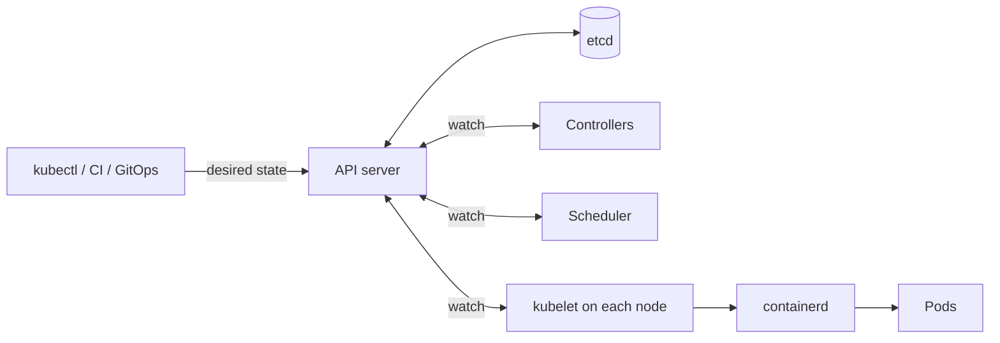

# Kubernetes

Not a list of YAML files: a database of desired state, and many small loops that make the world match it.

## Why go deeper?

Kubernetes is easy to start and hard to understand. One day:

- A deploy is "successful", and every pod is in `CrashLoopBackOff`.
- A pod is `Pending` forever, and the cluster has plenty of free CPU.
- During a rollout, a few requests fail with `502`, every time.
- The service is throttled at 30% CPU use.
- Someone deletes a pod by hand, and it comes back. Someone deletes a namespace, and it never finishes.

Each of these makes sense once you see the one idea under everything: **you write desired state to an API, and controllers keep working until reality matches it.** This chapter builds on [Linux](../linux/index.md), [Networking](../networking/index.md) and [Containers](../containers/index.md).

## The big picture

1. **The API server** is the only door. Everything is a resource stored in **etcd**.
2. **Controllers** watch resources and act: a Deployment makes ReplicaSets, a ReplicaSet makes Pods.
3. **The scheduler** picks a node for each Pod. **The kubelet** on that node makes the containers run.
4. Nobody calls anybody directly. Everything talks through the API, by **watching** and **reconciling**.

## Reading order

!!! note "Planned chapter"

    This section is a roadmap. The pages below are written in later sessions and linked here when they land.

| #   | Page                          | You will learn                                                                                  |
| --- | ----------------------------- | ----------------------------------------------------------------------------------------------- |
| 1   | Architecture                  | API server, etcd, scheduler, controller manager, kubelet; a local cluster with `kind`           |
| 2   | Reconciliation                | Desired vs actual state, watches, resource versions, finalizers, owner references, why it heals |
| 3   | Pods                          | The pause container, init and sidecar containers, probes, the pod lifecycle, termination        |
| 4   | Workloads                     | Deployments and rollouts, ReplicaSets, StatefulSets, DaemonSets, Jobs and CronJobs              |
| 5   | Services and cluster DNS      | ClusterIP, kube-proxy (iptables, IPVS, nftables), EndpointSlices, headless services, CoreDNS    |
| 6   | Ingress and Gateway API       | Getting traffic in, TLS termination, why Gateway API replaces Ingress                           |
| 7   | Config and secrets            | ConfigMaps, Secrets (and why they are not secret), service accounts, RBAC                       |
| 8   | Storage                       | Volumes, PersistentVolumes and Claims, StorageClasses, CSI                                      |
| 9   | Scheduling and resources      | Requests vs limits, QoS classes, CPU throttling, OOM kills, affinity, taints, autoscaling       |
| 10  | Packaging: Kustomize and Helm | Overlays vs templates, when to pick which, and how to keep manifests reviewable                 |
| 11  | Writing an operator in Go     | CRDs, `client-go` informers, controller-runtime, and a small controller for `orders`            |

## How each page works

The same shape as the [Fundamentals](../fundamentals/index.md): **Why care?**, **The idea**, **Under the hood**, **Try it**, **Traps** and **Check yourself**. All examples run on a local `kind` cluster, and deploy the `ordersd` service from the [Go chapter](../go/index.md).
