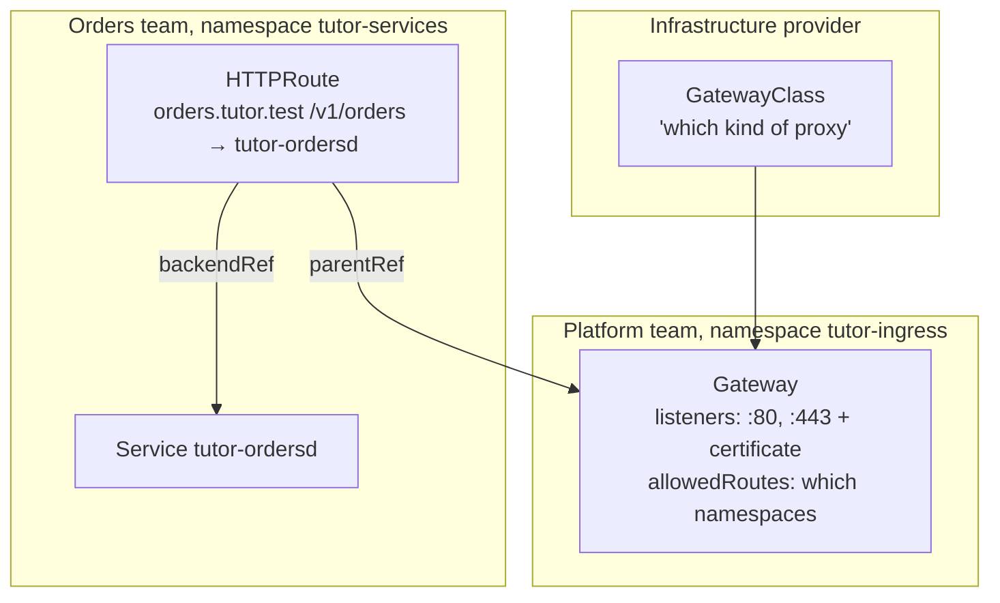

# Ingress and Gateway API

## Why care?

A Service gives `ordersd` a stable address **inside** the cluster. Customers are outside. You could give every Service its own cloud load balancer (`type: LoadBalancer`), but that is one public IP, one bill and one TLS certificate per Service, and no HTTP routing at all. What you want is one HTTP entry point: it terminates TLS, looks at the host name and the path, and sends `/v1/orders` to `ordersd` and `/v1/payments` to somebody else's service.

Kubernetes has two APIs for that entry point. **Ingress** is the old one: small, everywhere, and full of vendor-specific annotations. **Gateway API** is the new one, built to fix Ingress's problems. You will meet both, often in the same company:

- "The Ingress works on the test cluster, but in production the path rewrite does nothing." (Annotations are not portable.)
- "Which team owns this Ingress? Changing it broke three other teams' TLS." (Ingress has no role split.)
- "The route is in the cluster, but every request gets `404`." (The route was never accepted, and its status says why.)

This page installs a real controller in the `kind` cluster, serves `ordersd` through both APIs with TLS, and shows the 502 from [Workloads](workloads.md) again, this time at the entry point. It builds on [Load balancers and proxies](../networking/load-balancers.md) and [TLS and certificates](../networking/tls.md).

## The idea: one proxy, configured by routing objects

All external HTTP traffic enters through one reverse proxy. The proxy reads each request's host name and path, and sends it to the matching Service. The Pods are never exposed directly.

- The **controller** is a real proxy (Envoy, NGINX, Traefik, HAProxy) running as Pods, behind a NodePort or a cloud load balancer. It watches the API and configures itself.
- The **routing configuration** is a set of API objects: Ingress objects, or Gateway API routes.

With **Ingress**, every team writes the same kind of object, and each one can set ports, hosts and certificates. No single owner decides which ports are open or which certificates are served.

**Gateway API** splits the configuration by role:



- The **infrastructure provider** defines the kind of proxy: a **GatewayClass** ("Traefik", "Envoy Gateway", "the cloud's load balancer").
- The **platform team** runs one entry point: a **Gateway**, with its ports, its certificates, and a rule for which namespaces may attach routes.
- Each **application team** writes an **HTTPRoute** in its own namespace, pointing at its own Service.

## Under the hood: Ingress

### An Ingress is only configuration

Deploy two `ordersd` Pods and a Service (as in [Services and cluster DNS](services-and-dns.md)) in `tutor-ingress`, and an Ingress:

```yaml
apiVersion: networking.k8s.io/v1
kind: Ingress
metadata:
  name: tutor-orders
spec:
  ingressClassName: tutor-traefik
  rules:
    - host: orders.tutor.test
      http:
        paths:
          - path: /v1/orders
            pathType: Prefix
            backend:
              service:
                name: tutor-ordersd
                port:
                  name: http
```

```console
$ kubectl -n tutor-ingress apply -f ordersd.yaml -f svc.yaml -f ingress.yaml
deployment.apps/tutor-ordersd created
service/tutor-ordersd created
ingress.networking.k8s.io/tutor-orders created
$ kubectl -n tutor-ingress get ingress
NAME           CLASS           HOSTS               ADDRESS   PORTS   AGE
tutor-orders   tutor-traefik   orders.tutor.test             80      0s
$ kubectl -n tutor-ingress describe ingress tutor-orders | tail -3
                     /v1/orders   tutor-ordersd:http ()
Annotations:         <none>
Events:              <none>
```

The API server stored it, and nothing else happened. Unlike Services (kube-proxy) or Deployments (the controller manager), Kubernetes ships **no Ingress controller**. An Ingress on its own is only stored configuration. Somebody must install a controller that watches Ingress objects with its class name (`ingressClassName`) and configures a proxy.

`pathType` matters: `Prefix` matches whole path segments (`/v1/orders` matches `/v1/orders/42`, not `/v1/ordersX`), `Exact` matches one path, and `ImplementationSpecific` means "whatever this controller does", which is the start of most portability problems.

### Installing a controller

For many years the default answer was **ingress-nginx**. That project has been retired (no more releases or security fixes since March 2026), so new clusters should not start with it. This page uses **Traefik**, because one Traefik can serve both Ingress and Gateway API, and so you can compare them side by side. Envoy Gateway, Istio, Cilium, NGINX Gateway Fabric, HAProxy and the cloud providers' controllers do the same job.

The Helm chart (more on Helm in [Packaging](packaging.md)), with values for a `kind` cluster: a NodePort instead of a cloud load balancer, our own class names, and only the standard Kubernetes APIs (no Traefik-specific CRDs):

```yaml
# traefik-values.yaml
ingressClass:
  name: tutor-traefik
  isDefaultClass: false
gatewayClass:
  name: tutor-traefik
gateway:
  enabled: false # we write our own Gateway
providers:
  kubernetesCRD:
    enabled: false # no Traefik-specific CRDs, only standard APIs
  kubernetesIngress:
    enabled: true
  kubernetesGateway:
    enabled: true
service:
  spec:
    type: NodePort
ports:
  web:
    nodePort: 30080
  websecure:
    nodePort: 30443
```

Traefik's Gateway support needs the Gateway API CRDs first (next section explains them). Then the chart:

```console
$ kubectl apply --server-side -f https://github.com/kubernetes-sigs/gateway-api/releases/download/v1.7.0/standard-install.yaml
customresourcedefinition.apiextensions.k8s.io/backendtlspolicies.gateway.networking.k8s.io serverside-applied
...
validatingadmissionpolicybinding.admissionregistration.k8s.io/safe-upgrades.gateway.networking.k8s.io serverside-applied
$ helm pull oci://ghcr.io/traefik/helm/traefik --version 43.0.0 --untar
$ helm install tutor-traefik ./traefik -n tutor-ingress --skip-crds -f traefik-values.yaml
NAME: tutor-traefik
LAST DEPLOYED: Thu Nov 26 22:58:48 2026
NAMESPACE: tutor-ingress
STATUS: deployed
REVISION: 1
DESCRIPTION: Install complete
TEST SUITE: None
NOTES:
tutor-traefik with docker.io/traefik:v3.8.0 has been deployed successfully on tutor-ingress namespace!
...
$ kubectl get ingressclass,gatewayclass
NAME                                           CONTROLLER                      PARAMETERS   AGE
ingressclass.networking.k8s.io/tutor-traefik   traefik.io/ingress-controller   <none>       22s

NAME                                                   CONTROLLER                      ACCEPTED   AGE
gatewayclass.gateway.networking.k8s.io/tutor-traefik   traefik.io/gateway-controller   True       22s
$ kubectl -n tutor-ingress get svc tutor-traefik
NAME            TYPE        CLUSTER-IP     EXTERNAL-IP   PORT(S)                      AGE
tutor-traefik   NodePort    10.96.187.20   <none>        80:30080/TCP,443:30443/TCP   22s
```

The controller is one more Deployment, watching the API like every other controller. It only cares about Ingresses whose `ingressClassName` names an **IngressClass** with its `controller` string, `traefik.io/ingress-controller`. That's how several controllers can share a cluster.

### Routing by host and path

The node `tutor-worker` is at `172.18.0.2`, and the NodePort is 30080. The proxy routes on the `Host` header, so `curl` sets it:

```console
$ curl -s -i -H 'Host: orders.tutor.test' http://172.18.0.2:30080/v1/orders
HTTP/1.1 200 OK
Content-Length: 14
Content-Type: application/json
Date: Thu, 26 Nov 2026 21:59:10 GMT
X-Content-Type-Options: nosniff
X-Request-Id: 01a219de-a35f-73a7-a3ac-30862309841e

{"orders":[]}
$ curl -s -i -H 'Host: orders.tutor.test' http://172.18.0.2:30080/healthz | head -1
HTTP/1.1 404 Not Found
$ curl -s -i -H 'Host: other.test' http://172.18.0.2:30080/v1/orders | head -1
HTTP/1.1 404 Not Found
```

Only the host **and** path in the Ingress get through. `/healthz` is not published, which is what you want: probe endpoints stay inside. The `X-Request-Id` is set by `ordersd` (see [Building a service](../go/services.md)), and its log line has the same ID:

```console
$ kubectl -n tutor-ingress logs -l app=tutor-ordersd | grep 'http request'
{"time":"2026-11-26T21:59:10.943313494Z","level":"INFO","msg":"http request","service":"ordersd","request_id":"01a219de-a35f-73a7-a3ac-30862309841e","method":"GET","path":"/v1/orders","route":"GET /v1/orders","status":200,"bytes":14,"duration":75164}
```

The `ADDRESS` column of the Ingress stays empty here. A controller fills it from its own Service's external IP, and a NodePort has none. With a cloud load balancer you would see its address.

### The proxy talks to Pods, not to the Service

Look at the connections from the Traefik Pod (`10.244.1.159`) in the node's conntrack table:

```console
$ kubectl -n tutor-ingress get pod -o wide | awk '{print $1, $6}'
NAME IP
tutor-ordersd-5d867f797c-7ckb2 10.244.1.156
tutor-ordersd-5d867f797c-lwmms 10.244.1.157
tutor-traefik-685d49c79b-xb442 10.244.1.159
$ docker exec tutor-worker sh -c 'conntrack -L -p tcp -s 10.244.1.159 | grep -v "dport=6443"'
tcp      6 86399 ESTABLISHED src=10.244.1.159 dst=10.244.1.156 sport=60272 dport=8080 src=10.244.1.156 dst=10.244.1.159 sport=8080 dport=60272 [ASSURED] mark=0 use=1
tcp      6 86371 ESTABLISHED src=10.244.1.159 dst=10.96.0.1 sport=51390 dport=443 src=172.18.0.3 dst=172.18.0.2 sport=6443 dport=51390 [ASSURED] mark=0 use=1
tcp      6 86399 ESTABLISHED src=10.244.1.159 dst=10.244.1.157 sport=49076 dport=8080 src=10.244.1.157 dst=10.244.1.159 sport=8080 dport=49076 [ASSURED] mark=0 use=1
```

Two connections go straight to the Pod IPs on port 8080, with no ClusterIP in between. They are keep-alive connections, reused for many requests. The third is the watch on the API server (the `kubernetes` Service, `10.96.0.1:443`, DNAT to the control plane on 6443). Most Ingress and Gateway controllers work like this: they read **EndpointSlices** themselves and balance **per request** across Pods. So:

- The proxy balances requests, not connections, which fixes the "one long connection" problem from the [previous page](services-and-dns.md).
- The proxy has its own view of which Pods are alive. It must learn about a terminating Pod as fast as kube-proxy does, or faster. When it learns too late, you get a 502. See [Try it](#try-it-502-errors-at-the-proxy-during-a-rollout).

### TLS termination

The proxy can hold the certificate and speak plain HTTP to the Pods. Make a self-signed certificate (in production, cert-manager gets one from Let's Encrypt or your company CA; see [TLS and certificates](../networking/tls.md)), store it as a **Secret of type `kubernetes.io/tls`**, and name it in the Ingress:

```console
$ openssl req -x509 -newkey ec -pkeyopt ec_paramgen_curve:P-256 -nodes -days 30 \
    -subj "/CN=orders.tutor.test" -addext "subjectAltName=DNS:orders.tutor.test" \
    -keyout tls.key -out tls.crt
$ kubectl -n tutor-ingress create secret tls tutor-orders-tls --cert=tls.crt --key=tls.key
secret/tutor-orders-tls created
```

```yaml
apiVersion: networking.k8s.io/v1
kind: Ingress
metadata:
  name: tutor-orders
spec:
  ingressClassName: tutor-traefik
  tls:
    - hosts: [orders.tutor.test]
      secretName: tutor-orders-tls
  rules:
    - host: orders.tutor.test
      http:
        paths:
          - path: /v1/orders
            pathType: Prefix
            backend:
              service:
                name: tutor-ordersd
                port:
                  name: http
```

`--resolve` makes `curl` use the node's address for the name, so SNI and the certificate check use `orders.tutor.test`:

```console
$ curl -sS --cacert tls.crt --resolve orders.tutor.test:30443:172.18.0.2 \
    https://orders.tutor.test:30443/v1/orders -w ' %{http_code} %{ssl_verify_result}\n'
{"orders":[]}
 200 0
$ curl -sS -o /dev/null --resolve orders.tutor.test:30443:172.18.0.2 https://orders.tutor.test:30443/v1/orders
curl: (60) SSL certificate OpenSSL verify result: self-signed certificate (18)
...
$ echo | openssl s_client -connect 172.18.0.2:30443 -servername orders.tutor.test 2>/dev/null | grep -E '^subject|^issuer|^New'
subject=CN=orders.tutor.test
issuer=CN=orders.tutor.test
New, TLSv1.3, Cipher is TLS_AES_128_GCM_SHA256
$ echo | openssl s_client -connect 172.18.0.2:30443 -servername nope.test 2>/dev/null | grep -E '^subject|^issuer'
subject=CN=TRAEFIK DEFAULT CERT
issuer=CN=TRAEFIK DEFAULT CERT
```

The proxy picks the certificate by **SNI**, the name in the TLS ClientHello. An unknown name gets the controller's default certificate. If clients see `TRAEFIK DEFAULT CERT` (or `Kubernetes Ingress Controller Fake Certificate`), your TLS section does not match the host, or the Secret is missing or in another namespace.

Between the proxy and `ordersd` the traffic is plain HTTP inside the cluster network. If that is not good enough (zero trust, compliance), the proxy must re-encrypt to the backend (Gateway API has `BackendTLSPolicy` for this), or a service mesh adds mutual TLS between all Pods.

### The annotation trap

The Ingress API is tiny: hosts, paths, backends, TLS. Everything else (rewrites, timeouts, rate limits, auth, CORS, canaries) is done with **annotations**, and each controller has its own. Here is a common one from ingress-nginx, applied to Traefik:

```yaml
apiVersion: networking.k8s.io/v1
kind: Ingress
metadata:
  name: tutor-orders-api
  annotations:
    nginx.ingress.kubernetes.io/rewrite-target: / # only ingress-nginx reads this
spec:
  ingressClassName: tutor-traefik
  rules:
    - host: api.tutor.test
      http:
        paths:
          - path: /orders-api
            pathType: Prefix
            backend:
              service:
                name: tutor-ordersd
                port:
                  name: http
```

```console
$ kubectl -n tutor-ingress apply -f ingress-annot.yaml
ingress.networking.k8s.io/tutor-orders-api created
$ curl -s -i -H 'Host: api.tutor.test' http://172.18.0.2:30080/orders-api/v1/orders
HTTP/1.1 404 Not Found
Content-Length: 19
Content-Type: text/plain; charset=utf-8
Date: Thu, 26 Nov 2026 22:01:23 GMT
X-Content-Type-Options: nosniff
X-Request-Id: 01a219e0-a95e-734e-931d-2a1b2ed46287

404 page not found
$ kubectl -n tutor-ingress logs -l app=tutor-ordersd --since=15s | grep 'http request'
{"time":"2026-11-26T22:01:23.550252532Z","level":"INFO","msg":"http request","service":"ordersd","request_id":"01a219e0-a95e-734e-931d-2a1b2ed46287","method":"GET","path":"/orders-api/v1/orders","route":"","status":404,"bytes":19,"duration":36290}
```

No error, no warning, no event. The annotation was silently ignored, the path was not rewritten, and `ordersd` got `/orders-api/v1/orders`. (The `X-Request-Id` shows that this 404 came from `ordersd`, not from the proxy.) Moving between controllers means translating every annotation, and testing every one. Regex paths have the same problem: an nginx-style path like `/orders-api(/|$)(.*)` is just a literal string to another controller.

Ingress's other limits: only HTTP(S), no TCP or gRPC routing in the spec, no header matching, no traffic splitting, and the TLS and the routes of one host live in the same object, owned by one team. The Ingress API is frozen: it gets no new features. Kubernetes points to Gateway API instead.

## Under the hood: Gateway API

### The resources

Gateway API is not built into Kubernetes. It is a set of CRDs, released by the Kubernetes SIG Network project (v1.7.0 here), and you install them once per cluster:

```console
$ kubectl api-resources --api-group=gateway.networking.k8s.io
NAME                 SHORTNAMES   APIVERSION                     NAMESPACED   KIND
backendtlspolicies   btlspolicy   gateway.networking.k8s.io/v1   true         BackendTLSPolicy
gatewayclasses       gc           gateway.networking.k8s.io/v1   false        GatewayClass
gateways             gtw          gateway.networking.k8s.io/v1   true         Gateway
grpcroutes                        gateway.networking.k8s.io/v1   true         GRPCRoute
httproutes                        gateway.networking.k8s.io/v1   true         HTTPRoute
listenersets         lset         gateway.networking.k8s.io/v1   true         ListenerSet
referencegrants      refgrant     gateway.networking.k8s.io/v1   true         ReferenceGrant
tcproutes                         gateway.networking.k8s.io/v1   true         TCPRoute
tlsroutes                         gateway.networking.k8s.io/v1   true         TLSRoute
udproutes                         gateway.networking.k8s.io/v1   true         UDPRoute
$ kubectl get crd httproutes.gateway.networking.k8s.io -o jsonpath='{.metadata.annotations}'
{"api-approved.kubernetes.io":"https://github.com/kubernetes-sigs/gateway-api/pull/5371","gateway.networking.k8s.io/bundle-version":"v1.7.0","gateway.networking.k8s.io/channel":"standard"}
```

There are two **channels**: `standard` (stable, what you install in production) and `experimental` (new fields and kinds, which may still change). Several controllers may install CRDs too; one cluster can only have one version, so decide who owns them.

| Resource         | Who owns it         | Says                                                                                               |
| ---------------- | ------------------- | -------------------------------------------------------------------------------------------------- |
| `GatewayClass`   | Infrastructure      | "Gateways of this class are handled by controller X"                                               |
| `Gateway`        | Platform team       | "Listen on these ports and hostnames, with these certificates; these namespaces may attach routes" |
| `HTTPRoute`      | Application team    | "For this host and path, send to these Services, with these filters"                               |
| `ReferenceGrant` | Owner of the target | "Routes from namespace X may point at my Service Y"                                                |

The Helm chart already created the GatewayClass. Note that its `controllerName` matches the controller, as with IngressClass:

```console
$ kubectl get gatewayclass tutor-traefik -o jsonpath='{.spec}{"\n"}{range .status.conditions[*]}{.type}={.status} ({.reason}){"\n"}{end}'
{"controllerName":"traefik.io/gateway-controller"}
Accepted=True (Handled)
```

### A Gateway, owned by the platform team

The Gateway lives in `tutor-ingress`, the platform team's namespace. It has two listeners. With Traefik, the listener ports are Traefik's own entry points (8000 and 8443 inside the Pod), which its Service exposes as 80 and 443 (and the NodePorts 30080 and 30443):

```yaml
apiVersion: gateway.networking.k8s.io/v1
kind: Gateway
metadata:
  name: tutor-gateway
  namespace: tutor-ingress # owned by the platform team
spec:
  gatewayClassName: tutor-traefik
  listeners:
    - name: http
      protocol: HTTP
      port: 8000 # Traefik's "web" entry point
      hostname: "*.tutor.test"
      allowedRoutes:
        namespaces:
          from: Same
    - name: https
      protocol: HTTPS
      port: 8443 # Traefik's "websecure" entry point
      hostname: "*.tutor.test"
      tls:
        mode: Terminate
        certificateRefs:
          - name: tutor-wildcard-tls
      allowedRoutes:
        namespaces:
          from: Same
```

The certificate belongs to the Gateway now, not to each team's route. One wildcard certificate for `*.tutor.test`, managed by the platform team:

```console
$ openssl req -x509 -newkey ec -pkeyopt ec_paramgen_curve:P-256 -nodes -days 30 \
    -subj "/CN=*.tutor.test" -addext "subjectAltName=DNS:*.tutor.test" -keyout wild.key -out wild.crt
$ kubectl -n tutor-ingress create secret tls tutor-wildcard-tls --cert=wild.crt --key=wild.key
secret/tutor-wildcard-tls created
$ kubectl apply -f gateway.yaml
gateway.gateway.networking.k8s.io/tutor-gateway created
$ kubectl -n tutor-ingress get gateway
NAME            CLASS           ADDRESS   PROGRAMMED   AGE
tutor-gateway   tutor-traefik             True         3s
$ kubectl -n tutor-ingress get gateway tutor-gateway -o jsonpath='{range .status.conditions[*]}{.type}={.status} ({.reason}){"\n"}{end}{range .status.listeners[*]}{.name}: attachedRoutes={.attachedRoutes}{"\n"}{end}'
ResolvedRefs=True (ResolvedRefs)
Accepted=True (Accepted)
Programmed=True (Programmed)
http: attachedRoutes=0
https: attachedRoutes=0
```

Gateway API objects have a **status written by the controller**, with conditions: `Accepted` (the config is valid), `Programmed` (the proxy has it), `ResolvedRefs` (every reference was found). Read them first when something doesn't work. No routes are attached yet.

### An HTTPRoute, owned by the app team

The orders team writes its route in **its own** namespace, `tutor-services`, next to its Service:

```yaml
apiVersion: gateway.networking.k8s.io/v1
kind: HTTPRoute
metadata:
  name: tutor-orders
  namespace: tutor-services # owned by the orders team
spec:
  parentRefs:
    - name: tutor-gateway
      namespace: tutor-ingress
  hostnames: ["orders.tutor.test"]
  rules:
    - matches:
        - path:
            type: PathPrefix
            value: /v1/orders
      backendRefs:
        - name: tutor-ordersd
          port: 80
```

```console
$ kubectl apply -f route.yaml
httproute.gateway.networking.k8s.io/tutor-orders created
$ kubectl -n tutor-services get httproute tutor-orders -o jsonpath='{range .status.parents[*]}{.controllerName}{"\n"}{range .conditions[*]}  {.type}={.status} ({.reason}){"\n"}{end}{end}'
traefik.io/gateway-controller
  Accepted=False (NotAllowedByListeners)
  ResolvedRefs=True (ResolvedRefs)
```

**Refused.** The listeners say `from: Same`: only routes in `tutor-ingress` may attach. This is the role split at work: the platform team decides who may use its Gateway. Without the status, you would just see 404s.

The platform team opens the listeners to namespaces with a label, and labels the orders team's namespace:

```yaml
allowedRoutes:
  namespaces:
    from: Selector
    selector:
      matchLabels:
        tutor.test/gateway-access: "true"
```

```console
$ kubectl apply -f gateway2.yaml
gateway.gateway.networking.k8s.io/tutor-gateway configured
$ kubectl label ns tutor-services tutor.test/gateway-access=true
namespace/tutor-services labeled
$ kubectl -n tutor-services get httproute tutor-orders -o jsonpath='{range .status.parents[*].conditions[*]}  {.type}={.status} ({.reason}){"\n"}{end}'
  Accepted=True (Accepted)
  ResolvedRefs=True (ResolvedRefs)
$ kubectl -n tutor-ingress get gateway tutor-gateway -o jsonpath='{range .status.listeners[*]}{.name}: attachedRoutes={.attachedRoutes}{"\n"}{end}'
http: attachedRoutes=1
https: attachedRoutes=1
$ curl -s -w ' %{http_code}\n' -H 'Host: orders.tutor.test' http://172.18.0.2:30080/v1/orders
{"orders":[]}
 200
$ curl -s -w ' %{http_code}\n' --cacert wild.crt --resolve orders.tutor.test:30443:172.18.0.2 https://orders.tutor.test:30443/v1/orders
{"orders":[]}
 200
$ curl -s -o /dev/null -w '%{http_code}\n' -H 'Host: orders.tutor.test' http://172.18.0.2:30080/healthz
404
```

(The two Ingresses from before were deleted first, so these answers come from the Gateway.) The route attached to both listeners, because it did not name one. `sectionName: https` in the `parentRef` attaches it to the HTTPS listener only.

Who can break what is now clear. The orders team can't change the certificate or open a new port: those fields aren't in an HTTPRoute. The platform team doesn't touch the orders team's paths. RBAC can give each team write access to only its own kind of object.

### Traffic splitting, rewrites, and a ReferenceGrant

Features that need annotations in Ingress are in the spec here. This route sends 10% of `/v1/orders` to a canary (the `ordersd` in `tutor-workloads`, owned by another team), and rewrites an old path:

```yaml
apiVersion: gateway.networking.k8s.io/v1
kind: HTTPRoute
metadata:
  name: tutor-orders
  namespace: tutor-services
spec:
  parentRefs:
    - name: tutor-gateway
      namespace: tutor-ingress
      sectionName: https # attach to the HTTPS listener only
  hostnames: ["orders.tutor.test"]
  rules:
    - matches:
        - path:
            type: PathPrefix
            value: /v1/orders
      backendRefs:
        - name: tutor-ordersd
          port: 80
          weight: 90
        - name: tutor-ordersd # the canary, owned by another team
          namespace: tutor-workloads
          port: 80
          weight: 10
    - matches:
        - path:
            type: PathPrefix
            value: /legacy/orders
      filters:
        - type: URLRewrite
          urlRewrite:
            path:
              type: ReplacePrefixMatch
              replacePrefixMatch: /v1/orders
      backendRefs:
        - name: tutor-ordersd
          port: 80
```

```console
$ kubectl apply -f route-canary.yaml
httproute.gateway.networking.k8s.io/tutor-orders configured
$ kubectl -n tutor-services get httproute tutor-orders -o jsonpath='{range .status.parents[*].conditions[*]}  {.type}={.status} ({.reason}): {.message}{"\n"}{end}'
  Accepted=True (Accepted):
  ResolvedRefs=False (RefNotPermitted): Cannot load HTTPBackendRef core/Service/tutor-workloads/tutor-ordersd: missing ReferenceGrant
$ for i in $(seq 100); do curl -s -o /dev/null -w '%{http_code}\n' --cacert wild.crt \
    --resolve orders.tutor.test:30443:172.18.0.2 https://orders.tutor.test:30443/v1/orders; done | sort | uniq -c
     90 200
     10 500
```

A route may not point at a Service in **another** namespace on its own. Otherwise any team could publish any other team's internal Service to the internet. The spec says what happens to the forbidden share of the traffic: it gets a `500`. Exactly 10 out of 100.

The team that owns the target allows it with a **ReferenceGrant**, in **its** namespace:

```yaml
apiVersion: gateway.networking.k8s.io/v1
kind: ReferenceGrant
metadata:
  name: tutor-allow-orders-routes
  namespace: tutor-workloads # lives with the thing being referenced
spec:
  from:
    - group: gateway.networking.k8s.io
      kind: HTTPRoute
      namespace: tutor-services
  to:
    - group: ""
      kind: Service
      name: tutor-ordersd
```

```console
$ kubectl apply -f refgrant.yaml
referencegrant.gateway.networking.k8s.io/tutor-allow-orders-routes created
$ kubectl -n tutor-services get httproute tutor-orders -o jsonpath='{range .status.parents[*].conditions[*]}  {.type}={.status} ({.reason}){"\n"}{end}'
  Accepted=True (Accepted)
  ResolvedRefs=True (ResolvedRefs)
$ T=$(date -u +%Y-%m-%dT%H:%M:%SZ)
$ for i in $(seq 200); do curl -s -o /dev/null -w '%{http_code}\n' --cacert wild.crt \
    --resolve orders.tutor.test:30443:172.18.0.2 https://orders.tutor.test:30443/v1/orders; done | sort | uniq -c
    200 200
$ for ns in tutor-services tutor-workloads; do echo "$ns: $(kubectl -n $ns logs -l app=tutor-ordersd --since-time=$T --tail=-1 | grep -c '"path":"/v1/orders"')"; done
tutor-services: 180
tutor-workloads: 20
```

180 and 20: Traefik's weighted round robin is exact, not random. Other controllers may be random and give, say, 183 and 17. The rewrite works too, and this time it is portable, because `URLRewrite` is part of the standard:

```console
$ curl -s -w ' %{http_code}\n' --cacert wild.crt --resolve orders.tutor.test:30443:172.18.0.2 https://orders.tutor.test:30443/legacy/orders
{"orders":[]}
 200
$ kubectl -n tutor-services logs -l app=tutor-ordersd --since=5s | grep 'http request' | tail -1
{"time":"2026-11-26T22:02:18.898525085Z","level":"INFO","msg":"http request","service":"ordersd","request_id":"01a219e1-8192-77ce-8f88-bdbed0c3521f","method":"GET","path":"/v1/orders","route":"GET /v1/orders","status":200,"bytes":14,"duration":23186}
```

The client asked for `/legacy/orders`; `ordersd` saw `/v1/orders`.

### Why Gateway API replaces Ingress

| Question                         | Ingress                                  | Gateway API                                                   |
| -------------------------------- | ---------------------------------------- | ------------------------------------------------------------- |
| Who owns ports and certificates? | Every Ingress (anyone with write access) | The Gateway (platform team)                                   |
| Who owns routes?                 | The same object                          | HTTPRoutes in each team's namespace                           |
| Rewrites, header match, splits   | Annotations, different per controller    | In the spec: `filters`, `matches`, `weight`                   |
| Cross-namespace backends         | Not possible                             | With a `ReferenceGrant` from the target namespace             |
| Protocols                        | HTTP and HTTPS                           | HTTP, HTTPS, gRPC, TLS passthrough, TCP, UDP                  |
| "Why doesn't it work?"           | Controller logs                          | `status.conditions` on every object                           |
| Portability                      | Only for the tiny core                   | Conformance tests per feature; extended features are optional |
| Status of the API                | Frozen, still supported                  | Actively developed, GA since v1.0 (2023)                      |

Ingress isn't going away soon, and for one team with one host it is still fine. For a platform shared by many teams, start with Gateway API. Tools like `ingress2gateway` translate existing Ingress objects (and some annotations) into Gateway API resources.

## Try it: 502 errors at the proxy during a rollout

[Workloads](workloads.md) showed `connection refused` during a rollout, for clients inside the cluster. Through a proxy, the same race becomes a `502 Bad Gateway`. Give the Gateway a plain-HTTP route to the `ordersd` in `tutor-ingress` (label that namespace too, so it may attach):

```yaml
apiVersion: gateway.networking.k8s.io/v1
kind: HTTPRoute
metadata:
  name: tutor-load
  namespace: tutor-ingress
spec:
  parentRefs:
    - name: tutor-gateway
      sectionName: http
  hostnames: ["load.tutor.test"]
  rules:
    - backendRefs:
        - name: tutor-ordersd
          port: 80
```

and run a `curl` loop from the laptop that counts status codes (`000` means `curl` got no answer within its 5-second limit):

```sh
#!/bin/sh
# hostload.sh SECONDS: GET through the gateway, print status code counts.
end=$(( $(date +%s) + $1 ))
while [ "$(date +%s)" -lt "$end" ]; do
  curl -s -o /dev/null -m 5 -w '%{http_code}\n' -H 'Host: load.tutor.test' http://172.18.0.2:30080/v1/orders
done | sort | uniq -c
```

**Round 1**, no shutdown delay. Restart the Deployment 3 seconds into a 20-second run:

```console
$ kubectl label ns tutor-ingress tutor.test/gateway-access=true
$ kubectl apply -f route-load.yaml
$ ./hostload.sh 20 > gw-load0.txt &
$ sleep 3; kubectl -n tutor-ingress rollout restart deploy/tutor-ordersd
deployment.apps/tutor-ordersd restarted
$ cat gw-load0.txt
      1 000
   1136 200
     11 502
```

**Round 2**, with `ORDERS_SHUTDOWN_DELAY=5s`, a 25-second run:

```console
$ kubectl -n tutor-ingress set env deploy/tutor-ordersd ORDERS_SHUTDOWN_DELAY=5s
$ ./hostload.sh 25 > gw-load5.txt &
$ sleep 3; kubectl -n tutor-ingress rollout restart deploy/tutor-ordersd
deployment.apps/tutor-ordersd restarted
$ cat gw-load5.txt
   2720 200
```

11 errors became 0 with one environment variable. The proxy is a second watcher of the same EndpointSlices, with its own delay, and the Pod must keep serving until **every** watcher has noticed. The proxy itself needs the same care when **it** is rolled out: see `--entryPoints.web.transport.lifeCycle.requestAcceptGraceTimeout=5s` in Traefik's arguments (`kubectl -n tutor-ingress get deploy tutor-traefik -o yaml`). And a cloud load balancer in front of the proxy has its own health checks and delays (see [connection draining](../networking/load-balancers.md#connection-draining-during-deploys)).

To clean up the cluster-wide parts after these experiments (deleting the CRDs also deletes every Gateway API object in the cluster):

```console
$ helm uninstall tutor-traefik -n tutor-ingress
release "tutor-traefik" uninstalled
$ kubectl delete -f https://github.com/kubernetes-sigs/gateway-api/releases/download/v1.7.0/standard-install.yaml
customresourcedefinition.apiextensions.k8s.io "backendtlspolicies.gateway.networking.k8s.io" deleted
...
validatingadmissionpolicybinding.admissionregistration.k8s.io "safe-upgrades.gateway.networking.k8s.io" deleted
```

## Traps

- **No controller, no error.** An Ingress or HTTPRoute without a matching controller is stored and does nothing. Check `ingressClassName` / `gatewayClassName`, and that the class shows `ACCEPTED True`.
- **Annotations don't travel.** Every controller has its own. An unknown annotation is silently ignored. Test every one after a migration, or move the behaviour into Gateway API's standard fields.
- **Route not accepted.** Read `status.parents[].conditions` on the HTTPRoute: `NotAllowedByListeners` (the Gateway doesn't allow your namespace), `NoMatchingListenerHostname`, `RefNotPermitted` (missing ReferenceGrant). A route that isn't accepted only returns 404s.
- **The default certificate.** A client that sees the controller's default certificate means: no TLS config for that SNI name. Check hosts, Secret name and namespace.
- **TLS ends at the proxy.** Traffic from the proxy to Pods is plain HTTP unless you add backend TLS or a mesh.
- **Shared CRDs.** Gateway API CRDs are cluster-wide. Two controllers that each install "their" version will overwrite each other. Decide who owns them, and use the `standard` channel in production.
- **The rollout 502.** The proxy watches EndpointSlices with its own delay. Keep serving a few seconds after `SIGTERM`.
- **Starting on ingress-nginx today.** It is retired. Pick a maintained controller, preferably one with Gateway API support.

## Check yourself

??? question "1. You apply an Ingress, `kubectl get ingress` shows it, but every request to the host gets a connection error. The cluster is new. What is the first thing you check?"

    Whether an Ingress **controller** runs at all, and whether its IngressClass matches the
    Ingress's `ingressClassName`: `kubectl get ingressclass`. Kubernetes stores Ingress
    objects but does not ship a controller. Without one, nothing listens on any port.

??? question "2. An HTTPRoute in namespace `shop` has `parentRefs: [{name: main, namespace: infra}]`, and its status says `Accepted=False (NotAllowedByListeners)`. Who has to change what?"

    The owner of the Gateway `main` in `infra` (the platform team). Its listeners'
    `allowedRoutes.namespaces` does not include `shop` (for example `from: Same`). They
    change it to `from: All`, or `from: Selector` with a label that `shop` has. The app team
    can't fix this from their route, by design.

??? question "3. A route sends 20% of traffic to a Service in another namespace. 20% of requests fail with 500. What is missing, and where must it be created?"

    A **ReferenceGrant**, created in the **target** Service's namespace, allowing
    `HTTPRoute`s from the route's namespace to reference that Service. Without it,
    `ResolvedRefs` is `False (RefNotPermitted)`, and the spec says requests for that backend
    get a 500.

??? question "4. You move from ingress-nginx to another controller. Everything looks fine, but one API now gets `/api/v1/...` instead of `/v1/...`. Why did nothing warn you?"

    The path was rewritten by an annotation, `nginx.ingress.kubernetes.io/rewrite-target`.
    The new controller doesn't know that annotation and ignores it without an error or event.
    Translate each annotation to the new controller's mechanism, or better, to a Gateway API
    `URLRewrite` filter, which every conformant implementation must understand.

??? question "5. With TLS on the Ingress, `openssl s_client -servername orders.example.com` shows `CN=TRAEFIK DEFAULT CERT`. Name two likely causes."

    The proxy found no certificate for that SNI name. Either the `tls.hosts` list (or the
    certificate's SANs) does not include `orders.example.com`, or the Secret named in
    `secretName` does not exist, is in a different namespace than the Ingress, or is not a
    valid `kubernetes.io/tls` Secret. Check the controller's logs for the Secret error.

??? question "6. Why does the Ingress controller see a 502 during a rollout, even though kube-proxy is not involved in its path to the Pods?"

    The controller reads EndpointSlices itself and connects to Pod IPs directly. It learns
    about a terminating Pod through its own watch, with its own delay. If the Pod closes its
    listener at `SIGTERM`, the proxy still sends some requests there, gets a reset, and
    answers 502. The Pod must keep serving for a few seconds after `SIGTERM`.

## Recap

- One L7 entry point for many Services: TLS termination, host and path routing. Kubernetes defines the API; you install the **controller** (Traefik, Envoy Gateway, NGINX Gateway Fabric, a cloud's, ...).
- **Ingress**: hosts, paths, backends, TLS, and an IngressClass. Everything else is **annotations**, which are not portable and fail silently. The API is frozen. ingress-nginx is retired.
- Controllers usually read **EndpointSlices** and balance **per request** across Pod IPs, skipping kube-proxy.
- **Gateway API** (CRDs, v1.7.0 here) splits the roles: **GatewayClass** (infrastructure), **Gateway** (platform team: ports, certificates, who may attach), **HTTPRoute** (app team: matches, filters, weighted backends).
- Cross-namespace attachment needs the Gateway's `allowedRoutes`; cross-namespace backends need a **ReferenceGrant** from the target. Every object has **status conditions** that say why it doesn't work.
- The rollout 502 is the same race as on the [Workloads](workloads.md) page, seen through a proxy: 11 errors without a shutdown delay, 0 with 5 seconds.

Next: configuration, secrets, and who may do what in the cluster. [Config and secrets](config-and-secrets.md).
