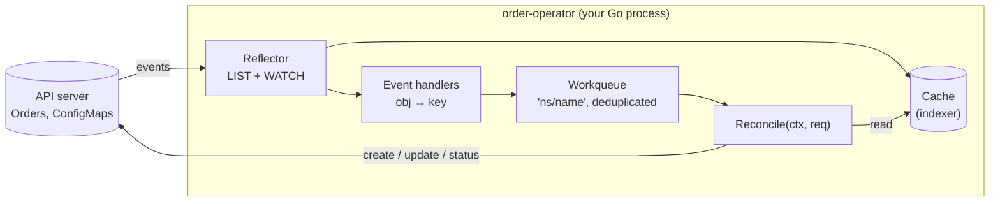

# Writing an operator in Go

## Why care?

At some point, someone in your company suggests writing an operator. Then you hear messages like these:

- "The controller is at 100% CPU, and the logs show it reconciling the same object 50 times a second."
- "We deleted the namespace. It has been `Terminating` for three days."
- "Somebody ran `kubectl delete crd`, and every customer database object was gone."
- "It works on one replica. With two, they fight over every object."

On the earlier pages you used controllers that come with Kubernetes: the Deployment controller makes ReplicaSets, the ReplicaSet controller makes Pods, the kubelet makes containers. [Reconciliation](reconciliation.md) showed the pattern they share. An **operator** is the same pattern, written by you, for a kind of object Kubernetes did not know before.

This page teaches Kubernetes a new kind, `Order`, and writes a controller for it in Go with **controller-runtime**, the library under Kubebuilder and the Operator SDK. You run it on your laptop against the `kind` cluster, break it, and watch it heal.

## The idea: a new resource type and a loop that acts on it

An operator has two parts: a new kind of resource in the API, and a controller that acts on it.

- The **API server** stores every resource, including the new kind. It is the single source of truth. Clients do not talk to the controller directly.
- Each object has a **spec**, written by the user: what is wanted. The controller writes the **status**: what has happened so far. Users do not write the status, and the controller does not change the spec.
- The **controller** keeps no memory of past events. Each time it runs, it reads the object again and answers one question: **"what is the next step to make the actual state match the spec?"**
- If a user changes an object three times in ten seconds, the controller does not do the work three times. It reads the object once, and acts on what it says **now**.
- Before an object is removed, the controller may need to clean up something outside the cluster, such as reserved stock. A **finalizer** on the object stops the deletion until the controller removes it.



Two things to notice:

1. **Reads come from the local cache; writes go to the API server.** The cache is filled by one LIST and one long WATCH per kind. That is how 100 controllers can watch a cluster without overloading the API server.
2. **The queue holds names, not events.** `Reconcile` gets `tutor-operators/tutor-order-1`, never "the quantity changed from 1 to 3". It must look at the current state and work out what to do. This is **level-triggered** design, from [Reconciliation](reconciliation.md).

## Under the hood: a CustomResourceDefinition

A **CustomResourceDefinition** (CRD) is itself a resource. When you create one, the API server starts serving a new REST path, stores the objects in etcd like any other, and supports `get`, `list`, `watch`, `kubectl explain`, RBAC, and server-side apply for it. You write no server code.

### Types first, YAML generated

You could write the CRD YAML by hand. In Go you don't: you write Go types with **marker comments**, and `controller-gen` (from `sigs.k8s.io/controller-tools`) generates the CRD and the `DeepCopy` methods. The types, in `api/v1alpha1/order_types.go`:

```go
// Package v1alpha1 contains the Order API, group tutor.example.com.
// +kubebuilder:object:generate=true
// +groupName=tutor.example.com
package v1alpha1

// Item is one line of an order.
type Item struct {
	// +kubebuilder:validation:MinLength=1
	SKU string `json:"sku"`
	// +kubebuilder:validation:Minimum=1
	// +kubebuilder:validation:Maximum=1000
	Quantity int32 `json:"quantity"`
	// +kubebuilder:validation:Minimum=0
	PriceCents int64 `json:"priceCents"`
}

// OrderSpec is the desired state: what the customer ordered.
type OrderSpec struct {
	// +kubebuilder:validation:MinLength=1
	CustomerID string `json:"customerID"`
	// +kubebuilder:validation:MinItems=1
	// +kubebuilder:validation:MaxItems=100
	Items []Item `json:"items"`
}

// OrderStatus is the observed state, written only by the controller.
type OrderStatus struct {
	// +kubebuilder:validation:Enum=Pending;Paid
	Phase              string             `json:"phase,omitempty"`
	TotalCents         int64              `json:"totalCents,omitempty"`
	ReceiptName        string             `json:"receiptName,omitempty"`
	ObservedGeneration int64              `json:"observedGeneration,omitempty"`
	Conditions         []metav1.Condition `json:"conditions,omitempty"`
}

// Order is a customer's order, stored in the Kubernetes API.
// +kubebuilder:object:root=true
// +kubebuilder:subresource:status
// +kubebuilder:resource:shortName=ord
// +kubebuilder:printcolumn:name="Customer",type=string,JSONPath=`.spec.customerID`
// +kubebuilder:printcolumn:name="Phase",type=string,JSONPath=`.status.phase`
// +kubebuilder:printcolumn:name="Total",type=integer,JSONPath=`.status.totalCents`
// +kubebuilder:printcolumn:name="Age",type=date,JSONPath=`.metadata.creationTimestamp`
type Order struct {
	metav1.TypeMeta   `json:",inline"`
	metav1.ObjectMeta `json:"metadata,omitempty"`

	Spec   OrderSpec   `json:"spec"`
	Status OrderStatus `json:"status,omitempty"`
}
```

(The file also has `OrderList`, the `GroupVersion`, and a `SchemeBuilder` that registers both types.) It mirrors `order.Order` from `examples/orders`: money in integer cents, the same item limits (`MaxItems = 100`, `MaxQuantity = 1_000`). The rules now live in the API schema, so the API server enforces them for every client, not only for your Go code.

```console
$ go run sigs.k8s.io/controller-tools/cmd/controller-gen@v0.23.0 \
    object:headerFile=hack/boilerplate.go.txt crd paths=./api/... output:crd:dir=config/crd
$ ls api/v1alpha1 config/crd
api/v1alpha1:
order_types.go
zz_generated.deepcopy.go

config/crd:
tutor.example.com_orders.yaml
```

The generated CRD is 167 lines. The parts that matter:

```yaml
apiVersion: apiextensions.k8s.io/v1
kind: CustomResourceDefinition
metadata:
  name: orders.tutor.example.com # <plural>.<group>, always
spec:
  group: tutor.example.com
  names:
    kind: Order
    listKind: OrderList
    plural: orders
    shortNames:
      - ord
    singular: order
  scope: Namespaced
  versions:
    - name: v1alpha1
      served: true
      storage: true
      subresources:
        status: {}
      schema:
        openAPIV3Schema:
          properties:
            spec:
              properties:
                customerID:
                  minLength: 1
                  type: string
                items:
                  items:
                    properties:
                      priceCents:
                        format: int64
                        minimum: 0
                        type: integer
                      quantity:
                        format: int32
                        maximum: 1000
                        minimum: 1
                        type: integer
                      # ...
                  maxItems: 100
                  minItems: 1
                  type: array
              required:
                - customerID
                - items
            status:
              # ... phase enum, conditions (with enum "True", "False", "Unknown") ...
```

(Shortened: descriptions, printer columns and the status schema are cut.) Three parts deserve a closer look:

- **`openAPIV3Schema`** is the validation. The API server rejects objects that don't match, before they reach etcd. It also **prunes** unknown fields: send `spec.colour` and it is silently dropped. For rules across fields ("`discountCents` < total") there are CEL rules (`x-kubernetes-validations`, marker `+kubebuilder:validation:XValidation`), still without any webhook.
- **`subresources: status`** splits the object in two. Writes to `/orders/x` ignore `status`; writes to `/orders/x/status` ignore everything but `status`. The user owns the spec, the controller owns the status, and RBAC can give each one only its half. It also means `metadata.generation` only increases on **spec** changes.
- **`versions`**: one version is `storage: true`, the one etcd keeps. Later you add `v1`, serve both, and convert between them (by a conversion webhook if the shapes differ). Start at `v1alpha1`, and you may still make incompatible changes before `v1`.

### Install it and use it without any controller

```console
$ kubectl apply -f config/crd/tutor.example.com_orders.yaml
customresourcedefinition.apiextensions.k8s.io/orders.tutor.example.com created
$ kubectl wait --for condition=Established crd/orders.tutor.example.com
customresourcedefinition.apiextensions.k8s.io/orders.tutor.example.com condition met
$ kubectl create ns tutor-operators
namespace/tutor-operators created
$ kubectl api-resources --api-group=tutor.example.com
NAME     SHORTNAMES   APIVERSION                   NAMESPACED   KIND
orders   ord          tutor.example.com/v1alpha1   true         Order
$ kubectl explain order.spec.items
GROUP:      tutor.example.com
KIND:       Order
VERSION:    v1alpha1

FIELD: items <[]Object>


DESCRIPTION:
    Item is one line of an order.

FIELDS:
  priceCents	<integer> -required-
    <no description>

  quantity	<integer> -required-
    <no description>

  sku	<string> -required-
    <no description>
```

(Write doc comments on your fields, and the `<no description>` lines get text.) Now try a bad order:

```yaml
# bad-order.yaml
apiVersion: tutor.example.com/v1alpha1
kind: Order
metadata:
  name: tutor-order-bad
  namespace: tutor-operators
spec:
  customerID: ""
  items:
    - sku: mug
      quantity: 0
      priceCents: -5
```

```console
$ kubectl apply -f bad-order.yaml
The Order "tutor-order-bad" is invalid:
* spec.customerID: Invalid value: "": spec.customerID in body should be at least 1 chars long
* spec.items[0].priceCents: Invalid value: -5: spec.items[0].priceCents in body should be greater than or equal to 0
* spec.items[0].quantity: Invalid value: 0: spec.items[0].quantity in body should be greater than or equal to 1
```

And a good one (`customerID: cust-42`, 2 x `book-k8s` at 3999 cents, 1 x `mug` at 1250):

```console
$ kubectl apply -f order.yaml
order.tutor.example.com/tutor-order-1 created
$ kubectl -n tutor-operators get orders
NAME            CUSTOMER   PHASE   TOTAL   AGE
tutor-order-1   cust-42                    0s
$ kubectl -n tutor-operators patch order tutor-order-1 --type merge -p '{"status":{"phase":"Paid"}}'
order.tutor.example.com/tutor-order-1 patched (no change)
$ kubectl -n tutor-operators get order tutor-order-1 -o jsonpath='{.status}{"|"}{.metadata.generation}{"\n"}'
|1
```

The order is stored, validated and listed with your columns. `PHASE` and `TOTAL` are empty: **a CRD is only data**. Nothing acts on it yet. And the status patch did nothing ("no change"), because `status` is a subresource now. That's the job of the controller.

## Under the hood: client-go, the parts under the library

controller-runtime is a thin layer over three parts of `k8s.io/client-go`. It helps to see them once without the layer. This small program watches ConfigMaps in `tutor-operators` with the raw parts:

```go
// One LIST, then one long WATCH, feeding a local cache.
factory := informers.NewSharedInformerFactoryWithOptions(cs, 0,
	informers.WithNamespace("tutor-operators"))
cms := factory.Core().V1().ConfigMaps()
lister := cms.Lister() // reads from the cache, never from the API server

// The queue holds keys ("namespace/name"), not objects or events.
q := workqueue.NewTypedRateLimitingQueue(workqueue.DefaultTypedControllerRateLimiter[string]())
enqueue := func(obj any) {
	key, err := cache.DeletionHandlingMetaNamespaceKeyFunc(obj)
	if err == nil {
		fmt.Printf("%s event   -> add %s (queue len %d)\n", time.Now().Format("15:04:05.000"), key, q.Len())
		q.Add(key)
	}
}
cms.Informer().AddEventHandler(cache.ResourceEventHandlerFuncs{
	AddFunc:    enqueue,
	UpdateFunc: func(_, obj any) { enqueue(obj) },
	DeleteFunc: enqueue,
})

factory.Start(ctx.Done())
factory.WaitForCacheSync(ctx.Done())
fmt.Println("cache synced")

go func() { <-ctx.Done(); q.ShutDown() }()
for {
	key, quit := q.Get()
	if quit {
		return
	}
	time.Sleep(500 * time.Millisecond) // a slow reconcile, so events pile up
	ns, name, _ := cache.SplitMetaNamespaceKey(key)
	cm, err := lister.ConfigMaps(ns).Get(name)
	switch {
	case apierrors.IsNotFound(err):
		fmt.Printf("%s reconcile %s: gone\n", time.Now().Format("15:04:05.000"), key)
	case err == nil:
		fmt.Printf("%s reconcile %s: rv=%s n=%q\n", time.Now().Format("15:04:05.000"), key, cm.ResourceVersion, cm.Data["n"])
	}
	q.Forget(key)
	q.Done(key)
}
```

- An **informer** runs a **reflector** (LIST once, then WATCH from that `resourceVersion`, re-LIST if the watch breaks) and keeps every object in an **indexer**, a thread-safe in-memory map.
- A **lister** reads that map. `lister.Get` is a map lookup, no network.
- A **workqueue** holds keys. A key that is already waiting is not added twice. A key that is being processed is marked "dirty" and handed out **again after** `Done`, never to two workers at once.

Run it, and from another terminal create a ConfigMap, change it three times, and delete it, as fast as `kubectl` can:

```console
$ kubectl -n tutor-operators create configmap tutor-demo --from-literal=n=1
configmap/tutor-demo created
$ for i in 2 3 4; do kubectl -n tutor-operators patch cm tutor-demo --type merge -p "{\"data\":{\"n\":\"$i\"}}"; done
configmap/tutor-demo patched
configmap/tutor-demo patched
configmap/tutor-demo patched
$ kubectl -n tutor-operators delete cm tutor-demo
configmap "tutor-demo" deleted from tutor-operators namespace
```

The program's output:

```text
cache synced
22:49:56.347 event   -> add tutor-operators/kube-root-ca.crt (queue len 0)
22:49:56.848 reconcile tutor-operators/kube-root-ca.crt: rv=3200 n=""
22:49:58.014 event   -> add tutor-operators/tutor-demo (queue len 0)
22:49:58.167 event   -> add tutor-operators/tutor-demo (queue len 0)
22:49:58.334 event   -> add tutor-operators/tutor-demo (queue len 0)
22:49:58.509 event   -> add tutor-operators/tutor-demo (queue len 0)
22:49:58.515 reconcile tutor-operators/tutor-demo: rv=4620 n="4"
22:49:58.678 event   -> add tutor-operators/tutor-demo (queue len 0)
22:49:59.016 reconcile tutor-operators/tutor-demo: gone
22:49:59.516 reconcile tutor-operators/tutor-demo: gone
```

Read it line by line. These ten lines show the whole operator model:

1. **Startup is an "add" for everything that exists** (`kube-root-ca.crt`). After a restart, your controller sees every object again. That's how it catches up on whatever it missed while it was down.
2. **Five events, three reconciles.** The create started the first reconcile. The three patches arrived while it was sleeping, and marked the key dirty once, not three times.
3. **No reconcile ever saw `n=1`, `2` or `3`.** The first one read the cache at 58.515 and found `n="4"`. Intermediate states are skipped. If your logic needs to see every change, a controller is the wrong tool (use a log or a queue, see the coming chapters).
4. **"gone" twice.** The dirty mark from the patches gave a second pass, and the delete event came in during that pass, so the key went around a third time. Reconciling a deleted object must be harmless. Every reconcile must be **idempotent**: running it twice does what running it once does.

## Under the hood: controller-runtime

controller-runtime packs these parts into three ideas:

- The **Manager** owns the shared cache (one informer per kind, shared by all controllers), a client that **reads from the cache and writes to the API server**, leader election, metrics and health endpoints, and starts and stops everything on a signal.
- The **Builder** (`ctrl.NewControllerManagedBy`) wires watches to a queue: `For(&Order{})` enqueues the Order itself; `Owns(&ConfigMap{})` enqueues the **owner** of a ConfigMap whose owner reference points at an Order.
- The **Reconciler** is your code: one method, `Reconcile(ctx, req) (Result, error)`. `req` is only a namespace and a name.

The result decides what happens next:

| You return                     | What controller-runtime does                                                                         |
| ------------------------------ | ---------------------------------------------------------------------------------------------------- |
| `Result{}, nil`                | Done. Forget the failure count. Wait for the next event.                                             |
| `Result{RequeueAfter: d}, nil` | Done for now; reconcile this name again after `d`, even without an event.                            |
| `Result{}, err`                | Log `Reconciler error`, retry with exponential backoff per key: 5 ms, 10 ms, 20 ms ... up to 1000 s. |

(`Result.Requeue` still exists but is deprecated in v0.25: "Use `RequeueAfter` instead.") The backoff numbers are the defaults in `controller.go` of controller-runtime v0.25.3. That version also uses a **priority queue** by default, so events from the initial list don't delay fresh changes.

### The module

```console
$ go mod init example.com/order-operator
$ go get sigs.k8s.io/controller-runtime@v0.25.3 k8s.io/api@v0.37.3 k8s.io/apimachinery@v0.37.3
$ grep -E 'controller-runtime|k8s.io/(api|apimachinery|client-go) ' go.mod
	k8s.io/api v0.37.3
	k8s.io/apimachinery v0.37.3
	sigs.k8s.io/controller-runtime v0.25.3
	k8s.io/client-go v0.37.3 // indirect
```

`k8s.io/*` v0.37 goes with Kubernetes 1.37, and controller-runtime v0.25 is built on it. Keep the three in step: a controller-runtime release supports one `client-go` minor version.

### `main.go`: the Manager

```go
func main() {
	ns := flag.String("namespace", "tutor-operators", "only watch this namespace")
	flag.Parse()
	ctrl.SetLogger(zap.New(zap.UseDevMode(true)))
	log := ctrl.Log.WithName("setup")

	scheme := runtime.NewScheme()
	_ = corev1.AddToScheme(scheme)
	_ = tutorv1.AddToScheme(scheme)

	mgr, err := ctrl.NewManager(ctrl.GetConfigOrDie(), ctrl.Options{
		Scheme:  scheme,
		Metrics: metricsserver.Options{BindAddress: "0"}, // off for the demo
		Cache:   cache.Options{DefaultNamespaces: map[string]cache.Config{*ns: {}}},
	})
	if err != nil {
		log.Error(err, "new manager")
		os.Exit(1)
	}
	if err := (&controller.OrderReconciler{Client: mgr.GetClient()}).SetupWithManager(mgr); err != nil {
		log.Error(err, "setup controller")
		os.Exit(1)
	}
	log.Info("starting manager", "namespace", *ns)
	if err := mgr.Start(ctrl.SetupSignalHandler()); err != nil {
		log.Error(err, "manager stopped")
		os.Exit(1)
	}
}
```

- The **scheme** maps Go types to API kinds (`*tutorv1.Order` ↔ `tutor.example.com/v1alpha1, Kind=Order`). The client needs it to know which URL to call for a Go value.
- `ctrl.GetConfigOrDie()` finds credentials the way `kubectl` does: `--kubeconfig`, `$KUBECONFIG`, the in-cluster service account, `~/.kube/config`. The same binary runs on your laptop and in a pod.
- `DefaultNamespaces` limits the cache to one namespace. Without it, the manager caches **every** Order and, because of `Owns`, **every ConfigMap in the cluster**.
- `SetupSignalHandler` cancels the context on `SIGTERM`, the same graceful stop as `ordersd` (see [Pods](pods.md) for how Kubernetes sends it).

### `Reconcile`: one pass towards the goal

The whole controller, `internal/controller/order_controller.go`:

```go
const (
	finalizer  = "tutor.example.com/release-stock"
	payTimeout = 5 * time.Second // pretend payment takes this long
)

// OrderReconciler makes the world match each Order.
type OrderReconciler struct {
	client.Client
}

// Reconcile is called with a name, never with an event. It reads the
// current state and moves the world one step towards the desired state.
func (r *OrderReconciler) Reconcile(ctx context.Context, req ctrl.Request) (ctrl.Result, error) {
	logger := log.FromContext(ctx)

	var o tutorv1.Order
	if err := r.Get(ctx, req.NamespacedName, &o); err != nil {
		// Deleted before we got here: nothing to do.
		return ctrl.Result{}, client.IgnoreNotFound(err)
	}

	// 1. Deletion: clean up outside the cluster, then let it go.
	if !o.DeletionTimestamp.IsZero() {
		if controllerutil.ContainsFinalizer(&o, finalizer) {
			logger.Info("releasing reserved stock", "items", len(o.Spec.Items))
			controllerutil.RemoveFinalizer(&o, finalizer)
			if err := r.Update(ctx, &o); err != nil {
				return ctrl.Result{}, err
			}
		}
		return ctrl.Result{}, nil
	}

	// 2. Make sure we get a say before the Order disappears.
	if controllerutil.AddFinalizer(&o, finalizer) {
		if err := r.Update(ctx, &o); err != nil {
			return ctrl.Result{}, err // a 409 Conflict lands here; we are retried
		}
	}

	// 3. Owned object: a receipt ConfigMap. The owner reference makes the
	// garbage collector delete it with the Order, and wakes us when it changes.
	var total int64
	for _, it := range o.Spec.Items {
		total += int64(it.Quantity) * it.PriceCents
	}
	receipt := &corev1.ConfigMap{ObjectMeta: metav1.ObjectMeta{Name: o.Name + "-receipt", Namespace: o.Namespace}}
	op, err := controllerutil.CreateOrUpdate(ctx, r.Client, receipt, func() error {
		receipt.Data = map[string]string{
			"customer":   o.Spec.CustomerID,
			"totalCents": strconv.FormatInt(total, 10),
		}
		return controllerutil.SetControllerReference(&o, receipt, r.Scheme())
	})
	if err != nil {
		return ctrl.Result{}, fmt.Errorf("receipt: %w", err)
	}
	if op != controllerutil.OperationResultNone {
		logger.Info("receipt", "operation", op)
	}

	// 4. Status: what we observed, for this generation of the spec.
	phase, requeue := "Paid", time.Duration(0)
	if age := time.Since(o.CreationTimestamp.Time); age < payTimeout {
		phase, requeue = "Pending", payTimeout-age
	}
	o.Status.Phase = phase
	o.Status.TotalCents = total
	o.Status.ReceiptName = receipt.Name
	o.Status.ObservedGeneration = o.Generation
	ready := metav1.ConditionFalse
	if phase == "Paid" {
		ready = metav1.ConditionTrue
	}
	meta.SetStatusCondition(&o.Status.Conditions, metav1.Condition{
		Type:               "Ready",
		Status:             ready,
		Reason:             phase,
		Message:            "order is " + phase,
		ObservedGeneration: o.Generation,
	})
	if err := r.Status().Update(ctx, &o); err != nil {
		if apierrors.IsConflict(err) {
			// Someone changed the Order since we read it. Not an error:
			// a new event is already queued for the newer version.
			logger.Info("conflict, will retry")
			return ctrl.Result{RequeueAfter: time.Second}, nil
		}
		return ctrl.Result{}, err
	}

	// 5. Nothing will change by itself, except time: ask to be woken up.
	logger.Info("reconciled", "phase", phase, "totalCents", total, "requeueAfter", requeue.Round(time.Millisecond))
	return ctrl.Result{RequeueAfter: requeue}, nil
}

// SetupWithManager registers the controller: watch Orders, and the
// ConfigMaps they own.
func (r *OrderReconciler) SetupWithManager(mgr ctrl.Manager) error {
	return ctrl.NewControllerManagedBy(mgr).
		For(&tutorv1.Order{}).
		Owns(&corev1.ConfigMap{}).
		Named("order").
		Complete(r)
}
```

The "payment" is fake: an order becomes `Paid` 5 seconds after it was created. It stands in for anything outside the cluster you have to wait for (a payment provider, a cloud API, a DNS record). Walk through the five steps:

1. **Deletion comes first.** When someone deletes an object that has finalizers, the API server only sets `deletionTimestamp`. The object stays until the finalizer list is empty. That's your chance to clean up things **outside** the cluster (here: "release reserved stock"). Then you remove your finalizer, and the API server deletes the object.
2. **Add the finalizer before doing any outside work.** If you created the outside thing first and crashed, a delete could happen with nothing to remind you to clean up.
3. **Owned objects get a controller owner reference.** You don't need a finalizer for things **inside** the cluster: the garbage collector deletes the receipt when the Order goes (see [Reconciliation](reconciliation.md)). `CreateOrUpdate` reads the current receipt, runs your function, and writes only if something changed.
4. **Status says what you saw, and for which generation.** `observedGeneration` lets a client tell "the controller has not seen my change yet" from "the controller saw it and this is the result". Conditions are the standard shape (`type`, `status`, `reason`, `message`) that `kubectl wait --for=condition=Ready` understands.
5. **`RequeueAfter` for time.** No event fires when 5 seconds pass. If you depend on time or on something outside the cluster, ask to be called again.

There is no `if old.Quantity != new.Quantity` anywhere. There is no "old". Every pass computes everything from the current spec. That's what makes it correct after a crash, a missed event, or a restart.

## Try it: run the operator against `kind`

Build it and start it on your laptop. It uses your kubeconfig, like `kubectl` (no image, no deployment, no RBAC yet: your kubeconfig is cluster admin on `kind`):

```sh
go build -o bin/order-operator .
./bin/order-operator
```

The first run, with the order `tutor-order-1` from above already waiting (log context fields like `controller`, `controllerKind` and `reconcileID` are cut from every line here and below):

```text
2026-11-26T22:47:17+01:00	INFO	setup	starting manager	{"namespace": "tutor-operators"}
2026-11-26T22:47:17+01:00	INFO	Starting EventSource	{"source": "kind source: *v1.ConfigMap"}
2026-11-26T22:47:17+01:00	INFO	Starting EventSource	{"source": "kind source: *v1alpha1.Order"}
2026-11-26T22:47:17+01:00	INFO	Starting Controller
2026-11-26T22:47:17+01:00	INFO	Starting workers	{"worker count": 1}
2026-11-26T22:47:17+01:00	INFO	receipt	{"name": "tutor-order-1", "operation": "created"}
2026-11-26T22:47:17+01:00	ERROR	Reconciler error	{"error": "Order.tutor.example.com \"tutor-order-1\" is invalid: status.conditions[0].status: Unsupported value: \"true\": supported values: \"True\", \"False\", \"Unknown\""}
2026-11-26T22:47:17+01:00	ERROR	Reconciler error	{"error": "Order.tutor.example.com \"tutor-order-1\" is invalid: status.conditions[0].status: Unsupported value: \"true\": supported values: \"True\", \"False\", \"Unknown\""}
...
```

This is a real bug, kept on purpose. The first version built the condition status with `metav1.ConditionStatus(strconv.FormatBool(ready))`, which gives `"true"`. The API wants `"True"`. The schema caught it. Look at how often it retried:

```console
$ grep 'Reconciler error' operator-bug.log | awk '{print $1}' | uniq -c
      6 2026-11-26T22:47:17+01:00
      2 2026-11-26T22:47:18+01:00
      1 2026-11-26T22:47:19+01:00
      1 2026-11-26T22:47:20+01:00
      1 2026-11-26T22:47:22+01:00
      1 2026-11-26T22:47:27+01:00
```

That's the per-key exponential backoff: 5 ms, 10, 20, 40 ... 1.28 s, 2.56 s, 5.12 s. Six tries in the first second, then fewer and fewer. A broken object costs you a little, not a hot loop. (The backoff resets only when a reconcile of that key succeeds.)

With `metav1.ConditionTrue`/`ConditionFalse` instead (the code above), stop it with Ctrl-C and start again. Then create a second order and watch it from another terminal:

```console
$ kubectl apply -f order-2.yaml
order.tutor.example.com/tutor-order-2 created
$ kubectl -n tutor-operators get orders -w
NAME            CUSTOMER   PHASE     TOTAL   AGE
tutor-order-1   cust-42    Paid      9248    53s
tutor-order-2   cust-7     Pending   9248    0s
tutor-order-2   cust-7     Paid      9248    5s
```

2 x 3999 + 1250 = 9248 cents. And the operator's log:

```text
2026-11-26T22:47:55+01:00	INFO	reconciled	{"name": "tutor-order-1", "phase": "Paid", "totalCents": 9248, "requeueAfter": "0s"}
2026-11-26T22:47:55+01:00	INFO	reconciled	{"name": "tutor-order-1", "phase": "Paid", "totalCents": 9248, "requeueAfter": "0s"}
2026-11-26T22:47:56+01:00	INFO	receipt	{"name": "tutor-order-2", "operation": "created"}
2026-11-26T22:47:56+01:00	INFO	reconciled	{"name": "tutor-order-2", "phase": "Pending", "totalCents": 9248, "requeueAfter": "4.791s"}
2026-11-26T22:47:56+01:00	INFO	reconciled	{"name": "tutor-order-2", "phase": "Pending", "totalCents": 9248, "requeueAfter": "4.781s"}
2026-11-26T22:48:00+01:00	INFO	reconciled	{"name": "tutor-order-2", "phase": "Pending", "totalCents": 9248, "requeueAfter": "729ms"}
2026-11-26T22:48:01+01:00	INFO	reconciled	{"name": "tutor-order-2", "phase": "Paid", "totalCents": 9248, "requeueAfter": "0s"}
2026-11-26T22:48:01+01:00	INFO	reconciled	{"name": "tutor-order-2", "phase": "Paid", "totalCents": 9248, "requeueAfter": "0s"}
```

- **Every reconcile shows up twice.** The first pass writes (finalizer, receipt, status). Those writes are events too, so the Order comes back into the queue, and the second pass finds nothing to do. **Your own writes wake you up.** That's fine, as long as a pass with nothing to do writes nothing. If it always wrote something (a timestamp in status, say), you would have the 100%-CPU loop from "Why care?".
- At 22:48:00 it woke a bit early, saw 729 ms left, and asked again. Nothing breaks, because the decision is made from the clock and the object, not from "I was woken, so it must be time".

The order and its receipt (the `last-applied-configuration` annotation is cut):

```console
$ kubectl -n tutor-operators get order tutor-order-2 -o yaml
apiVersion: tutor.example.com/v1alpha1
kind: Order
metadata:
  creationTimestamp: "2026-11-26T21:47:56Z"
  finalizers:
  - tutor.example.com/release-stock
  generation: 1
  name: tutor-order-2
  namespace: tutor-operators
  resourceVersion: "4095"
  uid: a7a78319-b324-4c03-bda7-0ca3a8c5ce8d
spec:
  customerID: cust-7
  items:
  - priceCents: 3999
    quantity: 2
    sku: book-k8s
  - priceCents: 1250
    quantity: 1
    sku: mug
status:
  conditions:
  - lastTransitionTime: "2026-11-26T21:48:01Z"
    message: order is Paid
    observedGeneration: 1
    reason: Paid
    status: "True"
    type: Ready
  observedGeneration: 1
  phase: Paid
  receiptName: tutor-order-2-receipt
  totalCents: 9248
$ kubectl -n tutor-operators get cm tutor-order-2-receipt -o yaml
apiVersion: v1
data:
  customer: cust-7
  totalCents: "9248"
kind: ConfigMap
metadata:
  creationTimestamp: "2026-11-26T21:47:56Z"
  name: tutor-order-2-receipt
  namespace: tutor-operators
  ownerReferences:
  - apiVersion: tutor.example.com/v1alpha1
    blockOwnerDeletion: true
    controller: true
    kind: Order
    name: tutor-order-2
    uid: a7a78319-b324-4c03-bda7-0ca3a8c5ce8d
  resourceVersion: "3966"
  uid: 4f6fa9fd-c86d-447e-b836-295d8c5e9094
```

### Break things

**Tamper with the receipt, then delete it:**

```console
$ kubectl -n tutor-operators patch cm tutor-order-2-receipt --type merge -p '{"data":{"totalCents":"1"}}'
configmap/tutor-order-2-receipt patched
$ kubectl -n tutor-operators get cm tutor-order-2-receipt -o jsonpath='{.data.totalCents}{"\n"}'
9248
$ kubectl -n tutor-operators delete cm tutor-order-2-receipt
configmap "tutor-order-2-receipt" deleted from tutor-operators namespace
$ kubectl -n tutor-operators get cm tutor-order-2-receipt
NAME                    DATA   AGE
tutor-order-2-receipt   2      0s
```

```text
2026-11-26T22:48:23+01:00	INFO	receipt	{"name": "tutor-order-2", "operation": "updated"}
2026-11-26T22:48:23+01:00	INFO	reconciled	{"name": "tutor-order-2", "phase": "Paid", "totalCents": 9248, "requeueAfter": "0s"}
2026-11-26T22:48:23+01:00	INFO	reconciled	{"name": "tutor-order-2", "phase": "Paid", "totalCents": 9248, "requeueAfter": "0s"}
2026-11-26T22:48:23+01:00	INFO	receipt	{"name": "tutor-order-2", "operation": "created"}
2026-11-26T22:48:23+01:00	INFO	reconciled	{"name": "tutor-order-2", "phase": "Paid", "totalCents": 9248, "requeueAfter": "0s"}
2026-11-26T22:48:23+01:00	INFO	reconciled	{"name": "tutor-order-2", "phase": "Paid", "totalCents": 9248, "requeueAfter": "0s"}
```

By the time the next `kubectl` read the receipt, the controller had already put `9248` back. `Owns(&ConfigMap{})` turned the ConfigMap event into a reconcile of `tutor-order-2`, its owner. This is exactly why a Deployment's pods come back when you delete them.

**Change the spec:**

```console
$ kubectl -n tutor-operators patch order tutor-order-2 --type json -p '[{"op":"replace","path":"/spec/items/1/quantity","value":3}]'
order.tutor.example.com/tutor-order-2 patched
$ kubectl -n tutor-operators get order tutor-order-2 -o jsonpath='generation={.metadata.generation} observed={.status.observedGeneration} total={.status.totalCents}{"\n"}'
generation=2 observed=2 total=11748
$ kubectl -n tutor-operators get cm tutor-order-2-receipt -o jsonpath='{.data.totalCents}{"\n"}'
11748
```

`generation` went to 2 (a spec change), and `observedGeneration` caught up before `kubectl` could look. The status writes never changed `generation`, thanks to the status subresource.

**Delete an order while the operator runs:**

```console
$ kubectl -n tutor-operators delete order tutor-order-2
order.tutor.example.com "tutor-order-2" deleted from tutor-operators namespace
$ kubectl -n tutor-operators get orders,cm
NAME                                    CUSTOMER   PHASE   TOTAL   AGE
order.tutor.example.com/tutor-order-1   cust-42    Paid    9248    93s

NAME                              DATA   AGE
configmap/kube-root-ca.crt        1      101s
configmap/tutor-order-1-receipt   2      79s
```

```text
2026-11-26T22:48:35+01:00	INFO	releasing reserved stock	{"name": "tutor-order-2", "items": 2}
```

The finalizer ran, then the Order went, then the garbage collector removed its receipt.

**Delete an order while the operator is down.** Stop it with `kill` (`SIGTERM`; `SetupSignalHandler` turns it into a clean stop):

```text
2026-11-26T22:48:41+01:00	INFO	Shutdown signal received, waiting for all workers to finish
2026-11-26T22:48:41+01:00	INFO	All workers finished
2026-11-26T22:48:41+01:00	INFO	Stopping and waiting for caches
2026-11-26T22:48:41+01:00	INFO	Wait completed, proceeding to shutdown the manager
```

(Some "Stopping and waiting for ..." lines are cut.) Now delete:

```console
$ kubectl -n tutor-operators delete order tutor-order-1 --wait=false
order.tutor.example.com "tutor-order-1" deleted from tutor-operators namespace
$ kubectl -n tutor-operators get order tutor-order-1 -o jsonpath='deletionTimestamp={.metadata.deletionTimestamp} finalizers={.metadata.finalizers}{"\n"}'
deletionTimestamp=2026-11-26T21:48:46Z finalizers=["tutor.example.com/release-stock"]
$ kubectl -n tutor-operators get orders,cm
NAME                                    CUSTOMER   PHASE   TOTAL   AGE
order.tutor.example.com/tutor-order-1   cust-42    Paid    9248    104s

NAME                              DATA   AGE
configmap/kube-root-ca.crt        1      112s
configmap/tutor-order-1-receipt   2      90s
```

`kubectl` said "deleted", but the Order is still there, with a `deletionTimestamp`. It waits for the finalizer's owner. **This is the namespace that is `Terminating` for three days**: a namespace can only go when all objects in it are gone, and this one waits for a controller that is not running. In a second terminal, start a raw watch from the current `resourceVersion` (the same call the reflector makes). Then start the operator again in the first:

```console
$ rv=$(kubectl get --raw '/apis/tutor.example.com/v1alpha1/namespaces/tutor-operators/orders' | jq -r .metadata.resourceVersion)
$ kubectl get --raw "/apis/tutor.example.com/v1alpha1/namespaces/tutor-operators/orders?watch=1&resourceVersion=$rv" \
    | jq -c '{type, name: .object.metadata.name, rv: .object.metadata.resourceVersion}'
{"type":"DELETED","name":"tutor-order-1","rv":"4354"}
```

```text
2026-11-26T22:48:56+01:00	INFO	Starting workers	{"worker count": 1}
2026-11-26T22:48:56+01:00	INFO	releasing reserved stock	{"name": "tutor-order-1", "items": 2}
```

On startup the informer listed the Order, saw a `deletionTimestamp`, and step 1 of `Reconcile` finished the job. The watch saw the final `DELETED`. Nothing was lost while the operator was down, because the state was never in the operator. It was in the API.

Clean up. Deleting the CRD deletes **every** Order in the cluster with it; that's why you guard CRDs carefully in production:

```console
$ kubectl delete ns tutor-operators
namespace "tutor-operators" deleted
$ kubectl delete crd orders.tutor.example.com
customresourcedefinition.apiextensions.k8s.io "orders.tutor.example.com" deleted
```

### From laptop to cluster

To run it **in** the cluster you need four more things. Kubebuilder (`kubebuilder init`, `kubebuilder create api`) scaffolds all of them:

1. An **image** (static Go binary, distroless, see [Building images](../containers/building-images.md)) and a Deployment.
2. A **ServiceAccount with RBAC**: `get/list/watch/update` on `orders`, `update` on `orders/status` and `orders/finalizers`, and `get/list/watch/create/update` on `configmaps`. Generate it from `// +kubebuilder:rbac:...` markers next to `Reconcile` (see [Config and secrets](config-and-secrets.md) for RBAC).
3. **Leader election** (`ctrl.Options{LeaderElection: true, LeaderElectionID: ...}`) if you run more than one replica. Only the leader reconciles; the others wait with a warm cache. Without it, two replicas reconcile the same objects and overwrite each other's work. That explains the fourth message from "Why care?".
4. **Health and metrics endpoints** (`HealthProbeBindAddress`, `Metrics`), wired to probes as in [Pods](pods.md).

## Traps

- **Edge-triggered thinking.** Writing logic for "what changed" (old vs new) breaks on missed or merged events. Compute everything from the current state, every time.
- **A write on every pass.** Your own writes are events. Write a timestamp or a counter to status on every pass and you loop forever. Write only when something changed.
- **Stale reads.** `r.Get` reads the cache, which can be a few milliseconds behind. A write based on a stale read gets **409 Conflict**. Return and let the next event retry; never loop on `Update` inside `Reconcile`.
- **Finalizers without a controller.** Uninstall the operator before its objects, and every object (and its namespace) hangs in `Terminating`. Remove objects first, operator last. Removing a finalizer by hand (`kubectl patch ... '{"metadata":{"finalizers":null}}'`) skips the clean-up; do it only when you know the outside thing is gone.
- **Deleting a CRD deletes all its objects.** In every namespace. Protect CRDs: separate them from the operator's chart, and restrict who can delete them.
- **Cluster-wide caches.** `Owns(&corev1.ConfigMap{})` caches every ConfigMap the manager can see. In a big cluster that's gigabytes. Limit the cache by namespace or label (`cache.Options`), or use metadata-only watches.
- **Wrong enum values.** `"true"` is not `"True"`. Use the constants (`metav1.ConditionTrue`), and test against a real API server (controller-runtime's `envtest` starts one with etcd for tests).
- **No `observedGeneration`.** Without it, nobody can tell whether the status is about the current spec or an old one. Set it on status and on each condition.
- **Two replicas, no leader election.** They both act on every object. Turn it on before the second replica.
- **Long work inside `Reconcile`.** With one worker, a 30-second API call blocks every other object. Start long work outside, record it in status, and come back with `RequeueAfter`.

## Check yourself

??? question "1. A user changes an Order's quantity 1 → 2 → 3 within a second. How many times does `Reconcile` run, and what does it see?"

    Usually once or twice, not three times. The workqueue holds one entry per key; events
    for a key that is already waiting are merged, and events during a running reconcile
    mark it dirty once. Each run reads the cache and sees the newest state (quantity 3),
    never the history. The informer demo shows this: five events, three reconciles, and
    `n="4"` was the only value seen.

??? question "2. Why does the controller add a finalizer, but not delete the receipt ConfigMap itself?"

    The receipt is inside the cluster and has a controller owner reference to the Order,
    so the garbage collector deletes it when the Order goes. The finalizer is for clean-up
    **outside** the cluster (releasing stock, deleting a cloud resource), which the
    garbage collector knows nothing about.

??? question "3. Your `Reconcile` returns an error for one object. What happens to that object, and to the others?"

    That key is requeued with exponential backoff (5 ms, doubling, up to 1000 s in
    controller-runtime v0.25), and `Reconciler error` is logged each time. Other keys are
    not affected, except that they share the workers: with `MaxConcurrentReconciles: 1`,
    only one reconcile runs at a time. The backoff for the key resets after a successful
    reconcile.

??? question "4. A client sets `spec.items[0].quantity` and immediately reads `status.totalCents`. How can it know the total is for its change?"

    Compare `status.observedGeneration` with `metadata.generation`. The spec change bumps
    `generation`; the controller copies the generation it computed from into
    `observedGeneration`. When they are equal, the status is about the current spec.

??? question "5. The operator was down for an hour. During that hour, orders were created, changed and deleted. What happens when it starts?"

    The informer lists every Order (and every owned ConfigMap) and enqueues each one, as
    "add" events. Each is reconciled from its current state. Orders with a
    `deletionTimestamp` get their finalizer run. Orders that were created and fully
    deleted during the hour never existed as far as the operator is concerned, which is
    fine if they had no finalizer (and if they had, they are still there, waiting).

??? question "6. Why does `kubectl patch order ... -p '{\"status\":{...}}'` report `no change`?"

    The CRD has the status subresource. Writes to the main resource ignore `status`, and
    writes to `/status` ignore everything else. To change status you must write to the
    subresource (`r.Status().Update` in Go, `kubectl patch --subresource=status` on the
    command line), which RBAC can grant separately from the spec.

## Recap

- A **CRD** teaches the API server a new kind: storage, REST, watch, RBAC, validation with an OpenAPI schema, and a **status subresource** that splits user (spec) from controller (status). It is only data until a controller acts.
- Write the types in Go with **markers**; `controller-gen` makes the CRD and `DeepCopy`.
- client-go gives you **informers** (LIST + WATCH into a cache), **listers** (read the cache), and a **workqueue** of keys that merges events and never gives one key to two workers.
- controller-runtime wraps them: a **Manager** (shared cache, client, leader election), a **Builder** (`For`, `Owns`), and your **`Reconcile(ctx, req)`**, which gets a name, not an event.
- Return `nil` when done, `RequeueAfter` to wait for time or the outside world, an error to retry with backoff.
- Use **owner references** for objects inside the cluster, **finalizers** for clean-up outside it, and **`observedGeneration`** plus conditions to report status honestly.
- Your own writes wake you up. Be idempotent, write only on change, and keep no state in memory: the API is the state.

## You finished Kubernetes

You now know the whole machine: one API in front of etcd, many small loops that make reality match it, and the objects they manage, from Pods to Services, Secrets, volumes and scheduling. You have packaged a service with Kustomize and Helm, and you have written one of those loops yourself.

Every one of those loops kept its state in the API server, backed by etcd. Most services you write keep theirs in a database, and that's where things get harder: transactions, isolation, indexes, migrations and replicas. Next chapter: [Databases](../databases/index.md).
