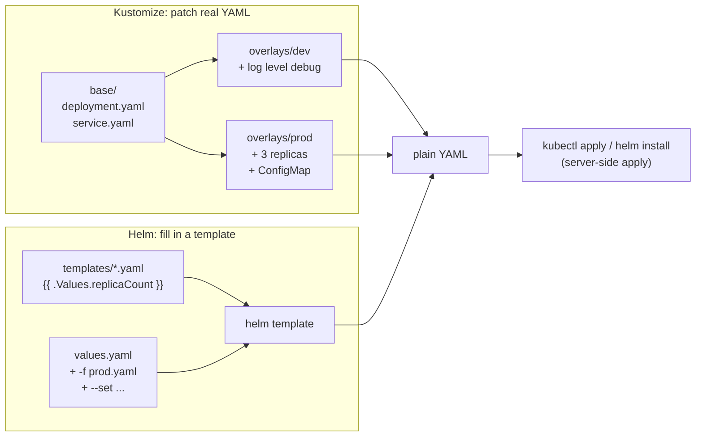

# Packaging: Kustomize and Helm

## Why care?

Four messages from teams that "just deploy some YAML":

- "Dev and prod run in the same namespace. Since yesterday, a few prod requests hit the dev pod."
- "We added one label to the overlay, and now `kubectl apply` fails with `field is immutable`."
- "The on-call engineer scaled the deployment to 5 during the incident. The next pipeline run failed with `conflict with "kubectl"`."
- "Every chart upgrade restarts all pods, even when we only changed the chart version."

You never write one manifest. You write one for dev, one for staging, one for each of the 12 prod regions, and they must stay the same _except_ for the few things that must differ. Copy-paste gives you 14 files that drift apart. **Kustomize** and **Helm** are the two common answers. They solve the same problem in opposite ways, and each fails in its own way.

This page packages `ordersd` both ways, deploys it to the `kind` cluster from [Architecture](architecture.md), and then looks at the part both tools share: how `kubectl apply` decides who owns which field.

## The idea: tracing paper vs a form with blanks

Two ways to make 14 slightly different floor plans of the same house.

- **Kustomize is tracing paper.** You draw the house once, on the bottom sheet (the **base**). For each customer you put a sheet of tracing paper on top (an **overlay**) and draw only the changes: "move this wall", "3 bedrooms, not 1". The bottom sheet is a real, complete plan. You can read it alone. Every layer is a real plan too.
- **Helm is a form with blanks.** You write the plan once, with holes in it: "number of bedrooms: \_\_\_". For each customer you fill in a sheet of answers (the **values**). The form alone is not a plan: you can't read it without the answers, and the form's author decided which questions you may answer.



Both end in the same place: **plain YAML that goes to the API server**. Everything after that point (the API server, the controllers, [Reconciliation](reconciliation.md)) does not know or care which tool made it. That is the most useful fact on this page: **you can always render, read and diff the output**, whatever tool you use.

## Under the hood: Kustomize

Kustomize is built into `kubectl` (`kubectl kustomize`, `kubectl apply -k`). Here it is version 5.8.1:

```console
$ kubectl version --client
Client Version: v1.37.3
Kustomize Version: v5.8.1
```

A Kustomize directory has a `kustomization.yaml` that lists **resources** (files or other directories) and **transformers** that change them. There is no template language: every input is valid Kubernetes YAML.

### The base

The base is what all environments share. It is plain YAML you could `kubectl apply -f` directly:

```yaml
# base/deployment.yaml
apiVersion: apps/v1
kind: Deployment
metadata:
  name: ordersd
spec:
  replicas: 1
  selector:
    matchLabels:
      app: ordersd
  template:
    metadata:
      labels:
        app: ordersd
    spec:
      containers:
        - name: ordersd
          image: tutor-ordersd:dev
          imagePullPolicy: IfNotPresent
          ports:
            - name: http
              containerPort: 8080
          env:
            - name: ORDERS_LOG_LEVEL
              value: info
          readinessProbe:
            httpGet:
              path: /readyz
              port: http
          resources:
            requests:
              cpu: 50m
              memory: 64Mi
```

```yaml
# base/kustomization.yaml
apiVersion: kustomize.config.k8s.io/v1beta1
kind: Kustomization
resources:
  - deployment.yaml
  - service.yaml
labels:
  - pairs:
      app.kubernetes.io/name: ordersd
    includeSelectors: false
```

`service.yaml` is a normal Service with `selector: {app: ordersd}` and port 80 to `targetPort: http`.

### Overlays

An overlay points at the base and says what is different. The dev overlay changes one value with a **JSON patch** (RFC 6902: `op`, `path`, `value`):

```yaml
# overlays/dev/kustomization.yaml
apiVersion: kustomize.config.k8s.io/v1beta1
kind: Kustomization
namespace: tutor-packaging
namePrefix: tutor-dev-
resources:
  - ../../base
patches:
  - target:
      kind: Deployment
      name: ordersd
    patch: |-
      - op: replace
        path: /spec/template/spec/containers/0/env/0/value
        value: debug
```

The prod overlay uses the built-in transformers (`replicas`, `images`), a **strategic merge patch** (a partial object that is merged in), and a **ConfigMap generator**:

```yaml
# overlays/prod/kustomization.yaml
apiVersion: kustomize.config.k8s.io/v1beta1
kind: Kustomization
namespace: tutor-packaging
namePrefix: tutor-prod-
resources:
  - ../../base
replicas:
  - name: ordersd
    count: 3
images:
  - name: tutor-ordersd
    newTag: dev
patches:
  - path: resources.yaml
configMapGenerator:
  - name: ordersd-config
    literals:
      - ORDERS_LOG_FORMAT=json
      - ORDERS_SHUTDOWN_DELAY=5s
```

```yaml
# overlays/prod/resources.yaml: a strategic merge patch
apiVersion: apps/v1
kind: Deployment
metadata:
  name: ordersd
spec:
  template:
    spec:
      containers:
        - name: ordersd # list items are matched by name, not by position
          envFrom:
            - configMapRef:
                name: ordersd-config
          resources:
            requests:
              cpu: 200m
              memory: 128Mi
            limits:
              memory: 256Mi
```

Two ways to patch, and the difference matters:

| Patch type                  | Looks like             | Lists                                        | Use when                                |
| --------------------------- | ---------------------- | -------------------------------------------- | --------------------------------------- |
| Strategic merge (`path:`)   | a partial object       | merged by a key (`name` for containers, env) | adding or changing fields; most patches |
| JSON 6902 (`op:` + `path:`) | a list of instructions | addressed by index (`/containers/0/env/0`)   | removing fields, or exact surgery       |

The JSON patch above says `env/0`. If someone adds a variable at the top of the base's `env` list, the patch silently changes the wrong variable. Strategic merge would match by `name` instead.

### What comes out

`kubectl kustomize` prints the result. Nothing goes to the cluster:

```console
$ kubectl kustomize overlays/prod
apiVersion: v1
data:
  ORDERS_LOG_FORMAT: json
  ORDERS_SHUTDOWN_DELAY: 5s
kind: ConfigMap
metadata:
  name: tutor-prod-ordersd-config-b9dgk46c2m
  namespace: tutor-packaging
---
apiVersion: v1
kind: Service
metadata:
  labels:
    app.kubernetes.io/name: ordersd
  name: tutor-prod-ordersd
  namespace: tutor-packaging
spec:
  ports:
  - name: http
    port: 80
    targetPort: http
  selector:
    app: ordersd
---
apiVersion: apps/v1
kind: Deployment
metadata:
  labels:
    app.kubernetes.io/name: ordersd
  name: tutor-prod-ordersd
  namespace: tutor-packaging
spec:
  replicas: 3
  selector:
    matchLabels:
      app: ordersd
  template:
    metadata:
      labels:
        app: ordersd
    spec:
      containers:
      - env:
        - name: ORDERS_LOG_LEVEL
          value: info
        envFrom:
        - configMapRef:
            name: tutor-prod-ordersd-config-b9dgk46c2m
        image: tutor-ordersd:dev
        imagePullPolicy: IfNotPresent
        name: ordersd
        ports:
        - containerPort: 8080
          name: http
        readinessProbe:
          httpGet:
            path: /readyz
            port: http
        resources:
          limits:
            memory: 256Mi
          requests:
            cpu: 200m
            memory: 128Mi
```

Read it carefully, because three things happened that you did not write:

1. **The ConfigMap got a hash suffix**: `ordersd-config-b9dgk46c2m`. The hash is computed from its content.
2. **The reference was rewritten too.** `envFrom` in the Deployment now says `tutor-prod-ordersd-config-b9dgk46c2m`. Kustomize knows which fields point at ConfigMaps, Secrets and Services, and fixes them when it renames things.
3. **`namePrefix` renamed every object**, but **not the labels**. The selector is still `app: ordersd`. Keep that in mind; it bites in a minute.

Why the hash? A [ConfigMap used as env vars](config-and-secrets.md) is read once, at container start. Changing it does nothing to running pods. With a hash in the name, new content means a **new name**, which changes the Deployment's pod template, which starts a rollout. Config change and rollout become one step, and `kubectl rollout undo` brings back the old config too, because the old ConfigMap is still there.

## Under the hood: Helm

Helm (here 4.3.2) is a package manager. A **chart** is a directory of templates plus default values; a **release** is one installed copy of a chart, with a name and a history.

```console
$ helm create ordersd
Creating ordersd
$ find ordersd -type f | sort
ordersd/.helmignore
ordersd/Chart.yaml
ordersd/templates/NOTES.txt
ordersd/templates/_helpers.tpl
ordersd/templates/deployment.yaml
ordersd/templates/hpa.yaml
ordersd/templates/httproute.yaml
ordersd/templates/ingress.yaml
ordersd/templates/service.yaml
ordersd/templates/serviceaccount.yaml
ordersd/templates/tests/test-connection.yaml
ordersd/values.yaml
```

The scaffold is generic: it runs `nginx`, uses the Service port as the container port, and has 161 lines of values for things `ordersd` doesn't need. Delete what you don't use (`hpa`, `ingress`, `httproute`, `serviceaccount`, `tests`, `NOTES.txt`). A chart with 40 knobs nobody uses is 40 places for a bug.

### Templates are Go `text/template`

You know this language from Go: `{{ .Values.x }}`, `{{- with }}`, pipelines. Helm adds the [Sprig](https://masterminds.github.io/sprig/) functions (`default`, `quote`, `toYaml`, `nindent`) and a few of its own (`include`, `required`). The trimmed `templates/deployment.yaml`:

```yaml
apiVersion: apps/v1
kind: Deployment
metadata:
  name: {{ include "ordersd.fullname" . }}
  labels:
    {{- include "ordersd.labels" . | nindent 4 }}
spec:
  replicas: {{ .Values.replicaCount }}
  selector:
    matchLabels:
      {{- include "ordersd.selectorLabels" . | nindent 6 }}
  template:
    metadata:
      labels:
        {{- include "ordersd.labels" . | nindent 8 }}
    spec:
      containers:
        - name: ordersd
          image: "{{ .Values.image.repository }}:{{ .Values.image.tag | default .Chart.AppVersion }}"
          imagePullPolicy: {{ .Values.image.pullPolicy }}
          ports:
            - name: http
              containerPort: 8080
          env:
            - name: ORDERS_LOG_LEVEL
              value: {{ .Values.logLevel | quote }}
            - name: ORDERS_LOG_FORMAT
              value: {{ .Values.logFormat | quote }}
            - name: ORDERS_SHUTDOWN_DELAY
              value: {{ .Values.shutdownDelay | quote }}
          readinessProbe:
            httpGet:
              path: /readyz
              port: http
          {{- with .Values.resources }}
          resources:
            {{- toYaml . | nindent 12 }}
          {{- end }}
```

And `values.yaml`, the defaults:

```yaml
replicaCount: 1

image:
  repository: tutor-ordersd
  tag: "" # defaults to the chart's appVersion
  pullPolicy: IfNotPresent

logLevel: info
logFormat: json
shutdownDelay: 5s

service:
  type: ClusterIP
  port: 80

resources:
  requests:
    cpu: 50m
    memory: 64Mi
```

The important part is the thing Helm does **not** know: **it generates text, not objects.** `nindent 8` means "newline, then 8 spaces". Helm does not know that `labels:` needs a map, or that `replicas:` needs a number. It glues strings and hopes the result is valid YAML for the API. Get an indent wrong and you get a field in the wrong place, often without an error.

### Values: where the answers come from

The values a template sees are merged from several places. Later wins:

1. `values.yaml` in the chart
2. a parent chart's values for this subchart
3. each `-f file.yaml`, in order
4. each `--set` / `--set-string` / `--set-json`, in order

`--set` guesses types: `--set replicaCount=2` is a number, `--set replicaCount=two` is a string. The template doesn't care:

```console
$ helm template tutor-orders ordersd --set replicaCount=two | grep 'replicas:'
  replicas: two
$ helm template tutor-orders ordersd -n tutor-packaging --set replicaCount=two | kubectl apply --dry-run=server -f -
service/tutor-orders-ordersd created (server dry run)
Error from server (BadRequest): error when creating "STDIN": Deployment in version "v1" cannot be handled as a Deployment: json: cannot unmarshal string into Go struct field DeploymentSpec.spec.replicas of type int32
```

Helm rendered garbage happily. Only the API server said no, and it said no **after** it accepted the Service. A real install would now be half done. The fix is a `values.schema.json` next to `values.yaml`. Helm checks values against it before rendering:

```json
{
  "$schema": "https://json-schema.org/draft/2020-12/schema",
  "type": "object",
  "required": ["replicaCount", "image", "logLevel"],
  "properties": {
    "replicaCount": { "type": "integer", "minimum": 0 },
    "logLevel": { "enum": ["debug", "info", "warn", "error"] },
    "logFormat": { "enum": ["json", "text"] },
    "shutdownDelay": { "type": "string", "pattern": "^[0-9]+(ms|s|m)$" }
  }
}
```

```console
$ helm template tutor-orders ordersd --set replicaCount=two
Error: values don't meet the specifications of the schema(s) in the following chart(s):
ordersd:
- at '/replicaCount': got string, want integer

$ helm template tutor-orders ordersd --set logLevel=verbose
Error: values don't meet the specifications of the schema(s) in the following chart(s):
ordersd:
- at '/logLevel': value must be one of 'debug', 'info', 'warn', 'error'
```

A values schema is the chart's API contract. Treat it like the request validation in [Services](../go/services.md): reject bad input at the door, with a clear message.

### Releases are stored in the cluster

`helm install` renders the chart, sends the objects to the API server, and **records what it did**:

```console
$ helm install tutor-orders ./ordersd -n tutor-packaging --wait --timeout 90s
NAME: tutor-orders
LAST DEPLOYED: Thu Nov 26 22:43:45 2026
NAMESPACE: tutor-packaging
STATUS: deployed
REVISION: 1
DESCRIPTION: Install complete
TEST SUITE: None
$ helm upgrade tutor-orders ./ordersd -n tutor-packaging --set replicaCount=2 --set logLevel=debug --wait --timeout 90s
Release "tutor-orders" has been upgraded. Happy Helming!
NAME: tutor-orders
LAST DEPLOYED: Thu Nov 26 22:43:47 2026
NAMESPACE: tutor-packaging
STATUS: deployed
REVISION: 2
DESCRIPTION: Upgrade complete
TEST SUITE: None
$ helm get values tutor-orders -n tutor-packaging
USER-SUPPLIED VALUES:
logLevel: debug
replicaCount: 2
$ kubectl -n tutor-packaging get secrets -l owner=helm --show-labels
NAME                                 TYPE                 DATA   AGE   LABELS
sh.helm.release.v1.tutor-orders.v1   helm.sh/release.v1   1      15s   modifiedAt=1795729426,name=tutor-orders,owner=helm,status=superseded,version=1
sh.helm.release.v1.tutor-orders.v2   helm.sh/release.v1   1      13s   modifiedAt=1795729426,name=tutor-orders,owner=helm,status=deployed,version=2
```

There is no Helm server. **The release history is a Secret per revision**, in the release's namespace. Open one: base64 (from the Secret), then base64 again, then gzip, then JSON:

```console
$ kubectl -n tutor-packaging get secret sh.helm.release.v1.tutor-orders.v2 -o jsonpath='{.data.release}' \
    | base64 -d | base64 -d | gunzip \
    | jq -c '{keys: keys, status: .info.status, apply_method, config, chart: .chart.metadata.version}'
{"keys":["apply_method","chart","config","info","manifest","name","namespace","version"],"status":"superseded","apply_method":"ssa","config":{"logLevel":"debug","replicaCount":2},"chart":"0.1.0"}
```

The whole chart, the values you passed (`config`) and the rendered `manifest` are in there. Two consequences:

- Anyone who can read Secrets in the namespace can read your values. **Never pass passwords with `--set`.** (Secrets are only base64 anyway, see [Config and secrets](config-and-secrets.md).)
- `apply_method: ssa`: Helm 4 sends objects with **server-side apply**, like `kubectl apply --server-side`. That changes what happens when someone else touches the same fields, as you'll see below.

`helm rollback` does not go back in time. It renders an old revision again and applies it as a **new** revision:

```console
$ helm rollback tutor-orders 1 -n tutor-packaging --wait --timeout 90s
Rollback was a success! Happy Helming!
$ helm history tutor-orders -n tutor-packaging
REVISION  UPDATED                   STATUS      CHART          APP VERSION  DESCRIPTION
1         Thu Nov 26 22:43:45 2026  superseded  ordersd-0.1.0  dev          Install complete
2         Thu Nov 26 22:43:47 2026  superseded  ordersd-0.1.0  dev          Upgrade complete
3         Thu Nov 26 22:44:15 2026  failed      ordersd-0.1.0  dev          Upgrade "tutor-orders" failed: conflict occurred while applying object ...
4         Thu Nov 26 22:44:22 2026  superseded  ordersd-0.1.0  dev          Upgrade complete
5         Thu Nov 26 22:44:23 2026  deployed    ordersd-0.1.0  dev          Rollback to 1
```

(Columns shortened. Revision 3 failed; that story is in the next section.) A rollback only restores what the chart renders. A database migration a hook ran, or a PersistentVolume's data, does not roll back.

## Under the hood: who owns this field?

Both tools end with "send YAML to the API server". How that YAML is **merged** with what is already there decides what happens when two parties change the same object: your CI pipeline, an on-call engineer with `kubectl scale`, an autoscaler.

### Client-side apply: a note on the object

Classic `kubectl apply` stores your last applied YAML in an annotation, `kubectl.kubernetes.io/last-applied-configuration`. On the next apply it compares three things: the last applied YAML, the new YAML, and the live object. A field that was in the last apply but not in the new one is deleted. A field you never wrote (like one set by a controller) is left alone. It works, but the logic runs in `kubectl`, and the annotation is a big JSON blob on every object.

### Server-side apply: the API server keeps a list of owners

With **server-side apply** (SSA) the API server does the merge. For every field, it records **which manager** set it, in `metadata.managedFields`. Two managers may set the same field to the same value (shared ownership). If a manager tries to **change** a field another manager owns, the server refuses with a **conflict**.

Switching the prod overlay from client-side to server-side, with `tutor-ci` as the manager name:

```console
$ kubectl apply -k overlays/prod --server-side --field-manager=tutor-ci
configmap/tutor-prod-ordersd-config-892tt8fmd9 serverside-applied
service/tutor-prod-ordersd serverside-applied
error: Apply failed with 1 conflict: conflict with "kubectl-client-side-apply" using apps/v1: .spec.template.spec.containers[name="ordersd"].envFrom
Please review the fields above--they currently have other managers. Here
are the ways you can resolve this warning:
* If you intend to manage all of these fields, please re-run the apply
  command with the `--force-conflicts` flag.
* If you do not intend to manage all of the fields, please edit your
  manifest to remove references to the fields that should keep their
  current managers.
* You may co-own fields by updating your manifest to match the existing
  value; in this case, you'll become the manager if the other manager(s)
  stop managing the field (remove it from their configuration).
See https://kubernetes.io/docs/reference/using-api/server-side-apply/#conflicts
```

The overlay changes `envFrom` (a new ConfigMap hash), and that field belonged to the old client-side apply. The message tells you the three ways out. Here the pipeline really is the owner, so it takes the fields once with `--force-conflicts`:

```console
$ kubectl apply -k overlays/prod --server-side --field-manager=tutor-ci --force-conflicts
configmap/tutor-prod-ordersd-config-892tt8fmd9 serverside-applied
service/tutor-prod-ordersd serverside-applied
deployment.apps/tutor-prod-ordersd serverside-applied
$ kubectl -n tutor-packaging get deploy tutor-prod-ordersd --show-managed-fields \
    -o jsonpath='{range .metadata.managedFields[*]}{.manager}{"\t"}{.operation}{"\t"}{.subresource}{"\n"}{end}'
tutor-ci	Apply
kube-controller-manager	Update	status
```

Two managers: `tutor-ci` owns the spec it applied, and the Deployment controller owns `status`.

Now the incident. The on-call engineer sets 5 replicas, also with server-side apply, under their own name:

```yaml
# replicas-5.yaml
apiVersion: apps/v1
kind: Deployment
metadata:
  name: tutor-prod-ordersd
  namespace: tutor-packaging
spec:
  replicas: 5
```

```console
$ kubectl apply --server-side --field-manager=tutor-oncall -f replicas-5.yaml
error: Apply failed with 1 conflict: conflict with "tutor-ci": .spec.replicas
...
$ kubectl apply --server-side --field-manager=tutor-oncall --force-conflicts -f replicas-5.yaml
deployment.apps/tutor-prod-ordersd serverside-applied
```

And the next pipeline run:

```console
$ kubectl apply -k overlays/prod --server-side --field-manager=tutor-ci
configmap/tutor-prod-ordersd-config-892tt8fmd9 serverside-applied
service/tutor-prod-ordersd serverside-applied
error: Apply failed with 1 conflict: conflict with "tutor-oncall": .spec.replicas
...
```

This is SSA doing its job. With client-side apply, the pipeline would have silently set replicas back to 3 in the middle of the incident. With SSA, it stops and tells you that someone else owns `.spec.replicas` now. The real fix is a decision: **who owns replicas?** If a HorizontalPodAutoscaler does (see [Scheduling and resources](scheduling-and-resources.md)), remove `replicas` from your manifests, so the pipeline never claims the field.

Helm 4 behaves the same way. The release's Deployment, scaled by hand with `kubectl scale`, then upgraded:

```console
$ kubectl -n tutor-packaging scale deploy tutor-orders-ordersd --replicas=4
deployment.apps/tutor-orders-ordersd scaled
$ kubectl -n tutor-packaging get deploy tutor-orders-ordersd --show-managed-fields \
    -o jsonpath='{range .metadata.managedFields[*]}{.manager}{"\t"}{.operation}{"\t"}{.subresource}{"\n"}{end}'
helm	Apply
kubectl	Update	scale
kube-controller-manager	Update	status
$ helm upgrade tutor-orders ./ordersd -n tutor-packaging --reuse-values --wait --timeout 90s
level=WARN msg="upgrade failed" name=tutor-orders error="conflict occurred while applying object tutor-packaging/tutor-orders-ordersd apps/v1, Kind=Deployment: Apply failed with 1 conflict: conflict with \"kubectl\" with subresource \"scale\" using apps/v1: .spec.replicas"
Error: UPGRADE FAILED: conflict occurred while applying object tutor-packaging/tutor-orders-ordersd apps/v1, Kind=Deployment: Apply failed with 1 conflict: conflict with "kubectl" with subresource "scale" using apps/v1: .spec.replicas
```

That's revision 3, `failed`, in the history above. `helm upgrade --force-conflicts` took the field back (revision 4).

### `kubectl diff`: ask the server first

`kubectl diff` sends your objects as a **server-side dry run** and diffs the result against the live objects. It runs admission, defaulting and validation, so it shows what would really change, and it catches errors before you apply. Change `ORDERS_SHUTDOWN_DELAY` to `10s` in the prod overlay:

```console
$ kubectl diff -k overlays/prod
diff -u -N /tmp/LIVE-903448332/apps.v1.Deployment.tutor-packaging.tutor-prod-ordersd /tmp/MERGED-308390152/apps.v1.Deployment.tutor-packaging.tutor-prod-ordersd
--- /tmp/LIVE-903448332/apps.v1.Deployment.tutor-packaging.tutor-prod-ordersd	2026-11-26 22:42:36.798541475 +0100
+++ /tmp/MERGED-308390152/apps.v1.Deployment.tutor-packaging.tutor-prod-ordersd	2026-11-26 22:42:36.798541475 +0100
@@ -6,7 +6,7 @@
     kubectl.kubernetes.io/last-applied-configuration: |
       {"apiVersion":"apps/v1","kind":"Deployment", ... }
   creationTimestamp: "2026-11-26T21:42:28Z"
-  generation: 1
+  generation: 2
   labels:
     app.kubernetes.io/instance: prod
     app.kubernetes.io/name: ordersd
@@ -39,7 +39,7 @@
           value: info
         envFrom:
         - configMapRef:
-            name: tutor-prod-ordersd-config-b9dgk46c2m
+            name: tutor-prod-ordersd-config-892tt8fmd9
         image: tutor-ordersd:dev
         imagePullPolicy: IfNotPresent
         name: ordersd
diff -u -N /tmp/LIVE-903448332/v1.ConfigMap.tutor-packaging.tutor-prod-ordersd-config-892tt8fmd9 /tmp/MERGED-308390152/v1.ConfigMap.tutor-packaging.tutor-prod-ordersd-config-892tt8fmd9
--- /tmp/LIVE-903448332/v1.ConfigMap.tutor-packaging.tutor-prod-ordersd-config-892tt8fmd9	2026-11-26 22:42:36.686050413 +0100
+++ /tmp/MERGED-308390152/v1.ConfigMap.tutor-packaging.tutor-prod-ordersd-config-892tt8fmd9	2026-11-26 22:42:36.686050413 +0100
@@ -0,0 +1,12 @@
+apiVersion: v1
+data:
+  ORDERS_LOG_FORMAT: json
+  ORDERS_SHUTDOWN_DELAY: 10s
+kind: ConfigMap
+metadata:
+  creationTimestamp: "2026-11-26T21:42:36Z"
+  labels:
+    app.kubernetes.io/instance: prod
+  name: tutor-prod-ordersd-config-892tt8fmd9
+  namespace: tutor-packaging
+  uid: d2fb7411-ba5f-45f4-bf27-42a13932857d
$ echo $?
1
```

(The annotation line is shortened.) One changed value in, a new ConfigMap and a changed pod template out: you can see that this change **will start a rollout**. `generation: 2` says the spec changes (see [Reconciliation](reconciliation.md) for generation). The exit code is a contract you can use in CI: **0** no changes, **1** changes, **more than 1** an error.

## Try it: dev and prod in one namespace

Create the namespace and apply both overlays from above:

```console
$ kubectl create ns tutor-packaging
namespace/tutor-packaging created
$ kubectl apply -k overlays/dev
service/tutor-dev-ordersd created
deployment.apps/tutor-dev-ordersd created
$ kubectl apply -k overlays/prod
configmap/tutor-prod-ordersd-config-b9dgk46c2m created
service/tutor-prod-ordersd created
deployment.apps/tutor-prod-ordersd created
$ kubectl -n tutor-packaging get deploy,svc -o wide
NAME                                 READY   UP-TO-DATE   AVAILABLE   AGE   CONTAINERS   IMAGES              SELECTOR
deployment.apps/tutor-dev-ordersd    1/1     1            1           2s    ordersd      tutor-ordersd:dev   app=ordersd
deployment.apps/tutor-prod-ordersd   3/3     3            3           2s    ordersd      tutor-ordersd:dev   app=ordersd

NAME                         TYPE        CLUSTER-IP      EXTERNAL-IP   PORT(S)   AGE   SELECTOR
service/tutor-dev-ordersd    ClusterIP   10.96.61.46     <none>        80/TCP    2s    app=ordersd
service/tutor-prod-ordersd   ClusterIP   10.96.120.228   <none>        80/TCP    2s    app=ordersd
```

Everything is green. Look at the `SELECTOR` column. Then ask each Service which pods it sends traffic to (EndpointSlices, from [Services and DNS](services-and-dns.md)):

```console
$ kubectl -n tutor-packaging get endpointslices \
    -o 'custom-columns=SERVICE:.metadata.labels.kubernetes\.io/service-name,PODS:.endpoints[*].targetRef.name'
SERVICE              PODS
tutor-dev-ordersd    tutor-dev-ordersd-58dc69585b-7gxmr,tutor-prod-ordersd-7fcbbbdd64-r4lqh,tutor-prod-ordersd-7fcbbbdd64-bwszd,tutor-prod-ordersd-7fcbbbdd64-b9s4n
tutor-prod-ordersd   tutor-dev-ordersd-58dc69585b-7gxmr,tutor-prod-ordersd-7fcbbbdd64-r4lqh,tutor-prod-ordersd-7fcbbbdd64-bwszd,tutor-prod-ordersd-7fcbbbdd64-b9s4n
```

**Both Services send to all four pods.** A quarter of prod traffic goes to the dev pod with debug logging. `namePrefix` renamed the objects but not the labels, so both selectors are `app=ordersd`. That is the first message from "Why care?".

Fix it by adding an instance label to each overlay, **including selectors** this time:

```yaml
# appended to overlays/dev/kustomization.yaml (and "prod" in the prod overlay)
labels:
  - pairs:
      app.kubernetes.io/instance: dev
    includeSelectors: true
```

```console
$ kubectl apply -k overlays/dev
service/tutor-dev-ordersd configured
The Deployment "tutor-dev-ordersd" is invalid: spec.selector: Invalid value: {"matchLabels":{"app":"ordersd","app.kubernetes.io/instance":"dev"}}: field is immutable
```

The second message from "Why care?". **A Deployment's selector can't change after creation**: it is how the Deployment finds its own ReplicaSets, and changing it would orphan them (see [Workloads](workloads.md)). Note also that the Service **was** changed: `apply` is not a transaction. `kubectl diff` would have told you first:

```console
$ kubectl diff -k overlays/prod
The Deployment "tutor-prod-ordersd" is invalid: spec.selector: Invalid value: {"matchLabels":{"app":"ordersd","app.kubernetes.io/instance":"prod"}}: field is immutable
$ echo $?
2
```

The way out is to delete and recreate the Deployments. In production you would create a new Deployment next to the old one and move traffic, because delete-and-recreate means downtime. Here:

```console
$ kubectl -n tutor-packaging delete deploy tutor-dev-ordersd tutor-prod-ordersd
deployment.apps "tutor-dev-ordersd" deleted from tutor-packaging namespace
deployment.apps "tutor-prod-ordersd" deleted from tutor-packaging namespace
$ kubectl apply -k overlays/dev
service/tutor-dev-ordersd unchanged
deployment.apps/tutor-dev-ordersd created
$ kubectl apply -k overlays/prod
configmap/tutor-prod-ordersd-config-b9dgk46c2m configured
service/tutor-prod-ordersd configured
deployment.apps/tutor-prod-ordersd created
$ kubectl -n tutor-packaging get endpointslices \
    -o 'custom-columns=SERVICE:.metadata.labels.kubernetes\.io/service-name,PODS:.endpoints[*].targetRef.name'
SERVICE              PODS
tutor-dev-ordersd    tutor-dev-ordersd-596b976b48-prfhl
tutor-prod-ordersd   tutor-prod-ordersd-6678978d58-8c7br,tutor-prod-ordersd-6678978d58-kgbk7,tutor-prod-ordersd-6678978d58-qlpvw
```

Lesson: **decide your selector labels on day one**, make them include the instance, and never change them. Helm's scaffold does this for you: its `selectorLabels` are `app.kubernetes.io/name` and `app.kubernetes.io/instance: <release name>`.

After the `ORDERS_SHUTDOWN_DELAY` change from the `kubectl diff` section, look at the ConfigMaps:

```console
$ kubectl -n tutor-packaging get cm
NAME                                   DATA   AGE
kube-root-ca.crt                       1      64s
tutor-prod-ordersd-config-892tt8fmd9   2      19s
tutor-prod-ordersd-config-b9dgk46c2m   2      63s
```

The old one stays. That's good for rollbacks, and it's garbage after a while. `kubectl apply --prune` can delete objects that are no longer in your files, but `kubectl apply --help` still calls it Alpha ("not yet complete. Do not use unless you are aware of what the current state is"). GitOps tools (Argo CD, Flux) do this pruning for you, and so does Helm for objects that leave the chart.

Clean up:

```console
$ helm uninstall tutor-orders -n tutor-packaging
release "tutor-orders" uninstalled
$ kubectl delete ns tutor-packaging
namespace "tutor-packaging" deleted
```

### Keep it reviewable: render in CI, review the output

A pull request that changes `values.yaml` or a template is hard to review: you have to run the template in your head. Make CI render it and show the diff of the **output**. Here, bumping the chart version and changing one value:

```console
$ helm template tutor-orders ./ordersd > before.yaml
$ sed -i 's/^version: 0.1.0/version: 0.2.0/' ordersd/Chart.yaml
$ helm template tutor-orders ./ordersd --set shutdownDelay=10s > after.yaml
$ diff -u before.yaml after.yaml
--- before.yaml	2026-11-26 22:44:43.986657070 +0100
+++ after.yaml	2026-11-26 22:44:44.446910698 +0100
@@ -5,7 +5,7 @@
 metadata:
   name: tutor-orders-ordersd
   labels:
-    helm.sh/chart: ordersd-0.1.0
+    helm.sh/chart: ordersd-0.2.0
     app.kubernetes.io/name: ordersd
     app.kubernetes.io/instance: tutor-orders
     app.kubernetes.io/version: "dev"
@@ -28,7 +28,7 @@
 metadata:
   name: tutor-orders-ordersd
   labels:
-    helm.sh/chart: ordersd-0.1.0
+    helm.sh/chart: ordersd-0.2.0
     app.kubernetes.io/name: ordersd
     app.kubernetes.io/instance: tutor-orders
     app.kubernetes.io/version: "dev"
@@ -42,7 +42,7 @@
   template:
     metadata:
       labels:
-        helm.sh/chart: ordersd-0.1.0
+        helm.sh/chart: ordersd-0.2.0
         app.kubernetes.io/name: ordersd
         app.kubernetes.io/instance: tutor-orders
         app.kubernetes.io/version: "dev"
@@ -61,7 +61,7 @@
             - name: ORDERS_LOG_FORMAT
               value: "json"
             - name: ORDERS_SHUTDOWN_DELAY
-              value: "5s"
+              value: "10s"
           readinessProbe:
             httpGet:
               path: /readyz
```

The third hunk is the fourth message from "Why care?". The scaffold puts `helm.sh/chart: ordersd-0.2.0` into the **pod template** labels. A new chart version changes the pod template, so **every chart release restarts every pod**, even if nothing else changed. Use only stable labels (`selectorLabels`) in the pod template.

A good pipeline for either tool:

1. Render every environment (`kubectl kustomize overlays/<env>`, `helm template -f values-<env>.yaml`) and validate the output against the API schemas (`kubectl apply --dry-run=server`, or an offline schema checker).
2. Post the **rendered diff** on the pull request. Reviewers read YAML, not templates.
3. Before deploy, run `kubectl diff --server-side` (or Helm's `helm diff` plugin) against the real cluster, and fail on exit code > 1.
4. Apply with server-side apply and a **fixed field manager name** per pipeline, so `managedFields` tell you who did what.

### Kustomize or Helm?

|                      | Kustomize                                                    | Helm                                                                        |
| -------------------- | ------------------------------------------------------------ | --------------------------------------------------------------------------- |
| Input                | valid Kubernetes YAML                                        | text templates; only valid after rendering                                  |
| Who may change what  | an overlay can patch **any** field                           | only the fields the chart author made into values                           |
| Distribution         | a Git directory                                              | versioned packages in a repository (OCI registries work)                    |
| State in the cluster | none                                                         | a release with history, `helm rollback`, hooks, `helm uninstall`            |
| Logic                | none (no `if`, no loops)                                     | full template language                                                      |
| Typical fit          | your own services, few environments, platform teams patching | software you ship to others, or install from others (ingress, cert-manager) |

The common enterprise answer is **both**: install third-party software from its Helm chart, and manage your own services with Kustomize, or with a small, strict Helm chart per team. Kustomize can even render a Helm chart as one of its inputs (`helmCharts:` with `kubectl kustomize --enable-helm`), so you can patch a vendor chart in fields it doesn't expose.

## Traps

- **`namePrefix` doesn't change selectors.** Two copies in one namespace with the same `app` label share traffic. Put the instance in the selector, on day one.
- **Selectors are immutable.** Changing a Deployment's (or StatefulSet's, or Job's) `selector` means delete and recreate. Plan the labels before the first deploy.
- **JSON patches by index.** `/containers/0/env/0` points at whatever is first today. Prefer strategic merge patches, which match list items by name.
- **Helm renders text.** A wrong `nindent` produces valid-looking YAML with fields in the wrong place. Render and read the output; add `values.schema.json`.
- **`--set` guesses types.** `--set replicaCount=two` is a string, `--set x=true` a boolean, `--set x=2` a number. Use `--set-string` when a value must stay a string (labels, annotations), or use `-f` files.
- **Secrets in values.** Helm stores your values in the release Secret. Use a secret store and reference it (see [Config and secrets](config-and-secrets.md)).
- **`--reuse-values` freezes old values.** It reuses the last release's values and ignores new defaults in the chart's `values.yaml`. Pass the same `-f` files every time instead.
- **Chart version in the pod template.** Every chart release restarts every pod. Keep `helm.sh/chart` out of `spec.template.metadata.labels`.
- **`apply` is not a transaction.** When one object fails, the ones before it are already changed. Run `kubectl diff` (exit code 2) first.
- **Two owners for one field.** CI applies `replicas: 3`, an HPA wants 7. With server-side apply you get a conflict; with client-side apply they fight silently. Remove the field from the manifest that should not own it.
- **Old generated ConfigMaps pile up.** Hash-suffixed ConfigMaps and Secrets are never deleted by `kubectl apply`. Prune them with your GitOps tool.

## Check yourself

??? question "1. You change a value in a `configMapGenerator`. Why do the pods restart, and why is that a feature?"

    The generated name includes a hash of the content, so new content means a new name.
    Kustomize rewrites the `envFrom`/`volumes` reference in the Deployment, which changes
    the pod template, which starts a rollout. Without the hash, env-var config would only
    change when pods happen to restart. With it, config and code roll out (and roll back)
    together.

??? question "2. `helm template` succeeds, `helm install` fails half way. What happened, and what would have caught it earlier?"

    Helm only checks that the templates render to YAML. Types and field names are checked
    by the API server, object by object, so the objects sent before the bad one already
    exist. A `values.schema.json` catches bad values before rendering, and
    `helm template ... | kubectl apply --dry-run=server -f -` (or `kubectl diff`) checks the
    rendered objects against the real API without changing anything.

??? question "3. CI applies with `--server-side --field-manager=ci`. An HPA scales the Deployment. The next CI run fails with `conflict with \"horizontal-pod-autoscaler\"`. What's the right fix?"

    Not `--force-conflicts` in CI: that would set replicas back on every run and fight the
    HPA. The HPA should own `.spec.replicas`, so remove `replicas` from the manifest (or
    the overlay) that CI applies. Then CI no longer claims the field, and there is no
    conflict.

??? question "4. Where does Helm keep release history, and what follows from that?"

    In a Secret per revision (`sh.helm.release.v1.<name>.v<N>`), in the release's
    namespace, holding the gzipped chart, values and rendered manifest. So: anyone who can
    read Secrets there can read your values; deleting the namespace deletes the history;
    and there is no server to install, only RBAC on that namespace.

??? question "5. Your team needs to change a field a vendor's Helm chart does not expose as a value. What are your options?"

    Fork the chart (now you maintain it), ask upstream to add the value (slow), or render
    the chart and patch the output: Kustomize's `helmCharts` with `--enable-helm`, or a
    Helm post-renderer. Patching the rendered output keeps you on the vendor's releases.

??? question "6. When would you choose Kustomize over Helm for your own service?"

    When the consumers are your own environments and you want every input to be real,
    reviewable YAML, with any field patchable per environment and no template logic.
    Choose Helm when you ship the software to others, need a versioned package, or want
    install/upgrade/rollback as one unit with hooks.

## Recap

- Kustomize **patches real YAML**: a base plus overlays, strategic merge or JSON patches, generators with content hashes, and `kubectl kustomize` to see the result.
- Helm **fills in templates**: Go `text/template` plus Sprig, values merged from `values.yaml`, `-f` and `--set`. Add `values.schema.json`; it is the chart's API contract.
- A Helm **release** is a Secret per revision in the namespace. `helm rollback` applies an old revision as a new one.
- Both produce **plain YAML**. Render it in CI, review the rendered diff, and run `kubectl diff` (exit 0/1/2) before applying.
- **Server-side apply** records an owner for every field in `managedFields` and refuses silent overwrites with a conflict. Helm 4 uses it by default. Decide who owns each field, especially `replicas`.
- Pick selector labels once, with the instance in them. Selectors are immutable.

Next: [Writing an operator in Go](operators.md). Kustomize and Helm template objects that Kubernetes already understands. An operator teaches Kubernetes a new kind of object, and the loop that makes it real.
