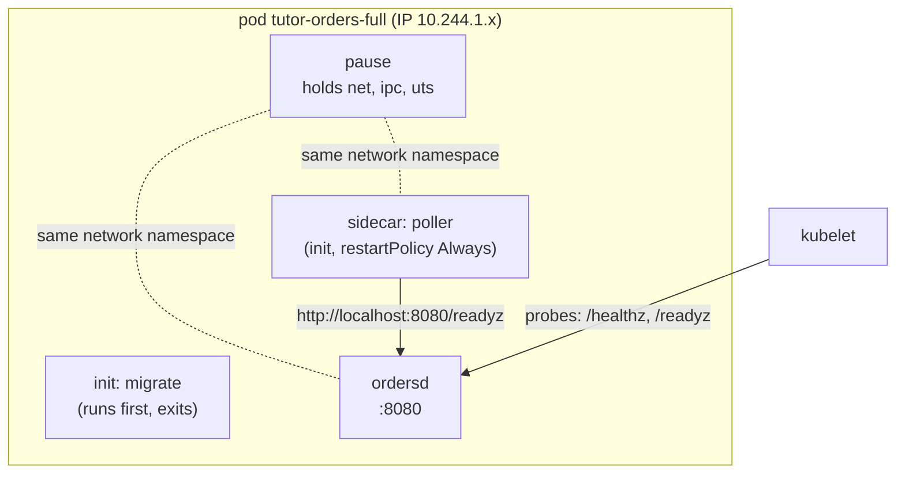
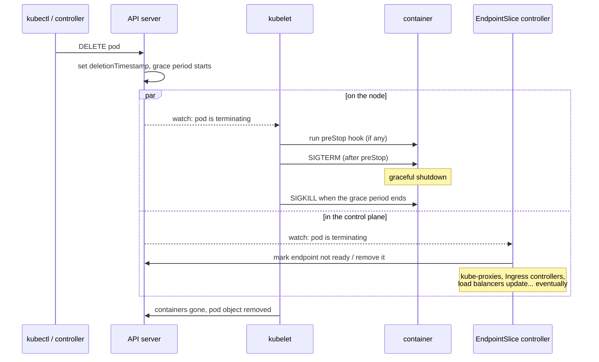

# Pods

## Why care?

Five things you will see in `kubectl get pods` at some point:

- `READY 0/2`, `STATUS Running`. Running, but not ready? And why 2, when you wrote one container?
- `CrashLoopBackOff`, with `RESTARTS 4`, while the code "works on my machine".
- `ImagePullBackOff` right after a release.
- "`kubectl delete pod` hangs for exactly 20 seconds, every time."
- "During every deploy, a few requests fail with `502`."

A pod is the smallest thing Kubernetes runs. It is not a container. It is a small group of containers that share a network and a life cycle, plus a set of rules for how they start, how they are checked, and how they stop. Each message above is one of those rules at work.

On this page you deploy `ordersd` as a bare pod, find the hidden `pause` container on the node, add an init container and a sidecar, wire the probes to `/healthz` and `/readyz`, and then stop the pod and watch the shutdown, second by second.

## The idea: containers that share one network

In [Namespaces and cgroups](../linux/namespaces-and-cgroups.md) a container was a process with its own set of Linux namespaces. A **pod** is a group of containers that share some of those namespaces.

- The containers share **one network**: one network namespace, one IP, one `localhost`. They can reach each other on `localhost` (for example `localhost:8080`), and two of them cannot listen on the same port.
- Each container keeps **its own filesystem** (mount namespace), its own image and its own processes.
- A small extra container, **`pause`**, holds the shared namespaces open. As long as `pause` runs, the namespaces exist, even when an app container exits and is replaced.
- The containers are scheduled, started and stopped **together**: the whole pod runs on one node.



## Under the hood: one pod, step by step

### A bare pod for `ordersd`

The smallest useful manifest. The image `tutor-ordersd:dev` is already loaded on the nodes, so `IfNotPresent` never pulls:

```yaml
# tutor-ordersd-pod.yaml
apiVersion: v1
kind: Pod
metadata:
  name: tutor-ordersd
  namespace: tutor-pods
  labels:
    app: tutor-ordersd
spec:
  containers:
    - name: ordersd
      image: tutor-ordersd:dev
      imagePullPolicy: IfNotPresent
      ports:
        - name: http
          containerPort: 8080
      env:
        - name: ORDERS_LOG_FORMAT
          value: text
```

```console
$ kubectl create namespace tutor-pods
namespace/tutor-pods created
$ kubectl apply -f tutor-ordersd-pod.yaml
pod/tutor-ordersd created
$ kubectl -n tutor-pods get pod tutor-ordersd -o wide
NAME            READY   STATUS    RESTARTS   AGE   IP            NODE           NOMINATED NODE   READINESS GATES
tutor-ordersd   1/1     Running   0          1s    10.244.1.86   tutor-worker   <none>           <none>
$ kubectl -n tutor-pods logs tutor-ordersd
time=2026-11-26T21:50:07.185Z level=INFO msg=starting service=ordersd version=dev revision="" go_version=go1.27.4
time=2026-11-26T21:50:07.210Z level=INFO msg=listening service=ordersd addr=[::]:8080
```

`ports` is documentation (and gives the port a name); it doesn't open or block anything. To reach the pod from your laptop, `kubectl port-forward` tunnels through the API server and the kubelet:

```console
$ kubectl -n tutor-pods port-forward pod/tutor-ordersd 18081:8080 &
Forwarding from 127.0.0.1:18081 -> 8080
Forwarding from [::1]:18081 -> 8080
$ curl -sS localhost:18081/readyz
{"status":"ready"}
$ curl -sS localhost:18081/v1/orders
{"orders":[]}
```

A bare pod is fine for learning. In production you never create one directly: nothing replaces it when it, or its node, dies. A Deployment does that ([Workloads](workloads.md)). Everything on this page applies to the pods a Deployment makes, too.

### The pause container

On the node, the runtime knows two kinds of things: **pod sandboxes** and **containers**. `crictl` (the CRI client, see [Architecture](architecture.md#the-kubelet-the-nodes-agent)) shows both:

```console
$ docker exec tutor-worker crictl pods --namespace tutor-pods
POD ID              CREATED             STATE               NAME                NAMESPACE           ATTEMPT             RUNTIME
f27bcf3a22764       17 seconds ago      Ready               tutor-ordersd       tutor-pods          0                   (default)
$ docker exec tutor-worker crictl ps --pod f27bcf3a22764
CONTAINER           IMAGE               CREATED             STATE               NAME                ATTEMPT             POD ID              POD                 NAMESPACE
9184e617ed831       b10af4102acf1       17 seconds ago      Running             ordersd             0                   f27bcf3a22764       tutor-ordersd       tutor-pods
```

One container in the list, but the sandbox has a process of its own. This script, run on the node, finds both processes and compares their namespaces:

```sh
#!/bin/sh
# pause.sh: run on the node. Compare namespaces of the pause process and ordersd.
POD=$(crictl pods --namespace tutor-pods --name tutor-ordersd --state ready -q)
CTR=$(crictl ps --pod "$POD" --name ordersd -q)
PAUSE_PID=$(crictl inspectp -o go-template --template '{{.info.pid}}' "$POD")
APP_PID=$(crictl inspect -o go-template --template '{{.info.pid}}' "$CTR")
echo "pause pid=$PAUSE_PID app pid=$APP_PID"
ps -o pid,ppid,user,comm -p "$PAUSE_PID","$APP_PID"
for ns in net ipc uts pid mnt; do
  printf '%-4s pause=%s ordersd=%s\n' "$ns" "$(readlink /proc/$PAUSE_PID/ns/$ns)" "$(readlink /proc/$APP_PID/ns/$ns)"
done
crictl inspectp -o go-template --template '{{.status.network.ip}}{{"\n"}}' "$POD"
nsenter -t "$PAUSE_PID" -n ip -br addr
```

```console
$ docker exec -i tutor-worker sh < pause.sh
pause pid=140439 app pid=140464
    PID    PPID USER     COMMAND
 140439  140413 65535    pause
 140464  140413 65532    ordersd
net  pause=net:[4026533852] ordersd=net:[4026533852]
ipc  pause=ipc:[4026534605] ordersd=ipc:[4026534605]
uts  pause=uts:[4026534604] ordersd=uts:[4026534604]
pid  pause=pid:[4026534608] ordersd=pid:[4026534610]
mnt  pause=mnt:[4026534603] ordersd=mnt:[4026534609]
10.244.1.86

lo               UNKNOWN        127.0.0.1/8 ::1/128
eth0@if87        UP             10.244.1.86/24 fe80::f0b1:48ff:fed5:f801/64
```

Read it with the namespace page in mind:

- **`net`, `ipc` and `uts` are the same** inode: `ordersd` joined the pause process's network, IPC and hostname namespaces. The pod's IP, `10.244.1.86`, lives on the `eth0` in that network namespace, which the CNI plugin created for the **sandbox**, before any app container existed.
- **`pid` and `mnt` differ**: each container has its own processes and its own root filesystem.
- Both have the same parent, PID 140413: the `containerd-shim` for this pod.
- `pause` runs as UID 65535, `ordersd` as 65532 (distroless `nonroot`).

The `pause` binary (image `registry.k8s.io/pause:3.10`, 320 kB) does almost nothing: it calls `pause(2)` and waits for signals, forever. Its only job is to **hold the namespaces open**. If `ordersd` crashes and is restarted, the new process joins the same namespaces: same IP, and the CNI plugin doesn't run again. When the pod is deleted, pause stops last and the namespaces disappear with it.

### Shared network, separate everything else

`ordersd` is distroless: no shell, no `ps`, no `netstat`. To look inside, add an **ephemeral container** with `kubectl debug`. `--target` puts it in the PID namespace of the `ordersd` container:

```console
$ kubectl -n tutor-pods debug tutor-ordersd --image=busybox:1.37 --target=ordersd -c tutor-debug -- sh -c 'id; ps -o pid,user,comm; netstat -tln; hostname'
Targeting container "ordersd". If you don't see processes from this container it may be because the container runtime doesn't support this feature.
$ kubectl -n tutor-pods logs tutor-ordersd -c tutor-debug
uid=0(root) gid=0(root) groups=0(root),10(wheel)
PID   USER     COMMAND
    1 65532    ordersd
   18 root     sh
   29 root     ps
Active Internet connections (only servers)
Proto Recv-Q Send-Q Local Address           Foreign Address         State
tcp        0      0 :::8080                 :::*                    LISTEN
tutor-ordersd
```

From the debug container: `ordersd` is PID 1, its socket on `:8080` is visible (same network namespace), and the hostname is the pod name (same UTS namespace). Its files are not: the busybox image is the debug container's root. (You can reach them through `/proc/1/root/` when you share the PID namespace.) Ephemeral containers can't be removed; they stay in the pod spec until the pod goes.

Without `--target`, containers in a pod don't see each other's processes. `spec.shareProcessNamespace: true` makes one PID namespace for the whole pod, and then `pause` becomes PID 1 for everybody and reaps zombies (see [Signals and process lifetime](../linux/signals-and-processes.md#rule-2-pid-1-adopts-every-orphan-and-must-reap-it)).

## Under the hood: more containers in one pod

### Init containers and native sidecars

A pod can have two kinds of helpers:

- An **init container** runs **to completion before** the app containers start. Several run one after another, in order. If one fails, the kubelet retries it (with the pod's restart policy) and nothing else starts. Use it for "wait for the database", "run migrations", "fetch a config file".
- A **native sidecar** is an init container with `restartPolicy: Always`. It starts in the init sequence, but the kubelet doesn't wait for it to finish: once it has **started**, the next init container goes. It keeps running next to the app, is restarted if it dies, and is stopped **after** the app containers. Use it for log shippers, proxies, and agents that must outlive the app.

Here is `ordersd` with both, and with all three probes:

```yaml
# tutor-orders-full.yaml
apiVersion: v1
kind: Pod
metadata:
  name: tutor-orders-full
  namespace: tutor-pods
  labels:
    app: tutor-orders-full
spec:
  terminationGracePeriodSeconds: 20
  initContainers:
    # 1. A classic init container: runs to completion, before anything else.
    - name: migrate
      image: busybox:1.37
      command: [sh, -c, 'echo "migrating schema..."; sleep 3; echo done']
    # 2. A native sidecar: an init container with restartPolicy Always.
    #    It starts before ordersd and keeps running next to it.
    - name: poller
      image: busybox:1.37
      restartPolicy: Always
      command:
        - sh
        - -c
        - 'while true; do echo "$(date +%T) $(wget -qO- http://localhost:8080/readyz 2>&1)"; sleep 2; done'
  containers:
    - name: ordersd
      image: tutor-ordersd:dev
      imagePullPolicy: IfNotPresent
      ports:
        - name: http
          containerPort: 8080
      env:
        - name: ORDERS_LOG_FORMAT
          value: text
        - name: ORDERS_SHUTDOWN_DELAY
          value: 5s
        - name: ORDERS_SHUTDOWN_TIMEOUT
          value: 10s
      startupProbe:
        httpGet: { path: /healthz, port: http }
        periodSeconds: 1
        failureThreshold: 30
      livenessProbe:
        httpGet: { path: /healthz, port: http }
        periodSeconds: 10
        failureThreshold: 3
      readinessProbe:
        httpGet: { path: /readyz, port: http }
        periodSeconds: 2
        failureThreshold: 1
```

Watch it come up:

```console
$ kubectl -n tutor-pods get pods --field-selector metadata.name=tutor-orders-full -w &
$ kubectl apply -f tutor-orders-full.yaml
pod/tutor-orders-full created
NAME                READY   STATUS    RESTARTS   AGE
tutor-orders-full   0/2     Pending   0          0s
tutor-orders-full   0/2     Pending   0          0s
tutor-orders-full   0/2     Init:0/2   0          0s
tutor-orders-full   0/2     Init:0/2   0          1s
tutor-orders-full   0/2     Init:0/2   0          1s
tutor-orders-full   0/2     Init:1/2   0          5s
tutor-orders-full   1/2     PodInitializing   0          5s
tutor-orders-full   1/2     Running           0          5s
tutor-orders-full   1/2     Running           0          5s
tutor-orders-full   1/2     Running           0          6s
tutor-orders-full   2/2     Running           0          6s
$ kubectl -n tutor-pods logs tutor-orders-full -c migrate
migrating schema...
done
$ kubectl -n tutor-pods logs tutor-orders-full -c poller | head -2
21:51:54 wget: can't connect to remote host (127.0.0.1): Connection refused
21:51:56 {"status":"ready"}
```

- `Init:0/2` for about 4 seconds: `migrate` is sleeping. Nothing else runs.
- `Init:1/2`, then at once `1/2`: the sidecar started and counts in `READY`. This is why the message at the top of the page shows 2 containers when you wrote one. Sidecars count; classic init containers don't.
- The poller's first request failed with `Connection refused`: it started **before** `ordersd`. A sidecar that the app depends on (a proxy, say) can get a `startupProbe`, and then the next container waits until that probe passes.
- `localhost:8080` from the busybox container reached `ordersd`: one network namespace.

On the node (this listing is from the second version of the pod, further down), the three containers share one sandbox. The finished init container stays as `Exited` (its logs are kept until the pod goes):

```console
$ docker exec tutor-worker crictl ps -a --pod e575fb26dc411
CONTAINER           IMAGE               CREATED             STATE               NAME                ATTEMPT             POD ID              POD                 NAMESPACE
effcd3378150e       b10af4102acf1       3 seconds ago       Running             ordersd             0                   e575fb26dc411       tutor-orders-full   tutor-pods
ea19742d1a840       30ecbe1509090       3 seconds ago       Running             poller              0                   e575fb26dc411       tutor-orders-full   tutor-pods
7b461e1d1d285       30ecbe1509090       6 seconds ago       Exited              migrate             0                   e575fb26dc411       tutor-orders-full   tutor-pods
```

Before native sidecars (beta and on by default since 1.29, stable since 1.33), a sidecar was a normal second container. It started in random order with the app, and it never stopped on its own, so a Job with a log-shipper sidecar never finished. If you see a plain container doing sidecar work in an old chart, that's why.

### Probes: three questions

The kubelet asks each container up to three questions, on a timer:

| Probe       | Question                      | When it fails                                                          | `ordersd` endpoint |
| ----------- | ----------------------------- | ---------------------------------------------------------------------- | ------------------ |
| `startup`   | "Have you finished starting?" | Keep asking (up to `failureThreshold`), then kill and restart          | `/healthz`         |
| `liveness`  | "Are you stuck?"              | Kill the container and restart it                                      | `/healthz`         |
| `readiness` | "May I send you traffic?"     | Mark the pod not ready: Services stop sending it requests. No restart. | `/readyz`          |

Liveness and readiness don't start until the startup probe has passed. So a slow starter gets `periodSeconds × failureThreshold` (here 1 × 30 = 30 s) to boot, without a lax liveness probe for the rest of its life.

A probe can be `httpGet` (2xx or 3xx is success), `tcpSocket` (the connect works), `grpc` (the standard gRPC health service) or `exec` (a command in the container exits 0). The defaults, from `kubectl explain pod.spec.containers.livenessProbe`: `periodSeconds` 10, `timeoutSeconds` 1, `failureThreshold` 3, `successThreshold` 1. The kubelet sends HTTP probes from the node to the pod's IP; they don't go through a Service.

Why two endpoints? [Building a service](../go/services.md#health-checks-liveness-vs-readiness) explains it from the Go side: `/healthz` says "the process is not stuck" and must **not** check dependencies, while `/readyz` says "send me work" and turns false during shutdown. If liveness checked the database, a database outage would make the kubelet restart every healthy pod at once.

A typo in a liveness probe:

```yaml
# tutor-badprobe.yaml
apiVersion: v1
kind: Pod
metadata:
  name: tutor-badprobe
  namespace: tutor-pods
spec:
  containers:
    - name: ordersd
      image: tutor-ordersd:dev
      ports:
        - name: http
          containerPort: 8080
      livenessProbe:
        httpGet: { path: /livez, port: http } # typo: ordersd serves /healthz
        periodSeconds: 2
        failureThreshold: 3
```

```console
$ kubectl -n tutor-pods get pod tutor-badprobe
NAME             READY   STATUS             RESTARTS      AGE
tutor-badprobe   0/1     CrashLoopBackOff   3 (18s ago)   51s
$ kubectl -n tutor-pods events --for pod/tutor-badprobe
LAST SEEN            TYPE      REASON      OBJECT               MESSAGE
51s                  Normal    Scheduled   Pod/tutor-badprobe   Successfully assigned tutor-pods/tutor-badprobe to tutor-worker
22s (x4 over 50s)    Normal    Pulled      Pod/tutor-badprobe   Container image "tutor-ordersd:dev" already present on machine and can be accessed by the pod
22s (x4 over 50s)    Normal    Created     Pod/tutor-badprobe   Container created
22s (x4 over 50s)    Normal    Started     Pod/tutor-badprobe   Container started
18s (x12 over 49s)   Warning   Unhealthy   Pod/tutor-badprobe   Liveness probe failed: HTTP probe failed with statuscode: 404
18s (x4 over 45s)    Normal    Killing     Pod/tutor-badprobe   Container ordersd failed liveness probe, will be restarted
17s (x4 over 33s)    Warning   BackOff     Pod/tutor-badprobe   Back-off restarting failed container ordersd in pod tutor-badprobe_tutor-pods(838a4e55-bed7-48df-8421-bf535bf32740)
```

A healthy server, killed every 6 seconds (3 failures × 2 s) because of a 404. The events tell you: `Liveness probe failed ... 404`, then `Killing`. The same typo in a **readiness** probe (`/ready` instead of `/readyz`) does no killing at all. The pod just never gets traffic:

```console
$ kubectl -n tutor-pods get pod tutor-notready
NAME             READY   STATUS    RESTARTS   AGE
tutor-notready   0/1     Running   0          30s
$ kubectl -n tutor-pods get pod tutor-notready -o json | jq -r '.status.conditions[] | "\(.type)\t\(.status)\t\(.reason // "")"' | column -t
PodReadyToStartContainers  True
Initialized                True
Ready                      False  ContainersNotReady
ContainersReady            False  ContainersNotReady
PodScheduled               True
$ kubectl -n tutor-pods events --for pod/tutor-notready | tail -1
1s (x15 over 28s)   Warning   Unhealthy   Pod/tutor-notready   Readiness probe failed: HTTP probe failed with statuscode: 404
```

`Running 0/1` forever: the first message from the top of the page.

## Under the hood: the life of a pod

### Phases and conditions

`status.phase` is a short summary with five values (from `kubectl explain pod.status.phase`):

| Phase       | Meaning                                                                         |
| ----------- | ------------------------------------------------------------------------------- |
| `Pending`   | Accepted, but not all containers have started: not scheduled yet, pulling, init |
| `Running`   | Bound to a node, all containers created, at least one running or restarting     |
| `Succeeded` | All containers exited 0 and won't be restarted                                  |
| `Failed`    | All containers have exited, at least one with an error                          |
| `Unknown`   | The pod's state can't be obtained, usually the node is unreachable              |

`Succeeded` and `Failed` need `restartPolicy: Never` or `OnFailure` (Jobs). With the default `Always`, the phase stays `Running` while the kubelet keeps restarting:

```console
$ kubectl -n tutor-pods run tutor-once --image=busybox:1.37 --restart=Never -- sh -c 'echo hello; exit 0'
pod/tutor-once created
$ kubectl -n tutor-pods run tutor-fail --image=busybox:1.37 --restart=Never -- sh -c 'echo bye; exit 3'
pod/tutor-fail created
$ kubectl -n tutor-pods get pods tutor-once tutor-fail -o custom-columns=NAME:.metadata.name,PHASE:.status.phase,EXIT:.status.containerStatuses[0].state.terminated.exitCode,REASON:.status.containerStatuses[0].state.terminated.reason
NAME         PHASE       EXIT   REASON
tutor-once   Succeeded   0      Completed
tutor-fail   Failed      3      Error
```

The `STATUS` column of `kubectl get pods` is **not** the phase. It is computed by the server from the phase, the container states and their reasons (`Init:1/2`, `CrashLoopBackOff`, `Terminating`). For details, look at the **conditions**, each with a time it last changed. For `tutor-orders-full`:

```console
$ kubectl -n tutor-pods get pod tutor-orders-full -o json | jq -r '.status.conditions[] | "\(.type)\t\(.status)\t\(.lastTransitionTime)"' | column -t
PodReadyToStartContainers  True  2026-11-26T21:51:50Z
Initialized                True  2026-11-26T21:51:54Z
Ready                      True  2026-11-26T21:51:55Z
ContainersReady            True  2026-11-26T21:51:55Z
PodScheduled               True  2026-11-26T21:51:49Z
$ kubectl -n tutor-pods get pod tutor-orders-full -o json | jq -r '(.status.initContainerStatuses + .status.containerStatuses)[] | "\(.name)\t\(.state|keys[0])\tready=\(.ready)\tstarted=\(.started)"' | column -t
migrate  terminated  ready=true  started=false
poller   running     ready=true  started=true
ordersd  running     ready=true  started=true
```

In time order: scheduled at :49, sandbox and network ready at :50, init done at :54 (the 3-second `migrate`), ready at :55. When a pod is slow to start, these timestamps tell you which step was slow. `Ready` is the condition Services look at.

### Termination: the grace period and 502 errors

This is the most important part of the page. When a pod is deleted (by you, by a rollout, by a node drain), this happens:



Two things run **in parallel**: the kubelet starts stopping the containers, and the endpoint controllers start taking the pod out of Services. Nothing orders them. If your process exits on `SIGTERM` at once, some kube-proxy or load balancer may still send it a request a moment later, which fails. That's the `502` during deploys. [Services and cluster DNS](services-and-dns.md) shows the endpoint side; here is the pod side.

`ordersd` handles this itself (see [Graceful shutdown](../go/services.md#graceful-shutdown)). On `SIGTERM` it turns `/readyz` to `503`, keeps serving for `ORDERS_SHUTDOWN_DELAY`, then drains in-flight requests for up to `ORDERS_SHUTDOWN_TIMEOUT`. The pod's `terminationGracePeriodSeconds` (default 30) must be longer than both together.

Delete `tutor-orders-full` and time it, with the logs of both containers:

```console
$ kubectl -n tutor-pods logs -f tutor-orders-full -c poller --since=1s > term-poller.out &
$ time kubectl -n tutor-pods delete pod tutor-orders-full
pod "tutor-orders-full" deleted from tutor-pods namespace

real	0m19.986s
user	0m0.076s
sys	0m0.038s
$ cat term-poller.out
21:52:06 {"status":"ready"}
21:52:08 wget: server returned error: HTTP/1.1 503 Service Unavailable
21:52:09 wget: server returned error: HTTP/1.1 503 Service Unavailable
21:52:11 wget: can't connect to remote host (127.0.0.1): Connection refused
21:52:13 wget: can't connect to remote host (127.0.0.1): Connection refused
21:52:15 wget: can't connect to remote host (127.0.0.1): Connection refused
21:52:17 wget: can't connect to remote host (127.0.0.1): Connection refused
21:52:19 wget: can't connect to remote host (127.0.0.1): Connection refused
21:52:21 wget: can't connect to remote host (127.0.0.1): Connection refused
21:52:23 wget: can't connect to remote host (127.0.0.1): Connection refused
21:52:25 wget: can't connect to remote host (127.0.0.1): Connection refused
```

`ordersd` did its part: `503` from :08, gone by :11. But the delete took **20 seconds**, the whole grace period, and the poller kept running until it was killed. Why? The sidecar's `sh` is **PID 1** in its container, and PID 1 only gets the signals it has a handler for ([Namespaces and cgroups](../linux/namespaces-and-cgroups.md#pid-namespaces-who-is-pid-1)). `sh` has no `SIGTERM` handler, so the kubelet's `SIGTERM` did nothing, and the kubelet waited the full 20 seconds before `SIGKILL`. That's the 20-second `kubectl delete` from the top of the page.

Fix the sidecar: trap `SIGTERM`, and sleep in the background so the trap can run at once (a shell runs traps only between commands):

```yaml
command:
  - sh
  - -c
  - |
    trap 'echo "$(date +%T) poller: got SIGTERM"; exit 0' TERM
    while true; do
      echo "$(date +%T) $(wget -qO- http://localhost:8080/readyz 2>&1)"
      sleep 1 & wait $!
    done
```

```console
$ kubectl apply -f tutor-orders-full-v2.yaml
pod/tutor-orders-full created
$ kubectl -n tutor-pods logs -f tutor-orders-full -c ordersd > term-ordersd.out &
$ kubectl -n tutor-pods logs -f tutor-orders-full -c poller --since=1s > term-poller.out &
$ time kubectl -n tutor-pods delete pod tutor-orders-full
pod "tutor-orders-full" deleted from tutor-pods namespace

real	0m6.213s
user	0m0.043s
sys	0m0.071s
$ cat term-ordersd.out
time=2026-11-26T21:52:53.219Z level=INFO msg=starting service=ordersd version=dev revision="" go_version=go1.27.4
time=2026-11-26T21:52:53.235Z level=INFO msg=listening service=ordersd addr=[::]:8080
time=2026-11-26T21:52:58.061Z level=INFO msg="shutting down" service=ordersd delay=5s timeout=10s
time=2026-11-26T21:53:03.061Z level=INFO msg="shutdown complete" service=ordersd
$ cat term-poller.out
21:52:56 {"status":"ready"}
21:52:57 {"status":"ready"}
21:52:58 wget: server returned error: HTTP/1.1 503 Service Unavailable
21:52:59 wget: server returned error: HTTP/1.1 503 Service Unavailable
21:53:00 wget: server returned error: HTTP/1.1 503 Service Unavailable
21:53:01 wget: server returned error: HTTP/1.1 503 Service Unavailable
21:53:02 wget: server returned error: HTTP/1.1 503 Service Unavailable
21:53:03 poller: got SIGTERM
```

Now the whole timeline is visible, in 6 seconds:

1. **21:52:58** `ordersd` gets `SIGTERM`, logs `shutting down`, and `/readyz` returns `503`. It **still serves** requests: this is the window in which load balancers notice and stop sending traffic.
2. **21:53:03**, exactly 5 s later (`ORDERS_SHUTDOWN_DELAY`), it stops accepting, drains, and exits.
3. **21:53:03** only **then** does the sidecar get `SIGTERM`. Native sidecars are stopped after the app containers, in reverse order of start. A proxy sidecar therefore stays up while the app drains.

### `preStop`: waiting without changing the app

Not every program has a shutdown delay built in. A `preStop` hook runs **before** `SIGTERM`, and the kubelet waits for it. The `sleep` action needs no binary in the image, which matters for distroless:

```yaml
# tutor-prestop.yaml
apiVersion: v1
kind: Pod
metadata:
  name: tutor-prestop
  namespace: tutor-pods
spec:
  terminationGracePeriodSeconds: 20
  containers:
    - name: ordersd
      image: tutor-ordersd:dev
      env:
        - name: ORDERS_LOG_FORMAT
          value: text
        - name: ORDERS_SHUTDOWN_DELAY
          value: 0s
      lifecycle:
        preStop:
          sleep:
            seconds: 4
```

```console
$ kubectl apply -f tutor-prestop.yaml
pod/tutor-prestop created
$ kubectl -n tutor-pods logs -f tutor-prestop > prestop.out &
$ date -u +%T.%N | cut -c1-12; kubectl -n tutor-pods delete pod tutor-prestop; date -u +%T.%N | cut -c1-12
21:53:16.917
pod "tutor-prestop" deleted from tutor-pods namespace
21:53:21.690
$ cat prestop.out
time=2026-11-26T21:53:15.895Z level=INFO msg=starting service=ordersd version=dev revision="" go_version=go1.27.4
time=2026-11-26T21:53:15.921Z level=INFO msg=listening service=ordersd addr=[::]:8080
time=2026-11-26T21:53:21.089Z level=INFO msg="shutting down" service=ordersd delay=0s timeout=15s
time=2026-11-26T21:53:21.089Z level=INFO msg="shutdown complete" service=ordersd
```

Delete at :16.9, `SIGTERM` at :21.1: four seconds of `preStop` sleep (plus the kubelet noticing), during which the app served normally. The time of the `preStop` hook **counts against** the grace period. A `preStop` of 25 seconds with the default grace of 30 leaves 5 for the real shutdown.

Use one or the other: a delay in the app (it can make `/readyz` fail at once, which is better) or a `preStop` sleep (for apps you can't change). `exec` hooks (`command: [sleep, "5"]`) need the binary in the image; distroless has none.

### When the grace period runs out

Give `ordersd` a 30-second delay but only 5 seconds of grace:

```yaml
# tutor-slowstop.yaml
apiVersion: v1
kind: Pod
metadata:
  name: tutor-slowstop
  namespace: tutor-pods
spec:
  terminationGracePeriodSeconds: 5
  containers:
    - name: ordersd
      image: tutor-ordersd:dev
      env:
        - name: ORDERS_LOG_FORMAT
          value: text
        - name: ORDERS_SHUTDOWN_DELAY
          value: 30s
```

```console
$ kubectl apply -f tutor-slowstop.yaml
pod/tutor-slowstop created
$ kubectl -n tutor-pods logs -f tutor-slowstop > slow.out &
$ kubectl -n tutor-pods get events --field-selector involvedObject.name=tutor-slowstop -w > slowev.out &
$ date -u +%T.%N | cut -c1-12; kubectl -n tutor-pods delete pod tutor-slowstop; date -u +%T.%N | cut -c1-12
21:53:33.367
pod "tutor-slowstop" deleted from tutor-pods namespace
21:53:39.441
$ cat slow.out
time=2026-11-26T21:53:32.341Z level=INFO msg=starting service=ordersd version=dev revision="" go_version=go1.27.4
time=2026-11-26T21:53:32.368Z level=INFO msg=listening service=ordersd addr=[::]:8080
time=2026-11-26T21:53:33.537Z level=INFO msg="shutting down" service=ordersd delay=30s timeout=15s
$ cat slowev.out
LAST SEEN   TYPE     REASON      OBJECT               MESSAGE
2s          Normal   Scheduled   pod/tutor-slowstop   Successfully assigned tutor-pods/tutor-slowstop to tutor-worker
1s          Normal   Pulled      pod/tutor-slowstop   Container image "tutor-ordersd:dev" already present on machine and can be accessed by the pod
1s          Normal   Created     pod/tutor-slowstop   Container created
1s          Normal   Started     pod/tutor-slowstop   Container started
0s          Normal   Killing     pod/tutor-slowstop   Stopping container ordersd
```

No `shutdown complete`. After 5 seconds the kubelet sent `SIGKILL`, and in-flight requests were cut off. The process can't log anything about it: `SIGKILL` can't be caught. When a pod's logs end in the middle of a shutdown, compare its delays with `terminationGracePeriodSeconds`.

## Try it: break a pod three ways

Here are two common failures, next to the bad probe from above. A typo in configuration, and a tag that doesn't exist:

```yaml
# tutor-crash.yaml
apiVersion: v1
kind: Pod
metadata:
  name: tutor-crash
  namespace: tutor-pods
spec:
  containers:
    - name: ordersd
      image: tutor-ordersd:dev
      env:
        - name: ORDERS_LOG_LEVEL
          value: loud
---
# tutor-noimage.yaml
apiVersion: v1
kind: Pod
metadata:
  name: tutor-noimage
  namespace: tutor-pods
spec:
  containers:
    - name: ordersd
      image: tutor-ordersd:v9.9.9
```

```console
$ kubectl apply -f tutor-badprobe.yaml -f tutor-crash.yaml -f tutor-noimage.yaml
pod/tutor-badprobe created
pod/tutor-crash created
pod/tutor-noimage created
$ kubectl -n tutor-pods get pods
NAME             READY   STATUS             RESTARTS      AGE
tutor-badprobe   0/1     CrashLoopBackOff   3 (11s ago)   44s
tutor-crash      0/1     Error              3 (28s ago)   44s
tutor-noimage    0/1     ImagePullBackOff   0             44s
tutor-ordersd    1/1     Running            0             4m28s
```

**The crash.** The container starts, exits with code 1, and the kubelet restarts it, waiting longer each time (10 s, 20 s, 40 s... up to 5 minutes). Between tries, the status shows the last exit (`Error`) or the wait (`CrashLoopBackOff`). Watch the status change:

```console
$ kubectl -n tutor-pods get pod tutor-crash -w --output-watch-events
EVENT      NAME          READY   STATUS   RESTARTS      AGE
ADDED      tutor-crash   0/1     Error    4 (75s ago)   115s
MODIFIED   tutor-crash   0/1     CrashLoopBackOff   4 (86s ago)   2m58s
MODIFIED   tutor-crash   1/1     Running            5 (86s ago)   2m58s
MODIFIED   tutor-crash   0/1     Error              5 (86s ago)   2m58s
```

`CrashLoopBackOff` is not an error of its own. It means "this container keeps exiting, and I'm waiting before I try again". The reason is in the logs and the exit code:

```console
$ kubectl -n tutor-pods logs tutor-crash
ordersd: ORDERS_LOG_LEVEL: slog: level string "loud": unknown name
$ kubectl -n tutor-pods describe pod tutor-crash | sed -n '/^Containers:/,/^Conditions:/p' | grep -E 'State|Reason|Exit Code|Restart Count|Last State|Started|Finished'
    State:          Terminated
      Reason:       Error
      Exit Code:    1
      Started:      Thu, 26 Nov 2026 22:55:22 +0100
      Finished:     Thu, 26 Nov 2026 22:55:22 +0100
    Last State:     Terminated
      Reason:       Error
      Exit Code:    1
      Started:      Thu, 26 Nov 2026 22:54:30 +0100
      Finished:     Thu, 26 Nov 2026 22:54:30 +0100
    Restart Count:  4
```

Exit code 1, started and finished in the same second: a configuration error, found at start-up, exactly as `ordersd`'s config loader is meant to fail ([Building a service](../go/services.md#configuration-internalconfig)). Exit code 137 would mean `SIGKILL` (OOM or a liveness kill), 143 a `SIGTERM`. `kubectl logs --previous` shows the logs of the last crashed instance, when the current one has nothing yet.

**The missing image.** `ImagePullBackOff` is the same back-off, for pulls. The events have the registry's answer:

```console
$ kubectl -n tutor-pods events --for pod/tutor-noimage | head -5
LAST SEEN           TYPE      REASON      OBJECT              MESSAGE
52s                 Normal    Scheduled   Pod/tutor-noimage   Successfully assigned tutor-pods/tutor-noimage to tutor-worker
21s (x2 over 50s)   Normal    BackOff     Pod/tutor-noimage   Back-off pulling image "tutor-ordersd:v9.9.9"
21s (x2 over 50s)   Warning   Failed      Pod/tutor-noimage   Error: ImagePullBackOff
10s (x3 over 51s)   Normal    Pulling     Pod/tutor-noimage   Pulling image "tutor-ordersd:v9.9.9"
$ kubectl -n tutor-pods get pod tutor-noimage -o jsonpath='{.status.containerStatuses[0].state}' | jq .
{
  "waiting": {
    "message": "Back-off pulling image \"tutor-ordersd:v9.9.9\": ErrImagePull: failed to pull and unpack image \"docker.io/library/tutor-ordersd:v9.9.9\": failed to resolve reference \"docker.io/library/tutor-ordersd:v9.9.9\": pull access denied, repository does not exist or may require authorization: server message: insufficient_scope: authorization failed",
    "reason": "ImagePullBackOff"
  }
}
```

A short name like `tutor-ordersd` means `docker.io/library/tutor-ordersd` (see [Images and layers](../containers/images-and-layers.md)). "Repository does not exist **or may require authorization**": the registry gives the same answer for a typo and for a missing pull secret, on purpose, so it doesn't leak which private repositories exist. Check the tag first, then `imagePullSecrets`.

Clean up with `kubectl delete namespace tutor-pods`.

## Traps

- **A sidecar or shell script as PID 1 that ignores `SIGTERM`.** The pod takes the full grace period to stop, every time. `exec` your program, or trap `TERM`.
- **Exiting at once on `SIGTERM`.** Endpoints are removed in parallel with the signal, not before it. Keep serving for a few seconds (`ORDERS_SHUTDOWN_DELAY`, or a `preStop` sleep), then drain.
- **Grace period shorter than delay + drain.** `SIGKILL` cuts off in-flight requests. `terminationGracePeriodSeconds` > `preStop` + shutdown delay + drain timeout.
- **Liveness probes that check dependencies.** A database outage restarts every pod. Liveness checks the process; readiness may check what it needs to serve.
- **Liveness without a startup probe.** A slow start (a cold cache, a big migration) gets killed by liveness before it is up, and loops. Add a `startupProbe` with a generous budget.
- **Probe timeouts of 1 second under load.** A busy Go server with GC pauses or a full accept queue can miss a 1-second probe three times, and get restarted when it needs help most. Measure, then set `timeoutSeconds`.
- **`exec` hooks in distroless images.** There is no `sleep` or `sh`. Use `lifecycle.preStop.sleep` or `httpGet`.
- **Bare pods in production.** Nothing replaces them. Use a Deployment, StatefulSet or Job.
- **Reading `STATUS` as the phase.** `CrashLoopBackOff` and `Error` are container reasons, and the column flips between them. Read the exit code and `kubectl logs --previous`.
- **Two containers wanting the same port.** They share one network namespace. The second one fails with `address already in use`.

## Check yourself

??? question "1. Two containers in one pod: one listens on port 8080. How does the other reach it, and why does that work?"

    On `localhost:8080`. All containers in a pod join the network namespace that the `pause`
    container holds, so they share interfaces, the IP and `localhost`. Their filesystems
    and (by default) process lists are separate.

??? question "2. Why does a pod need a `pause` container at all?"

    It holds the pod's namespaces (network, IPC, UTS) open, independent of any app container.
    The CNI plugin sets up the network once, for the sandbox. App containers can crash,
    restart or be replaced and still join the same namespaces with the same IP. It also can
    act as PID 1 and reap zombies when the pod shares one PID namespace.

??? question "3. A pod shows `READY 1/2`, `STATUS Running`, no restarts. What do you check?"

    Which container isn't ready: `kubectl get pod -o jsonpath` on `containerStatuses` (and
    `initContainerStatuses` for sidecars), then `kubectl events --for pod/<name>` for
    `Readiness probe failed` messages. A failing readiness probe never restarts anything;
    it only keeps the pod out of Services. Often it is a wrong path or port.

??? question "4. What's the difference between a liveness and a readiness failure, from the kubelet's point of view?"

    Liveness failure: the kubelet kills the container and restarts it (with back-off, which
    shows as `CrashLoopBackOff`). Readiness failure: the kubelet marks the container and the
    pod not ready, and Services stop routing to it. No restart.

??? question "5. `kubectl delete pod` always takes 30 seconds, and the logs show your app stopped after 1 second. What is going on?"

    Another container in the pod (a sidecar, or a shell wrapper) doesn't exit on `SIGTERM`,
    typically because it is PID 1 without a handler. The kubelet waits for the full
    `terminationGracePeriodSeconds` (default 30) and then sends `SIGKILL`. Make it handle
    `SIGTERM` (trap it, or `exec` the real program).

??? question "6. During a rollout a few requests fail with 502, even though `ordersd` drains in-flight requests. Why, and what's the fix?"

    Draining only protects requests that already arrived. On delete, the kubelet sends
    `SIGTERM` and the endpoint controllers remove the pod from Services **at the same time**,
    and the load balancers and kube-proxies update a little later. If the app stops
    accepting at once, new requests sent in that gap fail. Keep serving for a few seconds
    after `SIGTERM` (`ORDERS_SHUTDOWN_DELAY`, or a `preStop` sleep), with `/readyz` returning
    503, then drain. And keep the grace period longer than all of that.

## Recap

- A **pod** is containers that share a network namespace (one IP, one `localhost`), IPC and hostname, held open by the **`pause`** container. Each container keeps its own filesystem and, by default, its own PIDs.
- **Init containers** run to completion, in order, before the app. **Native sidecars** are init containers with `restartPolicy: Always`: they start first, run beside the app, and stop last.
- Three **probes**: `startup` (done booting?), `liveness` (stuck? restart), `readiness` (send traffic?). `ordersd`: `/healthz` for the first two, `/readyz` for the third.
- `status.phase` is a summary; **conditions** and **container states** have the details, with timestamps. The `STATUS` column is neither.
- **Termination**: deletion timestamp → `preStop` → `SIGTERM` → grace period → `SIGKILL`. Endpoint removal happens **in parallel**, so serve a little longer before you drain.
- A PID 1 without a `SIGTERM` handler makes every delete take the whole grace period.
- `CrashLoopBackOff` and `ImagePullBackOff` are back-off waits. The reason is in the logs, the exit code, and the events.

Next: [Workloads](workloads.md), the controllers that create pods for you, replace them, and roll out new versions without dropping requests.
