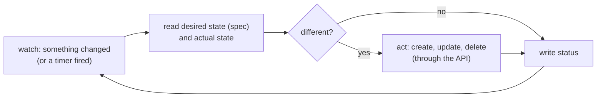

# Reconciliation

## Why care?

Five things people say in their first month with Kubernetes:

- "I deleted the pod by hand. It came back with a new name."
- "I deleted the namespace an hour ago. It still says `Terminating`."
- "Our operator logs `the object has been modified; please apply your changes to the latest version` all day."
- "`kubectl apply` said `configured`, but the rollout hasn't started. Or has it?"
- "Somebody killed the process inside the container, and nothing broke."

All five come from one design. You don't tell Kubernetes **what to do**. You tell it **what you want**, and many small loops keep comparing what you want with what is, and fix the difference. Over and over, forever. This is **reconciliation**, and once you see the loop, Kubernetes stops being magic.

On this page you watch the API's change feed, make two writers collide, see how the cluster tracks "have you seen my change yet?", and break things on purpose to watch them heal.

## The idea: a thermostat, not a light switch

A light switch is **edge-triggered**: you flip it, something happens once. If the bulb was broken at that moment, too bad. The command is gone.

A thermostat is **level-triggered**. You set 21 °C (the **desired state**). The thermostat measures the room (the **actual state**). Too cold? Heat. Warm enough? Stop. It does not remember how many times you turned the dial, or what the setting was yesterday. It only looks at two numbers, now. Open a window, and it simply heats more. Pull the plug for an hour, and when it comes back it looks at the two numbers and carries on.

Every Kubernetes controller is a thermostat:

- **`spec`** is the dial: what you want. You (or another controller) write it.
- **`status`** is the thermometer: what is. The controller writes it.
- The **reconcile loop** looks at both and acts, then looks again.



The loop is the same for the ReplicaSet controller ("3 pods wanted, 2 exist: create one"), the kubelet ("this pod should run here, the container is dead: start it"), the scheduler ("this pod has no node: pick one") and the operator you will write in [the last page](operators.md).

## Under the hood: desired and actual

### `spec` and `status`

Almost every resource has the same shape:

```yaml
apiVersion: apps/v1
kind: Deployment
metadata: # name, labels, resourceVersion, generation, owners, finalizers
  name: tutor-orders
spec: # desired state: written by you
  replicas: 3
status: # observed state: written by the controller
  replicas: 3
  readyReplicas: 3
  observedGeneration: 2
```

For most types, `status` is a separate **subresource** (`.../deployments/tutor-orders/status`). A normal update ignores changes to `status`, and a status update ignores changes to `spec`. So users can't fake status by accident, and controllers can't change your spec by accident. RBAC can even give them different permissions.

### Level-triggered loops, in Go

Here is the heart of a ReplicaSet-like controller, simplified. Notice what it does **not** take as input: the event that woke it up.

```go
// reconcile makes the pods for one ReplicaSet match its spec.
// It is called after ANY change to the ReplicaSet or its pods, and
// on a timer. It never asks "what happened?", only "what is?".
func (c *Controller) reconcile(ctx context.Context, key string) error {
	rs, err := c.rsLister.Get(key) // from a local cache, not the API
	if apierrors.IsNotFound(err) {
		return nil // deleted: garbage collection removes its pods
	}
	if err != nil {
		return err
	}

	pods := c.podsOwnedBy(rs) // also from the cache
	switch diff := int(*rs.Spec.Replicas) - len(pods); {
	case diff > 0:
		return c.createPods(ctx, rs, diff)
	case diff < 0:
		return c.deletePods(ctx, pods[:-diff])
	}
	return c.updateStatus(ctx, rs, len(pods))
}
```

Why level-triggered? Because events get lost. A controller restarts and misses ten minutes of changes. Two events arrive close together and are merged. A network blip drops a watch. An edge-triggered design ("on pod deleted: create one") breaks on each of these. A level-triggered one doesn't care: the next time it runs, it compares the two states and does the right thing. It is also why every action must be **idempotent**: running `reconcile` twice in a row must be harmless.

### List, then watch

How does a controller know something changed, without asking every second? It **watches**. A watch is a long HTTP GET with `?watch=1`. The API server keeps the connection open and sends one JSON object per line, one per change. Watch the ConfigMaps in a namespace with nothing but `kubectl get --raw`, and change one from another terminal:

```console
$ kubectl create namespace tutor-reconciliation
namespace/tutor-reconciliation created
$ kubectl -n tutor-reconciliation create configmap tutor-config --from-literal=color=blue
configmap/tutor-config created
$ kubectl get --raw '/api/v1/namespaces/tutor-reconciliation/configmaps?watch=1&fieldSelector=metadata.name=tutor-config' > watch.out &
$ kubectl -n tutor-reconciliation patch configmap tutor-config -p '{"data":{"color":"green"}}'
configmap/tutor-config patched
$ kubectl -n tutor-reconciliation delete configmap tutor-config
configmap "tutor-config" deleted from tutor-reconciliation namespace
$ jq -c '{type, name: .object.metadata.name, rv: .object.metadata.resourceVersion, data: .object.data}' watch.out
{"type":"ADDED","name":"tutor-config","rv":"3012","data":{"color":"blue"}}
{"type":"MODIFIED","name":"tutor-config","rv":"3015","data":{"color":"green"}}
{"type":"DELETED","name":"tutor-config","rv":"3016","data":{"color":"green"}}
```

Three events: `ADDED`, `MODIFIED`, `DELETED`. Each one carries the **whole object**, not a diff. That fits the level-triggered idea: the receiver always gets the full current state.

The first event is interesting. The ConfigMap existed before the watch started, yet it came as `ADDED`. A watch without a starting point begins with the current state, as synthetic `ADDED` events, and then streams changes. `kubectl get -w` does the same; that's why it prints the existing objects first.

Every event has a **`resourceVersion`** (`3012`, `3015`, `3016`). It is a cluster-wide counter that goes up with every write, backed by etcd's revision number. A list also returns one:

```console
$ kubectl get --raw '/api/v1/namespaces/tutor-reconciliation/configmaps?limit=1' | jq -c '.metadata'
{"resourceVersion":"3042"}
```

This is how a real client (a `client-go` **informer**) works:

1. **List** everything once, and remember the list's `resourceVersion`.
2. **Watch from that `resourceVersion`**. The API server sends every change after that point, and nothing is missed between the list and the watch.
3. Keep the objects in a local **cache**. The controller reads from the cache, never from the API, so a thousand reconciles cost the API server nothing.
4. When the watch breaks, **resume** from the last `resourceVersion` seen.

You can resume by hand. Ask for everything after `resourceVersion=3012`:

```console
$ kubectl get --raw '/api/v1/namespaces/tutor-reconciliation/configmaps?watch=1&resourceVersion=3012' | head -c 300
{"type":"MODIFIED","object":{"kind":"ConfigMap","apiVersion":"v1","metadata":{"name":"tutor-config","namespace":"tutor-reconciliation","uid":"864e8fed-72ba-4b73-8770-11e08e4dd659","resourceVersion":"3015","creationTimestamp":"2026-11-26T21:45:50Z","managedFields":[{"manager":"kubectl-create","operat
```

The first event is the change **after** 3012: the patch at 3015. The API server serves this from its **watch cache**, a window of recent events in memory. History does not last forever: the API server asks etcd to **compact** old revisions every five minutes (`--etcd-compaction-interval`), and the watch cache only holds a limited window. A client that asks for a `resourceVersion` that is too old gets `410 Gone` ("too old resource version"). An informer handles that by doing a fresh list and starting over. That's normal and safe, again because the loop is level-triggered.

!!! tip "Watching is cheap, polling is not"

    A watch costs the API server one open HTTP/2 stream and the events. A loop that lists
    all pods every second costs a full read, serialisation and transfer, every second,
    for every client. In code, always use an informer (`client-go`) or controller-runtime's
    cached client. [Writing an operator](operators.md) shows how.

### `resourceVersion` and optimistic concurrency

`resourceVersion` has a second job: it stops two writers from overwriting each other. Two people, Alice and Bob, read the same ConfigMap at the same time:

```console
$ kubectl -n tutor-reconciliation create configmap tutor-stock --from-literal=count=10
configmap/tutor-stock created
$ kubectl -n tutor-reconciliation get configmap tutor-stock -o json > alice.json
$ kubectl -n tutor-reconciliation get configmap tutor-stock -o json > bob.json
$ jq -r .metadata.resourceVersion alice.json bob.json
3064
3064
```

Alice sells one item (10 → 9). Bob, at the same moment, sells two (10 → 8). Both write back the whole object with `kubectl replace` (an HTTP PUT):

```console
$ jq '.data.count="9"' alice.json | kubectl replace -f -
configmap/tutor-stock replaced
$ jq '.data.count="8"' bob.json | kubectl replace -f -
Error from server (Conflict): error when replacing "STDIN": Operation cannot be fulfilled on configmaps "tutor-stock": the object has been modified; please apply your changes to the latest version and try again
```

Bob's PUT said "this is version 3064", but Alice's write had already made it 3069. The API server checks the version **in the same etcd transaction** as the write (a compare-and-swap), and refuses with **409 Conflict**:

```console
$ jq '.data.count="8"' bob.json | kubectl replace -v=6 -f - 2>&1 | grep 'PUT'
I1126 22:46:23.886823  472353 round_trippers.go:632] "Response" verb="PUT" url="https://127.0.0.1:46318/api/v1/namespaces/tutor-reconciliation/configmaps/tutor-stock?fieldManager=kubectl-replace&fieldValidation=Strict" status="409 Conflict" milliseconds=4
```

This is **optimistic concurrency**: no locks, nobody waits. Everyone writes, and the loser of a race is told to read again and retry. Bob should now read 9 and write 7. Here is what happens if he removes `resourceVersion` from his object instead:

```console
$ jq '.data.count="8" | del(.metadata.resourceVersion)' bob.json | kubectl replace -f -
configmap/tutor-stock replaced
$ kubectl -n tutor-reconciliation get configmap tutor-stock -o jsonpath='{.data.count} rv={.metadata.resourceVersion}{"\n"}'
8 rv=3082
```

No `resourceVersion`, no check: **last write wins**, silently. Three items were sold, the count says 8, and Alice's sale is lost. Now do it properly, from Go, with ten writers at once. `retry.RetryOnConflict` from `client-go` runs your function again (read, change, write) whenever the write gets a 409:

```go
// Command decrement takes one item out of stock, safely, with many writers.
package main

import (
	"context"
	"fmt"
	"log"
	"strconv"

	metav1 "k8s.io/apimachinery/pkg/apis/meta/v1"
	"k8s.io/client-go/kubernetes"
	"k8s.io/client-go/tools/clientcmd"
	"k8s.io/client-go/util/retry"
)

func main() {
	// Same rules as kubectl: $KUBECONFIG, else ~/.kube/config.
	cfg, err := clientcmd.NewNonInteractiveDeferredLoadingClientConfig(
		clientcmd.NewDefaultClientConfigLoadingRules(), nil).ClientConfig()
	if err != nil {
		log.Fatal(err)
	}
	cms := kubernetes.NewForConfigOrDie(cfg).CoreV1().ConfigMaps("tutor-reconciliation")
	ctx := context.Background()

	// On 409 Conflict: read the latest version again and redo the change.
	attempts := 0
	err = retry.RetryOnConflict(retry.DefaultRetry, func() error {
		attempts++
		cm, err := cms.Get(ctx, "tutor-stock", metav1.GetOptions{})
		if err != nil {
			return err
		}
		n, err := strconv.Atoi(cm.Data["count"])
		if err != nil {
			return err
		}
		cm.Data["count"] = strconv.Itoa(n - 1)
		_, err = cms.Update(ctx, cm, metav1.UpdateOptions{}) // sends cm's resourceVersion
		return err
	})
	if err != nil {
		log.Fatal(err)
	}
	fmt.Println("attempts:", attempts)
}
```

Start at 100 and run ten of them in parallel (`k8s.io/client-go v0.37.3`):

```console
$ kubectl -n tutor-reconciliation create configmap tutor-stock --from-literal=count=100
configmap/tutor-stock created
$ for i in $(seq 10); do ./decrement & done; wait
attempts: 1
attempts: 1
attempts: 2
attempts: 1
attempts: 3
attempts: 2
attempts: 4
attempts: 4
2026/11/26 23:03:02 Operation cannot be fulfilled on configmaps "tutor-stock": the object has been modified; please apply your changes to the latest version and try again
2026/11/26 23:03:02 Operation cannot be fulfilled on configmaps "tutor-stock": the object has been modified; please apply your changes to the latest version and try again
$ kubectl -n tutor-reconciliation get configmap tutor-stock -o jsonpath='{.data.count}{"\n"}'
92
```

Eight writers succeeded (some on the fourth try), and the count is exactly 100 − 8 = 92. No update was lost. Two writers **gave up**: `retry.DefaultRetry` allows only 5 attempts, 10 ms apart. That's the right default for a controller, which simply gets called again later, but a CLI or a batch job must check the error. Under heavy contention on one object, the real fix is to have fewer writers, not more retries.

!!! note "Patches and server-side apply"

    `kubectl patch` and `kubectl apply --server-side` usually don't send a `resourceVersion`,
    so they don't conflict on unrelated fields: the API server applies the change to the
    current object. Server-side apply tracks **which manager owns which field**
    (`managedFields`, which you saw in the watch output) and returns a conflict only when two
    managers fight over the same field. [Packaging](packaging.md) uses it.

### `generation` and `observedGeneration`: "have you seen my change?"

`kubectl apply` returns as soon as the API server has **stored** your change. The controller hasn't even looked at it yet. How do you know when it has? Two numbers:

- **`metadata.generation`**: the API server adds 1 every time the **spec** changes.
- **`status.observedGeneration`**: the controller writes the generation it last acted on.

When they are equal, the status describes your latest spec. When `observedGeneration` is lower, the status is old news. A Deployment to play with:

```yaml
# tutor-orders-deploy.yaml
apiVersion: apps/v1
kind: Deployment
metadata:
  name: tutor-orders
  namespace: tutor-reconciliation
spec:
  replicas: 2
  selector:
    matchLabels:
      app: tutor-orders
  template:
    metadata:
      labels:
        app: tutor-orders
    spec:
      containers:
        - name: ordersd
          image: tutor-ordersd:dev
          imagePullPolicy: Never
          ports:
            - containerPort: 8080
```

```console
$ kubectl apply -f tutor-orders-deploy.yaml
deployment.apps/tutor-orders created
$ G='{.metadata.generation} observed={.status.observedGeneration}{"\n"}'
$ kubectl -n tutor-reconciliation get deploy tutor-orders -o jsonpath="gen=$G"
gen=1 observed=1
$ kubectl -n tutor-reconciliation label deploy tutor-orders team=payments >/dev/null
$ kubectl -n tutor-reconciliation get deploy tutor-orders -o jsonpath="after label: gen=$G"
after label: gen=1 observed=1
$ kubectl -n tutor-reconciliation scale deploy tutor-orders --replicas=3 >/dev/null
$ kubectl -n tutor-reconciliation get deploy tutor-orders -o jsonpath="right after scale: gen=$G"
right after scale: gen=2 observed=2
```

A label is metadata: no new generation. Scaling changes the spec: generation 2. The controller was so fast that it had already caught up when we looked. To catch it in the act, watch the Deployment while you change its image (to one that doesn't exist, which also shows a stuck rollout):

```console
$ kubectl get --raw '/apis/apps/v1/namespaces/tutor-reconciliation/deployments?watch=1&fieldSelector=metadata.name=tutor-orders' > dwatch.out &
$ kubectl -n tutor-reconciliation set image deploy/tutor-orders ordersd=tutor-ordersd:does-not-exist >/dev/null
$ jq -c '{type, rv: .object.metadata.resourceVersion, gen: .object.metadata.generation, observed: .object.status.observedGeneration, replicas: .object.status.replicas, updated: .object.status.updatedReplicas, available: .object.status.availableReplicas}' dwatch.out
{"type":"ADDED","rv":"3156","gen":2,"observed":2,"replicas":3,"updated":3,"available":3}
{"type":"MODIFIED","rv":"3174","gen":3,"observed":2,"replicas":3,"updated":3,"available":3}
{"type":"MODIFIED","rv":"3178","gen":3,"observed":2,"replicas":3,"updated":3,"available":3}
{"type":"MODIFIED","rv":"3183","gen":3,"observed":3,"replicas":3,"updated":null,"available":3}
{"type":"MODIFIED","rv":"3186","gen":3,"observed":3,"replicas":4,"updated":1,"available":3}
$ kubectl -n tutor-reconciliation get pods
NAME                            READY   STATUS              RESTARTS   AGE
tutor-orders-78799859db-f66qr   1/1     Running             0          19s
tutor-orders-78799859db-r8h9b   1/1     Running             0          17s
tutor-orders-78799859db-rzwkg   1/1     Running             0          19s
tutor-orders-d8d49fd8-6w2bh     0/1     ErrImageNeverPull   0          6s
```

Read the second and third lines: **generation 3, observed 2, updated 3, available 3**. Anyone who looked at the status at that moment saw "3 of 3 updated, all available, done", and it was wrong: it described generation 2. One event later the controller caught up (`observed: 3`), reset `updated`, and started a new pod, which can't start. `kubectl rollout status` checks `observedGeneration` for exactly this reason. Your CI should too, if it writes its own wait loop. (The image goes back with `kubectl rollout undo`; [Workloads](workloads.md) covers rollouts.)

## Under the hood: who owns what

### Owner references

The pods above have names like `tutor-orders-78799859db-r8h9b`. Who made them? Each object says so, in `metadata.ownerReferences`:

```console
$ kubectl -n tutor-reconciliation get pod tutor-orders-78799859db-r8h9b -o jsonpath='{.metadata.ownerReferences}' | jq .
[
  {
    "apiVersion": "apps/v1",
    "blockOwnerDeletion": true,
    "controller": true,
    "kind": "ReplicaSet",
    "name": "tutor-orders-78799859db",
    "uid": "f55253fe-e487-4334-ab9b-a4068d84cd3b"
  }
]
$ kubectl -n tutor-reconciliation get rs -o jsonpath='{range .items[*]}{.metadata.name}: {.metadata.ownerReferences[0].kind}/{.metadata.ownerReferences[0].name}{"\n"}{end}'
tutor-orders-78799859db: Deployment/tutor-orders
tutor-orders-d8d49fd8: Deployment/tutor-orders
```

A chain: Deployment → ReplicaSet → Pod. The `uid` matters, not the name: a new ReplicaSet with the same name is a different owner. `controller: true` marks the one owner that **manages** the object (there can be only one).

### Why a deleted pod comes back

Delete one of the pods, and watch:

```console
$ kubectl -n tutor-reconciliation get pods -w --output-watch-events &
$ kubectl -n tutor-reconciliation delete pod tutor-orders-78799859db-r8h9b
pod "tutor-orders-78799859db-r8h9b" deleted from tutor-reconciliation namespace
EVENT      NAME                            READY   STATUS    RESTARTS   AGE
ADDED      tutor-orders-78799859db-r8h9b   1/1     Running   0          46s
ADDED      tutor-orders-78799859db-rzwkg   1/1     Running   0          48s
MODIFIED   tutor-orders-78799859db-r8h9b   1/1     Terminating   0          47s
ADDED      tutor-orders-78799859db-c86g2   0/1     Pending       0          0s
MODIFIED   tutor-orders-78799859db-r8h9b   1/1     Terminating   0          47s
MODIFIED   tutor-orders-78799859db-c86g2   0/1     Pending       0          0s
MODIFIED   tutor-orders-78799859db-c86g2   0/1     ContainerCreating   0          0s
MODIFIED   tutor-orders-78799859db-r8h9b   0/1     Completed           0          47s
MODIFIED   tutor-orders-78799859db-c86g2   0/1     ContainerCreating   0          1s
MODIFIED   tutor-orders-78799859db-r8h9b   0/1     Completed           0          48s
DELETED    tutor-orders-78799859db-r8h9b   0/1     Completed           0          48s
MODIFIED   tutor-orders-78799859db-c86g2   1/1     Running             0          1s
$ kubectl -n tutor-reconciliation events --for replicaset/tutor-orders-78799859db | tail -1
12s         Normal   SuccessfulCreate   ReplicaSet/tutor-orders-78799859db   Created pod: tutor-orders-78799859db-c86g2
```

The order tells the story. The pod got a **deletion timestamp** (`Terminating`), and the ReplicaSet controller stopped counting it as one of its replicas at once. Two wanted, one counted: create `c86g2`. The replacement was `Pending` before the old pod was even gone. For the first message at the top of the page: you don't delete pods to stop them, you change the **desired state** (`kubectl scale`, or delete the Deployment).

A controller finds "its" pods with the **label selector**, and owner references confirm it. Change the label of a pod, and it leaves the family:

```console
$ kubectl -n tutor-reconciliation label pod tutor-orders-78799859db-c86g2 app=tutor-quarantine --overwrite
pod/tutor-orders-78799859db-c86g2 labeled
$ kubectl -n tutor-reconciliation get pods -L app
NAME                            READY   STATUS    RESTARTS   AGE   APP
tutor-orders-78799859db-bhrpv   1/1     Running   0          3s    tutor-orders
tutor-orders-78799859db-c86g2   1/1     Running   0          23s   tutor-quarantine
tutor-orders-78799859db-rzwkg   1/1     Running   0          72s   tutor-orders
$ kubectl -n tutor-reconciliation get pod tutor-orders-78799859db-c86g2 -o jsonpath='ownerReferences={.metadata.ownerReferences}{"\n"}'
ownerReferences=
```

The ReplicaSet **released** the pod (removed its owner reference) and made a new one, `bhrpv`. The old pod keeps running, out of the traffic (a Service selects on the same label), so you can debug it at leisure. That's a real production trick for a misbehaving pod.

### Garbage collection: cascading deletes

When an owner is deleted, the **garbage collector** controller deletes what it owned. You choose how with `--cascade`:

| `--cascade`            | What happens                                                                                                     |
| ---------------------- | ---------------------------------------------------------------------------------------------------------------- |
| `background` (default) | The owner is deleted at once; the garbage collector deletes the dependents afterwards.                           |
| `foreground`           | The owner stays (with a `foregroundDeletion` finalizer) until all dependents with `blockOwnerDeletion` are gone. |
| `orphan`               | The owner is deleted; dependents stay, and lose their owner reference.                                           |

```console
$ kubectl -n tutor-reconciliation delete deploy tutor-orders --cascade=orphan
deployment.apps "tutor-orders" deleted from tutor-reconciliation namespace
$ kubectl -n tutor-reconciliation get deploy,rs,pods
NAME                                      DESIRED   CURRENT   READY   AGE
replicaset.apps/tutor-orders-78799859db   2         2         2       82s
replicaset.apps/tutor-orders-d8d49fd8     0         0         0       69s

NAME                                READY   STATUS    RESTARTS   AGE
pod/tutor-orders-78799859db-bhrpv   1/1     Running   0          13s
pod/tutor-orders-78799859db-rzwkg   1/1     Running   0          82s
$ kubectl -n tutor-reconciliation delete rs --all --cascade=foreground --wait=false
replicaset.apps "tutor-orders-78799859db" deleted from tutor-reconciliation namespace
replicaset.apps "tutor-orders-d8d49fd8" deleted from tutor-reconciliation namespace
$ kubectl -n tutor-reconciliation get rs tutor-orders-78799859db -o jsonpath='deletionTimestamp={.metadata.deletionTimestamp} finalizers={.metadata.finalizers}{"\n"}'
deletionTimestamp=2026-11-26T21:48:03Z finalizers=["foregroundDeletion"]
$ kubectl -n tutor-reconciliation get rs,pods
No resources found in tutor-reconciliation namespace.
```

The Deployment is gone, its ReplicaSets live on as orphans and keep their pods running. Then a foreground delete: the ReplicaSet still exists with a deletion timestamp and a `foregroundDeletion` **finalizer** while its pods go, and disappears last. Orphaning is how you replace a Deployment's spec in ways the API forbids (such as its selector) without downtime.

### Finalizers: "not yet, I have work to do"

A **finalizer** is a string in `metadata.finalizers`. While the list is not empty, the object **cannot disappear**. A delete only sets `metadata.deletionTimestamp`. Some controller is expected to see that, do its clean-up (release a cloud load balancer, delete a database, detach a volume), and then remove its finalizer. When the list is empty, the API server really deletes the object.

Add a finalizer that no controller knows about, and delete:

```console
$ kubectl -n tutor-reconciliation create configmap tutor-guarded --from-literal=k=v
configmap/tutor-guarded created
$ kubectl -n tutor-reconciliation patch configmap tutor-guarded --type=merge -p '{"metadata":{"finalizers":["tutor.example.com/cleanup"]}}'
configmap/tutor-guarded patched
$ kubectl -n tutor-reconciliation delete configmap tutor-guarded --wait=false
configmap "tutor-guarded" deleted from tutor-reconciliation namespace
$ kubectl -n tutor-reconciliation get configmap tutor-guarded -o jsonpath='deletionTimestamp={.metadata.deletionTimestamp} finalizers={.metadata.finalizers}{"\n"}'
deletionTimestamp=2026-11-26T21:48:44Z finalizers=["tutor.example.com/cleanup"]
```

`kubectl` said "deleted". It wasn't. It still exists, and you can even still change its data, but no new finalizers can be added:

```console
$ kubectl -n tutor-reconciliation patch configmap tutor-guarded --type=merge -p '{"data":{"k":"changed"}}'
configmap/tutor-guarded patched
$ kubectl -n tutor-reconciliation patch configmap tutor-guarded --type=merge -p '{"metadata":{"finalizers":["tutor.example.com/cleanup","tutor.example.com/another"]}}'
The ConfigMap "tutor-guarded" is invalid: metadata.finalizers: Forbidden: no new finalizers can be added if the object is being deleted, found new finalizers []string{"tutor.example.com/another"}
```

Now the second message from the top of the page. Delete the **namespace**:

```console
$ kubectl delete namespace tutor-reconciliation --wait=false
namespace "tutor-reconciliation" deleted
$ kubectl get namespace tutor-reconciliation
NAME                   STATUS        AGE
tutor-reconciliation   Terminating   3m30s
```

The namespace has its own finalizer, `kubernetes`, held by the namespace controller. That controller deletes everything inside, and only then removes its finalizer. It can't finish, because our ConfigMap won't go. The namespace's conditions say exactly why:

```console
$ kubectl get namespace tutor-reconciliation -o json | jq '{spec, deletionTimestamp: .metadata.deletionTimestamp, conditions: [.status.conditions[] | {type, status, reason, message}]}'
{
  "spec": {
    "finalizers": [
      "kubernetes"
    ]
  },
  "deletionTimestamp": "2026-11-26T21:49:10Z",
  "conditions": [
    {
      "type": "NamespaceDeletionDiscoveryFailure",
      "status": "False",
      "reason": "ResourcesDiscovered",
      "message": "All resources successfully discovered"
    },
    {
      "type": "NamespaceDeletionGroupVersionParsingFailure",
      "status": "False",
      "reason": "ParsedGroupVersions",
      "message": "All legacy kube types successfully parsed"
    },
    {
      "type": "NamespaceDeletionContentFailure",
      "status": "False",
      "reason": "ContentDeleted",
      "message": "All content successfully deleted, may be waiting on finalization"
    },
    {
      "type": "NamespaceContentRemaining",
      "status": "True",
      "reason": "SomeResourcesRemain",
      "message": "Some resources are remaining: configmaps. has 1 resource instances"
    },
    {
      "type": "NamespaceFinalizersRemaining",
      "status": "True",
      "reason": "SomeFinalizersRemain",
      "message": "Some content in the namespace has finalizers remaining: tutor.example.com/cleanup in 1 resource instances"
    }
  ]
}
```

`NamespaceFinalizersRemaining: tutor.example.com/cleanup in 1 resource instances`. And while it is terminating, nothing new may be created in it:

```console
$ kubectl -n tutor-reconciliation create configmap tutor-late --from-literal=a=b
error: failed to create configmap: configmaps "tutor-late" is forbidden: unable to create new content in namespace tutor-reconciliation because it is being terminated
```

In real life, the finalizer belongs to a controller that is gone: an operator that was uninstalled before its resources were deleted, or a CRD's controller that is crash-looping. The right fix is to bring the controller back and let it finish. When you are **sure** the clean-up is not needed (or you did it by hand), remove the finalizer yourself:

```console
$ kubectl -n tutor-reconciliation patch configmap tutor-guarded --type=json -p='[{"op":"remove","path":"/metadata/finalizers"}]'
configmap/tutor-guarded patched
$ kubectl get namespace tutor-reconciliation
Error from server (NotFound): namespaces "tutor-reconciliation" not found
```

The namespace was gone within seconds. Don't remove the namespace's own `kubernetes` finalizer (through the `/finalize` subresource, a popular answer online): it leaves the contents behind in etcd, invisible and orphaned.

## Try it: why it heals

Two loops healed things on this page already: the ReplicaSet controller replaced a deleted pod. Now the loop one level down, on the node. Start a pod, then kill its process from **outside** Kubernetes, on the node itself:

```console
$ kubectl -n tutor-reconciliation run tutor-heal --image=tutor-ordersd:dev --image-pull-policy=Never
pod/tutor-heal created
$ docker exec tutor-worker crictl ps --name tutor-heal
CONTAINER           IMAGE               CREATED             STATE               NAME                ATTEMPT             POD ID              POD                 NAMESPACE
6004271d5daed       b10af4102acf1       12 seconds ago      Running             tutor-heal          0                   3b32cb6e768d9       tutor-heal          tutor-reconciliation
$ docker exec tutor-worker crictl inspect --output go-template --template '{{.info.pid}}' 6004271d5daed
93198
$ docker exec tutor-worker kill -KILL 93198
$ kubectl -n tutor-reconciliation get pod tutor-heal
NAME         READY   STATUS    RESTARTS     AGE
tutor-heal   1/1     Running   1 (5s ago)   19s
$ kubectl -n tutor-reconciliation get pod tutor-heal -o jsonpath='{.status.containerStatuses[0].lastState}' | jq .
{
  "terminated": {
    "containerID": "containerd://6004271d5daeda04af3c54883181603cd52456c34cec662a42c2cddba21c7419",
    "exitCode": 137,
    "finishedAt": "2026-11-26T21:48:30Z",
    "reason": "Error",
    "startedAt": "2026-11-26T21:48:17Z"
  }
}
```

Exit code 137 = 128 + 9, `SIGKILL` (see [Signals and process lifetime](../linux/signals-and-processes.md)). The kubelet's loop compared "this pod should have a running `tutor-heal` container" with "it is dead", and started a new one in the same pod (`RESTARTS 1`). No API server round trip was needed for the decision; the kubelet already had the spec. That's the fifth message from the top.

So the cluster heals at three levels, each a loop of its own:

| Something breaks | Loop that notices                  | What it does                                  |
| ---------------- | ---------------------------------- | --------------------------------------------- |
| A container dies | kubelet on that node               | Restart it in the same pod (with back-off)    |
| A pod is deleted | ReplicaSet controller              | Create a new pod, with a new name             |
| A node dies      | node-lifecycle controller, then RS | Mark the node `NotReady`, evict, replace pods |

Clean up with `kubectl delete namespace tutor-reconciliation`.

## Traps

- **Deleting pods to "fix" them.** The controller makes new ones. Change the desired state: scale, roll back, or fix the spec.
- **Trusting `status` without `observedGeneration`.** Right after a change, status describes the previous spec. Wait until `observedGeneration == generation`; `kubectl rollout status` and `kubectl wait --for=jsonpath=...` do this.
- **Read-modify-write without `resourceVersion`.** Drop it (or use a plain PUT from a stale copy), and the last writer silently wins. Keep it, and handle 409 with `retry.RetryOnConflict`, which gives up after 5 tries.
- **Edge-triggered controllers.** Code that only reacts to "pod deleted" events misses everything that happened while it was down. Write `reconcile` to look at the whole current state, and make it idempotent.
- **Polling the API.** A loop that lists objects every second hurts the API server. Use watches, through an informer's cache.
- **Removing finalizers blindly.** A finalizer stands for clean-up work outside Kubernetes (a cloud load balancer, a bucket). Remove it by hand, and that resource leaks. Find the owning controller first.
- **Uninstalling an operator before its resources.** Its finalizers stay on every object it managed, and their namespaces never finish deleting. Delete the custom resources first, then the operator.
- **"`kubectl delete` printed deleted, so it's gone."** It only means the API accepted the delete. With finalizers (or a grace period, for pods) the object can live on. Use `--wait` (the default) or check.

## Check yourself

??? question "1. Why does a ReplicaSet controller recount pods every time instead of reacting to \"pod deleted\" events?"

    Because events can be missed or merged: the controller may restart, a watch may break, two
    changes may arrive together. A level-triggered loop compares desired and actual state on
    every run, so it does the right thing however it was woken up, and running it twice is
    harmless.

??? question "2. A watch is started with no `resourceVersion` on a namespace with two ConfigMaps. What are the first events?"

    Two `ADDED` events, one per existing ConfigMap: the current state as synthetic events.
    After that come real changes. Informers instead list first and then watch from the list's
    `resourceVersion`, which gives the same result: nothing is missed between the two.

??? question "3. Two controllers read the same object at `resourceVersion` 500 and both send an update. What happens, and what should the loser do?"

    The first update succeeds and the object gets a new `resourceVersion`. The second gets
    `409 Conflict`, because its `resourceVersion` 500 no longer matches. The loser must read
    the object again, re-apply its change to the fresh copy and retry, for example with
    `retry.RetryOnConflict`. For a controller, returning the error and being requeued works too.

??? question "4. Right after `kubectl apply`, a Deployment shows `generation: 7`, `observedGeneration: 6`, and all replicas updated and available. Is your change rolled out?"

    No. The status was computed for generation 6, the spec before your change. The Deployment
    controller hasn't processed generation 7 yet. Wait until `observedGeneration` is 7 and
    then look at `updatedReplicas` and `availableReplicas` (or run `kubectl rollout status`).

??? question "5. A namespace has been `Terminating` for an hour. How do you find out why, and what is the safe fix?"

    Read its conditions: `kubectl get ns <name> -o json | jq .status.conditions`.
    `NamespaceContentRemaining` and `NamespaceFinalizersRemaining` name the resource types
    and the finalizers that block it. The safe fix is to make the controller that owns that
    finalizer run again (reinstall the operator, fix its crash) so it can clean up. Only if
    the clean-up is truly not needed, remove the finalizer from those objects. Never force
    the namespace's own `kubernetes` finalizer away.

??? question "6. You change the label `app` on one pod of a Deployment. What happens to that pod, and why is it useful?"

    It no longer matches the ReplicaSet's selector. The ReplicaSet releases it (removes its
    owner reference) and creates a replacement. The old pod keeps running, out of the
    Service's selector too, so you can inspect a misbehaving instance without it taking
    traffic and without losing capacity.

## Recap

- You write **desired state** (`spec`); controllers report **actual state** (`status`) and work to close the gap.
- Controllers are **level-triggered**: they look at the whole current state, not at the event that woke them. Their actions are idempotent.
- Clients **list, then watch** from the list's `resourceVersion`, and keep a local cache. Watch events carry whole objects. Too old a `resourceVersion` gives `410 Gone`; the client re-lists.
- **`resourceVersion`** gives optimistic concurrency: a stale write gets **409 Conflict**. Retry with a fresh read; `retry.DefaultRetry` tries 5 times.
- **`generation`** counts spec changes; **`observedGeneration`** says which one the status describes.
- **Owner references** link Deployment → ReplicaSet → Pod. The **garbage collector** deletes dependents (`background`, `foreground`) or leaves them (`orphan`).
- **Finalizers** delay deletion until a controller has cleaned up. A missing controller means an object, or a whole namespace, that never goes away.
- The cluster heals at every level because every level is a loop: kubelet for containers, ReplicaSet for pods, node lifecycle for nodes.

Next: [Pods](pods.md), the smallest thing these loops create, and what the kubelet really does with one.
