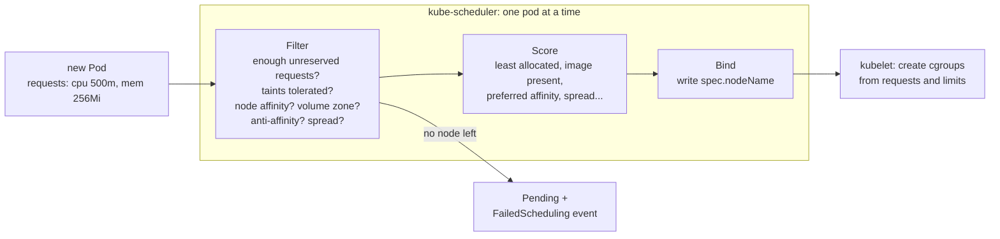

# Scheduling and resources

## Why care?

Six messages that every platform team gets, sooner or later:

- "The pod is `Pending` forever. The cluster has plenty of free CPU."
- "Our service is throttled, and the dashboard says it uses only 30% of its CPU."
- "The pod restarts with exit code 137 a few times a day. The logs show nothing."
- "When the node ran low on memory, our payments service was killed first, and the batch job kept running."
- "All three replicas ran on one node. The node died. So did the service."
- "The autoscaler added five pods at 9:00. They were all idle by 9:05, and it took another five minutes to remove them."

Each one comes from two numbers per container (**requests** and **limits**) and a handful of **rules** that the scheduler reads. On this page you see what those numbers become on the node (cgroup files, see [Namespaces and cgroups](../linux/namespaces-and-cgroups.md)), throttle a container and watch the counter go up, get a container OOM-killed, check what Go 1.27 does with a CPU limit, and make the scheduler say no in five different ways.

## The idea: booking a table vs the fire code

Think of a restaurant again (the kitchen from [Architecture](architecture.md)), now from the **dining room**.

- A **request** is a **reservation**. "Table for four at eight." The host (the **scheduler**) only seats you where four chairs are still unreserved. It does not look at who is actually sitting there right now. Booked is booked.
- A **limit** is the **fire code**. However many chairs are free, this party may never have more than six people at the table. A seventh for CPU waits at the door (**throttling**). A seventh for memory is thrown out (**OOM kill**).
- **Taints** are signs on tables: "staff only". **Tolerations** are the staff badge that lets you sit there anyway.
- **Affinity** is a wish: "by the window", "next to our friends" (pod affinity), "**not** next to the other party from our company" (anti-affinity).
- **Topology spread** is the manager's rule: "spread this group over all rooms, never more than one table difference".



The scheduler never looks at **real** usage. It adds up the **requests** of the pods already on a node and compares them with the node's **allocatable**. That's the first message: a cluster can be 10% busy and 100% booked.

## Under the hood: requests and limits

### What the node sees

`kubectl describe node` shows both sides of the booking:

```console
$ kubectl describe node tutor-worker | sed -n '/Capacity:/,/System Info/p; /Allocated resources/,/Events/p'
Capacity:
  cpu:                16
  ephemeral-storage:  1081101176832
  hugepages-1Gi:      0
  hugepages-2Mi:      0
  memory:             16304464Ki
  pods:               110
Allocatable:
  cpu:                16
  ephemeral-storage:  1081101176832
  hugepages-1Gi:      0
  hugepages-2Mi:      0
  memory:             16304464Ki
  pods:               110
System Info:
Allocated resources:
  (Total limits may be over 100 percent, i.e., overcommitted.)
  Resource           Requests    Limits
  --------           --------    ------
  cpu                850m (5%)   500m (3%)
  memory             242Mi (1%)  256Mi (1%)
  ephemeral-storage  0 (0%)      0 (0%)
  hugepages-1Gi      0 (0%)      0 (0%)
  hugepages-2Mi      0 (0%)      0 (0%)
Events:
```

- **Capacity** is the machine (here the whole laptop: 16 CPUs, 16 GB, because a `kind` node is a container on it).
- **Allocatable** is capacity minus what the kubelet keeps for the system (`kube-reserved`, `system-reserved`, eviction threshold). On `kind` it's the same; on a real node expect a few hundred MiB and some CPU less.
- **Allocated** is the sum of **requests** on the node. The scheduler uses this column, and only this column. Limits may add up to more than 100%: that's **overcommit**, and it is allowed.

CPU is counted in **millicores**: `500m` is half a CPU, `2` is two. Memory in bytes, usually `Mi`/`Gi` (powers of two; `M` and `G` are powers of ten, a classic typo).

### Three pods, three QoS classes

How you set requests and limits puts each pod in a **Quality of Service class**:

```yaml
# BestEffort: nothing set
- name: app
  image: busybox:1.37
---
# Burstable: something set, but not "requests == limits for everything"
- name: app
  resources:
    requests: { cpu: 250m, memory: 64Mi }
    limits: { memory: 128Mi }
---
# Guaranteed: every container has requests == limits, for CPU and memory
- name: app
  resources:
    requests: { cpu: 500m, memory: 128Mi }
    limits: { cpu: 500m, memory: 128Mi }
```

```console
$ kubectl -n tutor-scheduling get pods -o custom-columns=NAME:.metadata.name,QOS:.status.qosClass,UID:.metadata.uid
NAME               QOS          UID
tutor-besteffort   BestEffort   d7f1f679-f2c9-466d-a558-8a311af77d53
tutor-burstable    Burstable    833e21f6-7beb-415c-8745-712e3bd66659
tutor-guaranteed   Guaranteed   b7950d0e-5605-45fc-9ecc-305a9893e31c
```

Now find them on the node. The kubelet uses the systemd cgroup driver, so each pod is a `.slice`, inside a slice per QoS class. This host is **cgroup v1** (see [Namespaces and cgroups](../linux/namespaces-and-cgroups.md#this-machine-hybrid-and-honest-about-it)), so CPU and memory live in separate trees:

```console
$ docker exec tutor-worker sh -c 'cd /sys/fs/cgroup/cpu/kubelet.slice/kubelet-kubepods.slice && ls -d */ ;
    for p in kubelet-kubepods-besteffort.slice/*pod*d7f1f679* kubelet-kubepods-burstable.slice/*pod*833e21f6* *pod*b7950d0e*; do
      echo "== $p"
      echo "cpu.shares=$(cat $p/cpu.shares) cfs_quota_us=$(cat $p/cpu.cfs_quota_us) cfs_period_us=$(cat $p/cpu.cfs_period_us)"
      echo "memory.limit_in_bytes=$(cat /sys/fs/cgroup/memory/kubelet.slice/kubelet-kubepods.slice/$p/memory.limit_in_bytes)"
    done'
kubelet-kubepods-besteffort.slice/
kubelet-kubepods-burstable.slice/
kubelet-kubepods-podb7950d0e_5605_45fc_9ecc_305a9893e31c.slice/
== kubelet-kubepods-besteffort.slice/kubelet-kubepods-besteffort-podd7f1f679_f2c9_466d_a558_8a311af77d53.slice
cpu.shares=2 cfs_quota_us=-1 cfs_period_us=100000
memory.limit_in_bytes=9223372036854771712
== kubelet-kubepods-burstable.slice/kubelet-kubepods-burstable-pod833e21f6_7beb_415c_8745_712e3bd66659.slice
cpu.shares=256 cfs_quota_us=-1 cfs_period_us=100000
memory.limit_in_bytes=134217728
== kubelet-kubepods-podb7950d0e_5605_45fc_9ecc_305a9893e31c.slice
cpu.shares=512 cfs_quota_us=50000 cfs_period_us=100000
memory.limit_in_bytes=134217728
```

Read it as a translation table:

| Kubernetes             | cgroup v1 (this node)                       | cgroup v2 (most nodes)                            | Effect                                          |
| ---------------------- | ------------------------------------------- | ------------------------------------------------- | ----------------------------------------------- |
| CPU **request** `250m` | `cpu.shares = 256` (250 × 1024 / 1000)      | `cpu.weight`                                      | a **share** when CPUs are busy; never a ceiling |
| no CPU request         | `cpu.shares = 2` (the minimum)              | `cpu.weight = 1`                                  | gets CPU only when nobody else wants it         |
| CPU **limit** `500m`   | `cpu.cfs_quota_us = 50000` per `100000`     | `cpu.max = 50000 100000`                          | a hard **budget** per 100 ms period: throttling |
| memory **limit**       | `memory.limit_in_bytes = 134217728` (128Mi) | `memory.max`                                      | the OOM killer runs at this line                |
| memory **request**     | nothing                                     | nothing (`memory.min` only with an alpha feature) | used only by the scheduler and for eviction     |

Two things to notice:

- **A memory request does nothing on the node.** It is a number for the scheduler, and for choosing whom to evict when the node runs low.
- **A CPU request is not a reservation** either, not in the kernel. It is a weight. On an idle node, the Burstable pod with `250m` may use all 16 CPUs. When the node is busy, CPU is shared in the ratio of the weights, so each pod gets **at least** its request.

### Who dies first

The QoS class also sets the **OOM score adjustment** of the container's processes. When the **whole node** runs out of memory (not one cgroup), the kernel kills the process with the highest score:

```console
$ for p in tutor-besteffort tutor-burstable tutor-guaranteed; do printf '%-18s %s\n' $p "$(kubectl -n tutor-scheduling exec $p -- cat /proc/1/oom_score_adj)"; done
tutor-besteffort   1000
tutor-burstable    996
tutor-guaranteed   -997
```

- **BestEffort: 1000**, killed first.
- **Burstable: between**, here 996. The kubelet computes `1000 - 1000 × memory request / node memory`: 64 MiB of 16 GB is almost nothing, so almost 1000. A bigger request means a lower score.
- **Guaranteed: -997**, killed last (only system daemons are safer).

Before the kernel gets there, the **kubelet** tries to **evict** pods when the node goes below its eviction threshold (for example `memory.available<100Mi`). It picks pods that use more than they **requested** first, then by priority. That's the fourth message: the payments service with no requests (BestEffort) was the cheapest to kill; the batch job with big requests was safe. Give important services requests that match their real use.

## Under the hood: CPU limits and throttling

### Watch it happen

A Guaranteed pod with `200m`: 20 ms of CPU per 100 ms period.

```yaml
resources:
  requests: { cpu: 200m, memory: 32Mi }
  limits: { cpu: 200m, memory: 32Mi }
```

Inside the container, `/sys/fs/cgroup/cpu` is the container's own cgroup:

```console
$ kubectl -n tutor-scheduling exec tutor-throttled -- sh -c 'cat /sys/fs/cgroup/cpu/cpu.cfs_quota_us /sys/fs/cgroup/cpu/cpu.cfs_period_us; cat /sys/fs/cgroup/cpu/cpu.stat'
20000
100000
nr_periods 2
nr_throttled 0
throttled_time 0
```

Now four busy loops for five seconds, like four busy goroutines on four threads:

```console
$ kubectl -n tutor-scheduling exec tutor-throttled -- sh -c '
    cat /sys/fs/cgroup/cpu/cpu.stat > /tmp/before
    for i in 1 2 3 4; do timeout 5 sh -c "while :; do :; done" & done; wait
    echo before:; cat /tmp/before; echo after:; cat /sys/fs/cgroup/cpu/cpu.stat; cat /sys/fs/cgroup/cpuacct/cpuacct.usage'
before:
nr_periods 4
nr_throttled 0
throttled_time 0
after:
nr_periods 57
nr_throttled 53
throttled_time 19209106300
1105099700
```

- **53 of 53** new periods were throttled. In every 100 ms period, the four loops used up the 20 ms budget in about 5 ms of wall time (4 threads × 5 ms), and then **everything in the container stopped** for the remaining ~95 ms.
- `cpuacct.usage` says 1.1 s of CPU in about 5.3 s: exactly 0.2 CPUs on average. A dashboard shows "200m, at the limit", or as a percentage of a bigger number, "low". It cannot show the 95 ms pauses.
- `throttled_time` is 19.2 s, more than the wall time: it is counted per CPU that had runnable threads waiting.

For a web service, each pause lands on whatever requests are in flight. A handler that needs 2 ms of CPU can take 90 ms if it arrives just after the budget ran out. That's the second message at the top: "30% CPU use" and throttled, because the average hides the bursts. The same experiment is described for plain cgroups in [Namespaces and cgroups](../linux/namespaces-and-cgroups.md#cpumax-a-budget-per-period); this is what it looks like with a Kubernetes limit.

What to do:

- Many teams set CPU **requests** and **no CPU limit** for latency-sensitive services. The request still guarantees a fair share under load; nobody is stopped while CPUs sit idle.
- If you must set a limit (a shared cluster with strict quotas), set it well above the request, watch `container_cpu_cfs_throttled_periods_total` (cAdvisor's name for `nr_throttled`) and alert on the ratio.
- Make sure the program **knows** its limit. For Go, that's `GOMAXPROCS`.

### `GOMAXPROCS` and `GOMEMLIMIT` in a pod

Since Go 1.25, `GOMAXPROCS` follows the cgroup CPU limit, and Go 1.27's documentation still says so (`go doc runtime.GOMAXPROCS`):

```text
    The Go runtime typically selects the default GOMAXPROCS as the minimum
    of the logical CPU count, the CPU affinity mask count, or the cgroup CPU
    throughput limit. However, it will never set GOMAXPROCS less than 2 unless
    the logical CPU count or CPU affinity mask count are below 2.

    If the cgroup CPU throughput limit is not a whole number, the Go runtime
    rounds up to the next whole number.

    GOMAXPROCS updates are performed up to once per second, or less if the
    application is idle.
```

See it in a pod. A small program prints what the runtime chose, then prints `GOMAXPROCS` again whenever it changes:

```go
// Command procs prints what the Go runtime thinks it may use,
// then prints GOMAXPROCS again whenever it changes.
package main

import (
	"fmt"
	"os"
	"runtime"
	"runtime/debug"
	"time"
)

func main() {
	fmt.Println("NumCPU:    ", runtime.NumCPU())
	fmt.Println("GOMAXPROCS:", runtime.GOMAXPROCS(0))
	fmt.Println("GOMEMLIMIT:", debug.SetMemoryLimit(-1), "env:", os.Getenv("GOMEMLIMIT"))
	last := runtime.GOMAXPROCS(0)
	for range time.Tick(time.Second) {
		if n := runtime.GOMAXPROCS(0); n != last {
			fmt.Println(time.Now().Format(time.TimeOnly), "GOMAXPROCS:", last, "->", n)
			last = n
		}
	}
}
```

Build it static (`CGO_ENABLED=0`, `go 1.27` in `go.mod`), put it in a `FROM scratch` image, and load it into the cluster with `kind load docker-image tutor-procs:dev --name tutor` (see [Building images](../containers/building-images.md)). The pod has a limit of `1500m`, and passes the **memory limit** to `GOMEMLIMIT` with the downward API:

```yaml
containers:
  - name: app
    image: tutor-procs:dev
    imagePullPolicy: Never
    resources:
      requests: { cpu: 500m, memory: 256Mi }
      limits: { cpu: 1500m, memory: 256Mi }
    env:
      - name: GOMEMLIMIT
        valueFrom:
          resourceFieldRef:
            resource: limits.memory
```

```console
$ kubectl -n tutor-scheduling logs tutor-procs
NumCPU:     16
GOMAXPROCS: 2
GOMEMLIMIT: 268435456 env: 268435456
```

- `NumCPU` is still 16: the node's CPUs.
- `GOMAXPROCS` is **2**: 1.5 CPUs, rounded **up**. Without this (Go before 1.25, or `go 1.24` in `go.mod`), it would be 16, and 16 threads would burn the 150 ms budget in under 10 ms.
- `GOMEMLIMIT` is the full 256 MiB (268435456 bytes). The Go runtime does **not** read the memory limit by itself; the downward API passed it as a plain number of bytes, which `GOMEMLIMIT` accepts.

Now change the CPU limit of the **running** pod. Kubernetes can resize a container in place, through the pod's `resize` subresource:

```console
$ date -u +%T; kubectl -n tutor-scheduling patch pod tutor-procs --subresource resize -p '{"spec":{"containers":[{"name":"app","resources":{"limits":{"cpu":"4"}}}]}}'
21:56:37
pod/tutor-procs patched
$ kubectl -n tutor-scheduling logs tutor-procs
NumCPU:     16
GOMAXPROCS: 2
GOMEMLIMIT: 268435456 env: 268435456
21:56:38 GOMAXPROCS: 2 -> 4
$ kubectl -n tutor-scheduling get pod tutor-procs -o jsonpath='{.status.containerStatuses[0].resources}{"  restarts="}{.status.containerStatuses[0].restartCount}{"\n"}'
{"limits":{"cpu":"4","memory":"256Mi"},"requests":{"cpu":"500m","memory":"256Mi"}}  restarts=0
```

The kubelet rewrote the cgroup's quota, and **one second later** the Go runtime noticed and moved to 4. No restart. `GOMEMLIMIT` is an environment variable, though: a memory resize would **not** change it.

!!! warning "100% of the limit is too much for `GOMEMLIMIT`"

    `GOMEMLIMIT` counts only memory the Go runtime manages. Thread stacks of cgo code,
    memory-mapped files, and the page cache of the cgroup are on top. At exactly the
    limit, the kernel kills you before the GC gets serious. Set it to about **90%** of
    the limit. The downward API can't compute 90%, so write the value next to the limit
    (`limits.memory: 256Mi`, `GOMEMLIMIT: 230MiB`), or compute it at start-up from the
    cgroup file. And never use `divisor: 1Mi` with `resourceFieldRef` for this: you get
    `256`, which `GOMEMLIMIT` reads as **256 bytes**.

## Under the hood: memory limits and OOM kills

A memory limit is a hard line. A container that crosses it is killed by the kernel, inside its cgroup, no matter how much memory the node has:

```yaml
apiVersion: v1
kind: Pod
metadata:
  name: tutor-oom
  namespace: tutor-scheduling
spec:
  restartPolicy: Never
  containers:
    - name: hog
      image: busybox:1.37
      # tail looks for a newline in /dev/zero, never finds one,
      # and keeps everything it read in memory.
      command: ["tail", "/dev/zero"]
      resources:
        requests: { memory: 64Mi }
        limits: { memory: 64Mi }
```

```console
$ kubectl -n tutor-scheduling get pod tutor-oom
NAME        READY   STATUS   RESTARTS   AGE
tutor-oom   0/1     Error    0          9s
$ kubectl -n tutor-scheduling describe pod tutor-oom | sed -n '/State:/,/Ready:/p'
    State:          Terminated
      Reason:       Error
      Exit Code:    137
      Started:      Thu, 26 Nov 2026 22:55:41 +0100
      Finished:     Thu, 26 Nov 2026 22:55:42 +0100
    Ready:          False
```

**Exit code 137** is 128 + 9: the process died from signal 9, `SIGKILL` (see [Signals and processes](../linux/signals-and-processes.md)). Nobody sends `SIGKILL` politely, so there are no last log lines, no deferred functions, nothing. That's the third message at the top.

The kernel log says who did it:

```console
$ dmesg | grep -E 'invoked oom-killer|Killed process'
[55325.675323] tail invoked oom-killer: gfp_mask=0xcc0(GFP_KERNEL), order=0, oom_score_adj=996
[55325.677845] Memory cgroup out of memory: Killed process 580950 (tail) total-vm:69340kB, anon-rss:62032kB, file-rss:2088kB, shmem-rss:0kB, UID:0 pgtables:184kB oom_score_adj:996
```

`Memory cgroup out of memory`: the **cgroup** limit, not the node. `anon-rss:62032kB` plus `file-rss` reached the 64 MiB.

But look at `Reason: Error`. On a normal node, it says **`Reason: OOMKilled`**. containerd learns about OOM kills from the cgroup's OOM events, and on this nested cgroup v1 setup (a `kind` node inside Docker on WSL2, cgroup v1 allowed only with `failCgroupV1: false`) it didn't get one. Its log for this container shows only the exit (shortened):

```text
level=info msg="received container exit event container_id:\"919243fc3f5a...\" ... exit_status:137 ..."
```

So, a lesson for any cluster: **137 without `OOMKilled` can still be an OOM kill.** Check the kernel log of the node, or the cgroup's counters (`memory.events` `oom_kill` on v2), before you blame something else.

<!-- TODO(real-output): on a cgroup v2 node, run the tutor-oom pod and paste `kubectl describe pod` showing "Reason: OOMKilled" and "Exit Code: 137", and `kubectl get pod` showing STATUS OOMKilled. -->

For Go services, OOM kills usually come from the heap target: with `GOGC=100` the heap grows to twice the live data before a GC. Live data of 150 MiB and a 256 MiB limit is already an OOM kill waiting to happen. `GOMEMLIMIT` at 90% of the limit fixes most of these; see [Namespaces and cgroups](../linux/namespaces-and-cgroups.md#gomemlimit-does-not-follow-the-memory-limit) for a measured example, and [Performance](../go/performance.md) for profiling the heap.

## Under the hood: placing pods

### Pending: read the event

Every scheduling failure ends up in the same place: a `FailedScheduling` event, with one reason **per node**. Ask for more CPU than any node has:

```console
$ kubectl -n tutor-scheduling run tutor-too-big --image=busybox:1.37 --restart=Never \
    --overrides='{"spec":{"containers":[{"name":"tutor-too-big","image":"busybox:1.37","command":["sleep","3600"],"resources":{"requests":{"cpu":"20"}}}]}}'
pod/tutor-too-big created
$ kubectl -n tutor-scheduling describe pod tutor-too-big | sed -n '/Events/,$p'
Events:
  Type     Reason            Age   From               Message
  ----     ------            ----  ----               -------
  Warning  FailedScheduling  4s    default-scheduler  0/2 nodes are available: 1 Insufficient cpu, 1 node(s) had untolerated taint(s). preemption: 0/2 nodes are available: 2 Preemption is not helpful for scheduling.
```

Read it as "2 nodes, and here is why each one said no": `tutor-worker` has **insufficient cpu** (unreserved requests, not idle CPU), and `tutor-control-plane` has a **taint**. The `preemption` part says the scheduler also checked whether evicting lower-**priority** pods would help (see `PriorityClass`); here it wouldn't. On a cloud cluster, the **cluster autoscaler** watches for exactly these pending pods and adds a node, if a node type exists where the pod would fit.

### Node affinity: "only on these nodes"

Nodes carry labels (`kubernetes.io/hostname`, `kubernetes.io/arch`, `topology.kubernetes.io/zone` on clouds, and your own). A pod that needs a node with an SSD:

```yaml
spec:
  affinity:
    nodeAffinity:
      requiredDuringSchedulingIgnoredDuringExecution:
        nodeSelectorTerms:
          - matchExpressions:
              - key: tutor-disk
                operator: In
                values: ["ssd"]
```

```console
$ kubectl -n tutor-scheduling get pod tutor-wants-ssd
NAME              READY   STATUS    RESTARTS   AGE
tutor-wants-ssd   0/1     Pending   0          4s
$ kubectl -n tutor-scheduling describe pod tutor-wants-ssd | sed -n '/Events/,$p'
Events:
  Type     Reason            Age   From               Message
  ----     ------            ----  ----               -------
  Warning  FailedScheduling  4s    default-scheduler  0/2 nodes are available: 1 node(s) didn't match Pod's node affinity/selector, 1 node(s) had untolerated taint(s). preemption: 0/2 nodes are available: 2 Preemption is not helpful for scheduling.
$ kubectl label node tutor-worker tutor-disk=ssd
node/tutor-worker labeled
$ kubectl -n tutor-scheduling get pod tutor-wants-ssd -o wide
NAME              READY   STATUS    RESTARTS   AGE   IP             NODE           NOMINATED NODE   READINESS GATES
tutor-wants-ssd   1/1     Running   0          10s   10.244.1.144   tutor-worker   <none>           <none>
```

The pod was waiting, and as soon as a node matched, the scheduler placed it. Now remove the label again:

```console
$ kubectl label node tutor-worker tutor-disk-
node/tutor-worker unlabeled
$ kubectl -n tutor-scheduling get pod tutor-wants-ssd
NAME              READY   STATUS    RESTARTS   AGE
tutor-wants-ssd   1/1     Running   0          12s
```

Still running. That's the **`IgnoredDuringExecution`** in the long name: the rule is checked only when the pod is placed. `preferredDuringSchedulingIgnoredDuringExecution` is the soft version: a score bonus, never a reason to stay `Pending`. `nodeSelector: {tutor-disk: ssd}` is the short, old form of the required rule.

### Taints and tolerations: "keep out, unless..."

Affinity is the pod choosing nodes. A **taint** is the node pushing pods away. You saw one on every `FailedScheduling` message: the control plane has `node-role.kubernetes.io/control-plane:NoSchedule`. Taint the worker too (briefly; it's a shared cluster):

```console
$ kubectl taint node tutor-worker tutor-dedicated=orders:NoSchedule
node/tutor-worker tainted
```

Two pods, one of them with a toleration:

```yaml
tolerations:
  - key: tutor-dedicated
    operator: Equal
    value: orders
    effect: NoSchedule
```

```console
$ kubectl -n tutor-scheduling get pods tutor-no-toleration tutor-tolerates -o wide
NAME                  READY   STATUS    RESTARTS   AGE   IP             NODE           NOMINATED NODE   READINESS GATES
tutor-no-toleration   0/1     Pending   0          3s    <none>         <none>         <none>           <none>
tutor-tolerates       1/1     Running   0          3s    10.244.1.146   tutor-worker   <none>           <none>
$ kubectl -n tutor-scheduling get events --field-selector involvedObject.name=tutor-no-toleration,reason=FailedScheduling -o custom-columns=MSG:.message --no-headers
0/2 nodes are available: 2 node(s) had untolerated taint(s). preemption: 0/2 nodes are available: 2 Preemption is not helpful for scheduling.
$ kubectl taint node tutor-worker tutor-dedicated-
node/tutor-worker untainted
$ kubectl -n tutor-scheduling get pods tutor-no-toleration tutor-tolerates
NAME                  READY   STATUS    RESTARTS   AGE
tutor-no-toleration   1/1     Running   0          7s
tutor-tolerates       1/1     Running   0          7s
```

With the taint gone, the waiting pod was placed. Three effects:

| Effect             | New pods without toleration | Running pods without toleration                 |
| ------------------ | --------------------------- | ----------------------------------------------- |
| `PreferNoSchedule` | avoided if possible         | stay                                            |
| `NoSchedule`       | not placed                  | **stay**                                        |
| `NoExecute`        | not placed                  | **evicted** (after `tolerationSeconds`, if set) |

A toleration only **allows** a node; it doesn't **attract** the pod there. For dedicated nodes ("only orders pods here, and orders pods only here"), use a taint **and** a node affinity. And the kubelet itself uses `NoExecute` taints: `node.kubernetes.io/not-ready` and `unreachable`. Every pod gets tolerations for them with `tolerationSeconds: 300` by default (you can see `node.kubernetes.io/unreachable:NoExecute op=Exists for 300s` in any `kubectl describe pod`). That's why pods on a dead node are only replaced after about five minutes.

### Pod anti-affinity: "not next to each other"

Three replicas on one node is the fifth message. Require that no two pods of `tutor-anti` share a hostname:

```yaml
affinity:
  podAntiAffinity:
    requiredDuringSchedulingIgnoredDuringExecution:
      - topologyKey: kubernetes.io/hostname
        labelSelector:
          matchLabels: { app: tutor-anti }
```

```console
$ kubectl -n tutor-scheduling get pods -l app=tutor-anti -o wide
NAME                          READY   STATUS    RESTARTS   AGE   IP             NODE           NOMINATED NODE   READINESS GATES
tutor-anti-5cb9d47899-qdmvq   0/1     Pending   0          5s    <none>         <none>         <none>           <none>
tutor-anti-5cb9d47899-vtfnd   1/1     Running   0          5s    10.244.1.153   tutor-worker   <none>           <none>
$ kubectl -n tutor-scheduling describe pod tutor-anti-5cb9d47899-qdmvq | sed -n '/Events/,$p'
Events:
  Type     Reason            Age   From               Message
  ----     ------            ----  ----               -------
  Warning  FailedScheduling  5s    default-scheduler  0/2 nodes are available: 1 node(s) didn't match pod anti-affinity rules, 1 node(s) had untolerated taint(s). preemption: 0/2 nodes are available: 1 No preemption victims found for incoming pod, 1 Preemption is not helpful for scheduling.
```

One schedulable node, so one pod. The `topologyKey` says what "next to" means: `kubernetes.io/hostname` for nodes, `topology.kubernetes.io/zone` for zones. **Required** anti-affinity turns "fewer nodes than replicas" into `Pending` pods; most services want the **preferred** form. And pod (anti-)affinity is expensive for the scheduler in big clusters: it must look at the pods on every node. For spreading, there is a better tool.

### Topology spread constraints

"Spread my pods evenly over nodes (or zones), with at most `maxSkew` difference":

```yaml
topologySpreadConstraints:
  - maxSkew: 1
    topologyKey: kubernetes.io/hostname
    whenUnsatisfiable: DoNotSchedule
    labelSelector:
      matchLabels: { app: tutor-spread }
```

Three replicas, two nodes. You'd expect three pods on `tutor-worker` (the other node is tainted), or maybe two `Pending`. You get:

```console
$ kubectl -n tutor-scheduling get pods -l app=tutor-spread -o wide
NAME                            READY   STATUS    RESTARTS   AGE   IP             NODE           NOMINATED NODE   READINESS GATES
tutor-spread-5b7f6949c9-27crz   0/1     Pending   0          6s    <none>         <none>         <none>           <none>
tutor-spread-5b7f6949c9-m28xw   1/1     Running   0          6s    10.244.1.149   tutor-worker   <none>           <none>
tutor-spread-5b7f6949c9-p8w57   0/1     Pending   0          6s    <none>         <none>         <none>           <none>
$ kubectl -n tutor-scheduling describe pod tutor-spread-5b7f6949c9-27crz | sed -n '/Events/,$p'
Events:
  Type     Reason            Age   From               Message
  ----     ------            ----  ----               -------
  Warning  FailedScheduling  7s    default-scheduler  0/2 nodes are available: 1 node(s) didn't match pod topology spread constraints, 1 node(s) had untolerated taint(s). preemption: 0/2 nodes are available: 1 No preemption victims found for incoming pod, 1 Preemption is not helpful for scheduling.
```

The skew is counted over **all** nodes, including the tainted control plane, where the pods can never go. Worker 1, control plane 0: skew 1. A second pod on the worker would make the skew 2. `kubectl explain` explains why:

```console
$ kubectl explain pod.spec.topologySpreadConstraints.nodeTaintsPolicy | sed -n '/DESCRIPTION/,/Ignore policy/p'
DESCRIPTION:
    NodeTaintsPolicy indicates how we will treat node taints when calculating
    pod topology spread skew. Options are: - Honor: nodes without taints, along
    with tainted nodes for which the incoming pod has a toleration, are
    included. - Ignore: node taints are ignored. All nodes are included.

    If this value is nil, the behavior is equivalent to the Ignore policy.
```

Add `nodeTaintsPolicy: Honor`, and the tainted node no longer counts:

```console
$ kubectl -n tutor-scheduling get pods -l app=tutor-spread -o wide
NAME                            READY   STATUS        RESTARTS   AGE   IP             NODE           NOMINATED NODE   READINESS GATES
tutor-spread-5b7f6949c9-m28xw   1/1     Terminating   0          14s   10.244.1.149   tutor-worker   <none>           <none>
tutor-spread-d7559cbdd-4n8gz    1/1     Running       0          2s    10.244.1.150   tutor-worker   <none>           <none>
tutor-spread-d7559cbdd-6srpn    1/1     Running       0          2s    10.244.1.151   tutor-worker   <none>           <none>
tutor-spread-d7559cbdd-7dtrl    1/1     Running       0          1s    10.244.1.152   tutor-worker   <none>           <none>
```

All three on the one node they may use. In production, spread over **zones** with `DoNotSchedule` (a zone failure must not take everything) and over **nodes** with `ScheduleAnyway` (a soft score), and set `nodeTaintsPolicy: Honor` when some nodes are tainted for other teams.

## Under the hood: the Horizontal Pod Autoscaler

The HPA is a control loop (see [Reconciliation](reconciliation.md)): every 15 seconds it reads a metric, computes a replica count, and writes it to the Deployment's `scale` subresource. For CPU, it needs **metrics-server**, which `kind` doesn't have. Install it with Helm (for `kind` only, with `--kubelet-insecure-tls`, because the kubelets' serving certificates are self-signed):

```console
$ helm install tutor-metrics-server metrics-server --repo https://kubernetes-sigs.github.io/metrics-server/ \
    -n tutor-scheduling --set 'args={--kubelet-insecure-tls}' --wait --timeout 3m | tail -5
***********************************************************************
  Chart version: 3.14.0
  App version:   0.9.0
  Image tag:     registry.k8s.io/metrics-server/metrics-server:v0.9.0
***********************************************************************
$ kubectl get apiservice v1beta1.metrics.k8s.io
NAME                     SERVICE                                 AVAILABLE   AGE
v1beta1.metrics.k8s.io   tutor-scheduling/tutor-metrics-server   True        57s
$ kubectl top nodes
NAME                  CPU(cores)   CPU(%)   MEMORY(bytes)   MEMORY(%)
tutor-control-plane   208m         1%       1010Mi          6%
tutor-worker          135m         0%       829Mi           5%
```

metrics-server is an **aggregated API**: the API server forwards `/apis/metrics.k8s.io/...` to it, and it collects CPU and memory from every kubelet. `kubectl top` and the HPA both read that API.

Now `ordersd` with a small request, no CPU limit, and an HPA that aims for 60% of the **request**:

```yaml
# in the Deployment's container:
resources:
  requests: { cpu: 50m, memory: 32Mi }
  limits: { memory: 64Mi }
---
apiVersion: autoscaling/v2
kind: HorizontalPodAutoscaler
metadata:
  name: tutor-ordersd
  namespace: tutor-scheduling
spec:
  scaleTargetRef:
    apiVersion: apps/v1
    kind: Deployment
    name: tutor-ordersd
  minReplicas: 1
  maxReplicas: 5
  metrics:
    - type: Resource
      resource:
        name: cpu
        target:
          type: Utilization
          averageUtilization: 60
```

Load it with eight loops of `GET /v1/orders` through the Service (see [Services and DNS](services-and-dns.md)), and watch every 20 s:

```console
$ kubectl -n tutor-scheduling run tutor-load --image=busybox:1.37 --restart=Never -- \
    sh -c 'for i in 1 2 3 4 5 6 7 8; do (while :; do wget -q -O /dev/null http://tutor-ordersd/v1/orders; done) & done; wait'
pod/tutor-load created
$ kubectl -n tutor-scheduling get hpa tutor-ordersd --no-headers    # every 20 s
tutor-ordersd   Deployment/tutor-ordersd   cpu: 2%/60%   1     5     1     83s
tutor-ordersd   Deployment/tutor-ordersd   cpu: 1720%/60%   1     5     1     102s
tutor-ordersd   Deployment/tutor-ordersd   cpu: 228%/60%   1     5     5     2m2s
tutor-ordersd   Deployment/tutor-ordersd   cpu: 210%/60%   1     5     5     2m22s
tutor-ordersd   Deployment/tutor-ordersd   cpu: 361%/60%   1     5     5     2m42s
tutor-ordersd   Deployment/tutor-ordersd   cpu: 212%/60%   1     5     5     3m1s
tutor-ordersd   Deployment/tutor-ordersd   cpu: 214%/60%   1     5     5     3m21s
tutor-ordersd   Deployment/tutor-ordersd   cpu: 408%/60%   1     5     5     3m41s
```

**1720%**: one pod used 860m, seventeen times its 50m request, because there was no CPU limit and the node was idle. Utilization is always **per request**. The HPA's formula is simple:

```text
desired = ceil(current replicas × current value / target value)
        = ceil(1 × 1720 / 60) = 29  → capped at maxReplicas 5
```

```console
$ kubectl -n tutor-scheduling top pods -l app=tutor-ordersd
NAME                            CPU(cores)   MEMORY(bytes)
tutor-ordersd-db75f9997-6bvm6   233m         16Mi
tutor-ordersd-db75f9997-7wtm6   177m         16Mi
tutor-ordersd-db75f9997-9r2tn   165m         15Mi
tutor-ordersd-db75f9997-mkf7j   243m         13Mi
tutor-ordersd-db75f9997-wcp2n   203m         15Mi
$ kubectl -n tutor-scheduling describe hpa tutor-ordersd | sed -n '/Metrics:/,/Events/p'
Metrics:                                               ( current / target )
  resource cpu on pods  (as a percentage of request):  408% (204m) / 60%
Min replicas:                                          1
Max replicas:                                          5
Deployment pods:                                       5 current / 5 desired
Conditions:
  Type            Status  Reason            Message
  ----            ------  ------            -------
  AbleToScale     True    ReadyForNewScale  recommended size matches current size
  ScalingActive   True    ValidMetricFound  the HPA was able to successfully calculate a replica count from cpu resource utilization (percentage of request)
  ScalingLimited  True    TooManyReplicas   the desired replica count is more than the maximum replica count
  ScaledToZero    False   NotScaledToZero   the HPA controller did not scale the workload to zero
Events:
```

`ScalingLimited ... TooManyReplicas`: it wants more than 5. Now stop the load and look at the scaling events:

```console
$ kubectl -n tutor-scheduling delete pod tutor-load --now; date -u +%T
pod "tutor-load" deleted from tutor-scheduling namespace
22:03:32
$ kubectl -n tutor-scheduling get events --field-selector involvedObject.kind=HorizontalPodAutoscaler,reason=SuccessfulRescale -o custom-columns=TIME:.lastTimestamp,MSG:.message
TIME                   MSG
2026-11-26T22:01:08Z   New size: 4; reason: cpu resource utilization (percentage of request) above target
2026-11-26T22:01:23Z   New size: 5; reason: cpu resource utilization (percentage of request) above target
2026-11-26T22:08:43Z   New size: 3; reason: All metrics below target
2026-11-26T22:08:58Z   New size: 1; reason: All metrics below target
```

Up within a minute of the load starting (4, then 5 fifteen seconds later), down **5 minutes and 11 seconds** after it stopped. That's on purpose, and it's the sixth message at the top:

```console
$ kubectl explain hpa.spec.behavior.scaleDown.stabilizationWindowSeconds | sed -n '/DESCRIPTION/,$p'
DESCRIPTION:
    stabilizationWindowSeconds is the number of seconds for which past
    recommendations should be considered while scaling up or scaling down.
    StabilizationWindowSeconds must be greater than or equal to zero and less
    than or equal to 3600 (one hour). If not set, use the default values: - For
    scale up: 0 (i.e. no stabilization is done). - For scale down: 300 (i.e. the
    stabilization window is 300 seconds long).
```

For scale-down, the HPA uses the **highest** recommendation of the last 300 seconds, so a short dip doesn't remove pods that are needed a minute later. Tune it in `spec.behavior` (with `policies` like "at most 2 pods per minute"), not by fighting the HPA.

Three things make an HPA work well:

- **Requests that match reality.** Utilization is relative to the request. A tiny request makes every pod look overloaded; a huge one hides real load.
- **No CPU limit, or a high one.** With a limit at the request, utilization can never go above 100%, and throttled pods look "fine".
- **Fast start and clean stop.** New pods must be ready quickly ([Pods](pods.md): readiness probes), and removed pods must drain (`ORDERS_SHUTDOWN_DELAY`).

For other signals (queue length, requests per second), use `type: Pods` or `type: External` metrics through an adapter, or **KEDA**. The **Vertical Pod Autoscaler** suggests (or sets) requests from real usage; don't let VPA and HPA both act on CPU for the same Deployment.

## Try it

1. Create a BestEffort, a Burstable and a Guaranteed pod. Read `oom_score_adj` in each. Change the Burstable pod's memory request to 4Gi (new pod): how does its score change?
2. Run the throttling experiment with a limit of `1` and then `4`, still with four loops. How do `nr_throttled` and `cpuacct.usage` change? Then remove the limit.
3. Build the `procs` program with `go 1.24` in its `go.mod`. What is `GOMAXPROCS` now in the `1500m` pod? Add `//go:debug containermaxprocs=1` to `main.go`, and check again.
4. Run `tail /dev/zero` with a 64Mi limit. Find the kill in the node's kernel log. What does `kubectl get pod` show on your cluster: `OOMKilled` or `Error`?
5. Create a pod with `requests.cpu: 20` and read the `FailedScheduling` event. Then give it a toleration for the control-plane taint. What changes in the message?
6. Spread a 3-replica Deployment with `maxSkew: 1` over `kubernetes.io/hostname`, first without and then with `nodeTaintsPolicy: Honor`. Explain the difference to a colleague.

## Traps

- **No requests.** BestEffort pods are evicted and OOM-killed first, and the scheduler packs them anywhere. Every production container needs requests.
- **Requests far from reality.** Too low: nodes get overloaded and pods evicted. Too high: `Pending` pods on an idle cluster, and a big cloud bill.
- **CPU limits on latency-sensitive services.** Throttling is a stop, not a slowdown. Watch `nr_throttled`; many teams use requests only.
- **Go without `GOMAXPROCS` from the limit.** Old Go or `go 1.24` in `go.mod` uses all node CPUs and burns the quota in milliseconds.
- **No `GOMEMLIMIT`, or `GOMEMLIMIT` at 100%.** Set it to about 90% of the memory limit, in bytes or with `MiB`. `divisor: 1Mi` gives a bare number, read as bytes.
- **"137, but not `OOMKilled`, so it's not memory."** It can still be the OOM killer. Check the node's kernel log.
- **`requiredDuringScheduling` anti-affinity.** More replicas than nodes means `Pending`. Prefer topology spread, or the `preferred` form.
- **Topology spread and tainted nodes.** Tainted nodes count by default. Set `nodeTaintsPolicy: Honor`.
- **Toleration without affinity.** It allows the dedicated node, it doesn't send the pod there.
- **HPA with a CPU limit equal to the request.** Utilization tops out at 100%, and the pods are throttled before the HPA reacts.

## Check yourself

??? question "1. A pod is `Pending` with `Insufficient cpu`, but `kubectl top nodes` shows every node at 15% CPU. Explain."

    The scheduler compares the pod's **request** with the node's allocatable minus the
    **sum of requests** already on the node. It never looks at real use. The nodes are
    fully **booked** by requests that are much higher than what the pods use. Fix the
    requests (measure real use, or let the VPA recommend), not the node count.

??? question "2. A container has `requests.cpu: 1` and `limits.cpu: 2`. On v1 and on v2, which cgroup files get which values? Which one can slow it down when the node is idle?"

    Request 1 → `cpu.shares = 1024` (v1) or the matching `cpu.weight` (v2). Limit 2 →
    `cpu.cfs_quota_us = 200000` with `cpu.cfs_period_us = 100000` (v1), or `cpu.max = 200000
    100000` (v2). On an idle node only the **limit** can slow it down: shares/weights matter
    only when CPUs are contended.

??? question "3. A Go 1.27 service with `go 1.27` in `go.mod` runs with `limits.cpu: 2500m` on a 64-core node. What is `GOMAXPROCS`? What if the limit is resized to `6` while it runs?"

    3: the cgroup limit 2.5, rounded up, is smaller than 64 cores. After the resize, the
    runtime notices within about a second (if it isn't idle) and moves to 6, as the `procs`
    pod moved from 2 to 4. Unless `GOMAXPROCS` was set by the environment variable or
    `runtime.GOMAXPROCS(n)`, which turns off the automatic updates.

??? question "4. During a memory shortage on a node, which of these goes first: a BestEffort log shipper, a Burstable API using twice its memory request, a Guaranteed database? Why?"

    The kubelet evicts pods that use more than they request, lowest priority first: the
    BestEffort pod (request 0, any use is above it) and the Burstable API (2× its request)
    are candidates; the Guaranteed database uses no more than it requested. If the kernel
    OOM killer acts first, `oom_score_adj` decides: BestEffort 1000, Burstable in between,
    Guaranteed -997. Either way, the database goes last.

??? question "5. A Deployment of 3 has a topology spread constraint over zones with `maxSkew: 1` and `DoNotSchedule`. The cluster has 3 zones, and one zone has no free capacity. What happens to the third pod? What would `ScheduleAnyway` do?"

    With `DoNotSchedule`, the third pod can't go to the two zones that already have one
    (skew would be 2 vs the empty zone's 0), and the third zone has no room: it stays
    `Pending` (and a cluster autoscaler may add a node in that zone). With `ScheduleAnyway`,
    the constraint is only a score: the pod lands in one of the other zones, and you accept
    the uneven spread.

??? question "6. The HPA targets 60% CPU. A pod requests 50m and uses 200m. Two replicas run. How many does the HPA want? Why did the scale-down on this page take five minutes?"

    Utilization is 200/50 = 400%. Desired = ceil(2 × 400 / 60) = ceil(13.3) = 14, capped
    at `maxReplicas`. Scale-down waits for the **stabilization window** (300 s by default):
    the HPA uses the highest recommendation of the last five minutes, so a short dip doesn't
    remove pods. Set `spec.behavior.scaleDown` to change it.

## Recap

- The scheduler places pods by **requests**, against the node's **allocatable**, never by real use. Limits may overcommit.
- **Requests** become `cpu.shares`/`cpu.weight` (a share under contention). **CPU limits** become CFS quota (`cpu.cfs_quota_us`/`cpu.max`): a budget per 100 ms, and **throttling** (`nr_throttled`) when it's used up. **Memory limits** become `memory.limit_in_bytes`/`memory.max`: the OOM killer, exit code **137**.
- **QoS classes**: BestEffort (nothing), Burstable (something), Guaranteed (requests = limits for all). They set `oom_score_adj` (1000 / between / -997) and eviction order.
- Go 1.25+ sets **`GOMAXPROCS`** from the CPU limit (rounded up, at least 2) and follows in-place resizes. Set **`GOMEMLIMIT`** yourself, at about 90% of the memory limit.
- `Pending`? Read the **`FailedScheduling`** event: one reason per node.
- **Node affinity** picks nodes by label; **taints** push pods away unless they **tolerate** them; **pod anti-affinity** keeps replicas apart; **topology spread** balances them (mind `nodeTaintsPolicy`). "IgnoredDuringExecution" means "checked only at placement".
- The **HPA** scales on utilization **relative to the request**, scales up fast and down after a 300 s stabilization window, and needs metrics-server for CPU.

Next: stop copying YAML between environments. [Packaging: Kustomize and Helm](packaging.md).
