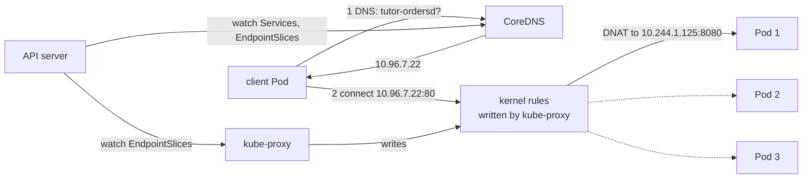
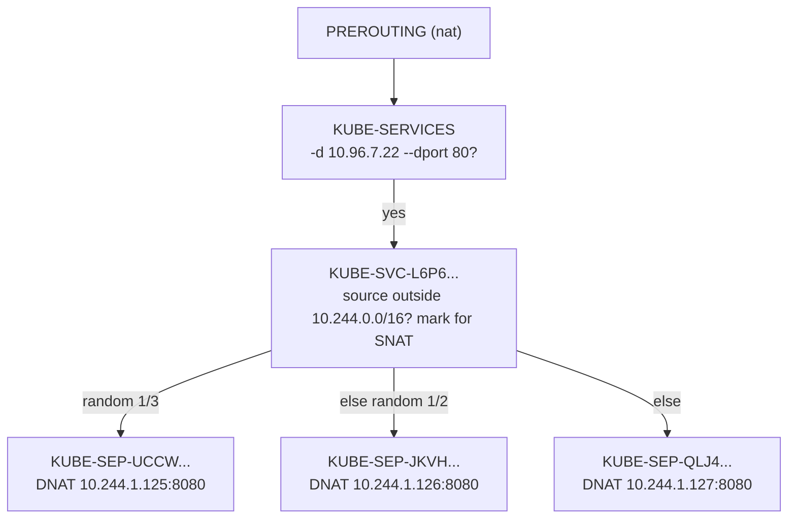

# Services and cluster DNS

## Why care?

Pods come and go. Every new Pod gets a new IP. Yet `orderctl` must reach `ordersd`, and `ordersd` must reach its database, with an address that never changes. That address is a **Service**. Most network mysteries in Kubernetes live here:

- "I can `curl` the Service, but `ping` says nothing answers." (That is normal.)
- "One of three Pods gets almost no traffic, and another gets all of it." (Long-lived connections.)
- "DNS is slow, and CoreDNS gets ten queries for every lookup of `api.stripe.com`." (`ndots:5`.)
- "The Pod is gone for 10 seconds, but some clients still hang on it." (Connection tracking.)

On this page you look inside a Service: the API objects, the actual kernel rules that kube-proxy writes on a node, and the DNS packets a Go program sends. It builds on [Container networking](../containers/networking.md), [DNS](../networking/dns.md) and [Load balancers and proxies](../networking/load-balancers.md).

## The idea: a company phone number

A company prints one phone number on its website. Nobody sits at that number. When you dial it, the phone system picks one of the people on duty and connects you. When people come and go, the list of people on duty changes, but the number stays.

- The **Service** is the published number: a **ClusterIP** like `10.96.7.22`. No machine has this address.
- The **EndpointSlice** is the duty list: which Pod IPs are ready right now.
- **kube-proxy** is the phone system. It runs on every node, and turns "call the number" into "call this person" by rewriting packets in the kernel.
- **CoreDNS** is the company directory. You look up `tutor-ordersd`, and it tells you the number.



The important part: **the ClusterIP is not a proxy and not a machine.** It is a rule in the kernel of every node. The packet goes straight from the client Pod to a backend Pod, and the address is rewritten on the way out of the client's node.

## Under the hood: what a Service is made of

Start with three `ordersd` Pods (the Deployment from [Workloads](workloads.md)) and a Service:

```yaml
apiVersion: v1
kind: Service
metadata:
  name: tutor-ordersd
spec:
  selector:
    app: tutor-ordersd
  ports:
    - name: http
      port: 80 # what clients connect to
      targetPort: http # the container port named "http" (8080)
```

```console
$ kubectl create namespace tutor-services
$ kubectl -n tutor-services apply -f deploy.yaml -f svc.yaml
deployment.apps/tutor-ordersd created
service/tutor-ordersd created
$ kubectl -n tutor-services get svc tutor-ordersd -o wide
NAME            TYPE        CLUSTER-IP   EXTERNAL-IP   PORT(S)   AGE   SELECTOR
tutor-ordersd   ClusterIP   10.96.7.22   <none>        80/TCP    2s    app=tutor-ordersd
$ kubectl -n tutor-services get pods -o wide -l app=tutor-ordersd
NAME                             READY   STATUS    RESTARTS   AGE   IP             NODE           NOMINATED NODE   READINESS GATES
tutor-ordersd-5d867f797c-4dxxb   1/1     Running   0          3s    10.244.1.125   tutor-worker   <none>           <none>
tutor-ordersd-5d867f797c-wb78l   1/1     Running   0          3s    10.244.1.127   tutor-worker   <none>           <none>
tutor-ordersd-5d867f797c-xmbnp   1/1     Running   0          3s    10.244.1.126   tutor-worker   <none>           <none>
```

Two client Pods help with the tests: `tutor-shell` with `busybox`, and `tutor-netshoot` with the `nicolaka/netshoot` image, a toolbox with `dig`, `tcpdump`, `curl` and friends:

```console
$ kubectl -n tutor-services run tutor-shell --image=busybox:1.37 --restart=Never -- sleep 3600
pod/tutor-shell created
$ kubectl -n tutor-services run tutor-netshoot --image=nicolaka/netshoot:v0.13 --restart=Never -- sleep 3600
pod/tutor-netshoot created
```

Three different parts work together.

### Part 1: the IP, allocated by the API server

The API server picks the ClusterIP from the service range when you create the Service. In `kind` that range is `10.96.0.0/16`. Since Kubernetes 1.33 the range and every allocated address are API objects you can see:

```console
$ kubectl get servicecidr
NAME         CIDRS          AGE
kubernetes   10.96.0.0/16   28m
$ kubectl get ipaddresses | grep -E 'NAME|10.96.7.22'
NAME            PARENTREF
10.96.7.22      services/tutor-services/tutor-ordersd
```

That's all. The API server writes the number down. It does not configure any network card. On the node, no interface has this address, and the routing table sends it to the default gateway, like any internet address:

```console
$ docker exec tutor-worker sh -c 'ip -o addr | grep -c 10.96.7.22; ip route get 10.96.7.22'
0
10.96.7.22 via 172.18.0.1 dev eth0 src 172.18.0.2 uid 0
    cache
```

This is why `ping` fails. kube-proxy's rules only match TCP to port 80 (the Service's port). An ICMP packet matches nothing, leaves the node, and is dropped somewhere outside:

```console
$ kubectl -n tutor-services exec tutor-netshoot -- ping -c 2 -W 1 10.96.7.22
PING 10.96.7.22 (10.96.7.22) 56(84) bytes of data.
From <a router outside the laptop> icmp_seq=1 Packet filtered

--- 10.96.7.22 ping statistics ---
2 packets transmitted, 0 received, +1 errors, 100% packet loss, time 999ms
```

(The router's public address is removed here.) Never debug a Service with `ping`. Use `curl`, `nc -vz`, or `wget`.

### Part 2: the EndpointSlice, the duty list

The **EndpointSlice controller** (in the controller manager) watches Services and Pods. For every Service with a selector, it writes **EndpointSlice** objects with the matching Pods' IPs:

```console
$ kubectl -n tutor-services get endpointslices
NAME                  ADDRESSTYPE   PORTS   ENDPOINTS                                AGE
tutor-ordersd-rkqbj   IPv4          8080    10.244.1.127,10.244.1.126,10.244.1.125   3s
$ kubectl -n tutor-services get endpointslices -l kubernetes.io/service-name=tutor-ordersd -o yaml
...
  endpoints:
  - addresses:
    - 10.244.1.127
    conditions:
      ready: true
      serving: true
      terminating: false
    nodeName: tutor-worker
    targetRef:
      kind: Pod
      name: tutor-ordersd-5d867f797c-wb78l
      namespace: tutor-services
  ...
  kind: EndpointSlice
  metadata:
    labels:
      endpointslice.kubernetes.io/managed-by: endpointslice-controller.k8s.io
      kubernetes.io/service-name: tutor-ordersd
    name: tutor-ordersd-rkqbj
    ownerReferences:
    - apiVersion: v1
      blockOwnerDeletion: true
      controller: true
      kind: Service
      name: tutor-ordersd
  ports:
  - name: http
    port: 8080
    protocol: TCP
```

The port is 8080 here: `targetPort: http` was resolved to the container port. A Service can have several slices (the controller puts at most 100 endpoints in one by default), so a change to one Pod in a big Service only rewrites one small object. The older `Endpoints` object (one big list) still exists, but is deprecated:

```console
$ kubectl -n tutor-services get endpoints tutor-ordersd
Warning: v1 Endpoints is deprecated in v1.33+; use discovery.k8s.io/v1 EndpointSlice
NAME            ENDPOINTS                                               AGE
tutor-ordersd   10.244.1.138:8080,10.244.1.139:8080,10.244.1.141:8080   14m
```

The three **conditions** matter during a rollout:

| Condition     | Means                                                           |
| ------------- | --------------------------------------------------------------- |
| `ready`       | Serving **and** not terminating. Normal traffic goes here only. |
| `serving`     | The readiness probe passes, terminating or not.                 |
| `terminating` | The Pod has a deletion timestamp.                               |

Watch them change when a Pod is deleted. Here `ordersd` runs with `ORDERS_SHUTDOWN_DELAY=10s` (it keeps serving for 10 seconds after `SIGTERM`, see [Workloads](workloads.md)), and the slice is read about 0.3 s, 3 s and 15 s after the delete (`--` separates the three reads):

```console
$ kubectl -n tutor-services delete pod tutor-ordersd-7c5c5fb968-kfwd7 --wait=false
pod "tutor-ordersd-7c5c5fb968-kfwd7" deleted from tutor-services namespace
$ kubectl -n tutor-services get endpointslice -l kubernetes.io/service-name=tutor-ordersd \
    -o jsonpath="{range .items[*].endpoints[*]}{.addresses[0]} ready={.conditions.ready} serving={.conditions.serving} terminating={.conditions.terminating}{'\n'}{end}"
10.244.1.138 ready=true serving=true terminating=false
10.244.1.139 ready=true serving=true terminating=false
10.244.1.140 ready=false serving=true terminating=true
--
10.244.1.138 ready=true serving=true terminating=false
10.244.1.139 ready=true serving=true terminating=false
10.244.1.140 ready=false serving=true terminating=true
10.244.1.141 ready=true serving=true terminating=false
--
10.244.1.138 ready=true serving=true terminating=false
10.244.1.139 ready=true serving=true terminating=false
10.244.1.141 ready=true serving=true terminating=false
```

Within 0.3 s the old Pod `.140` is `ready=false`: kube-proxy stops sending **new** connections to it. It is still `serving=true` (its readiness probe has not failed three times yet), and it still answers the connections it has. After 3 s the ReplicaSet's replacement `.141` is in the list. When the old Pod is gone, so is its entry.

The selector is optional. A Service without a selector gets no slices from the controller, and you write your own EndpointSlice: that's how you give an outside database a cluster name.

### Part 3: the rules, written by kube-proxy

**kube-proxy** runs on every node (as a DaemonSet). It watches Services and EndpointSlices, and turns them into kernel rules. Which kind of rules depends on its mode:

```console
$ kubectl -n kube-system get cm kube-proxy -o jsonpath='{.data.config\.conf}' | grep -E '^mode|minSyncPeriod'
  minSyncPeriod: 1s
  minSyncPeriod: 0s
  minSyncPeriod: 0s
mode: iptables
$ kubectl -n kube-system logs ds/kube-proxy | grep Proxier
I1126 21:39:51.177438       1 server_linux.go:144] "Using iptables Proxier"
$ docker exec tutor-worker iptables -V
iptables v1.8.11 (nf_tables)
```

The three `minSyncPeriod` lines belong to the `iptables`, `ipvs` and `nftables` sections of the config. Only the first one counts here: kube-proxy rewrites the rules at most once per second.

Here are all the NAT rules for our Service, on the worker node (`iptables-save` prints them in the format you would type them in):

```console
$ docker exec tutor-worker sh -c 'iptables-save -t nat | grep "tutor-services/tutor-ordersd"'
-A KUBE-SEP-JKVH326E67KBMMXJ -s 10.244.1.126/32 -m comment --comment "tutor-services/tutor-ordersd:http" -j KUBE-MARK-MASQ
-A KUBE-SEP-JKVH326E67KBMMXJ -p tcp -m comment --comment "tutor-services/tutor-ordersd:http" -m tcp -j DNAT --to-destination 10.244.1.126:8080
-A KUBE-SEP-QLJ43IUMHXUPPVPG -s 10.244.1.127/32 -m comment --comment "tutor-services/tutor-ordersd:http" -j KUBE-MARK-MASQ
-A KUBE-SEP-QLJ43IUMHXUPPVPG -p tcp -m comment --comment "tutor-services/tutor-ordersd:http" -m tcp -j DNAT --to-destination 10.244.1.127:8080
-A KUBE-SEP-UCCWUAWJGIMXOHKV -s 10.244.1.125/32 -m comment --comment "tutor-services/tutor-ordersd:http" -j KUBE-MARK-MASQ
-A KUBE-SEP-UCCWUAWJGIMXOHKV -p tcp -m comment --comment "tutor-services/tutor-ordersd:http" -m tcp -j DNAT --to-destination 10.244.1.125:8080
-A KUBE-SERVICES -d 10.96.7.22/32 -p tcp -m comment --comment "tutor-services/tutor-ordersd:http cluster IP" -m tcp --dport 80 -j KUBE-SVC-L6P6CCCIKBUWY66F
-A KUBE-SVC-L6P6CCCIKBUWY66F ! -s 10.244.0.0/16 -d 10.96.7.22/32 -p tcp -m comment --comment "tutor-services/tutor-ordersd:http cluster IP" -m tcp --dport 80 -j KUBE-MARK-MASQ
-A KUBE-SVC-L6P6CCCIKBUWY66F -m comment --comment "tutor-services/tutor-ordersd:http -> 10.244.1.125:8080" -m statistic --mode random --probability 0.33333333349 -j KUBE-SEP-UCCWUAWJGIMXOHKV
-A KUBE-SVC-L6P6CCCIKBUWY66F -m comment --comment "tutor-services/tutor-ordersd:http -> 10.244.1.126:8080" -m statistic --mode random --probability 0.50000000000 -j KUBE-SEP-JKVH326E67KBMMXJ
-A KUBE-SVC-L6P6CCCIKBUWY66F -m comment --comment "tutor-services/tutor-ordersd:http -> 10.244.1.127:8080" -j KUBE-SEP-QLJ43IUMHXUPPVPG
```

And the entry points, which send every new connection (from a Pod or from the node itself) through `KUBE-SERVICES`:

```console
$ docker exec tutor-worker sh -c 'iptables-save -t nat | grep -E "^-A (PREROUTING|OUTPUT|POSTROUTING) .*KUBE|^-A KUBE-POSTROUTING|^-A KUBE-MARK-MASQ"'
-A PREROUTING -m comment --comment "kubernetes service portals" -j KUBE-SERVICES
-A OUTPUT -m comment --comment "kubernetes service portals" -j KUBE-SERVICES
-A POSTROUTING -m comment --comment "kubernetes postrouting rules" -j KUBE-POSTROUTING
-A KUBE-MARK-MASQ -j MARK --set-xmark 0x4000/0x4000
-A KUBE-POSTROUTING -m mark ! --mark 0x4000/0x4000 -j RETURN
-A KUBE-POSTROUTING -j MARK --set-xmark 0x4000/0x0
-A KUBE-POSTROUTING -m comment --comment "kubernetes service traffic requiring SNAT" -j MASQUERADE --random-fully
```

Follow one new TCP connection from a client Pod to `10.96.7.22:80`:



1. `KUBE-SERVICES` has one rule per Service port. It matches the ClusterIP and port, and jumps to that Service's chain.
2. `KUBE-SVC-...` picks a backend **at random**. The probabilities look odd, but they are fair: the first rule takes 1/3 of all connections. Of the remaining 2/3, the second takes half (1/3 of the total). The last one takes the rest.
3. `KUBE-SEP-...` ("service endpoint") does the **DNAT**: it rewrites the destination to the Pod IP and port. If the Pod is talking to itself through the Service (source = its own IP), it marks the packet for SNAT too; otherwise the answer would bypass the NAT and the connection would break ("hairpin").
4. Packets marked `0x4000` get **masquerade** (SNAT to the node's IP) in `POSTROUTING`. That's for traffic from outside the Pod network (a node process, a NodePort client), so the answer comes back through this node.

This is the same DNAT and MASQUERADE that Docker uses for `-p` (see [Container networking](../containers/networking.md)), only many more rules.

The `(nf_tables)` in `iptables -V` means these are not legacy iptables rules. `iptables-nft` translates them to nftables. You can see the translated version, and its packet counters:

```console
$ kubectl -n tutor-services exec tutor-shell -- sh -c 'for i in $(seq 300); do wget -q -O /dev/null http://10.96.7.22/healthz; done'
$ docker exec tutor-worker nft list chain ip nat KUBE-SVC-L6P6CCCIKBUWY66F
# Warning: table ip nat is managed by iptables-nft, do not touch!
table ip nat {
	chain KUBE-SVC-L6P6CCCIKBUWY66F {
		meta l4proto tcp ip saddr != 10.244.0.0/16 ip daddr 10.96.7.22  tcp dport 80 counter packets 0 bytes 0 jump KUBE-MARK-MASQ
		 meta random & 2147483647 < 715827883 counter packets 95 bytes 5700 jump KUBE-SEP-UCCWUAWJGIMXOHKV
		 meta random & 2147483647 < 1073741824 counter packets 99 bytes 5940 jump KUBE-SEP-JKVH326E67KBMMXJ
		 counter packets 106 bytes 6360 jump KUBE-SEP-QLJ43IUMHXUPPVPG
	}
}
```

300 connections: 95, 99 and 106. Only the **first packet** of a connection walks these chains. That's why each counter is a count of connections: NAT rules are only consulted for new connections. After that, **conntrack** (the kernel's connection tracking table) remembers the translation:

```console
$ docker exec tutor-worker conntrack -L -d 10.96.7.22 | head -3
tcp      6 119 TIME_WAIT src=10.244.1.2 dst=10.96.7.22 sport=58522 dport=80 src=10.244.1.125 dst=10.244.1.2 sport=8080 dport=58522 [ASSURED] mark=0 use=1
tcp      6 119 TIME_WAIT src=10.244.1.2 dst=10.96.7.22 sport=58458 dport=80 src=10.244.1.127 dst=10.244.1.2 sport=8080 dport=58458 [ASSURED] mark=0 use=1
tcp      6 119 TIME_WAIT src=10.244.1.2 dst=10.96.7.22 sport=59936 dport=80 src=10.244.1.125 dst=10.244.1.2 sport=8080 dport=59936 [ASSURED] mark=0 use=1
```

Each entry has two halves: the packet as the client sent it (`dst=10.96.7.22 dport=80`), and the answer it expects (`src=10.244.1.125 sport=8080`). The kernel rewrites both directions with this entry.

This has a big consequence for Go services. **kube-proxy balances connections, not requests.** An `http.Client` keeps connections open and reuses them, and gRPC uses one HTTP/2 connection for everything. Three client Pods with one long connection each can all land on the same server Pod, and stay there for hours. Scaling up the server doesn't help: the new Pods only get **new** connections. Fixes: an L7 proxy or service mesh that balances requests, client-side balancing (gRPC with a headless Service, below), or limiting connection lifetime on the server (see [Load balancers and proxies](../networking/load-balancers.md)).

### Three modes: iptables, IPVS, nftables

kube-proxy 1.37 knows three modes on Linux:

```console
$ kubectl -n tutor-services run tutor-kp-help --image=registry.k8s.io/kube-proxy:v1.37.0 --restart=Never --command -- kube-proxy --help
$ kubectl -n tutor-services logs tutor-kp-help | grep -- --proxy-mode
      --proxy-mode ProxyMode                         Which proxy mode to use: on Linux this can be 'iptables' (default), 'ipvs', or 'nftables'. On Windows the only supported value is 'kernelspace'. This parameter is ignored if a config file is specified by --config.
```

| Mode       | How it works                                                                                       | Good                                           | Bad                                                                                         |
| ---------- | -------------------------------------------------------------------------------------------------- | ---------------------------------------------- | ------------------------------------------------------------------------------------------- |
| `iptables` | Chains as above. Picking a backend walks the list rule by rule.                                    | Default, everywhere, well understood           | Cost grows with the number of Services and endpoints; big rule rewrites on every change     |
| `ipvs`     | The kernel's L4 load balancer (IP Virtual Server). One virtual server per ClusterIP, a hash lookup | Fast lookup, more algorithms (`rr`, `lc`, ...) | Still needs iptables for some parts; a separate kernel subsystem to learn; being phased out |
| `nftables` | Native nftables, with **maps**: one lookup from (IP, port) to a chain, no list walking             | Fast, incremental updates, the future          | Newer; needs a recent kernel (5.13+); some tools still expect iptables rules                |

In `nftables` mode you would see one table, `table ip kube-proxy`, with a `service-ips` map instead of one `KUBE-SERVICES` rule per Service. For new clusters on a recent kernel, the Kubernetes documentation recommends `nftables` over `ipvs`.

<!-- TODO(real-output): show `nft list table ip kube-proxy` from a kind cluster created with `networking.kubeProxyMode: nftables`. This shared cluster runs iptables mode, and changing kube-proxy in kube-system is not allowed. -->

Some clusters have **no kube-proxy at all**. Cilium, for example, does the same job with eBPF programs. The Service API is the same; only the "phone system" is different, and `iptables-save` shows nothing.

### NodePort and LoadBalancer: from outside the cluster

A ClusterIP only works inside the cluster. To get traffic in, a Service can also open a port on **every node**:

```console
$ kubectl -n tutor-services expose deploy tutor-ordersd --name=tutor-ordersd-np --type=NodePort --port=80 --target-port=http
service/tutor-ordersd-np exposed
$ kubectl -n tutor-services get svc
NAME               TYPE        CLUSTER-IP    EXTERNAL-IP   PORT(S)        AGE
tutor-ordersd      ClusterIP   10.96.7.22    <none>        80/TCP         39s
tutor-ordersd-np   NodePort    10.96.2.164   <none>        80:31422/TCP   1s
$ curl -s -m 3 http://172.18.0.2:31422/healthz -w ' %{http_code}\n'
 000
```

The first try, within one second of creating the Service, failed: kube-proxy had not written the rules yet (remember `minSyncPeriod: 1s`). A moment later it works, on **both** nodes, even though all Pods run on `tutor-worker`:

```console
$ curl -sS -m 3 http://172.18.0.2:31422/healthz -w ' %{http_code}\n'
{"status":"ok"}
 200
$ docker exec tutor-control-plane curl -sS -m 3 http://172.18.0.3:31422/healthz -w ' %{http_code}\n'
{"status":"ok"}
 200
$ docker exec tutor-control-plane sh -c 'ss -ltn | grep 31422 || echo "nobody listens on 31422"'
nobody listens on 31422
$ docker exec tutor-worker sh -c "iptables-save -t nat | grep -E 'KUBE-NODEPORTS|KUBE-EXT-3W7QVS6HJ5NJMGOM' | grep -v '^:'"
-A KUBE-EXT-3W7QVS6HJ5NJMGOM -m comment --comment "masquerade traffic for tutor-services/tutor-ordersd-np external destinations" -j KUBE-MARK-MASQ
-A KUBE-EXT-3W7QVS6HJ5NJMGOM -j KUBE-SVC-3W7QVS6HJ5NJMGOM
-A KUBE-NODEPORTS -p tcp -m comment --comment "tutor-services/tutor-ordersd-np" -m tcp --dport 31422 -j KUBE-EXT-3W7QVS6HJ5NJMGOM
-A KUBE-NODEPORTS -p tcp -m comment --comment "tutor-ingress/tutor-traefik:web" -m tcp --dport 30080 -j KUBE-EXT-ZJQG4ZNMTIRI7IXC
-A KUBE-NODEPORTS -p tcp -m comment --comment "tutor-ingress/tutor-traefik:websecure" -m tcp --dport 30443 -j KUBE-EXT-OOE65L4QCE76326F
-A KUBE-SERVICES -m comment --comment "kubernetes service nodeports; NOTE: this must be the last rule in this chain" -m addrtype --dst-type LOCAL -j KUBE-NODEPORTS
```

(The two `tutor-traefik` ports belong to the Ingress controller of the [next page](ingress-and-gateway-api.md).)

(`172.18.0.2` and `172.18.0.3` are the two `kind` node containers on the Docker network.) Nobody listens on port 31422. It is again only a DNAT rule: "any packet to a local address on port 31422" goes to `KUBE-EXT-...`, gets marked for masquerade, and then joins the normal `KUBE-SVC-...` chain. A request that arrives at the control-plane node is forwarded to a Pod on the worker. The default NodePort range is 30000–32767.

The masquerade means the Pod sees the **node's** IP as the client, not the real one. `externalTrafficPolicy: Local` changes that: only Pods on the receiving node are used, without SNAT, so the client IP survives. A node without a local Pod then drops the traffic, so the load balancer in front must health-check each node.

`type: LoadBalancer` is NodePort plus a request to the cloud: "give me an external load balancer that sends to these node ports". On `kind` nothing answers that request, and `EXTERNAL-IP` stays `<pending>` (tools like `cloud-provider-kind` or MetalLB fill the gap). A load balancer per Service gets expensive. That is one reason for [Ingress and Gateway API](ingress-and-gateway-api.md): one load balancer, and an L7 proxy behind it for many Services.

Other knobs on a Service:

| Field                   | Default   | Does                                                                              |
| ----------------------- | --------- | --------------------------------------------------------------------------------- |
| `sessionAffinity`       | `None`    | `ClientIP`: the same client IP always goes to the same Pod (conntrack-based, L4)  |
| `internalTrafficPolicy` | `Cluster` | `Local`: Pods only use backends on their own node (node-local agents, DaemonSets) |
| `externalTrafficPolicy` | `Cluster` | `Local`: keep the client IP, only use Pods on the receiving node                  |
| `trafficDistribution`   | unset     | `PreferClose`: prefer endpoints in the same zone (saves cross-zone traffic costs) |

### Headless Services: no number, just the list

Sometimes the client wants to choose the Pod itself: a database client that must talk to the primary, a gRPC client that balances requests across all Pods, a StatefulSet member that must find its peers. A **headless** Service (`clusterIP: None`) gets no ClusterIP and no kube-proxy rules. DNS returns the Pod IPs directly:

```yaml
apiVersion: v1
kind: Service
metadata:
  name: tutor-ordersd-headless
spec:
  clusterIP: None
  selector:
    app: tutor-ordersd
  ports:
    - name: http
      port: 8080
```

```console
$ kubectl -n tutor-services exec tutor-netshoot -- dig +short tutor-ordersd.tutor-services.svc.cluster.local
10.96.7.22
$ kubectl -n tutor-services exec tutor-netshoot -- dig +short tutor-ordersd-headless.tutor-services.svc.cluster.local
10.244.1.127
10.244.1.126
10.244.1.125
$ kubectl -n tutor-services exec tutor-netshoot -- dig +short SRV _http._tcp.tutor-ordersd-headless.tutor-services.svc.cluster.local
0 33 8080 10-244-1-125.tutor-ordersd-headless.tutor-services.svc.cluster.local.
0 33 8080 10-244-1-127.tutor-ordersd-headless.tutor-services.svc.cluster.local.
0 33 8080 10-244-1-126.tutor-ordersd-headless.tutor-services.svc.cluster.local.
```

The normal Service gives one A record (the ClusterIP). The headless one gives one A record **per ready Pod**. The SRV record adds the port, from the port's name (`_http._tcp`). With a StatefulSet (whose `serviceName` points at a headless Service), each Pod also gets its own stable name, as in [Workloads](workloads.md):

```console
$ kubectl -n tutor-services exec tutor-netshoot -- dig +short tutor-db-1.tutor-db.tutor-workloads.svc.cluster.local
10.244.1.88
```

The catch: the client now does the balancing, and it must **re-resolve**. DNS answers are cached (CoreDNS here: 30 s), and a Go program that resolves once at startup keeps the old IPs forever. gRPC-Go's `dns:///` resolver re-resolves; most HTTP clients do not.

## Under the hood: cluster DNS

### CoreDNS and its Corefile

Cluster DNS is two CoreDNS Pods behind a normal Service, `kube-dns`, with a fixed ClusterIP:

```console
$ kubectl -n kube-system get svc kube-dns
NAME       TYPE        CLUSTER-IP   EXTERNAL-IP   PORT(S)                  AGE
kube-dns   ClusterIP   10.96.0.10   <none>        53/UDP,53/TCP,9153/TCP   15m
$ kubectl -n kube-system get endpointslice -l kubernetes.io/service-name=kube-dns
NAME             ADDRESSTYPE   PORTS        ENDPOINTS               AGE
kube-dns-dm9xj   IPv4          53,53,9153   10.244.0.2,10.244.0.3   28m
$ kubectl -n kube-system get cm coredns -o jsonpath='{.data.Corefile}'
.:53 {
    errors
    health {
       lameduck 5s
    }
    ready
    kubernetes cluster.local in-addr.arpa ip6.arpa {
       pods insecure
       fallthrough in-addr.arpa ip6.arpa
       ttl 30
    }
    prometheus :9153
    forward . /etc/resolv.conf {
       max_concurrent 1000
    }
    cache 30 {
       disable success cluster.local
       disable denial cluster.local
    }
    loop
    reload
    loadbalance
}
```

Read it as a list of plugins, tried in order for each query:

- `kubernetes cluster.local ...`: answer names under `cluster.local` (and reverse lookups) from the API. CoreDNS **watches** Services and EndpointSlices like any controller, so the answers are in memory. `ttl 30` is the TTL clients get.
- `forward . /etc/resolv.conf`: everything else goes to the resolver of the node (here, Docker's, then the laptop's).
- `cache 30`: cache forwarded answers for up to 30 s, but not `cluster.local` (those are fresh from memory anyway).
- `health` with `lameduck 5s`: when CoreDNS stops, it keeps answering for 5 s while it reports unhealthy. The same trick as `ORDERS_SHUTDOWN_DELAY`.
- `loadbalance`: shuffle the order of A records in each answer.

### `/etc/resolv.conf` in a Pod

The kubelet writes each Pod's `/etc/resolv.conf` (for the default `dnsPolicy: ClusterFirst`):

```console
$ kubectl -n tutor-services exec tutor-shell -- cat /etc/resolv.conf
search tutor-services.svc.cluster.local svc.cluster.local cluster.local localdomain
nameserver 10.96.0.10
options ndots:5
```

- `nameserver` is the `kube-dns` ClusterIP (the kubelet's `clusterDNS` setting).
- The `search` list starts with **the Pod's own namespace**. That's why `tutor-ordersd` alone works inside `tutor-services`, and `tutor-ordersd.tutor-workloads` reaches another namespace. `localdomain` is copied from the node's own `resolv.conf`.
- `ndots:5`: a name with **fewer than 5 dots** is tried with every search domain **first**, and only then as it is.

The full names:

| Name                                            | Answers                                                    |
| ----------------------------------------------- | ---------------------------------------------------------- |
| `<svc>.<ns>.svc.cluster.local`                  | ClusterIP (or Pod IPs, if headless)                        |
| `<pod>.<svc>.<ns>.svc.cluster.local`            | One StatefulSet Pod (via its headless Service)             |
| `<a-b-c-d>.<svc>.<ns>.svc.cluster.local`        | A Pod behind a headless Service, by its IP                 |
| `_<port>._<proto>.<svc>.<ns>.svc.cluster.local` | SRV: port number and targets                               |
| `d.c.b.a.in-addr.arpa`                          | Reverse lookup: `dig -x 10.96.7.22` gives the Service name |

### `ndots:5`: one lookup, ten queries

[DNS](../networking/dns.md#search-domains-and-ndots-one-lookup-eight-queries) explains `ndots` and search domains in a lab. Here is the real thing, in a Pod. A tiny Go program resolves names with Go's own resolver (static binary, `CGO_ENABLED=0`):

```go
// Command resolve looks up each argument with Go's resolver and prints the addresses.
package main

import (
	"context"
	"fmt"
	"net"
	"os"
	"time"
)

func main() {
	for _, name := range os.Args[1:] {
		start := time.Now()
		addrs, err := net.DefaultResolver.LookupHost(context.Background(), name)
		fmt.Printf("%s -> %v %v (%v)\n", name, addrs, err, time.Since(start).Round(time.Millisecond))
	}
}
```

Copy it into the toolbox Pod, and capture the DNS packets with `tcpdump` while it resolves `example.com`:

```console
$ kubectl -n tutor-services cp resolve tutor-netshoot:/tmp/resolve
$ kubectl -n tutor-services exec tutor-netshoot -- sh -c 'tcpdump -i eth0 -n -l udp port 53 2>/dev/null > /tmp/dns.txt & sleep 1; GODEBUG=netdns=go /tmp/resolve example.com; sleep 1; kill %1; cat /tmp/dns.txt'
example.com -> [172.66.147.243 104.20.23.154 2606:4700:10::6814:179a 2606:4700:10::ac42:93f3] <nil> (47ms)
21:55:31.364547 IP 10.244.1.134.33756 > 10.96.0.10.53: 61979+ [1au] AAAA? example.com.tutor-services.svc.cluster.local. (73)
21:55:31.364570 IP 10.244.1.134.49295 > 10.96.0.10.53: 5583+ [1au] A? example.com.tutor-services.svc.cluster.local. (73)
21:55:31.365009 IP 10.96.0.10.53 > 10.244.1.134.33756: 61979 NXDomain*- 0/1/1 (166)
21:55:31.365122 IP 10.96.0.10.53 > 10.244.1.134.49295: 5583 NXDomain*- 0/1/1 (166)
21:55:31.365281 IP 10.244.1.134.57492 > 10.96.0.10.53: 62292+ [1au] A? example.com.svc.cluster.local. (58)
21:55:31.365285 IP 10.244.1.134.33376 > 10.96.0.10.53: 50823+ [1au] AAAA? example.com.svc.cluster.local. (58)
21:55:31.365521 IP 10.96.0.10.53 > 10.244.1.134.33376: 50823 NXDomain*- 0/1/1 (151)
21:55:31.365620 IP 10.96.0.10.53 > 10.244.1.134.57492: 62292 NXDomain*- 0/1/1 (151)
21:55:31.365680 IP 10.244.1.134.42938 > 10.96.0.10.53: 7930+ [1au] AAAA? example.com.cluster.local. (54)
21:55:31.365728 IP 10.244.1.134.54086 > 10.96.0.10.53: 43448+ [1au] A? example.com.cluster.local. (54)
21:55:31.365911 IP 10.96.0.10.53 > 10.244.1.134.42938: 7930 NXDomain*- 0/1/1 (147)
21:55:31.366201 IP 10.96.0.10.53 > 10.244.1.134.54086: 43448 NXDomain*- 0/1/1 (147)
21:55:31.366389 IP 10.244.1.134.43275 > 10.96.0.10.53: 27639+ [1au] A? example.com.localdomain. (52)
21:55:31.366398 IP 10.244.1.134.36790 > 10.96.0.10.53: 28994+ [1au] AAAA? example.com.localdomain. (52)
21:55:31.385426 IP 10.96.0.10.53 > 10.244.1.134.36790: 28994 NXDomain 0/1/1 (127)
21:55:31.385517 IP 10.96.0.10.53 > 10.244.1.134.43275: 27639 NXDomain 0/1/1 (127)
21:55:31.385712 IP 10.244.1.134.44468 > 10.96.0.10.53: 37610+ [1au] A? example.com. (40)
21:55:31.385714 IP 10.244.1.134.36507 > 10.96.0.10.53: 57708+ [1au] AAAA? example.com. (40)
21:55:31.408735 IP 10.96.0.10.53 > 10.244.1.134.44468: 37610 2/0/1 A 172.66.147.243, A 104.20.23.154 (94)
21:55:31.410509 IP 10.96.0.10.53 > 10.244.1.134.36507: 57708 2/0/1 AAAA 2606:4700:10::6814:179a, AAAA 2606:4700:10::ac42:93f3 (118)
```

**Ten queries** for one name. `example.com` has one dot, fewer than 5, so Go tries all four search domains first (A and AAAA for each, in parallel), gets four `NXDOMAIN`s, and only then asks for `example.com.` itself. The three `cluster.local` misses are fast (CoreDNS answers from memory, `*` means authoritative). The `localdomain` miss is forwarded upstream and costs 19 ms. For a service that calls an external API, every new connection pays this.

Count the queries for three more names (only the outgoing queries, this time):

```console
$ kubectl -n tutor-services exec tutor-netshoot -- sh -c 'for n in example.com. tutor-ordersd tutor-ordersd.tutor-workloads; do tcpdump -i eth0 -n -l udp dst port 53 2>/dev/null > /tmp/dns.txt & sleep 1; /tmp/resolve $n; sleep 1; kill %1; wait; cut -d" " -f5- /tmp/dns.txt; done'
example.com. -> [172.66.147.243 104.20.23.154 2606:4700:10::6814:179a 2606:4700:10::ac42:93f3] <nil> (5ms)
10.96.0.10.53: 8384+ [1au] AAAA? example.com. (40)
10.96.0.10.53: 21896+ [1au] A? example.com. (40)

tutor-ordersd -> [10.96.7.22] <nil> (1ms)
10.96.0.10.53: 22809+ [1au] AAAA? tutor-ordersd.tutor-services.svc.cluster.local. (75)
10.96.0.10.53: 19920+ [1au] A? tutor-ordersd.tutor-services.svc.cluster.local. (75)

tutor-ordersd.tutor-workloads -> [10.96.223.34] <nil> (1ms)
10.96.0.10.53: 65522+ [1au] AAAA? tutor-ordersd.tutor-workloads.tutor-services.svc.cluster.local. (91)
10.96.0.10.53: 11265+ [1au] A? tutor-ordersd.tutor-workloads.tutor-services.svc.cluster.local. (91)
10.96.0.10.53: 35755+ [1au] AAAA? tutor-ordersd.tutor-workloads.svc.cluster.local. (76)
10.96.0.10.53: 50918+ [1au] A? tutor-ordersd.tutor-workloads.svc.cluster.local. (76)
```

- **A trailing dot** (`example.com.`) means "this name is complete": no search list, 2 queries. Use it for external names in configuration: `https://api.example.com.:443/`. Most HTTP clients and TLS accept it (TLS ignores the dot in SNI and certificate checks).
- A short Service name in the **same namespace** hits on the first search domain: 2 queries.
- `<svc>.<ns>` hits on the second: 4 queries.

You can also lower `ndots` per Pod with `dnsConfig`:

```yaml
apiVersion: v1
kind: Pod
metadata:
  name: tutor-ndots
spec:
  dnsConfig:
    options:
      - name: ndots
        value: "1"
  containers:
    - name: shell
      image: nicolaka/netshoot:v0.13
      command: ["sleep", "3600"]
```

```console
$ kubectl -n tutor-services exec tutor-ndots -- cat /etc/resolv.conf
search tutor-services.svc.cluster.local svc.cluster.local cluster.local localdomain
nameserver 10.96.0.10
options ndots:1
```

Now `example.com` (1 dot, not fewer than 1) is tried as-is first: 2 queries. But look what happens to the cross-namespace name:

```console
$ kubectl -n tutor-services exec tutor-ndots -- sh -c 'for n in tutor-ordersd.tutor-workloads; do tcpdump -i eth0 -n -l udp dst port 53 2>/dev/null > /tmp/dns.txt & sleep 1; /tmp/resolve $n; sleep 1; kill %1; wait; cut -d" " -f5- /tmp/dns.txt; done'
tutor-ordersd.tutor-workloads -> [10.96.223.34] <nil> (20ms)
10.96.0.10.53: 19557+ [1au] AAAA? tutor-ordersd.tutor-workloads. (58)
10.96.0.10.53: 57575+ [1au] A? tutor-ordersd.tutor-workloads. (58)
10.96.0.10.53: 36528+ [1au] AAAA? tutor-ordersd.tutor-workloads.tutor-services.svc.cluster.local. (91)
10.96.0.10.53: 33369+ [1au] A? tutor-ordersd.tutor-workloads.tutor-services.svc.cluster.local. (91)
10.96.0.10.53: 15254+ [1au] AAAA? tutor-ordersd.tutor-workloads.svc.cluster.local. (76)
10.96.0.10.53: 55596+ [1au] A? tutor-ordersd.tutor-workloads.svc.cluster.local. (76)
```

`tutor-ordersd.tutor-workloads` has one dot, so it is now tried as a complete name first. That query leaves the cluster, to a real DNS server on the internet, and fails: 20 ms instead of 1 ms, and your internal names leak to the outside. There is no free lunch: either use full names (`tutor-ordersd.tutor-workloads.svc.cluster.local.`) for internal calls too, or keep `ndots:5` and use a trailing dot for external ones. Many clusters add **NodeLocal DNSCache** (a DNS cache on every node) to make all these queries cheap.

## Try it: `kubectl port-forward`

To reach a Service from your laptop without a NodePort, use a port-forward. Use a port other than 8080 on the laptop:

```console
$ kubectl -n tutor-services port-forward svc/tutor-ordersd 18080:80 &
Forwarding from 127.0.0.1:18080 -> 8080
Forwarding from [::1]:18080 -> 8080
$ curl -s localhost:18080/healthz
{"status":"ok"}
$ curl -s localhost:18080/v1/orders
{"orders":[]}
Handling connection for 18080
Handling connection for 18080
```

Look at `-> 8080`. A port-forward does **not** use the Service's ClusterIP or kube-proxy. `kubectl` picks **one Pod** of the Service when it starts, and tunnels through the API server and the kubelet to that Pod's port (8080, the `targetPort`). Every connection goes to the same Pod, and if that Pod dies, the port-forward dies too. It is a debugging tool, not a load balancer.

More things to try:

1. Scale `tutor-ordersd` to 5 and watch the `KUBE-SVC-...` chain on the node: the probabilities change to 0.2, 0.25, 0.33, 0.5.
2. Create an order through the port-forward, then list orders through the Service from a Pod a few times. `ordersd` keeps orders in memory, so you only see it on one Pod in three. Every replica has its own state: that's why the real service needs a database.
3. `dig -x 10.96.7.22` from the toolbox Pod, and compare with the table above.

## Traps

- **Debugging with `ping`.** A ClusterIP doesn't answer ICMP. Test the port: `curl`, `nc -vz`, `wget`.
- **Long-lived connections don't rebalance.** kube-proxy picks a backend per connection. Keep-alive HTTP and gRPC stick to one Pod until the connection closes. Balance per request (L7 proxy, mesh, or gRPC client-side with a headless Service), or cap connection age on the server.
- **Wrong `targetPort`.** `port` is what clients use; `targetPort` is the container port. If the slice shows the wrong port or no endpoints, check the selector and `targetPort` first: `kubectl get endpointslices -l kubernetes.io/service-name=<svc>`.
- **A selector that matches too much.** Two Deployments with `app: orders` behind one Service share its traffic. Use specific labels.
- **`ndots:5` for external calls.** Up to 10 DNS queries per lookup of an external name. Use a trailing dot, or full names, or NodeLocal DNSCache. Lowering `ndots` makes short internal names slower and leaks them upstream.
- **Resolving once.** With a headless Service, clients must re-resolve, or they keep using dead Pod IPs. With a normal Service, DNS is stable and this does not matter.
- **Losing the client IP.** NodePort and LoadBalancer traffic is masqueraded by default. Use `externalTrafficPolicy: Local` (and node health checks), or the proxy protocol / `X-Forwarded-For` at an L7 proxy.
- **Rules lag behind the API.** kube-proxy syncs at most every `minSyncPeriod` (1 s here). A new Service, or a removed Pod, takes a moment to reach every node. Graceful shutdown exists for this.

## Check yourself

??? question "1. You `kubectl exec` into a Pod and run `ping 10.96.7.22`. It fails, but `wget http://10.96.7.22/healthz` works. Why?"

    A ClusterIP is not on any interface. kube-proxy's rules match only the Service's
    protocol and ports (TCP 80 here), and DNAT those packets to a Pod. ICMP matches no rule,
    so it is routed like any other address: out of the node, and dropped. It is not a host,
    just a rule.

??? question "2. A Service has 4 endpoints in iptables mode. What probabilities do the four rules in its `KUBE-SVC-...` chain have, and why do they look unequal?"

    0.25, then 0.333, then 0.5, then no condition (the rest). Each rule only sees the
    connections the earlier rules did not take. 0.25 of all; 0.333 of the remaining 0.75 =
    0.25; 0.5 of the remaining 0.5 = 0.25; the last 0.25. Each backend gets a quarter.

??? question "3. You scale a gRPC server from 2 to 6 Pods because of high CPU. CPU on the 2 old Pods stays high, and the 4 new ones are idle. What is going on?"

    gRPC uses one long-lived HTTP/2 connection per client, and kube-proxy only balances new
    connections (conntrack keeps existing ones on their Pod). The existing clients never
    reconnect, so they stay on the old Pods. Use client-side balancing (a headless Service and
    gRPC's `round_robin` with the `dns:///` resolver), an L7 proxy or mesh, or set
    `MaxConnectionAge` on the server so clients reconnect from time to time.

??? question "4. A Pod in namespace `shop` calls `api.payments.example.com` for every order. Using the default `resolv.conf`, how many DNS queries does one lookup send, and how do you cut it to 2?"

    The name has 3 dots, fewer than `ndots:5`, so the search list comes first: `shop.svc.cluster.local`,
    `svc.cluster.local`, `cluster.local` (plus any node search domains), each with A and AAAA,
    then the name itself: at least 8 queries. Write it with a trailing dot,
    `api.payments.example.com.`, to make it absolute: 2 queries (A and AAAA).

??? question "5. What is the difference between `ready` and `serving` in an EndpointSlice, and when does it matter?"

    `serving` means the readiness probe passes. `ready` means serving **and** not
    terminating. They differ for a Pod that is shutting down but still passes its probe. Normal
    traffic uses only `ready` endpoints, so a terminating Pod gets no new connections. If all
    endpoints are terminating, kube-proxy may fall back to the `serving` ones rather than
    drop everything.

??? question "6. `kubectl port-forward svc/tutor-ordersd 18080:80` works, but all requests land on one Pod, and it stops when that Pod is deleted. Why is this not like the Service?"

    A port-forward does not go through the ClusterIP or kube-proxy. `kubectl` resolves the
    Service to one Pod once, and opens a tunnel through the API server and the kubelet to that
    Pod's `targetPort`. No balancing, no failover. It is for debugging only.

## Recap

- A **Service** is three things: a **ClusterIP** written down by the API server (`ServiceCIDR`, `IPAddress`), **EndpointSlices** written by a controller (`ready`, `serving`, `terminating`), and **kernel rules** written by kube-proxy on every node.
- In **iptables mode**, `KUBE-SERVICES` → `KUBE-SVC-...` (random pick) → `KUBE-SEP-...` (DNAT to a Pod). Only the first packet walks the rules; **conntrack** handles the rest. So balancing is **per connection**.
- **IPVS** uses the kernel's L4 balancer; **nftables** uses maps and is the future. Some CNIs (Cilium) replace kube-proxy completely.
- **NodePort** is a DNAT rule on every node for a port in 30000–32767, with SNAT unless `externalTrafficPolicy: Local`. **LoadBalancer** adds a cloud load balancer in front.
- A **headless** Service has no IP: DNS returns Pod IPs, and the client must balance and re-resolve. StatefulSet Pods get stable names through it.
- **CoreDNS** answers `cluster.local` from a watch, and forwards the rest. Pods get `search <ns>.svc.cluster.local svc.cluster.local cluster.local` and **`ndots:5`**: one external lookup can send 10 queries. A trailing dot makes a name absolute.
- **`kubectl port-forward`** tunnels to one Pod. It is not a Service.

Next: getting HTTP traffic from the outside world to these Services, with TLS. [Ingress and Gateway API](ingress-and-gateway-api.md).
