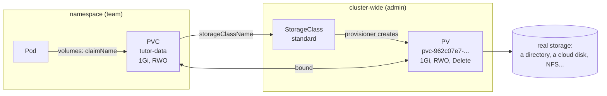
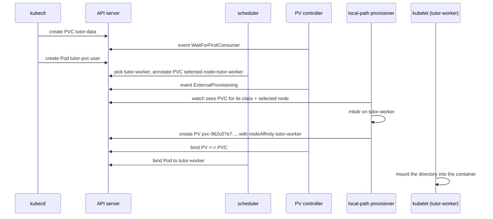
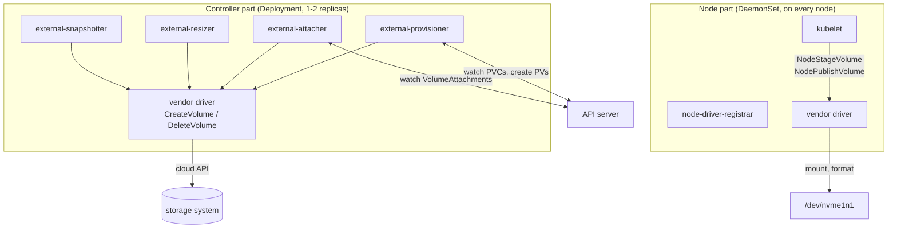

# Storage

## Why care?

Five tickets from teams that run stateful things on Kubernetes:

- "The pod restarted after a deploy, and all uploaded files were gone."
- "We drained a node for maintenance. The database pod has been `Pending` ever since."
- "Someone deleted the namespace by mistake. The volumes went with it. All of them."
- "The claim asks for 1 GiB. The service filled the node's disk at 900 GB."
- "The volume is `ReadWriteOnce`, but two pods are writing to it at the same time."

A container's own filesystem is a thin writable layer on top of the image (see [Filesystems](../linux/filesystems.md#under-the-hood-overlayfs-the-container-filesystem)), and it is thrown away with the container. Anything that must last longer needs a **volume**. Kubernetes has many kinds, and they differ in one question: **how long does the data live, and where?** On this page you use each kind on the `kind` cluster, watch a disk being created on demand, pin a pod to a node through its disk, and delete things to see what survives.

## The idea: a left-luggage office

You arrive at a train station with a suitcase.

- An **`emptyDir`** is the **shelf in your train compartment**. Everybody in your compartment (the containers of the pod) can use it. When you leave the train, the shelf is cleared.
- A **`hostPath`** is putting your suitcase **in the driver's cabin**. It works, but now you are in a room you should not be in, and you only find it again if you board the same train.
- A **PersistentVolumeClaim (PVC)** is a **ticket** you fill in: "one locker, 10 GB, only one person opens it at a time". You don't care which locker.
- A **PersistentVolume (PV)** is the **actual locker**, with a number. The office matches your ticket to a locker. That's **binding**.
- A **StorageClass** is the **locker company and the type of locker** ("fast lockers near platform 1"). If no free locker fits, the company **builds a new one** for your ticket. That's **dynamic provisioning**.
- The **reclaim policy** says what happens to the locker when you hand back the ticket: **emptied and torn down** (`Delete`), or **kept, locked, for the manager to look at** (`Retain`).



The split is about **roles**. A developer writes PVCs in their namespace: "I need this much, this way". A cluster admin (or the cloud) owns StorageClasses and the PVs behind them. The pod only ever names the claim.

## Under the hood: volumes that live with the pod

### `emptyDir`: scratch space for one pod

An `emptyDir` is created empty when the pod starts on a node, and deleted when the pod is deleted. All containers of the pod can mount it. Here one container writes, another reads, and a second volume is in memory:

```yaml
apiVersion: v1
kind: Pod
metadata:
  name: tutor-emptydir
  namespace: tutor-storage
spec:
  containers:
    - name: writer
      image: busybox:1.37
      command: ["sh", "-c", "while :; do date >> /work/log.txt; sleep 5; done"]
      volumeMounts:
        - { name: work, mountPath: /work }
    - name: reader
      image: busybox:1.37
      command: ["sleep", "3600"]
      volumeMounts:
        - { name: work, mountPath: /data, readOnly: true }
        - { name: scratch, mountPath: /scratch }
  volumes:
    - name: work
      emptyDir: {}
    - name: scratch
      emptyDir:
        medium: Memory
        sizeLimit: 64Mi
```

```console
$ kubectl -n tutor-storage exec tutor-emptydir -c reader -- sh -c 'cat /data/log.txt; grep -E " /data | /scratch " /proc/mounts; df -h /data /scratch'
Thu Nov 26 21:48:57 UTC 2026
Thu Nov 26 21:49:01 UTC 2026
Thu Nov 26 21:49:06 UTC 2026
/dev/sdc /data ext4 ro,relatime,discard,errors=remount-ro,data=ordered 0 0
tmpfs /scratch tmpfs rw,relatime,size=65536k 0 0
Filesystem                Size      Used Available Use% Mounted on
/dev/sdc               1006.9G     43.9G    911.7G   5% /data
tmpfs                    64.0M         0     64.0M   0% /scratch
```

- `/data` is on `/dev/sdc`, the **node's own disk**, with the node's full size. It is a plain directory on the node, bind-mounted into both containers. The kubelet keeps it under the pod's directory:

  ```console
  $ docker exec tutor-worker ls -l /var/lib/kubelet/pods/07e93e79-c0f3-437f-9839-f89113a54939/volumes/kubernetes.io~empty-dir/
  total 4
  drwxrwxrwt 2 root root   40 Nov 26 21:48 scratch
  drwxrwxrwx 2 root root 4096 Nov 26 21:48 work
  ```

  (`docker exec tutor-worker` runs a command on the `kind` node, see [Architecture](architecture.md).)

- `/scratch` is a **tmpfs** of 64 MiB: `sizeLimit` became the tmpfs size. Fill it:

  ```console
  $ kubectl -n tutor-storage exec tutor-emptydir -c reader -- sh -c 'dd if=/dev/zero of=/scratch/big bs=1M count=100; df -h /scratch'
  dd: error writing '/scratch/big': No space left on device
  65+0 records in
  64+0 records out
  67108864 bytes (64.0MB) copied, 0.103686 seconds, 617.2MB/s
  Filesystem                Size      Used Available Use% Mounted on
  tmpfs                    64.0M     64.0M         0 100% /scratch
  ```

  Memory-backed `emptyDir` is fast, but those 64 MiB are **RAM**. `kubectl explain pod.spec.volumes.emptyDir.sizeLimit` says the real maximum is the smaller of `sizeLimit` and the sum of the pod's memory limits, and the pages count as the pod's memory (see [Scheduling and resources](scheduling-and-resources.md)). A disk-backed `emptyDir` with a `sizeLimit` is not cut off like this; the kubelet **evicts the pod** when it goes over.

Now, how long does it live? Stop only the `writer` container (on the node, with `crictl`), and the kubelet restarts it:

```console
$ docker exec tutor-worker crictl stop 542db6ca294e4d4fa2215c2db3b886cf120b64c93b12a19a413f2897e04c7570
542db6ca294e4d4fa2215c2db3b886cf120b64c93b12a19a413f2897e04c7570
$ kubectl -n tutor-storage get pod tutor-emptydir
NAME             READY   STATUS    RESTARTS      AGE
tutor-emptydir   2/2     Running   1 (10s ago)   44s
$ kubectl -n tutor-storage exec tutor-emptydir -c reader -- sh -c 'head -1 /data/log.txt; wc -l /data/log.txt'
Thu Nov 26 21:48:57 UTC 2026
11 /data/log.txt
```

The data **survived the container restart**: the first line is still from 21:48:57. Now delete the pod and create it again:

```console
$ kubectl -n tutor-storage delete pod tutor-emptydir --now
pod "tutor-emptydir" deleted from tutor-storage namespace
$ kubectl apply -f emptydir.yaml
pod/tutor-emptydir created
$ kubectl -n tutor-storage exec tutor-emptydir -c reader -- sh -c 'head -1 /data/log.txt; wc -l /data/log.txt'
Thu Nov 26 21:49:44 UTC 2026
1 /data/log.txt
```

Gone. Same name, new pod (new UID, new directory). A Deployment rollout always makes **new** pods, so "deploy" means "lose every `emptyDir`". That's the first ticket from the top. Use `emptyDir` for caches, temporary files, and files shared between containers of one pod (an init container that prepares something, a sidecar that ships logs). Never for data you want back.

### `hostPath`: a hole in the wall

A `hostPath` volume mounts a path **from the node** into the container. Here, the node's pod log directory, read-only:

```yaml
spec:
  nodeName: tutor-worker
  containers:
    - name: app
      image: busybox:1.37
      command: ["sleep", "3600"]
      volumeMounts:
        - { name: node-logs, mountPath: /node-logs, readOnly: true }
  volumes:
    - name: node-logs
      hostPath:
        path: /var/log/pods
        type: Directory
```

```console
$ kubectl -n tutor-storage exec tutor-hostpath -- sh -c 'ls /node-logs | head -2'
kube-system_kindnet-7c9fw_ebcb0ec0-bf7c-4dad-aa34-c2acc14ca77e
kube-system_kube-proxy-wql9f_664287de-a825-4b5e-b914-b17bf0388e8f
```

One small pod in `tutor-storage` now reads the logs of **every pod on the node**, from every namespace. With write access to the right path (`/var/lib/kubelet`, `/etc`, the containerd socket) it owns the node. That is why `hostPath` is forbidden by the `baseline` Pod Security Standard, and why you see it only in node agents (log shippers, CNI plugins, CSI node drivers), which run as DaemonSets.

It also does not do what people hope: the data stays on **one node**. If the pod moves to another node, it finds an empty directory there. For node-local data that should follow a claim, use a **local PV** instead (next section).

### The other pod volumes

You met the rest already, and they all live and die with the pod too:

- `configMap`, `secret`, `downwardAPI` and `projected`: files made by the kubelet from API objects ([Config and secrets](config-and-secrets.md)).
- `image` (newer clusters): mount the content of an OCI image read-only, for example a model or a data set shipped as an image.
- `ephemeral`: a PVC that is created with the pod and deleted with it. A real disk from a StorageClass, with `emptyDir` lifetime.

## Under the hood: PersistentVolumes, Claims and StorageClasses

### The `kind` StorageClass

```console
$ kubectl get storageclass standard -o yaml
apiVersion: storage.k8s.io/v1
kind: StorageClass
metadata:
  annotations:
    kubectl.kubernetes.io/last-applied-configuration: |
      {"apiVersion":"storage.k8s.io/v1","kind":"StorageClass","metadata":{"annotations":{"storageclass.kubernetes.io/is-default-class":"true"},"name":"standard"},"provisioner":"rancher.io/local-path","reclaimPolicy":"Delete","volumeBindingMode":"WaitForFirstConsumer"}
    storageclass.kubernetes.io/is-default-class: "true"
  name: standard
provisioner: rancher.io/local-path
reclaimPolicy: Delete
volumeBindingMode: WaitForFirstConsumer
```

(`uid`, `resourceVersion` and `creationTimestamp` are cut.) Four fields, four decisions:

- **`is-default-class`**: a PVC without `storageClassName` gets this class.
- **`provisioner`**: who builds the volumes. `rancher.io/local-path` is a small controller in the `local-path-storage` namespace. It makes a **directory on a node** for each claim, under `/var/local-path-provisioner`. On a cloud this would be `ebs.csi.aws.com`, `pd.csi.storage.gke.io` or `disk.csi.azure.com`, and each volume would be a real network disk.
- **`reclaimPolicy: Delete`**: when the claim goes, the volume and its data go.
- **`volumeBindingMode: WaitForFirstConsumer`**: don't create anything until a **pod** uses the claim. The other mode, `Immediate`, creates the volume as soon as the PVC exists.

### Dynamic provisioning, step by step

Ask for a disk:

```yaml
apiVersion: v1
kind: PersistentVolumeClaim
metadata:
  name: tutor-data
  namespace: tutor-storage
spec:
  accessModes: ["ReadWriteOnce"]
  resources:
    requests:
      storage: 1Gi
```

```console
$ kubectl apply -f pvc.yaml
persistentvolumeclaim/tutor-data created
$ kubectl -n tutor-storage get pvc
NAME         STATUS    VOLUME   CAPACITY   ACCESS MODES   STORAGECLASS   VOLUMEATTRIBUTESCLASS   AGE
tutor-data   Pending                                      standard       <unset>                 6s
$ kubectl -n tutor-storage describe pvc tutor-data | sed -n '/Events/,$p'
Events:
  Type    Reason                Age   From                         Message
  ----    ------                ----  ----                         -------
  Normal  WaitForFirstConsumer  6s    persistentvolume-controller  waiting for first consumer to be created before binding
```

`Pending` is correct here, not an error. Now a pod that uses it:

```yaml
spec:
  containers:
    - name: app
      image: busybox:1.37
      command: ["sleep", "3600"]
      volumeMounts:
        - { name: data, mountPath: /data }
  volumes:
    - name: data
      persistentVolumeClaim:
        claimName: tutor-data
```

```console
$ kubectl apply -f pvc-pod.yaml
pod/tutor-pvc-user created
$ kubectl -n tutor-storage get pvc; kubectl get pv
NAME         STATUS   VOLUME                                     CAPACITY   ACCESS MODES   STORAGECLASS   VOLUMEATTRIBUTESCLASS   AGE
tutor-data   Bound    pvc-962c07e7-a007-4cf8-84bb-ad11c64a133f   1Gi        RWO            standard       <unset>                 21s
NAME                                       CAPACITY   ACCESS MODES   RECLAIM POLICY   STATUS   CLAIM                      STORAGECLASS   VOLUMEATTRIBUTESCLASS   REASON   AGE
pvc-962c07e7-a007-4cf8-84bb-ad11c64a133f   1Gi        RWO            Delete           Bound    tutor-storage/tutor-data   standard       <unset>                          2s
$ kubectl -n tutor-storage describe pvc tutor-data | sed -n '/Events/,$p'
Events:
  Type    Reason                 Age                From                                                                                                Message
  ----    ------                 ----               ----                                                                                                -------
  Normal  WaitForFirstConsumer   14s (x2 over 20s)  persistentvolume-controller                                                                         waiting for first consumer to be created before binding
  Normal  ExternalProvisioning   4s (x2 over 4s)    persistentvolume-controller                                                                         Waiting for a volume to be created either by the external provisioner 'rancher.io/local-path' or manually by the system administrator. If volume creation is delayed, please verify that the provisioner is running and correctly registered.
  Normal  Provisioning           4s                 rancher.io/local-path_local-path-provisioner-75f7fc7dc5-kc55p_d0497d41-abcf-4fc9-83eb-08baf443ad95  External provisioner is provisioning volume for claim "tutor-storage/tutor-data"
  Normal  ProvisioningSucceeded  1s                 rancher.io/local-path_local-path-provisioner-75f7fc7dc5-kc55p_d0497d41-abcf-4fc9-83eb-08baf443ad95  Successfully provisioned volume pvc-962c07e7-a007-4cf8-84bb-ad11c64a133f
```

This is the reconciliation pattern from [Reconciliation](reconciliation.md), with three loops handing work to each other through the API:



The key step is the **scheduler** writing `volume.kubernetes.io/selected-node` on the claim. That's why `WaitForFirstConsumer` exists: the disk is made **where the pod will run**, not in some random place first. With `Immediate`, a cloud disk could be created in zone A while the pod can only run in zone B (a disk attaches only to machines in its own zone), and the pod would be stuck.

```console
$ kubectl -n tutor-storage get pvc tutor-data -o jsonpath='{.metadata.annotations}'
{"kubectl.kubernetes.io/last-applied-configuration":"...","pv.kubernetes.io/bind-completed":"yes","pv.kubernetes.io/bound-by-controller":"yes","volume.beta.kubernetes.io/storage-provisioner":"rancher.io/local-path","volume.kubernetes.io/selected-node":"tutor-worker","volume.kubernetes.io/storage-provisioner":"rancher.io/local-path"}
```

(The `last-applied-configuration` value is cut.)

### What a local volume really is

Look at the PV the provisioner made:

```console
$ kubectl get pv pvc-962c07e7-a007-4cf8-84bb-ad11c64a133f -o yaml | sed -n '/^spec:/,/^status/p'
spec:
  accessModes:
  - ReadWriteOnce
  capacity:
    storage: 1Gi
  claimRef:
    apiVersion: v1
    kind: PersistentVolumeClaim
    name: tutor-data
    namespace: tutor-storage
    resourceVersion: "4791"
    uid: 962c07e7-a007-4cf8-84bb-ad11c64a133f
  hostPath:
    path: /var/local-path-provisioner/pvc-962c07e7-a007-4cf8-84bb-ad11c64a133f_tutor-storage_tutor-data
    type: DirectoryOrCreate
  nodeAffinity:
    required:
      nodeSelectorTerms:
      - matchExpressions:
        - key: kubernetes.io/hostname
          operator: In
          values:
          - tutor-worker
  persistentVolumeReclaimPolicy: Delete
  storageClassName: standard
  volumeMode: Filesystem
status:
```

- **`claimRef`** is the binding, from the PV's side, with the claim's **UID**. The PV belongs to this one claim object, not just to any claim with that name.
- **`hostPath`**: in the end, it is a directory on the node.
- **`nodeAffinity`**: the volume exists only on `tutor-worker`. Any pod that uses this claim **must** run there.

Write something and find it on the node:

```console
$ kubectl -n tutor-storage exec tutor-pvc-user -- sh -c 'echo "order-1 paid" > /data/orders.txt; grep " /data " /proc/mounts; df -h /data'
/dev/sdc /data ext4 rw,relatime,discard,errors=remount-ro,data=ordered 0 0
Filesystem                Size      Used Available Use% Mounted on
/dev/sdc               1006.9G     44.0G    911.7G   5% /data
$ docker exec tutor-worker ls -l /var/local-path-provisioner/
total 4
drwxrwxrwx 2 root root 4096 Nov 26 21:50 pvc-962c07e7-a007-4cf8-84bb-ad11c64a133f_tutor-storage_tutor-data
$ docker exec tutor-worker sh -c 'cat /var/local-path-provisioner/*tutor-data/orders.txt'
order-1 paid
```

Look at `df`: the claim said 1 GiB, and the pod sees **1006.9G**. A directory has no size. `capacity` here is only a label used for matching; nothing enforces it. That's the fourth ticket. Real block storage (a cloud disk, a CSI driver for LVM) gives you a filesystem of exactly the size you asked for.

### Pinned to a node

Delete the pod and try to run a new one, on purpose, on the other node:

```yaml
spec:
  nodeSelector:
    kubernetes.io/hostname: tutor-control-plane
  tolerations:
    - key: node-role.kubernetes.io/control-plane
      effect: NoSchedule
  # ... same container and claim as before
```

```console
$ kubectl -n tutor-storage get pod tutor-pvc-elsewhere
NAME                  READY   STATUS    RESTARTS   AGE
tutor-pvc-elsewhere   0/1     Pending   0          5s
$ kubectl -n tutor-storage describe pod tutor-pvc-elsewhere | sed -n '/Events/,$p'
Events:
  Type     Reason            Age              From               Message
  ----     ------            ----             ----               -------
  Warning  FailedScheduling  6s (x2 over 6s)  default-scheduler  0/2 nodes are available: 1 node(s) didn't match PersistentVolume's node affinity, 1 node(s) didn't match Pod's node affinity/selector. preemption: 0/2 nodes are available: 2 Preemption is not helpful for scheduling.
```

The scheduler reads the PV's `nodeAffinity` like any other rule (see [Scheduling and resources](scheduling-and-resources.md)). The pod wants `tutor-control-plane`; its disk lives on `tutor-worker`. No node satisfies both. Without the `nodeSelector`, the scheduler puts the pod on `tutor-worker` and the data is still there:

```console
$ kubectl apply -f pvc-pod.yaml
pod/tutor-pvc-user created
$ kubectl -n tutor-storage exec tutor-pvc-user -- cat /data/orders.txt
order-1 paid
```

That's the second ticket. With **local** volumes (local-path, `local` PVs, node-local NVMe), the pod can only ever run on the node that has its disk. Drain that node, and the pod waits. Cloud disks have a softer version of the same rule: they are pinned to a **zone**, and the PV has a `topology.kubernetes.io/zone` affinity instead of a hostname.

### Access modes: per node, not per pod

| Mode               | Short  | Means                                                  |
| ------------------ | ------ | ------------------------------------------------------ |
| `ReadWriteOnce`    | `RWO`  | mounted read-write by **one node** (many pods on it)   |
| `ReadOnlyMany`     | `ROX`  | mounted read-only by many nodes                        |
| `ReadWriteMany`    | `RWX`  | mounted read-write by many nodes (NFS, CephFS, EFS…)   |
| `ReadWriteOncePod` | `RWOP` | mounted read-write by **one pod** in the whole cluster |

`RWO` is about **nodes**. A second pod with the same claim, on the same node:

```console
$ kubectl apply -f pvc-pod2.yaml
pod/tutor-pvc-user2 created
$ kubectl -n tutor-storage get pods -o wide
NAME              READY   STATUS    RESTARTS   AGE   IP            NODE           NOMINATED NODE   READINESS GATES
tutor-pvc-user    1/1     Running   0          33s   10.244.1.94   tutor-worker   <none>           <none>
tutor-pvc-user2   1/1     Running   0          1s    10.244.1.96   tutor-worker   <none>           <none>
$ kubectl -n tutor-storage exec tutor-pvc-user2 -- sh -c 'echo "order-2 paid" >> /data/orders.txt'
$ kubectl -n tutor-storage exec tutor-pvc-user -- cat /data/orders.txt
order-1 paid
order-2 paid
```

Two writers, one `ReadWriteOnce` volume, no error. That's the fifth ticket: during a rolling update, the old and the new pod of a Deployment can both be running on the same node, both with the database files open. If your software is not built for two writers (most aren't), use **`ReadWriteOncePod`**:

```console
$ kubectl apply -f pvc-rwop.yaml -f solo-a.yaml
persistentvolumeclaim/tutor-solo created
pod/tutor-solo-a created
$ kubectl apply -f solo-b.yaml
pod/tutor-solo-b created
$ kubectl -n tutor-storage get pods tutor-solo-a tutor-solo-b
NAME           READY   STATUS    RESTARTS   AGE
tutor-solo-a   1/1     Running   0          10s
tutor-solo-b   0/1     Pending   0          6s
$ kubectl -n tutor-storage describe pod tutor-solo-b | sed -n '/Events/,$p'
Events:
  Type     Reason            Age   From               Message
  ----     ------            ----  ----               -------
  Warning  FailedScheduling  6s    default-scheduler  0/2 nodes are available: 1 node(s) had untolerated taint(s), 1 node(s) unavailable due to PersistentVolumeClaim with ReadWriteOncePod access mode already in-use by another pod. preemption: 0/2 nodes are available: 1 No preemption victims found for incoming pod, 1 Preemption is not helpful for scheduling.
```

The scheduler itself keeps the second pod away. (The tainted node is the control plane.)

And not every StorageClass can do every mode. A directory on one node can't be shared between nodes:

```console
$ kubectl -n tutor-storage describe pvc tutor-shared | grep ProvisioningFailed
  Warning  ProvisioningFailed    1s (x2 over 16s)  rancher.io/local-path_local-path-provisioner-75f7fc7dc5-kc55p_d0497d41-abcf-4fc9-83eb-08baf443ad95  failed to provision volume with StorageClass "standard": NodePath only supports ReadWriteOnce and ReadWriteOncePod (1.22+) access modes
```

The claim stays `Pending`, and so does its pod. Most cloud **block** disks are `RWO` only. `RWX` needs a network filesystem, and a network filesystem has different rules for locking and `fsync` than a local disk (see [Filesystems](../linux/filesystems.md#under-the-hood-fsync-and-the-atomic-rename)). Don't put a database on it.

### Reclaim policy: what deleting a claim deletes

With `Delete`, deleting the claim deletes the PV **and the data**. But not while a pod uses it:

```console
$ kubectl -n tutor-storage delete pvc tutor-data --wait=false
persistentvolumeclaim "tutor-data" deleted from tutor-storage namespace
$ kubectl -n tutor-storage get pvc tutor-data
NAME         STATUS        VOLUME                                     CAPACITY   ACCESS MODES   STORAGECLASS   VOLUMEATTRIBUTESCLASS   AGE
tutor-data   Terminating   pvc-962c07e7-a007-4cf8-84bb-ad11c64a133f   1Gi        RWO            standard       <unset>                 105s
$ kubectl -n tutor-storage get pvc tutor-data -o jsonpath='{.metadata.finalizers}{"  "}{.metadata.deletionTimestamp}{"\n"}'
["kubernetes.io/pvc-protection"]  2026-11-26T21:51:54Z
```

A **finalizer** (see [Reconciliation](reconciliation.md)) holds the claim in `Terminating` while pods use it. Delete the pods, and it all goes:

```console
$ kubectl -n tutor-storage delete pod tutor-pvc-user tutor-pvc-user2 --now
pod "tutor-pvc-user" deleted from tutor-storage namespace
pod "tutor-pvc-user2" deleted from tutor-storage namespace
$ kubectl -n tutor-storage get pvc; kubectl get pv pvc-962c07e7-a007-4cf8-84bb-ad11c64a133f; docker exec tutor-worker ls /var/local-path-provisioner/
No resources found in tutor-storage namespace.
Error from server (NotFound): persistentvolumes "pvc-962c07e7-a007-4cf8-84bb-ad11c64a133f" not found
```

Claim gone, PV gone, directory gone (the last `ls` prints nothing). Deleting a **namespace** deletes every PVC in it, and so, with `Delete`, every disk. That's the third ticket. For data you care about, use a StorageClass with `reclaimPolicy: Retain` (you can also change one PV with `kubectl patch pv ... -p '{"spec":{"persistentVolumeReclaimPolicy":"Retain"}}'`), and take backups or snapshots anyway.

Here is `Retain` with a PV made by hand (a **static** PV, the way admins did it before dynamic provisioning):

```yaml
apiVersion: v1
kind: PersistentVolume
metadata:
  name: tutor-retained
spec:
  capacity:
    storage: 1Gi
  accessModes: ["ReadWriteOnce"]
  persistentVolumeReclaimPolicy: Retain
  storageClassName: "" # no class: only claims that also say "" can bind
  hostPath:
    path: /var/tmp/tutor-retained
    type: DirectoryOrCreate
  nodeAffinity:
    required:
      nodeSelectorTerms:
        - matchExpressions:
            - key: kubernetes.io/hostname
              operator: In
              values: ["tutor-worker"]
---
apiVersion: v1
kind: PersistentVolumeClaim
metadata:
  name: tutor-keep
  namespace: tutor-storage
spec:
  storageClassName: ""
  volumeName: tutor-retained
  accessModes: ["ReadWriteOnce"]
  resources:
    requests:
      storage: 1Gi
```

```console
$ kubectl get pv tutor-retained
NAME             CAPACITY   ACCESS MODES   RECLAIM POLICY   STATUS   CLAIM                      STORAGECLASS   VOLUMEATTRIBUTESCLASS   REASON   AGE
tutor-retained   1Gi        RWO            Retain           Bound    tutor-storage/tutor-keep                  <unset>                          3s
$ kubectl -n tutor-storage delete pvc tutor-keep
persistentvolumeclaim "tutor-keep" deleted from tutor-storage namespace
$ kubectl get pv tutor-retained
NAME             CAPACITY   ACCESS MODES   RECLAIM POLICY   STATUS     CLAIM                      STORAGECLASS   VOLUMEATTRIBUTESCLASS   REASON   AGE
tutor-retained   1Gi        RWO            Retain           Released   tutor-storage/tutor-keep                  <unset>                          7s
```

`Released`: the data is kept, and the PV still remembers its old claim, by UID. Create a claim with the **same name** again, and it does not bind:

```console
$ kubectl apply -f static-pv.yaml >/dev/null
$ kubectl -n tutor-storage get pvc tutor-keep
NAME         STATUS    VOLUME           CAPACITY   ACCESS MODES   STORAGECLASS   VOLUMEATTRIBUTESCLASS   AGE
tutor-keep   Pending   tutor-retained   0                                        <unset>                 5s
```

The new claim has a new UID. Kubernetes won't hand your old data to a new object just because it has the same name; an admin must decide. Remove the old UID from `claimRef`, and the controller binds them on its next pass:

```console
$ kubectl patch pv tutor-retained --type json -p '[{"op":"remove","path":"/spec/claimRef/uid"},{"op":"remove","path":"/spec/claimRef/resourceVersion"}]'
persistentvolume/tutor-retained patched
$ kubectl -n tutor-storage get pvc tutor-keep
NAME         STATUS   VOLUME           CAPACITY   ACCESS MODES   STORAGECLASS   VOLUMEATTRIBUTESCLASS   AGE
tutor-keep   Bound    tutor-retained   1Gi        RWO                           <unset>                 29s
$ kubectl -n tutor-storage describe pvc tutor-keep | sed -n '/Events/,$p'
Events:
  Type     Reason         Age   From                         Message
  ----     ------         ----  ----                         -------
  Warning  FailedBinding  30s   persistentvolume-controller  volume "tutor-retained" already bound to a different claim.
```

That's how you get data back after a namespace was deleted: if the PV was `Retain`.

### Resizing

```console
$ kubectl -n tutor-storage patch pvc data-tutor-db-0 -p '{"spec":{"resources":{"requests":{"storage":"2Gi"}}}}'
Error from server (Forbidden): persistentvolumeclaims "data-tutor-db-0" is forbidden: only dynamically provisioned pvc can be resized and the storageclass that provisions the pvc must support resize
```

Growing a claim works only if the StorageClass has `allowVolumeExpansion: true` and the driver supports it (cloud disks do). `standard` here has `false`. You can only **grow**, never shrink.

## Under the hood: CSI, the plug for storage

`local-path` is a simple, special case. Real storage on Kubernetes goes through the **Container Storage Interface (CSI)**: a gRPC API between Kubernetes and a **driver** written by the storage vendor. Kubernetes itself knows nothing about EBS, Ceph or NetApp. This cluster has no CSI driver at all:

```console
$ kubectl get csidrivers
No resources found
$ kubectl get csinodes
NAME                  DRIVERS   AGE
tutor-control-plane   0         14m
tutor-worker          0         14m
```

On a cloud cluster, `kubectl get csidrivers` lists one or more. A CSI driver comes in two parts, each a vendor container plus small Kubernetes **sidecars** that turn API objects into gRPC calls:



Follow one claim through it:

1. **Provision.** `external-provisioner` sees a PVC for its class (after the scheduler picked a node, with `WaitForFirstConsumer`) and calls `CreateVolume` with the size and the node's zone. The driver calls the cloud API. The sidecar creates the PV. That's what `rancher.io/local-path` did above, without CSI.
2. **Attach.** When a pod using it is scheduled, the attach/detach controller creates a **VolumeAttachment** object. `external-attacher` sees it and calls `ControllerPublishVolume`: "attach disk vol-123 to machine i-456". `kubectl get volumeattachments` shows them.
3. **Stage.** The kubelet on the node calls `NodeStageVolume`: find the device, **format** it if new, mount it once at a node-wide staging path.
4. **Publish.** `NodePublishVolume`: bind-mount the staged path into this pod's directory under `/var/lib/kubelet/pods/<uid>/volumes/`. The container sees it at its `mountPath`.

Removal runs backwards: unpublish, unstage, detach (`ControllerUnpublishVolume`), and `DeleteVolume` if the policy is `Delete`. A pod stuck in `ContainerCreating` with `FailedAttachVolume` or `FailedMount` events is stuck in step 2 or 3, often because the disk is still attached to the old node, which died. The `external-snapshotter` handles `VolumeSnapshot` objects: point-in-time copies made by the storage system, which you can restore into a new PVC.

## Under the hood: StatefulSets and `volumeClaimTemplates`

A Deployment's pods all share one pod template, so they would all share one claim. A database with two replicas needs **one disk each**, and each pod must get **its own** disk back after a restart. [Workloads](workloads.md) introduced StatefulSets for the stable names; `volumeClaimTemplates` does the same for disks:

```yaml
apiVersion: apps/v1
kind: StatefulSet
metadata:
  name: tutor-db
  namespace: tutor-storage
spec:
  serviceName: tutor-db
  replicas: 2
  selector:
    matchLabels: { app: tutor-db }
  template:
    metadata:
      labels: { app: tutor-db }
    spec:
      containers:
        - name: db
          image: busybox:1.37
          command:
            ["sh", "-c", "hostname >> /var/lib/db/boots.txt; exec sleep 3600"]
          volumeMounts:
            - { name: data, mountPath: /var/lib/db }
  volumeClaimTemplates:
    - metadata:
        name: data
      spec:
        accessModes: ["ReadWriteOnce"]
        resources:
          requests:
            storage: 1Gi
```

```console
$ kubectl -n tutor-storage get pods,pvc
NAME             READY   STATUS    RESTARTS   AGE
pod/tutor-db-0   1/1     Running   0          9s
pod/tutor-db-1   1/1     Running   0          5s

NAME                                    STATUS   VOLUME                                     CAPACITY   ACCESS MODES   STORAGECLASS   VOLUMEATTRIBUTESCLASS   AGE
persistentvolumeclaim/data-tutor-db-0   Bound    pvc-56e0d21e-907a-42fe-9439-deda7127061a   1Gi        RWO            standard       <unset>                 9s
persistentvolumeclaim/data-tutor-db-1   Bound    pvc-28a93836-fc0f-4bee-b178-83197f28f364   1Gi        RWO            standard       <unset>                 5s
```

The claim name is `<template name>-<pod name>`: `data-tutor-db-0`, `data-tutor-db-1`. The StatefulSet controller creates the claim **before** the pod, and a new `tutor-db-1` always gets `data-tutor-db-1`. Delete pod 1; it comes back and appends to the same file:

```console
$ kubectl -n tutor-storage delete pod tutor-db-1
pod "tutor-db-1" deleted from tutor-storage namespace
$ kubectl -n tutor-storage exec tutor-db-1 -- cat /var/lib/db/boots.txt
tutor-db-1
tutor-db-1
```

Scale down to one replica. The pod goes; its claim **stays**:

```console
$ kubectl -n tutor-storage scale sts tutor-db --replicas=1
statefulset.apps/tutor-db scaled
$ kubectl -n tutor-storage get pods,pvc
NAME             READY   STATUS        RESTARTS   AGE
pod/tutor-db-0   1/1     Running       0          51s
pod/tutor-db-1   1/1     Terminating   0          7s

NAME                                    STATUS   VOLUME                                     CAPACITY   ACCESS MODES   STORAGECLASS   VOLUMEATTRIBUTESCLASS   AGE
persistentvolumeclaim/data-tutor-db-0   Bound    pvc-56e0d21e-907a-42fe-9439-deda7127061a   1Gi        RWO            standard       <unset>                 51s
persistentvolumeclaim/data-tutor-db-1   Bound    pvc-28a93836-fc0f-4bee-b178-83197f28f364   1Gi        RWO            standard       <unset>                 47s
```

Scale back to two, and the new `tutor-db-1` finds its old data, with a third boot:

```console
$ kubectl -n tutor-storage scale sts tutor-db --replicas=2
statefulset.apps/tutor-db scaled
$ kubectl -n tutor-storage exec tutor-db-1 -- cat /var/lib/db/boots.txt
tutor-db-1
tutor-db-1
tutor-db-1
```

Kept on purpose: scaling down by mistake must not delete a database. The default is spelled out in the spec:

```console
$ kubectl -n tutor-storage get sts tutor-db -o jsonpath='{.spec.persistentVolumeClaimRetentionPolicy}'
{"whenDeleted":"Retain","whenScaled":"Retain"}
```

Set `whenScaled: Delete` or `whenDeleted: Delete` only for data you can rebuild (a cache, a replica that resyncs). The other side of this coin: claims left after scale-downs and deleted StatefulSets keep their disks, and keep costing money. Look for unused PVCs now and then.

## Try it

1. Make a pod with two containers and an `emptyDir`. Stop one container with `crictl stop` on the node. Is the data still there? Now `kubectl delete` the pod. Where on the node was the directory, and does it still exist?
2. Create a PVC on the `standard` class and wait a minute. Why is it `Pending`? Which event tells you? Then create a pod that uses it and find the directory under `/var/local-path-provisioner` on the node.
3. Write 2 GiB into a 1 GiB local-path claim (`dd if=/dev/zero of=/data/big bs=1M count=2048`). What happens, and why?
4. Run two pods on the same `ReadWriteOnce` claim. Then change the claim to `ReadWriteOncePod` (you need a new claim) and try again. Which component stops the second pod?
5. Create a StatefulSet with `volumeClaimTemplates`, scale it to 3 and back to 1. List the claims. Delete the StatefulSet. What is left? Clean up the claims by hand.
6. On a cloud cluster (if you have one), find the CSI driver pods (`kubectl get pods -A | grep csi`) and the `VolumeAttachment` for one of your PVs.

## Traps

- **`emptyDir` for data you want to keep.** Every rollout creates new pods. The data is gone.
- **Memory `emptyDir` without a limit.** It is RAM, and it counts as the pod's memory. Always set `sizeLimit`.
- **`hostPath` in application pods.** It gives the pod the node, and the data stays on one node anyway. Use a PVC.
- **Deleting a namespace with `reclaimPolicy: Delete`.** All its disks go with it. Use `Retain` for important data, and back up.
- **`ReadWriteOnce` = one node, not one pod.** Two pods on one node can both write. Use `ReadWriteOncePod`, or the `Recreate` strategy, for single-writer software.
- **`Immediate` binding with zonal disks.** The disk is made in the wrong zone, and the pod can never start. Use `WaitForFirstConsumer`.
- **Local volumes pin pods to nodes.** Drain the node, and the pod waits for it. Plan for it, or use replicated storage.
- **Trusting `capacity` on local-path.** It is not enforced. A full node disk takes all pods on that node down.
- **Databases on `RWX` network filesystems.** Locking and `fsync` behave differently. Use block storage (`RWO`).
- **Forgotten claims.** StatefulSets keep claims after scale-down and delete. They keep costing money.

## Check yourself

??? question "1. A Deployment writes uploads to an `emptyDir`. A container crashes and restarts. Then a new version is rolled out. When are the uploads lost?"

    Not at the container restart: an `emptyDir` belongs to the **pod**, and the kubelet
    keeps it while the pod exists (you saw the first log line survive `crictl stop`). They
    are lost at the rollout, because a rollout creates **new** pods, and a new pod gets a
    new, empty directory. Use a PVC, or better, object storage.

??? question "2. A PVC on a `WaitForFirstConsumer` class has been `Pending` for an hour. Is something broken? What would you check?"

    Probably not: the class waits until a pod uses the claim. The event
    `WaitForFirstConsumer` says so. Check that a pod with this `claimName` exists. If one
    does and it is also `Pending`, look at the pod's events (scheduling) and the claim's
    events (`ProvisioningFailed`, for example an unsupported access mode, as with `RWX` on
    local-path).

??? question "3. After a node failure, a StatefulSet pod is `Pending` with `didn't match PersistentVolume's node affinity`. Explain, and give two ways out."

    The pod's disk is a **local** volume on the failed node; the PV has `nodeAffinity` for
    that node, so no other node is allowed. Ways out: bring the node back; or accept losing
    that replica's data, delete the PVC (and PV), and let the StatefulSet create a new
    claim on another node, then let the application resync from the other replicas. With
    network block storage (a zonal cloud disk) the pod could move to another node in the
    same zone instead.

??? question "4. A namespace was deleted by accident. Which data can you still get back, and how?"

    Only volumes whose PV had `reclaimPolicy: Retain`. Those are now `Released` and still
    hold the data. Recreate the namespace and a PVC (with `volumeName` set), remove the
    old `claimRef.uid` from the PV, and it binds. Volumes with `Delete` are gone, unless
    you have snapshots or backups.

??? question "5. Two pods use one `ReadWriteOnce` claim. One runs, the other is `ContainerCreating` with a `Multi-Attach error`. Why didn't this happen in the demo on this page?"

    In the demo both pods were on the same node, and `RWO` allows any number of pods on
    **one node**. The error happens when the second pod lands on a **different** node:
    a block disk can be attached to only one machine at a time. `ReadWriteOncePod` would
    have blocked the second pod even on the same node, already in the scheduler.

??? question "6. Name the four CSI calls that happen between a new PVC and a running container, and which component makes each one."

    `CreateVolume` (external-provisioner sidecar, controller part), `ControllerPublishVolume`
    (external-attacher, after a VolumeAttachment is created), `NodeStageVolume` and
    `NodePublishVolume` (the kubelet, talking to the node part of the driver: format and
    mount once per node, then bind-mount into the pod).

## Recap

- **`emptyDir`** lives as long as the **pod**: it survives container restarts, not rollouts. `medium: Memory` is tmpfs and counts as memory. **`hostPath`** gives the pod a piece of the node; keep it to node agents.
- A **PVC** asks, a **PV** is the volume, a **StorageClass** says who makes it (**provisioner**), when (**`WaitForFirstConsumer`** or `Immediate`), and what happens on release (**`Delete`** or **`Retain`**).
- **Binding** is by UID. A `Released` PV keeps its data until an admin clears `claimRef`.
- `kind`'s `standard` class is **local-path**: a directory on one node, pinned by `nodeAffinity`, **size not enforced**, `RWO`/`RWOP` only.
- **Access modes** are about nodes: `RWO` allows many pods on one node. **`ReadWriteOncePod`** means one pod.
- **CSI**: controller sidecars (provisioner, attacher, resizer, snapshotter) and a node plugin; `CreateVolume` → `ControllerPublishVolume` → `NodeStageVolume` → `NodePublishVolume`.
- **StatefulSet `volumeClaimTemplates`** give each pod its own claim, `data-<pod>`, kept across restarts and, by default, across scale-down and delete.

Next: where pods run, and how much they may use. [Scheduling and resources](scheduling-and-resources.md).
