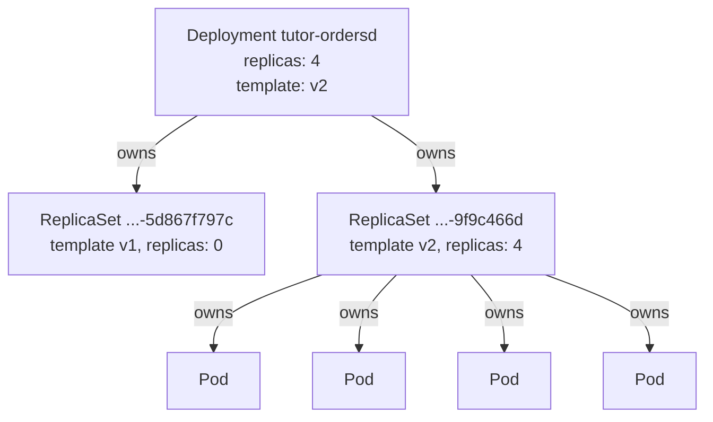
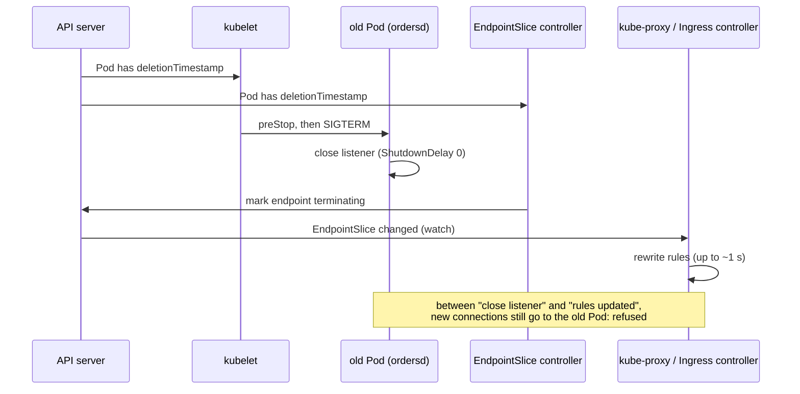

# Workloads

## Why care?

You almost never create a Pod yourself. You create a **workload**, and a controller creates the Pods for you. Each workload kind answers a different question:

- "Keep 4 copies of `ordersd` running, and swap them for a new version without downtime." That is a **Deployment**.
- "Run 3 database members, each with its own name and its own disk." That is a **StatefulSet**.
- "Run one log agent on every node." That is a **DaemonSet**.
- "Run this migration once, and retry it if it fails." That is a **Job**. "Every night at 2:00" makes it a **CronJob**.

Pick the wrong one, or misunderstand the one you picked, and you get messages like these:

- "The rollout is `successful`, but for 20 seconds some users got `502 Bad Gateway`."
- "`kubectl apply` says `configured`, but nothing changed. The rollout is stuck, and nobody noticed."
- "The CronJob ran twice at the same time, and the report has every order twice."

This page builds each workload for the `orders` service, watches the controllers work, and then breaks a rollout on purpose. It uses the ideas from [Reconciliation](reconciliation.md) (controllers, owner references) and [Pods](pods.md) (probes, termination).

## The idea: a Deployment manages ReplicaSets, a ReplicaSet manages Pods

A Deployment works in two layers:

- The **Deployment** holds the **Pod template** (the spec for each Pod) and one number: the wanted count of Pods, for example 4.
- Every version of the Pod template gets its own **ReplicaSet**. A ReplicaSet has one job: keep exactly N Pods that match its template.
- The **Pods** are created by the ReplicaSet.

When the template changes, the Deployment does not change the existing Pods. It creates a new ReplicaSet with the new template and scales it up, and at the same time scales the old ReplicaSet down. Old ReplicaSets are not deleted: they stay with 0 Pods, so the Deployment can scale one up again if the new version is bad. That is a rollback.



The other workloads manage Pods in other ways. A StatefulSet gives every Pod a fixed name and its own disk. A DaemonSet runs exactly one Pod on every node. A Job runs Pods until a task is done, and then stops.

## Under the hood: Deployments

### Three objects for one app

Here is a Deployment for `ordersd`. The image `tutor-ordersd:dev` is already loaded on the `kind` nodes (see [Architecture](architecture.md)), so `imagePullPolicy: Never` keeps the kubelet from trying a registry:

```yaml
apiVersion: apps/v1
kind: Deployment
metadata:
  name: tutor-ordersd
  labels:
    app: tutor-ordersd
spec:
  replicas: 4
  selector:
    matchLabels:
      app: tutor-ordersd
  strategy:
    type: RollingUpdate
    rollingUpdate:
      maxSurge: 1
      maxUnavailable: 0
  template:
    metadata:
      labels:
        app: tutor-ordersd
    spec:
      containers:
        - name: ordersd
          image: tutor-ordersd:dev
          imagePullPolicy: Never
          ports:
            - name: http
              containerPort: 8080
          env:
            - name: ORDERS_LOG_LEVEL
              value: info
          readinessProbe:
            httpGet:
              path: /readyz
              port: http
            periodSeconds: 2
```

Apply it, and you get three kinds of object, not one:

```console
$ kubectl create namespace tutor-workloads
$ kubectl -n tutor-workloads apply -f deploy.yaml
deployment.apps/tutor-ordersd created
$ kubectl -n tutor-workloads get deploy,rs,pods
NAME                            READY   UP-TO-DATE   AVAILABLE   AGE
deployment.apps/tutor-ordersd   4/4     4            4           2s

NAME                                       DESIRED   CURRENT   READY   AGE
replicaset.apps/tutor-ordersd-5d867f797c   4         4         4       2s

NAME                                 READY   STATUS    RESTARTS   AGE
pod/tutor-ordersd-5d867f797c-96p6s   1/1     Running   0          2s
pod/tutor-ordersd-5d867f797c-cdjw5   1/1     Running   0          2s
pod/tutor-ordersd-5d867f797c-f2qdx   1/1     Running   0          2s
pod/tutor-ordersd-5d867f797c-sjvp5   1/1     Running   0          2s
```

Look at the names. The ReplicaSet is `<deployment>-<hash>`, and each Pod is `<replicaset>-<random>`. The hash is also a label:

```console
$ kubectl -n tutor-workloads get pods --show-labels
NAME                             READY   STATUS    RESTARTS   AGE   LABELS
tutor-ordersd-5d867f797c-96p6s   1/1     Running   0          2s    app=tutor-ordersd,pod-template-hash=5d867f797c
tutor-ordersd-5d867f797c-cdjw5   1/1     Running   0          2s    app=tutor-ordersd,pod-template-hash=5d867f797c
...
```

**`pod-template-hash`** is a hash of the Pod template. The Deployment controller adds it to the ReplicaSet's selector and to its Pods. That is how two ReplicaSets of the same Deployment never fight over the same Pods: both select `app=tutor-ordersd`, but each one also selects its own hash.

The chain of ownership is in `ownerReferences`, as in [Reconciliation](reconciliation.md):

```console
$ kubectl -n tutor-workloads get pod tutor-ordersd-5d867f797c-96p6s -o jsonpath='{.metadata.ownerReferences}'
[{"apiVersion":"apps/v1","blockOwnerDeletion":true,"controller":true,"kind":"ReplicaSet","name":"tutor-ordersd-5d867f797c","uid":"4cdda09b-ebf8-408d-b3a5-902d89d9275d"}]
$ kubectl -n tutor-workloads get rs tutor-ordersd-5d867f797c -o jsonpath='{.metadata.ownerReferences}{"\n"}{.metadata.annotations}'
[{"apiVersion":"apps/v1","blockOwnerDeletion":true,"controller":true,"kind":"Deployment","name":"tutor-ordersd","uid":"864d937e-08b7-49f7-bc88-e3c910594eb2"}]
{"deployment.kubernetes.io/desired-replicas":"4","deployment.kubernetes.io/max-replicas":"5","deployment.kubernetes.io/revision":"1"}
```

`max-replicas: 5` is `replicas` plus `maxSurge`. Delete the Deployment and the garbage collector deletes the ReplicaSets, then the Pods.

Two controllers do the work, and neither knows about Pods of the other:

| Controller            | Watches                  | Does                                                     |
| --------------------- | ------------------------ | -------------------------------------------------------- |
| Deployment controller | Deployments, ReplicaSets | Creates a ReplicaSet per template, sets their `replicas` |
| ReplicaSet controller | ReplicaSets, Pods        | Creates or deletes Pods until the count matches          |

Scaling (`kubectl scale --replicas=6`) does not change the template, so the hash stays the same and no new ReplicaSet appears. Only a template change starts a **rollout**.

### A rolling update, step by step

Two fields control a rolling update:

| Field            | Means                                                 | Default | Rounding               |
| ---------------- | ----------------------------------------------------- | ------- | ---------------------- |
| `maxSurge`       | How many Pods **above** `replicas` may exist          | 25%     | percentage rounds up   |
| `maxUnavailable` | How many Pods **below** `replicas` may be unavailable | 25%     | percentage rounds down |

They can't both be 0: then the controller could neither add a Pod nor remove one. With 4 replicas, the defaults mean "1 extra, 1 missing". This page uses `maxSurge: 1, maxUnavailable: 0`: never fewer than 4 ready Pods, one new Pod at a time. That is the safe choice for a small service that can afford one extra Pod.

Change the template (a new env value is enough) and watch the Deployment's status counters. This small loop polls them five times a second, and prints a line with the elapsed time whenever they change:

```sh
kubectl -n tutor-workloads set env deploy/tutor-ordersd ORDERS_LOG_LEVEL=info
prev=; start=$(date +%s.%N)
while :; do
  cur=$(kubectl -n tutor-workloads get deploy tutor-ordersd -o jsonpath='replicas={.status.replicas} updated={.status.updatedReplicas} ready={.status.readyReplicas} available={.status.availableReplicas} terminating={.status.terminatingReplicas}')
  [ "$cur" != "$prev" ] && printf '%5.1fs %s\n' "$(echo "$(date +%s.%N) - $start" | bc)" "$cur" && prev=$cur
  sleep 0.2
done # stop with Ctrl-C when the rollout is done
```

```console
  0.2s replicas=5 updated=1 ready=4 available=4 terminating=0
  2.4s replicas=5 updated=2 ready=4 available=4 terminating=1
  3.2s replicas=5 updated=2 ready=5 available=5 terminating=1
  3.5s replicas=5 updated=3 ready=4 available=4 terminating=2
  4.3s replicas=5 updated=4 ready=4 available=4 terminating=3
  5.4s replicas=4 updated=4 ready=4 available=4 terminating=4
  7.7s replicas=4 updated=4 ready=4 available=4 terminating=3
  8.8s replicas=4 updated=4 ready=4 available=4 terminating=2
  9.9s replicas=4 updated=4 ready=4 available=4 terminating=1
 10.7s replicas=4 updated=4 ready=4 available=4 terminating=0
```

Read it as the controller's loop:

1. Scale the new ReplicaSet to 1 (5 Pods: the surge). `available` stays 4.
2. Wait until the new Pod is **available** (ready for `minReadySeconds`, default 0). Now scale the old ReplicaSet down by 1.
3. Repeat until the new ReplicaSet has 4 and the old one 0.

!!! note "Terminating Pods don't count"

    Look at 5.4 s: `replicas=4`, but 4 more Pods are still `terminating`. That is 8 Pods at once,
    with `maxSurge: 1`. The Deployment counts a Pod as gone the moment it gets a deletion
    timestamp. These Pods still run their shutdown (this `ordersd` waits 5 s, see below). If your
    Pods hold a lot of memory, or the namespace has a tight quota, a rollout needs more room than
    `maxSurge` suggests. The `terminatingReplicas` status field (beta in 1.37) shows it.

Readiness is what keeps this safe. The controller only moves on when the new Pod passes its **readiness probe**. A Pod with no readiness probe is ready as soon as its container starts, so a broken version can replace every good Pod in seconds. See [Pods](pods.md) for the probes.

The rollout created a second ReplicaSet. The old one is kept, scaled to 0:

```console
$ kubectl -n tutor-workloads get rs
NAME                       DESIRED   CURRENT   READY   AGE
tutor-ordersd-5d867f797c   0         0         0       33s
tutor-ordersd-9f9c466d     4         4         4       14s
```

The other strategy is `type: Recreate`: scale the old ReplicaSet to 0, wait until all its Pods are gone, then create the new ones. You get downtime, but never two versions at once. Use it only when two versions must not run together (for example, both would migrate the same database schema).

### Revisions, history and undo

Each ReplicaSet is a **revision**. The annotation `kubernetes.io/change-cause` on the Deployment is copied to the revision, and `rollout history` shows it:

```console
$ kubectl -n tutor-workloads annotate deploy/tutor-ordersd kubernetes.io/change-cause="log level debug"
$ kubectl -n tutor-workloads rollout history deploy/tutor-ordersd
deployment.apps/tutor-ordersd
REVISION  CHANGE-CAUSE
1         <none>
2         log level debug

$ kubectl -n tutor-workloads rollout history deploy/tutor-ordersd --revision=2
deployment.apps/tutor-ordersd with revision #2
Pod Template:
  Labels:	app=tutor-ordersd
	pod-template-hash=9f9c466d
  Annotations:	kubernetes.io/change-cause: log level debug
  Containers:
   ordersd:
    Image:	tutor-ordersd:dev
    Port:	8080/TCP (http)
    Host Port:	0/TCP (http)
    Readiness:	http-get http://:http/readyz delay=0s timeout=1s period=2s successThreshold=1 failureThreshold=3
    Environment:
      ORDERS_LOG_LEVEL:	debug
...
```

`revisionHistoryLimit` (default 10) is how many old ReplicaSets are kept. Every one is a full copy of the template. A rollback is only possible to a revision that still has its ReplicaSet.

### When a rollout gets stuck

Now ship a typo: an image tag that does not exist. To see the result quickly, set `progressDeadlineSeconds` (default 600) to 30:

```console
$ kubectl -n tutor-workloads patch deploy/tutor-ordersd -p '{"spec":{"progressDeadlineSeconds":30}}'
$ kubectl -n tutor-workloads set image deploy/tutor-ordersd ordersd=tutor-ordersd:v2-typo
$ kubectl -n tutor-workloads annotate deploy/tutor-ordersd kubernetes.io/change-cause="image v2-typo" --overwrite
$ kubectl -n tutor-workloads rollout status deploy/tutor-ordersd
Waiting for deployment "tutor-ordersd" rollout to finish: 1 out of 4 new replicas have been updated...
error: deployment "tutor-ordersd" exceeded its progress deadline
$ echo $?
1
```

`rollout status` gave up after 29 seconds.

Nothing is down. Because `maxUnavailable` is 0, the controller created one new Pod and then waited for it. The 4 old Pods still serve:

```console
$ kubectl -n tutor-workloads get deploy,rs,pods
NAME                            READY   UP-TO-DATE   AVAILABLE   AGE
deployment.apps/tutor-ordersd   4/4     1            4           70s

NAME                                       DESIRED   CURRENT   READY   AGE
replicaset.apps/tutor-ordersd-5d867f797c   0         0         0       70s
replicaset.apps/tutor-ordersd-758bcf4474   1         1         0       30s
replicaset.apps/tutor-ordersd-9f9c466d     4         4         4       51s

NAME                                 READY   STATUS              RESTARTS   AGE
pod/tutor-ordersd-758bcf4474-755xt   0/1     ErrImageNeverPull   0          30s
pod/tutor-ordersd-9f9c466d-khc5t     1/1     Running             0          49s
pod/tutor-ordersd-9f9c466d-lqq6d     1/1     Running             0          48s
pod/tutor-ordersd-9f9c466d-nnj7z     1/1     Running             0          51s
pod/tutor-ordersd-9f9c466d-sbz5d     1/1     Running             0          50s
$ kubectl -n tutor-workloads get deploy tutor-ordersd \
    -o jsonpath='{range .status.conditions[*]}{.type}{"\t"}{.status}{"\t"}{.reason}{"\t"}{.message}{"\n"}{end}'
Available	True	MinimumReplicasAvailable	Deployment has minimum availability.
Progressing	False	ProgressDeadlineExceeded	ReplicaSet "tutor-ordersd-758bcf4474" has timed out progressing.
```

`ProgressDeadlineExceeded` is only a **condition**. Kubernetes does not roll back by itself. The controller keeps the broken ReplicaSet at 1 forever. Something has to look at the condition: `kubectl rollout status` (exit code 1) in your CI pipeline, a GitOps tool, or an alert. Otherwise the next "successful" `kubectl apply` hides a rollout that never finished.

Roll back with `undo`:

```console
$ kubectl -n tutor-workloads rollout undo deploy/tutor-ordersd
Warning: resource deployments/tutor-ordersd was previously managed with 'kubectl apply'. Rolling back will not update the kubectl.kubernetes.io/last-applied-configuration annotation, which may cause unexpected behavior on future 'kubectl apply' operations. Consider using 'kubectl apply' with your previous configuration file instead.
deployment.apps/tutor-ordersd rolled back
$ kubectl -n tutor-workloads rollout history deploy/tutor-ordersd
deployment.apps/tutor-ordersd
REVISION  CHANGE-CAUSE
1         <none>
3         image v2-typo
4         log level debug
$ kubectl -n tutor-workloads get rs
NAME                       DESIRED   CURRENT   READY   AGE
tutor-ordersd-5d867f797c   0         0         0       76s
tutor-ordersd-758bcf4474   0         0         0       36s
tutor-ordersd-9f9c466d     4         4         4       57s
```

Three things to notice:

- `undo` copies the old template back into the Deployment. Same template, same hash, so the **same** ReplicaSet `9f9c466d` is scaled up again. Revision 2 became revision 4.
- The broken ReplicaSet was scaled to 0 and its Pod deleted.
- The warning is real. Your YAML in Git still says `v2-typo`. The next `kubectl apply` from Git rolls the typo out again. In a GitOps setup, roll back by reverting the commit, not with `undo`.

Other rollout commands worth knowing: `kubectl rollout restart` (changes an annotation in the template, so all Pods are replaced; it is what the experiment below uses) and `kubectl rollout pause`/`resume` (batch several changes into one rollout).

### Why 502s during a rollout

Here is the race behind "a few errors on every deploy". When a Pod is deleted, two things start **at the same time**, and nobody waits for the other:



- Path 1: the kubelet runs the `preStop` hook and sends `SIGTERM`. A Go server that calls `srv.Shutdown` right away closes its listening socket.
- Path 2: the EndpointSlice controller marks the endpoint as terminating. kube-proxy on **every** node, and every Ingress or Gateway controller, gets the change through a watch and rewrites its rules. kube-proxy here waits at least `minSyncPeriod: 1s` between syncs.

If path 1 wins, new connections still arrive at a closed port, and the kernel answers with a reset. A client in the cluster sees `connection refused`. A proxy in front of it (an Ingress controller, a cloud load balancer) turns that into **`502 Bad Gateway`**. [Ingress and Gateway API](ingress-and-gateway-api.md) shows the 502 version of this experiment.

The fix is on the Pod side: **keep serving for a few seconds after `SIGTERM`**. `ordersd` has this built in, as `ORDERS_SHUTDOWN_DELAY`: it reports not-ready, sleeps, and only then stops accepting. See [Building a service](../go/services.md) for the code, and [Signals and process lifetime](../linux/signals-and-processes.md) for `SIGTERM`. A `preStop` hook with `sleep` does the same for servers you can't change (see [Pods](pods.md)). The delay plus your drain time must fit in `terminationGracePeriodSeconds` (default 30 s), or the kubelet sends `SIGKILL`.

## Try it: count the errors of one rollout

You need a Service (explained on the [next page](services-and-dns.md)) and a client inside the cluster:

```yaml
apiVersion: v1
kind: Service
metadata:
  name: tutor-ordersd
spec:
  selector:
    app: tutor-ordersd
  ports:
    - name: http
      port: 80
      targetPort: http
```

```console
$ kubectl -n tutor-workloads apply -f svc.yaml
service/tutor-ordersd created
$ kubectl -n tutor-workloads run tutor-load --image=busybox:1.37 --restart=Never -- sleep 3600
pod/tutor-load created
```

The load script is a plain `wget` loop. It makes a new connection for every request, and prints the error for every failure:

```sh
# load.sh: GET /v1/orders through the Service for $1 seconds, count failures.
ok=0; fail=0; s=$(date +%s)
while [ $(( $(date +%s) - s )) -lt "$1" ]; do
  if out=$(wget -q -T 10 -O /dev/null http://tutor-ordersd/v1/orders 2>&1); then
    ok=$((ok+1))
  else
    fail=$((fail+1)); echo "$(date +%T) $out"
  fi
done
echo "ok=$ok fail=$fail"
```

**Round 1: no shutdown delay** (the default, `ORDERS_SHUTDOWN_DELAY=0`). Start 30 seconds of load, and restart the Deployment 3 seconds in:

```console
$ kubectl -n tutor-workloads cp load.sh tutor-load:/tmp/load.sh
$ kubectl -n tutor-workloads exec tutor-load -- sh /tmp/load.sh 30 > load1.txt &
$ sleep 3; kubectl -n tutor-workloads rollout restart deploy/tutor-ordersd
deployment.apps/tutor-ordersd restarted
$ cat load1.txt
21:47:12 wget: can't connect to remote host (10.96.223.34): Connection refused
21:47:12 wget: can't connect to remote host (10.96.223.34): Connection refused
...   (13 lines like this, all in the same second)
21:47:22 wget: download timed out
21:47:32 wget: download timed out
ok=3396 fail=15
```

13 refused connections. Each one is a user error, on a deploy that `kubectl` called successful.

**Round 2: 5 seconds of delay.**

```console
$ kubectl -n tutor-workloads set env deploy/tutor-ordersd ORDERS_SHUTDOWN_DELAY=5s
$ kubectl -n tutor-workloads exec tutor-load -- sh /tmp/load.sh 40 > load2.txt &
$ sleep 3; kubectl -n tutor-workloads rollout restart deploy/tutor-ordersd
deployment.apps/tutor-ordersd restarted
$ cat load2.txt
21:48:15 wget: download timed out
21:48:44 wget: download timed out
ok=9842 fail=2
```

No refused connections. Both rounds also have a few timeouts. They are not from the rollout: the same loop, with no rollout at all, has them too (`ok=16676 fail=1` in 60 quiet seconds on this laptop, a single `download timed out`). Always measure a quiet baseline before you blame the change.

## Under the hood: StatefulSets

A Deployment's Pods are interchangeable: random names, any order, any one can be replaced by any other. Databases, Kafka brokers and etcd members can't work like that. Member 2 must stay member 2, with its own disk and its own DNS name. A **StatefulSet** gives each Pod:

- A **stable name**: `<statefulset>-0`, `-1`, `-2`. A replacement Pod gets the same name.
- A **stable DNS name** through a headless Service: `tutor-db-1.tutor-db.tutor-workloads.svc.cluster.local` (see [Services and cluster DNS](services-and-dns.md)).
- **Its own volume** through `volumeClaimTemplates`. The volume follows the name, not the Pod (see [Storage](storage.md)).
- **Order**: by default (`podManagementPolicy: OrderedReady`), Pod `n` starts only when Pod `n-1` is ready, and scaling down removes the highest number first.

Here `ordersd` stands in for the database (it has no disk, so no volumes yet):

```yaml
apiVersion: v1
kind: Service
metadata:
  name: tutor-db
spec:
  clusterIP: None # headless: DNS names per pod, no virtual IP
  selector:
    app: tutor-db
  ports:
    - name: http
      port: 8080
---
apiVersion: apps/v1
kind: StatefulSet
metadata:
  name: tutor-db
spec:
  serviceName: tutor-db
  replicas: 3
  selector:
    matchLabels:
      app: tutor-db
  template:
    metadata:
      labels:
        app: tutor-db
    spec:
      containers:
        - name: ordersd
          image: tutor-ordersd:dev
          imagePullPolicy: Never
          ports:
            - name: http
              containerPort: 8080
          readinessProbe:
            httpGet:
              path: /readyz
              port: http
            initialDelaySeconds: 3
            periodSeconds: 2
```

Watch the Pods while you apply it:

```console
$ kubectl -n tutor-workloads get pods -l app=tutor-db -w
NAME         READY   STATUS    RESTARTS   AGE
tutor-db-0   0/1     Pending   0          0s
tutor-db-0   0/1     ContainerCreating   0          0s
tutor-db-0   0/1     Running             0          1s
tutor-db-0   1/1     Running             0          5s
tutor-db-1   0/1     Pending             0          0s
tutor-db-1   0/1     ContainerCreating   0          0s
tutor-db-1   0/1     Running             0          1s
tutor-db-1   1/1     Running             0          5s
tutor-db-2   0/1     Pending             0          0s
tutor-db-2   0/1     ContainerCreating   0          0s
tutor-db-2   0/1     Running             0          1s
tutor-db-2   1/1     Running             0          5s
```

(Duplicate update lines removed.) `tutor-db-1` was not even created until `tutor-db-0` was `1/1`. That is how a database cluster can bootstrap: member 0 starts first, the others join it.

The labels show the identity:

```console
$ kubectl -n tutor-workloads get pod tutor-db-1 --show-labels
NAME         READY   STATUS    RESTARTS   AGE   LABELS
tutor-db-1   1/1     Running   0          66s   app=tutor-db,apps.kubernetes.io/pod-index=1,controller-revision-hash=tutor-db-5566b75ff,statefulset.kubernetes.io/pod-name=tutor-db-1
```

Delete a Pod, and the replacement has the **same name** (but a new IP, so never store Pod IPs):

```console
$ kubectl -n tutor-workloads delete pod tutor-db-1
pod "tutor-db-1" deleted from tutor-workloads namespace
$ kubectl -n tutor-workloads get pods -l app=tutor-db -o wide
NAME         READY   STATUS              RESTARTS   AGE   IP            NODE           NOMINATED NODE   READINESS GATES
tutor-db-0   1/1     Running             0          73s   10.244.1.80   tutor-worker   <none>           <none>
tutor-db-1   0/1     ContainerCreating   0          0s    <none>        tutor-worker   <none>           <none>
tutor-db-2   1/1     Running             0          63s   10.244.1.82   tutor-worker   <none>           <none>
```

A StatefulSet has no ReplicaSets. It owns its Pods directly, and keeps template versions in **ControllerRevision** objects. Its rolling update goes from the highest number down, one Pod at a time. `partition` makes a canary: only Pods with a number **≥ partition** get the new template:

```console
$ kubectl -n tutor-workloads patch sts tutor-db -p '{"spec":{"updateStrategy":{"rollingUpdate":{"partition":2}}}}'
$ kubectl -n tutor-workloads set env sts/tutor-db ORDERS_LOG_LEVEL=debug
$ kubectl -n tutor-workloads rollout status sts/tutor-db
Waiting for partitioned roll out to finish: 0 out of 1 new pods have been updated...
Waiting for 1 pods to be ready...
partitioned roll out complete: 1 new pods have been updated...
$ kubectl -n tutor-workloads get pods -l app=tutor-db -L controller-revision-hash
NAME         READY   STATUS    RESTARTS   AGE   CONTROLLER-REVISION-HASH
tutor-db-0   1/1     Running   0          95s   tutor-db-5566b75ff
tutor-db-1   1/1     Running   0          14s   tutor-db-5566b75ff
tutor-db-2   1/1     Running   0          5s    tutor-db-7fd567747b
$ kubectl -n tutor-workloads get controllerrevisions
NAME                  CONTROLLER                  REVISION   AGE
tutor-db-5566b75ff    statefulset.apps/tutor-db   1          95s
tutor-db-7fd567747b   statefulset.apps/tutor-db   2          6s
```

Only `tutor-db-2` runs the new version. Lower the partition to 0 to finish.

A StatefulSet gives identity and order. It does **not** give replication, backups or failover. Those are your database's job, or an operator's (see [Writing an operator in Go](operators.md)). For a real database in production, a managed service or a mature operator is usually the better choice.

## Under the hood: DaemonSets

A **DaemonSet** runs one Pod on every node (or every node that matches a selector). It is for node-level agents: log shippers, metrics exporters, CNI plugins, kube-proxy itself.

```yaml
apiVersion: apps/v1
kind: DaemonSet
metadata:
  name: tutor-agent
spec:
  selector:
    matchLabels:
      app: tutor-agent
  template:
    metadata:
      labels:
        app: tutor-agent
    spec:
      containers:
        - name: agent
          image: busybox:1.37
          command: ["sh", "-c", "echo agent on $NODE_NAME; exec sleep 1d"]
          env:
            - name: NODE_NAME
              valueFrom:
                fieldRef:
                  fieldPath: spec.nodeName
```

```console
$ kubectl -n tutor-workloads apply -f ds.yaml
daemonset.apps/tutor-agent created
$ kubectl -n tutor-workloads get ds tutor-agent
NAME          DESIRED   CURRENT   READY   UP-TO-DATE   AVAILABLE   NODE SELECTOR   AGE
tutor-agent   1         1         1       1            1           <none>          1s
$ kubectl -n tutor-workloads logs -l app=tutor-agent
agent on tutor-worker
```

The cluster has two nodes, but `DESIRED` is 1. The control-plane node has a **taint**, and our Pod has no matching **toleration** (more in [Scheduling and resources](scheduling-and-resources.md)):

```console
$ kubectl get nodes -o custom-columns=NAME:.metadata.name,TAINTS:.spec.taints
NAME                  TAINTS
tutor-control-plane   [map[effect:NoSchedule key:node-role.kubernetes.io/control-plane]]
tutor-worker          <none>
```

Add the toleration, and the DaemonSet rolls out to both:

```console
$ kubectl -n tutor-workloads patch ds tutor-agent --type=json -p '[{"op":"add","path":"/spec/template/spec/tolerations","value":[{"key":"node-role.kubernetes.io/control-plane","operator":"Exists","effect":"NoSchedule"}]}]'
daemonset.apps/tutor-agent patched
$ kubectl -n tutor-workloads get pods -l app=tutor-agent -o wide
NAME                READY   STATUS    RESTARTS   AGE   IP            NODE                  NOMINATED NODE   READINESS GATES
tutor-agent-gbj82   1/1     Running   0          34s   10.244.0.5    tutor-control-plane   <none>           <none>
tutor-agent-gs6s7   1/1     Running   0          1s    10.244.1.98   tutor-worker          <none>           <none>
```

How does the DaemonSet put a Pod on a specific node? It does not set `nodeName` itself. It adds a node affinity for exactly one node, plus a set of tolerations, and lets the normal scheduler do the rest:

```console
$ kubectl -n tutor-workloads get pod tutor-agent-gbj82 -o jsonpath='{.spec.affinity}'
{"nodeAffinity":{"requiredDuringSchedulingIgnoredDuringExecution":{"nodeSelectorTerms":[{"matchFields":[{"key":"metadata.name","operator":"In","values":["tutor-control-plane"]}]}]}}}
$ kubectl -n tutor-workloads get pod tutor-agent-gbj82 \
    -o jsonpath='{range .spec.tolerations[*]}{.key}{" "}{.operator}{" "}{.effect}{"\n"}{end}'
node-role.kubernetes.io/control-plane Exists NoSchedule
node.kubernetes.io/not-ready Exists NoExecute
node.kubernetes.io/unreachable Exists NoExecute
node.kubernetes.io/disk-pressure Exists NoSchedule
node.kubernetes.io/memory-pressure Exists NoSchedule
node.kubernetes.io/pid-pressure Exists NoSchedule
node.kubernetes.io/unschedulable Exists NoSchedule
```

The first toleration is ours. The other six were added by the DaemonSet controller: a node agent should keep running on a node that is not ready, short of memory, or being drained. That is also why `kubectl drain` needs `--ignore-daemonsets`: those Pods would come straight back.

## Under the hood: Jobs and CronJobs

### Jobs: run to completion

A Deployment restarts a Pod that exits. A **Job** wants its Pods to exit, with code 0. It counts successes until it reaches `completions`, running up to `parallelism` Pods at once.

An **Indexed** Job gives each Pod a number in `$JOB_COMPLETION_INDEX`. That is an easy way to split work into shards:

```yaml
apiVersion: batch/v1
kind: Job
metadata:
  name: tutor-report
spec:
  completions: 5
  parallelism: 2
  completionMode: Indexed
  template:
    spec:
      restartPolicy: Never
      containers:
        - name: report
          image: busybox:1.37
          command:
            ["sh", "-c", "echo shard $JOB_COMPLETION_INDEX of 5; sleep 3"]
```

```console
$ kubectl -n tutor-workloads apply -f job.yaml
job.batch/tutor-report created
$ kubectl -n tutor-workloads wait --for=condition=Complete job/tutor-report --timeout=60s
job.batch/tutor-report condition met
$ kubectl -n tutor-workloads get job tutor-report
NAME           STATUS     COMPLETIONS   DURATION   AGE
tutor-report   Complete   5/5           19s        19s
$ kubectl -n tutor-workloads get pods -l job-name=tutor-report \
    -o custom-columns='NAME:.metadata.name,INDEX:.metadata.annotations.batch\.kubernetes\.io/job-completion-index,STATUS:.status.phase,START:.status.startTime'
NAME                   INDEX   STATUS      START
tutor-report-0-5bppz   0       Succeeded   2026-11-26T21:51:51Z
tutor-report-1-ttrgv   1       Succeeded   2026-11-26T21:51:51Z
tutor-report-2-vbdz4   2       Succeeded   2026-11-26T21:51:58Z
tutor-report-3-jjdt2   3       Succeeded   2026-11-26T21:51:58Z
tutor-report-4-wn9r9   4       Succeeded   2026-11-26T21:52:05Z
```

Two at a time, by start time. `restartPolicy` must be `Never` or `OnFailure` in a Job. With `Never`, a failed container means a failed Pod, and the Job controller creates a new Pod. With `OnFailure`, the kubelet restarts the container in the same Pod.

### Retries and back-off

A Job that keeps failing is retried up to `backoffLimit` times (default 6), with an **exponential back-off** between new Pods: 10 s, 20 s, 40 s, and so on, up to 6 minutes. Here with `backoffLimit: 3`:

```yaml
apiVersion: batch/v1
kind: Job
metadata:
  name: tutor-flaky
spec:
  backoffLimit: 3
  template:
    spec:
      restartPolicy: Never
      containers:
        - name: flaky
          image: busybox:1.37
          command: ["sh", "-c", "echo cannot reach database; exit 1"]
```

```console
$ kubectl -n tutor-workloads apply -f job-fail.yaml
$ kubectl -n tutor-workloads wait --for=condition=Failed job/tutor-flaky --timeout=180s
job.batch/tutor-flaky condition met
$ kubectl -n tutor-workloads get pods -l job-name=tutor-flaky --sort-by=.metadata.creationTimestamp \
    -o 'custom-columns=NAME:.metadata.name,STATUS:.status.phase,EXIT:.status.containerStatuses[0].state.terminated.exitCode,FINISHED:.status.containerStatuses[0].state.terminated.finishedAt'
NAME                STATUS   EXIT   FINISHED
tutor-flaky-kzrfv   Failed   1      2026-11-26T21:52:21Z
tutor-flaky-t7rfm   Failed   1      2026-11-26T21:52:31Z
tutor-flaky-4bclm   Failed   1      2026-11-26T21:52:52Z
tutor-flaky-lrxx2   Failed   1      2026-11-26T21:53:33Z
$ kubectl -n tutor-workloads get job tutor-flaky \
    -o jsonpath='{range .status.conditions[*]}{.type}{"\t"}{.reason}{"\t"}{.message}{"\n"}{end}'
FailureTarget	BackoffLimitExceeded	Job has reached the specified backoff limit
Failed	BackoffLimitExceeded	Job has reached the specified backoff limit
```

1 try plus 3 retries, 10, 21 and 41 seconds apart. The failed Pods are kept, so you can read their logs.

Not every failure deserves a retry. If your migration exits with a code that means "bug, don't try again", retrying 6 times only wastes 10 minutes. A **`podFailurePolicy`** maps exit codes and Pod conditions to actions:

```yaml
apiVersion: batch/v1
kind: Job
metadata:
  name: tutor-migrate
spec:
  backoffLimit: 6
  podFailurePolicy:
    rules:
      - action: FailJob # a bug: retrying will not help
        onExitCodes:
          containerName: migrate
          operator: In
          values: [42]
      - action: Ignore # node drained, pod evicted: not our fault
        onPodConditions:
          - type: DisruptionTarget
  template:
    spec:
      restartPolicy: Never
      containers:
        - name: migrate
          image: busybox:1.37
          command: ["sh", "-c", "echo schema version unknown; exit 42"]
```

```console
$ kubectl -n tutor-workloads apply -f job-pfp.yaml
$ kubectl -n tutor-workloads wait --for=condition=Failed job/tutor-migrate --timeout=60s
job.batch/tutor-migrate condition met
$ kubectl -n tutor-workloads get job tutor-migrate
NAME            STATUS   COMPLETIONS   DURATION   AGE
tutor-migrate   Failed   0/1           3s         3s
$ kubectl -n tutor-workloads get job tutor-migrate \
    -o jsonpath='{range .status.conditions[*]}{.type}{"\t"}{.reason}{"\t"}{.message}{"\n"}{end}'
FailureTarget	PodFailurePolicy	Container migrate for pod tutor-workloads/tutor-migrate-d8mqs failed with exit code 42 matching FailJob rule at index 0
Failed	PodFailurePolicy	Container migrate for pod tutor-workloads/tutor-migrate-d8mqs failed with exit code 42 matching FailJob rule at index 0
```

Failed in 3 seconds, not 10 minutes. The `Ignore` rule is the other half: a Pod killed because its node was drained does not count against `backoffLimit`. This makes a Go exit code part of your contract with Kubernetes: pick distinct codes for "try again" and "don't" (see [exit codes](../linux/signals-and-processes.md)).

Other Job fields worth knowing:

| Field                     | Does                                                                        |
| ------------------------- | --------------------------------------------------------------------------- |
| `activeDeadlineSeconds`   | Fails the whole Job after this many seconds, retries included               |
| `ttlSecondsAfterFinished` | Deletes the finished Job (and its Pods) after this many seconds             |
| `backoffLimitPerIndex`    | Indexed Jobs: retry limit per index, so one bad shard doesn't fail the rest |
| `successPolicy`           | Indexed Jobs: "done when index 0 succeeds" (leader-worker setups)           |
| `podReplacementPolicy`    | `Failed`: wait until the old Pod is fully gone before starting a new one    |
| `suspend`                 | Pause: delete running Pods, create none until set back to `false`           |

Without `ttlSecondsAfterFinished` or a CronJob's history limits, finished Jobs and their Pods stay forever.

### CronJobs: a Job on a schedule

A **CronJob** creates a Job from its `jobTemplate` on a cron schedule:

```yaml
apiVersion: batch/v1
kind: CronJob
metadata:
  name: tutor-cleanup
spec:
  schedule: "*/1 * * * *"
  timeZone: Europe/Amsterdam
  concurrencyPolicy: Forbid
  startingDeadlineSeconds: 120
  successfulJobsHistoryLimit: 2
  failedJobsHistoryLimit: 1
  jobTemplate:
    spec:
      ttlSecondsAfterFinished: 600
      template:
        spec:
          restartPolicy: Never
          containers:
            - name: cleanup
              image: busybox:1.37
              command: ["sh", "-c", "date; echo deleting old orders"]
```

```console
$ kubectl -n tutor-workloads apply -f cron.yaml
cronjob.batch/tutor-cleanup created
$ kubectl -n tutor-workloads get cronjob
NAME            SCHEDULE      TIMEZONE           SUSPEND   ACTIVE   LAST SCHEDULE   AGE
tutor-cleanup   */1 * * * *   Europe/Amsterdam   False     0        <none>          0s
```

A few minutes later:

```console
$ kubectl -n tutor-workloads get jobs
NAME                               STATUS     COMPLETIONS   DURATION   AGE
tutor-cleanup-29928836             Complete   1/1           3s         66s
tutor-cleanup-29928837             Complete   1/1           3s         6s
...
$ date -u -d @$((29928837*60))
Thu Nov 26 21:57:00 UTC 2026
$ kubectl -n tutor-workloads logs job/tutor-cleanup-29928837
Thu Nov 26 21:57:00 UTC 2026
deleting old orders
```

The number in the Job name is the scheduled time, in **minutes since 1970**. So two Jobs for the same minute get the same name, and the API refuses the second. To run one now, by hand: `kubectl create job tutor-cleanup-manual --from=cronjob/tutor-cleanup`. To stop it: `kubectl patch cronjob tutor-cleanup -p '{"spec":{"suspend":true}}'`.

The fields that decide what happens when something goes wrong:

| Field                        | Default                            | What it decides                                                                     |
| ---------------------------- | ---------------------------------- | ----------------------------------------------------------------------------------- |
| `concurrencyPolicy`          | `Allow`                            | Previous run still busy: run anyway (`Allow`), skip (`Forbid`), kill it (`Replace`) |
| `startingDeadlineSeconds`    | none                               | A missed start (controller down) is still run if it is at most this late            |
| `timeZone`                   | the controller manager's time zone | Which clock the schedule uses                                                       |
| `successfulJobsHistoryLimit` | 3                                  | How many finished Jobs to keep                                                      |
| `failedJobsHistoryLimit`     | 1                                  | How many failed Jobs to keep                                                        |

Two warnings. First, `Allow` is the default: a report that sometimes takes longer than its interval will run twice at the same time. Second, the controller promises "about once": a Job can be skipped (controller down, past the starting deadline), and in rare cases created twice. Make every scheduled job **idempotent**: running it twice must do no harm.

## Traps

- **No readiness probe.** A rollout then trusts "container started". A version that crashes after 10 seconds replaces every good Pod. Add a readiness probe, and `minReadySeconds` for slow failures.
- **Nobody watches the rollout.** `kubectl apply` returns at once. `ProgressDeadlineExceeded` is just a condition, and there is no automatic rollback. Run `kubectl rollout status` in CI and fail the pipeline on exit code 1.
- **`rollout undo` with GitOps.** It changes the cluster, not Git. The next sync rolls the bad version out again. Revert the commit.
- **Shutting down too fast.** `SIGTERM` and endpoint removal race. Keep serving for a few seconds after `SIGTERM` (`ORDERS_SHUTDOWN_DELAY`, or a `preStop` sleep), and keep `terminationGracePeriodSeconds` larger than delay plus drain time.
- **`maxSurge` is not a memory budget.** Terminating Pods don't count, so a rollout can briefly run many more Pods than `replicas + maxSurge`.
- **Changing a Deployment's selector.** `spec.selector` is immutable in `apps/v1`. Plan your labels before the first deploy.
- **A StatefulSet as a database.** It gives names, order and volumes. Replication, backup and failover are still your job.
- **CronJob defaults.** `concurrencyPolicy: Allow` and the controller's time zone are rarely what you want. Set both, and make the job idempotent.
- **Retrying bugs.** A Job retries every failure 6 times with back-off. Use `podFailurePolicy` with distinct exit codes, so bugs fail fast and evictions don't count.

## Check yourself

??? question "1. You run `kubectl scale deploy/tutor-ordersd --replicas=8`. Does this create a new ReplicaSet? Why or why not?"

    No. A new ReplicaSet appears only when the **Pod template** changes, because the
    ReplicaSet is named and selected by `pod-template-hash`, a hash of the template.
    `replicas` is not part of the template. The Deployment controller just raises the
    current ReplicaSet's `replicas` to 8.

??? question "2. A Deployment has `replicas: 10`, `maxSurge: 25%`, `maxUnavailable: 25%`. How many Pods may exist at most during a rollout, and how many must be available at least?"

    `maxSurge` rounds **up**: 25% of 10 is 2.5, so 3. At most 13 Pods (not counting
    terminating ones). `maxUnavailable` rounds **down**: 2.5 becomes 2, so at least 8 must
    be available.

??? question "3. You deploy a typo in the image tag with `maxUnavailable: 0`. What do users notice, and what does the Deployment look like after 10 minutes?"

    Users notice nothing: the controller adds one new Pod (it stays in `ErrImagePull` or
    `ImagePullBackOff`) and waits, keeping all old Pods. After `progressDeadlineSeconds`
    (600 s by default), the `Progressing` condition becomes `False` with reason
    `ProgressDeadlineExceeded`. Nothing rolls back on its own; the broken ReplicaSet stays at
    1 until you fix the tag or run `rollout undo`.

??? question "4. Every deploy causes a few `502` errors at the Ingress, for less than a second. The service handles `SIGTERM` with `srv.Shutdown`. What is happening, and what do you change?"

    The kubelet sends `SIGTERM` at the same time as the endpoint is removed. `Shutdown`
    closes the listener at once, but the Ingress controller (and kube-proxy) still send new
    connections to the old Pod until their rules are updated. Those get a reset, and the
    proxy answers 502. Keep serving for a few seconds after `SIGTERM` before calling
    `Shutdown` (`ORDERS_SHUTDOWN_DELAY=5s`, or a `preStop` sleep), and keep the total under
    `terminationGracePeriodSeconds`.

??? question "5. Why does a DaemonSet Pod keep running on a node that is `NotReady`, when a Deployment's Pod would be evicted after a few minutes?"

    The DaemonSet controller adds tolerations for `node.kubernetes.io/not-ready` and
    `node.kubernetes.io/unreachable` with effect `NoExecute`, and no
    `tolerationSeconds`. So the taint-based eviction never applies to it. Deployment Pods get
    those tolerations with `tolerationSeconds: 300` by default, and are evicted after 5
    minutes.

??? question "6. A nightly CronJob sends invoice emails. Once, the customers got two emails. Name two ways this can happen, and the real fix."

    The job ran longer than its interval with the default `concurrencyPolicy: Allow`, so two
    runs overlapped. Or a Pod failed after sending some emails, and the Job retried it
    (`backoffLimit`). In rare cases the controller can also create a run twice. Set
    `concurrencyPolicy: Forbid`, but the real fix is to make the job **idempotent**: record
    which invoices were sent, and skip them on the next run.

## Recap

- A **Deployment** owns **ReplicaSets**, one per Pod template (`pod-template-hash`). Each ReplicaSet owns its Pods. Scaling changes a number; changing the template starts a rollout.
- A **rolling update** grows the new ReplicaSet and shrinks the old one, limited by `maxSurge` (rounds up) and `maxUnavailable` (rounds down), and gated by **readiness**.
- Old ReplicaSets stay at 0 as **revisions** (`revisionHistoryLimit`, default 10). `rollout undo` scales an old one up again. It does not change Git.
- A stuck rollout only sets `ProgressDeadlineExceeded`. Watch it with `kubectl rollout status` in CI.
- **502s during rollouts** come from the race between `SIGTERM` and endpoint removal. Keep serving for a few seconds after `SIGTERM`. Here: 13 refused connections without a delay, 0 with 5 seconds.
- A **StatefulSet** gives stable names, stable DNS, per-Pod volumes and ordered start, using ControllerRevisions and `partition` for canaries.
- A **DaemonSet** runs one Pod per node, through node affinity and extra tolerations.
- A **Job** runs Pods to completion, with `completions`, `parallelism`, `backoffLimit` (exponential back-off) and `podFailurePolicy`. A **CronJob** creates Jobs on a schedule; set `concurrencyPolicy` and `timeZone`, and make the work idempotent.

Next: how clients find these Pods, and what a Service IP really is. [Services and cluster DNS](services-and-dns.md).
