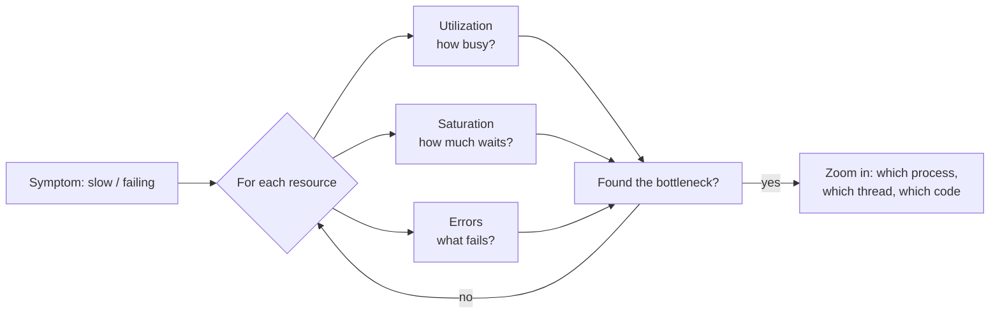

# Debugging a Linux box

## Why care?

The pager goes off at 03:00. "Orders API is slow." You SSH into the box. Now what?

- You run `top`. It shows a lot of numbers. Which ones matter?
- The load average is 9.93. Is that bad? On how many CPUs?
- `free` says only 7 GB of 16 GB is free. Are you out of memory?
- The process uses almost no CPU, but requests hang. Where are they stuck?

Most engineers poke around at random until something looks odd. This page gives you a **method** instead, and the tools to follow it. At the end, you diagnose three real problems in `ordersd` with nothing but the tools that ship with Ubuntu.

All output on this page is real. It comes from a WSL2 machine: kernel 5.15.167.4, Ubuntu 24.04, 16 CPUs, 16 GB RAM, Go 1.27.4. Where a tool is not installed here, the page shows the command and says so.

## The idea: a mechanic's checklist

A good mechanic does not guess. For each part of the car (engine, brakes, tyres) they ask the same three questions: _How hard is it working? Is anything waiting for it? Is anything broken?_

Brendan Gregg turned this into the **USE method** for computers. For every **resource**, check:

- **U**tilization: how busy is it? (CPU 90% busy, disk busy 70% of the time.)
- **S**aturation: how much work is **waiting** for it? (Threads in the run queue, requests in a socket backlog, pages swapped out.)
- **E**rrors: is anything failing? (Dropped packets, OOM kills, `EMFILE` "too many open files".)



Why it works: utilization alone lies. A disk at 60% can still have a long queue. A CPU at 100% is fine if nothing is waiting. **Saturation is usually where the pain is.** And errors are the cheapest thing to check, so check them early.

Here is the checklist for one Linux box, with tools that exist on this machine:

| Resource       | Utilization                            | Saturation                                    | Errors                                   |
| -------------- | -------------------------------------- | --------------------------------------------- | ---------------------------------------- |
| CPU            | `vmstat 1` (`us`, `sy`), `top`         | `vmstat 1` `r` > number of CPUs, load average | `dmesg` (machine checks, rare)           |
| Memory         | `free -m`, `/proc/meminfo`             | `vmstat 1` `si`/`so` (swapping), PSI          | `dmesg` (OOM killer)                     |
| Disk I/O       | `iostat -xz 1` `%util` (not installed) | `vmstat 1` `b`, `wa`; `iostat` `aqu-sz`       | `dmesg` (I/O errors)                     |
| Network        | `ss -s`, `/proc/net/dev`               | `ss -ltn` `Recv-Q` on `LISTEN`, retransmits   | `nstat` (drops, overflows), `ip -s link` |
| File handles   | `ls /proc/<pid>/fd \| wc -l`           | (count close to the limit)                    | `EMFILE` in logs; `/proc/<pid>/limits`   |
| Your Go server | goroutines (pprof), in-flight requests | goroutines waiting on locks, channels, I/O    | 5xx rate, timeouts                       |

The last two rows are not hardware, but they are resources. File descriptors run out like memory does. A Go service has its own scheduler on top of the kernel's ([Processes and threads](../fundamentals/processes-and-threads.md)), so some saturation is invisible to Linux tools. You will see that in incident 3.

## The first 60 seconds

Gregg's famous checklist is ten commands you run in the first minute on a sick Linux box. Here it is, adapted to what is installed on this machine:

| Gregg's command     | What it tells you                       | Here                                    |
| ------------------- | --------------------------------------- | --------------------------------------- |
| `uptime`            | Load average: rising or falling?        | yes                                     |
| `dmesg \| tail`     | OOM kills, disk errors, dropped packets | yes (`dmesg_restrict` is 0 on this box) |
| `vmstat 1`          | CPU, run queue, memory, swap, I/O wait  | yes                                     |
| `mpstat -P ALL 1`   | One hot CPU vs. all CPUs busy           | no (sysstat); use `top -1` instead      |
| `pidstat 1`         | Which process uses CPU, per second      | no (sysstat); use `top -b -n1`          |
| `iostat -xz 1`      | Disk utilization and queue per device   | no (sysstat); use `vmstat` `b` and `wa` |
| `free -m`           | Memory, and how much is **available**   | yes                                     |
| `sar -n DEV 1`      | Network throughput per interface        | no (sysstat); use `/proc/net/dev`       |
| `sar -n TCP,ETCP 1` | New connections, retransmits            | no (sysstat); use `ss -s` and `nstat`   |
| `top`               | A summary of all of the above           | yes                                     |

On a real server, install `sysstat` (it gives you `mpstat`, `pidstat`, `iostat`, `sar`) **before** you need it. Installing packages during an incident is slow and sometimes impossible.

This is the idle machine, as a baseline. Always know what "normal" looks like:

```console
$ uptime
 16:39:50 up  9:11,  2 users,  load average: 0.64, 0.29, 0.16
$ vmstat -w 1 5
--procs-- -----------------------memory---------------------- ---swap-- -----io---- -system-- ----------cpu----------
   r    b         swpd         free         buff        cache   si   so    bi    bo   in   cs  us  sy  id  wa  st  gu
   1    0            0     10983724        39368      3433384    0    0   447   438  700    1   1   0  99   0   0   0
   0    0            0     10990768        39368      3433316    0    0     0     0  950 3726   1   1  98   0   0   0
   0    0            0     10992280        39368      3433316    0    0     0     0  181 1052   0   0 100   0   0   0
   0    0            0     10992028        39368      3433316    0    0     0     0  465 1707   0   0 100   0   0   0
   0    0            0     10991524        39376      3433308    0    0     0    80  316 1425   0   0  99   0   0   0
$ free -m
               total        used        free      shared  buff/cache   available
Mem:           15922        2125       10733           3        3391       13796
Swap:           4096           0        4096
```

Nothing waits, nothing swaps, the CPUs are idle. Now let's learn to read each number.

## Under the hood: the load average

`uptime`, `top` and `/proc/loadavg` all show three numbers: the load average over the last **1, 5 and 15 minutes**.

```console
$ cat /proc/loadavg
7.31 2.05 0.76 23/577 204460
```

Here the 1-minute value (7.31) is much higher than the 15-minute value (0.76): load is **rising**. The fourth field means "23 threads runnable right now, out of 577". The last one is the most recent PID.

What is "load"? The kernel samples, every 5 seconds, the number of threads that are:

1. **running** or **waiting for a CPU** (state `R`), plus
2. in **uninterruptible sleep** (state `D`), usually waiting for disk I/O or a kernel lock.

It then keeps an exponentially damped moving average of that count. The "1 minute" average is not a plain mean of the last minute; old samples fade out gradually.

The second point is Linux-specific, and it surprises people. On most other Unix systems, load counts only CPU demand. On Linux, it also counts threads stuck in `D` state. So **a high load average with idle CPUs** usually means many threads blocked on disk or NFS, not a CPU problem. That is the "something is slow and `top` says the CPU is idle" story from the [chapter intro](index.md).

How to read the number:

- Compare it with the CPU count (`nproc`; 16 here). A load of 9.93 on 16 CPUs is not saturated. The same 9.93 on 4 CPUs means about 6 threads are always waiting.
- It counts **threads**, not processes. A Go server with 25 threads can add 25 on its own.
- It is a hint, not a diagnosis. Next, find out **which** part: `vmstat 1` splits it into `r` (CPU) and `b` (blocked).

## Under the hood: `vmstat 1`, column by column

`vmstat 1` prints one line per second. `-w` makes the columns wide enough to stay aligned. This is the machine while `ordersd` was being hammered (incident 1 below):

```console
$ vmstat -w 1 5
--procs-- -----------------------memory---------------------- ---swap-- -----io---- -system-- ----------cpu----------
   r    b         swpd         free         buff        cache   si   so    bi    bo   in   cs  us  sy  id  wa  st  gu
  26    0            0      8430300        39492      3465580    0    0   446   445  722    2   1   0  99   0   0   0
  17    0            0      8707208        39500      3465592    0    0     0   316 10001 25508  40  26  34   0   0   0
  21    0            0      8649800        39500      3465592    0    0     0     0 5125 13386  56  30  14   0   0   0
  20    0            0      7928244        39500      3465600    0    0     0     0 3722 7499  62  29   9   0   0   0
  34    0            0      8365844        39500      3465604    0    0     0    40 2944 9953  54  32  14   0   0   0
```

!!! warning "Ignore the first line"

    The first data line is the **average since boot**, not the last second. Here it says
    `id 99` while the machine is busy. Read from the second line on.

| Column         | Meaning                                                        | Here                                                  |
| -------------- | -------------------------------------------------------------- | ----------------------------------------------------- |
| `r`            | Threads running or waiting for a CPU                           | 17 to 34 on 16 CPUs: **CPU saturation**               |
| `b`            | Threads blocked in uninterruptible sleep (`D`), mostly I/O     | 0: no disk problem                                    |
| `swpd`         | KiB of swap in use                                             | 0                                                     |
| `free`         | KiB of completely unused RAM                                   | about 8 GB. Not the number to watch (see below)       |
| `buff`/`cache` | KiB used for block buffers and the page cache                  | about 3.4 GB, can be given back                       |
| `si`/`so`      | KiB per second swapped **in** from disk / **out** to disk      | 0. Any steady non-zero `so` means memory saturation   |
| `bi`/`bo`      | Blocks read from / written to block devices per second         | almost 0                                              |
| `in`/`cs`      | Interrupts and **context switches** per second                 | `cs` 7,500 to 25,000, up from about 1,500 idle        |
| `us`           | % CPU time in user space (**includes** nice time)              | 40 to 62                                              |
| `sy`           | % CPU time in the kernel                                       | 26 to 32: a lot. Syscalls, network copies (see below) |
| `id`           | % idle                                                         | 9 to 34                                               |
| `wa`           | % idle **while** some I/O was outstanding                      | 0                                                     |
| `st`           | % "stolen": time the hypervisor gave your vCPU to someone else | 0. On a cloud VM, steady `st` means a noisy neighbour |
| `gu`           | % time running a guest VM (new in procps 4)                    | 0                                                     |

Two columns deserve more words.

**`wa` is idle time, not busy time.** It means "the CPU had nothing to do, and some I/O was pending". On a 16-CPU box one slow disk read can show `wa 6`, and a CPU-bound box can show `wa 0` while the disk is drowning, because the CPUs are never idle. Use `b` and `iostat` for disk saturation.

**`r` is the CPU saturation signal.** If `r` stays above the number of CPUs, threads queue for a CPU. Here `r` was 17 to 34 on 16 CPUs while `id` was still 9 to 34%. Both can be true in the same second: the samples are taken at different moments, and Go threads wake and sleep in bursts.

## Under the hood: memory, "free" vs "available"

```console
$ free -m
               total        used        free      shared  buff/cache   available
Mem:           15922        4817        7866           3        3567       11105
Swap:           4096           0        4096
```

- **`free`** is RAM that holds nothing at all. Linux tries to keep this **small**: unused RAM is wasted RAM, so it fills it with the page cache ([Filesystems](filesystems.md)).
- **`buff/cache`** is file data cached in RAM. Most of it can be dropped at once when a program needs memory.
- **`available`** is the kernel's estimate of how much memory a new program could get **without swapping**: free memory plus the part of the cache and kernel slabs it can reclaim. **This is the number to alert on.**

`free` reads `/proc/meminfo`. The important lines, at the same moment:

```console
$ grep -E '^(MemTotal|MemFree|MemAvailable|Buffers|Cached|SwapCached|Active\(file\)|Inactive\(file\)|SReclaimable|Shmem|Dirty|AnonPages|Committed_AS):' /proc/meminfo
MemTotal:       16304464 kB
MemFree:         8047172 kB
MemAvailable:   11363264 kB
Buffers:           43232 kB
Cached:          3037868 kB
SwapCached:            0 kB
Active(file):    1720876 kB
Inactive(file):  1356172 kB
Dirty:              8120 kB
AnonPages:       3798120 kB
Shmem:              4052 kB
SReclaimable:     571640 kB
Committed_AS:    7117224 kB
```

- `AnonPages` is memory with no file behind it: heaps and stacks. It can only go to swap. This is where a Go heap lives.
- `Active(file)`/`Inactive(file)` are the page cache. Inactive pages are the first to be reclaimed.
- `Dirty` is cached file data not yet written to disk.
- `Committed_AS` is how much memory all processes have **asked for**. It can be far above what they really use (see VSZ vs. RSS in [Memory](../fundamentals/memory.md)).

When `available` gets close to zero, the kernel first reclaims cache (your disk reads get slower), then swaps (`si`/`so` in `vmstat`), and finally runs the **OOM killer**, which picks a process and sends it `SIGKILL`. That last step only shows up in the kernel log. In a container, the same happens at the cgroup memory limit, even if the host has plenty free ([Namespaces and cgroups](namespaces-and-cgroups.md)).

### PSI: saturation as a percentage

Since kernel 4.20, Linux can report **pressure stall information** (PSI): the share of time in which some (or all) tasks were stalled waiting for CPU, memory or I/O. It is the most direct saturation number Linux has:

```text
/proc/pressure/cpu
/proc/pressure/memory
/proc/pressure/io
```

Each file has lines like `some avg10=... avg60=... avg300=... total=...`. `some` is the percentage of time at least one task was stalled. `full` is the percentage of time **all** non-idle tasks were stalled at once, the "nothing gets done" number. With cgroup v2, every cgroup has its own `cpu.pressure`, `memory.pressure` and `io.pressure` files, and Kubernetes and systemd-oomd use them.

On this machine:

```console
$ ls /proc/pressure/
ls: cannot access '/proc/pressure/': No such file or directory
$ zcat /proc/config.gz | grep -i PSI
# CONFIG_PSI is not set
```

The WSL2 kernel is built without PSI. Most distribution kernels (Ubuntu, Debian, Fedora, RHEL 9) have it on. Check your servers.

<!-- TODO(real-output): cat /proc/pressure/{cpu,memory,io} on a kernel with CONFIG_PSI=y, ideally under load. -->

## Under the hood: processes and threads

### `ps` with the columns you want

The default `ps` output is too thin. Choose your own columns with `-o`:

```console
$ ps -eo pid,ppid,stat,nlwp,pcpu,pmem,rss,vsz,etime,comm --sort=-pcpu | head -6
    PID    PPID STAT NLWP %CPU %MEM   RSS    VSZ     ELAPSED COMMAND
 202837     588 SNl    24  508 12.0 1964664 4293412    00:57 ordersd
 203914  203540 R       1  100  0.0  4612   8828       00:00 ps
 203544     588 RNl    20 98.9  0.1 25028 2671168      00:24 loadgen-bin
   5167    5063 Ssl+   22  3.2  3.6 594088 5799200  09:10:12 claude
   5136    5095 Rsl     5  0.9  0.2 46584  81732    09:10:12 nvim
```

`NLWP` is the number of threads ("light-weight processes"). `RSS` and `VSZ` are in KiB. Careful with `%CPU`: in `ps` it is **CPU time divided by the lifetime** of the process, not the current rate. `ordersd` shows 508% because it has been busy for most of its 57 seconds of life. A process that was busy for an hour and is idle now still shows a high `%CPU` in `ps`. Use `top` for "right now".

The `STAT` column is the process state, plus flags:

| Letter | State                                                                           |
| ------ | ------------------------------------------------------------------------------- |
| `R`    | Running, or runnable and waiting for a CPU                                      |
| `S`    | Interruptible sleep: waiting for an event (a socket, a timer, a futex)          |
| `D`    | **Uninterruptible** sleep: inside the kernel, usually disk I/O. Ignores signals |
| `Z`    | Zombie: exited, but the parent has not read the exit status yet                 |
| `T`    | Stopped by a signal (`SIGSTOP`, Ctrl+Z) or by a debugger (`t`)                  |

Flags after the letter: `s` session leader, `l` multi-threaded, `+` in the foreground process group, `N` low priority (positive nice value), `<` high priority. `ordersd` is `SNl`: sleeping, niced, multi-threaded. (Processes started from the background shell on this machine got nice 5. That detail comes back in `top`.)

A count of states over the whole box is a quick health check:

```console
$ ps -eo stat= | cut -c1 | sort | uniq -c
      1 R
     62 S
      1 Z
```

One zombie: this count was taken while the one below existed. Here is how to make one, on purpose: a parent that never calls `wait` ([Signals and process lifetime](signals-and-processes.md) explains reaping):

```console
$ sh -c 'sleep 0.1 & exec sleep 20' &
$ ps -o pid,ppid,stat,wchan:16,comm --ppid $! -p $!
    PID    PPID STAT WCHAN            COMMAND
 213460  213456 SN   hrtimer_nanoslee sleep
 213462  213460 ZN   -                sleep
```

The child `sleep 0.1` exited, but its parent became `sleep 20` through `exec`, and `sleep` never reaps children. A zombie uses no memory, only a PID. Thousands of them mean a buggy parent.

`D` state did not show up on this box: there was no slow disk or NFS mount to block on. On a real server, `ps -eLo pid,tid,stat,wchan:32,comm | awk '$3 ~ /^D/'` lists threads in `D` and the kernel function they wait in. Many `D` threads plus a high load average plus idle CPUs is the classic "storage is sick" pattern.

`WCHAN` ("wait channel") is the kernel function a sleeping thread is blocked in. `hrtimer_nanosleep` is a sleep. You will see `futex_wait_queue_me` (waiting on a futex, which Go uses to park idle threads), `ep_poll` (waiting in `epoll`) and `do_signal_stop` (stopped).

### `top`: the live view

```console
$ top -bn1 -o %CPU | head -15
top - 16:40:41 up  9:12,  2 users,  load average: 5.17, 1.47, 0.56
Tasks:  60 total,   2 running,  58 sleeping,   0 stopped,   0 zombie
%Cpu(s):  2.6 us,  8.2 sy, 30.9 ni, 37.1 id,  0.0 wa,  0.0 hi, 21.1 si,  0.0 st
MiB Mem :  15922.3 total,   8381.3 free,   4446.6 used,   3423.2 buff/cache
MiB Swap:   4096.0 total,   4096.0 free,      0.0 used.  11475.7 avail Mem

    PID USER      PR  NI    VIRT    RES    SHR S  %CPU  %MEM     TIME+ COMMAND
 202837 you       25   5 4293412   1.9g   6148 S 572.7  12.0   4:49.44 ordersd
 203544 you       25   5 2671168  25028   5744 R 163.6   0.2   0:24.08 loadgen+
   5167 you       20   0 5799200 594088 157624 S   9.1   3.6  17:59.72 claude
      1 root      20   0   21860  13212   9656 S   0.0   0.1   0:01.67 systemd
      2 root      20   0    2616   1512   1384 S   0.0   0.0   0:00.01 init-sy+
      6 root      20   0    2636    132    132 S   0.0   0.0   0:00.67 init
     53 root      19  -1   66840  16108  14840 S   0.0   0.1   0:01.35 systemd+
    103 root      20   0   24044   6024   4808 S   0.0   0.0   0:00.77 systemd+
```

`-b` (batch) and `-n1` (one round) make `top` print and exit, which is what you want in scripts and in notes for a postmortem. `%CPU` is per CPU: 572.7 means almost six CPUs.

Look at the `%Cpu(s)` line. It splits time more finely than `vmstat`: `us` user, `sy` system, **`ni` user time of niced processes**, `id`, `wa`, `hi`/`si` hardware/software interrupts, `st` steal. Because `ordersd` runs at nice 5, its user time shows as `ni 30.9`, not `us`. `vmstat` adds nice time into `us`. Same machine, same moment, different labels. And `si 21.1`: a fifth of the CPU went to software interrupts, which here is the kernel moving bytes over the loopback network.

Useful keys in interactive `top`: `1` per-CPU lines, `H` threads instead of processes, `P`/`M` sort by CPU/memory, `c` full command line. In batch mode, `-H` shows threads and `-p` picks a process:

```console
$ top -H -bn1 -p 202837 | head -14
top - 16:41:05 up  9:13,  2 users,  load average: 9.93, 2.89, 1.06
Threads:  25 total,   6 running,  19 sleeping,   0 stopped,   0 zombie
%Cpu(s):  0.0 us,  9.0 sy, 19.1 ni, 45.5 id,  3.9 wa,  0.0 hi, 22.5 si,  0.0 st
MiB Mem :  15922.3 total,   7441.1 free,   5243.2 used,   3566.8 buff/cache
MiB Swap:   4096.0 total,   4096.0 free,      0.0 used.  10679.1 avail Mem

    PID USER      PR  NI    VIRT    RES    SHR S  %CPU  %MEM     TIME+ COMMAND
 202840 you       25   5 4293436   2.5g   6148 R  90.0  16.0   0:23.44 ordersd
 203089 you       25   5 4293436   2.5g   6148 R  70.0  16.0   0:32.04 ordersd
 203092 you       25   5 4293436   2.5g   6148 R  70.0  16.0   0:30.55 ordersd
 203565 you       25   5 4293436   2.5g   6148 S  60.0  16.0   0:28.71 ordersd
 203086 you       25   5 4293436   2.5g   6148 R  50.0  16.0   0:28.99 ordersd
 203085 you       25   5 4293436   2.5g   6148 S  40.0  16.0   0:22.41 ordersd
 203094 you       25   5 4293436   2.5g   6148 R  40.0  16.0   0:31.00 ordersd
```

The `PID` column is now a **thread ID** (TID). The load is spread over many threads. That points to "lots of Go work on all Ps", not "one goroutine in a hot loop" (which would show one thread at 100%).

### `/proc/<pid>`: the source of truth

`ps` and `top` only format what the kernel writes in `/proc`. Reading it directly works in minimal containers where `ps` is missing, and it shows things `ps` does not.

**`/proc/<pid>/stat`** is one line of space-separated numbers. The field positions are in `man 5 proc`:

```console
$ getconf CLK_TCK
100
$ awk '{print "state="$3, "ppid="$4, "utime="$14, "stime="$15, "nice="$19, "threads="$20, "rss_pages="$24}' /proc/202837/stat
state=S ppid=588 utime=38585 stime=16868 nice=5 threads=25 rss_pages=601267
```

`utime` and `stime` are in clock ticks (100 per second): 385 seconds in user space, 169 seconds in the kernel, summed over all threads. Read it twice, subtract, and you have the CPU rate, which is exactly what `top` does. A high `stime` share means the process spends a lot of time in system calls ([System calls](system-calls.md)). `rss_pages` is in 4 KiB pages: 601,267 pages is about 2.3 GiB.

**`/proc/<pid>/status`** is the human-readable version:

```console
$ grep -E '^(State|Threads|VmRSS|VmHWM|voluntary|nonvoluntary)' /proc/202837/status
State:	S (sleeping)
VmHWM:	 3057932 kB
VmRSS:	 2635424 kB
Threads:	25
voluntary_ctxt_switches:	6
nonvoluntary_ctxt_switches:	0
```

`VmHWM` is the "high water mark", the peak RSS. Very useful after a spike. The context-switch counters here belong to the **main thread** only, which in Go sleeps almost all the time. Per-thread data lives in `/proc/<pid>/task/<tid>/`.

**`/proc/<pid>/task/<tid>/sched`** shows the scheduler's view of one thread. Here, the busiest `ordersd` thread, read twice, one second apart:

```console
$ grep -E 'sum_exec_runtime|nr_switches|nr_voluntary|nr_involuntary' /proc/202837/task/203565/sched
se.sum_exec_runtime                          :         27829.409300
nr_switches                                  :                 5013
nr_voluntary_switches                        :                 2059
nr_involuntary_switches                      :                 2954
$ sleep 1; grep -E 'nr_switches|nr_involuntary' /proc/202837/task/203565/sched
nr_switches                                  :                 5117
nr_involuntary_switches                      :                 3033
```

- A **voluntary** switch: the thread gave up the CPU itself (it went to sleep on a futex or `epoll`).
- An **involuntary** switch: the scheduler took the CPU away because the time slice was up and someone else was waiting.

79 of the 104 switches in that second were involuntary. That is CPU saturation, seen from one thread: it wanted to keep running and was pushed off. `sum_exec_runtime` is total CPU time in milliseconds.

**`/proc/<pid>/wchan`, `syscall` and `stack`** tell you where a thread is waiting:

```console
$ cat /proc/202837/wchan
futex_wait_queue_me
$ cat /proc/202837/syscall
202 0xa92f58 0x80 0x0 0x0 0x0 0x0 0x7fff8649d708 0x48e223
$ cat /proc/202837/stack
cat: /proc/202837/stack: Permission denied
```

`syscall` shows the system call number the thread is blocked in, its arguments, then the stack pointer and program counter. 202 is `futex` in the x86-64 system call table. `stack` would show the full **kernel** stack, but it needs root (`CAP_SYS_ADMIN`), and there is no root on this box. For a thread stuck in `D` state it is the single most useful file: it shows exactly which filesystem or driver function it waits in.

<!-- TODO(real-output): sudo cat /proc/<pid>/stack for a Go process (futex_wait_queue_me ... do_syscall_64), and for a thread in D state. -->

**`/proc/<pid>/limits`** shows the limits **this** process runs with. That can differ from what your shell says with `ulimit`, because systemd, Docker and Kubernetes set their own:

```console
$ cat /proc/202837/limits
Limit                     Soft Limit           Hard Limit           Units
Max cpu time              unlimited            unlimited            seconds
Max file size             unlimited            unlimited            bytes
Max data size             unlimited            unlimited            bytes
Max stack size            8388608              unlimited            bytes
Max core file size        0                    unlimited            bytes
Max resident set          unlimited            unlimited            bytes
Max processes             63662                63662                processes
Max open files            1048576              1048576              files
Max locked memory         67108864             67108864             bytes
Max address space         unlimited            unlimited            bytes
Max file locks            unlimited            unlimited            locks
Max pending signals       63662                63662                signals
Max msgqueue size         819200               819200               bytes
Max nice priority         0                    0
Max realtime priority     0                    0
Max realtime timeout      unlimited            unlimited            us
```

`Max open files` is the one you check for `too many open files`. Compare it with `ls /proc/<pid>/fd | wc -l` ([File descriptors](file-descriptors.md) covers the limit and how to set it in [systemd](systemd.md)).

## Under the hood: sockets with `ss` and `lsof`

`ss` reads socket state straight from the kernel. It replaces the old `netstat`. Start with the summary:

```console
$ ss -s
Total: 337
TCP:   87 (estab 79, closed 2, orphaned 0, timewait 2)

Transport Total     IP        IPv6
RAW	  0         0         0
UDP	  5         4         1
TCP	  85        85        0
INET	  90        89        1
FRAG	  0         0         0
```

Then list TCP sockets: `-t` TCP, `-a` all states, `-n` numbers instead of names, `-p` owning process. A filter like `'sport = :8080'` keeps only one port:

```console
$ ss -tanp 'sport = :8080' | head -8
State  Recv-Q Send-Q  Local Address:Port Peer Address:Port Process
LISTEN 0      4096        127.0.0.1:8080      0.0.0.0:*     users:(("ordersd",pid=202837,fd=5))
ESTAB  0      0           127.0.0.1:8080    127.0.0.1:45829 users:(("ordersd",pid=202837,fd=12))
ESTAB  0      0           127.0.0.1:8080    127.0.0.1:46077 users:(("ordersd",pid=202837,fd=38))
ESTAB  0      3612760     127.0.0.1:8080    127.0.0.1:46009 users:(("ordersd",pid=202837,fd=29))
ESTAB  0      0           127.0.0.1:8080    127.0.0.1:46081 users:(("ordersd",pid=202837,fd=37))
ESTAB  0      0           127.0.0.1:8080    127.0.0.1:45791 users:(("ordersd",pid=202837,fd=14))
ESTAB  0      3549048     127.0.0.1:8080    127.0.0.1:45987 users:(("ordersd",pid=202837,fd=32))
```

`Recv-Q` and `Send-Q` mean **different things** depending on the state:

| State    | `Recv-Q`                                         | `Send-Q`                                                 |
| -------- | ------------------------------------------------ | -------------------------------------------------------- |
| `ESTAB`  | Bytes received, not yet read by the application  | Bytes sent by the application, not yet acked by the peer |
| `LISTEN` | Connections fully set up, waiting for `accept()` | The **backlog** limit: how many may wait                 |

So, on `ESTAB`:

- A growing `Recv-Q` means **your** process does not read fast enough.
- A growing `Send-Q` means the **peer** does not read fast enough (or the network is slow). Above, `ordersd` has 3.6 MB queued for a client: the load generator is too CPU-starved to read the 20 MB responses quickly.

On `LISTEN`, `Send-Q 4096` is the backlog. Go passes `/proc/sys/net/core/somaxconn` to `listen()`, which is 4096 on this kernel. `Recv-Q` above 0 on a listener means the kernel finished TCP handshakes, but nobody called `accept()` yet. You will see that in incident 4. When the queue is full, new connections are dropped, and `nstat` counts them:

```console
$ nstat -az TcpExtListenOverflows TcpExtListenDrops
#kernel
TcpExtListenOverflows           0                  0.0
TcpExtListenDrops               0                  0.0
```

`ss -o` adds timers (keep-alive, retransmit, `TIME-WAIT`), and `ss -i` adds TCP internals like RTT and congestion window. The [Networking](../networking/index.md) chapter goes deeper into TCP states.

`lsof` ("list open files") shows **every** file descriptor of a process: files, sockets, pipes, the binary itself and mapped libraries. `-i` limits it to network sockets, `-a` means "and" (by default, options are OR-ed), `-nP` skips name lookups:

```console
$ lsof -nP -a -p 211550 -i | head -5
COMMAND      PID  USER   FD   TYPE DEVICE SIZE/OFF NODE NAME
loadgen-b 211550 you      5u  IPv4 864155      0t0  TCP 127.0.0.1:47469->127.0.0.1:8080 (ESTABLISHED)
loadgen-b 211550 you      8u  IPv4 864156      0t0  TCP 127.0.0.1:47483->127.0.0.1:8080 (ESTABLISHED)
loadgen-b 211550 you      9u  IPv4 864157      0t0  TCP 127.0.0.1:47491->127.0.0.1:8080 (ESTABLISHED)
```

The `FD` column is the descriptor number plus the mode (`r` read, `w` write, `u` both). Two more invocations worth memorising: `lsof -i :8080` (who uses this port?) and `lsof +L1` (files that are deleted but still open, the "disk is still full" trap from [File descriptors](file-descriptors.md)).

## Under the hood: the kernel log

Errors are the **E** in USE, and the kernel reports its errors in a ring buffer that `dmesg` reads. Look for the OOM killer, disk errors, hung tasks and segfaults:

```console
$ dmesg -T --level=err,warn | tail -5
[Thu Nov 26 15:39:56 2026] FS-Cache: N-cookie c=00003761 [p=0000000c fl=2 nc=0 na=1]
[Thu Nov 26 15:39:56 2026] FS-Cache: N-cookie d=000000002ca0391c{9p.inode} n=0000000017c49d6c
[Thu Nov 26 15:39:56 2026] FS-Cache: N-key=[8] 'f5c50f0000001100'
[Thu Nov 26 16:36:11 2026] overlayfs: failed to set xattr on upper
[Thu Nov 26 16:36:20 2026] overlayfs: failed to set xattr on upper
$ dmesg -T | grep -iE 'oom|killed process|hung_task|blocked for more'
```

No OOM kills, no hung tasks. Just WSL file-sharing noise. Three notes:

- Many distributions set `kernel.dmesg_restrict = 1`, and then `dmesg` needs root (`sudo dmesg`). On this machine it is 0, so it worked as a normal user. `journalctl -k` reads the same messages through journald ([systemd](systemd.md)), with permission set by journal groups.
- `-T` converts kernel timestamps to wall-clock time, but the conversion ignores time spent suspended, so it can drift on laptops and VMs. Use `journalctl -k` when the exact time matters.
- An OOM kill looks like `Out of memory: Killed process 1234 (ordersd) ...` (or `Memory cgroup out of memory` for a container). If your service restarts "for no reason", grep for it first.

## Under the hood: `perf` and eBPF

Everything so far is **counters**: how much, how often. When you need to know **which code** is on the CPU, or **why** a thread waits, you need **tracing**. Two families of tools do this on Linux. Neither is installed here (and both need root or `CAP_PERFMON`/`CAP_BPF`), but the kernel supports them: `CONFIG_PERF_EVENTS`, `CONFIG_BPF_SYSCALL`, `CONFIG_BPF_JIT` and `CONFIG_DEBUG_INFO_BTF` are all `y`.

### `perf`: sampling the CPU

`perf` asks the CPU to interrupt every N cycles (or N times per second) and records the stack that was running. Lots of samples in one function means that function burns CPU. It works for any program, in user space **and** the kernel, so it sees what pprof cannot: time spent in system calls, page faults and network code.

```sh
perf top -p 202837
perf record -F 99 -g -p 202837 -- sleep 10
perf report --stdio --no-children | head -40
```

<!-- TODO(real-output): perf top / perf report on ordersd during incident 1 (expect encoding/json, runtime.mallocgc, memmove, and kernel copy_user_* / tcp_sendmsg under loopback). -->

`-F 99` samples 99 times per second per CPU (not 100, to avoid running in lockstep with timers). `-g` records call stacks. Go keeps frame pointers on amd64 and arm64, so `perf` can walk Go stacks without extra flags. `perf stat -p <pid> -- sleep 5` counts events instead of sampling: context switches, page faults, cache misses, instructions per cycle.

For a Go service, start with **pprof** ([Performance](../go/performance.md)). It knows goroutines and inlined functions. Use `perf` when the time is in the kernel, in cgo, or in a process you cannot rebuild.

### eBPF: small programs inside the kernel

**eBPF** lets you load a small, verified program into the kernel and attach it to an event: a system call, a kernel function (kprobe), a function in your binary (uprobe), a tracepoint, a timer. The program counts or records in kernel memory and only sends summaries to user space. That is why it is cheap enough for production, unlike `strace`, which stops the process on every system call.

Two ways to use it:

**bcc tools** are ready-made programs. On Ubuntu they come in the `bpfcc-tools` package with a `-bpfcc` suffix:

| Tool                      | Answers                                                                |
| ------------------------- | ---------------------------------------------------------------------- |
| `execsnoop`               | Which processes start? (Short-lived ones that `top` never shows.)      |
| `opensnoop -p <pid>`      | Which files does it open, and which opens fail?                        |
| `biolatency`              | Disk I/O latency as a histogram                                        |
| `runqlat`                 | How long do threads wait for a CPU? (Direct CPU saturation)            |
| `offcputime -p <pid>`     | Where do threads **sleep**, with stacks? (The "low CPU but slow" case) |
| `tcpconnect`, `tcpaccept` | Which connections are opened, by whom?                                 |
| `tcpretrans`              | Which connections retransmit? (Network trouble, per flow)              |

```sh
sudo runqlat-bpfcc 10 1
sudo offcputime-bpfcc -p 202837 10
```

<!-- TODO(real-output): runqlat-bpfcc during incident 1 (expect a long tail above 1 ms), and offcputime-bpfcc for ordersd during incident 3. -->

**bpftrace** is a small language for one-off questions, like `awk` for kernel events:

```sh
sudo bpftrace -e 'tracepoint:syscalls:sys_enter_openat /comm == "ordersd"/ { @[str(args->filename)] = count(); }'
sudo bpftrace -e 'profile:hz:99 /comm == "ordersd"/ { @[ustack] = count(); }'
sudo bpftrace -e 'tracepoint:syscalls:sys_exit_accept4 /comm == "ordersd" && args->ret < 0/ { @errors[args->ret] = count(); }'
```

<!-- TODO(real-output): the three bpftrace one-liners above, run against ordersd. -->

The first counts files opened by `ordersd`. The second is a tiny CPU profiler. The third counts failed `accept4` calls by error number, for example `-24` (`EMFILE`, out of file descriptors).

### `strace` and `gdb`

`strace -f -p <pid>` prints every system call of a running process ([System calls](system-calls.md) shows it in detail). `strace -c -f -p <pid>` counts them instead, which is the quickest answer to "is it in the kernel, and doing what?". Be careful in production: `strace` can slow a busy process down by 10× or more.

`gdb` can attach to a stuck process and print every thread's stack. For Go, prefer Delve (`dlv attach <pid>`), which understands goroutines. Often you do not need either: a Go program prints all goroutine stacks when it gets `SIGQUIT`. You will use that in incident 3.

<!-- TODO(real-output): strace -c -f -p <ordersd pid> for 5 s during incident 1. -->

## Try it: three incidents on `ordersd`

Time to use all this. Build `ordersd` from the [Go chapter's](../go/index.md) example project into a scratch directory, start it, and write a small load generator that misbehaves on purpose.

```console
$ D=$(mktemp -d "$TMPDIR/dbg.XXXXXX")
$ cd examples/orders && CGO_ENABLED=0 go build -trimpath -o "$D/ordersd" ./cmd/ordersd
$ cd "$D" && nohup ./ordersd -addr 127.0.0.1:8080 >ordersd.log 2>ordersd.err &
$ pgrep -x ordersd
202837
```

The load generator `loadgen` is one `main.go` with four modes. The interesting parts:

```go
case "leak":
	// BUG on purpose: a new Transport per request, and the body is never closed.
	end := time.Now().Add(*d)
	for i := 0; time.Now().Before(end); i++ {
		client := &http.Client{Transport: &http.Transport{}}
		resp, err := client.Get(base + "/healthz")
		if err != nil {
			log.Fatalf("request %d: %v", i, err)
		}
		_ = resp // forgot resp.Body.Close()
		time.Sleep(20 * time.Millisecond)
	}
case "stall":
	// A client that promises a 1000-byte body and sends 10 bytes.
	var conns []net.Conn
	for range *n {
		conn, err := net.Dial("tcp", *addr)
		if err != nil {
			log.Fatal(err)
		}
		fmt.Fprintf(conn, "POST /v1/orders HTTP/1.1\r\nHost: x\r\nContent-Type: application/json\r\nContent-Length: 1000\r\n\r\n{\"custome")
		conns = append(conns, conn)
	}
	time.Sleep(*d)
```

The other two modes are normal: `create` posts orders with N workers, `list` calls `GET /v1/orders` in a loop.

### Incident 1: "the API is slow" (a CPU hog)

Fill the store with 100,000 orders, then let 32 clients list them:

```console
$ ./loadgen-bin -mode create -n 100000 -c 16
created 100000
$ curl -s -o /dev/null -w '%{size_download} bytes %{time_total}s\n' http://127.0.0.1:8080/v1/orders
20889000 bytes 0.340541s
$ ./loadgen-bin -mode list -c 32 -d 90s &
```

Now pretend you know nothing, and walk the checklist.

1. **`uptime`**: `load average: 9.93, 2.89, 1.06` a minute in. Rising fast.
2. **`dmesg`**: nothing new. No OOM, no errors.
3. **`vmstat 1`** (shown above): `r` 17 to 34 on 16 CPUs, `b` 0, `si`/`so` 0, `wa` 0. **CPU is saturated. Memory and disk are fine.** That rules out two of the four resources in ten seconds.
4. **`top`**: `ordersd` at 572% CPU. `sy` plus `si` is about 30%: a lot of kernel time.
5. **`top -H -p`**: many threads at 40 to 90% each. Spread work, not one stuck loop.
6. **`/proc/<pid>/task/<tid>/sched`**: most context switches are involuntary. Threads want more CPU than they get.
7. **`ss -tanp`**: 32 connections, with megabytes in `Send-Q`. Each response is huge.
8. **`/proc/<pid>/status`**: `VmHWM` 3 GB, up from 55 MB before the test.

The USE answer: **CPU utilization and saturation, caused by `ordersd`.** The Linux tools stop here; they show threads, not Go functions. The next step is a CPU profile from pprof ([Performance](../go/performance.md)), or `perf top` if you can't change the binary.

You don't even need the profile to form a strong guess: one `curl` said it. `GET /v1/orders` returns **all** orders, 20 MB, every time. The handler copies, sorts and JSON-encodes 100,000 orders per call, the kernel copies 20 MB through loopback per call (the `sy` and `si` time), and the GC cleans up gigabytes of garbage (the RSS spike). The fix is not more CPUs. It is **pagination**: a `limit` and a cursor on the list endpoint.

When the test ended, memory came back down, but not all the way. The Go runtime returns freed memory to the OS gradually:

```console
$ cat list.out
list requests: 1364
$ uptime
 16:43:40 up  9:15,  2 users,  load average: 2.39, 3.70, 1.77
$ grep -E 'VmRSS|Threads' /proc/202837/status
VmRSS:	  504180 kB
Threads:	25
```

The load average now reads high, higher, low: it is **falling**. The 5-minute value still remembers the storm.

### Incident 2: "too many open files" (a descriptor leak)

Run the leaky client for 40 seconds and count the descriptors of **both** processes every 5 seconds:

```console
$ ./loadgen-bin -mode leak -d 40s &
$ for i in 1 2 3 4 5 6; do printf '%s loadgen_fds=%s ordersd_fds=%s\n' $(date +%T) $(ls /proc/$L/fd | wc -l) $(ls /proc/$P/fd | wc -l); sleep 5; done
16:43:48 loadgen_fds=54 ordersd_fds=55
16:43:53 loadgen_fds=272 ordersd_fds=273
16:43:57 loadgen_fds=499 ordersd_fds=500
16:44:02 loadgen_fds=720 ordersd_fds=721
16:44:07 loadgen_fds=947 ordersd_fds=948
16:44:12 loadgen_fds=1168 ordersd_fds=1169
```

(`$L` and `$P` hold the two PIDs from `pgrep -x`.) About 45 new descriptors per second, in **both** processes, and never fewer. A count that only grows is a leak. A busy-but-healthy service goes up and down.

Which kind of descriptor? `lsof` groups them by type:

```console
$ lsof -p $L | awk 'NR>1{print $5}' | sort | uniq -c | sort -nr
   1416 IPv4
      7 REG
      2 a_inode
      2 DIR
      1 sock
      1 CHR
```

All sockets. `ss` shows the states (both ends of each connection are on this box, so each counts twice):

```console
$ ss -tan '( sport = :8080 or dport = :8080 )' | awk 'NR>1{print $1}' | sort | uniq -c
   2772 ESTAB
      1 LISTEN
```

Every connection is `ESTABLISHED` and idle. Nobody closes them. On the server, `ss -o` shows the keep-alive timers that keep them alive:

```console
$ ss -tanpo 'sport = :8080' | sed -n '1,4p'
State  Recv-Q Send-Q Local Address:Port Peer Address:Port Process
LISTEN 0      4096       127.0.0.1:8080      0.0.0.0:*     users:(("ordersd",pid=202837,fd=5))
ESTAB  0      0          127.0.0.1:8080    127.0.0.1:45413 users:(("ordersd",pid=202837,fd=242)) timer:(keepalive,9.740ms,0)
ESTAB  0      0          127.0.0.1:8080    127.0.0.1:48043 users:(("ordersd",pid=202837,fd=379)) timer:(keepalive,12sec,0)
```

And who is on the other end? Group the **client** side of the connections by process:

```console
$ ss -tnp state established 'dport = :8080' | awk 'NR>1{print $NF}' | sed 's/,fd=[0-9]*//' | sort | uniq -c
    471 users:(("loadgen-bin",pid=211550))
```

The server has the leak, but the **client** causes it. That is a common real-world finding: one misbehaving caller exhausts a service's descriptors, and the service is the one that pages you. `ordersd` survives because of its `IdleTimeout` of 60 seconds, which closes idle connections. A server without it would hold them until it hits `Max open files` and starts failing `accept()` with `EMFILE`.

To see **why** the client leaks, ask the Go runtime. `SIGQUIT` makes a Go program print every goroutine's stack and exit:

```console
$ kill -QUIT $L
$ grep -E '^(net/http|main)' leak.out | sed -E 's/\(0x.*|\(\)$//; s/\(\{.*//' | sort | uniq -c | sort -nr
    222 net/http.(*persistConn).writeLoop
    222 net/http.(*persistConn).readLoop
    222 net/http.(*Transport).dialConn.gowrap3
    222 net/http.(*Transport).dialConn.gowrap2
      1 main.main
```

222 connections, each with a read and a write goroutine, after 5 seconds of a fresh run. Each `http.Transport` owns a connection pool. A new Transport per request means a new pool per request, and a body that is never closed means the connection is never returned or closed. The fix is one shared `http.Client` and `defer resp.Body.Close()`.

!!! tip "Leak detection before production"

    Count `/proc/self/fd` in an integration test before and after a run, and fail if it grew. The
    Go 1.27 runtime also has a `goroutineleak` profile that finds goroutines blocked forever
    ([Concurrency](../go/concurrency.md)).

### Incident 3: "requests hang, CPU is idle" (blocked goroutines)

Open 50 connections that each promise a 1000-byte body and send 10 bytes:

```console
$ ./loadgen-bin -mode stall -n 50 -d 30s &
$ ls /proc/$P/fd | wc -l
58
$ ss -tn state established 'sport = :8080' | head -3
Recv-Q Send-Q Local Address:Port Peer Address:Port Process
0      0          127.0.0.1:8080    127.0.0.1:47429
0      0          127.0.0.1:8080    127.0.0.1:47619
```

`Recv-Q` is 0: `ordersd` has read everything the client sent. It waits for more. What do its threads do?

```console
$ for t in /proc/$P/task/*; do cat $t/wchan; echo; done | sort | uniq -c
      1 0
     24 futex_wait_queue_me
$ grep -E '^(State|Threads)' /proc/$P/status
State:	S (sleeping)
Threads:	25
```

24 threads parked on a futex, one running (`0` means "not sleeping in the kernel"). From the kernel's point of view, `ordersd` is **completely healthy and idle**. No CPU, no blocked threads, no `D` state. Every Linux tool on this page says "fine".

That is the trap with Go. The 50 stuck requests are 50 **goroutines** in the netpoller ([Processes and threads](../fundamentals/processes-and-threads.md)). They hold no thread. You need the Go runtime's view:

```console
$ kill -QUIT $P
$ grep -oE '^goroutine [0-9]+ .*\[[a-zA-Z ,0-9]+' ordersd.err | sed 's/.*\[//' | sort | uniq -c | sort -nr
     51 IO wait
     16 GC worker
      2 select, 6 minutes
      1 syscall, 6 minutes
      1 select, 6 minutes, locked to thread
      1 idle
      1 force gc
      1 finalizer wait, 6 minutes
      1 cleanup wait, 6 minutes
      1 chan receive, 6 minutes
      1 GOMAXPROCS updater
      1 GC sweep wait
      1 GC scavenge wait
```

51 goroutines in `IO wait`: one is the `accept` loop, 50 are requests. The top of one request's stack, with arguments and file lines stripped:

```text
goroutine 143841 gp=0xe1f713810e0 m=nil [IO wait]:
runtime.gopark
runtime.netpollblock
internal/poll.runtime_pollWait
internal/poll.(*pollDesc).wait
internal/poll.(*pollDesc).waitRead
internal/poll.(*FD).Read
net.(*netFD).Read
net.(*conn).Read
net/http.(*connReader).Read
bufio.(*Reader).Read
io.(*LimitedReader).Read
net/http.(*body).readLocked
net/http.(*body).Read
net/http.(*maxBytesReader).Read
encoding/json/jsontext.(*decoderState).fetch
encoding/json/jsontext.(*decoderState).consumeString
encoding/json/jsontext.(*decoderState).consumeValue
encoding/json/jsontext.(*decoderState).ReadValue
encoding/json/v2.makeStructArshaler.func3
encoding/json/v2.unmarshalDecode
encoding/json/v2.UnmarshalRead
github.com/acme/orders/internal/httpapi.(*api).decodeJSON
github.com/acme/orders/internal/httpapi.(*api).createOrder
```

Read it from the bottom: `createOrder` decodes JSON, the decoder needs more bytes, the body reader reads the socket, the socket has no data, so the goroutine parks in the netpoller. `m=nil` confirms that no thread is attached. This is a **slow client** (or a "Slowloris" attack). `ordersd` is protected by its `ReadTimeout` of 10 seconds; without it, each stalled client would hold a goroutine and a descriptor forever.

`SIGQUIT` ends the process, so it is a last resort. In production, take the same picture without killing anything from the pprof goroutine endpoint on a private port ([Performance](../go/performance.md)).

### Incident 4: "connections time out, but the port is open" (a frozen process)

Freeze `ordersd` with `SIGSTOP` (this simulates a process that stopped calling `accept()`: stuck in a deadlock, a long GC, or a debugger), then send 20 requests:

```console
$ kill -STOP $P
$ for i in $(seq 20); do (curl -s -o /dev/null --max-time 4 http://127.0.0.1:8080/healthz &); done
$ ps -o pid,stat,wchan:20,comm -p $P
    PID STAT WCHAN                COMMAND
 202837 TNl  do_signal_stop       ordersd
$ grep State /proc/$P/status
State:	T (stopped)
$ ss -ltn 'sport = :8080'
State  Recv-Q Send-Q Local Address:Port Peer Address:PortProcess
LISTEN 20     4096       127.0.0.1:8080      0.0.0.0:*
$ ss -tan 'sport = :8080' | awk 'NR>1{print $1}' | sort | uniq -c
     20 ESTAB
      1 LISTEN
```

The process is stopped (`T`), yet all 20 connections are `ESTABLISHED`. **The kernel does the TCP handshake, not your program.** The connections wait in the listen queue: `Recv-Q 20` of a possible 4096. From the client's view, the connection succeeded and the server just never answers. Health checks that only test "can I connect?" pass happily.

Let it go again, and the queue drains at once:

```console
$ kill -CONT $P
$ ss -ltn 'sport = :8080'
State  Recv-Q Send-Q Local Address:Port Peer Address:PortProcess
LISTEN 0      4096       127.0.0.1:8080      0.0.0.0:*
$ ps -o pid,stat,comm -p $P
    PID STAT COMMAND
 202837 SNl  ordersd
```

On a real server, a listener `Recv-Q` that stays above 0 means the accept loop can't keep up or is stuck. When it reaches the `Send-Q` value, `TcpExtListenOverflows` starts counting dropped connections.

Clean up when done: `pkill -x loadgen-bin`, stop `ordersd` with `kill $P` (or `SIGQUIT` already ended it), and remove `$D`.

## Traps

- **Reading the first line of `vmstat`.** It is the average since boot. Read from the second line.
- **Trusting `%CPU` in `ps`.** It is lifetime CPU divided by lifetime. Use `top` or two reads of `/proc/<pid>/stat`.
- **Alerting on `free` memory.** Linux fills RAM with cache on purpose. Alert on `MemAvailable`, swap activity (`si`/`so`) and PSI.
- **Reading load average as CPU usage.** On Linux it includes `D` state. High load with idle CPUs usually means I/O or lock trouble.
- **Treating `wa` as a disk metric.** It is idle time. A busy CPU hides I/O wait completely.
- **Checking `ulimit -n` in your shell** instead of `/proc/<pid>/limits` of the actual process. systemd and container runtimes set their own limits.
- **Looking only at the server for a leak.** Incident 2 was caused by a client. `ss -tnp` shows both ends.
- **Expecting Linux tools to see goroutines.** Stuck goroutines hold no thread. A Go service can look idle to `top` while every request hangs. Use pprof's goroutine profile.
- **"The port accepts connections, so the service is up."** The kernel accepts connections for a frozen process. Health checks must make a real request.
- **Installing tools during the incident.** Put `sysstat`, `bpfcc-tools`, `bpftrace`, `strace` and `perf` on your base image now.
- **Running `strace` on a busy production process.** It can slow it down many times. Prefer eBPF tools there.

## Check yourself

??? question "1. A box with 8 CPUs has a load average of 30, and `top` shows the CPUs 90% idle. What is the most likely cause, and how do you confirm it?"

    Many threads in uninterruptible sleep (`D`), usually waiting for disk or NFS. Linux counts
    them in the load. Confirm with `vmstat 1` (a high `b` column) and
    `ps -eLo pid,tid,stat,wchan:32,comm | awk '$3 ~ /^D/'` to see which threads and which kernel
    function. `/proc/<tid>/stack` (as root) shows the full kernel stack.

??? question "2. `vmstat 1` shows `r` = 40 on a 16-CPU machine, `si`/`so` = 0, `b` = 0. Which resource is saturated? Which USE column is it?"

    The CPU. `r` counts threads running or waiting for a CPU; 40 on 16 CPUs means about 24 wait
    all the time. That is **saturation**. Memory (no swapping) and disk (`b` = 0) are fine.

??? question "3. `free -m` says `free 300` and `available 9000` on a 16 GB server. Is it about to run out of memory?"

    No. 300 MB is completely unused, but about 9 GB can be handed to programs, mostly by dropping
    page cache. Watch `available`, swap activity and the OOM killer in `dmesg`, not `free`.

??? question "4. On a listening socket, `ss -ltn` shows `Recv-Q 128` and `Send-Q 128`. What does that mean, and what happens next?"

    The accept queue is full: 128 connections finished the handshake and wait for the program to
    call `accept()`, and the backlog limit is 128. New connections are dropped (clients retry
    their SYN and see long connect times), and `nstat` shows `TcpExtListenOverflows` growing.
    Find out why the process does not accept: stopped, stuck, or too slow.

??? question "5. Your Go service hangs on every request, but `top` shows 0% CPU and all threads are in `futex_wait_queue_me`. What next?"

    The Linux tools have done their job: the process is not using CPU and is not blocked in the
    kernel, so the wait is **inside the Go runtime**. Get a goroutine dump: pprof's
    `/debug/pprof/goroutine?debug=2` on the admin port, or `SIGQUIT` as a last resort. Look for
    many goroutines in the same state (`IO wait`, `chan receive`, `sync.Mutex.Lock`) and the same
    stack.

??? question "6. The number of entries in `/proc/<pid>/fd` goes from 50 to 5,000 in an hour and never drops. How do you find out what is leaking?"

    `lsof -p <pid>` and group by `TYPE` (`awk '{print $5}' | sort | uniq -c`): files, sockets or
    pipes? For sockets, `ss -tanp` shows states and peers: `ESTAB` idle connections point to
    missing `Close` or pooling bugs, `CLOSE-WAIT` means **your** side never closed after the peer
    did. For files, the `NAME` column shows the path. Then fix the missing `Close`.

## Recap

- Use a method, not random poking. **USE**: for each resource, check **u**tilization, **s**aturation and **e**rrors.
- First 60 seconds: `uptime`, `dmesg | tail`, `vmstat 1`, `free -m`, `ss -s`, `top`. Add `mpstat`, `pidstat`, `iostat` and `sar` from `sysstat` on real servers.
- Load average counts `R` **and** `D` threads on Linux. Compare it with the CPU count, and split it with `vmstat`'s `r` and `b`.
- `vmstat`: skip the first line. `r` > CPUs is CPU saturation; `si`/`so` is memory saturation; `wa` is idle time; `st` is a noisy neighbour.
- Watch `MemAvailable`, not `MemFree`. PSI (`/proc/pressure/*`) gives saturation directly, when the kernel has it.
- `ps -eo` with your own columns, states `R S D Z T`, `WCHAN` for where it sleeps. `/proc/<pid>/{stat,status,limits,wchan,syscall,stack}` and `task/<tid>/sched` are the raw truth.
- `ss`: `Recv-Q`/`Send-Q` on `ESTAB` are unread/unacked bytes; on `LISTEN` they are the accept queue and its limit. `lsof` shows every descriptor.
- `perf` samples stacks, eBPF (bcc tools, `bpftrace`) traces kernel and user events cheaply. For Go code, pprof first.
- Linux tools see threads, not goroutines. When a Go service is "idle but stuck", ask the Go runtime.

## You finished Linux

You can now follow a request from your Go code down through system calls, file descriptors, the page cache and signals, see the walls of namespaces and cgroups, run a service under systemd, and debug the whole box with a method.

Next, two chapters that build directly on this one. [Networking](../networking/index.md) opens the network stack you met in `ss`: TCP states, DNS, TLS and load balancers. [Containers](../containers/index.md) shows that a container is the namespaces and cgroups from this chapter, packaged into an image.
