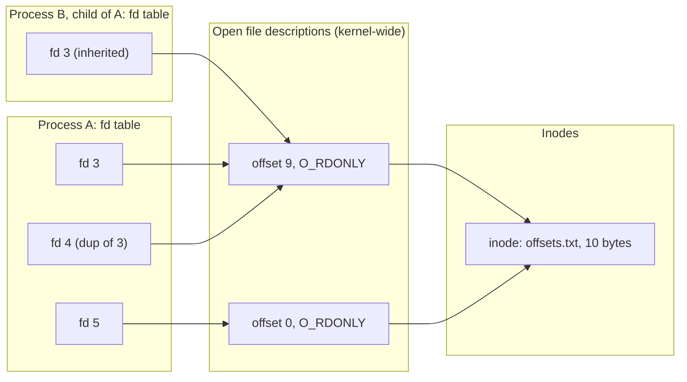

# File descriptors

## Why care?

Three tickets from the same on-call week:

- "`accept: too many open files`. We raised the limit to 65,536. A week later: same error."
- "The disk was 100% full. We deleted the 40 GB log file. `df` still says 100%."
- "We restarted the service, and it can't bind port 8080. Nothing is running... except a child process it started yesterday."

All three are about **file descriptors**: the small numbers that almost every system call (see [System calls up close](system-calls.md)) takes as its first argument. [Fundamentals](../fundamentals/processes-and-threads.md#file-descriptors-and-too-many-open-files) said that a descriptor "points to" an open file. This page shows what it points **through**, because that middle layer explains all three tickets.

## The idea: three layers between a number and a file

A file descriptor does not point straight at a file. There are three layers:

- The **file descriptor** is a small number, such as 3. It only has meaning inside one process.
- The number points to an **open file description**. This is a kernel object that holds the access mode, the flags, and the current **offset** (where the next read or write starts).
- The open file description points to the **inode**: the real file, with its size and its data.

The middle layer decides who shares what:

- **`dup`** gives you a second number for the **same** open file description. Both numbers share one offset. A read through one moves the offset for the other.
- **`fork`** gives the child a copy of all your numbers. They point to the same open file descriptions, so parent and child share offsets too.
- A second **`open`** of the same file creates a **new** open file description with its own offset. It points to the same inode.
- **`rm`** removes the file's name, but an open file description can still point to the inode. The data stays on disk until the last open file description is closed.

## Under the hood: three tables



| Layer                     | One per...                                | Holds                                                                                           |
| ------------------------- | ----------------------------------------- | ----------------------------------------------------------------------------------------------- |
| **fd table entry**        | process and number                        | A pointer to an open file description, plus **one** flag: close-on-exec (`FD_CLOEXEC`)          |
| **Open file description** | successful `open()`, `socket()`, `pipe()` | Offset, access mode (`O_RDONLY`...), status flags (`O_APPEND`, `O_NONBLOCK`), a reference count |
| **Inode**                 | file on a filesystem                      | Size, owner, permissions, link count, where the data is                                         |

Two rules complete the picture:

1. **`open` always returns the lowest free number.** Close fd 0, open a file, and it becomes your stdin. Shells use this rule for redirection.
2. **The kernel frees an open file description when its last fd is closed**, and frees an inode when it has no names (links) **and** no open file descriptions. Remember this one for the deleted-file ticket.

## Try it: look inside ordersd

Start [`ordersd`](../go/services.md) with its logs going into a pipe, and open one TCP connection to it from the shell (with bash's `/dev/tcp` feature):

```console
$ ./ordersd -addr 127.0.0.1:18080 </dev/null 2>&1 | cat >/dev/null &
$ exec 3<>/dev/tcp/127.0.0.1/18080
$ ls -l /proc/208369/fd
total 0
lr-x------ 1 you   you   64 Nov 26 16:43 0 -> /dev/null
l-wx------ 1 you   you   64 Nov 26 16:43 1 -> pipe:[864412]
l-wx------ 1 you   you   64 Nov 26 16:43 2 -> pipe:[864412]
lr-x------ 1 you   you   64 Nov 26 16:43 3 -> /sys/fs/cgroup/cpu/init.scope/cpu.cfs_quota_us
lr-x------ 1 you   you   64 Nov 26 16:43 4 -> /sys/fs/cgroup/cpu/init.scope/cpu.cfs_period_us
lrwx------ 1 you   you   64 Nov 26 16:43 5 -> socket:[856783]
lrwx------ 1 you   you   64 Nov 26 16:43 6 -> socket:[858355]
lrwx------ 1 you   you   64 Nov 26 16:43 7 -> anon_inode:[eventpoll]
lrwx------ 1 you   you   64 Nov 26 16:43 8 -> anon_inode:[eventfd]
```

Nine descriptors. Each one has a reason:

- **0, 1, 2**: stdin from `/dev/null`; stdout and stderr both point to **the same pipe** (`2>&1` is a `dup`).
- **3, 4**: the Go runtime itself. Since Go 1.25 it reads the cgroup CPU limit to set `GOMAXPROCS`, and keeps these two files open to notice when the limit changes.
- **5**: the listening socket. **6**: our one TCP connection.
- **7, 8**: the netpoller's epoll instance and its wake-up `eventfd` (see [the netpoller](system-calls.md#under-the-hood-the-netpoller-or-how-go-avoids-blocking)).

`/proc/<pid>/fdinfo/<fd>` shows the **open file description** behind each number:

```console
$ cat /proc/208369/fdinfo/5
pos:	0
flags:	02004002
mnt_id:	8
ino:	856783
$ cat /proc/208369/fdinfo/7
pos:	0
flags:	02000002
mnt_id:	14
ino:	17421
tfd:        8 events:       19 data:                0  pos:0 ino:440d sdev:d
tfd:        5 events: 8000201d data: 3fa1143240000002  pos:0 ino:d12cf sdev:7
tfd:        6 events: 8000201d data: 3fa114323f000001  pos:0 ino:d18f3 sdev:7
```

`pos` is the offset. `flags` is in **octal**, and you decode it by adding these up:

| Octal      | Flag          | Meaning                                                     |
| ---------- | ------------- | ----------------------------------------------------------- |
| `01`       | `O_WRONLY`    | Write only (`00` is read only)                              |
| `02`       | `O_RDWR`      | Read and write                                              |
| `02000`    | `O_APPEND`    | Every write goes to the end of the file                     |
| `04000`    | `O_NONBLOCK`  | Return `EAGAIN` instead of waiting                          |
| `0100000`  | `O_LARGEFILE` | Offsets may exceed 2 GiB (always set by 64-bit code)        |
| `02000000` | `O_CLOEXEC`   | Close this fd on `exec` (really an fd flag; shown here too) |

So the listener's `02004002` is `O_CLOEXEC | O_NONBLOCK | O_RDWR`: exactly what the netpoller needs. And the epoll fd lists the fds it watches: `tfd: 5` and `tfd: 6` with `ino:d12cf`, which is hex for 856783, the socket inode from `ls -l`. The events mask `8000201d` is `EPOLLET | EPOLLRDHUP | EPOLLHUP | EPOLLERR | EPOLLOUT | EPOLLIN`: Go uses **edge-triggered** epoll.

## Under the hood: who shares an offset?

This is where the middle table matters. The program opens one file three ways and watches the offsets:

```go
// Command offsets shows which file descriptors share a file offset.
package main

import (
	"fmt"
	"io"
	"os"
	"os/exec"
	"path/filepath"
	"syscall"
)

func offset(f *os.File) int64 {
	pos, err := f.Seek(0, io.SeekCurrent) // lseek(fd, 0, SEEK_CUR)
	if err != nil {
		panic(err)
	}
	return pos
}

func main() {
	path := filepath.Join(os.TempDir(), "offsets.txt")
	if err := os.WriteFile(path, []byte("0123456789"), 0o644); err != nil {
		panic(err)
	}
	defer os.Remove(path)

	// 1. Two open() calls: two open file descriptions, two offsets.
	a, _ := os.Open(path)
	b, _ := os.Open(path)
	a.Read(make([]byte, 4))
	fmt.Printf("open twice: fd %d at %d, fd %d at %d\n", a.Fd(), offset(a), b.Fd(), offset(b))

	// 2. dup(): a second fd for the SAME open file description.
	fd, err := syscall.Dup(int(a.Fd()))
	if err != nil {
		panic(err)
	}
	c := os.NewFile(uintptr(fd), "dup")
	c.Read(make([]byte, 3))
	fmt.Printf("after dup:  fd %d at %d, fd %d at %d\n", a.Fd(), offset(a), c.Fd(), offset(c))

	// 3. A child process inherits fd a as its fd 3 and reads 2 bytes.
	cmd := exec.Command("sh", "-c", "head -c 2 <&3 >/dev/null")
	cmd.ExtraFiles = []*os.File{a}
	if err := cmd.Run(); err != nil {
		panic(err)
	}
	fmt.Printf("after child read: fd %d at %d\n", a.Fd(), offset(a))
}
```

```console
$ go run .
open twice: fd 5 at 4, fd 8 at 0
after dup:  fd 5 at 7, fd 9 at 7
after child read: fd 5 at 9
```

1. **Two `open`s, two offsets.** Reading 4 bytes from fd 5 does not move fd 8. (fds 6 and 7 went to the netpoller's epoll and eventfd, created the first time Go opened a file.)
2. **`dup` shares the offset.** We read 3 bytes through fd 9, and fd 5 moved too: both are at 7.
3. **A child shares it too.** `ExtraFiles` gives the child our open file description as its fd 3. `head` reads 2 bytes in **another process**, and our offset is now 9.

This matters in practice. It is why `O_APPEND` exists. Two processes that write to one log file **without** `O_APPEND` each have their own offset and overwrite each other's lines. With `O_APPEND`, the kernel moves to the end of the file and writes in one step, on every write. Go's `os.OpenFile(name, os.O_APPEND|os.O_CREATE|os.O_WRONLY, 0o644)` is the right way to open a log.

## Pipes: a buffer with two ends

A pipe is a buffer inside the kernel with a write end and a read end, each its own fd. `ordersd`'s fd 1 above was one. How big is the buffer?

```go
// Command pipes measures a pipe's buffer and shows what a write
// to a pipe without readers does.
package main

import (
	"errors"
	"fmt"
	"os"
	"syscall"
)

const (
	fGetPipeSz = 1032 // F_GETPIPE_SZ from <fcntl.h>
	fSetPipeSz = 1031 // F_SETPIPE_SZ
)

func fill(w int) int {
	total, chunk := 0, make([]byte, 4096)
	for {
		n, err := syscall.Write(w, chunk)
		if errors.Is(err, syscall.EAGAIN) { // full: a blocking write would wait here
			return total
		}
		if err != nil {
			panic(err)
		}
		total += n
	}
}

func main() {
	var p [2]int
	if err := syscall.Pipe2(p[:], syscall.O_NONBLOCK|syscall.O_CLOEXEC); err != nil {
		panic(err)
	}
	r, w := p[0], p[1]

	size, _, _ := syscall.Syscall(syscall.SYS_FCNTL, uintptr(w), fGetPipeSz, 0)
	fmt.Println("F_GETPIPE_SZ:", size)
	fmt.Println("bytes written before EAGAIN:", fill(w))

	syscall.Syscall(syscall.SYS_FCNTL, uintptr(w), fSetPipeSz, 1<<20)
	size, _, _ = syscall.Syscall(syscall.SYS_FCNTL, uintptr(w), fGetPipeSz, 0)
	fmt.Println("after F_SETPIPE_SZ 1 MiB:", size)

	// Close the only read end. Now nobody can ever read.
	syscall.Close(r)
	_, err := syscall.Write(w, []byte("x"))
	fmt.Printf("write with no reader: %v (%d)\n", err, err)

	// Same thing through the os package, on an fd that is not 1 or 2.
	pr, pw, _ := os.Pipe()
	pr.Close()
	_, err = pw.Write([]byte("x"))
	fmt.Println("os.File:", err)
}
```

```console
$ go run .
F_GETPIPE_SZ: 65536
bytes written before EAGAIN: 65536
after F_SETPIPE_SZ 1 MiB: 1048576
write with no reader: broken pipe (32)
os.File: write |1: broken pipe
$ cat /proc/sys/fs/pipe-max-size
1048576
```

- **The buffer is 64 KiB** by default. When it is full, a blocking writer **waits** until the reader catches up. This is back-pressure, and it is why `producer | slow-consumer` doesn't eat all your memory. It is also why a service that logs to a pipe **stops** when the log collector behind the pipe stalls.
- You can grow it up to `/proc/sys/fs/pipe-max-size` (1 MiB here) with `F_SETPIPE_SZ`.
- **Writes of up to 4096 bytes (`PIPE_BUF`) are atomic**: lines from two writers never mix, if each line is one `write` of at most 4 KiB.
- **Writing with no reader** gives `EPIPE` (32), "broken pipe".

### `SIGPIPE`: the other way a broken pipe ends

Before `EPIPE`, the kernel also sends the writer a **`SIGPIPE`** signal, whose default action is to kill the process. Go ignores it for most fds (that's why the program above saw an error and kept running), but **not for stdout and stderr**. A Go program writing to a closed stdout dies, like a C program would:

```go
// Command yes prints lines until writing fails.
package main

import (
	"fmt"
	"os"
)

func main() {
	for i := 0; ; i++ {
		if _, err := fmt.Println("line", i); err != nil {
			fmt.Fprintln(os.Stderr, "stopping:", err)
			os.Exit(1)
		}
	}
}
```

```console
$ ./yes | head -n 2; echo "exit status: ${PIPESTATUS[0]}"; kill -l 141
line 0
line 1
exit status: 141
PIPE
```

Exit status 141 = 128 + 13, and signal 13 is `SIGPIPE`. "stopping:" was never printed: the process died inside `write`. That is what you want for `mytool | head`. If you don't want it (say, a server whose stdout is a pipe to a log shipper that restarts), call `signal.Notify` for `syscall.SIGPIPE`; then Go returns `EPIPE` on fd 1 and 2 as well.

## Sockets are file descriptors too

`socket:[856783]` in `ls -l` is an inode number in the kernel's socket filesystem. `ss` and `lsof` connect those numbers to addresses:

```console
$ ss -tnp
State Recv-Q Send-Q Local Address:Port  Peer Address:Port Process
ESTAB 0      0          127.0.0.1:45811    127.0.0.1:18080 users:(("ss",pid=208384,fd=3),("bash",pid=208368,fd=3))
ESTAB 0      0          127.0.0.1:18080    127.0.0.1:45811 users:(("ordersd",pid=208369,fd=6))
$ lsof -a -p 208369 -d 0-20
COMMAND    PID  USER   FD      TYPE DEVICE SIZE/OFF   NODE NAME
ordersd 208369 you      0r      CHR    1,3      0t0      3 /dev/null
ordersd 208369 you      1w     FIFO   0,12      0t0 864412 pipe
ordersd 208369 you      2w     FIFO   0,12      0t0 864412 pipe
ordersd 208369 you      3r      REG   0,60        0     23 /sys/fs/cgroup/cpu/init.scope/cpu.cfs_quota_us
ordersd 208369 you      4r      REG   0,60        0     24 /sys/fs/cgroup/cpu/init.scope/cpu.cfs_period_us
ordersd 208369 you      5u     IPv4 856783      0t0    TCP localhost:18080 (LISTEN)
ordersd 208369 you      6u     IPv4 858355      0t0    TCP localhost:18080->localhost:45811 (ESTABLISHED)
ordersd 208369 you      7u  a_inode   0,13        0  17421 [eventpoll:5,6,8]
ordersd 208369 you      8u  a_inode   0,13        0  17421 [eventfd:130]
```

Both ends of the connection are on this machine: the server end is `ordersd`'s fd 6, the client end is the shell's fd 3. In `lsof`, the letter after the fd number is the access mode (`r`, `w`, `u` for both).

Look again at the client end: it belongs to `bash` **and** to `ss`, both as fd 3. `ss` never opened a connection. It **inherited** bash's fd 3 when bash started it, because bash's `exec 3<>` does not set close-on-exec. Keep that in mind; it is the next topic.

Every connection a server holds is one fd. So is every outgoing connection in an HTTP client pool, every open file, every pipe. That is what the limit counts.

## Limits: `RLIMIT_NOFILE`

Each process has a limit on its **highest fd number + 1**, in two parts:

- The **soft** limit is what is enforced. A process may raise it, up to the hard limit.
- The **hard** limit is the ceiling. Only root (`CAP_SYS_RESOURCE`) can raise it.

Above both is `fs.nr_open`, the most any process can have, and `fs.file-max`, the system-wide total:

```console
$ cat /proc/sys/fs/nr_open /proc/sys/fs/file-nr
1048576
1984	0	9223372036854775807
$ systemctl show -p DefaultLimitNOFILE -p DefaultLimitNOFILESoft
DefaultLimitNOFILE=1048576
DefaultLimitNOFILESoft=1024
```

`file-nr` is: open file descriptions in the whole system (1984), unused (always 0 on modern kernels), and the maximum. systemd 255 starts services with **soft 1024, hard 1048576** unless the unit sets `LimitNOFILE=`. The low soft limit is on purpose: old programs that use `select()` break on fd numbers above 1023.

### Go raises the soft limit for you

Go does not use `select()`, so since **Go 1.19** the `syscall` package raises the soft limit at start-up. This program prints the limit as Go sees it, as a child shell sees it, and then runs out:

```go
// Command nofile shows RLIMIT_NOFILE as Go sees it, and what
// happens when a process runs out of file descriptors.
package main

import (
	"fmt"
	"os"
	"os/exec"
	"syscall"
)

func main() {
	var lim syscall.Rlimit
	syscall.Getrlimit(syscall.RLIMIT_NOFILE, &lim)
	fmt.Printf("Go process:  soft=%d hard=%d\n", lim.Cur, lim.Max)

	out, _ := exec.Command("sh", "-c", "ulimit -Sn").Output()
	fmt.Printf("child shell: soft=%s", out)

	// Lower the soft limit to 10 and open files until it fails.
	lim.Cur = 10
	if err := syscall.Setrlimit(syscall.RLIMIT_NOFILE, &lim); err != nil {
		panic(err)
	}
	var files []*os.File
	for {
		f, err := os.Open("/etc/hostname")
		if err != nil {
			fmt.Printf("after %d opens: %v\n", len(files), err)
			fmt.Printf("errno: %d\n", err.(*os.PathError).Err)
			break
		}
		files = append(files, f)
	}
}
```

```console
$ ulimit -Sn 1024; echo "shell: soft=$(ulimit -Sn) hard=$(ulimit -Hn)"; ./nofile
shell: soft=1024 hard=1048576
Go process:  soft=1048575 hard=1048576
child shell: soft=1024
after 3 opens: open /etc/hostname: too many open files
errno: 24
```

Three results need an explanation:

1. **The soft limit is the hard limit minus one**, not the hard limit. From `syscall/rlimit.go`: Go sets `Cur = Max - 1` on purpose, so that if a tool later uses `prlimit` to set `Cur == Max`, Go can tell that someone else changed it.
2. **The child got 1024 back.** Go remembers the original soft limit and restores it in child processes, so old programs you start still get what they expect. (Once you call `syscall.Setrlimit` yourself, Go stops doing this.)
3. **"after 3 opens"** with a limit of 10: the runtime and `os/exec` already used 7 fds. `EMFILE` (24) is "too many open files **in this process**". `ENFILE` (23) is the rare system-wide version.

Check a running service without restarting it:

```console
$ prlimit --pid 213193 --nofile
RESOURCE DESCRIPTION                 SOFT    HARD UNITS
NOFILE   max number of open files 1048575 1048576 files
$ grep "open files" /proc/213193/limits
Max open files            1048575              1048576              files
```

That is `ordersd` started from a shell with soft limit 1024. So, back to the first ticket: **for a Go service, the soft limit is almost never the problem.** If you hit `too many open files` with a limit of a million, or a limit of 65,536 that you "fixed" last week, you have a **leak**. Count the fds over time (`ls /proc/<pid>/fd | wc -l`). The common causes: `resp.Body` not closed, `os.Open` without `defer f.Close()`, a new `http.Client` or `http.Transport` per request.

## `O_CLOEXEC`: keep fds out of child processes

`fork` copies the whole fd table into the child. `exec` replaces the child's program but **keeps the fd table**, except for fds marked close-on-exec. So without that flag, every program you start inherits every socket, file and pipe you have open.

Why that hurts:

- **Leaked listeners.** Your service starts a helper. The helper inherits the listening socket on port 8080. Your service restarts and can't bind: the helper still holds the port. (The third ticket.)
- **Pipes that never close.** A reader waits for EOF on a pipe. EOF only comes when **all** write ends are closed, including the one a child inherited by accident. The reader hangs forever.
- **Security.** A child running less trusted code can read your secrets file through an fd you forgot about.

Setting the flag after `open` with `fcntl(fd, F_SETFD, FD_CLOEXEC)` is not good enough in a threaded program: another thread can `fork` between the two calls. That is why `O_CLOEXEC` exists as an `open` flag, set atomically. **Go sets it on every fd it creates**: `os.Open`, `os.Pipe`, `net.Listen`, `net.Dial`, `accept4`, all of them. `os/exec` then clears it only for the fds you list in `Stdin`, `Stdout`, `Stderr` and `ExtraFiles`.

Watch what a child process actually gets:

```go
// Command cloexec shows which file descriptors a child process inherits.
package main

import (
	"fmt"
	"os"
	"os/exec"
	"strings"
	"syscall"
)

func main() {
	// os.Open always passes O_CLOEXEC.
	safe, err := os.Open("/etc/hostname")
	if err != nil {
		panic(err)
	}
	// A raw open(2) without O_CLOEXEC, like old C code does.
	leaky, err := syscall.Open("/etc/passwd", syscall.O_RDONLY, 0)
	if err != nil {
		panic(err)
	}
	for _, fd := range []int{int(safe.Fd()), leaky} {
		info, _ := os.ReadFile(fmt.Sprintf("/proc/self/fdinfo/%d", fd))
		for line := range strings.Lines(string(info)) {
			if strings.HasPrefix(line, "flags:") {
				fmt.Printf("parent fd %d %s", fd, line)
			}
		}
	}

	// The child lists its own fds. /proc/self is the child here.
	cmd := exec.Command("sh", "-c", "ls -l /proc/self/fd | awk 'NR > 1 {print \"child fd\", $9, $10, $11}'")
	cmd.Stdout, cmd.Stderr = os.Stdout, os.Stderr
	if err := cmd.Run(); err != nil {
		panic(err)
	}
}
```

```console
$ ./cloexec </dev/null 2>&1 | cat
parent fd 5 flags:	02100000
parent fd 8 flags:	0100000
child fd 0 -> /dev/null
child fd 1 -> pipe:[878940]
child fd 2 -> pipe:[864053]
child fd 3 -> /proc/211164/fd
child fd 8 -> /etc/passwd
```

The parent's fd 5 has `02000000` set, so the child does not get it. fd 8 doesn't, and shows up in the child (`ls`, started by `sh`) **with the same number**. (The child's fd 1 is its pipe into `awk`, and fd 3 is the directory `ls` is reading.) The 3 and 4 that the Go runtime holds are not there either: they have `O_CLOEXEC` too.

!!! tip "When you do want a child to inherit an fd"

    Use `cmd.ExtraFiles`: entry `i` becomes fd `3+i` in the child. This is how zero-downtime restarts
    hand a listening socket to the new process, and how systemd socket activation works (see
    [systemd](systemd.md)). Never "fix" a missing fd by dropping `O_CLOEXEC`.

## Deleted, but still open

Now the second ticket. `rm` does not delete a file. It removes a **name** (a link) from a directory. The inode, and the disk space, is freed only when the link count is 0 **and** no open file description refers to it. A service that still has its log open keeps all those blocks.

This demo uses `/dev/shm` (a RAM-backed tmpfs) so the numbers are easy to read; ext4 and xfs behave the same way:

```console
$ cd /dev/shm/demo.PN5MDI
$ head -c 200M /dev/urandom > app.log
$ sleep 600 3>>app.log &
$ df -h --output=target,used,avail .
Mounted on  Used Avail
/dev/shm    200M  7.6G
$ rm app.log
$ df -h --output=target,used,avail .
Mounted on  Used Avail
/dev/shm    200M  7.6G
```

`sleep` stands in for a service that holds the log open as fd 3. The file is gone from the directory, but `df` hasn't changed. Find the process that holds it:

```console
$ ls -l /proc/212375/fd/3
l-wx------ 1 you   you   64 Nov 26 16:45 /proc/212375/fd/3 -> /dev/shm/demo.PN5MDI/app.log (deleted)
$ lsof -a +L1 -u "$USER" -c sleep
COMMAND    PID  USER   FD   TYPE DEVICE  SIZE/OFF NLINK NODE NAME
sleep   212375 you      3w   REG   0,66 209715200     0    7 /dev/shm/demo.PN5MDI/app.log (deleted)
$ stat -L -c '%s bytes, %h links, inode %i' /proc/212375/fd/3
209715200 bytes, 0 links, inode 7
```

`lsof +L1` means "open files with fewer than 1 link": exactly the deleted-but-open ones. On a real server, run `sudo lsof +L1` with no other filters. `NLINK 0` means the file has no names left, but its 200 MB are still in use.

`/proc/<pid>/fd/3` is not a normal symlink. Opening it opens **the inode itself**, even without a name. So you can rescue the data, or free the space without restarting the service:

```console
$ cp /proc/212375/fd/3 rescued.log && ls -l rescued.log && rm rescued.log
-rw-r--r-- 1 you   you   209715200 Nov 26 16:45 rescued.log
$ : > /proc/212375/fd/3
$ df -h --output=target,used,avail .
Mounted on  Used Avail
/dev/shm       0  7.8G
```

`: > file` truncates the file to 0 bytes. The space is free again, and the service keeps running. (This works safely because the log is opened with `O_APPEND`: the next write goes to the new end, offset 0. Without `O_APPEND`, the writer keeps its old offset and the file becomes "sparse", with a hole at the start.)

The real fix is in how logs are rotated:

- **Best for containers:** log to stdout and let the platform handle files.
- **`logrotate` with `create`**: rename the file, create a new one, then signal the service (for example `SIGHUP`) to **reopen** its log. The service must support that.
- **`logrotate` with `copytruncate`**: copy, then truncate in place. Works with any program, but lines written between the copy and the truncate are lost.

## Traps

- **Raising `LimitNOFILE` to "fix" a leak.** It only moves the crash. Count fds over time first. A number that only grows is a leak.
- **Forgetting `resp.Body.Close()`** in HTTP clients. Each unclosed body holds a TCP connection, which is an fd.
- **`syscall.Open`, `syscall.Dup` and `syscall.Socket` without the CLOEXEC flags.** The raw calls don't add them. Use `os` and `net`, or pass `O_CLOEXEC` / use `unix.Dup3(old, new, unix.O_CLOEXEC)` / `F_DUPFD_CLOEXEC`.
- **Two processes writing one file without `O_APPEND`.** Separate offsets, lost lines.
- **A log pipe nobody drains.** After 64 KiB, every write blocks, and the service stops with no error at all.
- **Ignoring `EPIPE` on stdout in CLI tools, or catching `SIGPIPE` by accident.** Then `mytool | head` runs to the end, or prints `broken pipe` errors. Leave the default unless you have a reason.
- **`rm` on a big log of a running process** and expecting free space. Truncate it, or rotate with a reopen.
- **`os.File.Fd()` puts the file in blocking mode.** Calling `Fd()` on a pipe or socket `*os.File` takes it out of the netpoller. Use `SyscallConn()` when you need the raw fd.

## Check yourself

??? question "1. A parent opens a file, reads 100 bytes, then forks. The child reads 50 bytes. Where is the parent's offset now? What if the child had opened the file again by name?"

    At 150. After `fork`, both fd tables point to the same open file description, and the offset lives
    there. If the child opens the file by name, it gets its own open file description with offset 0,
    and the parent stays at 100.

??? question "2. `/proc/<pid>/fdinfo/5` says `flags: 02004002`. What does that mean?"

    `02000000` (`O_CLOEXEC`) + `04000` (`O_NONBLOCK`) + `02` (`O_RDWR`). A read-write fd in
    non-blocking mode that is closed on `exec`: a typical Go socket.

??? question "3. A Go service under systemd has no `LimitNOFILE=` in its unit. What soft limit does it run with on this machine, and why?"

    1048575. systemd starts it with soft 1024 and hard 1048576. Go (1.19+) raises the soft limit to
    hard - 1 at start-up, because Go doesn't use `select()`. Child processes get 1024 back.

??? question "4. `df` says the disk is full, `du` adds up to much less. What do you run, and how do you free the space without a restart?"

    `sudo lsof +L1` lists files with link count 0 that are still open. Truncate the file through the
    holder's fd: `: > /proc/<pid>/fd/<n>`. Then fix rotation so the service reopens its log.

??? question "5. Your service starts a helper with `os/exec`. After a restart, the service can't bind its port. How can that happen in Go, which sets O_CLOEXEC everywhere?"

    Something cleared the flag or created the fd without it: the listener was passed in `ExtraFiles`,
    or created with a raw `syscall.Socket` or C code (cgo) without `SOCK_CLOEXEC`, or the helper was
    started by a non-Go wrapper that leaked it. Check `ls -l /proc/<helper-pid>/fd` and `ss -tlnp`.

## Recap

- A **file descriptor** is a per-process number. It points to an **open file description** (offset, flags), which points to an **inode** (the file).
- `dup` and `fork` share the open file description, and so the offset. A second `open` does not. Use `O_APPEND` for shared logs.
- `/proc/<pid>/fd` and `/proc/<pid>/fdinfo` show everything; `lsof` and `ss` add names and addresses.
- A pipe is a 64 KiB kernel buffer by default. Full means writers wait. No reader means `EPIPE`, and `SIGPIPE` kills Go programs writing to stdout.
- Sockets are fds. Every connection counts against `RLIMIT_NOFILE`.
- Go 1.19+ raises the soft limit to hard - 1 and restores it for children. `too many open files` in Go is almost always a leak.
- Go sets `O_CLOEXEC` on every fd. Pass fds to children on purpose with `ExtraFiles`.
- `rm` removes a name. Space comes back when the last open fd closes. Find them with `lsof +L1`.

Next: what is behind the inode. [Filesystems](filesystems.md).
