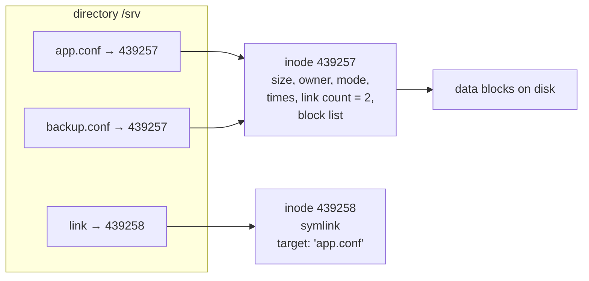
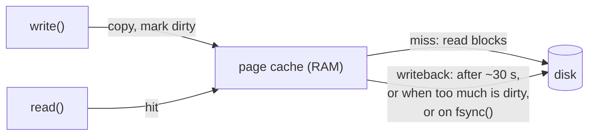
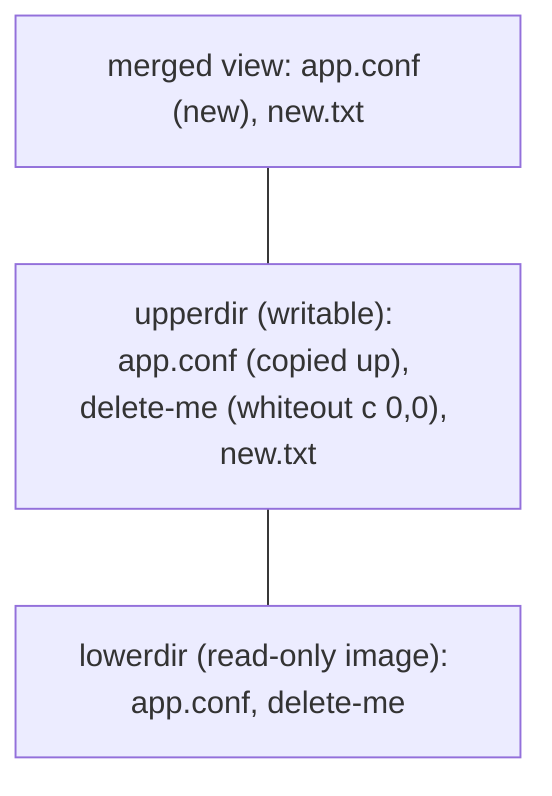

# Filesystems

## Why care?

Four problems from real teams:

- "Our service writes its state to `state.json`. After a power cut, the file was **empty**. Zero bytes."
- "The disk has 60 GB free, but every write fails with `No space left on device`."
- "We changed one byte in a 2 GB file inside a container, and the write took a whole second."
- "The first request after a deploy takes 800 ms. The second takes 80 ms. Nothing is cached in our code."

Each one has a short answer, and all four answers live in the kernel, not in your Go code. This page shows what a file really is (an **inode**), where your writes go before they reach the disk (the **page cache**), how to write a file so a crash can't break it (**fsync and rename**), and how containers stack directories on top of each other (**mounts** and **overlayfs**).

The page before this one, [File descriptors](file-descriptors.md), showed the numbers your process uses to talk to open files. Here we look at what those numbers point to.

## The idea: data, inodes and names are separate

A filesystem keeps three kinds of things apart:

- The **data blocks** on the disk hold the file's bytes.
- Each file has one **inode**: a small record with the size, owner, permissions, times, and the list of data blocks. Each inode has a number, the **inode number**.
- The **name** of a file is not in the inode. Names live in **directories**, which are lists of "name → inode number".

On top of this, the kernel keeps recently used file pages in RAM. This is the **page cache**. The next read of the same pages does not need the disk.



Three rules follow from this picture. Most of this page explains them in more detail:

1. **A file is an inode, not a name.** One inode can have many names (hard links). A name can point to a name (symlink).
2. **A directory is a small file that maps names to inode numbers.** Renaming a file changes only the directory. The data does not move.
3. **Reads and writes go through RAM first.** The disk is updated later, unless you ask for it.

## Under the hood: inodes

`stat` prints the inode. Make a file and look:

```console
$ echo 'hello inode' > a.txt
$ stat a.txt
  File: a.txt
  Size: 12        	Blocks: 8          IO Block: 4096   regular file
Device: 8,32	Inode: 439257      Links: 1
Access: (0644/-rw-r--r--)  Uid: ( 1000/     you)   Gid: ( 1000/     you)
Access: 2026-11-26 16:39:01.404616326 +0100
Modify: 2026-11-26 16:39:01.414942797 +0100
Change: 2026-11-26 16:39:01.414942797 +0100
 Birth: 2026-11-26 16:39:01.404616326 +0100
```

Read it line by line:

- **Size: 12** is the number of bytes. **Blocks: 8** is the space really used, counted in 512-byte units: 8 × 512 = 4096 bytes. The filesystem hands out space in 4 KiB blocks (`IO Block: 4096`), so even 12 bytes take 4 KiB.
- **Device: 8,32** is the disk (major 8, minor 32 = `/dev/sdc` here). An inode number is unique only **inside one filesystem**. The pair (device, inode) identifies a file on the machine.
- **Inode: 439257** is the inode number. **Links: 1** says how many directory entries point to it.
- **Access** (0644) is the permission bits, then owner and group as numbers. The inode stores numbers; `you` is looked up in `/etc/passwd` for display.
- Four times: **Access** (last read, often updated lazily, see `relatime` below), **Modify** (content changed), **Change** (the _inode_ changed: content, permissions, owner or link count), **Birth** (created). There is no "rename time": a rename changes the directory, not the file.

The name `a.txt` is **not** in the inode. The next example shows this.

### Hard links and symlinks

```console
$ ln a.txt b.txt
$ ln -s a.txt c.txt
$ ls -li
total 8
439257 -rw-r--r-- 2 you you 12 Nov 26 16:39 a.txt
439257 -rw-r--r-- 2 you you 12 Nov 26 16:39 b.txt
439258 lrwxrwxrwx 1 you you  5 Nov 26 16:39 c.txt -> a.txt
```

`ls -i` adds the inode number in the first column.

- `b.txt` is a **hard link**: a second name for inode 439257. The link count went from 1 to 2. There is no "original" and "copy". Both names are equal.
- `c.txt` is a **symbolic link**: a _new_ inode (439258) whose content is the text `a.txt`. Its size is 5: the length of that text.

Now rename the "original":

```console
$ mv a.txt moved.txt
$ cat b.txt
hello inode
$ cat c.txt
cat: c.txt: No such file or directory
$ ls -li
total 8
439257 -rw-r--r-- 2 you you 12 Nov 26 16:39 b.txt
439258 lrwxrwxrwx 1 you you  5 Nov 26 16:39 c.txt -> a.txt
439257 -rw-r--r-- 2 you you 12 Nov 26 16:39 moved.txt
```

The hard link still works: it points to the inode, and the inode did not change. The symlink broke: it points to the _name_ `a.txt`, and that name is gone. This is called a **dangling** symlink.

| Question                       | Hard link                      | Symlink                                        |
| ------------------------------ | ------------------------------ | ---------------------------------------------- |
| Points to                      | An inode                       | A path (text)                                  |
| Survives rename of the target? | Yes                            | No                                             |
| Works across filesystems?      | No (inode numbers are per-FS)  | Yes                                            |
| Can point to a directory?      | No                             | Yes                                            |
| When is the data freed?        | When link count is 0 and no fd | Never by the link; it's just a path            |
| Typical use                    | Atomic swaps, dedup, backups   | `current -> releases/v42`, `/etc/alternatives` |

Both "No" answers are easy to see:

```console
$ ln d d2
ln: d: hard link not allowed for directory
$ ln d/x /dev/shm/x
ln: failed to create hard link '/dev/shm/x' => 'd/x': Invalid cross-device link
```

`Invalid cross-device link` is the error `EXDEV`. Remember it: you will meet it again with `rename`.

!!! note "When is a file really deleted?"

    `rm` does not delete a file. It calls `unlink`, which removes one **name** and lowers the link
    count. The kernel frees the inode and its blocks only when the link count is 0 **and** no
    process still has it open. That is the "I deleted the 20 GB log and the disk is still full"
    trap. See [File descriptors](file-descriptors.md) for how to find the process holding it.

### In Go

`os.Stat` follows symlinks; `os.Lstat` does not. The raw inode fields are behind `Sys()`:

```go
package main

import (
	"fmt"
	"log"
	"os"
	"syscall"
)

func main() {
	for _, name := range []string{"a.txt", "b.txt", "c.txt"} {
		fi, err := os.Lstat(name) // Lstat: do not follow symlinks
		if err != nil {
			log.Fatal(err)
		}
		st := fi.Sys().(*syscall.Stat_t) // the raw inode fields (Linux only)
		fmt.Printf("%s  inode=%d links=%d mode=%v\n", name, st.Ino, st.Nlink, fi.Mode())
	}
	a, _ := os.Stat("a.txt")
	b, _ := os.Stat("b.txt")
	c, _ := os.Stat("c.txt") // Stat follows the symlink
	fmt.Println("same file a,b:", os.SameFile(a, b), " a,c:", os.SameFile(a, c))
}
```

```text
a.txt  inode=439506 links=2 mode=-rw-r--r--
b.txt  inode=439506 links=2 mode=-rw-r--r--
c.txt  inode=439520 links=1 mode=Lrwxrwxrwx
same file a,b: true  a,c: true
```

`os.SameFile` compares device and inode, exactly the pair from `stat`. Use it instead of comparing paths: `/srv/app/../app/x` and `/srv/app/x` are different strings but the same file.

## Under the hood: a directory is a name → inode map

A directory is a special file whose content is a list of entries: name and inode number. `ls -f` prints them in the order they are stored, without sorting:

```console
$ mkdir -p d/sub1 d/sub2; touch d/x
$ ls -fi d
439262 sub1
439263 sub2
439265 x
439261 .
439260 ..
```

`.` is an entry pointing to the directory itself (439261), and `..` points to the parent. They are real entries, which explains the link count of a directory:

```console
$ ls -lid d
439261 drwxr-xr-x 4 you you 4096 Nov 26 16:39 d
```

Four links to `d`: its name in the parent, its own `.`, and the `..` in each of its two subdirectories. So "link count − 2" is the number of subdirectories.

Because a directory is "a file of names", its **permissions are about names**, not about the files:

- `r` on a directory: you may **list** the names.
- `w`: you may **add, remove and rename** names.
- `x`: you may **use** names to reach inodes (`cd`, open a file inside).

This has two results that are easy to miss:

```console
$ chmod 444 d/x
$ rm -f d/x && echo removed
removed
$ chmod 555 d
$ touch d/y
touch: cannot touch 'd/y': Permission denied
$ rmdir d/sub1
rmdir: failed to remove 'd/sub1': Permission denied
```

A read-only file can be deleted, because deleting changes the _directory_, and the directory was writable. And in a read-only directory you can't create or remove anything, even if you own every file in it.

### Inodes can run out

Most filesystems have a fixed number of inodes. `df -i` shows them:

```console
$ df -i / /dev/shm
Filesystem       Inodes  IUsed    IFree IUse% Mounted on
/dev/sdc       67108864 861437 66247427    2% /
none            2038058      1  2038057    1% /dev/shm
```

Millions of tiny files (cache entries, session files, mail queues) can use every inode while bytes are still free. Here is the "60 GB free, but no space" problem, on a small scale. A user namespace lets us mount a small `tmpfs` without root (more about that in [Namespaces and cgroups](namespaces-and-cgroups.md)):

```console
$ unshare -Urm sh -c '
  mount -t tmpfs -o size=100M,nr_inodes=100 tmpfs /mnt; cd /mnt
  i=0; while touch f$i 2>/dev/null; do i=$((i+1)); done; echo "created $i files"
  touch one-more; df -h /mnt; df -i /mnt'
created 99 files
touch: cannot touch 'one-more': No space left on device
Filesystem      Size  Used Avail Use% Mounted on
tmpfs           100M     0  100M   0% /mnt
Filesystem     Inodes IUsed IFree IUse% Mounted on
tmpfs             100   100     0  100% /mnt
```

0% of the bytes used, 100% of the inodes. (99 files plus the root directory = 100.) When you see `No space left on device`, run **both** `df -h` and `df -i`.

!!! tip "Size is not space"

    The opposite also exists: a **sparse file** has a size but no blocks.
    `truncate -s 1G sparse.img` makes one instantly. `stat -c '%n size=%s blocks=%b'` prints
    `sparse.img size=1073741824 blocks=0`, and `du -h` says `0`, while `du -h --apparent-size` says `1.0G`.
    Disk images and database files are often sparse. Copy them with `cp --sparse=always`, or they
    grow on the way.

## Under the hood: the page cache

When you `read` a file, the kernel does not copy straight from disk to your buffer. It first reads the disk blocks into **pages of RAM** (4 KiB each) that belong to the kernel, the **page cache**, and copies from there. The next read of the same bytes, by any process, comes from RAM.

When you `write`, the kernel copies your bytes into the page cache, marks those pages **dirty**, and returns. Your `write` "succeeded", and the disk has not seen a single byte yet. Kernel **writeback** threads flush dirty pages to disk later.



### Measure it

`free` shows the page cache in the `buff/cache` column. `/proc/meminfo` has the details:

```console
$ free -h
               total        used        free      shared  buff/cache   available
Mem:            15Gi       2.1Gi        11Gi       4.0Mi       1.8Gi        13Gi
Swap:          4.0Gi          0B       4.0Gi
$ grep -E '^(MemFree|MemAvailable|Buffers|Cached|Dirty|Writeback|Active\(file\)|Inactive\(file\)):' /proc/meminfo
MemFree:        12525448 kB
MemAvailable:   14120836 kB
Buffers:           34740 kB
Cached:          1342212 kB
Active(file):     627808 kB
Inactive(file):   745072 kB
Dirty:                24 kB
Writeback:             0 kB
```

- **Cached** is the page cache for files. **Buffers** is cache for raw block-device metadata. `buff/cache` in `free` adds both, plus reclaimable kernel memory.
- **Dirty** is data written but not yet on disk. **Writeback** is data being written right now.
- **MemAvailable** is the number to watch, not MemFree. Clean cache pages can be dropped at any moment, so they count as available. "Linux ate my RAM" is the page cache doing its job.

Now write 1 GiB and watch `Dirty`:

```console
$ grep -E '^(Dirty|Writeback):' /proc/meminfo
Dirty:              1828 kB
Writeback:             0 kB
$ head -c 1G /dev/urandom > big.bin
$ grep -E '^(Dirty|Writeback):' /proc/meminfo
Dirty:           1055164 kB
Writeback:             0 kB
$ time sync
sync  0.00s user 0.03s system 1% cpu 1.780 total
$ grep -E '^(Dirty|Writeback):' /proc/meminfo
Dirty:                 4 kB
Writeback:             0 kB
```

`head` finished, and a whole gigabyte was still only in RAM. `sync` forced it out; that took 1.8 seconds. Had the machine lost power before `sync`, the file would have been some random mix of old and new blocks, or empty.

`fincore` (from util-linux) shows how much of a file is in the cache:

```console
$ fincore big.bin
RES  PAGES SIZE FILE
 1G 262144   1G big.bin
```

### Cold read vs warm read

To get a **cold** cache without root, ask the kernel to drop the cached pages of just this file. GNU `dd` can do that with `iflag=nocache` (it calls `posix_fadvise(..., POSIX_FADV_DONTNEED)`; this only drops clean pages, so `sync` first):

```console
$ dd if=big.bin iflag=nocache count=0 status=none
$ fincore big.bin
RES PAGES SIZE FILE
 0B     0   1G big.bin
$ free -m
               total        used        free      shared  buff/cache   available
Mem:           15922        2106       11983           3        2161       13815
Swap:           4096           0        4096
$ time cat big.bin > /dev/null
cat big.bin > /dev/null  0.00s user 0.42s system 49% cpu 0.841 total
$ fincore big.bin
RES  PAGES SIZE FILE
 1G 262144   1G big.bin
$ time cat big.bin > /dev/null
cat big.bin > /dev/null  0.00s user 0.12s system 96% cpu 0.120 total
$ time cat big.bin > /dev/null
cat big.bin > /dev/null  0.00s user 0.07s system 96% cpu 0.077 total
```

Cold: 0.84 s. Warm: 0.08–0.12 s. **Ten times faster**, and the code did not change. Also look at the CPU column: the cold read was 49% CPU because `cat` spent half its time _waiting for the disk_. The warm read is 96% CPU: pure memory copying.

That explains the "first request after deploy is slow" problem. A new pod starts with a cold cache for its binary, its config, its templates and (worse) its database files. Postgres, Elasticsearch and Kafka all rely on the page cache, which is why you should leave them free RAM rather than give it all to their heap.

!!! note "This machine is WSL2"

    The Linux disk here is a virtual disk file on Windows, and Windows has its own cache below it.
    So "cold" here means "not in the Linux page cache", and 0.84 s for 1 GiB is faster than a
    truly cold cloud disk. On a network disk (EBS, Persistent Disk), the gap is often 50× or more.
    To drop **all** caches on a test machine: `sync; echo 3 | sudo tee /proc/sys/vm/drop_caches`.

### When does writeback happen?

Four `sysctl` knobs (files in `/proc/sys/vm/`) decide:

```console
$ sysctl vm.dirty_ratio vm.dirty_background_ratio vm.dirty_expire_centisecs vm.dirty_writeback_centisecs
vm.dirty_ratio = 20
vm.dirty_background_ratio = 10
vm.dirty_expire_centisecs = 3000
vm.dirty_writeback_centisecs = 500
```

- Every **5 s** (`500` centiseconds), flusher threads wake up and write pages that have been dirty for more than **30 s** (`3000`).
- When dirty pages pass **10%** of available memory, background writeback starts.
- When they pass **20%**, a process that writes is **throttled**: its `write` calls block until writeback catches up. This is when "write is fast" suddenly stops being true.

Watch the 30-second rule. Write 200 MB and check `Dirty` every 5 seconds:

```console
$ head -c 200M /dev/urandom > mid.bin
$ for i in $(seq 0 5 40); do printf '%2ss ' $i; grep -E '^Dirty:' /proc/meminfo; sleep 5; done
 0s Dirty:            215828 kB
 5s Dirty:            215916 kB
10s Dirty:            215932 kB
15s Dirty:            229224 kB
20s Dirty:            241016 kB
25s Dirty:            205520 kB
30s Dirty:               204 kB
35s Dirty:               276 kB
40s Dirty:              2548 kB
```

For about 30 seconds, 200 MB lived only in RAM. (The small changes are other programs writing too.) **A crash in that window loses the data**, even though every `write` returned success.

## Under the hood: fsync and the atomic rename

So how do you make a write durable? You ask for it:

- **`fsync(fd)`** blocks until the file's dirty data **and** its inode (size, times) are on stable storage, and the disk has been told to flush its own cache. In Go: `(*os.File).Sync()`.
- **`fdatasync(fd)`** is the same, but skips inode fields that are not needed to read the data back (like modification time). Go has it only as `syscall.Fdatasync`.
- **`sync`** (the command or `syscall.Sync`) flushes everything on the machine. That is far more than a service needs.

But `fsync` alone does not solve the empty `state.json` problem. `os.WriteFile` opens the file with `O_TRUNC`: it **first cuts the file to zero bytes**, then writes. Between those two steps, the file is empty or half-written, for readers and for crashes. You can see it without a crash. One goroutine rewrites a 1 MiB file in a loop; the main goroutine reads it for one second and counts reads that were not 1 MiB:

```go
// Command torn shows what a concurrent reader sees while a file is rewritten.
package main

import (
	"bytes"
	"fmt"
	"os"
	"sync"
	"sync/atomic"
	"time"
)

func main() {
	full := bytes.Repeat([]byte("x"), 1<<20) // 1 MiB
	write := map[string]func() error{
		"in-place": func() error { return os.WriteFile("cfg", full, 0o644) },
		"rename": func() error {
			if err := os.WriteFile("cfg.tmp", full, 0o644); err != nil {
				return err
			}
			return os.Rename("cfg.tmp", "cfg")
		},
	}
	for _, mode := range []string{"in-place", "rename"} {
		os.WriteFile("cfg", full, 0o644)
		var stop atomic.Bool
		var wg sync.WaitGroup
		wg.Go(func() {
			for !stop.Load() {
				write[mode]()
			}
		})
		reads, torn := 0, 0
		for deadline := time.Now().Add(time.Second); time.Now().Before(deadline); reads++ {
			b, _ := os.ReadFile("cfg")
			if len(b) != len(full) {
				torn++
			}
		}
		stop.Store(true)
		wg.Wait()
		fmt.Printf("%-8s reads=%d short=%d\n", mode, reads, torn)
	}
}
```

```text
in-place reads=6885 short=6867
rename   reads=2969 short=0
```

Rewriting in place: **99.7% of reads saw a truncated file**. Writing a temp file and renaming it over the old one: **zero**. `rename` replaces the directory entry in one step. Any process that opens `cfg` gets either the old inode or the new inode, never something in between. (A reader that already had the old file open keeps reading the old inode; it is not deleted until it's closed.)

### The full pattern

`rename` is atomic for **readers**. To be atomic for **crashes** too, each step must reach the disk in order. The standard steps:

1. Create a temp file **in the same directory** (same filesystem; `rename` across filesystems fails with `EXDEV`).
2. Write the data, then **`fsync` the temp file**. Now the new inode and its data are on disk.
3. **`rename`** temp → final name.
4. **`fsync` the directory**. The rename changed the directory, and that change is dirty too. Without this, after a crash the directory may still hold the old name → old inode.

```go
// writeFileAtomic replaces path with data so that a reader (or a crash)
// sees either the old file or the new file, never half of one.
func writeFileAtomic(path string, data []byte, perm os.FileMode) (err error) {
	dir := filepath.Dir(path)
	tmp, err := os.CreateTemp(dir, "."+filepath.Base(path)+".tmp-*") // 1. same directory = same filesystem
	if err != nil {
		return err
	}
	defer func() {
		if err != nil {
			os.Remove(tmp.Name()) // clean up on any failure
		}
	}()
	if _, err = tmp.Write(data); err != nil {
		tmp.Close()
		return err
	}
	if err = tmp.Chmod(perm); err != nil {
		tmp.Close()
		return err
	}
	if err = tmp.Sync(); err != nil { // 2. data and inode on disk
		tmp.Close()
		return err
	}
	if err = tmp.Close(); err != nil {
		return err
	}
	if err = os.Rename(tmp.Name(), path); err != nil { // 3. atomic name swap
		return err
	}
	d, err := os.Open(dir)
	if err != nil {
		return err
	}
	defer d.Close()
	return d.Sync() // 4. the new directory entry on disk
}
```

`os.CreateTemp` creates the file with mode `0600`, so we `Chmod` it to the mode we want. The leading dot keeps the temp file out of plain `ls` and out of most glob patterns.

Durability has a price. Timing 100 writes of a 4 KiB file each way:

```go
func main() {
	data := make([]byte, 4<<10) // a 4 KiB state file
	const n = 100

	start := time.Now()
	for range n {
		if err := os.WriteFile("plain.json", data, 0o644); err != nil {
			log.Fatal(err)
		}
	}
	fmt.Println("os.WriteFile:   ", (time.Since(start) / n).Round(time.Microsecond))

	start = time.Now()
	for range n {
		if err := writeFileAtomic("state.json", data, 0o644); err != nil {
			log.Fatal(err)
		}
	}
	fmt.Println("writeFileAtomic:", (time.Since(start) / n).Round(time.Microsecond))
}
```

```text
os.WriteFile:    661µs
writeFileAtomic: 32.733ms
```

About **50× slower**, nearly all of it in the two `fsync` calls waiting for the disk. That is why databases batch many changes into one `fsync` (a "group commit"), and why you should not `fsync` on every HTTP request unless you really need that guarantee. For a config or state file written now and then, 30 ms does not matter. For a log written 10,000 times a second, it is far too slow.

!!! warning "When fsync fails, the data is gone"

    If `fsync` returns an error (a disk error, a full thin-provisioned volume), Linux may already
    have marked the dirty pages clean. A second `fsync` can then return **success** while the data
    was never written. PostgreSQL found this in 2018 ("fsyncgate") and now crashes on any `fsync`
    error and recovers from its log. Do the same: treat an `fsync` error as "this write is lost",
    never as "retry later".

!!! note "What ext4 does for you (and what it doesn't)"

    The root filesystem here is ext4 with `data=ordered` (see the mount options below): file data is
    written before the journal commits the metadata that points to it, so after a crash a file never
    shows blocks that belonged to some other file. It can still be empty or short. ext4 also notices "write temp, rename over" without `fsync` and
    flushes early (`auto_da_alloc`), which hides many bugs. Don't rely on it: it is ext4-only,
    other filesystems (XFS, overlayfs, network filesystems) behave differently.

## Under the hood: mounts

Linux has **one** tree of directories, starting at `/`. Each filesystem (a disk partition, a `tmpfs` in RAM, `/proc`, an NFS share) is **mounted** on a directory in that tree. The kernel keeps a mount table per process (per mount namespace, to be exact), and `/proc/self/mountinfo` shows it:

```console
$ grep -E ' / / | /proc | /sys ' /proc/self/mountinfo
78 63 8:32 / / rw,relatime - ext4 /dev/sdc rw,discard,errors=remount-ro,data=ordered
113 78 0:20 / /sys rw,nosuid,nodev,noexec,noatime shared:19 - sysfs sysfs rw
114 78 0:62 / /proc rw,nosuid,nodev,noexec,noatime shared:20 - proc proc rw
```

The fields of the first line:

| Field           | Value                         | Meaning                                                                |
| --------------- | ----------------------------- | ---------------------------------------------------------------------- |
| mount ID        | `78`                          | This mount's number                                                    |
| parent ID       | `63`                          | The mount it sits on top of                                            |
| major:minor     | `8:32`                        | The device, same as `Device: 8,32` in `stat`                           |
| root            | `/`                           | Which directory of the filesystem is mounted (not `/` for bind mounts) |
| mount point     | `/`                           | Where it appears in the tree                                           |
| mount options   | `rw,relatime`                 | Per-mount options: read-write, update access times only sometimes      |
| optional fields | (none), `shared:19`           | Mount propagation peer group (relevant for containers)                 |
| separator       | `-`                           | End of the optional fields                                             |
| fstype          | `ext4`                        | The filesystem driver                                                  |
| source          | `/dev/sdc`                    | Where the data comes from                                              |
| super options   | `rw,discard,...,data=ordered` | Options of the filesystem itself                                       |

Options to recognise: `ro`; `noexec` (no programs run from here; `/proc` and `/sys` have it); `nosuid` (setuid bits are ignored); `nodev` (device files don't work); `relatime` (update `Access` time only if it is older than `Modify` or more than a day old, to avoid a disk write on every read); `noatime` (never update it).

`findmnt` prints the same table as a tree, and is easier to read:

```console
$ findmnt -o TARGET,SOURCE,FSTYPE,PROPAGATION | head -8
TARGET                                                SOURCE                          FSTYPE      PROPAGATION
/                                                     /dev/sdc                        ext4        private
├─/usr/lib/modules/5.15.167.4-microsoft-standard-WSL2 none                            overlay     private
├─/mnt/wsl                                            none                            tmpfs       shared
├─/usr/lib/wsl/drivers                                drivers                         9p          private
├─/mnt/wslg                                           none                            tmpfs       shared
│ ├─/mnt/wslg/distro                                  /dev/sdc                        ext4        shared
│ ├─/mnt/wslg/versions.txt                            none[/etc/versions.txt]         overlay     shared
```

`findmnt -T <path>` answers "which filesystem is this file on?", the question to ask before you rely on `rename` or hard links between two paths.

### Mounts are per namespace

A new **mount namespace** starts as a copy of the parent's mount table. Mounts made inside are invisible outside:

```console
$ unshare -Urm sh -c 'mount -t tmpfs tmpfs /mnt; findmnt /mnt; readlink /proc/self/ns/mnt; touch /mnt/only-here; ls /mnt'
TARGET SOURCE FSTYPE OPTIONS
/mnt   tmpfs  tmpfs  rw,relatime,uid=1000,gid=1000
mnt:[4026532268]
only-here
$ findmnt /mnt
$ readlink /proc/self/ns/mnt
mnt:[4026532255]
$ ls /mnt
c
wsl
wslg
```

Different namespace number, different `/mnt`. This is half of how a container gets its own root filesystem. The other half is overlayfs.

## Under the hood: overlayfs, the container filesystem

A container image is a stack of read-only **layers**. A running container needs a **writable** view of them, and ten containers from one image should share the layers, not copy them. **overlayfs** does exactly that. It merges directories:

- **lowerdir**: one or more read-only layers (the image). Colon-separated, top first.
- **upperdir**: a writable directory (the container's own changes).
- **workdir**: an empty scratch directory on the same filesystem as upperdir, which overlayfs uses to prepare changes before moving them into place atomically.
- The **merged** mount point shows upper on top of lower.



Since Linux 5.11, an unprivileged user can mount overlayfs inside a user + mount namespace. Kernel 5.15 here allows it, so the next example builds one. We put everything on a `tmpfs` at `/mnt` (to keep paths short) and add a fake "image":

```console
$ unshare -Urm sh
# mount -t tmpfs tmpfs /mnt && cd /mnt && mkdir lower upper work merged
# echo "from the image" > lower/app.conf; echo base > lower/delete-me
# mount -t overlay overlay -o lowerdir=/mnt/lower,upperdir=/mnt/upper,workdir=/mnt/work /mnt/merged
# grep ' /mnt/merged ' /proc/self/mountinfo
704 701 0:99 / /mnt/merged rw,relatime - overlay overlay rw,lowerdir=/mnt/lower,upperdir=/mnt/upper,workdir=/mnt/work
# ls merged
app.conf
delete-me
```

The merged view shows the lower layer. Now do what a container does: change a file, delete a file, add a file.

```console
# echo "changed in container" > merged/app.conf
# rm merged/delete-me
# echo new > merged/new.txt
# ls merged
app.conf
new.txt
# cat lower/app.conf
from the image
# ls -l upper
total 8
-rw-r--r-- 1 root root   21 Nov 26 16:42 app.conf
c--------- 2 root root 0, 0 Nov 26 16:42 delete-me
-rw-r--r-- 1 root root    4 Nov 26 16:42 new.txt
```

(We are "root" only inside the user namespace; outside, these files belong to UID 1000.)

Three mechanisms, all visible in `upper`:

1. **The lower layer never changes.** `lower/app.conf` still says "from the image". That is why one image can serve many containers.
2. **Copy-up.** The first write to a lower file copies the **whole file** into upper, then changes the copy. `upper/app.conf` is 21 bytes: the new content.
3. **Whiteouts.** You cannot delete from a read-only layer. So overlayfs puts a **character device with number 0,0** in upper, named like the deleted file. It means "hide this name".

"Whole file" in point 2 explains the big-file problem from the start of the page. A fresh overlay, this time with a 512 MiB file in the lower layer:

```console
$ unshare -Urm sh
# mount -t tmpfs tmpfs /mnt && cd /mnt && mkdir lower upper work merged
# head -c 512M /dev/zero > lower/big.db
# mount -t overlay overlay -o lowerdir=/mnt/lower,upperdir=/mnt/upper,workdir=/mnt/work /mnt/merged
# du -h upper
0	upper
# /usr/bin/time -f "append 1 byte: %e s" sh -c "echo x >> merged/big.db"
append 1 byte: 0.45 s
# /usr/bin/time -f "append again:  %e s" sh -c "echo x >> merged/big.db"
append again:  0.00 s
# du -h upper/big.db
513M	upper/big.db
```

One byte cost 0.45 s and 513 MB of new disk, because the first write copied the whole file up. The second write was instant. **Never put a database file in an image layer and write to it in the container.** Put it on a volume: a plain bind mount, no overlay.

Real containers work the same way. Here is the root mount inside a Docker container on this machine (the long snapshot directory is shortened to `$S` with `sed`):

```console
$ docker run -d --name ovdemo golang:1.27 sleep 30 >/dev/null
$ docker exec ovdemo head -1 /proc/self/mountinfo | tr ',' '\n' | sed -E 's#/var/lib/containerd/io.containerd.snapshotter.v1.overlayfs/snapshots#$S#g'
801 669 0:100 / / rw
relatime - overlay overlay rw
lowerdir=$S/74/fs:$S/7/fs:$S/6/fs:$S/5/fs:$S/4/fs:$S/3/fs:$S/2/fs:$S/1/fs
upperdir=$S/75/fs
workdir=$S/75/work
```

Eight read-only layers from the `golang` image, plus one upper layer for this container. Even WSL itself uses overlayfs: look back at `/usr/lib/modules/...` in the `findmnt` output above.

## Under the hood: `/proc` and `/sys`, the kernel as files

Some filesystems have no disk at all. Their "files" are generated by the kernel when you read them.

```console
$ df -h /proc /sys
Filesystem      Size  Used Avail Use% Mounted on
proc               0     0     0    - /proc
sysfs              0     0     0    - /sys
$ stat -c '%n size=%s' /proc/self/status /proc/meminfo
/proc/self/status size=0
/proc/meminfo size=0
$ wc -c /proc/meminfo
1391 /proc/meminfo
```

Size 0, yet 1391 bytes come out. The content is built fresh on every `read`. (So don't trust a file's size before reading a `/proc` file in Go: `os.ReadFile` handles this correctly; code that allocates `make([]byte, fi.Size())` does not.)

**`/proc`** (procfs) is about **processes**, plus older kernel-wide files:

- `/proc/<pid>/...`: one directory per process. `/proc/self` is a symlink to the reader's own PID:

  ```console
  $ ls /proc/self | tr '\n' ' '
  arch_status attr auxv cgroup clear_refs cmdline comm coredump_filter cpuset cwd environ exe fd fdinfo gid_map io limits loginuid map_files maps mem mountinfo mounts mountstats net ns oom_adj oom_score oom_score_adj pagemap personality projid_map root sched schedstat sessionid setgroups smaps smaps_rollup stack stat statm status syscall task timens_offsets timers timerslack_ns uid_map wchan
  ```

  You have met `fd/` in [File descriptors](file-descriptors.md) and `mountinfo` above. `status` comes back in [Signals and process lifetime](signals-and-processes.md), and `syscall`/`stack` in [System calls](system-calls.md).

- `/proc/meminfo`, `/proc/cpuinfo`, `/proc/loadavg`, `/proc/filesystems` (the filesystem types this kernel knows):

  ```console
  $ grep -E 'ext4|overlay|proc|sysfs|tmpfs|cgroup' /proc/filesystems
  nodev	sysfs
  nodev	tmpfs
  nodev	proc
  nodev	cgroup
  nodev	cgroup2
  nodev	devtmpfs
  	ext4
  nodev	overlay
  ```

  `nodev` means "needs no block device".

- `/proc/sys/...`: kernel tunables. `sysctl vm.dirty_ratio` is just a nicer way to read `/proc/sys/vm/dirty_ratio`. Writing to these files (as root) changes the running kernel.

**`/sys`** (sysfs) is the newer, more structured view of the **kernel's objects**: devices, drivers, buses, cgroups. The rule is "one value per file":

```console
$ cat /sys/block/sdc/queue/scheduler /sys/block/sdc/queue/rotational /sys/block/sdc/size /sys/block/sdc/queue/logical_block_size
[none]
1
2147483648
512
$ ls /sys/class/net
docker0
eth0
eth1
lo
loopback0
$ cat /sys/class/net/eth0/mtu
1500
```

The disk `sdc` uses no I/O scheduler (`[none]`), claims to be rotational (a virtual disk often does), and has 2147483648 sectors of 512 bytes: 1 TiB. Tools like `lsblk`, `ip link` and `udev` mostly read and format what is in `/sys`. And `/sys/fs/cgroup` is where cgroups live; on this WSL2 machine it's a hybrid of v1 controllers and a `cgroup2` mount at `/sys/fs/cgroup/unified`. See [Namespaces and cgroups](namespaces-and-cgroups.md).

## Try it

1. Make a file, a hard link and a symlink. Delete the original name. Which still works? Check `stat -c '%h'` on the survivor.
2. Run `ls -lid` on a directory, then create a subdirectory in it. Predict the new link count first.
3. Write 500 MB with `head -c 500M /dev/urandom > x`, then watch `grep Dirty /proc/meminfo` every 5 s. When does it drop?
4. Use `dd if=x iflag=nocache count=0` to drop the file from the cache, then time a cold and a warm `cat x > /dev/null`. Check with `fincore x` in between.
5. Run the `torn` program above. Then change the `rename` writer to use `writeFileAtomic`. Does the reader still see zero short reads? How many fewer writes per second does the writer manage?
6. Build the overlay in `unshare -Urm`. Then create a directory in lower with two files, `rm -r` it through merged, and look at upper. What is left there?
7. Find a process's mount namespace with `readlink /proc/<pid>/ns/mnt`. Do `ordersd` and your shell share one?

## Traps

- **`os.WriteFile` for important state.** It truncates first. Readers and crashes see empty or half files. Use temp + `fsync` + `rename` + `fsync(dir)`.
- **Forgetting the directory `fsync`.** The file data is safe, but after a crash the name may still point to the old inode.
- **Temp file in `/tmp`, then `rename` to `/data`.** Different filesystems: `rename` fails with `invalid cross-device link`. Create the temp file next to the target.
- **Retrying after an `fsync` error.** The second call may "succeed" with the data lost. Fail loudly.
- **`fsync` on every request.** Correct but slow (30 ms each here). Batch, or decide which data really must survive a crash.
- **Watching `MemFree`.** Low free memory is normal; the page cache uses it. Watch `MemAvailable`, and `Dirty` for write pressure.
- **Only checking `df -h`.** Also check `df -i`. Millions of small files exhaust inodes.
- **Writing big files inside a container layer.** Copy-up copies the whole file on the first write, and the data disappears with the container. Use a volume.
- **Relative symlinks resolved from the wrong place.** A symlink's target is resolved relative to the directory **containing the link**, not your current directory.
- **Using paths to compare files.** Use `os.SameFile` (device + inode).

## Check yourself

??? question "1. A file has two hard links. You `rm` one. What happens to the data? And if you `rm` the other while a process has the file open?"

    After the first `rm`, nothing happens to the data: the link count goes from 2 to 1, and the
    other name still works. After the second, the link count is 0, but the inode and blocks stay
    until the process closes its last file descriptor. `ls` no longer shows a name, `df` still counts
    the space.

??? question "2. Why can't a hard link cross filesystems, while a symlink can?"

    A hard link is a directory entry holding an **inode number**, and inode numbers are only
    unique inside one filesystem. A symlink holds a **path** as text, which the kernel resolves at
    open time, so it can point anywhere, even to something that doesn't exist.

??? question "3. `write()` returned success. Is the data on disk? When will it be, at the latest, with the default settings here?"

    No, it is in the page cache, marked dirty. With `dirty_expire_centisecs = 3000` and
    `dirty_writeback_centisecs = 500`, writeback usually starts within about 30–35 seconds, sooner
    if dirty memory passes `dirty_background_ratio`. To be sure, call `fsync` (`f.Sync()` in Go).

??? question "4. Explain each of the four steps of writeFileAtomic, and what breaks if you skip it."

    (1) Temp file in the same directory: otherwise `rename` may cross filesystems and fail with
    `EXDEV`. (2) `fsync` the temp file: otherwise, after a crash, the new name may point to an inode
    whose data never reached the disk (an empty file). (3) `rename`: the atomic swap, readers see
    old or new. (4) `fsync` the directory: otherwise the rename itself may be lost in a crash, and
    the old file comes back.

??? question "5. A container modifies one byte of a 2 GB file that came from the image. What happens on disk?"

    overlayfs copies the whole 2 GB file from the lower (image) layer into the container's upper
    layer, then changes the byte in the copy. The first write is slow and uses 2 GB more disk. Later
    writes go to the copy and are fast. The image layer is untouched.

??? question "6. How does a container 'delete' a file that lives in a read-only image layer?"

    It can't remove it from the layer, so overlayfs creates a **whiteout** in the upper layer: a
    character device with device number 0,0 and the same name. The merged view then hides that name.

??? question "7. `/proc/meminfo` has size 0. How can `cat` print 1391 bytes from it?"

    procfs files are generated by the kernel on each `read`. The size reported by `stat` is
    meaningless (0). Programs must read until EOF instead of trusting the size.

## Recap

- A file is an **inode** (metadata + block list), identified by (device, inode number). Names live in directories.
- A **directory** maps names to inode numbers. Directory permissions control names: `w` lets you delete any file in it.
- **Hard links** are extra names for one inode (same filesystem, no directories). **Symlinks** are small files holding a path.
- Data is freed when the link count is 0 **and** no process has it open.
- Reads and writes go through the **page cache**. Writes are **dirty** in RAM for up to ~30 s. Warm reads were 10× faster than cold ones here.
- **`fsync`** makes data durable. For crash-safe replacement: temp file in the same directory, `fsync`, `rename`, `fsync` the directory.
- **Mounts** glue filesystems into one tree. `/proc/self/mountinfo` and `findmnt` show them. Each mount namespace has its own table.
- **overlayfs** stacks read-only lower layers under a writable upper layer, with **copy-up** and **whiteouts**. That is a container's root filesystem.
- **`/proc`** and **`/sys`** are the kernel's state, shown as files generated on read.

Next: who owns all those open files, and what happens when they stop. [Signals and process lifetime](signals-and-processes.md).
