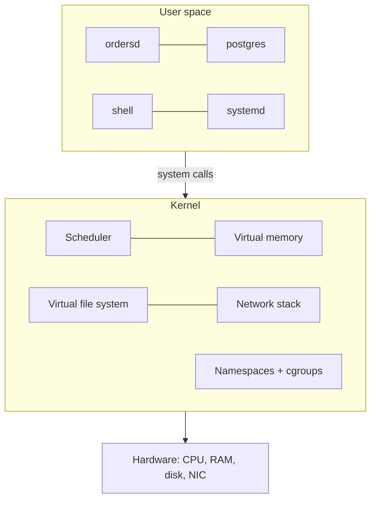

# Linux and the OS

The kernel your services really run on: files, processes, signals, and the walls between them.

## Why go deeper?

Almost every server, container and Kubernetes node runs Linux. Most days you never think about it. Then:

- The service dies with `too many open files`, and raising a limit "fixes" it for a week.
- `kill` stops the service, but in-flight requests are lost.
- The disk is full, you delete a 20 GB log file, and the disk is _still_ full.
- A container is "out of memory" while the host has 50 GB free.
- Something is slow, and `top` says the CPU is idle.

[Processes, threads and system calls](../fundamentals/processes-and-threads.md) showed how a program asks the kernel for help. This chapter opens the kernel's side of that deal. After it, containers stop being magic: they are a normal Linux process with a few extra walls.

## The big picture

1. **Everything is a file** (almost). Disks, sockets, pipes and `/proc` all hide behind one small API: `open`, `read`, `write`, `close`.
2. **Processes live in a tree.** They start, get signals, exit, and must be reaped by their parent.
3. **Namespaces decide what a process can see. Cgroups decide how much it can use.** Together, they are a container.

## Reading order

!!! note "Planned chapter"

    This section is a roadmap. The pages below are written in later sessions and linked here when they land.

| #   | Page                         | You will learn                                                                         |
| --- | ---------------------------- | -------------------------------------------------------------------------------------- |
| 1   | System calls up close        | The user/kernel boundary, `strace`, vDSO, why some calls are slow, how Go makes them   |
| 2   | File descriptors             | The fd table, pipes, sockets, `ulimit`, `O_CLOEXEC`, the "deleted but still open" trap |
| 3   | Filesystems                  | Inodes, links, the page cache, `fsync`, mounts, overlayfs, `/proc` and `/sys`          |
| 4   | Signals and process lifetime | `fork`/`exec`, exit codes, zombies, PID 1, `SIGTERM` vs `SIGKILL`, graceful shutdown   |
| 5   | Namespaces and cgroups       | PID, mount, network and user namespaces; cgroup v2 limits; build a "container" by hand |
| 6   | systemd                      | Units, dependencies, socket activation, journald, running a Go service with hardening  |
| 7   | Debugging a Linux box        | `ps`, `ss`, `lsof`, `vmstat`, `iostat`, `perf`, eBPF tools, and the USE method         |

## How each page works

The same shape as the [Fundamentals](../fundamentals/index.md): **Why care?**, **The idea**, **Under the hood**, **Try it**, **Traps** and **Check yourself**. The examples run on a normal Linux machine (WSL2 works) and use the `ordersd` service from the [Go chapter](../go/index.md) as the process we poke at.
