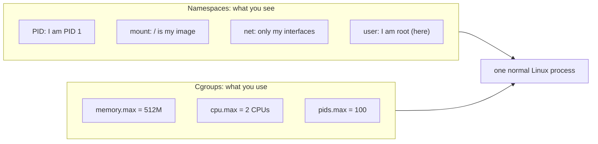

# Namespaces and cgroups

## Why care?

Three messages from production that all trace back to this page:

- "The pod was `OOMKilled`, but the node has 50 GB free."
- "p99 latency jumps every 100 ms, and CPU use is only 40%."
- "Inside the container, `ps` shows only two processes. Where did the rest go?"

There is no `container` object in the Linux kernel. Docker, Podman and Kubernetes all build containers from two kernel features:

- **Namespaces** decide what a process can **see**: which PIDs, which mounts, which network cards, which hostname.
- **Cgroups** (control groups) decide how much a process can **use**: how much memory, how much CPU time, how many processes.

On this page you build a container with nothing but `unshare`, run `ordersd` in it, and then look at the limits that make Go services fail in strange ways.

## The idea: a flat with frosted windows and an electricity meter

Think of a big apartment building again (the kernel is the building manager, see [Processes and threads](../fundamentals/processes-and-threads.md)).

- A **namespace** is frosted glass. The tenant in flat 12 looks out and sees their own little world: their own door numbers, their own name on the bell, their own mailbox. The building is still one building. The glass only changes what they can _see_.
- A **cgroup** is the electricity meter with a fuse. It does not hide anything. It counts what the flat uses, and when the flat uses too much, the fuse blows.

A container is a flat with both: frosted glass on every window, and a meter with a fuse.



## Under the hood: namespaces

### The eight namespaces

Each namespace type wraps one kind of global resource. Linux 5.6 and newer has eight:

| Namespace | `clone` flag      | Isolates                                     | Since (kernel) |
| --------- | ----------------- | -------------------------------------------- | -------------- |
| mount     | `CLONE_NEWNS`     | The list of mounts: what `/` and `/proc` are | 2.4.19         |
| UTS       | `CLONE_NEWUTS`    | Hostname and NIS domain name                 | 2.6.19         |
| IPC       | `CLONE_NEWIPC`    | System V IPC and POSIX message queues        | 2.6.19         |
| PID       | `CLONE_NEWPID`    | Process IDs                                  | 2.6.24         |
| network   | `CLONE_NEWNET`    | Interfaces, routes, firewall, ports, sockets | 2.6.29         |
| user      | `CLONE_NEWUSER`   | User and group IDs, capabilities             | 3.8            |
| cgroup    | `CLONE_NEWCGROUP` | Which part of the cgroup tree you see        | 4.6            |
| time      | `CLONE_NEWTIME`   | The `CLOCK_MONOTONIC` and `CLOCK_BOOTTIME`   | 5.6            |

The mount flag is called `CLONE_NEWNS` ("new namespace") because it was the first one. Nobody expected there would be more.

Every process is in exactly one namespace of each type. You can see which ones in `/proc/<pid>/ns`:

```console
$ ls -l /proc/self/ns | awk 'NR>1 {print $9, $10, $11}'
cgroup -> cgroup:[4026531835]
ipc -> ipc:[4026532244]
mnt -> mnt:[4026532255]
net -> net:[4026531840]
pid -> pid:[4026532257]
pid_for_children -> pid:[4026532257]
time -> time:[4026531834]
time_for_children -> time:[4026531834]
user -> user:[4026531837]
uts -> uts:[4026532256]
```

The number in brackets is an **inode number** on a hidden filesystem (`nsfs`). Two processes with the same number are in the same namespace. That's the whole test.

Two odd ones: `pid_for_children` and `time_for_children`. A process can never change its own PID, so a new PID (or time) namespace only applies to the **children** it creates from now on.

!!! note "WSL2 is already a container"

    The `mnt`, `pid`, `uts` and `ipc` numbers above are not the kernel's first namespaces
    (those are around `4026531836`). WSL2 runs each Linux distribution in its own set of
    namespaces, under a small `init` process from Microsoft. So the "host" in every example
    on this page is itself in namespaces. It does not change anything you will see.

### Three system calls, three tools

| System call  | What it does                                          | Command line tool          |
| ------------ | ----------------------------------------------------- | -------------------------- |
| `clone(2)`   | Start a new process in new namespaces                 | (used by runtimes, and Go) |
| `unshare(2)` | Move the calling process into new namespaces          | `unshare(1)`               |
| `setns(2)`   | Join an existing namespace, given a `/proc/.../ns` fd | `nsenter(1)`               |
| (read /proc) | List namespaces and who is in them                    | `lsns(8)`                  |

A namespace stays alive as long as one of these holds on to it: a process inside it, an open file descriptor on its `/proc/<pid>/ns/...` file, or a bind mount of that file. `ip netns add` uses the last trick: it bind-mounts network namespaces under `/run/netns` so they survive with no process in them.

### User namespaces: root, but only at home

Most namespaces need the `CAP_SYS_ADMIN` capability. Try one as a normal user:

```console
$ unshare --net readlink /proc/self/ns/net
unshare: unshare failed: Operation not permitted
```

The user namespace is the exception. Any user can create one, and inside it they can be root. Then they may create all the other namespaces, because they hold `CAP_SYS_ADMIN` **in their own user namespace**:

```console
$ unshare -Urn readlink /proc/self/ns/net
net:[4026532270]
$ unshare --user --map-root-user id
uid=0(root) gid=0(root) groups=0(root),65534(nogroup)
$ grep CapEff /proc/self/status
CapEff:	0000000000000000
$ unshare -Ur grep CapEff /proc/self/status
CapEff:	000001ffffffffff
```

`-r` (`--map-root-user`) writes a **UID map**. It says: "UID 0 inside is UID 1000 outside, for a range of 1 ID":

```console
$ unshare -Ur cat /proc/self/uid_map /proc/self/gid_map
         0       1000          1
         0       1000          1
```

The three columns are: first ID inside, first ID outside, how many. The kernel translates every UID at the border. That's why this "root" is harmless to the host:

```console
$ unshare -Ur touch /etc/hacked
touch: cannot touch '/etc/hacked': Permission denied
$ unshare -Ur ls -ln /etc/shadow
-rw-r----- 1 65534 65534 823 Jul  4 20:34 /etc/shadow
$ ls -ln /etc/shadow
-rw-r----- 1 0 42 823 Jul  4 20:34 /etc/shadow
$ unshare -Ur sh -c 'touch made-by-root; ls -ln made-by-root'
-rw-r--r-- 1 0 0 0 Nov 26 16:45 made-by-root
$ ls -ln made-by-root
-rw-r--r-- 1 1000 1000 0 Nov 26 16:45 made-by-root
```

Read it carefully:

- The real root (UID 0) and group `shadow` (GID 42) are **not in the map**. Inside, they show up as `65534` ("nobody", the overflow ID).
- The file "root" creates belongs to UID 1000 on the host. Inside root is outside you.
- Capabilities inside a user namespace only count for things **owned by** that namespace. Root in the box can change its own hostname. It can't load a kernel module or read `/etc/shadow`.

Without a map you are `nobody` and can do almost nothing:

```console
$ unshare -U sh -c 'id; cat /proc/self/uid_map; echo end'
uid=65534(nobody) gid=65534(nogroup) groups=65534(nogroup)
end
```

A one-ID map is enough for one user. Rootless Podman and rootless Docker need many (a container image has files owned by root, `nobody`, `postgres`...). They get a range from `/etc/subuid` and ask the setuid helper `newuidmap` to write the bigger map:

```console
$ grep "$USER" /etc/subuid
you:100000:65536
$ unshare --map-auto -r sh -c 'cat /proc/self/uid_map'
unshare: failed to execute newuidmap: Permission denied
```

`newuidmap` (Ubuntu package `uidmap`) is not installed on this machine, so the range is there but nobody can use it.

You can do the same from Go. `os/exec` calls `clone` with the flags you ask for, and writes the maps for you:

```go
// Command gons runs a command in new user, UTS and PID namespaces.
package main

import (
	"log"
	"os"
	"os/exec"
	"syscall"
)

func main() {
	cmd := exec.Command(os.Args[1], os.Args[2:]...)
	cmd.Stdin, cmd.Stdout, cmd.Stderr = os.Stdin, os.Stdout, os.Stderr
	cmd.SysProcAttr = &syscall.SysProcAttr{
		// clone(2) flags: one new namespace per flag.
		Cloneflags: syscall.CLONE_NEWUSER | syscall.CLONE_NEWUTS | syscall.CLONE_NEWPID,
		// Map our real UID/GID to 0 inside, like unshare --map-root-user.
		UidMappings: []syscall.SysProcIDMap{{ContainerID: 0, HostID: os.Getuid(), Size: 1}},
		GidMappings: []syscall.SysProcIDMap{{ContainerID: 0, HostID: os.Getgid(), Size: 1}},
	}
	if err := cmd.Run(); err != nil {
		log.Fatal(err)
	}
}
```

```console
$ ./gons sh -c 'hostname gobox; echo "pid $$ on $(hostname) as $(id -u)"; cat /proc/self/uid_map'
pid 1 on gobox as 0
         0       1000          1
```

### PID namespaces: who is PID 1?

A PID namespace gives its processes their own numbers, starting at 1. Three tries, each one teaches something:

```console
$ unshare -Urp sh -c '/bin/true; /bin/true; echo done'
sh: 1: Cannot fork
```

Without `--fork`, `unshare` puts the **shell itself** in the old PID namespace (remember `pid_for_children`). The shell's first child becomes PID 1 of the new namespace. When that child exits, the namespace has no init, and the kernel refuses every new process in it. Always use `-f` (`--fork`):

```console
$ unshare -Urpf sh -c 'echo $$; ps -o pid,comm | head -3'
1
    PID COMMAND
    595 systemd
    596 (sd-pam)
```

The shell is PID 1 now. But `ps` still shows host processes. `ps` does not ask the kernel for "my" processes. It reads `/proc`, and `/proc` is still the host's. A `proc` filesystem shows the PID namespace **of the process that mounted it**. So we need a new mount namespace and a fresh `/proc`. That's `--mount-proc`:

```console
$ unshare -Urpf --mount-proc sh -c 'echo $$; ps -o pid,user,comm'
1
    PID USER     COMMAND
      1 root     sh
      2 root     ps
```

PID 1 is special inside a namespace, just like on a real machine (see [Signals and process lifetime](signals-and-processes.md)):

1. When PID 1 exits, the kernel kills **every** other process in the namespace with `SIGKILL`.
2. Orphaned processes are re-parented to it, so it must reap zombies.
3. The kernel only delivers a signal to it if it has **installed a handler** for that signal. The default action ("die on `SIGTERM`") does not apply. From an ancestor namespace, only `SIGKILL` and `SIGSTOP` are forced through.

Rule 3, for real. `sleep` has no `SIGTERM` handler. `NSpid` in `/proc/<pid>/status` shows its PID in every namespace from the outside in: 202360 on the host, 1 in the box.

```console
$ unshare -Urpf --mount-proc --uts sh -c 'hostname box; exec sleep 300' &
$ grep NSpid /proc/202360/status
NSpid:	202360	1
$ kill -TERM 202360
$ ps -o pid,stat,comm -p 202360
    PID STAT COMMAND
 202360 SN   sleep
$ kill -KILL 202360
```

`SIGTERM` did nothing. This is exactly why `docker stop` on a container whose PID 1 ignores signals takes 10 seconds: Docker sends `SIGTERM`, nothing happens, Docker waits, then sends `SIGKILL`. Go programs that use `signal.Notify` (like `ordersd`) are fine. A shell script as PID 1 usually is not.

### Mount namespaces: your own `/`

A mount namespace is a private copy of the mount list. Mount something inside, and the outside never sees it:

```console
$ unshare -Urm sh -c 'mount -t tmpfs none scratch && echo secret > scratch/note && ls scratch && findmnt -n -o FSTYPE,OPTIONS scratch'
note
tmpfs rw,relatime,uid=1000,gid=1000
$ ls -A scratch | wc -l
0
```

One subtlety: **mount propagation**. On a normal systemd machine, `/` is a `shared` mount. A new mount under a shared mount is copied to every namespace that shares it, which would leak your mounts back to the host. `unshare` sets everything to `private` by default (`--propagation private`) to stop that. On this WSL2 machine `/` is already private:

```console
$ findmnt -no PROPAGATION /
private
```

To give a process a different root filesystem there are two tools:

- **`chroot`** changes the process's idea of `/`. That's all. The old root is still mounted, and a process with `CAP_SYS_CHROOT` can escape (`chroot` into a subdirectory, then `cd ..` past the new root). `chroot` was never a security boundary.
- **`pivot_root`** swaps the root **mount** of the mount namespace: the new root goes to `/`, the old root moves to a directory below it. Then you unmount the old root, and it is gone from this namespace. Nothing to escape to. Container runtimes use `pivot_root`.

`pivot_root` has rules: the new root must be a mount point (a bind mount of a directory onto itself is enough), and it must be in a mount namespace that is not shared with the host.

### Network namespaces: one cable, unplugged

A new network namespace has its own interfaces, routes, firewall rules and port numbers. It starts with **only a loopback interface, and that is down**:

```console
$ ip -br link
lo               UNKNOWN        00:00:00:00:00:00 <LOOPBACK,UP,LOWER_UP>
eth0             DOWN           90:2e:16:33:2b:1c <BROADCAST,MULTICAST>
loopback0        UP             00:15:5d:31:88:d7 <BROADCAST,MULTICAST,UP,LOWER_UP>
eth1             UP             50:2f:9b:20:47:48 <BROADCAST,MULTICAST,UP,LOWER_UP>
docker0          DOWN           d6:f8:6e:d2:e3:1a <NO-CARRIER,BROADCAST,MULTICAST,UP>
$ unshare -Urn ip -br link
lo               DOWN           00:00:00:00:00:00 <LOOPBACK>
$ unshare -Urn sh -c 'ping -c1 -W1 1.1.1.1; ip link set lo up; ping -c1 127.0.0.1'
ping: connect: Network is unreachable
PING 127.0.0.1 (127.0.0.1) 56(84) bytes of data.
64 bytes from 127.0.0.1: icmp_seq=1 ttl=64 time=0.099 ms

--- 127.0.0.1 ping statistics ---
1 packets transmitted, 1 received, 0% packet loss, time 0ms
rtt min/avg/max/mdev = 0.099/0.099/0.099/0.000 ms
```

No route to the outside at all. To connect a container, a runtime creates a **veth pair** (a virtual cable with two ends), puts one end in the container's namespace and plugs the other into a bridge on the host (`docker0`). That needs real root on the host, and it's the topic of container networking in the [Containers](../containers/index.md) chapter.

Note that `127.0.0.1` inside is **not** the host's `127.0.0.1`. Each network namespace has its own loopback. Keep that in mind; it bites in the "Try it" below.

### UTS, IPC, cgroup and time: the small four

```console
$ unshare -Ur --uts sh -c 'hostname box; hostname'; hostname
box
laptop

$ ipcmk -Q
Message queue id: 0
$ ipcs -q | tail -n +3
0xa6346c26 0          you        644        0            0
$ unshare -Uri ipcs -q | tail -n +3
$ ipcrm --all=msg

$ cat /proc/uptime
33487.04 527775.74
$ unshare -Urf --time --boottime 86400 cat /proc/uptime
119887.04 527775.77
```

- **UTS**: your own hostname, without touching the host's.
- **IPC**: the message queue made outside is not visible inside. Old databases (and PostgreSQL's shared memory, in older versions) used System V IPC, so this matters.
- **Time**: the box thinks the machine booted one day earlier. It is for moving containers between machines (checkpoint and restore) without the monotonic clock jumping. You will rarely use it.
- **Cgroup**: inside a new cgroup namespace, your own cgroup looks like the root. You will see `0::/` in the "Try it" below instead of a long host path. It hides host details and makes the container's view portable.

### `nsenter` and `setns`: walking into a running box

`nsenter` opens `/proc/<pid>/ns/<type>` for a target process and calls `setns(2)` on each, then runs a command. Start a box in the background, then join it:

```console
$ unshare -Urpf --mount-proc --uts sh -c 'hostname box; exec sleep 300' &
$ grep NSpid /proc/202583/status
NSpid:	202583	1
$ nsenter -t 202583 -U -u -m -p --preserve-credentials sh -c 'hostname; id; ps -o pid,user,comm'
box
uid=0(root) gid=0(root) groups=0(root),65534(nogroup)
    PID USER     COMMAND
      1 root     sleep
      3 root     sh
      6 root     ps
$ nsenter -t 202583 -U -u -m -p sh -c 'hostname'
nsenter: setgroups failed: Operation not permitted
```

Without `--preserve-credentials`, `nsenter` tries to drop supplementary groups with `setgroups(2)`, and a user namespace made by `unshare -r` forbids that. `docker exec` and `kubectl exec` do the same `setns` dance, with real root.

!!! warning "`setns` and Go don't mix well"

    `setns` changes the namespace of **one thread**, not the process. A Go program runs on
    many threads, and the scheduler moves goroutines between them. If you call `setns` from
    Go, you must call `runtime.LockOSThread()` first and never unlock that thread. Worse,
    the kernel refuses to move a multi-threaded process into a new **user** namespace at all,
    and a Go program is multi-threaded before `main` starts. That's why `runc`, which is
    written in Go, does its namespace work in a small C function (`nsexec`) that runs before
    the Go runtime starts. For a new process, set `SysProcAttr.Cloneflags` like `gons` above
    and let `clone` do it.

## Try it: a container by hand

Time to build one. No Docker, no root, just `unshare`, `mount` and `pivot_root`.

**Step 1: a root filesystem.** A container image is, in the end, a directory tree. A static Go binary needs no libraries, so the smallest useful tree is one binary. Here is a tiny program that prints what a process can see:

```go
// Command inspect prints what a process can see of the world.
package main

import (
	"fmt"
	"net"
	"os"
	"runtime"
	"strings"
)

func main() {
	host, _ := os.Hostname()
	fmt.Println("pid:", os.Getpid(), "ppid:", os.Getppid())
	fmt.Println("uid:", os.Getuid(), "gid:", os.Getgid())
	fmt.Println("hostname:", host)
	fmt.Println("GOMAXPROCS:", runtime.GOMAXPROCS(0))

	entries, _ := os.ReadDir("/")
	fmt.Print("/:")
	for _, e := range entries {
		fmt.Print(" ", e.Name())
	}
	fmt.Println()

	ifaces, _ := net.Interfaces()
	fmt.Print("interfaces:")
	for _, i := range ifaces {
		fmt.Print(" ", i.Name)
	}
	fmt.Println()

	cg, _ := os.ReadFile("/proc/self/cgroup")
	fmt.Print("cgroup: ", string(cg[strings.LastIndex(string(cg), "0::"):]))
}
```

Build it, and `ordersd` too, as static binaries (`CGO_ENABLED=0`), into a `rootfs`:

```console
$ CGO_ENABLED=0 go build -trimpath -ldflags=-s -o inspect.bin .
$ mkdir -p rootfs/bin rootfs/proc rootfs/.old
$ cp inspect.bin rootfs/bin/inspect
$ cp ordersd rootfs/bin/ordersd
$ find rootfs | sort
rootfs
rootfs/.old
rootfs/bin
rootfs/bin/inspect
rootfs/bin/ordersd
rootfs/proc
```

**Step 2: the "runtime".** One `unshare` for seven namespaces (all but time), then a shell script that sets the box up from the inside and replaces itself with the program:

```sh
#!/bin/sh
# box.sh: run a program from ./rootfs in a home-made container.
# Usage: ./box.sh /bin/inspect
set -eu
exec unshare --user --map-root-user --pid --fork --mount --uts --ipc --net --cgroup \
  sh -euc '
    hostname box                    # UTS: our own hostname
    ip link set lo up               # net: only lo exists; switch it on
    mount --bind rootfs rootfs      # pivot_root wants the new root to be a mount
    mount -t proc proc rootfs/proc  # a /proc for the new PID namespace
    cd rootfs
    pivot_root . .old               # rootfs becomes /, the old / moves to /.old
    cd /
    # The host tools now live under /.old, and so do their libraries.
    /.old/lib64/ld-linux-x86-64.so.2 --library-path /.old/lib/x86_64-linux-gnu \
      /.old/usr/bin/umount --lazy /.old
    exec "$@"                       # replace the shell: the program becomes PID 1
  ' box "$@"
```

The one ugly line deserves a word. After `pivot_root`, `umount` lives at `/.old/usr/bin/umount`, but it is dynamically linked and looks for its libraries in `/lib`, which is now our nearly empty rootfs. So we call the dynamic loader by hand and point it at the old library directory. Real runtimes do this step with a direct `umount2(2)` system call and have no such problem.

**Step 3: run it**, and compare with the host:

```console
$ ./box.sh /bin/inspect
pid: 1 ppid: 0
uid: 0 gid: 0
hostname: box
GOMAXPROCS: 16
/: .old bin proc
interfaces: lo
cgroup: 0::/
$ ./inspect.bin
pid: 219860 ppid: 219827
uid: 1000 gid: 1000
hostname: laptop
GOMAXPROCS: 16
/: bin bin.usr-is-merged boot dev etc home init lib lib.usr-is-merged lib64 lost+found media mnt opt proc root run sbin sbin.usr-is-merged snap srv sys tmp usr var
interfaces: lo eth0 loopback0 eth1 docker0
cgroup: 0::/init.scope
```

Every line differs, one per namespace. `.old` is still there as an empty directory: the mount on it is gone, so the host's files are gone too.

**Step 4: a real service.** Run `ordersd` in the box, and try to reach it:

```console
$ ./box.sh /bin/ordersd -addr 127.0.0.1:18080 -log-format text > box.log 2>&1 &
$ grep NSpid /proc/219912/status
NSpid:	219912	1
$ curl -sS http://127.0.0.1:18080/healthz
curl: (7) Failed to connect to 127.0.0.1:18080 after 0 ms: Could not connect to server
$ nsenter --target 219912 --user --net --preserve-credentials curl -sS http://127.0.0.1:18080/healthz
{"status":"ok"}
$ nsenter --target 219912 --user --net --preserve-credentials ip -br addr
lo               UNKNOWN        127.0.0.1/8 ::1/128
```

The host's `curl` fails: the box's `127.0.0.1` is a different loopback. With `nsenter --net` we run the **host's** `curl` binary (we did not join the mount namespace) inside the **box's** network. That's a handy debugging trick for real containers too, when the image has no `curl`: `nsenter -t <pid> -n curl ...`.

`lsns` shows the box from outside. Only the time namespace is still shared with the host:

```console
$ lsns -p 220278 -o NS,TYPE,NPROCS,PID,USER
        NS TYPE   NPROCS    PID USER
4026531834 time       25    589 you
4026532269 user        2 220276 you
4026532270 mnt         2 220276 you
4026532271 uts         2 220276 you
4026532272 ipc         2 220276 you
4026532273 pid         1 220278 you
4026532274 cgroup      2 220276 you
4026532275 net         2 220276 you
```

(The `unshare` process, PID 220276, is in every namespace but the new PID one, because of `--fork`.)

Now stop it:

```console
$ kill -TERM 219912
$ cat box.log
time=2026-11-26T15:51:05.806Z level=INFO msg=starting service=ordersd version=(devel) revision=f1ceceb702caa2e21fa5a586e30c350472c49ee6 go_version=go1.27.4
time=2026-11-26T15:51:05.830Z level=INFO msg=listening service=ordersd addr=127.0.0.1:18080
time=2026-11-26T15:51:06.816Z level=INFO msg="shutting down" service=ordersd delay=0s timeout=15s
time=2026-11-26T15:51:06.816Z level=INFO msg="shutdown complete" service=ordersd
```

Two details:

1. `ordersd` is PID 1 and **did** stop on `SIGTERM`, unlike `sleep` earlier. It installed a handler with `signal.NotifyContext`, so the kernel delivers the signal.
2. The times end in `Z` (UTC), while the host is in Amsterdam. Go looks for `/etc/localtime`, and our rootfs has no `/etc`. This is why distroless images ship time zone data, and why "the logs in the container are an hour off" is a classic.

What is missing compared to `docker run`? Quite a lot: an image made of layers (overlayfs, see [Filesystems](filesystems.md)), a network cable (veth), a `/dev`, dropped capabilities, a seccomp filter, and **cgroup limits**. Right now our box can use all 16 CPUs and all memory. Let's look at the meter.

## Under the hood: cgroups

### A tree of directories, where files are knobs

A cgroup is a directory in a special filesystem. Processes are listed in its `cgroup.procs` file. Limits and counters are other files in the same directory. Create a subdirectory, and you have a child cgroup. The interface is `mkdir`, `echo` and `cat`.

Each kind of resource is handled by a **controller**: `memory`, `cpu`, `io`, `pids`, `cpuset`, and a few more.

### v1 and v2

There are two versions, and the difference is the shape of the tree:

| Topic           | cgroup v1 (2008)                                          | cgroup v2 (stable in 4.5, 2016)                                   |
| --------------- | --------------------------------------------------------- | ----------------------------------------------------------------- |
| Trees           | One tree **per controller** (`/sys/fs/cgroup/memory/...`) | **One unified tree** for all controllers                          |
| A process is in | A different cgroup in each tree                           | Exactly one cgroup                                                |
| Memory limit    | `memory.limit_in_bytes`                                   | `memory.max` (hard), `memory.high` (throttle)                     |
| CPU limit       | `cpu.cfs_quota_us` + `cpu.cfs_period_us`                  | `cpu.max` (`"quota period"`)                                      |
| OOM events      | `memory.oom_control`                                      | `memory.events`                                                   |
| Pressure info   | no                                                        | `memory.pressure`, `cpu.pressure`, `io.pressure` (PSI)            |
| Safe delegation | no                                                        | yes: hand a subtree to an unprivileged user (rootless containers) |
| Rules           | Processes anywhere                                        | "No internal processes": controllers only manage leaf cgroups     |

With v1, the memory tree and the CPU tree could disagree about which group a process belongs to. Writeback I/O could not be charged correctly, because memory and I/O lived in different trees. v2 fixes this with one tree. In v2, a parent turns on controllers for its children by writing to `cgroup.subtree_control` (for example `+memory +cpu`), and `cgroup.controllers` lists what it may turn on.

**v2 is the production norm.** Ubuntu since 21.10, Fedora, Debian 11+, RHEL 9, and every current Kubernetes node image use pure v2. Kubernetes has supported it as stable since 1.25, and systemd 256 and newer refuse to boot on v1 by default.

### This machine: hybrid, and honest about it

WSL2 (kernel 5.15) still mounts 15 v1 trees (one per controller, plus `name=systemd` for systemd's own bookkeeping), and one v2 tree:

```console
$ mount -t cgroup2
cgroup2 on /sys/fs/cgroup/unified type cgroup2 (rw,nosuid,nodev,noexec,relatime,nsdelegate)
$ mount -t cgroup | wc -l
15
$ ls /sys/fs/cgroup
blkio cpu cpu,cpuacct cpuacct cpuset devices freezer hugetlb memory misc net_cls net_cls,net_prio net_prio perf_event pids rdma systemd unified
```

A controller can be attached to only one hierarchy. Every controller is taken by a v1 tree, so the v2 tree has **none**:

```console
$ cat /sys/fs/cgroup/unified/cgroup.controllers

$ cat /proc/self/cgroup
15:name=systemd:/init.scope
14:misc:/
13:rdma:/
12:pids:/init.scope
11:hugetlb:/
10:net_prio:/
9:perf_event:/
8:net_cls:/
7:freezer:/
6:devices:/init.scope
5:memory:/init.scope
4:blkio:/
3:cpuacct:/
2:cpu:/init.scope
1:cpuset:/
0::/init.scope
```

One line per v1 tree, plus `0::` for the v2 tree. On a pure v2 machine this file has only the `0::` line. That one-line file is the quickest way to tell which world you're in.

Now ask systemd for limits, as a normal user, the way you would on any modern laptop:

```console
$ systemd-run --user --scope -p MemoryMax=64M -p CPUQuota=50% -p TasksMax=20 --unit=demo-limits2 sleep 30 &
$ systemctl --user show demo-limits2.scope -p MemoryMax -p CPUQuotaPerSecUSec -p TasksMax -p MemoryCurrent -p TasksCurrent -p ControlGroup
ControlGroup=/user.slice/user-1000.slice/user@1000.service/app.slice/demo-limits2.scope
MemoryCurrent=[not set]
TasksCurrent=[not set]
CPUQuotaPerSecUSec=500ms
MemoryMax=67108864
TasksMax=20
```

systemd accepted all three settings. But `MemoryCurrent=[not set]` is the tell: there is no memory controller to read from. Prove it with a program that allocates and touches memory in 16 MiB steps:

```go
// Command hog allocates memory in 16 MiB steps and touches every page.
package main

import (
	"flag"
	"fmt"
	"time"
)

func main() {
	limit := flag.Int("mib", 256, "stop after this many MiB")
	flag.Parse()

	var keep [][]byte
	for mib := 16; mib <= *limit; mib += 16 {
		b := make([]byte, 16<<20)
		for i := range b {
			b[i] = 1 // touch the page so the kernel really backs it with RAM
		}
		keep = append(keep, b)
		fmt.Println("allocated", mib, "MiB")
		time.Sleep(50 * time.Millisecond)
	}
	fmt.Println("done, holding", len(keep)*16, "MiB")
}
```

```console
$ systemd-run --user --scope -p MemoryMax=64M --unit=demo-hog ./hog.bin -mib 128 2>&1 | tail -4
allocated 96 MiB
allocated 112 MiB
allocated 128 MiB
done, holding 128 MiB
$ systemd-run --user --scope --expand-environment=no -p CPUQuota=20% --unit=demo-cpu sh -c 'timeout 2 sh -c "while :; do :; done"; cat /sys/fs/cgroup/unified$(cut -d: -f3 /proc/self/cgroup | tail -1)/cpu.stat'
Running as unit: demo-cpu.scope; invocation ID: 289f10dc0d174579a0c48d9fc6df8618
usage_usec 1937782
user_usec 1937782
system_usec 0
```

128 MiB under a 64 MiB limit, and 1.94 seconds of CPU in 2 seconds under a 20% quota. **Neither limit was enforced.** Why? The user manager (`user@1000.service`) is delegated `cpu memory pids` (`systemctl show user@1000.service -p DelegateControllers`), but delegation only works in v2, and in this v2 tree those controllers don't exist. The v1 trees belong to root, and v1 cannot be delegated safely. So systemd records the setting and moves on. Silently.

Some limits **are** active here, set by the root systemd in the v1 trees. `systemd-logind` caps the number of tasks per user:

```console
$ cat /sys/fs/cgroup/pids/user.slice/user-1000.slice/pids.max
42017
$ cat /sys/fs/cgroup/pids/user.slice/user-1000.slice/pids.events
max 0
```

`pids.events` counts how often a `fork` failed because of the limit. Zero, so far.

!!! tip "Getting pure v2 on WSL2"

    A common fix is to add `kernelCommandLine = cgroup_no_v1=all` under `[wsl2]` in
    `%UserProfile%\.wslconfig`, then `wsl --shutdown`. The kernel then gives every
    controller to the v2 tree. The outputs below marked "to do" are meant to be captured
    on such a machine (or any modern Linux box).

### `memory.max`: the fuse

In v2, memory has a few knobs. Two matter most:

- **`memory.high`**: a soft ceiling. Above it, the kernel **throttles** the cgroup and reclaims its memory hard (page cache first). The process gets slow, not killed.
- **`memory.max`**: the hard limit. When the cgroup needs more and reclaim cannot free enough, the kernel's **OOM killer** runs **inside this cgroup only** and kills a process (the biggest one, by default). The host may have 50 GB free; it doesn't matter.

What counts? Anonymous memory (your Go heap and stacks), **page cache** of files the cgroup read or wrote, kernel memory for its sockets and so on. Page cache is reclaimable, so it is rarely what gets you killed, but it makes `memory.current` look scary.

`memory.events` counts what happened:

| Field      | Counts                                                               |
| ---------- | -------------------------------------------------------------------- |
| `low`      | Times the cgroup was reclaimed even though it was below `memory.low` |
| `high`     | Times it went over `memory.high` and was throttled                   |
| `max`      | Times it hit `memory.max` (reclaim had to run)                       |
| `oom`      | Times reclaim failed and the OOM killer was needed                   |
| `oom_kill` | Processes killed by the OOM killer                                   |

When Kubernetes reports `OOMKilled` (exit code 137 = 128 + 9, `SIGKILL`), this is the counter behind it. On a v2 machine:

<!-- TODO(real-output): on a pure cgroup v2 machine, run this and paste the output. Expect the hog to die after "allocated 48 MiB" or so with "Killed", exit 137, and memory.events showing max > 0, oom 1, oom_kill 1. -->

```sh
systemd-run --user --scope --expand-environment=no -p MemoryMax=64M -p MemorySwapMax=0 \
  sh -c './hog.bin -mib 128; echo "exit=$?"; cat /sys/fs/cgroup$(cut -d: -f3 /proc/self/cgroup)/memory.events'
```

(The `cat` runs in the same scope, so it reads the counters before systemd removes the cgroup. The OOM killer picks the biggest process, `hog`, not the shell.)

In v1 (as on this machine) the same counters live in `memory.oom_control`:

```console
$ cat /sys/fs/cgroup/memory/memory.oom_control
oom_kill_disable 0
under_oom 0
oom_kill 0
```

### `cpu.max`: a budget per period

The CPU limit is not "2 cores". It is **a budget of CPU time per period**. `cpu.max` holds two numbers in microseconds:

```text
200000 100000
```

"In every 100 ms period, this cgroup may use 200 ms of CPU time", across all its threads, on any cores. That's 2 CPUs on average. The default is `max 100000` (no limit). In v1 the same two numbers are `cpu.cfs_quota_us` and `cpu.cfs_period_us`.

Here is the trap. A Go service with 16 busy threads on a 16-core machine burns the 200 ms budget in **12.5 ms** of wall time. Then every thread of the cgroup is stopped until the next period starts. For 87.5 ms, nothing runs. A request that arrived at the wrong moment waits up to 87.5 ms for no visible reason, while average CPU use looks fine. This is the "p99 jumps every 100 ms" message from the top of the page.

```mermaid
gantt
    dateFormat x
    axisFormat %L ms
    title 16 threads, cpu.max = 200000 100000
    section Period 1
    running, budget used up :a1, 0, 12
    throttled               :crit, a2, 12, 100
    section Period 2
    running, budget used up :b1, 100, 112
    throttled               :crit, b2, 112, 200
```



The kernel counts it in `cpu.stat`:

- `nr_periods`: periods in which the cgroup wanted to run.
- `nr_throttled`: periods in which it ran out of budget.
- `throttled_usec` (v1: `throttled_time`, in nanoseconds): total time spent stopped.

A rising `nr_throttled / nr_periods` ratio is the smoking gun. Here, with no quota, all zeros:

```console
$ cat /sys/fs/cgroup/cpu/cpu.stat
nr_periods 0
nr_throttled 0
throttled_time 0
```

<!-- TODO(real-output): on a pure cgroup v2 machine, run this and paste cpu.stat. Expect nr_periods around 20, nr_throttled close to nr_periods, and throttled_usec well above 1000000. -->

```sh
systemd-run --user --scope --expand-environment=no -p CPUQuota=50% \
  sh -c 'timeout 2 sh -c "while :; do :; done"; cat /sys/fs/cgroup$(cut -d: -f3 /proc/self/cgroup)/cpu.stat'
```

Kubernetes maps a container's CPU **limit** to `cpu.max`, and its CPU **request** to `cpu.weight` (a relative share that only matters when the node is busy). Requests never throttle. Limits do.

### `pids.max`: the fork bomb fuse

`pids.max` caps the number of tasks (processes **and threads**) in the cgroup. When it is reached, `fork` and `clone` fail with `EAGAIN`, and `pids.events` counts it. It stops a fork bomb from taking the whole machine. For a Go service it means: if a blocking system call storm makes the runtime start hundreds of threads (see [System calls](system-calls.md)), they count too. Go crashes with `runtime: failed to create new OS thread` when it hits the limit.

## Go in a cgroup: `GOMAXPROCS` and `GOMEMLIMIT`

### `GOMAXPROCS` follows the CPU limit (Go 1.25+)

You saw `GOMAXPROCS` in [Processes and threads](../fundamentals/processes-and-threads.md). Since Go 1.25 the default is the **minimum** of: the number of CPUs, the CPU affinity mask, and the cgroup CPU limit (quota / period, rounded **up**). It never goes below 2 unless the machine or the affinity mask has fewer than 2 CPUs. And the runtime **re-checks** about once a second, so a changed limit (Kubernetes in-place resize) is picked up.

You can watch the runtime do it. An idle Go program (`func main() { time.Sleep(time.Minute) }`) keeps two cgroup files open:

```console
$ ./idle.bin </dev/null >/dev/null 2>&1 &
$ ls -l /proc/$!/fd | awk 'NR>1 {print $9, $10, $11}'
0 -> /dev/null
1 -> /dev/null
2 -> /dev/null
3 -> /sys/fs/cgroup/cpu/init.scope/cpu.cfs_quota_us
4 -> /sys/fs/cgroup/cpu/init.scope/cpu.cfs_period_us
5 -> anon_inode:[eventpoll]
6 -> anon_inode:[eventfd]
$ GODEBUG=containermaxprocs=0 ./idle.bin </dev/null >/dev/null 2>&1 &
$ ls -l /proc/$!/fd | awk 'NR>1 {print $9, $10, $11}'
0 -> /dev/null
1 -> /dev/null
2 -> /dev/null
3 -> anon_inode:[eventpoll]
4 -> anon_inode:[eventfd]
```

On this hybrid machine it reads the **v1** files; on a v2 machine it reads `cpu.max`. With `GODEBUG=containermaxprocs=0` it does not look at cgroups at all.

There is no quota here, but the CPU affinity part is easy to show with `taskset`:

```console
$ ./inspect.bin | grep GOMAX
GOMAXPROCS: 16
$ taskset -c 0,1 ./inspect.bin | grep GOMAX
GOMAXPROCS: 2
$ GOMAXPROCS=4 taskset -c 0,1 ./inspect.bin | grep GOMAX
GOMAXPROCS: 4
```

The environment variable wins over everything, and it also turns off the automatic updates.

!!! warning "Your `go.mod` decides, not your compiler"

    The new behaviour is tied to the **language version** in `go.mod`. A module with
    `go 1.24` (or lower) built with Go 1.27 gets `containermaxprocs=0` and
    `updatemaxprocs=0` by default, so `GOMAXPROCS` is the full CPU count again. Check the
    `go` line, or set `//go:debug containermaxprocs=1` in `main`. And log
    `runtime.GOMAXPROCS(0)` at start-up, always.

### `GOMEMLIMIT` does not follow the memory limit

The Go runtime does **not** read `memory.max`. By default, the garbage collector lets the heap grow to twice the live data (`GOGC=100`) before it collects. If your live data is 300 MiB and the limit is 512 MiB, the heap target is 600 MiB, and the kernel kills you before the GC even starts.

`GOMEMLIMIT` is a **soft limit** for the Go runtime: when total Go-managed memory gets near it, the GC runs more often, whatever `GOGC` says. Here is a program that keeps 100 MiB live and makes 8 GiB of short-lived garbage (in 4 MiB pieces), then prints its peak RSS (`VmHWM`):

```go
// Command churn keeps 100 MiB live and makes lots of garbage,
// then prints its peak resident memory and the number of GC cycles.
package main

import (
	"fmt"
	"os"
	"runtime"
	"strings"
)

var sink []byte

func main() {
	live := make([][]byte, 100) // 100 MiB that stays reachable
	for i := range live {
		live[i] = make([]byte, 1<<20)
		for j := range live[i] {
			live[i][j] = 1
		}
	}
	for range 2000 { // 8 GiB of short-lived garbage
		sink = make([]byte, 4<<20)
		for j := 0; j < len(sink); j += 4096 {
			sink[j] = 1
		}
	}
	runtime.KeepAlive(live)

	var ms runtime.MemStats
	runtime.ReadMemStats(&ms)
	status, _ := os.ReadFile("/proc/self/status")
	for line := range strings.Lines(string(status)) {
		if strings.HasPrefix(line, "VmHWM:") {
			fmt.Print("peak RSS ", strings.TrimSpace(strings.TrimPrefix(line, "VmHWM:")), ", GC cycles ", ms.NumGC, "\n")
		}
	}
}
```

```console
$ for l in off 150MiB 90MiB; do s=$(date +%s.%N); GOMEMLIMIT=$l ./churn.bin; e=$(date +%s.%N); echo "GOMEMLIMIT=$l $(echo "$e - $s" | bc) s"; done
peak RSS 234800 kB, GC cycles 79
GOMEMLIMIT=off 1.089660958 s
peak RSS 156840 kB, GC cycles 276
GOMEMLIMIT=150MiB 1.080546525 s
peak RSS 131348 kB, GC cycles 1520
GOMEMLIMIT=90MiB 2.074836889 s
```

Three lessons in three lines:

1. **Off**: peak 229 MiB for 100 MiB of live data. Under a 200 MiB `memory.max`, this program is OOM-killed while doing nothing wrong.
2. **150 MiB**: peak 153 MiB, same speed. The GC simply ran more often (276 cycles instead of 79). This is the setting you want.
3. **90 MiB**, below the live data: the limit **cannot** be met. The GC runs 1520 times and the program takes twice as long. Go caps GC work at about half the CPU to avoid a total death spiral, so it keeps working, slowly, over the limit. A soft limit is not a promise.

Rule of thumb: set `GOMEMLIMIT` to about 90% of the container's memory limit, leaving room for memory that is not Go-managed (cgo, the binary, page cache). In Kubernetes, use the downward API to set it from `limits.memory`, or use a library such as `github.com/KimMachineGun/automemlimit` that reads `memory.max` at start-up.

## Traps

- **"Root in the container" is not always fake.** With Docker's default (no user namespace), UID 0 in the container **is** UID 0 on the host, only with fewer capabilities and a seccomp filter. A kernel bug or a mounted host path turns that into real root. User namespaces (rootless Podman, `userns-remap`, Kubernetes `hostUsers: false`) fix this.
- **PID 1 that ignores signals.** A shell script or a program without a `SIGTERM` handler as PID 1 never stops on `SIGTERM`. Use `exec` in entrypoint scripts, handle signals, or use a tiny init (`docker run --init`, `tini`).
- **Settings that silently do nothing.** As you saw, systemd accepts `MemoryMax=` when there is no controller to apply it. Always check the counters (`MemoryCurrent`, `memory.current`) after you set a limit.
- **CPU limits cause latency, not just slowness.** Throttling is bursty. Watch `nr_throttled`. Many teams set CPU **requests** but no CPU **limits** for latency-sensitive Go services.
- **Old Go, old `go.mod`.** Before Go 1.25, or with `go 1.24` in `go.mod`, `GOMAXPROCS` ignores the CPU limit. Use `go.uber.org/automaxprocs` there.
- **No `GOMEMLIMIT`.** The Go runtime does not know about `memory.max`. Without `GOMEMLIMIT`, a heap at 2x live data meets the OOM killer.
- **Page cache counts.** A service that reads big files shows a high `memory.current`. Look at `memory.stat` (`anon` vs `file`) before you panic.
- **`chroot` is not isolation.** Use `pivot_root` in a mount namespace, and drop `CAP_SYS_CHROOT`.

## Check yourself

??? question "1. Two processes show `net:[4026531840]` in `/proc/<pid>/ns/net`. What does that tell you?"

    They are in the same network namespace: same interfaces, same routes, same ports. A
    socket bound to `127.0.0.1:8080` by one is reachable by the other. The number is the
    inode of the namespace, and the same inode means the same namespace.

??? question "2. Why can a normal user run `unshare -Urn` but not `unshare -n`?"

    Creating a network namespace needs `CAP_SYS_ADMIN`. A normal user does not have it. But
    any user may create a user namespace, and the creator gets full capabilities **inside**
    it. With those, it may create a network namespace owned by that user namespace. `-U`
    must come first, and `unshare` does that for you when you combine the flags.

??? question "3. Inside `unshare -Urpf sh`, `echo $$` prints 1, but `ps` lists every host process. Why, and how do you fix it?"

    `ps` reads `/proc`, and `/proc` was mounted by the host, so it shows the host's PID
    namespace. Mount a new `proc` filesystem in a new mount namespace: `unshare -Urpf
    --mount-proc`.

??? question "4. `docker stop` always takes 10 seconds for your image. The entrypoint is `sh -c './server'`. What is happening?"

    `sh` is PID 1 in the container's PID namespace. It has no handler for `SIGTERM`, so
    the kernel does not deliver the signal, and `./server` never hears about it. After the
    10-second grace period Docker sends `SIGKILL`. Fix: `exec ./server` (or the exec form
    `ENTRYPOINT ["/server"]`), and handle `SIGTERM` in the server.

??? question "5. A container has `cpu.max = 100000 100000` (1 CPU). Average CPU use is 30%, but `nr_throttled` grows quickly. How?"

    The budget is per 100 ms period, across all threads. With many runnable threads (Go
    runs up to `GOMAXPROCS` at once), the cgroup can spend its whole 100 ms of CPU in a few
    milliseconds of wall time, then wait for the rest of the period. Averages hide these
    bursts. Check `GOMAXPROCS` matches the limit, or remove the CPU limit.

??? question "6. Live heap is 400 MiB, the container limit is 512 MiB, `GOGC=100`, no `GOMEMLIMIT`. What happens under load, and what do you set?"

    The GC lets the heap grow towards 800 MiB before collecting, so the kernel OOM-kills
    the process at 512 MiB (exit 137, `oom_kill` in `memory.events`). Set
    `GOMEMLIMIT` to about 460MiB. The GC then runs more often as the heap nears the limit.
    If live data keeps growing past the limit, you need more memory, not more GC.

## Recap

- A container is a normal process in **namespaces** (what it sees) and **cgroups** (what it may use).
- Eight namespaces: mount, UTS, IPC, PID, network, user, cgroup, time. `/proc/<pid>/ns` shows them; `unshare`, `nsenter` and `lsns` drive them.
- **User namespaces** let normal users be root in a box, mapped by `uid_map` to their real UID. They are what makes rootless containers possible.
- **PID 1** in a namespace only gets signals it handles. Handle `SIGTERM`.
- `pivot_root` in a mount namespace, not `chroot`, gives a process its own `/`.
- A new **network namespace** has only `lo`, and it is down.
- **cgroup v2** is one tree; `memory.max`, `cpu.max` and `pids.max` are files. `memory.events` and `cpu.stat` tell you when they bite.
- This WSL2 machine is **hybrid**: v1 controllers, an empty v2 tree, and user-level limits that are accepted and ignored.
- Go 1.25+ sets `GOMAXPROCS` from the CPU limit. Nothing sets `GOMEMLIMIT` for you: set it to about 90% of the memory limit.

Next: [systemd](systemd.md), which creates these cgroups for every service on the machine, and can put your service in namespaces with one line each. Later, the [Containers](../containers/index.md) chapter adds images, runtimes and networking on top of what you built here.
