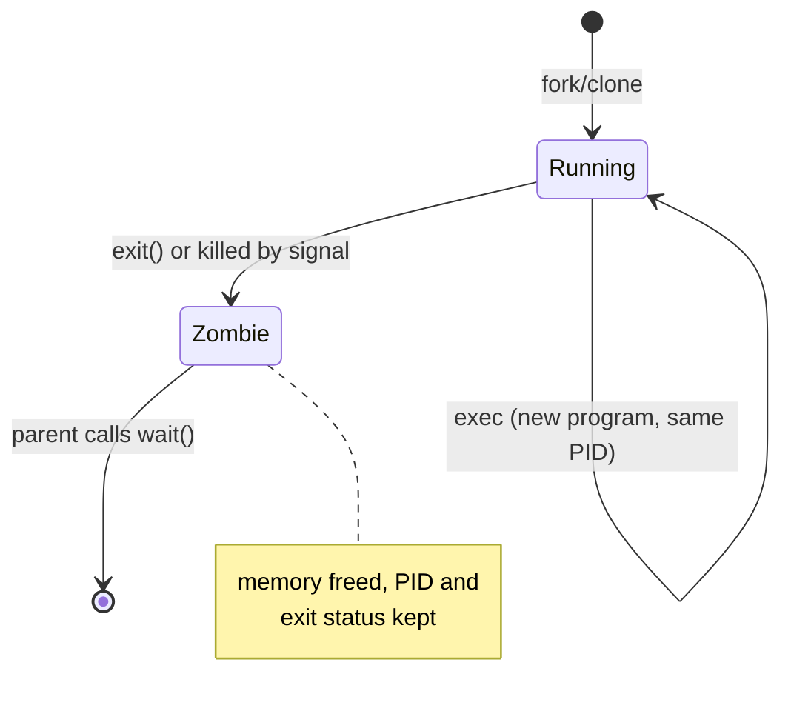
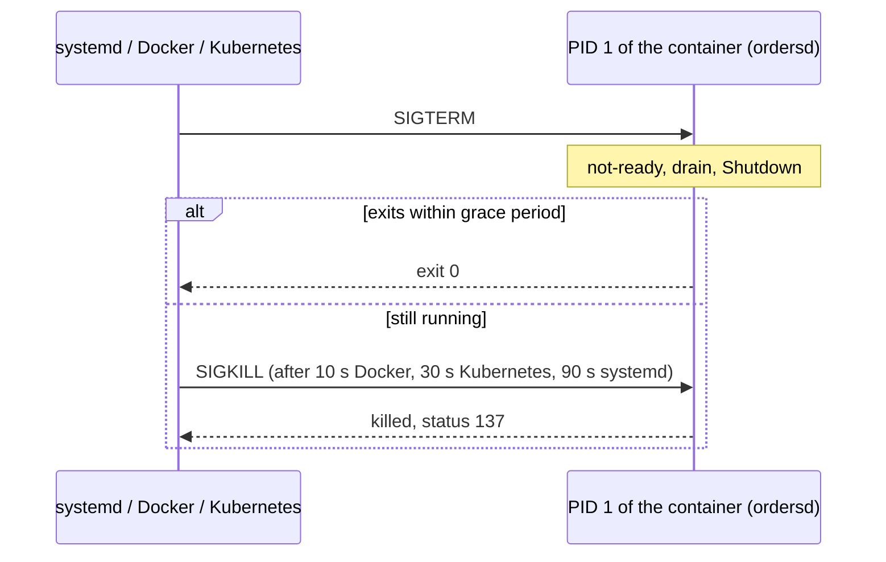

# Signals and process lifetime

## Why care?

More real messages:

- "`docker stop` always takes exactly 10 seconds, and the logs never say 'shutdown complete'."
- "`ps` shows hundreds of processes in state `Z`. What are they, and why won't `kill -9` remove them?"
- "Our Go service calls a script with a timeout. The timeout fires, `Run` returns, but the script's children are still running an hour later."
- "The job exited with code 137. What does that mean?"

The [Fundamentals](../fundamentals/processes-and-threads.md) told you that a signal is a message from the kernel and that `SIGTERM` is a request. The [Go chapter](../go/services.md#graceful-shutdown) built a graceful shutdown for `ordersd`. This page shows the machinery between them: how processes are born, how they die, who collects their exit status, and why one process, **PID 1**, plays by different rules. Every one of the stories above is a few lines of output away.

## The idea: a family where parents must sign the death certificate

Processes form a **family tree**. Every process has a parent (`PPid`). A process is born as a copy of its parent, and then usually becomes something else.

When a process dies, it does not vanish. Its memory and files are freed at once, but a tiny record stays: its PID and its **exit status**, the "death certificate". The parent must come and **sign** it by calling `wait`. Until then the dead child is a **zombie**.

If the parent dies first, the children are **orphans**. The kernel gives them a new parent: the nearest **subreaper**, or **PID 1**, the ancestor of everything. PID 1 is expected to sign certificates for all orphans, forever. That is a real job, and many programs that end up as PID 1 in a container don't do it.



## Under the hood: fork and exec

Unix starts a program in two steps:

1. **`fork`**: make a copy of the calling process. Same code, same memory (copy-on-write: pages are shared until one side writes), same open file descriptors. The child gets a **new PID**.
2. **`exec`** (`execve`): replace the program in the current process with a new one. New code, new memory, **same PID**, and the file descriptors stay open (unless marked `O_CLOEXEC`, see [File descriptors](file-descriptors.md)).

Both halves are easy to see in a shell:

```console
$ sh -c 'echo "parent $$"; sh -c "echo \"child \$\$, parent \$PPID\""'
parent 216792
child 216793, parent 216792
$ sh -c 'echo "before exec: pid $$, $(readlink /proc/$$/exe)"; exec /usr/bin/bash -c "echo \"after exec:  pid \$\$, \$(readlink /proc/\$\$/exe)\""'
before exec: pid 216856, /usr/bin/dash
after exec:  pid 216856, /usr/bin/bash
```

The first command forks: new PID, and the child's `PPID` is the parent. The second uses the shell's `exec` builtin: same PID 216856, but `/proc/<pid>/exe` changed from `dash` to `bash`. No new process. Keep this `exec` in mind; it is the fix for the `docker stop` story later.

### How Go starts a process: no plain fork

A Go program is always **multi-threaded** (the runtime runs several OS threads, see [G-M-P](../fundamentals/processes-and-threads.md#how-go-runs-goroutines-the-g-m-p-model)). `fork` copies only the **calling thread**. In the child, every lock held by another thread at that moment stays locked forever, and the Go runtime would deadlock. So Go never forks to run Go code. It only forks to **exec right away**.

`os/exec` calls `os.StartProcess`, which calls `syscall.forkExec`. On Linux, that uses `clone` with special flags. From the Go 1.27 source, `src/syscall/exec_linux.go`:

```go
	flags = sys.Cloneflags
	if sys.Cloneflags&CLONE_NEWUSER == 0 && sys.Unshareflags&CLONE_NEWUSER == 0 {
		flags |= CLONE_VFORK | CLONE_VM
	}
	if sys.PidFD != nil {
		flags |= CLONE_PIDFD
	}
```

- **`CLONE_VM`**: the child shares the parent's memory instead of copying page tables. Starting a child from a service with a 10 GB heap is as cheap as from a tiny one.
- **`CLONE_VFORK`**: the parent thread is paused until the child calls `execve` (or fails). Sharing memory is only safe because the child does almost nothing before exec. A comment a few lines further down reads _"No more allocation or calls of non-assembly functions."_
- **`CLONE_PIDFD`**: the parent also gets a **pidfd**, a file descriptor that refers to this exact process. On Linux, `os.Process` uses it for `Wait` and `Signal` (see `src/os/pidfd_linux.go`), so a recycled PID can never make Go signal the wrong process.

In the child, between `clone` and `execve`, Go applies your `SysProcAttr` (new process group, credentials, namespaces), sets up the file descriptors for `Stdin`/`Stdout`/`Stderr` and `ExtraFiles`, then calls `execve`. If `execve` fails, the child writes the error number into a pipe, and `cmd.Start` returns it to you as `exec: "x": executable file not found` or similar.

## Under the hood: exit codes

A process ends in one of two ways:

- It calls **`exit(n)`**. Only the low **8 bits** of `n` survive: 0 to 255.
- It is **killed by a signal**. Then there is no exit code at all; the wait status records the signal number.

Shells squeeze both into one number, `$?`. For a signal, they report **128 + the signal number**:

```console
$ sh -c "exit 3"; echo "exit 3 -> $?"
exit 3 -> 3
$ sh -c "exit 256"; echo "exit 256 -> $?"
exit 256 -> 0
$ sleep 100 & kill -TERM $!; wait $!; echo "SIGTERM -> $?"
SIGTERM -> 143
$ sleep 100 & kill -KILL $!; wait $!; echo "SIGKILL -> $?"
bash: line 1: 208270 Killed                     sleep 100
SIGKILL -> 137
$ nosuchcmd 2>/dev/null; echo "not found -> $?"
not found -> 127
$ /etc/passwd 2>/dev/null; echo "not executable -> $?"
not executable -> 126
$ kill -l 143
TERM
```

`exit 256` gives 0: a "failure" that looks like success. Never compute exit codes by adding things up.

| Code    | Meaning                               | Where you see it                                          |
| ------- | ------------------------------------- | --------------------------------------------------------- |
| 0       | Success                               |                                                           |
| 1       | General error                         | `log.Fatal`, `os.Exit(1)`, `ordersd` on a startup error   |
| 2       | Misuse / Go panic                     | Go exits with 2 after an unrecovered panic or `SIGQUIT`   |
| 126     | Found but not executable              | Missing `chmod +x`, wrong architecture on some shells     |
| 127     | Command not found                     | Typo, wrong `PATH` in an image                            |
| 128 + N | Killed by signal N (shell convention) | 130 = `SIGINT` (Ctrl+C), 137 = `SIGKILL`, 143 = `SIGTERM` |

**137** is the one to remember: `SIGKILL`. In Kubernetes it usually means the OOM killer (the pod status says `OOMKilled`) or a grace period that ran out (see [Namespaces and cgroups](namespaces-and-cgroups.md) for memory limits).

In Go, `os/exec` gives you both forms. `ExitCode()` is -1 when the child was killed by a signal; the raw `syscall.WaitStatus` tells you which one:

```go
package main

import (
	"errors"
	"fmt"
	"os/exec"
	"syscall"
)

func main() {
	for _, script := range []string{"exit 0", "exit 3", "kill -TERM $$", "kill -KILL $$"} {
		err := exec.Command("sh", "-c", script).Run()
		fmt.Printf("%-14s err=%v", script, err)
		if ee, ok := errors.AsType[*exec.ExitError](err); ok {
			ws := ee.Sys().(syscall.WaitStatus) // the raw wait status (Unix only)
			fmt.Printf("  ExitCode()=%d", ee.ExitCode())
			if ws.Signaled() {
				fmt.Printf("  signal=%d", ws.Signal())
			}
		}
		fmt.Println()
	}
}
```

```text
exit 0         err=<nil>
exit 3         err=exit status 3  ExitCode()=3
kill -TERM $$  err=signal: terminated  ExitCode()=-1  signal=15
kill -KILL $$  err=signal: killed  ExitCode()=-1  signal=9
```

## Under the hood: wait and zombies

When a child dies, the kernel keeps its **task struct** (PID, exit status, CPU time used) and sends the parent `SIGCHLD`. The parent reads the status with `wait4` or `waitid`. Until it does, the child is a zombie. Let's make one on purpose: start a child and "forget" to call `Wait`.

```go
package main

import (
	"fmt"
	"log"
	"os"
	"os/exec"
	"strconv"
	"strings"
	"time"
)

func ps(pid int) {
	out, _ := exec.Command("ps", "-o", "pid,ppid,stat,comm", "-p", strconv.Itoa(pid)).CombinedOutput()
	fmt.Print(string(out))
}

func main() {
	cmd := exec.Command("sh", "-c", "exit 7")
	if err := cmd.Start(); err != nil {
		log.Fatal(err)
	}
	child := cmd.Process.Pid
	fmt.Println("parent", os.Getpid(), "started child", child)

	time.Sleep(200 * time.Millisecond) // the child has exited by now
	ps(child)
	status, _ := os.ReadFile(fmt.Sprintf("/proc/%d/status", child))
	for line := range strings.Lines(string(status)) {
		if strings.HasPrefix(line, "State:") || strings.HasPrefix(line, "VmRSS:") {
			fmt.Print(line)
		}
	}

	err := cmd.Wait() // reap: collect the exit status, free the PID
	fmt.Println("Wait:", err)
	ps(child)
}
```

```text
parent 209646 started child 209652
    PID    PPID STAT COMMAND
 209652  209646 Z    sh
State:	Z (zombie)
Wait: exit status 7
    PID    PPID STAT COMMAND
```

- `STAT Z`: the child is dead. It exited 200 ms ago.
- There is **no `VmRSS` line** in its status: its memory is already gone. A zombie costs only a PID and a small kernel struct.
- After `Wait`, the exit status (7) is delivered, and the PID disappears from `ps`.

That is why `kill -9` can't remove a zombie: it is already dead. You can only make its **parent** call `wait`, or kill the parent so the zombie is reparented to someone who will.

Is a zombie harmful? One, no. Thousands, yes: PIDs are limited (`/proc/sys/kernel/pid_max`, and in containers the cgroup `pids.max`). When they run out, `fork` fails with `EAGAIN` and nothing new can start: no shell, no health-check script, nothing.

!!! tip "In Go: always Wait"

    `cmd.Run()` and `cmd.Output()` call `Wait` for you. If you use `cmd.Start()`, call
    `cmd.Wait()` on every path, including errors. A service that starts helpers without waiting
    collects zombies until it hits the PID limit.

## Under the hood: orphans, reparenting and subreapers

If a parent dies before its child, the child is an **orphan**. Here `sh` starts `sleep` in the background and exits at once:

```console
$ pid=$(sh -c 'sleep 30 >/dev/null 2>&1 & echo $!'); sleep 0.2
$ ps -o pid,ppid,stat,comm -p $pid
    PID    PPID STAT COMMAND
 209970     588 S    sleep
$ grep -E '^(Name|PPid)' /proc/588/status
Name:	Relay(589)
PPid:	587
```

The new parent is not PID 1 but process 588, part of WSL's `/init`. It has marked itself a **child subreaper** with `prctl(PR_SET_CHILD_SUBREAPER)`. The rule: an orphan goes to the nearest ancestor that is a subreaper; if there is none, to PID 1 of its PID namespace. `systemd --user`, container shims (`containerd-shim`) and `tini -s` use the same trick, so they can wait for everything started below them.

You can be a subreaper in Go, with one raw system call:

```go
// Command reaper becomes a child subreaper and adopts an orphaned grandchild.
package main

import (
	"fmt"
	"log"
	"os"
	"os/exec"
	"strings"
	"syscall"
)

const prSetChildSubreaper = 36 // PR_SET_CHILD_SUBREAPER from <linux/prctl.h>

func main() {
	if _, _, errno := syscall.RawSyscall(syscall.SYS_PRCTL, prSetChildSubreaper, 1, 0); errno != 0 {
		log.Fatal(errno)
	}
	fmt.Println("reaper pid:", os.Getpid())

	// sh starts a grandchild and exits at once: the grandchild is orphaned.
	out, err := exec.Command("sh", "-c", "sleep 0.5 & echo $!").Output()
	if err != nil {
		log.Fatal(err)
	}
	orphan := strings.TrimSpace(string(out))
	ps, _ := exec.Command("ps", "-o", "pid=,ppid=,comm=", "-p", orphan).Output()
	fmt.Printf("orphan: %s", ps)

	// Reap whatever child exits next. This is what tini does in a loop.
	var ws syscall.WaitStatus
	pid, err := syscall.Wait4(-1, &ws, 0, nil)
	fmt.Printf("reaped pid %d, exit %d, err %v\n", pid, ws.ExitStatus(), err)
}
```

```text
reaper pid: 214510
orphan:  214517  214510 sleep
reaped pid 214517, exit 0, err <nil>
```

The orphaned `sleep` now has our program as its parent (`214510`), and `Wait4(-1, ...)` ("any child") collects it.

!!! warning "Wait4(-1) and os/exec don't mix"

    `Wait4(-1)` reaps **any** child, including ones that `os/exec` is about to `Wait` for. Then
    `cmd.Wait` fails with `waitid: no child processes`. A real reaper either runs no `os/exec`
    children of its own, or is a separate tiny process. That is exactly why tini exists.

## Under the hood: signal dispositions and masks

For each signal, a process has a **disposition**:

- **Default** (`SIG_DFL`): what the kernel does if nobody asks. For most signals: terminate. For `SIGQUIT`, `SIGSEGV` and friends: terminate and dump core. For `SIGCHLD`, `SIGURG`, `SIGWINCH`: nothing. For `SIGSTOP`, `SIGTSTP`: stop.
- **Ignore** (`SIG_IGN`).
- **Catch**: run a handler function.

Each **thread** also has a **signal mask**: signals it **blocks** for now. A blocked signal stays **pending** until unblocked. A signal sent to a process is delivered to any one thread that doesn't block it.

`SIGKILL` and `SIGSTOP` can't be caught, ignored or blocked. That's the whole point of them.

All of this is visible in `/proc/<pid>/status`, as 64-bit hex masks (bit N−1 = signal N):

```console
$ ./ordersd -addr 127.0.0.1:0 >/dev/null 2>&1 & p=$!
$ grep -E '^(State|PPid|Threads|SigQ|SigPnd|ShdPnd|SigBlk|SigIgn|SigCgt)' /proc/$p/status
State:	S (sleeping)
PPid:	221410
Threads:	8
SigQ:	1/63662
SigPnd:	0000000000000000
ShdPnd:	0000000000000000
SigBlk:	fffffffc3bba3a00
SigIgn:	0000000000000000
SigCgt:	fffffffd7fc1feff
```

| Field    | Meaning                                                                                |
| -------- | -------------------------------------------------------------------------------------- |
| `SigQ`   | Queued signals / limit for this user                                                   |
| `SigPnd` | Pending for this thread                                                                |
| `ShdPnd` | Pending for the whole process (shared)                                                 |
| `SigBlk` | Blocked by this thread (the main thread here; others: `/proc/<pid>/task/<tid>/status`) |
| `SigIgn` | Ignored                                                                                |
| `SigCgt` | Caught: a handler is installed                                                         |

Hex masks are hard to read. A small bash function decodes signals 1–31:

```bash
sigs() { local m=$((16#$1)) i out=; for i in $(seq 1 31); do (( (m >> (i-1)) & 1 )) && out+="$(kill -l $i) "; done; echo "$out"; }
```

For `ordersd`:

```console
$ echo "caught:     $(sigs fffffffd7fc1feff)"
caught:     HUP INT QUIT ILL TRAP ABRT BUS FPE USR1 SEGV USR2 PIPE ALRM TERM STKFLT CHLD URG XCPU XFSZ VTALRM PROF WINCH IO PWR SYS
$ echo "not caught: $(sigs $(printf %x $(( ~16#fffffffd7fc1feff & 0x7fffffff ))))"
not caught: KILL CONT STOP TSTP TTIN TTOU
```

The **Go runtime installs a handler for almost every signal**, before `main` runs. It needs `SIGURG` for goroutine preemption, `SIGSEGV` to turn nil dereferences into panics, `SIGPROF` for the profiler, and so on. For signals you didn't ask for with `signal.Notify`, the handler mimics the default: on `SIGTERM` it resets the disposition and kills the process with the same signal, so the parent still sees "killed by signal 15".

Compare with `sleep`, a plain C program, started in the background by a script (`bash -c`, not your interactive shell), and with `nohup`:

```console
$ bash -c 'sleep 300 & sleep 0.2; grep -E "^Sig(Blk|Ign|Cgt)" /proc/$!/status'
SigBlk:	0000000000000000
SigIgn:	0000000000000006
SigCgt:	0000000000000000
$ bash -c 'nohup sleep 300 >/dev/null 2>&1 & sleep 0.2; grep SigIgn /proc/$!/status'
SigIgn:	0000000000000007
$ sigs 7
HUP INT QUIT
```

Two inheritance rules hide in these numbers:

- **Ignored signals stay ignored across `exec`.** `nohup` is just "ignore `SIGHUP`, then exec". A non-interactive shell runs background jobs with `SIGINT` and `SIGQUIT` ignored (`0x6`), so Ctrl+C in the terminal won't hit them.
- **Caught signals reset to default across `exec`.** The handler's code is gone after exec, so the kernel can't keep pointing at it.

The first rule leaks into Go too. Go keeps `SIGHUP` and `SIGINT` ignored if they were ignored at startup, unless you call `signal.Notify` for them. A plain Go program started as a background job has `SigCgt: fffffffd7fc1fefd`: the same as `ordersd`, minus bit 2 (`SIGINT`).

### Signals worth knowing

| Signal    | Default   | Sent by                                        | In a Go service                                               |
| --------- | --------- | ---------------------------------------------- | ------------------------------------------------------------- |
| `SIGTERM` | terminate | `kill`, systemd, Docker, Kubernetes            | Start graceful shutdown (`signal.NotifyContext`)              |
| `SIGINT`  | terminate | Ctrl+C, via the terminal                       | Same as `SIGTERM`, for local runs                             |
| `SIGKILL` | terminate | `kill -9`, OOM killer, end of a grace period   | Nothing. You can't see it coming                              |
| `SIGHUP`  | terminate | Terminal closed; by convention "reload config" | Optional: reload, reopen log files                            |
| `SIGQUIT` | core dump | Ctrl+\\                                        | Go prints **all goroutine stacks** and exits with 2           |
| `SIGPIPE` | terminate | Writing to a closed pipe or socket             | Go: only kills you for stdout/stderr; otherwise `EPIPE` error |
| `SIGCHLD` | ignore    | Kernel, when a child exits                     | Handled by the runtime for `os/exec`                          |
| `SIGURG`  | ignore    | Kernel (out-of-band data) or the Go runtime    | Goroutine preemption. Ignore it in `strace` output            |
| `SIGSTOP` | stop      | `kill -STOP`, debuggers                        | Can't catch. `SIGCONT` resumes                                |

`SIGQUIT` is a free debugging tool. A stuck Go process tells you where every goroutine is:

```console
$ bash -c './plain 2>quit.txt & sleep 0.3; kill -QUIT $!; wait $!; echo "exit $?"'
exit 2
$ grep -E '^(SIGQUIT|goroutine )' quit.txt
SIGQUIT: quit
goroutine 0 gp=0x533440 m=0 mp=0x534200 [idle]:
goroutine 1 gp=0x2b95b896a1e0 m=nil [sleep]:
goroutine 2 gp=0x2b95b896a780 m=nil [force gc (idle)]:
goroutine 3 gp=0x2b95b896ad20 m=nil [GC sweep wait]:
goroutine 4 gp=0x2b95b896af00 m=nil [GC scavenge wait]:
goroutine 5 gp=0x2b95b896b4a0 m=nil [GOMAXPROCS updater (idle)]:
```

(`plain` is a Go program whose `main` is only `time.Sleep(time.Hour)`.) Goroutine 1 is `main`, in `[sleep]`. In a real hang, look for many goroutines in the same state, like `[chan receive]` or `[sync.Mutex.Lock]`. In Kubernetes, the dump lands in the container log. The `ordersd` image has no shell and no `kill`, so send the signal from a debug container that shares the process namespace: `kubectl debug -it <pod> --target=<container> --image=busybox -- kill -QUIT 1`. The process exits afterwards, so do this only to a process that is already broken.

## Under the hood: SIGTERM, SIGKILL and graceful shutdown

The full shutdown design for `ordersd` lives in [Building a service](../go/services.md#graceful-shutdown): turn not-ready, wait, `srv.Shutdown`, then `Close`. Here is the kernel's view of it. `SIGTERM` versus `SIGKILL`:

```console
$ for s in TERM KILL; do
>   ./ordersd -addr 127.0.0.1:0 -log-format text > o.log 2>&1 & p=$!; sleep 0.5
>   kill -$s $p; wait $p 2>/dev/null; echo "SIG$s -> exit $?"; cut -d" " -f2- o.log
> done
SIGTERM -> exit 0
level=INFO msg=starting service=ordersd version=(devel) revision=f1ceceb702caa2e21fa5a586e30c350472c49ee6 go_version=go1.27.4
level=INFO msg=listening service=ordersd addr=127.0.0.1:45546
level=INFO msg="shutting down" service=ordersd delay=0s timeout=15s
level=INFO msg="shutdown complete" service=ordersd
SIGKILL -> exit 137
level=INFO msg=starting service=ordersd version=(devel) revision=f1ceceb702caa2e21fa5a586e30c350472c49ee6 go_version=go1.27.4
level=INFO msg=listening service=ordersd addr=127.0.0.1:45814
```

(`cut` drops the timestamp column.) With `SIGTERM`, `ordersd` drained and **exited 0**: it handled the signal and returned normally, so this is not "killed by signal". With `SIGKILL`, the log just stops. No "shutting down", no flushed buffers, no closed database transactions: the kernel removed the process between two instructions.

`signal.NotifyContext` turns the signal into a cancelled `context.Context`. The context's **cause** names the signal, which is useful in the shutdown log line:

```go
ctx, stop := signal.NotifyContext(context.Background(), os.Interrupt, syscall.SIGTERM)
defer stop()
fmt.Println("pid", os.Getpid(), "waiting")
<-ctx.Done()
fmt.Println("ctx.Err():       ", ctx.Err())
fmt.Println("context.Cause(): ", context.Cause(ctx))
```

```text
pid 217186 waiting
ctx.Err():        context canceled
context.Cause():  terminated signal received
```

The orchestrator's side is always the same shape:



That second branch is the `docker stop` story. But a well-written Go service can still land there, for a reason that has nothing to do with Go: **who is PID 1**. First, though, a detour through the terminal.

## Under the hood: process groups, sessions and Ctrl+C

Processes are grouped twice:

- A **process group** (PGID) is a job: for example, all processes of one pipeline `a | b | c`. Signals can be sent to a whole group: `kill -TERM -- -<pgid>` (negative number).
- A **session** (SID) is a login: all groups started from one terminal. One group per session is the **foreground** group of the terminal (`TPGID`).

When you press **Ctrl+C**, no program reads the keystroke. The terminal driver in the kernel turns it into `SIGINT` and sends it to **every process in the foreground process group**. Here is a real run in a `tmux` pane:

```console
$ ps -o pid,ppid,pgid,sid,tpgid,stat,comm -t pts/8
    PID    PPID    PGID     SID   TPGID STAT COMMAND
 212763  212730  212763  212763  212987 Ss   bash
 212987  212763  212987  212763  212987 S+   sleep
 212988  212763  212987  212763  212987 S+   sleep
```

The pane is running `sleep 300 | sleep 301`. Both `sleep`s are in group 212987, and that group is the terminal's foreground group (`TPGID` 212987, and `+` in `STAT`). `bash` is in its own group, and is the session leader (`s`). After pressing Ctrl+C in the pane:

```console
$ ps -o pid,ppid,pgid,sid,tpgid,stat,comm -t pts/8
    PID    PPID    PGID     SID   TPGID STAT COMMAND
 212763  212730  212763  212763  212763 Ss+  bash
```

```text
bash-5.3$ sleep 300 | sleep 301
^C
bash-5.3$ echo "exit status: $?"
exit status: 130
```

Both `sleep`s got `SIGINT` and died: 130 = 128 + 2. `bash` was not in the foreground group, so it survived, and took the terminal back (`TPGID` is now `bash`'s group).

A shell with job control does the same without a terminal. `kill` with a negative PID hits the group:

```console
$ set -m
$ sleep 300 | sleep 301 &
$ sleep 302 &
$ ps -o pid,ppid,pgid,sid,stat,comm --ppid $$
    PID    PPID    PGID     SID STAT COMMAND
 212461  212460  212461  212457 S    sleep
 212462  212460  212461  212457 S    sleep
 212463  212460  212463  212457 S    sleep
 212465  212460  212465  212457 R    ps
$ kill -INT -- -212461
$ ps -o pid,ppid,pgid,comm --ppid $$
    PID    PPID    PGID COMMAND
 212463  212460  212463 sleep
 212471  212460  212471 ps
```

### Process groups in Go: kill the whole tree

Now the "children still running an hour later" story. `exec.CommandContext` kills the child when the context ends. But only the **child**. If the child is a shell script that started its own children, they become orphans and keep running.

```go
// Command pgrp shows why killing a child is not the same as killing its children.
package main

import (
	"context"
	"fmt"
	"os"
	"os/exec"
	"strings"
	"syscall"
	"time"
)

func run(killGroup bool) {
	ctx, cancel := context.WithTimeout(context.Background(), 300*time.Millisecond)
	defer cancel()

	// sh starts a grandchild (sleep) and waits for it.
	cmd := exec.CommandContext(ctx, "sh", "-c", "sleep 60 & echo $! > grandchild.pid; wait")
	if killGroup {
		cmd.SysProcAttr = &syscall.SysProcAttr{Setpgid: true} // own process group, PGID = child PID
		cmd.Cancel = func() error {
			return syscall.Kill(-cmd.Process.Pid, syscall.SIGTERM) // negative PID = the whole group
		}
	}
	cmd.WaitDelay = time.Second // after Cancel, give up waiting on I/O after 1s
	err := cmd.Run()

	b, _ := os.ReadFile("grandchild.pid")
	pid := strings.TrimSpace(string(b))
	ps, _ := exec.Command("ps", "-o", "pid=,ppid=,comm=", "-p", pid).Output()
	fmt.Printf("killGroup=%-5v Run: %v\n  grandchild still running: %q\n", killGroup, err, strings.TrimSpace(string(ps)))
}

func main() {
	run(false)
	run(true)
}
```

```text
killGroup=false Run: signal: killed
  grandchild still running: "213973     588 sleep"
killGroup=true  Run: signal: terminated
  grandchild still running: ""
```

Without a process group: the context fired, the default `Cancel` sent `SIGKILL` to `sh`, `Run` returned, and the `sleep` lives on, adopted by the subreaper 588. With `Setpgid` and a custom `Cancel`, one `kill(-pgid, SIGTERM)` reaches the whole tree, and it also gives the children a chance to clean up (a `TERM`, not a `KILL`).

`Setpgid` has a second effect: the child leaves your process group, so **a Ctrl+C in your terminal no longer reaches it**. Your program must forward the signal itself. That is often what you want for a supervisor, and a surprise for a CLI tool.

`WaitDelay` matters if you capture output into a `bytes.Buffer`: `Wait` also waits until the child's stdout pipe is closed, and an orphaned grandchild keeps it open. `WaitDelay` caps that wait after the context ends.

## Under the hood: PID 1 is special

In a container, your program is usually **PID 1** of a new PID namespace. `unshare -Urpf --mount-proc` makes one without root (user namespace `-U`, map us to root `-r`, PID namespace `-p`, fork `-f`, and a fresh `/proc`):

```console
$ unshare -Urpf --mount-proc sh -c 'echo "inside: my pid is $$"; ps -o pid,ppid,comm'
inside: my pid is 1
    PID    PPID COMMAND
      1       0 sh
      2       1 ps
```

The kernel treats PID 1 differently in two ways.

### Rule 1: PID 1 ignores signals it has no handler for

For any other process, a signal with the default action kills it. For PID 1 (of any PID namespace), the kernel **drops** signals whose disposition is default. Only signals with an installed handler get through. From an **ancestor** namespace, `SIGKILL` and `SIGSTOP` are also delivered, so the host (or the container runtime) can always kill a container. From **inside**, not even `SIGKILL` works.

```console
$ sleep 300 & kill -TERM $!; wait $!; echo "normal sleep after SIGTERM: exit $?"
normal sleep after SIGTERM: exit 143
$ unshare -Urpf --mount-proc sleep 300 &
$ grep NSpid /proc/210916/status
NSpid:	210916	1
$ kill -TERM 210916; sleep 0.5; ps -o pid,stat,comm -p 210916
    PID STAT COMMAND
 210916 S    sleep
$ nsenter -t 210916 -U -p --preserve-credentials kill -KILL 1
$ ps -o pid,stat,comm -p 210916
    PID STAT COMMAND
 210916 S    sleep
$ kill -KILL 210916
bash: line 7: 210914 Killed                     unshare -Urpf --mount-proc sleep 300
```

`NSpid: 210916 1`: the same process is 210916 on the host and 1 inside. `SIGTERM` from the host: ignored. `SIGKILL` from inside the namespace (`nsenter` joins it): ignored. `SIGKILL` from the host: dead. The rule exists to protect `init`: if PID 1 dies, the kernel kills the whole namespace (on a real machine, it panics).

What about Go? The runtime installs handlers, so signals do reach a Go PID 1. If you did not `signal.Notify` for `SIGTERM`, the runtime tries to die by the signal, finds that PID 1 can't, and falls back. From `runtime/signal_unix.go`: _"If we are still somehow running, this probably means we're PID 1 immune to signals with default-terminate. Use a shell convention of exit(128+sig)"_. So a plain Go program as PID 1 still stops on `SIGTERM`, with exit code 143, but **not gracefully**. Handle the signal.

### Rule 2: PID 1 adopts every orphan, and must reap it

In a PID namespace there is no subreaper above PID 1. Every orphan comes to PID 1, and if PID 1 never calls `wait`, zombies pile up. Here PID 1 is a shell that starts an orphan and then `exec`s into `sleep`, a program that never waits for anything:

```console
$ unshare -Urpf --mount-proc sh -c 'sh -c "sleep 0.1 &"; exec sleep 300' &
$ nsenter -t <pid> -U -p -m --preserve-credentials ps -o pid,ppid,stat,comm
    PID    PPID STAT COMMAND
      1       0 S    sleep
      3       1 Z    sleep
      4       0 R    ps
```

(`<pid>` is the host PID of the namespace's PID 1: `pgrep -P $!`.) PID 3 is the orphaned `sleep 0.1`. It exited long ago, its parent is now PID 1, and PID 1 will never reap it. The same happens when a Go service as PID 1 runs a shell script that leaves background processes behind, or uses a library that starts helpers and loses track of them.

### tini: a real PID 1

**tini** is a tiny init (about 750 KB) for containers. It does two jobs: **forward signals** to its child, and **reap all zombies**. Docker ships it as `docker-init`:

```console
$ /usr/bin/docker-init --version
tini version 0.19.0
$ unshare -Urpf --mount-proc /usr/bin/docker-init -- sh -c 'sh -c "sleep 0.1 &"; exec sleep 300' &
$ nsenter -t <pid> -U -p -m --preserve-credentials ps -o pid,ppid,stat,comm
    PID    PPID STAT COMMAND
      1       0 S    docker-init
      2       1 S    sleep
      5       0 R    ps
$ kill -TERM <pid>; wait $!; echo "exit: $?"
exit: 143
```

Same command, but tini is PID 1. The orphan was reaped (no `Z`). `SIGTERM` to PID 1 was forwarded to `sleep`, which is not PID 1 any more, so the default action killed it, and tini exited with the child's status: 143.

How to get it:

- **Docker**: `docker run --init`, or `init: true` in Compose.
- **Any image**: copy `tini` in and set `ENTRYPOINT ["/tini", "--", "/ordersd"]`. Add `-g` to forward signals to the child's whole process group.
- **Kubernetes** has no `--init` flag; put tini in the image. (With `shareProcessNamespace: true`, the pod's `pause` container becomes PID 1 and reaps zombies, but that also shares `/proc` between containers.)

Does `ordersd` need tini? It handles `SIGTERM` and starts no child processes, so as PID 1 it does both jobs well enough. Add tini the day the service starts running other programs.

### Shell entrypoints and `exec`

Now the `docker stop` story. A common Dockerfile line: `ENTRYPOINT ["sh", "-c", "/ordersd"]`, or the shell form `CMD /ordersd`, which Docker runs as `/bin/sh -c "/ordersd"`, or a `start.sh` wrapper that sets some variables first. Then PID 1 is the **shell**, `ordersd` is its child, and:

- The shell has no `SIGTERM` handler, so as PID 1 it **ignores** `SIGTERM` (rule 1).
- The shell doesn't forward signals to its child either.

```console
$ for script in "./ordersd -addr 127.0.0.1:0; echo bye" "exec ./ordersd -addr 127.0.0.1:0"; do
>   echo "== sh -c \"$script\""
>   unshare -Urpf --mount-proc sh -c "$script" >out.log 2>&1 & u=$!; sleep 0.5; p1=$(pgrep -P $u)
>   echo "PID 1 is: $(ps -o comm= -p $p1)"
>   kill -TERM $p1; sleep 1
>   if kill -0 $p1 2>/dev/null; then echo "still running 1s after SIGTERM"; kill -KILL $p1; fi
>   wait $u 2>/dev/null; echo "exit status $?"; grep -o '"msg":"[a-z ]*"' out.log | tr "\n" " "; echo
> done
== sh -c "./ordersd -addr 127.0.0.1:0; echo bye"
PID 1 is: sh
still running 1s after SIGTERM
exit status 137
"msg":"starting" "msg":"listening"
== sh -c "exec ./ordersd -addr 127.0.0.1:0"
PID 1 is: ordersd
exit status 0
"msg":"starting" "msg":"listening" "msg":"shutting down" "msg":"shutdown complete"
```

`$p1` is the host PID of the namespace's PID 1. Behind a shell, `ordersd` never saw the signal and was killed with 137. With **`exec`**, the shell replaced itself with `ordersd`: same PID 1, and the handler is there.

In Docker, the same thing costs exactly the stop timeout:

```console
$ docker run -d --name sigdemo golang:1.27 sh -c 'sleep 300; echo done' >/dev/null
$ /usr/bin/time -f '%e s' docker stop sigdemo
sigdemo
9.49 s
$ docker inspect -f '{{.State.ExitCode}}' sigdemo
137
$ docker run -d --init --name sigdemo2 golang:1.27 sh -c 'sleep 300; echo done' >/dev/null
$ docker exec sigdemo2 ps -o pid,ppid,comm
    PID    PPID COMMAND
      1       0 docker-init
      7       1 sh
      8       7 sleep
      9       0 ps
$ /usr/bin/time -f '%e s' docker stop sigdemo2
sigdemo2
0.50 s
$ docker inspect -f '{{.State.ExitCode}}' sigdemo2
143
```

Ten seconds of waiting, then `SIGKILL` and 137. With `--init`, tini forwards `SIGTERM` to `sh`, which is not PID 1 any more and dies at once.

So, for entrypoints:

1. Prefer the **exec form**: `ENTRYPOINT ["/ordersd"]`. No shell at all. This is what the `ordersd` [Dockerfile](../go/services.md#containers) does.
2. If you need a wrapper script, end it with **`exec "$@"`** or `exec /ordersd`, so the real program becomes PID 1.
3. Don't trust the shell to `exec` the last command for you. On this machine `bash -c "sleep 300"` does, but `dash` (Ubuntu's `/bin/sh`) does not: with `dash -c "sleep 300"`, PID 1 stays `dash`.
4. If the program starts children, or can't handle signals, add **tini**.

## Try it

1. Run `sh -c 'exit 300'; echo $?`. Explain the number.
2. Run the zombie program, but replace `sh -c "exit 7"` with `sleep 5` and look at `ps` during and after. When does the `Z` appear?
3. Run `sleep 300 &` in your terminal (interactive shell), then look at its `SigIgn`. Compare with the same command inside `bash -c '...'`. Why are they different?
4. Start `ordersd`, then run `kill -QUIT` on it. Find the goroutine that runs `srv.Serve`.
5. In the `pgrp` program, set `Setpgid: true` but keep the default `Cancel`. Is the grandchild killed? Why not?
6. Write a `start.sh` that prints a line and then runs `ordersd` without `exec`. Run it as PID 1 with `unshare -Urpf --mount-proc` and send `SIGTERM`. Then add `exec` and try again.
7. Run `ps -eo pid,ppid,stat,comm | awk '$3 ~ /Z/'` on your machine. Any zombies? Who is their parent?

## Traps

- **Shell-form entrypoint or wrapper without `exec`.** PID 1 is the shell, `SIGTERM` is ignored, every deploy waits for the grace period and ends with `SIGKILL` (137).
- **Relying on the shell to `exec` the last command.** bash does, dash doesn't. Write `exec`.
- **`cmd.Start()` without `cmd.Wait()`.** Zombies, then a full PID table.
- **Killing only the child.** `CommandContext`'s default `Cancel` kills one process. Use `Setpgid` and `kill(-pgid)` for scripts that start children.
- **`Wait4(-1)` in a process that also uses `os/exec`.** You steal exit statuses from `cmd.Wait`.
- **Reading 137 as "the app crashed".** It means `SIGKILL`: usually the OOM killer or an expired grace period. Check `OOMKilled` and your shutdown timing.
- **Shutdown timeout ≥ grace period.** If `ordersd`'s `ShutdownTimeout` is longer than Kubernetes' `terminationGracePeriodSeconds`, `SIGKILL` wins and requests are cut. Keep delay + timeout below the grace period.
- **Expecting Ctrl+C to reach a child with its own process group.** It doesn't. Forward the signal.
- **`kill -9` on a zombie.** It is already dead. Fix or kill the parent.
- **Exit codes above 255.** `os.Exit(256)` is reported as 0.

## Check yourself

??? question "1. Why does Go use clone with CLONE_VM | CLONE_VFORK instead of a plain fork?"

    A Go process is always multi-threaded, and `fork` copies only the calling thread, so locks held
    by other threads stay locked in the child. Go therefore never runs Go code in a forked child; it
    only execs. `CLONE_VM` shares the memory instead of copying page tables (fast even with a huge
    heap), and `CLONE_VFORK` pauses the parent until the child has called `execve`, which makes the
    sharing safe.

??? question "2. A job exits with 143, another with 137, a third with 130. What happened to each?"

    All three were killed by a signal (128 + N). 143: `SIGTERM` (15), a polite stop that the
    program did not handle, or a Go program as PID 1 without a handler. 137: `SIGKILL` (9), often
    the OOM killer or the end of a grace period. 130: `SIGINT` (2), usually Ctrl+C.

??? question "3. What is a zombie, what does it cost, and how do you get rid of it?"

    A process that has exited but whose parent has not called `wait` yet. Its memory and files are
    already freed; it keeps only its PID and exit status. One costs almost nothing; many exhaust the
    PID limit. You remove it by making the parent `wait` (fix the code), or by killing the parent so
    the zombie is reparented to a subreaper or PID 1 that reaps it. `kill -9` on the zombie does nothing.

??? question "4. Ctrl+C in a terminal stops both sides of `a | b`, but not the shell. Explain the mechanism."

    The terminal driver turns Ctrl+C into `SIGINT` and sends it to the terminal's **foreground
    process group**. The shell put the pipeline `a | b` in its own process group and made it the
    foreground group, so both processes get the signal. The shell is in a different group.

??? question "5. Your container's entrypoint is `start.sh`, which sets two environment variables and then runs `/ordersd`. Deploys take 30 seconds and end with exit code 137. Why, and what are two fixes?"

    PID 1 is the shell. PID 1 ignores signals without a handler, so `SIGTERM` does nothing, and the
    shell doesn't forward it to `ordersd`. After the 30-second grace period, `SIGKILL` arrives: 137.
    Fix 1: end the script with `exec /ordersd`, so `ordersd` becomes PID 1 with its handler. Fix 2:
    run `tini` as PID 1 (`ENTRYPOINT ["/tini", "--", "/start.sh"]`), which forwards the signal. Even
    better: drop the script and pass the settings as environment variables in the deployment.

??? question "6. How can you see which signals a process catches, ignores and blocks?"

    In `/proc/<pid>/status`: `SigCgt` (caught), `SigIgn` (ignored), `SigBlk` (blocked by that
    thread; per-thread values are in `/proc/<pid>/task/<tid>/status`), and `SigPnd`/`ShdPnd`
    (pending). Each is a hex bitmask where bit N−1 stands for signal N.

??? question "7. Why can the host kill a container's PID 1 with SIGKILL, while a process inside the container can't?"

    The kernel protects a namespace's init: signals with default disposition are dropped. The
    exception is `SIGKILL` and `SIGSTOP` sent from an **ancestor** PID namespace, so the host and the
    container runtime always keep control. Inside the namespace there is no such exception.

## Recap

- A process starts with **fork** (copy, new PID) and usually **exec** (new program, same PID). Go uses `clone(CLONE_VM|CLONE_VFORK)` + `execve`, never a plain fork.
- Exit codes are 8 bits. Killed by signal N shows as **128 + N** in shells: 130, 137, 143.
- A dead child is a **zombie** until its parent calls **wait**. In Go: always `Wait` after `Start`.
- **Orphans** go to the nearest **subreaper**, or to PID 1 of their PID namespace.
- Every signal has a **disposition** (default, ignore, catch) and can be **blocked** per thread. `/proc/<pid>/status` shows `SigCgt`, `SigIgn`, `SigBlk`. Ignored survives `exec`; caught resets.
- The Go runtime catches almost all signals. `SIGQUIT` dumps all goroutines.
- **Ctrl+C** goes to the terminal's foreground **process group**. In Go, use `Setpgid` and `kill(-pgid)` to stop a whole child tree.
- **PID 1** ignores signals it doesn't handle and must reap orphans. Use the exec form or `exec` in scripts, and **tini** when you run children.

Next: the walls around a container. [Namespaces and cgroups](namespaces-and-cgroups.md).
