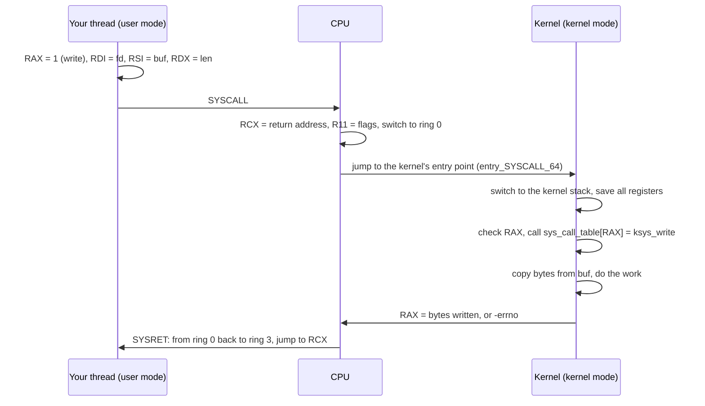
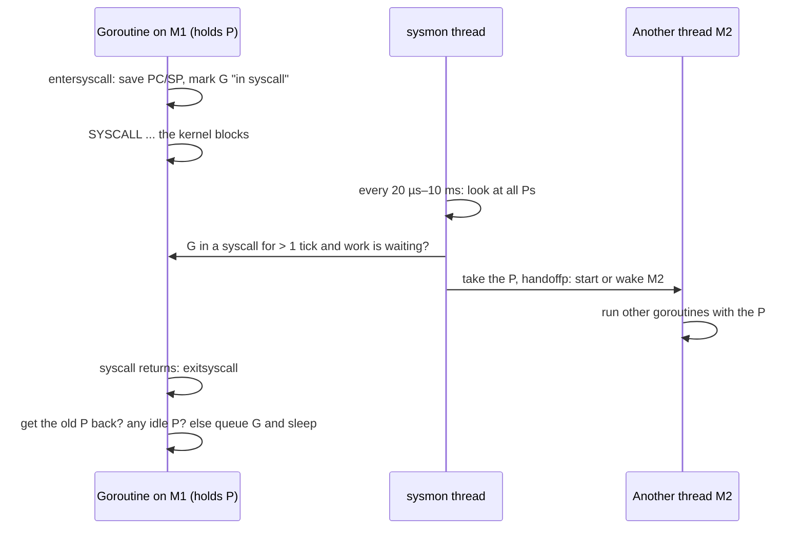

# System calls up close

## Why care?

Three things engineers say about a Go service:

- "Our logger writes one line per request. Why is it 20% of the CPU profile?"
- "We set `GOMAXPROCS=4`. Why does the process have 200 threads?"
- "`time.Now()` is a system call, so we cache it." (It isn't, and you shouldn't.)

All three are about the line between your program and the kernel. [Processes, threads and system calls](../fundamentals/processes-and-threads.md) showed that a program asks the kernel for help with a system call. This page opens that call up: which CPU registers carry it, how errors come back, which calls skip the kernel completely, what a call costs in nanoseconds, and what the Go runtime does around every one.

## The idea: the counter window at the bank

Think of the kernel as a bank behind thick glass.

- You can't walk into the vault. You go to the **counter window** and fill in a **form**.
- The form has a **number** for the kind of request ("withdraw" is form 0, "deposit" is form 1) and up to **six boxes** for details.
- The clerk checks the form, does the work in the back, and hands back **one number**: the result, or an error code.
- The clock on the wall is **outside** the glass. You read it yourself. Nobody fills in a form to learn the time.

That is the whole model. The window is the `SYSCALL` instruction. The form is a set of CPU registers. The error code is `errno`. The clock on the wall is the **vDSO**. And waiting in the queue costs time, even for a tiny request.

## Under the hood: one trip through the window

On x86-64 Linux, a system call is a contract about **registers** (see [CPU and registers](../fundamentals/cpu-and-registers.md)):

| Register | Holds                                                               |
| -------- | ------------------------------------------------------------------- |
| `RAX`    | The system call **number** on the way in. The result on the way out |
| `RDI`    | Argument 1                                                          |
| `RSI`    | Argument 2                                                          |
| `RDX`    | Argument 3                                                          |
| `R10`    | Argument 4 (not `RCX`, see below)                                   |
| `R8`     | Argument 5                                                          |
| `R9`     | Argument 6                                                          |
| `RCX`    | Destroyed: the CPU saves the return address here                    |
| `R11`    | Destroyed: the CPU saves the flags register here                    |

So six arguments at most, all of them plain 64-bit numbers. A "string" argument is just a pointer: the kernel copies the bytes out of your memory itself.

What happens when the CPU runs `SYSCALL`:



Three details matter later:

1. **The CPU, not your code, picks the kernel address.** The kernel wrote its entry point into a special CPU register at boot. You can't jump to any other place in the kernel. That is the safety model.
2. **The kernel saves and restores every register.** That work, plus the mode switch, plus security mitigations against Spectre-style attacks, is the fixed cost of a system call.
3. **The number in `RAX` is the whole API.** There is no name, no version, no library. Form 1 is `write` on every x86-64 Linux there has ever been.

### The numbers

The kernel headers list them:

```console
$ grep -E ' (230|202|281|232)$' /usr/include/x86_64-linux-gnu/asm/unistd_64.h
#define __NR_futex 202
#define __NR_clock_nanosleep 230
#define __NR_epoll_wait 232
#define __NR_epoll_pwait 281
$ grep -c '^#define __NR_' /usr/include/x86_64-linux-gnu/asm/unistd_64.h
373
```

About 370 calls. You need maybe 40 of them in daily life. Keep `futex` (202) and `epoll_pwait` (281) in mind: you will see them in every Go process below.

!!! note "Other CPUs, other numbers"

    The numbers are per architecture. On arm64 `write` is 64, not 1, and the registers are `X8` for
    the number and `X0`–`X5` for the arguments. The idea is the same. Go's `syscall` package has the
    right table for each `GOARCH`.

### Go's own `SYSCALL`

Go does not use the C library for system calls on Linux. It has its own few lines of assembly. Here they are, disassembled from a real binary:

```console
$ go tool objdump -s 'internal/runtime/syscall/linux.Syscall6' errno
TEXT internal/runtime/syscall/linux.Syscall6(SB) /home/linuxbrew/.linuxbrew/Cellar/go/1.27.4/libexec/src/internal/runtime/syscall/linux/asm_linux_amd64.s
  asm_linux_amd64.s:30	0x40d9e0		4989f2			MOVQ SI, R10
  asm_linux_amd64.s:31	0x40d9e3		4889fa			MOVQ DI, DX
  asm_linux_amd64.s:32	0x40d9e6		4889ce			MOVQ CX, SI
  asm_linux_amd64.s:33	0x40d9e9		4889df			MOVQ BX, DI
  asm_linux_amd64.s:35	0x40d9ec		0f05			SYSCALL
  asm_linux_amd64.s:36	0x40d9ee		483d01f0ffff		CMPQ AX, $-0xfff
  asm_linux_amd64.s:37	0x40d9f4		7613			JBE 0x40da09
  asm_linux_amd64.s:38	0x40d9f6		48f7d8			NEGQ AX
  asm_linux_amd64.s:39	0x40d9f9		4889c1			MOVQ AX, CX
  asm_linux_amd64.s:40	0x40d9fc		48c7c0ffffffff		MOVQ $-0x1, AX
  asm_linux_amd64.s:41	0x40da03		bb00000000		MOVL $0x0, BX
  asm_linux_amd64.s:42	0x40da08		c3			RET
  asm_linux_amd64.s:45	0x40da09		4889d3			MOVQ DX, BX
  asm_linux_amd64.s:46	0x40da0c		b900000000		MOVL $0x0, CX
  asm_linux_amd64.s:47	0x40da11		c3			RET
```

Read it top to bottom:

- Go's own calling convention passes arguments in `AX, BX, CX, DI, SI, ...`. The first four `MOVQ`s shuffle them into the kernel's order: `RDI, RSI, RDX, R10`. (Arguments 5 and 6 are already in `R8` and `R9`; the number is already in `AX`.)
- `0f05` is the `SYSCALL` instruction. Two bytes.
- Then the error check, which is the next topic.

## Under the hood: how errors come back

The kernel has no `errno` variable. It returns **one number in `RAX`**:

- `0` or a positive number: success (bytes written, a new file descriptor, ...).
- `-4095` to `-1`: failure. The number is minus the error code.

That is exactly the `CMPQ AX, $-0xfff` above: "is the result in the last 4095 values of the 64-bit range?" If yes, `NEGQ` flips it to a positive error code. The C library does the same thing and stores the code in a thread-local variable called `errno`. Go returns it as a value of type `syscall.Errno`.

The codes live in the kernel headers:

```console
$ grep -E "define\s+E(PERM|NOENT|INTR|AGAIN|BADF|MFILE|NFILE|ACCES|PIPE)\s" /usr/include/asm-generic/errno-base.h
/usr/include/asm-generic/errno-base.h:#define	EPERM		 1	/* Operation not permitted */
/usr/include/asm-generic/errno-base.h:#define	ENOENT		 2	/* No such file or directory */
/usr/include/asm-generic/errno-base.h:#define	EINTR		 4	/* Interrupted system call */
/usr/include/asm-generic/errno-base.h:#define	EBADF		 9	/* Bad file number */
/usr/include/asm-generic/errno-base.h:#define	EAGAIN		11	/* Try again */
/usr/include/asm-generic/errno-base.h:#define	EACCES		13	/* Permission denied */
/usr/include/asm-generic/errno-base.h:#define	ENFILE		23	/* File table overflow */
/usr/include/asm-generic/errno-base.h:#define	EMFILE		24	/* Too many open files */
/usr/include/asm-generic/errno-base.h:#define	EPIPE		32	/* Broken pipe */
```

### Try it: make a system call by hand

```go
// Command errno makes system calls by hand and looks at the errors.
package main

import (
	"errors"
	"fmt"
	"io/fs"
	"os"
	"syscall"
	"unsafe"
)

func main() {
	// write(1, msg, len(msg)): SYS_WRITE (1) goes in RAX, the arguments in RDI, RSI, RDX.
	msg := []byte("hi from a raw write(2)\n")
	n, _, errno := syscall.Syscall(syscall.SYS_WRITE, 1, uintptr(unsafe.Pointer(&msg[0])), uintptr(len(msg)))
	fmt.Println("write returned", n, "errno", int(errno))

	// write to fd 99, which is not open.
	n, _, errno = syscall.Syscall(syscall.SYS_WRITE, 99, uintptr(unsafe.Pointer(&msg[0])), uintptr(len(msg)))
	fmt.Printf("write(99) returned %d, errno %d: %v\n", int(n), int(errno), errno)

	// The os package wraps the errno in a *fs.PathError.
	_, err := os.Open("/no/such/file")
	fmt.Println(err)
	var pe *fs.PathError
	if errors.As(err, &pe) {
		fmt.Printf("Op=%q Path=%q Err=%#v (%d)\n", pe.Op, pe.Path, pe.Err, pe.Err)
	}
	fmt.Println("is ENOENT:", errors.Is(err, syscall.ENOENT))
	fmt.Println("is fs.ErrNotExist:", errors.Is(err, fs.ErrNotExist))
}
```

```console
$ go run .
hi from a raw write(2)
write returned 23 errno 0
write(99) returned -1, errno 9: bad file descriptor
open /no/such/file: no such file or directory
Op="open" Path="/no/such/file" Err=0x2 (2)
is ENOENT: true
is fs.ErrNotExist: true
```

The lesson for real code: **the errno is still inside your Go error.** `errors.Is(err, fs.ErrNotExist)` is the portable check. `errors.Is(err, syscall.ECONNREFUSED)` or `syscall.EMFILE` is how you react to one specific kernel answer. Never compare error strings.

!!! info "`EINTR`: the call that gave up"

    A slow system call can be **interrupted** by a signal and return `EINTR` ("try again"). Go sends
    its own threads signals for preemption (see [Fundamentals](../fundamentals/processes-and-threads.md)),
    so this happens often. The runtime installs its signal handlers with `SA_RESTART`, and the `os` and
    `internal/poll` packages wrap their calls in a retry loop called `ignoringEINTR`. If you call
    `syscall.*` or `golang.org/x/sys/unix` directly, **you** must retry on `EINTR`.

## Under the hood: the vDSO, the clock on the wall

Some calls are asked so often, and change so little, that a full trip into the kernel is a waste. "What time is it?" is the classic one. So the kernel puts a tiny shared library **into every process**, plus a read-only page of data that it keeps up to date. The library is the **vDSO** (virtual dynamic shared object). Your code calls it like a normal function. No `SYSCALL`, no mode switch.

You can see it in any process's memory map:

```console
$ grep -E "vdso|vvar" /proc/self/maps
7ffcf61bc000-7ffcf61c0000 r--p 00000000 00:00 0                          [vvar]
7ffcf61c0000-7ffcf61c2000 r-xp 00000000 00:00 0                          [vdso]
```

`[vvar]` is the data page (read-only to you, written by the kernel). `[vdso]` is the code (8 KiB here). It is a real ELF file, so Go's `debug/elf` can read it:

```go
// Command vdso finds the vDSO the kernel mapped into this process
// and lists the functions it exports.
package main

import (
	"bytes"
	"debug/elf"
	"fmt"
	"os"
	"strconv"
	"strings"
)

func main() {
	maps, err := os.ReadFile("/proc/self/maps")
	if err != nil {
		panic(err)
	}
	for line := range strings.Lines(string(maps)) {
		if !strings.HasSuffix(strings.TrimSpace(line), "[vdso]") {
			continue
		}
		fmt.Print(line)
		lo, hi, _ := strings.Cut(strings.Fields(line)[0], "-")
		start, _ := strconv.ParseInt(lo, 16, 64)
		end, _ := strconv.ParseInt(hi, 16, 64)

		// /proc/self/mem is our own memory as a file: offset = address.
		mem, err := os.Open("/proc/self/mem")
		if err != nil {
			panic(err)
		}
		image := make([]byte, end-start)
		if _, err := mem.ReadAt(image, start); err != nil {
			panic(err)
		}
		f, err := elf.NewFile(bytes.NewReader(image))
		if err != nil {
			panic(err)
		}
		syms, err := f.DynamicSymbols()
		if err != nil {
			panic(err)
		}
		for _, s := range syms {
			if strings.HasPrefix(s.Name, "__vdso_") {
				fmt.Println(" ", s.Name)
			}
		}
	}
}
```

```console
$ go run .
7fff881b1000-7fff881b3000 r-xp 00000000 00:00 0                          [vdso]
  __vdso_gettimeofday
  __vdso_clock_getres
  __vdso_time
  __vdso_clock_gettime
  __vdso_getcpu
```

Five functions on this 5.15 kernel. The address is different on every run: that is address space layout randomization (ASLR) at work.

The Go runtime finds `__vdso_clock_gettime` at start-up and uses it for `time.Now()` and for its own timers. In the runtime source (`runtime/vdso_linux_amd64.go`) it also looks for `__vdso_getrandom`, which newer kernels (6.11 and later) export for fast random numbers. This kernel doesn't have it, so Go falls back to the `getrandom` system call.

!!! warning "The vDSO only helps if the clock source allows it"

    The vDSO reads the CPU's time stamp counter (TSC) directly. If the kernel's clock source can't be
    read from user mode, every `clock_gettime` silently becomes a real system call. This happened on
    older cloud VMs with the `xen` clock source. Check yours:
    `cat /sys/devices/system/clocksource/clocksource0/current_clocksource`. This machine says `tsc`. Good.

## How much does a system call cost?

Talk is cheap. Measure. This benchmark compares a normal function call, the cheapest real system call (`getpid`), the clock through the vDSO, the **same** clock through a real `SYSCALL`, and one-byte writes with and without a buffer:

```go
package bench

import (
	"bufio"
	"os"
	"syscall"
	"testing"
	"time"
	"unsafe"
)

//go:noinline
func add(a, b int) int { return a + b }

// BenchmarkFuncCall is the baseline: a normal function call.
func BenchmarkFuncCall(b *testing.B) {
	for b.Loop() {
		add(1, 2)
	}
}

// BenchmarkGetpid makes a real system call that does almost nothing.
func BenchmarkGetpid(b *testing.B) {
	for b.Loop() {
		syscall.Getpid()
	}
}

// BenchmarkTimeNow reads the clock through the vDSO: no kernel entry.
func BenchmarkTimeNow(b *testing.B) {
	for b.Loop() {
		time.Now()
	}
}

// BenchmarkClockGettimeSyscall reads the same clock with a real SYSCALL.
func BenchmarkClockGettimeSyscall(b *testing.B) {
	var ts syscall.Timespec
	for b.Loop() {
		syscall.RawSyscall(syscall.SYS_CLOCK_GETTIME, 1 /* CLOCK_MONOTONIC */, uintptr(unsafe.Pointer(&ts)), 0)
	}
}

// BenchmarkWriteDevNull writes 1 byte per call: one write(2) each time.
func BenchmarkWriteDevNull(b *testing.B) {
	f, err := os.OpenFile(os.DevNull, os.O_WRONLY, 0)
	if err != nil {
		b.Fatal(err)
	}
	defer f.Close()
	buf := []byte{'x'}
	for b.Loop() {
		f.Write(buf)
	}
}

// BenchmarkBufioDevNull writes the same byte through a 4 KiB buffer:
// one write(2) per 4096 bytes.
func BenchmarkBufioDevNull(b *testing.B) {
	f, err := os.OpenFile(os.DevNull, os.O_WRONLY, 0)
	if err != nil {
		b.Fatal(err)
	}
	defer f.Close()
	w := bufio.NewWriter(f)
	for b.Loop() {
		w.WriteByte('x')
	}
	w.Flush()
}
```

```console
$ go test -bench . -count 1
goos: linux
goarch: amd64
pkg: bench
cpu: AMD Ryzen 7 5800H with Radeon Graphics
BenchmarkFuncCall-16               	517141428	         2.307 ns/op
BenchmarkGetpid-16                 	 6221256	       193.6 ns/op
BenchmarkTimeNow-16                	26241592	        44.20 ns/op
BenchmarkClockGettimeSyscall-16    	 3779973	       325.2 ns/op
BenchmarkWriteDevNull-16           	 2871123	       408.5 ns/op
BenchmarkBufioDevNull-16           	233694441	         5.133 ns/op
PASS
ok  	bench	7.169s
```

What the numbers say (on this WSL2 laptop; yours will differ, the ratios are the lesson):

| Operation                        | Cost   | Compared to a function call |
| -------------------------------- | ------ | --------------------------- |
| Function call                    | 2.3 ns | 1×                          |
| `bufio` write of 1 byte          | 5.1 ns | 2×                          |
| `time.Now()` (vDSO, two clocks)  | 44 ns  | 19×                         |
| `getpid` (does nothing)          | 194 ns | 84×                         |
| `clock_gettime` as a real call   | 325 ns | 141×                        |
| `write` of 1 byte to `/dev/null` | 409 ns | 177×                        |

- **The window itself costs about 200 ns here**, even when the kernel does nothing. That is `getpid`.
- **The vDSO is 7× faster than the same clock as a system call**, and `time.Now()` even reads _two_ clocks (wall clock and monotonic clock; the runtime's `time_linux_amd64.s` calls the vDSO with `CLOCK_REALTIME` and then `CLOCK_MONOTONIC`). Caching `time.Now()` is almost never worth the bugs.
- **Buffering is an 80× win** for small writes. `bufio.Writer` turns 4096 one-byte writes into one `write` system call. This answers the logger question: a logger that calls `write` per line, with a mutex around it, pays the window price on every request. Buffer it, or make sure the log library does.

!!! tip "Count calls, not bytes"

    For small I/O, the cost is the **number** of system calls, not the number of bytes. 4 KiB in one
    `write` costs about the same as 1 byte in one `write`. Batch your reads and writes.

## Under the hood: what Go does around a system call

A thread inside the kernel can't run Go code. If it holds one of the `GOMAXPROCS` slots (a **P**, see [the G-M-P model](../fundamentals/processes-and-threads.md#how-go-runs-goroutines-the-g-m-p-model)), the slot is wasted while it waits. So Go wraps every possibly-blocking call. This is the real code from `syscall/syscall_linux.go` in Go 1.27:

```go
func Syscall(trap, a1, a2, a3 uintptr) (r1, r2 uintptr, err Errno) {
	runtime_entersyscall()
	// (comment about coverage and race mode removed)
	r1, r2, err = RawSyscall6(trap, a1, a2, a3, 0, 0, 0)
	runtime_exitsyscall()
	return
}
```

And `getpid`, which never blocks, skips the wrapper:

```go
func Getpid() (pid int) {
	r0, _ := rawSyscallNoError(SYS_GETPID, 0, 0, 0)
	pid = int(r0)
	return
}
```

The dance, step by step:



1. **`entersyscall`** saves where the goroutine was and marks it "in a system call". It does not give up the P yet: most calls are short, and handing off costs time.
2. **`sysmon`** is a runtime thread that runs without a P. It wakes every 20 µs when busy, up to every 10 ms when idle. In `retake` it looks for a P whose goroutine has been in a system call for more than one tick. If there is other work, it **takes the P** and calls `handoffp`, which starts or wakes another thread.
3. **`exitsyscall`** runs when the kernel returns. Fast path: grab the old P back. Slow path: grab any idle P. Otherwise, put the goroutine on the global run queue and park the thread.

That is the answer to "200 threads with `GOMAXPROCS=4`". Each goroutine blocked in the kernel holds one OS thread. The P moves on, and a new thread gets it.

## Under the hood: the netpoller, or how Go avoids blocking

Blocking 10,000 threads on 10,000 sockets would be a disaster. So for network sockets and pipes Go never makes a **blocking** read. It does this instead (from `internal/poll/fd_unix.go`, shortened):

```go
for {
	n, err := ignoringEINTRIO(syscall.Read, fd.Sysfd, p)
	if err != nil {
		n = 0
		if err == syscall.EAGAIN && fd.pd.pollable() {
			if err = fd.pd.waitRead(fd.isFile); err == nil {
				continue
			}
		}
	}
	err = fd.eofError(n, err)
	return n, err
}
```

1. Every socket is opened in **non-blocking** mode (`O_NONBLOCK`) and registered once with an **epoll** instance.
2. `read` returns at once. If there is no data, the kernel says `EAGAIN`.
3. `waitRead` **parks the goroutine**, a cheap user-mode switch. The thread goes off and runs other goroutines.
4. When the scheduler has nothing to do, one thread calls `epoll_pwait`. The kernel wakes it when any registered socket is ready. The runtime marks those goroutines runnable, and the loop goes `continue` and reads again.


### Try it: three ways to wait

This program starts 200 goroutines that wait in three different ways, then counts the OS threads:

```go
// Command threads shows how many OS threads Go needs for
// 200 goroutines that wait in three different ways.
package main

import (
	"fmt"
	"net"
	"os"
	"path/filepath"
	"strings"
	"syscall"
	"time"
)

func threads() string {
	status, _ := os.ReadFile("/proc/self/status")
	for line := range strings.Lines(string(status)) {
		if strings.HasPrefix(line, "Threads:") {
			return strings.TrimSpace(strings.TrimPrefix(line, "Threads:"))
		}
	}
	return "?"
}

func main() {
	const n = 200
	mode := os.Args[1]
	switch mode {
	case "sleep": // parked by the Go scheduler, no syscall
		for range n {
			go time.Sleep(time.Hour)
		}
	case "syscall": // stuck inside the kernel in nanosleep(2)
		for range n {
			go func() {
				ts := syscall.Timespec{Sec: 3600}
				syscall.Nanosleep(&ts, nil)
			}()
		}
	case "socket": // waiting for data on a socket: the netpoller
		sock := filepath.Join(os.TempDir(), fmt.Sprintf("threads-%d.sock", os.Getpid()))
		ln, err := net.Listen("unix", sock)
		if err != nil {
			panic(err)
		}
		defer ln.Close()
		go func() {
			for {
				c, _ := ln.Accept()
				_ = c // never write: the clients wait forever
			}
		}()
		for range n {
			c, err := net.Dial("unix", sock)
			if err != nil {
				panic(err)
			}
			go c.Read(make([]byte, 1))
		}
	}
	time.Sleep(500 * time.Millisecond)
	fmt.Printf("%-8s goroutines waiting: %d  OS threads: %s\n", mode, n, threads())
	if len(os.Args) > 2 {
		time.Sleep(time.Hour)
	}
}
```

```console
$ go build -o threads . && for m in sleep syscall socket; do ./threads $m; done
sleep    goroutines waiting: 200  OS threads: 6
syscall  goroutines waiting: 200  OS threads: 204
socket   goroutines waiting: 200  OS threads: 7
```

- `time.Sleep` never enters the kernel per goroutine: the runtime's timers handle it. **6 threads.**
- A blocking system call pins one thread per goroutine. **204 threads**, on a machine with `GOMAXPROCS=16`.
- 200 sockets waiting for data: the netpoller. **7 threads.**

The runtime will tell you the same thing itself, every 200 ms, with `GODEBUG=schedtrace`:

```console
$ GODEBUG=schedtrace=200 ./threads syscall 2>&1 | head -5
SCHED 0ms: gomaxprocs=16 idleprocs=13 threads=6 spinningthreads=1 needspinning=0 idlethreads=0 runqueue=0 [ 0 0 0 0 0 0 0 0 0 0 0 0 0 0 0 0 ] schedticks=[ 0 0 0 0 0 0 0 0 0 0 0 0 0 0 0 2 ]
SCHED 208ms: gomaxprocs=16 idleprocs=16 threads=205 spinningthreads=0 needspinning=0 idlethreads=1 runqueue=0 [ 0 0 0 0 0 0 0 0 0 0 0 0 0 0 0 0 ] schedticks=[ 17 14 10 12 10 10 11 11 13 13 13 13 14 16 13 15 ]
SCHED 409ms: gomaxprocs=16 idleprocs=16 threads=205 spinningthreads=0 needspinning=0 idlethreads=1 runqueue=0 [ 0 0 0 0 0 0 0 0 0 0 0 0 0 0 0 0 ] schedticks=[ 17 14 10 12 10 10 11 11 13 13 13 13 14 16 13 15 ]
syscall  goroutines waiting: 200  OS threads: 204
```

`idleprocs=16`: all 16 Ps are free. `threads=205`: the threads are all stuck in the kernel, not running Go code.

!!! warning "Files on disk don't use the netpoller"

    epoll can't tell you that a regular file is "ready": the kernel says it always is. So `os.File`
    reads and writes on disk files are **blocking** system calls, and slow storage (a full NFS
    server, a throttled cloud disk) turns into many threads. Go stops at 10,000 threads by default
    and crashes with `runtime: program exceeds 10000-thread limit` and `fatal error: thread exhaustion`. See `runtime/debug.SetMaxThreads`.

## Try it: see which call a process is stuck in

`strace` is the classic tool, and you should learn it. But you can get far without installing anything: the kernel tells you what each thread is doing in `/proc`.

`/proc/<pid>/syscall` shows the number of the system call a thread is blocked in, then its six arguments, then the stack pointer and the instruction pointer:

```console
$ sleep 30 &
$ cat /proc/$!/syscall
230 0x0 0x0 0x7ffdfc6330f0 0x7ffdfc6330e0 0x0 0x0 0x7ffdfc633020 0x7fb489b9cb3a
$ cat /proc/$!/wchan
hrtimer_nanosleep
```

230 is `clock_nanosleep`. `wchan` ("wait channel") names the kernel function the thread sleeps in. Now the Go program, with the 200 sockets, one line per thread:

```console
$ ./threads socket hold >/dev/null &
$ for t in /proc/215552/task/*; do echo "${t##*/} $(cut -d" " -f1 $t/syscall)"; done
215552 202
215554 202
215555 281
215556 202
215557 202
215558 202
215559 202
215560 202
$ ls -l /proc/215552/fd | grep -c socket
401
$ ls -l /proc/215552/fd | grep anon_inode
lrwx------ 1 you   you   64 Nov 26 16:46 7 -> anon_inode:[eventpoll]
lrwx------ 1 you   you   64 Nov 26 16:46 8 -> anon_inode:[eventfd]
$ grep -c ^tfd /proc/215552/fdinfo/7
402
```

Read it like a detective:

- Seven threads are in `futex` (202): idle runtime threads, sleeping until the scheduler needs them.
- **One** thread is in `epoll_pwait` (281). That is the netpoller, waiting for all 400 sockets at once.
- fd 7 is the epoll instance. Its `fdinfo` has one `tfd` line per watched fd: 401 sockets (one listener, 200 client ends, 200 server ends) plus the `eventfd` that the runtime uses to wake the poller early.

There is also `/proc/<pid>/stack` with the full kernel stack, but it needs root.

### With `strace`

`strace` stops the process at every system call (using `ptrace`) and prints it. Three commands worth knowing:

<!-- TODO(real-output): strace is not installed on the test machine. Run this and paste the output. -->

```sh
strace -f -c ./threads syscall
```

`-c` counts instead of printing each call. Look for `nanosleep` with a count of about 200 and `clone` (one per new thread) with a count of about 200. `-f` follows all threads: without it you see only the main thread, which in a Go program does almost nothing.

<!-- TODO(real-output): strace is not installed on the test machine. Run this and paste the output. -->

```sh
strace -f -e trace=network,epoll_ctl,epoll_pwait ./ordersd -addr 127.0.0.1:18080
```

Look for `socket(AF_INET, SOCK_STREAM|SOCK_CLOEXEC|SOCK_NONBLOCK, ...)`, `bind`, `listen`, then `epoll_ctl` with `EPOLL_CTL_ADD` for the listening socket and the events `EPOLLIN|EPOLLOUT|EPOLLRDHUP|EPOLLET`, and `accept4` returning `EAGAIN` before the first client connects.

<!-- TODO(real-output): strace is not installed on the test machine. Run this and paste the output. -->

```sh
strace -T -e trace=write -p <pid>
```

`-T` prints the time spent inside each call, `-p` attaches to a running process. This is how you prove "the service is slow because each log line is its own `write`".

!!! warning "strace makes the program much slower"

    Every system call becomes two stops in the tracer. A busy service can slow down 10× or more.
    Use it on a test box, or for a few seconds. For production, eBPF tools have far less
    overhead. See [Debugging a Linux box](debugging.md).

## Which calls are slow?

The window costs about 200 ns. What happens behind the window can cost a million times more:

| Call                             | Why it can be slow                                                                   |
| -------------------------------- | ------------------------------------------------------------------------------------ |
| `fsync`, `fdatasync`             | Waits until the disk confirms the data. Milliseconds on SSD, more on networked disks |
| `read`/`write` on a regular file | Blocks if the data isn't in the page cache, or the dirty-page limit is reached       |
| `openat`, `stat` on NFS or FUSE  | Every call may be a network round trip                                               |
| `connect` to a remote host       | One network round trip (non-blocking in Go, so it costs a goroutine, not a thread)   |
| `futex`                          | Waiting for a lock or a sleeping thread to be woken                                  |
| `mmap`, `munmap`, `madvise`      | Change page tables; `munmap` may need to stop other CPUs' TLB caches                 |
| `clone`, `execve`                | Create a thread or replace a whole program                                           |

And one Go special: DNS lookups through the C library (when cgo is on and Go picks the `cgo` resolver) run in a C call, which **always** holds a thread. A slow DNS server then shows up as many threads. The pure Go resolver uses the netpoller instead.

## Traps

- **Calling `syscall` directly and forgetting `EINTR`.** The `os` package retries for you. Raw calls don't. Prefer `os`, `net` and `golang.org/x/sys/unix` wrappers that already loop.
- **Using `RawSyscall` for something that can block.** It skips `entersyscall`, so the runtime thinks the thread is still running Go code. The P is stuck, and with `GOMAXPROCS=1` the whole program freezes.
- **Unbuffered small writes in a hot path.** One `write` per log line, per CSV row, per byte. Wrap the `*os.File` in `bufio.Writer`, and remember to `Flush`.
- **Caching `time.Now()`** to "save a system call". It isn't one. You save 40 ns and gain stale timestamps.
- **`strace` without `-f` on a Go program.** You see the main thread only and conclude "it does nothing".
- **Blaming the CPU for a "slow" service that is waiting.** Threads in `futex` or `epoll_pwait` use no CPU. Look at `/proc/<pid>/task/*/syscall` to see what they wait for.
- **Containers with `seccomp`.** Docker and Kubernetes can block some system calls. The call then fails with `EPERM` (or kills the process), even for root. If a program works on your laptop and gets `operation not permitted` in a container, suspect the seccomp profile.

## Check yourself

??? question "1. On x86-64 Linux, which registers hold the system call number and its first three arguments? Why is the fourth argument in R10 and not RCX?"

    `RAX` holds the number; `RDI`, `RSI`, `RDX` the first three arguments. The `SYSCALL` instruction
    overwrites `RCX` with the return address (and `R11` with the flags), so the kernel ABI uses `R10`
    for argument 4.

??? question "2. A raw `write` returns 0xfffffffffffffff7 in RAX. What happened?"

    That is -9 as a signed number, which is in the error range -4095..-1. Error 9 is `EBADF`: the file
    descriptor is not open (or not open for writing). Go's assembly negates it and returns
    `syscall.Errno(9)`.

??? question "3. Why is `time.Now()` so much cheaper than `getpid()`, which does nothing?"

    `time.Now()` doesn't enter the kernel. It calls `__vdso_clock_gettime`, code the kernel maps into
    every process, which reads the CPU's time stamp counter and a data page (`[vvar]`) the kernel keeps
    up to date. `getpid()` must pay for the real mode switch.

??? question "4. A Go service with GOMAXPROCS=8 shows 300 threads in `/proc/<pid>/status`. What do you suspect, and how do you check?"

    Many goroutines blocked in system calls that the netpoller can't handle: disk I/O on slow storage,
    cgo calls (including cgo DNS lookups), or raw blocking calls. Check
    `for t in /proc/<pid>/task/*; do cut -d' ' -f1 $t/syscall; done | sort | uniq -c` and a goroutine
    dump (`SIGQUIT` or `/debug/pprof/goroutine?debug=2`), which shows goroutines in state `syscall`.

??? question "5. Why does a Go server with 100,000 idle keep-alive connections need only a handful of threads?"

    Sockets are non-blocking and registered with epoll. A read with no data returns `EAGAIN`, the
    goroutine is parked, and one thread waits for all sockets in `epoll_pwait`. Parked goroutines cost
    memory (a small stack each), not threads.

## Recap

- A system call is the `SYSCALL` instruction: number in `RAX`, up to six arguments in `RDI, RSI, RDX, R10, R8, R9`, the result back in `RAX`.
- Errors come back as `-1` to `-4095`. Go turns them into `syscall.Errno`, wrapped in errors like `*fs.PathError`. Use `errors.Is`.
- The **vDSO** gives you `clock_gettime` and friends without entering the kernel. `time.Now()` is about 44 ns here; a real call is 200–400 ns.
- Cost is per **call**, not per byte. Buffer small I/O.
- Go wraps blocking calls in `entersyscall`/`exitsyscall`. `sysmon` takes the P away after about 20 µs, so blocked calls cost threads, not progress.
- Sockets and pipes go through the **netpoller**: non-blocking calls, `EAGAIN`, park, `epoll_pwait`. Disk files don't.
- See what a process waits for in `/proc/<pid>/task/*/syscall`, or with `strace -f`.

Next: the numbers that most system calls take as their first argument. [File descriptors](file-descriptors.md).
