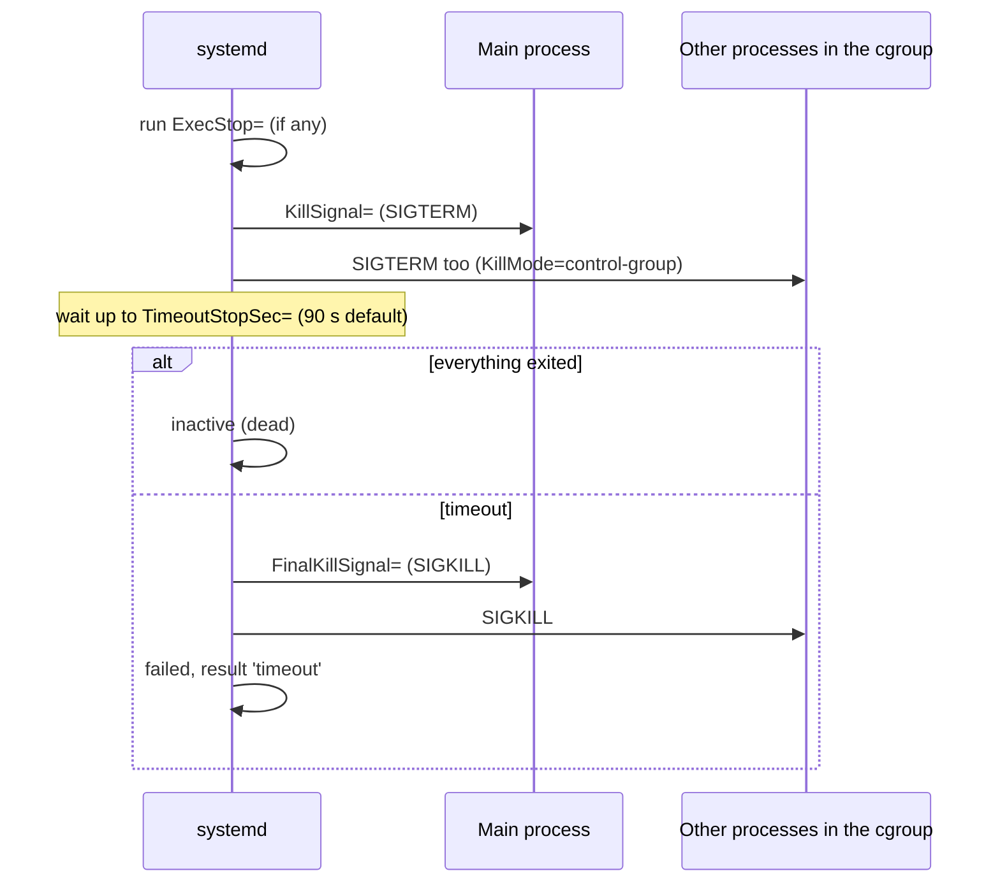

# systemd

## Why care?

Your Go service is done. Now it has to run on a Linux box: start at boot, restart when it crashes, log somewhere, stop cleanly on deploy. Things that go wrong in real life:

- "The service crashed at 3 a.m. and nobody restarted it."
- "`systemctl stop` hangs for 90 seconds, then the process is killed anyway."
- "Where are the logs? `/var/log` has nothing."
- "The service starts before the database is up and exits."
- "A security scan says our service can read every file on the machine."

On almost every Linux server, the answer to all five is **systemd**: the first process the kernel starts, and the one that runs everything else. This page runs `ordersd` under systemd for real, as a user service, and shows what each setting does to the process.

## The idea: one process that starts and supervises all the others

The kernel starts one process at boot, and on most Linux servers that process is systemd. Its job is to run every other service on the machine (see [Processes and threads](../fundamentals/processes-and-threads.md) for how the kernel runs processes):

- It reads a **list of units**: descriptions of what to run, and what each one depends on.
- It **starts units in the right order**, and starts as many in parallel as the order allows.
- It **supervises** them. When a service exits, it can restart it.
- It **collects the logs** of every service in the journal.
- It puts each service in its own **cgroup**, so it always knows which processes belong to which service.
- On stop, it sends each service a signal, waits a short time, then **kills** any process that is still running.

## Under the hood: PID 1's job

The kernel starts exactly one process after boot: PID 1. Here it is systemd:

```console
$ ps -o pid,comm,args -p 1
    PID COMMAND         COMMAND
      1 systemd         /usr/lib/systemd/systemd --system --deserialize=98
```

PID 1 has duties no other process has (see [Signals and process lifetime](signals-and-processes.md)): it adopts every orphan and must reap it, and if it exits, the kernel panics. systemd adds its own work on top:

1. Read **unit files** and build a dependency graph.
2. Start units in parallel, as far as the ordering rules allow.
3. Put every service in its own **cgroup** (see [Namespaces and cgroups](namespaces-and-cgroups.md)), so "the processes of a service" is an exact set, even after `fork`.
4. Supervise: notice exits, apply `Restart=`.
5. Collect stdout, stderr and syslog of everything into **journald**.
6. On stop and on shutdown: `SIGTERM`, wait, `SIGKILL`.

There is a second kind of manager: every logged-in user gets their own `systemd --user` instance (`user@1000.service`). It runs **user units**, without root. All the examples on this page use it, so you can try them without `sudo`. On a server, you put the same unit in `/etc/systemd/system/` and drop the `--user`.

### Units

A unit is a thing systemd manages. Its type is the file extension:

| Type       | What it is                                               | Example                  |
| ---------- | -------------------------------------------------------- | ------------------------ |
| `.service` | A process (or group of processes) to run and supervise   | `ordersd.service`        |
| `.socket`  | A socket systemd listens on, and hands to a service      | `docker.socket`          |
| `.target`  | A named group of units, a "sync point"                   | `multi-user.target`      |
| `.timer`   | Start a unit on a schedule (a better `cron`)             | `apt-daily.timer`        |
| `.mount`   | A mount point                                            | `tmp.mount`              |
| `.slice`   | A node in the cgroup tree, for grouping limits           | `user.slice`             |
| `.scope`   | Processes started by someone else, adopted into a cgroup | `session-1.scope`        |
| `.path`    | Start a unit when a file changes                         | `ssh-agent-restart.path` |

### Where unit files live

systemd looks in a list of directories. The **first match wins**, and the order is "local admin over runtime over package":

| Manager | Directory (highest priority first) | Who writes there                        |
| ------- | ---------------------------------- | --------------------------------------- |
| system  | `/etc/systemd/system/`             | You, the admin                          |
| system  | `/run/systemd/system/`             | Runtime, transient units (gone at boot) |
| system  | `/usr/lib/systemd/system/`         | Packages (`apt`, `dnf`). Don't edit     |
| user    | `~/.config/systemd/user/`          | You                                     |
| user    | `/etc/systemd/user/`               | The admin, for all users                |
| user    | `/usr/lib/systemd/user/`           | Packages                                |

`systemd-analyze unit-paths` (or `systemd-analyze --user unit-paths`) prints the full list on your machine. Never edit a file in `/usr/lib`: the next package upgrade overwrites it. Use a **drop-in** instead (below).

### Dependencies: two separate questions

This part is easy to get wrong. systemd keeps two **independent** kinds of relation:

- **Requirement**: "if A starts, B must start too". `Wants=` (B may fail, A starts anyway) and `Requires=` (if B fails to start, A fails too). `BindsTo=` is `Requires=` plus "if B stops, stop A".
- **Ordering**: "if both start, A waits for B". `After=` and `Before=`.

`Requires=` **without** `After=` starts both **at the same time**. Almost always you want both lines. Look at a real unit, Docker's:

```console
$ systemctl cat docker.service --no-pager | sed -n 1,20p
# /usr/lib/systemd/system/docker.service
[Unit]
Description=Docker Application Container Engine
Documentation=https://docs.docker.com
After=network-online.target firewalld.service containerd.service
Wants=network-online.target
Requires=docker.socket
Wants=containerd.service

[Service]
Type=notify
# the default is not to use systemd for cgroups because the delegate issues still
# exists and systemd currently does not support the cgroup feature set required
# for containers run by docker
ExecStart=/usr/bin/dockerd -H fd:// --containerd=/run/containerd/containerd.sock
ExecReload=/bin/kill -s HUP $MAINPID
TimeoutSec=0
RestartSec=2
Restart=always
```

`Wants=network-online.target` **and** `After=network-online.target`: "try to bring the network up, and wait for it". `Requires=docker.socket`: Docker uses socket activation (`-H fd://`), which you will build yourself below. systemd also adds **default dependencies** to every unit. `systemctl show` lists the full result:

```console
$ systemctl show docker.service -p Requires -p Wants -p After -p BindsTo --no-pager
Requires=system.slice sysinit.target docker.socket
Wants=network-online.target containerd.service
BindsTo=
After=docker.socket containerd.service sysinit.target network-online.target systemd-journald.socket firewalld.service basic.target system.slice
```

!!! warning "Dependencies don't replace retries"

    `After=postgresql.service` means "after PostgreSQL's start job finished". It does not
    mean PostgreSQL accepts connections, and it means nothing at all if the database is on
    another machine. Your service must retry its connections anyway. Use ordering to make
    the common case smooth, not to make your code correct.

### Service types: when is a service "started"?

`Type=` tells systemd when to consider the start **done**, so that units ordered `After=` it may start:

| `Type=`   | "Started" means                                        | Use for                            |
| --------- | ------------------------------------------------------ | ---------------------------------- |
| `simple`  | `fork` worked (the default). Even if `exec` then fails | Old default; prefer `exec`         |
| `exec`    | `execve` of the binary worked                          | Most Go services                   |
| `notify`  | The service sent `READY=1` to systemd's notify socket  | Services with slow warm-up         |
| `forking` | The first process exited, leaving a daemon behind      | Old C daemons that fork themselves |
| `oneshot` | The process **exited** successfully                    | Scripts: migrations, setup steps   |

`Type=notify` uses a tiny protocol (`sd_notify(3)`): systemd puts the path of a Unix datagram socket in `$NOTIFY_SOCKET`, and the service writes `READY=1` to it. No library needed:

```go
// Command ready warms up for two seconds, then tells systemd it is ready.
package main

import (
	"log"
	"net"
	"os"
	"time"
)

// notify sends one sd_notify(3) message. It is a no-op outside systemd.
func notify(state string) error {
	addr := os.Getenv("NOTIFY_SOCKET")
	if addr == "" {
		return nil
	}
	conn, err := net.DialUnix("unixgram", nil, &net.UnixAddr{Name: addr, Net: "unixgram"})
	if err != nil {
		return err
	}
	defer conn.Close()
	_, err = conn.Write([]byte(state))
	return err
}

func main() {
	log.SetFlags(0)
	log.Println("warming up: loading caches, connecting to the database...")
	time.Sleep(2 * time.Second)
	if err := notify("READY=1\nSTATUS=serving"); err != nil {
		log.Fatal(err)
	}
	log.Println("ready")
	select {}
}
```

Start it both ways with `systemd-run`, which creates a temporary (transient) unit from the command line. It waits until the start job is done:

```console
$ /usr/bin/time -f "start took %e s" systemd-run --user --unit=ready-exec -p Type=exec ~/.local/bin/ready
Running as unit: ready-exec.service; invocation ID: 638f579d825c4430987952fceb06b84e
start took 0.02 s
$ /usr/bin/time -f "start took %e s" systemd-run --user --quiet --unit=ready-notify -p Type=notify ~/.local/bin/ready
start took 2.02 s
$ systemctl --user status ready-notify --no-pager | head -7
● ready-notify.service - /home/you/.local/bin/ready
     Loaded: loaded (/run/user/1000/systemd/transient/ready-notify.service; transient)
  Transient: yes
     Active: active (running) since Thu 2026-11-26 16:49:30 CET; 18ms ago
   Main PID: 218785 (ready)
     Status: "serving"
     CGroup: /user.slice/user-1000.slice/user@1000.service/app.slice/ready-notify.service
```

With `Type=exec`, systemd calls it "started" after 20 ms, while the program is still warming up. With `Type=notify`, it waits the full 2 seconds for `READY=1`, and shows our `STATUS=` text. Anything ordered `After=ready-notify.service` now really starts after warm-up. If `READY=1` never comes, systemd fails the start after `TimeoutStartSec=` (90 s by default).

`ordersd` does not send `READY=1`, so it uses `Type=exec`. Its `/readyz` endpoint plays the same role for load balancers.

## Try it: `ordersd` as a user service

Build `ordersd` from `examples/orders` and put the binary where a user unit can find it:

```sh
CGO_ENABLED=0 go build -trimpath -o ~/.local/bin/ordersd ./cmd/ordersd
```

Write `~/.config/systemd/user/ordersd.service`:

```ini
[Unit]
Description=Orders HTTP API
StartLimitIntervalSec=60
StartLimitBurst=5

[Service]
Type=exec
ExecStart=%h/.local/bin/ordersd
Environment=ORDERS_ADDR=127.0.0.1:18081
Environment=ORDERS_SHUTDOWN_TIMEOUT=10s
Restart=on-failure
RestartSec=2s
TimeoutStopSec=15s

[Install]
WantedBy=default.target
```

Line by line:

- `%h` is a **specifier** for the home directory. `ExecStart=` needs an absolute path (or a binary in systemd's own fixed `PATH`), not your shell's `PATH`.
- `Environment=` sets `ORDERS_*` variables, which `ordersd` reads (see `internal/config`). For secrets, use `EnvironmentFile=` with a file only root can read, or better `LoadCredential=`.
- `Restart=on-failure` restarts after a non-zero exit, a crash signal or a timeout, but not after a clean `systemctl stop`. `RestartSec=2s` waits between tries.
- `StartLimitBurst=5` in `StartLimitIntervalSec=60`: more than 5 starts in 60 seconds, and systemd gives up (state `failed`, reason `start-limit-hit`). This stops a crash loop from using CPU forever.
- `TimeoutStopSec=15s`: how long a stop may take before `SIGKILL`. It must be **longer** than `ORDERS_SHUTDOWN_TIMEOUT` (10 s), or systemd kills the service in the middle of its graceful shutdown.
- `[Install]` is only read by `systemctl enable`: "make `default.target` want this unit".

Check the file before you load it. `systemd-analyze verify` catches typos that systemd would otherwise only log and ignore:

```console
$ systemd-analyze --user verify ~/.config/systemd/user/ordersd.service
$ echo $?
0
```

Here is what it says about a version with mistakes (path shortened):

```ini
[Unit]
Description=Orders HTTP API
After=network-online.target
Require=network-online.target

[Service]
Type=exec
ExecStart=ordersd -addr :8080
Restart=on-falure
TimeoutStopSec=15

[Install]
WantedBy=default.target
```

```console
$ systemd-analyze --user verify ./ordersd.service
.../broken/ordersd.service:4: Unknown key name 'Require' in section 'Unit', ignoring.
.../broken/ordersd.service:9: Failed to parse service restart specifier, ignoring: on-falure
ordersd.service: Command ordersd is not executable: No such file or directory
```

Three bugs, all of which systemd itself would only **warn** about and skip: no dependency, no restart, and a binary that is not in systemd's `PATH`. Run `verify` in CI for every unit file you ship.

Now load and start the good one:

```console
$ systemctl --user daemon-reload
$ systemctl --user start ordersd
$ systemctl --user status ordersd --no-pager
● ordersd.service - Orders HTTP API
     Loaded: loaded (/home/you/.config/systemd/user/ordersd.service; disabled; preset: enabled)
     Active: active (running) since Thu 2026-11-26 16:46:46 CET; 1s ago
   Main PID: 215458 (ordersd)
     CGroup: /user.slice/user-1000.slice/user@1000.service/app.slice/ordersd.service
             └─215458 /home/you/.local/bin/ordersd

Nov 26 16:46:46 laptop systemd[595]: Starting ordersd.service - Orders HTTP API...
Nov 26 16:46:46 laptop systemd[595]: Started ordersd.service - Orders HTTP API.
Nov 26 16:46:46 laptop ordersd[215458]: {"time":"2026-11-26T16:46:46.029249841+01:00","level":"INFO","msg":"starting","service":"ordersd","version":"(devel)","revision":"f1ceceb702caa2e21fa5a586e30c350472c49ee6","go_version":"go1.27.4"}
Nov 26 16:46:46 laptop ordersd[215458]: {"time":"2026-11-26T16:46:46.052630764+01:00","level":"INFO","msg":"listening","service":"ordersd","addr":"127.0.0.1:18081"}
$ curl -s 127.0.0.1:18081/healthz
{"status":"ok"}
```

`daemon-reload` is needed after **every** change to a unit file: systemd reads files only then. The `CGroup:` line is the cgroup systemd made for this one service. `disabled` means it won't start at login. `enable` creates the `WantedBy=` symlink:

```console
$ systemctl --user enable ordersd
Created symlink /home/you/.config/systemd/user/default.target.wants/ordersd.service → /home/you/.config/systemd/user/ordersd.service.
$ systemctl --user disable ordersd
Removed "/home/you/.config/systemd/user/default.target.wants/ordersd.service".
```

"Enabled" means only this: a symlink in a `.wants/` directory. (User units start at login, and stop at logout, unless you `loginctl enable-linger` the user.)

### `Restart=`: restart after a crash

Kill the service with `SIGKILL`, as the kernel's OOM killer would:

```console
$ systemctl --user kill -s KILL ordersd
$ systemctl --user show ordersd -p MainPID -p NRestarts -p Result
MainPID=215658
Result=success
NRestarts=1
$ journalctl --user -u ordersd --no-pager -n 6 -o short-precise
Nov 26 16:46:51.912560 laptop systemd[595]: ordersd.service: Sent signal SIGKILL to main process 215458 (ordersd) on client request.
Nov 26 16:46:51.913589 laptop systemd[595]: ordersd.service: Main process exited, code=killed, status=9/KILL
Nov 26 16:46:51.913780 laptop systemd[595]: ordersd.service: Failed with result 'signal'.
Nov 26 16:46:54.116631 laptop systemd[595]: ordersd.service: Scheduled restart job, restart counter is at 1.
Nov 26 16:46:54.117576 laptop systemd[595]: Starting ordersd.service - Orders HTTP API...
Nov 26 16:46:54.121751 laptop systemd[595]: Started ordersd.service - Orders HTTP API.
```

A new PID, 2.2 seconds later (`RestartSec=2s`). `NRestarts` counts restarts; alert on it, because a service that restarts every hour "works" while it loses every request in flight.

### Drop-ins: change a unit without editing it

To change a unit, add a file in `<unit>.d/` next to it, ending in `.conf`. systemd reads the unit, then every drop-in in alphabetical order. `systemctl --user edit ordersd` opens an editor on `ordersd.service.d/override.conf` for you.

One rule is special: **list settings add up**. A drop-in that only sets `ExecStart=` adds a **second** command:

```ini
[Service]
ExecStart=%h/.local/bin/ordersd -log-level debug
```

```console
$ systemctl --user daemon-reload
$ systemctl --user restart ordersd
Failed to restart ordersd.service: Unit ordersd.service has a bad unit file setting.
See user logs and 'systemctl --user status ordersd.service' for details.
$ journalctl --user -u ordersd --since -10s -o cat --no-pager | tail -1
ordersd.service: Service has more than one ExecStart= setting, which is only allowed for Type=oneshot services. Refusing.
```

An empty assignment clears the list first:

```ini
[Service]
ExecStart=
ExecStart=%h/.local/bin/ordersd -log-level debug
```

```console
$ systemctl --user daemon-reload
$ systemctl --user restart ordersd
$ systemctl --user status ordersd --no-pager | head -9
● ordersd.service - Orders HTTP API
     Loaded: loaded (/home/you/.config/systemd/user/ordersd.service; disabled; preset: enabled)
    Drop-In: /home/you/.config/systemd/user/ordersd.service.d
             └─hardening.conf, override.conf
     Active: active (running) since Thu 2026-11-26 16:50:28 CET; 38ms ago
   Main PID: 219480 (ordersd)
     CGroup: /user.slice/user-1000.slice/user@1000.service/app.slice/ordersd.service
             └─219480 /home/you/.local/bin/ordersd -log-level debug
```

(`hardening.conf` is the drop-in from the hardening section below.) `systemctl --user cat ordersd` prints the unit plus all drop-ins, in the order systemd applies them.

## Under the hood: how a service stops

`systemctl stop` runs this sequence, controlled by a few settings:



The defaults, for our unit:

```console
$ systemctl --user show ordersd -p KillMode -p KillSignal -p TimeoutStopUSec -p SendSIGKILL -p FinalKillSignal
TimeoutStopUSec=15s
KillMode=control-group
KillSignal=15
FinalKillSignal=9
SendSIGKILL=yes
```

A clean stop of `ordersd` takes milliseconds, because it handles `SIGTERM` (see [Signals and process lifetime](signals-and-processes.md)):

```console
$ systemctl --user stop ordersd
$ journalctl --user -u ordersd -n 4 -o short-precise --no-pager
Nov 26 17:34:37.690010 laptop systemd[595]: Stopping ordersd.service - Orders HTTP API...
Nov 26 17:34:37.690424 laptop ordersd[226165]: {"time":"2026-11-26T17:34:37.690220372+01:00","level":"INFO","msg":"shutting down","service":"ordersd","delay":0,"timeout":10000000000}
Nov 26 17:34:37.690424 laptop ordersd[226165]: {"time":"2026-11-26T17:34:37.690340039+01:00","level":"INFO","msg":"shutdown complete","service":"ordersd"}
Nov 26 17:34:37.691506 laptop systemd[595]: Stopped ordersd.service - Orders HTTP API.
```

`SIGTERM` at .690010, "shutdown complete" 0.3 ms later, and systemd sees the exit at .691506.

Now a program that catches `SIGTERM` and ignores it:

```go
// Command stubborn ignores SIGTERM, to show what systemd does next.
package main

import (
	"log"
	"os"
	"os/signal"
	"syscall"
)

func main() {
	log.SetFlags(0)
	sigs := make(chan os.Signal, 1)
	signal.Notify(sigs, syscall.SIGTERM)
	log.Println("running, pid", os.Getpid())
	for s := range sigs {
		log.Println("got", s, "- ignoring it")
	}
}
```

```console
$ systemd-run --user --unit=stubborn --description="ignores SIGTERM" -p TimeoutStopSec=3s ~/.local/bin/stubborn
Running as unit: stubborn.service; invocation ID: 0aef1aa8f0f24cd28ef50b81ff53491f
$ systemctl --user stop stubborn
$ journalctl --user -u stubborn -o short-precise --no-pager | sed 's/laptop //' | cut -c8-
16:47:55.583603 systemd[595]: Started stubborn.service - ignores SIGTERM.
16:47:55.589607 stubborn[216907]: running, pid 216907
16:47:56.597503 systemd[595]: Stopping stubborn.service - ignores SIGTERM...
16:47:56.598911 stubborn[216907]: got terminated - ignoring it
16:47:59.796468 systemd[595]: stubborn.service: State 'stop-sigterm' timed out. Killing.
16:47:59.796574 systemd[595]: stubborn.service: Killing process 216907 (stubborn) with signal SIGKILL.
16:47:59.797332 systemd[595]: stubborn.service: Main process exited, code=killed, status=9/KILL
16:47:59.797410 systemd[595]: stubborn.service: Failed with result 'timeout'.
16:47:59.797628 systemd[595]: Stopped stubborn.service - ignores SIGTERM.
```

`SIGTERM` at :56.6, `SIGKILL` 3.2 seconds later. With the default `TimeoutStopSec=90s`, this is the "stop hangs for 90 seconds" problem from the start of the page. The same logic, with other numbers, is Kubernetes' `terminationGracePeriodSeconds` and Docker's `stop -t`.

### `KillMode=`: who gets the signal?

| `KillMode=`     | `SIGTERM` goes to                         | `SIGKILL` (on timeout) goes to |
| --------------- | ----------------------------------------- | ------------------------------ |
| `control-group` | Every process in the cgroup (default)     | Every process in the cgroup    |
| `mixed`         | Only the main process                     | Every process in the cgroup    |
| `process`       | Only the main process                     | Only the main process          |
| `none`          | Nobody (only `ExecStop=` runs). Don't use | Nobody                         |

`mixed` is right for a parent that shuts down its own children in order (a supervisor, `nginx`). `process` can leave child processes running:

```console
$ systemd-run --user --quiet --unit=killmode-demo -p KillMode=process sh -c 'sleep 600 & wait'
$ systemctl --user status killmode-demo --no-pager | sed -n '/CGroup/,/^$/p'
     CGroup: /user.slice/user-1000.slice/user@1000.service/app.slice/killmode-demo.service
             ├─217042 /usr/bin/sh -c "sleep 600 & wait"
             └─217044 sleep 600
$ systemctl --user stop killmode-demo
$ journalctl --user -u killmode-demo -o cat --no-pager
Started killmode-demo.service - /usr/bin/sh -c "sleep 600 & wait".
Stopping killmode-demo.service - /usr/bin/sh -c "sleep 600 & wait"...
killmode-demo.service: Unit process 217044 (sleep) remains running after unit stopped.
Stopped killmode-demo.service - /usr/bin/sh -c "sleep 600 & wait".
$ pgrep -a -x sleep
217044 sleep 600
```

The unit is "stopped", but its child is still running. The cgroup is what makes the default safe: no matter how often a process forks or double-forks, systemd finds every one of them in the cgroup. Classic init scripts with PID files could not do this.

## Socket activation: systemd holds the socket

With **socket activation**, systemd creates the listening socket itself, and starts the service on the first connection (or at boot). The service gets the already-open socket as **file descriptor 3** (see [File descriptors](file-descriptors.md)). The benefits:

- **No lost connections on restart.** The socket stays open while the service restarts. New connections wait in the kernel's accept queue instead of getting `connection refused`.
- **Privileged ports without privileges.** systemd (root) binds port 443, the service runs as a normal user.
- **Lazy start, and no ordering.** Clients may connect before the service is up; the kernel queues them.

The protocol (`sd_listen_fds(3)`) is two environment variables: `LISTEN_FDS` (how many fds, starting at 3) and `LISTEN_PID` (the PID they are meant for, so a child does not take them by mistake). In Go:

```go
// Command hellosock serves HTTP on a socket that systemd opened for it.
package main

import (
	"errors"
	"fmt"
	"log"
	"net"
	"net/http"
	"os"
	"strconv"
)

// listenFDStart is the first passed file descriptor (0-2 are stdio).
const listenFDStart = 3

// systemdListener returns the socket systemd passed us, using the
// sd_listen_fds(3) protocol: LISTEN_PID must be our PID, LISTEN_FDS the count.
func systemdListener() (net.Listener, error) {
	if os.Getenv("LISTEN_PID") != strconv.Itoa(os.Getpid()) {
		return nil, errors.New("LISTEN_PID is not our PID: not socket-activated")
	}
	n, err := strconv.Atoi(os.Getenv("LISTEN_FDS"))
	if err != nil || n != 1 {
		return nil, fmt.Errorf("want LISTEN_FDS=1, got %q", os.Getenv("LISTEN_FDS"))
	}
	// Do not pass these on to child processes.
	os.Unsetenv("LISTEN_PID")
	os.Unsetenv("LISTEN_FDS")
	os.Unsetenv("LISTEN_FDNAMES")

	f := os.NewFile(listenFDStart, "systemd-socket")
	defer f.Close() // FileListener dups the fd; close our copy
	return net.FileListener(f)
}

func main() {
	ln, err := systemdListener()
	if err != nil {
		log.Fatal(err)
	}
	log.Printf("pid %d serving on %s (fd %d from systemd)", os.Getpid(), ln.Addr(), listenFDStart)
	http.HandleFunc("/", func(w http.ResponseWriter, r *http.Request) {
		fmt.Fprintf(w, "hello from pid %d\n", os.Getpid())
	})
	log.Fatal(http.Serve(ln, nil))
}
```

Two units. `~/.config/systemd/user/hellosock.socket`:

```ini
[Unit]
Description=hellosock listening socket

[Socket]
ListenStream=127.0.0.1:18082

[Install]
WantedBy=sockets.target
```

And `~/.config/systemd/user/hellosock.service` (same name, so the socket activates it by default):

```ini
[Unit]
Description=hellosock demo service
Requires=hellosock.socket
After=hellosock.socket

[Service]
Type=exec
ExecStart=%h/.local/bin/hellosock
```

Start only the **socket**:

```console
$ systemctl --user daemon-reload
$ systemctl --user start hellosock.socket
$ systemctl --user list-sockets --no-pager | grep -E 'LISTEN|hellosock'
LISTEN                                    UNIT                       ACTIVATES
127.0.0.1:18082                           hellosock.socket           hellosock.service
$ systemctl --user is-active hellosock.service
inactive
$ ss -tlnp | grep 18082
LISTEN 0      4096        127.0.0.1:18082      0.0.0.0:*
```

The port is open, and no service runs. (`ss` shows no process: the socket belongs to the systemd user manager, which `ss` may not inspect.) Now connect:

```console
$ curl -s 127.0.0.1:18082/
hello from pid 217840
$ systemctl --user is-active hellosock.service
active
$ ss -tlnp | grep 18082
LISTEN 0      4096        127.0.0.1:18082      0.0.0.0:*    users:(("hellosock",pid=217840,fd=6))
$ journalctl --user -u hellosock.service -o cat --no-pager
Starting hellosock.service - hellosock demo service...
Started hellosock.service - hellosock demo service.
2026/11/26 16:48:43 pid 217840 serving on 127.0.0.1:18082 (fd 3 from systemd)
```

The first `curl` started the service, and got its answer. Look at the service's file descriptors:

```console
$ ls -l /proc/217840/fd | awk '{print $9, $10, $11}'

0 -> /dev/null
1 -> socket:[910722]
2 -> socket:[910722]
4 -> /sys/fs/cgroup/cpu/user.slice/user-1000.slice/cpu.cfs_quota_us
5 -> /sys/fs/cgroup/cpu/user.slice/user-1000.slice/cpu.cfs_period_us
6 -> socket:[911474]
7 -> anon_inode:[eventpoll]
8 -> anon_inode:[eventfd]
```

- fd 3 is gone: `net.FileListener` made a duplicate (fd 6, the one `ss` shows) and we closed the original.
- fd 1 and 2 are a socket, not a terminal: stdout and stderr go straight to journald.
- fd 4 and 5 are the Go runtime watching the cgroup CPU limit for `GOMAXPROCS` ([Namespaces and cgroups](namespaces-and-cgroups.md)).

`Unsetenv` only changes the Go process's own copy of the environment, which its children inherit. `/proc/<pid>/environ` keeps showing the environment from `exec` time:

```console
$ tr '\0' '\n' < /proc/217840/environ | grep LISTEN
LISTEN_PID=217840
LISTEN_FDS=1
LISTEN_FDNAMES=hellosock.socket
```

Restart the service while the socket stays up:

```console
$ systemctl --user stop hellosock.service
Stopping 'hellosock.service', but its triggering units are still active:
hellosock.socket
$ curl -s 127.0.0.1:18082/
hello from pid 218120
```

A new PID, and the client never saw a refused connection. Run without systemd and the program says so; `systemd-socket-activate` emulates the protocol for local testing:

```console
$ ~/.local/bin/hellosock
2026/11/26 16:48:51 LISTEN_PID is not our PID: not socket-activated
$ systemd-socket-activate -l 127.0.0.1:18083 ~/.local/bin/hellosock &
Listening on 127.0.0.1:18083 as 3.
$ curl -s 127.0.0.1:18083/
Communication attempt on fd 3.
Execing /home/you/.local/bin/hellosock (/home/you/.local/bin/hellosock)
2026/11/26 16:48:52 pid 218134 serving on 127.0.0.1:18083 (fd 3 from systemd)
hello from pid 218134
```

!!! note "Graceful restarts still need care"

    Socket activation keeps the **listening** socket. Connections that are already
    accepted belong to the old process. Shut down gracefully (`http.Server.Shutdown`) or
    they still break. In production, a real service would also fall back to
    `net.Listen` when `LISTEN_FDS` is not set, so it runs both ways.

## journald: logs with fields

Everything a service writes to stdout or stderr goes to **journald**. You don't need log files, log rotation or a syslog setup. `journalctl` reads it:

| Command                                       | Shows                                       |
| --------------------------------------------- | ------------------------------------------- |
| `journalctl --user -u ordersd`                | All logs of one unit (`-u` can repeat)      |
| `journalctl --user -u ordersd -f`             | Follow, like `tail -f`                      |
| `journalctl --user -u ordersd -b`             | Since this boot                             |
| `journalctl --user -u ordersd --since -10min` | Time window (`--since`, `--until`)          |
| `journalctl --user -u ordersd -p warning`     | Priority `warning` and worse                |
| `journalctl --user -u ordersd -o cat`         | Only the messages, no prefix                |
| `journalctl --user -u ordersd -o json`        | One JSON object per entry, with every field |

Each entry is a set of **fields**, not one line of text. `-o verbose` shows them all:

```console
$ journalctl --user -u ordersd -n 1 -o verbose --no-pager
Thu 2026-11-26 16:46:54.150924 CET [s=6cde87478a8045648f0d7ff11e3712f1;i=2395a;b=65ecddd5d7c7432790fc4114d69975b4;m=7cfc83473;t=6612fda4dc50c;x=afbca10c84e211a3]
    _UID=1000
    _GID=1000
    _BOOT_ID=65ecddd5d7c7432790fc4114d69975b4
    _MACHINE_ID=fb3d14a343eb4f8e8d159b6a60a0fc8f
    _HOSTNAME=laptop
    _RUNTIME_SCOPE=system
    PRIORITY=6
    SYSLOG_FACILITY=3
    _AUDIT_SESSION=2
    _AUDIT_LOGINUID=1000
    _SYSTEMD_OWNER_UID=1000
    _SYSTEMD_UNIT=user@1000.service
    _SYSTEMD_SLICE=user-1000.slice
    _TRANSPORT=stdout
    SYSLOG_IDENTIFIER=ordersd
    _COMM=ordersd
    _EXE=/home/you/.local/bin/ordersd
    _CAP_EFFECTIVE=0
    _SYSTEMD_USER_SLICE=app.slice
    _CMDLINE=/home/you/.local/bin/ordersd
    _SYSTEMD_CGROUP=/user.slice/user-1000.slice/user@1000.service/app.slice/ordersd.service
    _SYSTEMD_USER_UNIT=ordersd.service
    _STREAM_ID=3fa22a4479f34fcea3f9c49e09c05562
    _PID=215658
    _SYSTEMD_INVOCATION_ID=1d3b72e327f94d3fae35d9d5a48d2de6
    MESSAGE={"time":"2026-11-26T16:46:54.15086789+01:00","level":"INFO","msg":"listening","service":"ordersd","addr":"127.0.0.1:18081"}
```

Fields starting with `_` are added by journald itself, from the kernel. The process can't fake them. That's how `-u` works: it matches `_SYSTEMD_UNIT` (or `_SYSTEMD_USER_UNIT`). `_SYSTEMD_INVOCATION_ID` changes on every start, so you can pick out exactly one run. Any field works as a filter: `journalctl _PID=215658`, `journalctl _COMM=ordersd`.

`ordersd` logs JSON, so `MESSAGE` is a JSON string, and `jq` can read its fields:

```console
$ journalctl --user -u ordersd -o cat --no-pager | grep '^{' | jq -c 'select(.msg=="listening") | {time,addr}'
{"time":"2026-11-26T16:46:46.052630764+01:00","addr":"127.0.0.1:18081"}
{"time":"2026-11-26T16:46:54.15086789+01:00","addr":"127.0.0.1:18081"}
```

!!! warning "Every stdout line is `PRIORITY=6` (info)"

    journald cannot read the `"level":"ERROR"` inside your JSON. To journald, every line
    from stdout is "info", so `journalctl -p err` finds nothing. Either let your log
    shipper parse the JSON (most do), or prefix lines with a syslog level like `<3>`,
    which journald understands on stdout and strips:

    ```console
    $ systemd-run --user --quiet --wait --unit=prio-demo sh -c 'echo "<3>disk is full"; echo "<6>all good"; echo "no prefix"'
    $ journalctl --user -u prio-demo -o json --no-pager | jq -c 'select(._COMM=="sh") | {PRIORITY, MESSAGE}'
    {"PRIORITY":"3","MESSAGE":"disk is full"}
    {"PRIORITY":"6","MESSAGE":"all good"}
    {"PRIORITY":"6","MESSAGE":"no prefix"}
    $ journalctl --user -u prio-demo -p err -o cat --no-pager
    disk is full
    ```

The journal has size limits (`SystemMaxUse=` in `journald.conf`, 10% of the filesystem by default), and old entries are dropped. For anything you must keep, ship logs off the box (see the [Observability](../observability/index.md) chapter).

## Hardening: a sandbox in a drop-in

By default a service can do everything its user can: read every home directory, write to `/tmp`, open any socket, call any system call. systemd can put a service in a sandbox, built from the same [namespaces](namespaces-and-cgroups.md), plus seccomp and capabilities, with one line per restriction. `systemd-analyze security` scores how exposed a unit is, from 0 (locked down) to 10:

```console
$ systemd-analyze --user security ordersd.service --no-pager | tail -1
→ Overall exposure level for ordersd.service: 9.8 UNSAFE 😨
```

Most units on a stock machine are no better. Here are a few lines of `systemd-analyze security` (system services):

```text
UNIT                                 EXPOSURE PREDICATE HAPPY
cron.service                              9.6 UNSAFE    😨
docker.service                            9.6 UNSAFE    😨
polkit.service                            1.6 OK        🙂
systemd-journald.service                  4.3 OK        🙂
systemd-resolved.service                  2.2 OK        🙂
```

Add a drop-in, `~/.config/systemd/user/ordersd.service.d/hardening.conf`:

```ini
[Service]
# No new privileges, ever: no setuid binaries, no file capabilities.
NoNewPrivileges=yes
CapabilityBoundingSet=
PrivateUsers=yes
# Filesystem: everything read-only, a private /tmp and /dev.
ProtectSystem=strict
ProtectHome=read-only
PrivateTmp=yes
PrivateDevices=yes
UMask=0077
# Kernel knobs the service never needs to touch.
ProtectKernelTunables=yes
ProtectKernelModules=yes
ProtectKernelLogs=yes
ProtectControlGroups=yes
ProtectClock=yes
ProtectHostname=yes
ProtectProc=invisible
ProcSubset=pid
# What the process may do.
RestrictAddressFamilies=AF_INET AF_INET6 AF_UNIX
RestrictNamespaces=yes
RestrictRealtime=yes
RestrictSUIDSGID=yes
LockPersonality=yes
MemoryDenyWriteExecute=yes
RemoveIPC=yes
SystemCallArchitectures=native
SystemCallFilter=@system-service
SystemCallFilter=~@privileged @resources
```

The most useful ones:

- **`ProtectSystem=strict`**: the whole filesystem is read-only for the service, except `/dev`, `/proc`, `/sys`. Give back what it needs with `ReadWritePaths=` or, better, `StateDirectory=orders` (systemd creates `/var/lib/orders`, owned by the service).
- **`ProtectHome=`**: `yes` hides `/home`, `/root` and `/run/user`; `read-only` here, because our binary lives in `~/.local/bin`. A system service in `/usr/local/bin` would use `yes`.
- **`PrivateTmp=yes`**: its own empty `/tmp` (a mount namespace). No more `/tmp` races with other services.
- **`NoNewPrivileges=yes`**: `execve` can never gain privileges (setuid bits are ignored).
- **`CapabilityBoundingSet=`** (empty): drop every capability for good.
- **`SystemCallFilter=@system-service`**: a seccomp allow-list of system calls normal services use; `~@privileged @resources` then removes some again. A forbidden call kills the process with `SIGSYS`.
- **`RestrictAddressFamilies=`**: only IPv4, IPv6 and Unix sockets. No raw packets, no netlink.
- **`MemoryDenyWriteExecute=yes`**: no memory that is both writable and executable. Fine for Go (no JIT); it breaks Java and Node.js.
- **`PrivateUsers=yes`**: a user namespace. In a user manager, systemd needs it for most of the other settings (it has no real root to build namespaces with).

```console
$ systemctl --user daemon-reload
$ systemd-analyze --user verify ordersd.service
$ systemd-analyze --user security ordersd.service --no-pager | tail -1
→ Overall exposure level for ordersd.service: 1.7 OK 🙂
$ systemctl --user start ordersd
$ curl -s 127.0.0.1:18081/healthz
{"status":"ok"}
```

From 9.8 to 1.7, and the service still works. What is left:

```console
$ systemd-analyze --user security ordersd.service --no-pager | grep -E '^✗'
✗ KeyringMode=                                                Service shares key material with other service                                      0.2
✗ RootDirectory=/RootImage=                                   Service runs within the host's root directory                                       0.1
✗ User=/DynamicUser=                                          Service runs as root user                                                           0.4
✗ RestrictAddressFamilies=~AF_UNIX                            Service may allocate local sockets                                                  0.1
✗ RestrictAddressFamilies=~AF_(INET|INET6)                    Service may allocate Internet sockets                                               0.3
✗ ProtectHome=                                                Service has read-only access to home directories                                    0.1
✗ PrivateNetwork=                                             Service has access to the host's network                                            0.5
✗ DeviceAllow=                                                Service has a device ACL with some special devices: char-rtc:r                      0.1
✗ IPAddressDeny=                                              Service does not define an IP address allow list                                    0.2
```

Read the report critically: not every item applies to every service. An HTTP service needs internet sockets and the network. And "runs as root user" is wrong here: the tool does not understand user managers, the service runs as UID 1000. For a **system** service it is right, and the fix is `DynamicUser=yes` (systemd invents a fresh UID for each run) or `User=orders`. `IPAddressDeny=` needs eBPF on a cgroup v2 tree, which this hybrid machine doesn't give to the user manager.

Check that the restrictions are active. The kernel's view of the running service:

```console
$ grep -E 'NoNewPrivs|Seccomp:|CapBnd' /proc/$(systemctl --user show -p MainPID --value ordersd)/status
CapBnd:	0000000000000000
NoNewPrivs:	1
Seccomp:	2
$ for n in user mnt; do echo "$n: $(readlink /proc/$P/ns/$n) vs shell $(readlink /proc/self/ns/$n)"; done
user: user:[4026532271] vs shell user:[4026531837]
mnt: mnt:[4026532272] vs shell mnt:[4026532255]
```

No capabilities, `no_new_privs` set, a seccomp filter active (mode 2), and its own user and mount namespaces (`P` holds the service's PID). And a quick test of the filesystem restrictions with a temporary unit:

```console
$ systemd-run --user --quiet --pipe --wait -p PrivateUsers=yes -p ProtectSystem=strict -p ProtectHome=read-only -p PrivateTmp=yes sh -c 'id; touch ~/pwned; touch /tmp/scratch && ls -A /tmp'
uid=1000(you) gid=1000(you) groups=1000(you),65534(nogroup)
touch: cannot touch '/home/you/pwned': Read-only file system
scratch
```

Same user, but home is read-only, and `/tmp` is a private, empty directory with one file in it.

!!! note "Resource limits: the same cgroups"

    `MemoryMax=`, `CPUQuota=` and `TasksMax=` in `[Service]` write `memory.max`,
    `cpu.max` and `pids.max` for the unit's cgroup. On this WSL2 machine (hybrid cgroups),
    they are accepted and **not enforced** for user units, as shown in
    [Namespaces and cgroups](namespaces-and-cgroups.md). On a normal cgroup v2 server
    they work, and `systemctl status` then shows `Memory:` and `CPU:` lines. Pair
    `MemoryMax=` with `Environment=GOMEMLIMIT=...` at about 90% of it.

## Traps

- **Forgetting `daemon-reload`.** systemd keeps using the old unit. `systemctl status` warns: "The unit file ... changed on disk".
- **`Requires=` without `After=`.** Both start at once. Requirement and ordering are separate.
- **`Type=simple` hides `exec` errors.** The start "succeeds", then the unit fails. Use `Type=exec`.
- **`TimeoutStopSec=` shorter than your graceful shutdown.** systemd kills the service halfway through draining. Make it a few seconds longer than the app's own shutdown timeout.
- **`KillMode=process`.** Children keep running after "stop", and pile up on every restart.
- **Restart loops.** `Restart=always` with a config error restarts forever, until `StartLimitBurst=` stops it. Then the unit is `failed` and needs `systemctl reset-failed`. Alert on `NRestarts` and failed units.
- **A drop-in with `ExecStart=` only.** List settings add up. Reset with an empty `ExecStart=` first.
- **Typos are warnings.** `Restart=on-falure` is logged and ignored. Run `systemd-analyze verify` in CI.
- **Log levels are lost.** stdout lines are all `PRIORITY=6`. Parse the JSON downstream or use `<N>` prefixes.
- **User units stop at logout.** Use `loginctl enable-linger`, or make it a system unit.
- **`After=network-online.target` in a user unit** orders against nothing: the user manager has its own, separate set of units. For real network dependencies, use a system unit.

## Check yourself

??? question "1. A unit has `Requires=postgresql.service` but no `After=`. What happens at boot?"

    Both start at the same time. If PostgreSQL fails to start, this unit is stopped too
    (that's the `Requires=` part), but nothing makes it wait. Add
    `After=postgresql.service`, and still retry connections in the code.

??? question "2. `systemctl stop myservice` always takes exactly 90 seconds. Why, and what are two fixes?"

    The process does not exit on `SIGTERM`, so systemd waits for the default
    `TimeoutStopSec=90s`, then sends `SIGKILL`. Fix the service to handle `SIGTERM`
    (`signal.NotifyContext` + `http.Server.Shutdown`). As a guard, set `TimeoutStopSec=` to
    a bit more than the app's shutdown timeout.

??? question "3. Why is `Type=exec` better than `Type=simple` for a Go binary?"

    With `simple`, the unit counts as started right after `fork`, before `execve`. A
    missing or non-executable binary then shows up as a later failure, and units ordered
    after it already started. With `exec`, a failed `execve` fails the start job itself.

??? question "4. What does a socket-activated service receive, and how does it know the socket is meant for it?"

    An already-listening socket as file descriptor 3 (more fds follow at 4, 5, ...), and
    the environment variables `LISTEN_FDS` (the count) and `LISTEN_PID` (the PID that
    should take them). If `LISTEN_PID` is not its own PID, the fds were meant for someone
    else (for example a parent), and it must not use them.

??? question "5. How does systemd find all processes of a service, even ones that double-forked away from the main PID?"

    Every service runs in its own cgroup, and children inherit their parent's cgroup no
    matter how they fork. systemd reads the cgroup's process list
    (`cgroup.procs`) and signals all of them (`KillMode=control-group`).

??? question "6. `journalctl -u ordersd -p err` shows nothing, but the service logged `\"level\":\"ERROR\"` lines. Why?"

    journald stores stdout lines with `PRIORITY=6` (info). It does not parse JSON. Use a
    `<3>` prefix for error lines, the native journal protocol, or filter on the message
    content (`-o cat | jq 'select(.level=="ERROR")'`).

## Recap

- systemd is PID 1: it starts units from a dependency graph, supervises them, puts each in a cgroup, collects logs, and stops them with `SIGTERM` then `SIGKILL`.
- Unit files live in `/etc/systemd/system` (yours), `/run` (runtime) and `/usr/lib` (packages). Change package units with **drop-ins**, then `daemon-reload`.
- `Wants=`/`Requires=` say **what** starts; `After=`/`Before=` say **in which order**. You usually need both.
- `Type=exec` for most Go services; `Type=notify` plus `READY=1` when warm-up matters.
- `Restart=on-failure`, `RestartSec=`, `StartLimitBurst=`: restarts with a limit.
- `KillMode=control-group` and `TimeoutStopSec=` decide who gets `SIGTERM` and how long until `SIGKILL`.
- **Socket activation** passes a listening socket as fd 3 (`LISTEN_FDS`, `LISTEN_PID`) and keeps it open across restarts.
- **journald** stores structured fields; `journalctl -u`, `-o verbose`, `-o json`, and filters on any field.
- **Hardening** is a drop-in: `ProtectSystem=strict`, `PrivateTmp=`, `NoNewPrivileges=`, `SystemCallFilter=`... `systemd-analyze security` took `ordersd` from 9.8 to 1.7.

Next: [Debugging a Linux box](debugging.md), for when the service runs but something is still wrong.
