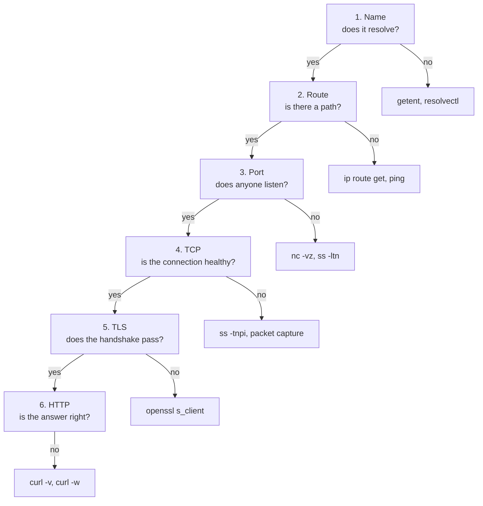

# Debugging the network

## Why care?

A ticket lands: "`orderctl` can't connect to the orders API." That one sentence hides at least six different problems:

- The name does not resolve, or resolves to the wrong address.
- The address resolves, but there is no route to it.
- The route exists, but nothing listens on the port.
- Something listens, but a firewall eats the packets, so you wait 30 seconds for nothing.
- TCP connects, but the TLS handshake fails on the certificate.
- TLS works, but the server hangs up before it answers.

Each one has a different fix, and each one is owned by a different team. Guessing wastes hours. This page gives you a **checklist** that walks down the layers in order, a real command for every step, and the exact error text each failure prints, so you can name the layer from the error alone.

All output on this page is real. It comes from a WSL2 machine: kernel 5.15.167.4, Ubuntu 24.04, Go 1.27.4, curl 8.23.0, OpenSSL 4.1.0, iproute2 6.1. `tcpdump`, `tshark`, `dig` and `traceroute` are not installed here; where the page shows them, it says so. For the Linux side of the box (`ss`, `lsof`, `/proc`), see [Debugging a Linux box](../linux/debugging.md). This page does not repeat it.

## The idea: walk down, one layer at a time

A request needs every layer below it to work. So you test them **in order**, bottom-up, and stop at the first one that fails. The first failure is the problem; everything above it is a symptom.



| Step     | Question                             | Tool                     | A failure looks like                                |
| -------- | ------------------------------------ | ------------------------ | --------------------------------------------------- |
| 1. Name  | Which address does this name become? | `getent`, `resolvectl`   | `no such host`, `Could not resolve host`            |
| 2. Route | Can my packets leave towards it?     | `ip route get`, `ping`   | `network is unreachable`, `no route to host`        |
| 3. Port  | Does anything accept on that port?   | `nc -vz`                 | `connection refused`, `i/o timeout`                 |
| 4. TCP   | Is the connection slow or lossy?     | `ss -tnpi`, `tcpdump`    | high `rtt`, retransmits, `connection reset by peer` |
| 5. TLS   | Does the certificate check pass?     | `openssl s_client`       | `x509: ...`, `tls: ...`                             |
| 6. HTTP  | Does the server answer, and how?     | `curl -v`, `curl -w`, Go | `EOF`, `Empty reply`, 5xx, slow first byte          |

The rest of the page is the checklist, then a lab that makes every error on purpose, then packet capture.

## The checklist

For the local examples, start `ordersd` from the [Go chapter](../go/services.md) on port 9180. Port 9181 stays closed on purpose.

```console
$ cd examples/orders && CGO_ENABLED=0 go build -o "$D/ordersd" ./cmd/ordersd
$ "$D/ordersd" -addr 127.0.0.1:9180 -log-format text &
time=2026-11-26T17:38:29.709+01:00 level=INFO msg=starting service=ordersd version=(devel) revision=c4aa9e744934fdc3a5416ef02d99adbf5df08868 go_version=go1.27.4
time=2026-11-26T17:38:29.732+01:00 level=INFO msg=listening service=ordersd addr=127.0.0.1:9180
```

`$D` is any scratch directory, for example `D=$(mktemp -d)`.

### Step 1: the name

Ask the system resolver, the same way most programs do. `getent ahosts` goes through glibc and `/etc/nsswitch.conf` (here `hosts: files dns`), so it sees `/etc/hosts` too:

```console
$ getent ahosts example.com
172.66.147.243  STREAM example.com
172.66.147.243  DGRAM
172.66.147.243  RAW
104.20.23.154   STREAM
104.20.23.154   DGRAM
104.20.23.154   RAW
2606:4700:10::6814:179a STREAM
2606:4700:10::6814:179a DGRAM
2606:4700:10::6814:179a RAW
2606:4700:10::ac42:93f3 STREAM
2606:4700:10::ac42:93f3 DGRAM
2606:4700:10::ac42:93f3 RAW
$ getent ahosts no-such-host.invalid; echo "exit=$?"
exit=2
```

Two IPv4 and two IPv6 addresses. Each appears three times, once per socket type; only `STREAM` (TCP) matters here. A failed lookup prints **nothing** and exits with 2. Check the exit code, not the screen.

`resolvectl query` asks `systemd-resolved` and tells you **where** the answer came from and how long it took:

```console
$ resolvectl query example.com
example.com: 172.66.147.243
             104.20.23.154
             2606:4700:10::6814:179a
             2606:4700:10::ac42:93f3

-- Information acquired via protocol DNS in 6.2ms.
-- Data is authenticated: no; Data was acquired via local or encrypted transport: no
-- Data from: network
$ resolvectl query no-such-host.invalid
no-such-host.invalid: Name 'no-such-host.invalid' not found
```

`dig` gives you the raw DNS answer with TTLs. It is not installed here; the [DNS](dns.md) page shows how to build the same query in Go.

<!-- TODO(real-output): dig example.com +noall +answer (dig not installed on the test machine) -->

```sh
dig example.com +noall +answer      # records with TTLs
dig @1.1.1.1 example.com            # ask one server directly, bypassing your resolver
```

!!! warning "Tools disagree about names"

    Not every program asks the same resolver. On this machine, `getent` only knows `127.0.0.1` for `localhost`, but curl adds `::1` by itself and tries it first:

    ```console
    $ getent ahosts localhost | grep STREAM
    127.0.0.1       STREAM localhost
    $ curl -sSv -o /dev/null http://localhost:9180/healthz 2>&1 | head -6
    * Host localhost:9180 was resolved.
    * IPv6: ::1
    * IPv4: 127.0.0.1
    *   Trying [::1]:9180...
    * connect to ::1 port 9180 from ::1 port 48513 failed: Connection refused
    *   Trying 127.0.0.1:9180...
    ```

    `ordersd` listens on `127.0.0.1` only, so `::1` is refused and curl falls back. Go has its own pure-Go resolver that reads `/etc/hosts` and `/etc/resolv.conf` itself (see [DNS](dns.md)). When "it works with curl but not in my service", resolve the name **the way the service does**.

### Step 2: the route

You have an address. Does the kernel know where to send packets for it? `ip route get` answers for one address, without sending anything:

```console
$ ip route get 1.1.1.1
1.1.1.1 via 192.168.4.1 dev eth1 src 192.168.4.119 uid 1000
    cache
$ ip route get 2606:4700:10::6814:179a
RTNETLINK answers: Network is unreachable
```

Read the first line as "to reach `1.1.1.1`, hand the packet to the router `192.168.4.1` on `eth1`, and use my address `192.168.4.119` as the source". The second answer is a real failure: this machine has **no IPv6 default route** (`ip -6 route` only lists `fe80::/64`). Every IPv6 address of `example.com` is unreachable from here. Remember that; it shows up again in step 6.

`ping` sends ICMP echo requests and measures the round trip:

```console
$ ping -c 3 1.1.1.1
PING 1.1.1.1 (1.1.1.1) 56(84) bytes of data.
64 bytes from 1.1.1.1: icmp_seq=1 ttl=58 time=8.64 ms
64 bytes from 1.1.1.1: icmp_seq=2 ttl=58 time=8.12 ms
64 bytes from 1.1.1.1: icmp_seq=3 ttl=58 time=7.86 ms

--- 1.1.1.1 ping statistics ---
3 packets transmitted, 3 received, 0% packet loss, time 1998ms
rtt min/avg/max/mdev = 7.856/8.205/8.639/0.325 ms
$ ping -c 2 -W 1 192.0.2.1
PING 192.0.2.1 (192.0.2.1) 56(84) bytes of data.
From <isp-router> icmp_seq=1 Packet filtered
From <isp-router> icmp_seq=2 Packet filtered

--- 192.0.2.1 ping statistics ---
2 packets transmitted, 0 received, +2 errors, 100% packet loss, time 999ms
```

(The ISP router's public address is hidden.) `192.0.2.0/24` is TEST-NET-1, reserved for documentation, so nobody should route it. Here the ISP's router answers with an ICMP "administratively prohibited" message, which `ping` prints as `Packet filtered`.

Two honest limits of `ping`:

- **It needs a raw socket.** That works here only because the binary has a file capability: `getcap /usr/bin/ping` prints `/usr/bin/ping cap_net_raw=ep`. The other way, unprivileged ICMP sockets, is off on this machine (`net.ipv4.ping_group_range = 1 0` is an empty range). In a slim container image, `ping` is often missing or fails with `Operation not permitted`.
- **ICMP is not TCP.** Many firewalls drop ICMP and allow TCP 443, or the other way round. "Ping fails" does not mean "the service is down". The real test is the next step.

`traceroute` and `mtr` show each router on the path. They are not installed here.

<!-- TODO(real-output): traceroute -T -p 443 example.com and mtr -rwc 10 example.com (not installed on the test machine) -->

### Step 3: the port

`nc -vz` (OpenBSD netcat) opens a TCP connection and closes it again: `-z` sends no data, `-v` says what happened, `-w` sets a timeout in seconds.

```console
$ nc -vz 127.0.0.1 9180
Connection to 127.0.0.1 9180 port [tcp/*] succeeded!
$ nc -vz example.com 443
Connection to example.com (172.66.147.243) 443 port [tcp/https] succeeded!
$ nc -vz 127.0.0.1 9181
nc: connect to 127.0.0.1 port 9181 (tcp) failed: Connection refused
$ nc -vz -w 2 192.0.2.1 443
nc: connect to 192.0.2.1 port 443 (tcp) failed: No route to host
$ nc -vz -w 2 203.0.113.1 443
nc: connect to 203.0.113.1 port 443 (tcp) timed out: Operation now in progress
```

Three failures, three meanings:

- **`Connection refused`** came back in under a millisecond. The host is alive and answered the SYN with a **RST**: nobody listens on that port. Wrong port, wrong address (`127.0.0.1` vs `0.0.0.0`), or the process is not running.
- **`No route to host`** also came back fast (6 ms). A router sent back an ICMP "unreachable" message. The packet never reached a host that could say yes or no.
- **`timed out`** took the full 2 seconds. **Nothing** came back. A firewall dropped the SYN silently, or the host is gone. `Operation now in progress` is `EINPROGRESS`, the state of a non-blocking connect that never finished.

Both `192.0.2.1` and `203.0.113.1` are TEST-NET addresses, yet they fail in different ways. What you get for an unroutable address depends on your ISP and firewalls. Your network may differ, and that is exactly why you read the message instead of guessing.

!!! tip "The port is open, but is it the right process?"

    A successful connect only proves that **some** socket accepts. `ss -ltnp 'sport = :9180'` shows which process owns it, and [Debugging a Linux box](../linux/debugging.md) shows how to read the accept queue. A frozen process still completes handshakes, because the kernel does that part.

### Step 4: the TCP connection

Once a connection exists, `ss -tnpi` shows the kernel's own view of it: `-t` TCP, `-n` numbers, `-p` process, `-i` internals. Keep a TLS connection to `example.com` open for a few seconds and look at it:

```console
$ ( sleep 4 | openssl s_client -connect example.com:443 -servername example.com -quiet >/dev/null 2>&1 & )
$ ss -tnpi 'dport = :443' | grep -A1 openssl
ESTAB 0      0      192.168.4.119:46177 172.66.147.243:443  users:(("openssl",pid=235359,fd=3))
	 cubic wscale:13,7 rto:220 rtt:13.678/12.999 ato:40 mss:1388 pmtu:1500 rcvmss:1448 advmss:1448 cwnd:10 bytes_sent:1654 bytes_acked:1655 bytes_received:5071 segs_out:6 segs_in:7 data_segs_out:3 data_segs_in:4 send 8118146bps lastsnd:1510 lastrcv:1510 lastack:1460 pacing_rate 16235840bps delivery_rate 2559112bps delivered:4 app_limited busy:60ms rcv_space:14480 rcv_ssthresh:64088 minrtt:8.341 snd_wnd:131072
```

The fields worth knowing (the [TCP](tcp.md) page explains the mechanics):

| Field                    | Meaning here                                                                                        |
| ------------------------ | --------------------------------------------------------------------------------------------------- |
| `cubic`                  | The congestion control algorithm.                                                                   |
| `rtt:13.678/12.999`      | Smoothed round-trip time and its variation, in ms. `minrtt:8.341` is the best seen: matches `ping`. |
| `rto:220`                | Retransmission timeout: wait 220 ms for an ACK before sending again.                                |
| `mss:1388`, `pmtu:1500`  | Biggest segment we send, and the path MTU.                                                          |
| `cwnd:10`                | Congestion window: 10 segments may be in flight unacknowledged. 10 is the start value.              |
| `bytes_received:5071`    | The server's TLS handshake, mostly its certificate chain.                                           |
| `retrans:` (absent here) | Retransmitted segments. Appears only when packets were lost. A growing number means a lossy path.   |

### Step 5: TLS

`openssl s_client` does only the TLS handshake, nothing else, and tells you what it saw. `-servername` sets SNI, `-brief` keeps it short:

```console
$ echo | openssl s_client -connect example.com:443 -servername example.com -brief
Connecting to 172.66.147.243
CONNECTION ESTABLISHED
Protocol version: TLSv1.3
Ciphersuite: TLS_AES_256_GCM_SHA384
Peer certificate: CN=example.com
Hash used: SHA256
Signature type: ecdsa_secp256r1_sha256
Verification: OK
Negotiated TLS1.3 group: X25519MLKEM768
DONE
```

Without `-brief` it prints the full chain, which is what you need for "unknown authority" problems:

```console
$ echo | openssl s_client -connect example.com:443 -servername example.com 2>&1 | sed -n '/^Certificate chain/,/^---/p'
Certificate chain
 0 s:CN=example.com
   i:C=US, O=SSL Corporation, CN=Cloudflare TLS Issuing ECC CA 3
   a:PKEY: EC, (prime256v1); sigalg: ecdsa-with-SHA256
   v:NotBefore: Nov 24 23:48:34 2026 GMT; NotAfter: Feb 22 23:53:08 2027 GMT
 1 s:C=US, O=SSL Corporation, CN=Cloudflare TLS Issuing ECC CA 3
   i:C=US, O=SSL Corporation, CN=SSL.com TLS Transit ECC CA R2
   a:PKEY: EC, (prime256v1); sigalg: ecdsa-with-SHA384
   v:NotBefore: May 29 19:49:45 2025 GMT; NotAfter: May 27 19:49:44 2035 GMT
 2 s:C=US, O=SSL Corporation, CN=SSL.com TLS Transit ECC CA R2
   i:C=US, O=SSL Corporation, CN=SSL.com TLS ECC Root CA 2022
   a:PKEY: EC, (secp384r1); sigalg: ecdsa-with-SHA384
   v:NotBefore: Oct 21 17:02:23 2022 GMT; NotAfter: Oct 17 17:02:22 2037 GMT
 3 s:C=US, O=SSL Corporation, CN=SSL.com TLS ECC Root CA 2022
   i:C=GB, ST=Greater Manchester, L=Salford, O=Comodo CA Limited, CN=AAA Certificate Services
   a:PKEY: EC, (secp384r1); sigalg: sha256WithRSAEncryption
   v:NotBefore: Aug  1 00:00:00 2025 GMT; NotAfter: Dec 31 23:59:59 2028 GMT
---
```

Read it as a chain: each `i:` (issuer) is the `s:` (subject) of the next line. `v:` gives the validity window, the first thing to check when a certificate "suddenly" fails. The [TLS](tls.md) page explains chains and trust stores.

Now a failing case. Make a self-signed certificate for `localhost` and serve it with `openssl s_server` on port 9443:

```sh
openssl req -x509 -newkey ec -pkeyopt ec_paramgen_curve:P-256 -nodes \
  -keyout key.pem -out cert.pem -days 1 -subj /CN=localhost -addext subjectAltName=DNS:localhost
openssl s_server -accept 127.0.0.1:9443 -cert cert.pem -key key.pem -www -quiet &
```

By default, `s_client` reports a bad certificate and carries on anyway. Add `-verify_return_error` to make it fail like a real client would:

```console
$ echo | openssl s_client -connect localhost:9443 -brief -verify_return_error
Can't use SSL_get_servername
depth=0 CN=localhost
verify error:num=18:self-signed certificate
80CBAF2B727F0000:error:0A000086:SSL routines:tls_post_process_server_certificate:certificate verify failed:ssl/statem/statem_clnt.c:2635:
$ echo | openssl s_client -connect localhost:9443 -brief -CAfile cert.pem -verify_hostname localhost
Can't use SSL_get_servername
CONNECTION ESTABLISHED
Protocol version: TLSv1.3
Ciphersuite: TLS_AES_256_GCM_SHA384
Peer certificate: CN=localhost
Hash used: SHA256
Signature type: ecdsa_secp256r1_sha256
Verification: OK
Verified peername: localhost
Negotiated TLS1.3 group: X25519MLKEM768
DONE
```

`-CAfile` says "trust this CA", `-verify_hostname` checks the name the way browsers and Go do. (`Can't use SSL_get_servername` is harmless: `s_client` sent no SNI for `localhost` here, and `-brief` notes it. Add `-servername localhost` and the line goes away.)

### Step 6: HTTP

`curl -v` shows every layer at once: resolution, each connect attempt, the TLS handshake, and the request and response headers. `>` is what curl sent, `<` what it received, `*` is curl's own commentary. Against `ordersd`:

```console
$ curl -sSv http://127.0.0.1:9180/healthz
*   Trying 127.0.0.1:9180...
* Established connection to 127.0.0.1 (127.0.0.1 port 9180) from 127.0.0.1 port 45993
* using HTTP/1.x
> GET /healthz HTTP/1.1
> Host: 127.0.0.1:9180
> User-Agent: curl/8.23.0
> Accept: */*
>
* Request completely sent off
< HTTP/1.1 200 OK
< Content-Type: application/json
< X-Content-Type-Options: nosniff
< X-Request-Id: 01a218c2-5045-7cab-a509-af93f5ddf724
< Date: Thu, 26 Nov 2026 16:48:37 GMT
< Content-Length: 16
<
{ [16 bytes data]
* Connection #0 to host 127.0.0.1:9180 left intact
{"status":"ok"}
```

Against a public HTTPS site, it is much richer. Here with a few lines cut (marked):

```console
$ curl -sSv -o /dev/null https://example.com/
* Host example.com:443 was resolved.
* IPv6: 2606:4700:10::6814:179a, 2606:4700:10::ac42:93f3
* IPv4: 172.66.147.243, 104.20.23.154
*   Trying [2606:4700:10::6814:179a]:443...
* Immediate connect fail for 2606:4700:10::6814:179a: Network is unreachable
* connect to 2606:4700:10::6814:179a port 443 from :: port 0 failed: Network is unreachable
*   Trying 172.66.147.243:443...
* ALPN: curl offers h2,http/1.1
* TLSv1.3 (OUT), TLS handshake, Client hello (1):
# ... (10 lines of TLS handshake messages and trust-store info cut)
* SSL connection using TLSv1.3 / TLS_AES_256_GCM_SHA384 / X25519MLKEM768 / id-ecPublicKey
* ALPN: server accepted h2
* Server certificate:
*   subject: CN=example.com
*   start date: Nov 24 23:48:34 2026 GMT
*   expire date: Feb 22 23:53:08 2027 GMT
*   issuer: C=US; O=SSL Corporation; CN=Cloudflare TLS Issuing ECC CA 3
# ... (4 lines of certificate levels cut)
*   subjectAltName: "example.com" matches cert's "example.com"
* OpenSSL verify result: 0
* SSL certificate verified via OpenSSL.
* Established connection to example.com (172.66.147.243 port 443) from 192.168.4.119 port 45423
* using HTTP/2
# ... (7 lines of HTTP/2 stream info cut)
> GET / HTTP/2
> Host: example.com
> User-Agent: curl/8.23.0
> Accept: */*
>
* Request completely sent off
* TLSv1.3 (IN), TLS handshake, Newsession Ticket (4):
* TLSv1.3 (IN), TLS handshake, Newsession Ticket (4):
< HTTP/2 200
< date: Thu, 26 Nov 2026 16:38:58 GMT
< content-type: text/html; charset=utf-8
< server: cloudflare
# ... (6 response headers cut)
< alt-svc: h3=":443"; ma=86400
<
* Connection #0 to host example.com:443 left intact
```

Read it top to bottom as the checklist:

1. **Name**: four addresses, IPv6 first.
2. **Route**: both IPv6 addresses fail at once with `Network is unreachable` (step 2 predicted it), and curl falls back to IPv4. That cost almost nothing here. If IPv6 packets were silently **dropped** instead, each attempt would wait for a timeout. That is the classic "every first request is slow" bug.
3. **TCP**: `Trying 172.66.147.243:443` then `Established`.
4. **TLS**: TLS 1.3, ALPN picked `h2`, certificate valid until February, name matches.
5. **HTTP**: HTTP/2 200. `alt-svc: h3` says the server also speaks HTTP/3 (see [HTTP](http.md)).

#### Timing with `curl -w`

`-w` prints variables after the transfer. Put a template in a file so you can reuse it:

```text title="curl-format.txt"
    dns:   %{time_namelookup}s\n
    tcp:   %{time_connect}s\n
    tls:   %{time_appconnect}s\n
    ttfb:  %{time_starttransfer}s\n
    total: %{time_total}s\n
    ip:    %{remote_ip}  http: %{http_version}  code: %{http_code}\n
```

```console
$ curl -sS -o /dev/null -w @curl-format.txt https://example.com/
    dns:   0.014770s
    tcp:   0.022280s
    tls:   0.037470s
    ttfb:  0.057442s
    total: 0.057525s
    ip:    172.66.147.243  http: 2  code: 200
$ curl -sS -o /dev/null -w @curl-format.txt http://127.0.0.1:9180/healthz
    dns:   0.000046s
    tcp:   0.000600s
    tls:   0.000000s
    ttfb:  0.001225s
    total: 0.001264s
    ip:    127.0.0.1  http: 1.1  code: 200
```

Every value is measured **from the start**, so subtract to get each phase:

```mermaid
gantt
    dateFormat x
    axisFormat %L ms
    title example.com, one request
    DNS              :0, 15
    TCP handshake    :15, 22
    TLS handshake    :22, 37
    Server think time:37, 57
```



| Phase  | Calculation         | example.com | `ordersd` | What it tells you                                      |
| ------ | ------------------- | ----------- | --------- | ------------------------------------------------------ |
| DNS    | `time_namelookup`   | 14.8 ms     | 0.05 ms   | Slow resolver, or a miss in every cache                |
| TCP    | `connect − dns`     | 7.5 ms      | 0.55 ms   | About **one round trip**. Matches the 8 ms `ping`.     |
| TLS    | `appconnect − tcp`  | 15.2 ms     | 0         | TLS 1.3 needs one round trip, plus crypto              |
| Server | `ttfb − appconnect` | 20.0 ms     | 0.6 ms    | Your handler, the database, the queue behind the proxy |

For plain HTTP, `time_appconnect` is 0, so for `ordersd` use `ttfb − tcp`. The last column is the point: when "the API is slow", this one command tells you whether to look at DNS, the network, TLS or the code.

## Under the hood: reading the error precisely

Each layer fails with its own words. Learn the words, and you know the layer before you run a single tool. To see every one for real, this lab makes each failure on purpose.

A tiny misbehaving server: port 9183 answers every request with a **RST**, port 9184 closes politely (FIN) without answering.

```go title="badserver/main.go"
// Command badserver misbehaves on purpose: one port resets, one hangs up.
package main

import (
	"bufio"
	"log"
	"net"
	"net/http"
)

func main() {
	go serve("127.0.0.1:9183", func(c *net.TCPConn) {
		c.SetLinger(0) // close with RST instead of FIN
		c.Close()
	})
	serve("127.0.0.1:9184", func(c *net.TCPConn) {
		c.Close() // a normal FIN, but no response
	})
}

func serve(addr string, hangUp func(*net.TCPConn)) {
	ln, err := net.Listen("tcp", addr)
	if err != nil {
		log.Fatal(err)
	}
	for {
		c, err := ln.Accept()
		if err != nil {
			log.Fatal(err)
		}
		go func() {
			http.ReadRequest(bufio.NewReader(c)) // wait for the request
			hangUp(c.(*net.TCPConn))
		}()
	}
}
```

`SetLinger(0)` is the trick: closing a socket with a zero linger time throws away the send buffer and sends RST instead of FIN. Proxies do the same when they kill an idle connection (see [Load balancers](load-balancers.md)).

A client that does one `GET` per URL and prints the error exactly as Go returns it. The dial timeout is 2 seconds, the whole request 5 seconds:

```go title="errlab/main.go"
// Command errlab sends one GET to each URL and prints the exact error.
package main

import (
	"fmt"
	"net"
	"net/http"
	"os"
	"time"
)

func main() {
	client := &http.Client{
		Timeout: 5 * time.Second, // whole request
		Transport: &http.Transport{
			DialContext: (&net.Dialer{Timeout: 2 * time.Second}).DialContext, // connect only
		},
	}
	for _, url := range os.Args[1:] {
		start := time.Now()
		resp, err := client.Get(url)
		took := time.Since(start).Round(time.Millisecond)
		if err != nil {
			fmt.Printf("%-6v %v\n", took, err)
			continue
		}
		resp.Body.Close()
		fmt.Printf("%-6v %s %s\n", took, url, resp.Status)
	}
}
```

With `ordersd`, `badserver` and `s_server` running, and two `badssl.com` test hosts for certificate errors you cannot easily make locally:

```console
$ ./errlab http://127.0.0.1:9180/healthz http://no-such-host.invalid/ http://127.0.0.1:9181/ \
    http://203.0.113.1/ http://192.0.2.1/ 'http://[2606:4700:10::6814:179a]/' \
    http://127.0.0.1:9183/ http://127.0.0.1:9184/ https://localhost:9443/ https://127.0.0.1:9443/ \
    https://expired.badssl.com/ https://wrong.host.badssl.com/
1ms    http://127.0.0.1:9180/healthz 200 OK
7ms    Get "http://no-such-host.invalid/": dial tcp: lookup no-such-host.invalid on 10.255.255.254:53: no such host
0s     Get "http://127.0.0.1:9181/": dial tcp 127.0.0.1:9181: connect: connection refused
2.002s Get "http://203.0.113.1/": dial tcp 203.0.113.1:80: i/o timeout
6ms    Get "http://192.0.2.1/": dial tcp 192.0.2.1:80: connect: no route to host
0s     Get "http://[2606:4700:10::6814:179a]/": dial tcp [2606:4700:10::6814:179a]:80: connect: network is unreachable
1ms    Get "http://127.0.0.1:9183/": read tcp 127.0.0.1:46833->127.0.0.1:9183: read: connection reset by peer
1ms    Get "http://127.0.0.1:9184/": EOF
60ms   Get "https://localhost:9443/": tls: failed to verify certificate: x509: certificate signed by unknown authority
2ms    Get "https://127.0.0.1:9443/": tls: failed to verify certificate: x509: cannot validate certificate for 127.0.0.1 because it doesn't contain any IP SANs
356ms  Get "https://expired.badssl.com/": tls: failed to verify certificate: x509: certificate has expired or is not yet valid: current time 2026-11-26T17:39:55+01:00 is after 2015-04-12T23:59:59Z
399ms  Get "https://wrong.host.badssl.com/": tls: failed to verify certificate: x509: certificate is valid for *.badssl.com, badssl.com, not wrong.host.badssl.com
```

One more: a server that accepts and then never answers. `nc -l` does exactly that:

```console
$ nc -l 127.0.0.1 9185 >/dev/null &
$ ./errlab http://127.0.0.1:9185/
5.007s Get "http://127.0.0.1:9185/": context deadline exceeded (Client.Timeout exceeded while awaiting headers)
```

Go errors read like a path: **operation, network, address, syscall, cause**. `dial tcp 127.0.0.1:9181: connect: connection refused` means "while dialling TCP to this address, the `connect` system call failed with `ECONNREFUSED`". The word before the last colon tells you the phase: `lookup`, `connect`, `read`, `tls`. Here is the whole cheat sheet, with curl's version of each:

| Go error                                            | curl                                   | Layer | What happened                                                                             | Where to look                                              |
| --------------------------------------------------- | -------------------------------------- | ----- | ----------------------------------------------------------------------------------------- | ---------------------------------------------------------- |
| `lookup ... no such host`                           | `(6) Could not resolve host`           | Name  | The resolver said the name does not exist (`NXDOMAIN`)                                    | Typo, search domains, `/etc/resolv.conf`                   |
| `connect: network is unreachable`                   | `(7) ... Network is unreachable`       | Route | No route at all; failed in the kernel, before any packet left                             | `ip route`, missing IPv6 default route                     |
| `connect: no route to host`                         | `(7) ... No route to host`             | Route | A router (or the kernel's ARP) said the host cannot be reached                            | Firewall `reject` rules, host down on the LAN              |
| `connect: connection refused`                       | `(7) ... Connection refused`           | Port  | The host answered SYN with RST: nobody listens                                            | Process down, wrong port, bound to `127.0.0.1` only        |
| `dial tcp ...: i/o timeout`                         | `(28) Connection timed out`            | Port  | No answer at all within the dial timeout                                                  | Firewall `drop` rules, security groups, wrong address      |
| `read: connection reset by peer`                    | `(56) Recv failure: Connection reset`  | TCP   | The connection existed, then the other side (or a box in the middle) sent RST             | Proxy idle timeouts, crashes, `SO_LINGER 0`, conn limits   |
| `EOF`                                               | `(52) Empty reply from server`         | HTTP  | The peer closed cleanly (FIN) without sending a response                                  | Server crash or panic, keep-alive race, protocol mismatch  |
| `x509: certificate signed by unknown authority`     | `(60) ... self-signed certificate`     | TLS   | The chain does not lead to a CA you trust                                                 | Missing intermediate, private CA, corporate TLS inspection |
| `x509: certificate is valid for X, not Y`           | `(60) no alternative ... name matches` | TLS   | You reached a server, but its certificate is for another name                             | Wrong host, wrong SNI, load balancer default certificate   |
| `x509: certificate has expired or is not yet valid` | `(60) ... certificate has expired`     | TLS   | Outside the `NotBefore`/`NotAfter` window: an old certificate, or **your** clock is wrong | `openssl s_client`, `date`, NTP                            |
| `Client.Timeout exceeded while awaiting headers`    | `(28) Operation timed out ... 0 bytes` | HTTP  | Connected, sent the request, no response headers in time                                  | The server's handler, its dependencies, a frozen process   |

<!-- TODO(real-output): curl output for expired.badssl.com and wrong.host.badssl.com (only the Go versions were captured) -->

The curl column for the local cases is real output from this machine:

```console
$ curl -sS -o /dev/null http://127.0.0.1:9183/
curl: (56) Recv failure: Connection reset by peer
$ curl -sS -o /dev/null http://127.0.0.1:9184/
curl: (52) Empty reply from server
$ curl -sS -o /dev/null https://localhost:9443/
curl: (60) SSL certificate OpenSSL verify result: self-signed certificate (18)
More details here: https://curl.se/docs/sslcerts.html

curl failed to verify the legitimacy of the server and therefore could not
establish a secure connection to it. To learn more about this situation and
how to fix it, please visit the webpage mentioned above.
$ curl -sS -o /dev/null --cacert cert.pem https://127.0.0.1:9443/
curl: (60) SSL: no alternative certificate subject name matches target IPv4 address '127.0.0.1'
(... same help text cut)
$ curl -sS --connect-timeout 2 http://203.0.113.1/
curl: (28) Connection timed out after 2000 milliseconds
$ curl -sS -m 3 http://127.0.0.1:9185/
curl: (28) Operation timed out after 3000 milliseconds with 0 bytes received
```

!!! warning "curl 8 hides the reason without `-v`"

    Without `-v`, recent curl prints `curl: (7) Failed to connect to 127.0.0.1:9181 after 0 ms: Could not connect to server` for refused, unreachable **and** no-route alike. The reason is on the `-v` line just above it: `connect to 127.0.0.1 port 9181 from 127.0.0.1 port 48549 failed: Connection refused`. Always debug with `-v`.

In Go code, do not match on the error **string**. Use `errors.Is` and `errors.As`:

```go
var dnsErr *net.DNSError
var certErr *tls.CertificateVerificationError
var netErr net.Error
switch {
case errors.As(err, &dnsErr) && dnsErr.IsNotFound: // no such host
case errors.Is(err, syscall.ECONNREFUSED): // nobody listens
case errors.Is(err, syscall.ECONNRESET): // RST on an open connection
case errors.As(err, &netErr) && netErr.Timeout(): // any timeout: dial, deadline, Client.Timeout
case errors.As(err, &certErr): // x509 problem; certErr.UnverifiedCertificates shows what you got
}
```

## Under the hood: `httptrace`, a stopwatch inside Go

`curl -w` times curl. Your service uses Go's `http.Transport`, with its own resolver, connection pool and timeouts. `net/http/httptrace` gives you the same timings **from inside your program**, with no extra tools. You attach a `ClientTrace` of callbacks to the request's context:

```go title="trace/main.go"
// Command trace times each phase of one HTTP request with net/http/httptrace.
package main

import (
	"crypto/tls"
	"fmt"
	"io"
	"net/http"
	"net/http/httptrace"
	"os"
	"time"
)

func main() {
	start := time.Now()
	at := func(event string) { fmt.Printf("%8.2fms  %s\n", ms(time.Since(start)), event) }

	trace := &httptrace.ClientTrace{
		DNSStart:     func(i httptrace.DNSStartInfo) { at("dns start " + i.Host) },
		DNSDone:      func(i httptrace.DNSDoneInfo) { at(fmt.Sprintf("dns done %v err=%v", i.Addrs, i.Err)) },
		ConnectStart: func(network, addr string) { at("connect start " + addr) },
		ConnectDone: func(network, addr string, err error) {
			at(fmt.Sprintf("connect done %s err=%v", addr, err))
		},
		TLSHandshakeStart: func() { at("tls start") },
		TLSHandshakeDone: func(s tls.ConnectionState, err error) {
			at(fmt.Sprintf("tls done %s alpn=%q err=%v", tls.VersionName(s.Version), s.NegotiatedProtocol, err))
		},
		GotConn:              func(i httptrace.GotConnInfo) { at(fmt.Sprintf("got conn reused=%v", i.Reused)) },
		WroteRequest:         func(httptrace.WroteRequestInfo) { at("wrote request") },
		GotFirstResponseByte: func() { at("first byte") },
	}

	for range 2 { // the second request reuses the pooled connection
		req, _ := http.NewRequest("GET", os.Args[1], nil)
		req = req.WithContext(httptrace.WithClientTrace(req.Context(), trace))
		resp, err := http.DefaultClient.Do(req)
		if err != nil {
			fmt.Println("error:", err)
			os.Exit(1)
		}
		io.Copy(io.Discard, resp.Body) // read to the end, or the connection is not reused
		resp.Body.Close()
		at("done " + resp.Status)
		fmt.Println()
		start = time.Now()
	}
}

func ms(d time.Duration) float64 { return float64(d.Microseconds()) / 1000 }
```

```console
$ ./trace https://example.com/
    0.20ms  dns start example.com
    4.09ms  dns done [{172.66.147.243 } {104.20.23.154 } {2606:4700:10::6814:179a } {2606:4700:10::ac42:93f3 }] err=<nil>
    4.18ms  connect start 172.66.147.243:443
   13.26ms  connect done 172.66.147.243:443 err=<nil>
   13.37ms  tls start
   41.55ms  tls done TLS 1.3 alpn="h2" err=<nil>
   41.70ms  got conn reused=false
   41.78ms  wrote request
   60.41ms  first byte
   60.58ms  done 200 OK

    0.01ms  got conn reused=true
    0.09ms  wrote request
   21.00ms  first byte
   21.20ms  done 200 OK

$ ./trace http://127.0.0.1:9180/healthz
    0.20ms  connect start 127.0.0.1:9180
    0.87ms  connect done 127.0.0.1:9180 err=<nil>
    0.94ms  got conn reused=false
    1.39ms  wrote request
    1.95ms  first byte
    2.07ms  done 200 OK

    0.01ms  got conn reused=true
    0.02ms  wrote request
    0.50ms  first byte
    0.60ms  done 200 OK
```

Three things this shows that `curl` cannot:

- **Go did not try IPv6 first.** Unlike curl, Go sorts addresses with RFC 6724 rules, sees no IPv6 route, and dials IPv4 straight away.
- **The second request skips DNS, TCP and TLS entirely** (`reused=true`): 60 ms became 21 ms. That is connection pooling, and it only works because the body was read to the end. Forget `io.Copy` and every request pays the full 41 ms setup again. The [HTTP](http.md) page tunes the pool.
- **An IP literal skips DNS.** The `ordersd` trace has no `dns` lines at all.

In a real service, put these callbacks behind a debug flag or feed them into your tracing spans, so a slow request in production carries its own breakdown.

## Under the hood: packet capture

Sometimes every tool above says "fine", and it still fails. Then you look at the packets themselves. A packet capture is the ground truth: it shows what really went over the wire, not what any program believes it sent.

### tcpdump and BPF filters

`tcpdump` captures on an interface and filters in the kernel with **BPF** (Berkeley Packet Filter) expressions, so only the packets you asked for are copied to user space. It needs `CAP_NET_RAW`, so in practice `sudo`. It is not installed on the test machine, so the commands below have no output here.

<!-- TODO(real-output): tcpdump -i lo -nn 'tcp port 9180' during one curl to ordersd (tcpdump not installed on the test machine) -->

```sh
sudo tcpdump -i any -nn 'tcp port 9180'              # one port, both directions, no name lookups
sudo tcpdump -i eth1 -nn 'host 172.66.147.243 and tcp port 443'
sudo tcpdump -i any -nn 'tcp[tcpflags] & (tcp-syn|tcp-rst) != 0'   # only handshakes and resets
sudo tcpdump -i any -nn 'udp port 53'                # DNS queries and answers
sudo tcpdump -i any -nn -A 'tcp port 9180'           # -A: print payload as ASCII (plain HTTP)
sudo tcpdump -i any -nn -w orders.pcap 'tcp port 9180'   # write to a file for Wireshark
```

The BPF words you need most:

| Expression                          | Matches                                           |
| ----------------------------------- | ------------------------------------------------- |
| `host 10.0.0.5`                     | Source **or** destination is that address         |
| `src host 10.0.0.5`, `dst port 443` | One direction only                                |
| `net 10.0.0.0/8`                    | Any address in the subnet                         |
| `tcp port 9180`, `udp port 53`      | Protocol plus port                                |
| `portrange 9180-9190`               | A range of ports                                  |
| `tcp[tcpflags] & tcp-rst != 0`      | Byte-level test on the TCP header: RST bit is set |
| `and`, `or`, `not`, parentheses     | Combine; quote the whole filter for the shell     |

A capture flag worth knowing: `-s 0` (the default today) captures whole packets; `-c 100` stops after 100; `-i any` captures all interfaces but replaces the Ethernet header with a "cooked" one.

### Wireshark

Wireshark is the graphical version: it opens a `.pcap`, decodes every protocol, and follows streams. On WSL2, the usual flow is: capture to a file in Linux, open it with Wireshark on Windows (`\\wsl$\...` paths work in its file dialog).

<!-- TODO(real-output): screenshot or tshark output of orders.pcap in Wireshark (Wireshark/tshark not installed on the test machine) -->

Wireshark has **two** filter languages, and mixing them up is the classic beginner mistake:

- **Capture filters** use BPF, the same as tcpdump: `tcp port 9180`. They decide what gets recorded.
- **Display filters** use Wireshark's own syntax and only hide packets on screen: `tcp.port == 9180`, `tcp.flags.reset == 1`, `http.response.code >= 500`, `tls.handshake.type == 1` (ClientHello), `dns.flags.rcode != 0`, `tcp.analysis.retransmission`.

Two features that pay for themselves: **Follow → TCP Stream** shows one conversation as text, and **Statistics → Conversations** lists every connection with bytes and duration. For TLS traffic, Go's `tls.Config.KeyLogWriter` writes the session keys to a file that Wireshark can use to decrypt the capture (the [TLS](tls.md) page shows it).

### Try it: capture real packets without root

No `tcpdump`, no root. But capturing only needs `CAP_NET_RAW`, and the [namespaces](../linux/namespaces-and-cgroups.md) page showed that `unshare -Urn` makes you root of a fresh user **and** network namespace. In there you hold `CAP_NET_RAW` over a private `lo`. Run a client and a server inside it, and capture with a small Go program that does what tcpdump does at its core: open an `AF_PACKET` socket, read every frame, write it to a `.pcap` file.

```go title="capture/main.go"
// Command capture is a tiny tcpdump: it reads every frame on one interface
// through an AF_PACKET socket, prints a one-line summary of each TCP
// segment, and writes all frames to a .pcap file Wireshark can open.
// It needs CAP_NET_RAW, for example inside "unshare -Urn".
package main

import (
	"encoding/binary"
	"flag"
	"fmt"
	"log"
	"net"
	"os"
	"syscall"
	"time"
)

func main() {
	ifname := flag.String("i", "lo", "interface")
	out := flag.String("w", "out.pcap", "pcap file to write")
	count := flag.Int("c", 20, "stop after this many frames")
	flag.Parse()

	ifi, err := net.InterfaceByName(*ifname)
	if err != nil {
		log.Fatal(err)
	}
	const ethPAll = 0x0003 // ETH_P_ALL: every protocol
	proto := int(htons(ethPAll))
	fd, err := syscall.Socket(syscall.AF_PACKET, syscall.SOCK_RAW, proto)
	if err != nil {
		log.Fatal("socket: ", err) // EPERM without CAP_NET_RAW
	}
	defer syscall.Close(fd)
	if err := syscall.Bind(fd, &syscall.SockaddrLinklayer{Protocol: htons(ethPAll), Ifindex: ifi.Index}); err != nil {
		log.Fatal("bind: ", err)
	}

	f, err := os.Create(*out)
	if err != nil {
		log.Fatal(err)
	}
	defer f.Close()
	// pcap global header: magic, version 2.4, timezone, accuracy, snaplen, link type 1 (Ethernet).
	binary.Write(f, binary.LittleEndian, []uint32{0xa1b2c3d4, 0x00040002, 0, 0, 65535, 1})

	buf := make([]byte, 65535)
	for seen := 0; seen < *count; {
		n, from, err := syscall.Recvfrom(fd, buf, 0)
		if err != nil {
			log.Fatal(err)
		}
		// On lo every frame shows up twice: once going out, once coming in.
		// Keep only the incoming copy, like tcpdump does.
		if ll, ok := from.(*syscall.SockaddrLinklayer); ok && ll.Pkttype == syscall.PACKET_OUTGOING {
			continue
		}
		seen++
		now := time.Now()
		binary.Write(f, binary.LittleEndian, []uint32{uint32(now.Unix()), uint32(now.Nanosecond() / 1000), uint32(n), uint32(n)})
		f.Write(buf[:n])
		fmt.Println(now.Format("15:04:05.000000"), summary(buf[:n]))
	}
}

// summary decodes Ethernet + IPv4 + TCP just enough for one line.
func summary(b []byte) string {
	if len(b) < 14+20 || binary.BigEndian.Uint16(b[12:14]) != 0x0800 || b[14+9] != 6 {
		return fmt.Sprintf("non-TCP frame, %d bytes", len(b))
	}
	ip := b[14:]
	ihl := int(ip[0]&0x0f) * 4
	tcp := ip[ihl:]
	doff := int(tcp[12]>>4) * 4
	payload := int(binary.BigEndian.Uint16(ip[2:4])) - ihl - doff
	flags := ""
	for bit, name := range "FSRP." { // FIN SYN RST PSH ACK: bits 0 to 4
		if tcp[13]&(1<<bit) != 0 {
			flags += string(name)
		}
	}
	return fmt.Sprintf("IP %v.%d > %v.%d: Flags [%s], seq %d, ack %d, win %d, length %d",
		net.IP(ip[12:16]), binary.BigEndian.Uint16(tcp[0:2]),
		net.IP(ip[16:20]), binary.BigEndian.Uint16(tcp[2:4]),
		flags, binary.BigEndian.Uint32(tcp[4:8]), binary.BigEndian.Uint32(tcp[8:12]),
		binary.BigEndian.Uint16(tcp[14:16]), payload)
}

func htons(v uint16) uint16 { return v<<8 | v>>8 }
```

Without the capability, the kernel says no, exactly as it would to `tcpdump` without `sudo`:

```console
$ go build -o capture . && ./capture -i lo -c 1 -w x.pcap
2026/11/26 17:41:13 socket: operation not permitted
```

Inside a fresh namespace, it works. The script brings up `lo`, starts the capture and `ordersd`, makes one good request and one to the closed port 9181:

```sh title="lab.sh"
ip link set lo up
./capture -i lo -c 12 -w orders.pcap > capture.txt & CAP=$!
./ordersd -addr 127.0.0.1:9180 -log-format text >/dev/null 2>&1 & SRV=$!
sleep 0.5
curl -s http://127.0.0.1:9180/healthz; echo
curl -sS http://127.0.0.1:9181/
wait $CAP
kill $SRV
```

```console
$ unshare -Urn sh lab.sh
{"status":"ok"}

curl: (7) Failed to connect to 127.0.0.1:9181 after 0 ms: Could not connect to server
$ cat capture.txt
17:43:28.915185 IP 127.0.0.1.55924 > 127.0.0.1.9180: Flags [S], seq 1164989933, ack 0, win 65495, length 0
17:43:28.916941 IP 127.0.0.1.9180 > 127.0.0.1.55924: Flags [S.], seq 2343670002, ack 1164989934, win 65483, length 0
17:43:28.916957 IP 127.0.0.1.55924 > 127.0.0.1.9180: Flags [.], seq 1164989934, ack 2343670003, win 512, length 0
17:43:28.916970 IP 127.0.0.1.55924 > 127.0.0.1.9180: Flags [P.], seq 1164989934, ack 2343670003, win 512, length 85
17:43:28.916982 IP 127.0.0.1.9180 > 127.0.0.1.55924: Flags [.], seq 2343670003, ack 1164990019, win 511, length 0
17:43:28.916995 IP 127.0.0.1.9180 > 127.0.0.1.55924: Flags [P.], seq 2343670003, ack 1164990019, win 512, length 209
17:43:28.917010 IP 127.0.0.1.55924 > 127.0.0.1.9180: Flags [.], seq 1164990019, ack 2343670212, win 511, length 0
17:43:28.917025 IP 127.0.0.1.55924 > 127.0.0.1.9180: Flags [F.], seq 1164990019, ack 2343670212, win 512, length 0
17:43:28.917037 IP 127.0.0.1.9180 > 127.0.0.1.55924: Flags [F.], seq 2343670212, ack 1164990020, win 512, length 0
17:43:28.917049 IP 127.0.0.1.55924 > 127.0.0.1.9180: Flags [.], seq 1164990020, ack 2343670213, win 512, length 0
17:43:28.922396 IP 127.0.0.1.40656 > 127.0.0.1.9181: Flags [S], seq 1537265082, ack 0, win 65495, length 0
17:43:28.922426 IP 127.0.0.1.9181 > 127.0.0.1.40656: Flags [R.], seq 0, ack 1537265083, win 0, length 0
```

The whole life of a connection in 10 lines, then a refusal in 2:

1. **Lines 1–3: the handshake.** SYN, SYN-ACK, ACK. The server's ack (`1164989934`) is the client's seq plus one.
2. **Line 4: the request**, 85 bytes of HTTP (`P.` = push and ack). Line 5: the kernel ACKs it.
3. **Line 6: the response**, 209 bytes: the status line, headers and `{"status":"ok"}`. Line 7: ACKed.
4. **Lines 8–10: the close.** Each side sends FIN and the other ACKs it. The client closed first, so the client's socket sits in `TIME_WAIT` now (see [TCP](tcp.md)).
5. **Lines 11–12: `connection refused` on the wire.** A SYN to 9181, and the kernel answers at once with `R.` (RST + ACK). That RST is all "refused" ever is. A **timeout** would look like line 11 repeated with growing gaps, and no line 12.

(`win 512` after the handshake is not tiny: it is scaled by the window-scale factor both sides agreed on in the SYN options.)

The file is a real pcap that Wireshark and tcpdump can read:

```console
$ file orders.pcap
orders.pcap: pcap capture file, microsecond ts (little-endian) - version 2.4 (Ethernet, capture length 65535)
$ ls -l orders.pcap
-rw-r--r-- 1 you you 1314 Nov 26 17:43 orders.pcap
$ xxd -l 24 orders.pcap
00000000: d4c3 b2a1 0200 0400 0000 0000 0000 0000  ................
00000010: ffff 0000 0100 0000                      ........
$ xxd -s 24 -l 16 orders.pcap
00000018: b061 086b f1f6 0d00 4a00 0000 4a00 0000  .a.k....J...J...
$ xxd -s 40 -l 74 orders.pcap
00000028: 0000 0000 0000 0000 0000 0000 0800 4500  ..............E.
00000038: 003c 9537 4000 4006 a782 7f00 0001 7f00  .<.7@.@.........
00000048: 0001 da74 23dc 4570 55ed 0000 0000 a002  ...t#.EpU.......
00000058: ffd7 fe30 0000 0204 ffd7 0402 080a b6c9  ...0............
00000068: 519f 0000 0000 0103 0307                 Q.........
```

The 24-byte **global header**, little-endian:

| Bytes          | Value        | Meaning                                                                    |
| -------------- | ------------ | -------------------------------------------------------------------------- |
| `d4c3 b2a1`    | `0xa1b2c3d4` | Magic number. Written backwards, so readers know the file is little-endian |
| `0200 0400`    | 2, 4         | Format version 2.4                                                         |
| `0000 0000` ×2 | 0, 0         | Time zone offset and timestamp accuracy (always 0)                         |
| `ffff 0000`    | 65535        | Snap length: the longest frame stored                                      |
| `0100 0000`    | 1            | Link type 1: every frame starts with an Ethernet header                    |

Then a 16-byte **record header** per frame: `b061 086b` is the time in seconds (`0x6b0861b0`), `f1f6 0d00` is `0x0df6f1` = 915185 microseconds (the `.915185` on line 1), and `4a00 0000` twice says 74 bytes stored, 74 bytes on the wire.

Then the frame itself, the first SYN. On `lo` the Ethernet header is 12 zero bytes of fake MAC addresses and `0800` (IPv4). Then IPv4 (`45` = version 4, 20-byte header, `06` = TCP, `7f00 0001` twice = `127.0.0.1`) and TCP: port `da74` = 55924, port `23dc` = 9180, seq `4570 55ed` = 1164989933, `a0` = 40-byte header, flags `02` = SYN, window `ffd7` = 65495, then the options (MSS, SACK permitted, timestamps, window scale 7). The [Layers and packets](layers-and-packets.md) page walks a header like this byte by byte.

Clean up: `kill` the `ordersd`, `badserver` and `openssl s_server` processes you started, and remove `$D`.

## WSL2: what is different here

The test machine is WSL2, which puts a Linux VM behind Windows networking. If you debug on WSL2 too, these will surprise you:

- **Two networking modes.** The default is **NAT**: Linux gets a private `172.x` address on `eth0` behind a virtual switch, and Windows forwards `localhost` ports. This machine uses **mirrored** mode (`networkingMode=mirrored` in `%UserProfile%\.wslconfig`): Linux sees the Windows interfaces and the same LAN address (`eth1 192.168.4.119/24` above), and Windows and Linux share `localhost`.
- **Odd routing for `127.0.0.1`.** Mirrored mode adds policy rules, so loopback TCP and UDP go through table 127 and a `loopback0` device instead of plain `lo`:

  ```console
  $ ip route get 127.0.0.1
  127.0.0.1 via 169.254.73.152 dev loopback0 table 127 src 127.0.0.1 uid 1000
      cache
  $ ip rule | head -8
  0:	from all iif eth0 ipproto tcp lookup local
  0:	from all iif eth0 ipproto udp lookup local
  0:	from all iif loopback0 ipproto tcp lookup local
  0:	from all iif loopback0 ipproto udp lookup local
  0:	from all iif eth1 ipproto tcp lookup local
  0:	from all iif eth1 ipproto udp lookup local
  1:	from all ipproto tcp lookup 127
  1:	from all ipproto udp lookup 127
  ```

  A fresh network namespace on the same machine shows what plain Linux does:

  ```console
  $ unshare -Urn sh -c 'ip link set lo up; ip route get 127.0.0.1'
  local 127.0.0.1 dev lo src 127.0.0.1 uid 0
      cache <local>
  ```

  Do not copy WSL2 routing tables into a production runbook.

- **The resolver is `10.255.255.254`.** WSL writes `/etc/resolv.conf` (it is a symlink to `/mnt/wsl/resolv.conf`) with `nameserver 10.255.255.254`. That address sits on `lo`, and a DNS proxy run by WSL listens there and forwards queries to Windows ("DNS tunneling"). That is why Go's error said `lookup ... on 10.255.255.254:53`. `ss -ulnp` shows the listener on `10.255.255.254:53` but no process name: it belongs to a WSL process you are not allowed to inspect. `systemd-resolved` runs too, but in "foreign" mode: it does not own `/etc/resolv.conf` and just forwards to the same address. When DNS breaks on WSL2, the problem is often on the Windows side (VPN clients are the usual suspect).
- **Capture where the packet is.** A Linux `tcpdump` does not see traffic that Windows handles for you, and a Windows Wireshark does not see traffic between two Linux processes on `lo`. Capture on the side that owns the socket.

## Traps

- **Starting at the top.** "The API returns 502" sends you into application logs. Walk the checklist from the bottom; the first failing layer is the cause.
- **Treating "timeout" and "refused" as the same.** Refused is fast and means the host is up and the port is closed. Timeout is slow and means something dropped your packets. They point at different teams.
- **Trusting `ping`.** ICMP can be blocked while TCP works, and the other way round. Test the real port with `nc -vz` or `curl`.
- **Resolving the name with a different tool than the service uses.** `getent`, `resolvectl`, curl and Go's pure-Go resolver can all give different answers (remember `localhost`). Resolve the way the failing program does.
- **Forgetting IPv6.** A name with AAAA records and a broken IPv6 path can make every first connect slow or fail, while IPv4 tests pass.
- **`s_client` without `-servername` or `-verify_return_error`.** Without SNI you may get the server's default certificate; without `-verify_return_error` a bad certificate still prints `CONNECTED`.
- **Fixing `x509: certificate has expired` on the server when the client's clock is wrong.** Check `date` on the client first.
- **Calling `EOF` a network error.** The network delivered a clean FIN. The server (or a proxy) chose to close without an answer: look at its logs and its idle timeouts.
- **Matching error strings in Go.** They change between versions. Use `errors.Is` and `errors.As`.
- **Mixing Wireshark capture and display filters.** `tcp port 9180` is BPF for capturing; `tcp.port == 9180` is for display.
- **Capturing on the wrong interface.** Loopback traffic is only on `lo`; `-i any` is the safe first try.

## Check yourself

??? question "1. A Go client fails with `dial tcp 10.20.0.7:443: i/o timeout` after exactly 30 seconds. Which layer, and what are the likely causes?"

    The **port** step, on the network side: the TCP SYN got no answer at all, and the 30 seconds
    is the dial timeout of Go's `http.DefaultTransport`: nobody set it, it is the default. A firewall or security group silently drops the packets, the
    address is wrong (an old DNS answer?), or the host is down. Not "nobody listens": that would
    be a fast `connection refused`. Check with `nc -vz -w 3 10.20.0.7 443` from the same host,
    and `ip route get 10.20.0.7`.

??? question "2. The same call fails instantly with `connect: connection refused`. What do you check?"

    The host is reachable and its kernel answered the SYN with RST: nothing listens on 443 at
    that address. Check that the server process runs, the port is right, and it listens on the
    right address: `ss -ltnp 'sport = :443'` on the server. A service bound to `127.0.0.1`
    refuses connections to the machine's LAN address.

??? question "3. `curl -w` shows `dns 0.002`, `tcp 0.004`, `tls 0.410`, `ttfb 0.415`. Where is the time going, and what would you look at next?"

    TCP took 2 ms, so the round trip is short. The TLS handshake took 406 ms, about 200 round
    trips' worth: that is not the network. Look at the server's TLS work: an OCSP or CRL fetch,
    a slow hardware key, a CPU-starved proxy, or a client certificate check that calls out to
    something. `openssl s_client` against the server, and against the proxy in front of it,
    tells you which hop is slow.

??? question "4. Requests through the load balancer sometimes fail with `read: connection reset by peer`, always on the first request after a quiet minute. What is happening?"

    The client reused a pooled keep-alive connection that the load balancer had already
    closed: its idle timeout is shorter than the client's (`IdleConnTimeout`, 90 s by default in
    Go). The LB answers the late request with RST. Fix it by making the client's idle timeout
    shorter than every hop in front of the server. The [Load balancers](load-balancers.md) page
    shows this exact failure.

??? question "5. A Go client says `x509: certificate signed by unknown authority`, but `curl` on the same host works. Name two possible reasons."

    The two programs trust different CA sets. Go reads the system trust store (or `SSL_CERT_FILE`
    / `SSL_CERT_DIR`), while this curl build uses OpenSSL's default paths, which may include a
    corporate CA that the container image running Go lacks. Or the server sends an incomplete
    chain (no intermediate), and one client fills the gap from a cache while the other does not.
    `openssl s_client -showcerts` shows exactly what the server sends.

??? question "6. In a capture you see a client SYN repeated after 1 s, 3 s and 7 s, and nothing from the server. What does the client program report, and what does it mean?"

    Eventually a timeout: `i/o timeout` in Go, `(28) Connection timed out` in curl. The SYNs
    leave, but no SYN-ACK and no RST come back: they are dropped on the way there or the
    answers are dropped on the way back. Capture on the server too: if the SYNs arrive there,
    the problem is the return path or the server's firewall; if not, something in between.

## Recap

- "It can't connect" is six questions. Walk them in order: **name → route → port → TCP → TLS → HTTP**, and stop at the first failure.
- **Name**: `getent ahosts` (what glibc sees), `resolvectl query` (what `systemd-resolved` sees). Check exit codes. Different programs can resolve differently.
- **Route**: `ip route get` for one address. `ping` needs `CAP_NET_RAW` and tests ICMP, not your port.
- **Port**: `nc -vz -w 2`. **Refused** = fast RST, nobody listens. **Timeout** = silence, something drops packets. **No route / unreachable** = a router or your own routing table said no.
- **TCP**: `ss -tnpi` shows `rtt`, `cwnd`, `retrans` for one connection. **Reset** = RST on an open connection.
- **TLS**: `openssl s_client -servername ... -verify_return_error` (`-brief` for a summary). `x509:` errors are about trust, names or dates.
- **HTTP**: `curl -v` shows every layer; `curl -w` with `time_namelookup`, `time_connect`, `time_appconnect`, `time_starttransfer` splits the time. **`EOF`** = clean close without an answer.
- In Go, `httptrace` gives the same timings from inside the program, including connection reuse. Match errors with `errors.Is`/`errors.As`, never strings.
- Packet capture is ground truth: `tcpdump` with BPF filters, Wireshark with display filters. Without root, `unshare -Urn` plus an `AF_PACKET` socket captures real packets into a real `.pcap`.
- On WSL2, know your mode (NAT or mirrored) and the `10.255.255.254` DNS proxy.

## You finished Networking

You can now follow a request from `client.Do(req)` down to the bytes on the wire: the name lookup and its caches, the route, the TCP handshake and its timers, the TLS handshake and its certificate chain, HTTP framing and connection pools, and every proxy in between. And when it breaks, you can name the layer from the error message and prove it with a command.

Next: [Containers](../containers/index.md). A container is the namespaces and cgroups from the Linux chapter, packaged into an image, and its network is a private network namespace with a virtual cable to the host. Everything on this page works inside it, once you know which namespace you are in.
