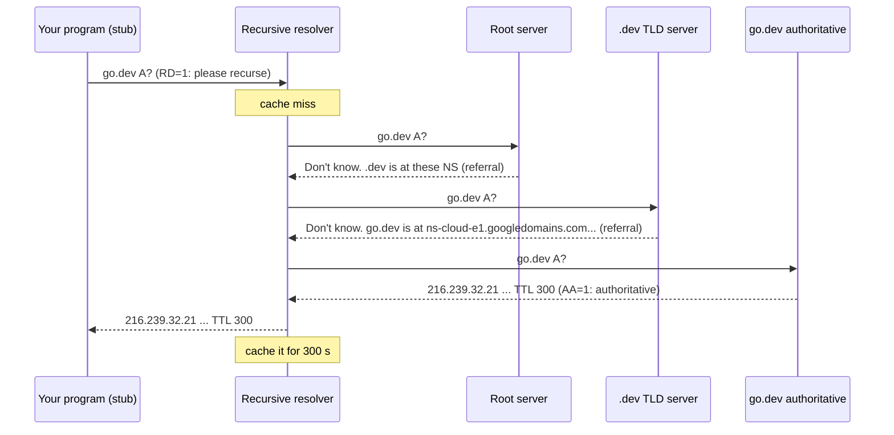

# DNS

## Why care?

Four tickets that are all DNS, though none of them says so:

- "We moved the database to a new IP an hour ago. Half the pods still connect to the old one."
- "Every outgoing HTTP call from the cluster is 5 ms slower than from a laptop. The DNS server's graphs show eight times more queries than we expected."
- "`lookup orders-db: i/o timeout`, but only under load, and only from one node."
- "The Go binary works on Ubuntu, but in the Alpine image it can't resolve the internal names."

DNS turns a name into an address. It looks like one function call: `net.LookupHost("go.dev")`. Under that call are config files, a search list, a cache with a timer on every entry, and up to four servers you never see. This page opens each of them. (We captured raw packets on the [layers and packets](layers-and-packets.md) page. Here we build DNS packets by hand.)

## The idea: asking for directions

You are in a strange city and want the "Go Developers' Café".

- You ask the **hotel receptionist**. You don't want to search yourself; you want an answer. That is your **stub resolver**: the small piece of code in your program (Go's `net` package, or glibc).
- The receptionist doesn't know either, but is good at finding out. That is the **recursive resolver**: your company's DNS server, `8.8.8.8`, or the cluster's CoreDNS. It does the legwork and **remembers** the answer for a while.
- The receptionist calls the **city hall**. City hall doesn't know cafés, but knows who keeps the list for each district: "for `.dev`, call this office". That is a **root server**.
- The `.dev` office doesn't know the café either, but knows who registered it: "`go.dev` is managed by these people". That is a **TLD server** (top-level domain).
- Those people know: "the café is at 216.239.32.21". That is the **authoritative server**. Its answer is the truth, and it comes with a "best before" time: the **TTL**.

The receptionist writes the answer on a note and keeps it until the time runs out. The next guest gets the note at once. That note is the whole reason a DNS change "takes time to propagate": nothing propagates. Old notes expire.

## Under the hood: the resolution chain



- The stub sets the **RD** bit ("recursion desired"). The recursive resolver does the walk.
- Root and TLD servers answer with **referrals**: no answer, just "ask them" (NS records), usually with their addresses as "glue".
- Only the last server sets **AA** ("authoritative answer").
- The resolver caches **every step**. It asks a root server for `.dev` only once every two days (the `.dev` NS records have a long TTL), so a warm resolver usually goes straight to the authoritative server, or answers from its cache in under a millisecond.

`dig +trace go.dev` shows this walk, with the referral from each level.

<!-- TODO(real-output): `dig +trace go.dev` from a network without DNS interception (dig is not installed here, and this machine's DNS traffic is intercepted, see below). -->

### Who answers your packets? (A WSL surprise)

You can walk the chain yourself by sending a query with RD=0 straight to a root server, `a.root-servers.net` (198.41.0.4). A root server only knows the TLDs, so it should answer with a referral to the `.dev` servers. Here is what came back on this machine, using the `ask` tool we build in the next section:

```console
$ ./ask -server 198.41.0.4:53 -norec go.dev A
;; 198.41.0.4:53 id=28970 rcode=Success aa=true rd=false ra=true tc=false time=3ms
;; ANSWER
go.dev.                      42 A     216.239.36.21
go.dev.                      42 A     216.239.38.21
go.dev.                      42 A     216.239.34.21
go.dev.                      42 A     216.239.32.21
$ ./ask -server 192.0.2.1:53 go.dev A
;; 192.0.2.1:53 id=57262 rcode=Success aa=true rd=true ra=true tc=false time=5ms
;; ANSWER
go.dev.                       3 A     216.239.36.21
go.dev.                       3 A     216.239.38.21
go.dev.                       3 A     216.239.34.21
go.dev.                       3 A     216.239.32.21
```

That is impossible for a real root server. It claims to be authoritative for `go.dev`, it offers recursion, and it answered in 3 ms from across the internet. The second query goes to `192.0.2.1`, an address reserved for documentation that no real host uses. It answered too. The TTLs give it away: 42, then 3, counting down in **one** cache.

Something between this program and the internet answers **every** packet to port 53 itself. Here it is WSL 2 in `networkingMode=mirrored`, whose DNS tunneling hands all DNS traffic to Windows (even TCP port 53 gets the same treatment). Hotel Wi-Fi, corporate networks and some home routers do the same. Remember this when a DNS test "proves" something: first check **who** really answered.

## Under the hood: a DNS message, byte by byte

DNS is a binary protocol, and simple enough to write by hand. A message is a 12-byte header, then four sections: **question**, **answer**, **authority** and **additional**. The `golang.org/x/net/dns/dnsmessage` package packs and parses them; the Go standard library uses a copy of it internally.

This is `ask`, a tiny `dig`:

```go
// Command ask is a tiny dig: it builds one DNS query by hand, sends it
// over UDP, and prints the answer.
//
//	ask [-server 10.255.255.254:53] [-norec] [-tcp] [-x] name [type]
package main

import (
	"encoding/binary"
	"encoding/hex"
	"flag"
	"fmt"
	"io"
	"math/rand/v2"
	"net"
	"os"
	"strings"
	"time"

	"golang.org/x/net/dns/dnsmessage"
)

var types = map[string]dnsmessage.Type{
	"A": dnsmessage.TypeA, "AAAA": dnsmessage.TypeAAAA, "CNAME": dnsmessage.TypeCNAME,
	"MX": dnsmessage.TypeMX, "TXT": dnsmessage.TypeTXT, "SRV": dnsmessage.TypeSRV,
	"NS": dnsmessage.TypeNS, "SOA": dnsmessage.TypeSOA,
}

func main() {
	server := flag.String("server", "10.255.255.254:53", "DNS server (host:port)")
	norec := flag.Bool("norec", false, "clear the RD bit: ask the server only what it knows itself")
	dump := flag.Bool("x", false, "print the raw bytes")
	tcp := flag.Bool("tcp", false, "use TCP (2-byte length prefix) instead of UDP")
	flag.Parse()
	name, qtype := flag.Arg(0), "A"
	if flag.NArg() > 1 {
		qtype = strings.ToUpper(flag.Arg(1))
	}

	// 1. Build the query: a 12-byte header and one question.
	q := dnsmessage.Message{
		Header: dnsmessage.Header{ID: uint16(rand.N(1 << 16)), RecursionDesired: !*norec},
		Questions: []dnsmessage.Question{{
			Name:  dnsmessage.MustNewName(strings.TrimSuffix(name, ".") + "."),
			Type:  types[qtype],
			Class: dnsmessage.ClassINET,
		}},
	}
	query, err := q.Pack()
	check(err)
	if *dump {
		fmt.Printf("query (%d bytes):\n%s", len(query), hex.Dump(query))
	}

	// 2. Send it. UDP: one datagram out, one back.
	// TCP: the same message with a 2-byte length in front.
	network := "udp"
	if *tcp {
		network = "tcp"
		query = append(binary.BigEndian.AppendUint16(nil, uint16(len(query))), query...)
	}
	conn, err := net.Dial(network, *server)
	check(err)
	defer conn.Close()
	conn.SetDeadline(time.Now().Add(3 * time.Second))
	start := time.Now()
	_, err = conn.Write(query)
	check(err)
	buf := make([]byte, 65535)
	var n int
	if *tcp {
		_, err = io.ReadFull(conn, buf[:2])
		check(err)
		n = int(binary.BigEndian.Uint16(buf))
		_, err = io.ReadFull(conn, buf[:n])
	} else {
		n, err = conn.Read(buf)
	}
	check(err)
	rtt := time.Since(start)
	if *dump {
		fmt.Printf("response (%d bytes):\n%s", n, hex.Dump(buf[:n]))
	}

	// 3. Parse it.
	var m dnsmessage.Message
	check(m.Unpack(buf[:n]))
	if m.ID != q.ID {
		check(fmt.Errorf("response ID %d does not match query ID %d", m.ID, q.ID))
	}
	fmt.Printf(";; %s id=%d rcode=%s aa=%t rd=%t ra=%t tc=%t time=%v\n",
		*server, m.ID, strings.TrimPrefix(m.RCode.String(), "RCode"), m.Authoritative, m.RecursionDesired, m.RecursionAvailable, m.Truncated, rtt.Round(time.Millisecond))
	section := func(title string, rrs []dnsmessage.Resource) {
		if len(rrs) == 0 {
			return
		}
		fmt.Println(";;", title)
		for _, rr := range rrs {
			fmt.Printf("%-24s %6d %-5s %s\n", rr.Header.Name, rr.Header.TTL,
				strings.TrimPrefix(rr.Header.Type.String(), "Type"), body(rr.Body))
		}
	}
	section("ANSWER", m.Answers)
	section("AUTHORITY", m.Authorities)
	section("ADDITIONAL", m.Additionals)
}

func body(b dnsmessage.ResourceBody) string {
	switch r := b.(type) {
	case *dnsmessage.AResource:
		return net.IP(r.A[:]).String()
	case *dnsmessage.AAAAResource:
		return net.IP(r.AAAA[:]).String()
	case *dnsmessage.CNAMEResource:
		return r.CNAME.String()
	case *dnsmessage.NSResource:
		return r.NS.String()
	case *dnsmessage.MXResource:
		return fmt.Sprintf("%d %s", r.Pref, r.MX)
	case *dnsmessage.TXTResource:
		return fmt.Sprintf("%q", r.TXT)
	case *dnsmessage.SRVResource:
		return fmt.Sprintf("%d %d %d %s", r.Priority, r.Weight, r.Port, r.Target)
	case *dnsmessage.SOAResource:
		return fmt.Sprintf("%s %s %d %d %d %d %d", r.NS, r.MBox, r.Serial, r.Refresh, r.Retry, r.Expire, r.MinTTL)
	case *dnsmessage.OPTResource:
		return "OPT"
	}
	return fmt.Sprintf("%v", b)
}

func check(err error) {
	if err != nil {
		fmt.Fprintln(os.Stderr, "ask:", err)
		os.Exit(1)
	}
}
```

Ask the real resolver from `/etc/resolv.conf`, and dump the bytes:

```console
$ go build -o ask . && ./ask -x go.dev
query (24 bytes):
00000000  74 6d 01 00 00 01 00 00  00 00 00 00 02 67 6f 03  |tm...........go.|
00000010  64 65 76 00 00 01 00 01                           |dev.....|
response (112 bytes):
00000000  74 6d 85 80 00 01 00 04  00 00 00 00 02 67 6f 03  |tm...........go.|
00000010  64 65 76 00 00 01 00 01  02 67 6f 03 64 65 76 00  |dev......go.dev.|
00000020  00 01 00 01 00 00 00 08  00 04 d8 ef 26 15 02 67  |............&..g|
00000030  6f 03 64 65 76 00 00 01  00 01 00 00 00 08 00 04  |o.dev...........|
00000040  d8 ef 22 15 02 67 6f 03  64 65 76 00 00 01 00 01  |.."..go.dev.....|
00000050  00 00 00 08 00 04 d8 ef  20 15 02 67 6f 03 64 65  |........ ..go.de|
00000060  76 00 00 01 00 01 00 00  00 08 00 04 d8 ef 24 15  |v.............$.|
;; 10.255.255.254:53 id=29805 rcode=Success aa=true rd=true ra=true tc=false time=3ms
;; ANSWER
go.dev.                       8 A     216.239.38.21
go.dev.                       8 A     216.239.34.21
go.dev.                       8 A     216.239.32.21
go.dev.                       8 A     216.239.36.21
```

The whole question is 24 bytes. Read it field by field:

| Bytes                           | Field       | Value                                                         |
| ------------------------------- | ----------- | ------------------------------------------------------------- |
| `74 6d`                         | ID          | 0x746d = 29805. A random number; the reply must carry it back |
| `01 00`                         | Flags       | Only RD (recursion desired) is set                            |
| `00 01` `00 00` `00 00` `00 00` | Counts      | 1 question, 0 answers, 0 authority, 0 additional              |
| `02 67 6f 03 64 65 76 00`       | Name        | Labels with a length in front: 2 `go`, 3 `dev`, 0 = the root  |
| `00 01` `00 01`                 | Type, class | A (1), IN (internet, 1)                                       |

In the response, the flags are `85 80`, in bits `1000 0101 1000 0000`: QR=1 (a response), AA=1, RD=1 (copied), RA=1 (recursion available), RCODE=0 (no error). Then four answers, each 16 bytes: the name again, type A, class IN, then the **TTL** `00 00 00 08` (8 seconds left), a length `00 04`, and four address bytes: `d8 ef 26 15` is 216.239.38.21.

Two details:

- **The ID is the only thing that ties a reply to a question.** UDP has no connection. An attacker who can guess the ID and the source port can inject a fake answer (the 2008 "Kaminsky attack"). That's why both must be random: Go picks a random ID, and the kernel a random source port.
- **Most servers compress names.** Instead of repeating `02 67 6f 03 64 65 76 00` in every answer, they write `c0 0c`: "the name at offset 12". The Windows proxy here doesn't bother. `dnsmessage` reads both.

!!! note "Why the 'aa=true'?"

    A recursive resolver should not set AA. This one (WSL's proxy, see above) sets it on answers
    from its own cache: a fresh lookup came back with `aa=false` in 14 ms, the same lookup a moment
    later with `aa=true` in 3 ms. Don't trust the flags of a middlebox.

## Record types

A name can hold many records of different types. These are the ones you meet in backend work, all queried for real with `ask`:

```console
$ ./ask go.dev AAAA
;; 10.255.255.254:53 id=58596 rcode=Success aa=true rd=true ra=true tc=false time=3ms
;; ANSWER
go.dev.                      72 AAAA  2001:4860:4802:32::15
go.dev.                      72 AAAA  2001:4860:4802:36::15
go.dev.                      72 AAAA  2001:4860:4802:34::15
go.dev.                      72 AAAA  2001:4860:4802:38::15
$ ./ask www.github.com
;; 10.255.255.254:53 id=8149 rcode=Success aa=false rd=true ra=true tc=false time=15ms
;; ANSWER
www.github.com.              34 CNAME github.com.
github.com.                  34 A     140.82.121.4
$ ./ask www.microsoft.com
;; 10.255.255.254:53 id=63292 rcode=Success aa=false rd=true ra=true tc=false time=16ms
;; ANSWER
www.microsoft.com.            8 CNAME www.microsoft.com-c-3.edgekey.net.
www.microsoft.com-c-3.edgekey.net.      8 CNAME e13678.dscb.akamaiedge.net.
e13678.dscb.akamaiedge.net.      8 A     184.30.158.70
$ ./ask go.dev MX
;; 10.255.255.254:53 id=25573 rcode=Success aa=false rd=true ra=true tc=false time=30ms
;; ANSWER
go.dev.                     300 MX    10 alt4.aspmx.l.google.com.
go.dev.                     300 MX    1 aspmx.l.google.com.
go.dev.                     300 MX    10 alt3.aspmx.l.google.com.
go.dev.                     300 MX    5 alt1.aspmx.l.google.com.
go.dev.                     300 MX    5 alt2.aspmx.l.google.com.
$ ./ask example.com TXT
;; 10.255.255.254:53 id=17491 rcode=Success aa=false rd=true ra=true tc=false time=15ms
;; ANSWER
example.com.                 17 TXT   ["v=spf1 -all"]
example.com.                 17 TXT   ["_k2n1y4vw3qtb4skdx9e7dxt97qrmmq9"]
$ ./ask _imaps._tcp.gmail.com SRV
;; 10.255.255.254:53 id=29198 rcode=Success aa=false rd=true ra=true tc=false time=20ms
;; ANSWER
_imaps._tcp.gmail.com.     3600 SRV   5 0 993 imap.gmail.com.
$ ./ask go.dev NS
;; 10.255.255.254:53 id=63573 rcode=Success aa=true rd=true ra=true tc=false time=3ms
;; ANSWER
go.dev.                    3471 NS    ns-cloud-e3.googledomains.com.
go.dev.                    3471 NS    ns-cloud-e4.googledomains.com.
go.dev.                    3471 NS    ns-cloud-e1.googledomains.com.
go.dev.                    3471 NS    ns-cloud-e2.googledomains.com.
$ ./ask go.dev SOA
;; 10.255.255.254:53 id=21856 rcode=Success aa=false rd=true ra=true tc=false time=27ms
;; ANSWER
go.dev.                    3600 SOA   ns-cloud-e1.googledomains.com. cloud-dns-hostmaster.google.com. 1 21600 3600 259200 300
```

| Type      | Holds                                                          | What to know                                                                                                                                                                                         |
| --------- | -------------------------------------------------------------- | ---------------------------------------------------------------------------------------------------------------------------------------------------------------------------------------------------- |
| **A**     | An IPv4 address                                                | Several A records = the client picks one. A poor man's load balancing, with no health checks.                                                                                                        |
| **AAAA**  | An IPv6 address                                                | Asked for **in parallel** with A by Go and glibc. A slow or broken AAAA answer slows every lookup.                                                                                                   |
| **CNAME** | "This name is an alias for that name"                          | The resolver follows the chain and returns all of it. `www.microsoft.com` takes two hops to a CDN. A CNAME can't sit next to other records, so the bare `example.com` (the "apex") can't be a CNAME. |
| **MX**    | Mail servers, with a preference (lower = first)                | `0 .` (as `example.com` has) is a "null MX": this domain takes no mail.                                                                                                                              |
| **TXT**   | Free text                                                      | SPF, DMARC, domain-ownership proofs (`google-site-verification=...`), ACME DNS challenges.                                                                                                           |
| **SRV**   | Priority, weight, **port**, target, for `_service._proto.name` | The only common record that carries a port. Used by Kubernetes headless services, Consul, XMPP, LDAP. Go: `net.LookupSRV`.                                                                           |
| **NS**    | The authoritative servers of a zone                            | What the TLD hands out as a referral.                                                                                                                                                                |
| **SOA**   | Zone facts: primary server, admin mailbox, serial, timers      | The last number (300 here) is the **negative-caching TTL**, see below.                                                                                                                               |

### Too big for UDP: truncation and TCP

```console
$ ./ask go.dev TXT
;; 10.255.255.254:53 id=64122 rcode=Success aa=false rd=true ra=true tc=true time=28ms
$ ./ask -tcp go.dev TXT
;; 10.255.255.254:53 id=30005 rcode=Success aa=false rd=true ra=true tc=false time=18ms
;; ANSWER
go.dev.                     293 TXT   ["google-site-verification=eqtrduRyMRS8TuoUEuYMF-u9_IDRMd1In6T6E1gTchU"]
go.dev.                     293 TXT   ["google-site-verification=qvibgBDBD_1VeFXvgduqw1cmDeMpAS_qBCZCFauYduk"]
go.dev.                     293 TXT   ["google-site-verification=eYE-BIP9BY8VZCUI_r8sJi7qjRVtxyRQSlbZmeVVlzE"]
go.dev.                     293 TXT   ["google-site-verification=3oHHTSOKrjE9J8SIvyj3gUxEtDjmr5oNZ-DbB271vpM"]
go.dev.                     293 TXT   ["google-site-verification=mJdpiJi2GyNG9nz7sctCXgJnzDHzdFzfhOqTTDuMR0s"]
go.dev.                     293 TXT   ["v=DMARC1; p=none; rua=mailto:golang-dmarc-reports@google.com;"]
```

Plain DNS over UDP allows **512 bytes**. Six long TXT records don't fit, so the server sent an empty answer with **TC=1** ("truncated, ask again over TCP"). Over TCP, the same message gets a 2-byte length in front, and size is no problem.

Real resolvers avoid most retries with **EDNS(0)**: an extra "OPT" record in the additional section that says "I can take bigger UDP answers". Go's resolver offers 1232 bytes (`maxDNSPacketSize` in `net/dnsclient_unix.go`), a size chosen to stay below the common internet MTU, and falls back to TCP on TC=1 by itself. Our `ask` sends no OPT record, so it gets the classic 512.

**Firewall rule**: DNS needs **TCP port 53 too**, not only UDP. A firewall that blocks TCP 53 breaks exactly the large answers: DNSSEC, many TXT records, big SRV sets.

## TTLs and caching

Every record carries a TTL in seconds. A cache may keep the record that long, counting down. Watch it run out, ten seconds apart:

```console
$ ./ask pkg.go.dev A
;; 10.255.255.254:53 id=14794 rcode=Success aa=true rd=true ra=true tc=false time=3ms
;; ANSWER
pkg.go.dev.                   4 A     34.149.140.181
$ ./ask pkg.go.dev A
;; 10.255.255.254:53 id=28505 rcode=Success aa=false rd=true ra=true tc=false time=15ms
;; ANSWER
pkg.go.dev.                 161 A     34.149.140.181
```

1. First answer: from the local cache, 3 ms, **4 seconds** left.
2. Ten seconds later the entry has expired. The local cache asks upstream (15 ms) and gets the record with **161** seconds left: the **upstream** cache had it too, already counting down from its own copy. Caches stack, and each layer can add up to one TTL of delay.

That is the first ticket: after a change, an old answer can live for **TTL × the number of cache layers**, plus whatever your program keeps. Plan a migration like this: lower the TTL to 30-60 s a day (one old TTL) **before** the change, make the change, raise it again after.

### Negative caching: "no such name" is cached too

```console
$ ./ask no-such-host.go.dev A
;; 10.255.255.254:53 id=13305 rcode=NameError aa=false rd=true ra=true tc=false time=28ms
;; AUTHORITY
go.dev.                     300 SOA   ns-cloud-e1.googledomains.com. cloud-dns-hostmaster.google.com. 1 21600 3600 259200 300
$ ./ask no-such-host.go.dev A
;; 10.255.255.254:53 id=26385 rcode=NameError aa=true rd=true ra=true tc=false time=3ms
;; AUTHORITY
go.dev.                     300 SOA   ns-cloud-e1.googledomains.com. cloud-dns-hostmaster.google.com. 1 21600 3600 259200 300
```

**NXDOMAIN** (`NameError`, RCODE 3) means "this name does not exist". It comes with the zone's SOA record in the authority section, and caches may keep the "no" for the smaller of the SOA's TTL and its last field (here both 300 s, RFC 2308). The second query came from the cache in 3 ms.

So: if a service looks up `orders-db.internal` **before** someone creates the record, every cache in the path remembers "doesn't exist" for up to the negative TTL. Creating the record does not help until the "no" expires.

There is a second kind of "no": **NODATA**. The name exists, but has no record of the asked type. RCODE is 0 (success) with an empty answer. Typical: an IPv4-only name asked for AAAA.

### Who caches what?

| Layer                                         | Caches?                                                                                          |
| --------------------------------------------- | ------------------------------------------------------------------------------------------------ |
| Go's `net` package (pure Go resolver)         | **No.** Every `LookupHost` and every new connection asks again.                                  |
| glibc `getaddrinfo` (the cgo resolver)        | **No.** Unless `nscd` runs.                                                                      |
| `systemd-resolved`, the WSL/Windows proxy     | Yes, per machine.                                                                                |
| CoreDNS in Kubernetes                         | Yes (the `cache` plugin, 30 s by default in the standard config).                                |
| Your company's resolver, `8.8.8.8`, `1.1.1.1` | Yes, shared by everyone behind it.                                                               |
| `http.Transport`                              | It caches **connections**, not names. A pooled connection stays on the old IP until it's closed. |

The last row is the one people forget. Even with TTL 0, a keep-alive connection pool (see [HTTP](http.md)) talks to the IP it dialled until the connection closes. Set `IdleConnTimeout`, and expect long-lived HTTP/2 or gRPC connections to stay put until something closes them.

## On your machine: three files decide

When Go or glibc resolves a name, three files are read:

```console
$ grep hosts: /etc/nsswitch.conf
hosts:          files dns
$ grep -v '^#' /etc/hosts
127.0.0.1	localhost

::1     ip6-localhost ip6-loopback
fe00::0 ip6-localnet
ff00::0 ip6-mcastprefix
ff02::1 ip6-allnodes
ff02::2 ip6-allrouters
$ cat /etc/resolv.conf
# This file was automatically generated by WSL. To stop automatic generation of this file, add the following entry to /etc/wsl.conf:
# [network]
# generateResolvConf = false
nameserver 10.255.255.254
search localdomain
$ ip -br addr show lo
lo               UNKNOWN        127.0.0.1/8 10.255.255.254/32 ::1/128
```

- **`/etc/nsswitch.conf`**, the `hosts:` line: the order of sources. `files dns` means "`/etc/hosts` first, then DNS". Other sources you'll see: `mdns4_minimal` (Avahi, for `.local` names), `resolve` (systemd-resolved over D-Bus), `myhostname`.
- **`/etc/hosts`**: fixed name-to-address pairs. Wins over DNS with `files dns`. (WSL generates this one too; the line with the machine's own name is left out here.)
- **`/etc/resolv.conf`**: which servers to ask (`nameserver`, at most 3 are used), the **search list** and options. Here WSL writes it. The `nameserver` is `10.255.255.254`, an address WSL adds to the loopback interface; Windows answers on it. On Ubuntu with systemd-resolved, it's `127.0.0.53` instead, and `resolvectl` shows what is behind it:

```console
$ resolvectl query go.dev
go.dev: 216.239.32.21
        216.239.36.21
        216.239.38.21
        216.239.34.21
        2001:4860:4802:34::15
        2001:4860:4802:38::15
        2001:4860:4802:36::15
        2001:4860:4802:32::15

-- Information acquired via protocol DNS in 4.2ms.
-- Data is authenticated: no; Data was acquired via local or encrypted transport: no
-- Data from: network
```

`getent hosts <name>` (or `getent ahosts`) asks through **nsswitch**, exactly like a C program would. `dig` and our `ask` go straight to a DNS server and skip `/etc/hosts` and the search list. When `dig` works and your program doesn't, this difference is often why.

## Search domains and `ndots`: one lookup, eight queries

`resolv.conf` can list **search domains**. A short name like `orders` is tried with each one appended: `orders.shop.svc.cluster.local`, then `orders.svc.cluster.local`, and so on. That's how `http://orders/` works inside Kubernetes.

The question is **when** to use the list. The `ndots` option decides: if the name has **fewer than `ndots` dots**, try the search list **first**, and the name as-is last. Otherwise try the name as-is first. A name with a trailing dot (`go.dev.`) is "fully qualified": no search list at all.

Kubernetes writes this `resolv.conf` into every pod (with the pod's namespace first; `shop` here):

```text
nameserver 10.96.0.10
search shop.svc.cluster.local svc.cluster.local cluster.local
options ndots:5
```

`ndots:5` means that `go.dev` (1 dot), `api.github.com` (2 dots) and even `orders-db.prod.eu-west-1.rds.amazonaws.com` (4 dots) all go through the search list **first**. Let's count what that costs, for real.

### A lab: a fake DNS server in a namespace

We want to see every query the resolver sends. `fakedns` is a DNS server that knows three names, says NXDOMAIN to everything else, and logs each question:

```go
// Command fakedns is a DNS server for experiments. It knows a few names,
// says NXDOMAIN to everything else, and logs every question it gets.
package main

import (
	"fmt"
	"net"
	"net/netip"
	"os"

	"golang.org/x/net/dns/dnsmessage"
)

var zone = map[string][]netip.Addr{
	"orders.shop.svc.cluster.local.": {netip.MustParseAddr("10.96.12.34")},
	"go.dev.":                        {netip.MustParseAddr("216.239.32.21")},
	"dual.test.":                     {netip.MustParseAddr("127.0.0.1"), netip.MustParseAddr("2001:db8::99")},
}

func main() {
	conn, err := net.ListenPacket("udp", "127.0.0.1:53")
	if err != nil {
		fmt.Fprintln(os.Stderr, err)
		os.Exit(1)
	}
	buf := make([]byte, 1232)
	for n := 1; ; n++ {
		size, from, err := conn.ReadFrom(buf)
		if err != nil {
			continue
		}
		var q dnsmessage.Message
		if q.Unpack(buf[:size]) != nil || len(q.Questions) != 1 {
			continue
		}
		question := q.Questions[0]
		resp := dnsmessage.Message{
			Header:    dnsmessage.Header{ID: q.ID, Response: true, Authoritative: true, RecursionDesired: q.RecursionDesired},
			Questions: q.Questions,
		}
		addrs, known := zone[question.Name.String()]
		result := "NXDOMAIN"
		if !known {
			resp.RCode = dnsmessage.RCodeNameError
		} else {
			result = "no records" // the name exists, but has no records of this type
			for _, a := range addrs {
				h := dnsmessage.ResourceHeader{Name: question.Name, Type: question.Type, Class: dnsmessage.ClassINET, TTL: 30}
				switch {
				case a.Is4() && question.Type == dnsmessage.TypeA:
					resp.Answers = append(resp.Answers, dnsmessage.Resource{Header: h, Body: &dnsmessage.AResource{A: a.As4()}})
				case a.Is6() && question.Type == dnsmessage.TypeAAAA:
					resp.Answers = append(resp.Answers, dnsmessage.Resource{Header: h, Body: &dnsmessage.AAAAResource{AAAA: a.As16()}})
				default:
					continue
				}
				result = a.String()
			}
		}
		fmt.Printf("%2d %-4s %-40s -> %s\n", n, question.Type.String()[4:], question.Name, result)
		out, _ := resp.Pack()
		conn.WriteTo(out, from)
	}
}
```

And `lookup` resolves names exactly the way `net/http` does, through `net.DefaultResolver`:

```go
// Command lookup resolves names the way net/http does.
package main

import (
	"context"
	"fmt"
	"net"
	"os"
	"time"
)

func main() {
	for _, name := range os.Args[1:] {
		start := time.Now()
		addrs, err := net.DefaultResolver.LookupHost(context.Background(), name)
		fmt.Printf("%s: %v %v (%v)\n", name, addrs, err, time.Since(start).Round(time.Millisecond))
	}
}
```

To run a DNS server on port 53 without root, and to give the resolver our own `/etc/resolv.conf` without touching the real one, we use the namespaces from [Namespaces and cgroups](../linux/namespaces-and-cgroups.md): `unshare -Urnm` gives a new user namespace (we are "root" inside), a new network namespace (only a loopback interface, ours) and a new mount namespace (a bind mount over `/etc/resolv.conf` is visible only inside).

```console
$ cat resolv.conf
nameserver 127.0.0.1
search shop.svc.cluster.local svc.cluster.local cluster.local
options ndots:5
$ unshare -Urnm bash
# ip link set lo up
# mount --bind resolv.conf /etc/resolv.conf
# ./fakedns &
# ./lookup go.dev
 1 AAAA go.dev.shop.svc.cluster.local.           -> NXDOMAIN
 2 A    go.dev.shop.svc.cluster.local.           -> NXDOMAIN
 3 AAAA go.dev.svc.cluster.local.                -> NXDOMAIN
 4 A    go.dev.svc.cluster.local.                -> NXDOMAIN
 5 AAAA go.dev.cluster.local.                    -> NXDOMAIN
 6 A    go.dev.cluster.local.                    -> NXDOMAIN
 7 AAAA go.dev.                                  -> no records
 8 A    go.dev.                                  -> 216.239.32.21
go.dev: [216.239.32.21] <nil> (2ms)
# ./lookup orders
 9 AAAA orders.shop.svc.cluster.local.           -> no records
10 A    orders.shop.svc.cluster.local.           -> 10.96.12.34
orders: [10.96.12.34] <nil> (1ms)
# ./lookup orders.shop
11 AAAA orders.shop.shop.svc.cluster.local.      -> NXDOMAIN
12 A    orders.shop.shop.svc.cluster.local.      -> NXDOMAIN
13 AAAA orders.shop.svc.cluster.local.           -> no records
14 A    orders.shop.svc.cluster.local.           -> 10.96.12.34
orders.shop: [10.96.12.34] <nil> (1ms)
# ./lookup go.dev.
15 AAAA go.dev.                                  -> no records
16 A    go.dev.                                  -> 216.239.32.21
go.dev.: [216.239.32.21] <nil> (1ms)
# ./lookup go.dev. go.dev.
17 AAAA go.dev.                                  -> no records
18 A    go.dev.                                  -> 216.239.32.21
go.dev.: [216.239.32.21] <nil> (1ms)
19 AAAA go.dev.                                  -> no records
20 A    go.dev.                                  -> 216.239.32.21
go.dev.: [216.239.32.21] <nil> (0s)
# getent ahosts go.dev
21 A    go.dev.shop.svc.cluster.local.           -> NXDOMAIN
22 AAAA go.dev.shop.svc.cluster.local.           -> NXDOMAIN
23 A    go.dev.svc.cluster.local.                -> NXDOMAIN
24 AAAA go.dev.svc.cluster.local.                -> NXDOMAIN
25 A    go.dev.cluster.local.                    -> NXDOMAIN
26 AAAA go.dev.cluster.local.                    -> NXDOMAIN
27 A    go.dev.                                  -> 216.239.32.21
28 AAAA go.dev.                                  -> no records
216.239.32.21   STREAM go.dev
216.239.32.21   DGRAM
216.239.32.21   RAW
```

Count them:

- **`go.dev`: 8 queries** for one lookup. Six of them are guaranteed to fail. Each pair (A and AAAA, sent in parallel) is one round trip to the DNS server, so that's **four round trips** before the first useful answer. In a real cluster, CoreDNS answers the junk from its cache, but it still has to receive, process and answer every one. That is the second ticket: "eight times more queries".
- **`orders`: 2 queries.** The short in-namespace name hits on the first search domain. This is the case `ndots:5` is designed for.
- **`orders.shop`** (service `orders` in namespace `shop`): 4 queries. It first tries `orders.shop.shop.svc...`.
- **`go.dev.`**, with a trailing dot: **2 queries**, the minimum. The trailing dot says "this name is complete".
- **Go doesn't cache.** Two lookups of the same name in one process: 4 queries.
- **glibc** (`getent`) does exactly the same walk, A first instead of AAAA first.

And a missing external name costs the most, because every attempt fails. Here with `ndots:1`, the normal default, for comparison:

```console
# grep ndots /etc/resolv.conf
options ndots:1
# ./lookup go.dev
 1 AAAA go.dev.                                  -> no records
 2 A    go.dev.                                  -> 216.239.32.21
go.dev: [216.239.32.21] <nil> (1ms)
# ./lookup orders
 3 AAAA orders.shop.svc.cluster.local.           -> no records
 4 A    orders.shop.svc.cluster.local.           -> 10.96.12.34
orders: [10.96.12.34] <nil> (1ms)
# ./lookup nope.example
 5 A    nope.example.                            -> NXDOMAIN
 6 AAAA nope.example.                            -> NXDOMAIN
 7 AAAA nope.example.shop.svc.cluster.local.     -> NXDOMAIN
 8 A    nope.example.shop.svc.cluster.local.     -> NXDOMAIN
 9 A    nope.example.svc.cluster.local.          -> NXDOMAIN
10 AAAA nope.example.svc.cluster.local.          -> NXDOMAIN
11 AAAA nope.example.cluster.local.              -> NXDOMAIN
12 A    nope.example.cluster.local.              -> NXDOMAIN
nope.example: [] lookup nope.example on 127.0.0.1:53: no such host (3ms)
```

With `ndots:1`, `go.dev` costs 2 queries, and short names still work. But a name that doesn't exist **anywhere** still walks the whole list: 8 queries for one "no such host".

Fixes, from cheapest:

1. **Use fully qualified names with a trailing dot** in config for external services: `https://api.github.com./`. Works everywhere. (Some servers and TLS libraries dislike the dot in the `Host` header or SNI; test it with yours.)
2. **Lower `ndots` per pod**: `spec.dnsConfig.options: [{name: ndots, value: "2"}]`. Short in-cluster names still work.
3. **Reuse connections.** Every new connection is a new lookup in Go. A healthy `http.Transport` pool does few lookups at all.
4. **NodeLocal DNSCache** in the cluster, so the junk is answered on the node.

## Go's two resolvers

Go has **two** ways to resolve a name on Linux:

- **The pure-Go resolver**: reads `/etc/nsswitch.conf`, `/etc/hosts` and `/etc/resolv.conf` itself and sends the UDP packets itself, through the netpoller (see [System calls up close](../linux/system-calls.md)). A blocked lookup costs a goroutine, not a thread.
- **The cgo resolver**: calls glibc's `getaddrinfo`. Supports everything glibc supports (LDAP, `resolve`, mDNS, custom NSS modules), but each lookup blocks **one OS thread** for its whole duration. Go limits concurrent cgo lookups (to 500, or fewer with a low fd limit; `net/rlimit_unix.go`) and queues the rest.

`GODEBUG=netdns=go+2` (or `cgo+2`, or just `2`) prints which one is used, and why:

```console
$ GODEBUG=netdns=go+2 ./lookup go.dev
go package net: confVal.netCgo = false  netGo = true
go package net: GODEBUG setting forcing use of the Go resolver
go package net: hostLookupOrder(go.dev) = files,dns
go.dev: [216.239.32.21 216.239.36.21 216.239.38.21 216.239.34.21 2001:4860:4802:32::15 2001:4860:4802:36::15 2001:4860:4802:34::15 2001:4860:4802:38::15] <nil> (3ms)
$ GODEBUG=netdns=cgo+2 ./lookup go.dev
go package net: confVal.netCgo = true  netGo = false
go package net: GODEBUG setting forcing use of the cgo resolver
go package net: hostLookupOrder(go.dev) = cgo
go.dev: [216.239.32.21 216.239.36.21 216.239.38.21 216.239.34.21 2001:4860:4802:32::15 2001:4860:4802:36::15 2001:4860:4802:34::15 2001:4860:4802:38::15] <nil> (4ms)
$ GODEBUG=netdns=2 ./lookup go.dev localhost
go package net: confVal.netCgo = false  netGo = false
go package net: dynamic selection of DNS resolver
go package net: hostLookupOrder(go.dev) = files,dns
go.dev: [216.239.32.21 216.239.36.21 216.239.38.21 216.239.34.21 2001:4860:4802:32::15 2001:4860:4802:36::15 2001:4860:4802:34::15 2001:4860:4802:38::15] <nil> (3ms)
go package net: hostLookupOrder(localhost) = files,dns
localhost: [127.0.0.1] <nil> (0s)
```

`hostLookupOrder` is the decision: `files,dns` means the pure-Go resolver, `/etc/hosts` first; `cgo` means glibc. By default ("dynamic selection") Go uses its own resolver **unless** it sees something it can't do itself. `net/conf.go` has the rules. A few you can try in the namespace lab, by bind-mounting a different `nsswitch.conf`:

```console
# cat nss-mdns.conf
hosts: files mdns4_minimal [NOTFOUND=return] dns
# mount --bind nss-mdns.conf /etc/nsswitch.conf
# GODEBUG=netdns=2 ./lookup go.dev. printer.local
go package net: dynamic selection of DNS resolver
go package net: hostLookupOrder(go.dev.) = files,dns
go.dev.: [216.239.32.21] <nil> (1ms)
go package net: hostLookupOrder(printer.local) = cgo
printer.local: [] lookup printer.local: no such host (12ms)
# umount /etc/nsswitch.conf
# cat nss-resolve.conf
hosts: files resolve [!UNAVAIL=return] dns
# mount --bind nss-resolve.conf /etc/nsswitch.conf
# GODEBUG=netdns=2 ./lookup go.dev.
go package net: dynamic selection of DNS resolver
go package net: hostLookupOrder(go.dev.) = cgo
go.dev.: [216.239.32.21] <nil> (1ms)
```

(For these two runs, `fakedns` logged to `/dev/null`, and the first `netdns=2` line, `confVal...`, is left out.) And with a host entry, `/etc/hosts` wins without a single DNS query:

```console
# cat hosts.test
127.0.0.1 localhost
192.0.2.80 go.dev
# mount --bind hosts.test /etc/hosts
# GODEBUG=netdns=2 ./lookup go.dev
go package net: confVal.netCgo = false  netGo = false
go package net: dynamic selection of DNS resolver
go package net: hostLookupOrder(go.dev) = files,dns
go.dev: [192.0.2.80] <nil> (2ms)
```

| Go switches to cgo when...                                                         | Because                                |
| ---------------------------------------------------------------------------------- | -------------------------------------- |
| `nsswitch.conf` has a source it doesn't know (`resolve`, `ldap`, `sss`, `wins`...) | Only glibc can load NSS modules        |
| `mdns*` is in `nsswitch.conf` **and** the name ends in `.local`                    | Go doesn't speak multicast DNS         |
| `myhostname` is listed and you look up the machine's own name or `localhost`       | That module answers from local config  |
| `resolv.conf` has an option it doesn't understand, or can't be read                | Better ask the one who wrote the rules |
| `LOCALDOMAIN`, `RES_OPTIONS` or `HOSTALIASES` is set in the environment            | glibc reads them, Go doesn't           |

That switch only exists if the binary **has** cgo. A static binary (`CGO_ENABLED=0`, the norm for distroless and `scratch` images) has only the Go resolver, and says so:

```console
$ CGO_ENABLED=0 go build -o lookup-static . && ldd lookup-static
	not a dynamic executable
$ GODEBUG=netdns=cgo+2 ./lookup-static go.dev
go package net: confVal.netCgo = true  netGo = false
go package net: ignoring GODEBUG=netdns=cgo as the binary was compiled without support for the cgo resolver
go package net: hostLookupOrder(go.dev) = files,dns
go.dev: [216.239.32.21 216.239.36.21 216.239.38.21 216.239.34.21 2001:4860:4802:34::15 2001:4860:4802:38::15 2001:4860:4802:36::15 2001:4860:4802:32::15] <nil> (16ms)
```

That explains the fourth ticket. On the Ubuntu host, the company's internal names come from an NSS module (`sss`, say) through cgo. In the static binary in a container, only `resolv.conf` and `/etc/hosts` count. The fix is to make internal names resolvable **through DNS**, not to add cgo back into the image.

You can choose in code, too: `net.Resolver{PreferGo: true}` forces the Go resolver, and its `Dial` field lets you send the queries to a server of your choice (or count them, as we did with `fakedns`). The build tags `netgo` and `netcgo` set the default at compile time.

### When the resolver doesn't answer

Go reads `timeout` and `attempts` from `resolv.conf` (defaults: 5 s and 2, in `net/dnsconfig_unix.go`), and re-checks the file at most every 5 seconds, so a changed `resolv.conf` is picked up without a restart. A dead DNS server looks like this. In a fresh namespace with no `fakedns`, and a dummy interface (`10.99.0.1/24`) that silently drops everything sent to `10.99.0.10`:

```console
# cat /etc/resolv.conf
nameserver 127.0.0.1
# ./lookup go.dev
go.dev: [] lookup go.dev on 127.0.0.1:53: read udp 127.0.0.1:48981->127.0.0.1:53: read: connection refused (1ms)
# cat /etc/resolv.conf
nameserver 10.99.0.10
options timeout:1 attempts:2
# ./lookup go.dev
go.dev: [] lookup go.dev on 10.99.0.10:53: read udp 10.99.0.1:36980->10.99.0.10:53: i/o timeout (2.002s)
```

- **Nothing listening** on the port: the kernel answers with an ICMP "port unreachable", and Go fails in 1 ms with `connection refused`.
- **Packets dropped**: Go waits `timeout` × `attempts` per server = 2 s here. With the defaults it would be **10 s per server**, multiplied by the search list. That is the third ticket's `i/o timeout`: an overloaded DNS server that drops UDP under load (or a full conntrack table on the node, where UDP DNS is a classic victim).

Always give lookups a deadline through the `context`, as `net/http` does with the dial timeout.

## Happy Eyeballs: when a name has two families

`go.dev` has both A and AAAA records. Which address does `net.Dial` use? Go sorts the addresses by the rules of RFC 6724 (prefer the family you have a real source address for), then races them: it starts with the first family, and if that hasn't connected after **300 ms** (`Dialer.FallbackDelay`), it starts the other family in parallel. First to connect wins. This is "Happy Eyeballs" (RFC 6555), and it hides broken IPv6 from users.

This machine has no global IPv6 address, so Go puts IPv4 first for `go.dev` (as in the `netdns` output above). To see the race, the namespace lab gets an IPv6 network where every packet disappears: a `dummy` interface with `2001:db8::1/64`. `dual.test` in `fakedns` points to both `2001:db8::99` (on that black hole) and `127.0.0.1`, where a web server listens. `dial` prints every `connect(2)` it makes, via `Dialer.ControlContext` (`fakedns` is again logging to `/dev/null`):

```go
// Command dial shows Go's Happy Eyeballs: which addresses it tries, and when.
package main

import (
	"context"
	"fmt"
	"net"
	"os"
	"syscall"
	"time"
)

func main() {
	start := time.Now()
	since := func() time.Duration { return time.Since(start).Round(time.Millisecond) }
	d := net.Dialer{
		Timeout: 3 * time.Second,
		// ControlContext runs just before each connect(2).
		ControlContext: func(_ context.Context, network, address string, _ syscall.RawConn) error {
			fmt.Printf("%6v connect %s %s\n", since(), network, address)
			return nil
		},
	}
	if os.Getenv("NO_FALLBACK") != "" {
		d.FallbackDelay = -1 // turn Happy Eyeballs off
	}
	conn, err := d.Dial("tcp", os.Args[1])
	if err != nil {
		fmt.Printf("%6v error: %v\n", since(), err)
		return
	}
	fmt.Printf("%6v connected to %s\n", since(), conn.RemoteAddr())
	conn.Close()
}
```

```console
# ip link add d0 type dummy && ip link set d0 up && ip addr add 2001:db8::1/64 dev d0
# ./lookup dual.test.
dual.test.: [2001:db8::99 127.0.0.1] <nil> (1ms)
# python3 -m http.server -b 127.0.0.1 8080 &
# ./dial dual.test.:8080
   1ms connect tcp6 [2001:db8::99]:8080
 301ms connect tcp4 127.0.0.1:8080
 302ms connected to 127.0.0.1:8080
# NO_FALLBACK=1 ./dial dual.test.:8080
   1ms connect tcp6 [2001:db8::99]:8080
2.004s connect tcp4 127.0.0.1:8080
2.004s connected to 127.0.0.1:8080
```

- With Happy Eyeballs: IPv6 goes first (we now have an IPv6 source address), the SYN vanishes, and after exactly **300 ms** Go starts IPv4, which connects at once. Every new connection to a "dual-stack but IPv6 is broken" service pays 300 ms.
- Without it, Go tries the addresses one after another. Each gets a share of the remaining timeout, but at least **2 s** (`saneMinimum` in `net/dial.go`): 3 s split over 2 addresses would be 1.5 s, so it's 2 s.

If your p99 latency has a step of 300 ms "before the request is sent", look at IPv6.

## The orders service

`orderctl` takes a base URL like `http://ordersd.shop.svc.cluster.local:8080`. Every `CreateOrder` that opens a **new** connection resolves that name again ([`internal/client`](../go/services.md) uses one `http.Client`, so mostly it doesn't). The name in the config should be fully qualified **with** the trailing dot if it leaves the namespace, and `ordersd`'s pods should be reached through a Service name, not pod IPs, because pod IPs change and DNS TTLs lag.

## Traps

- **"DNS propagation."** Nothing propagates. Old answers expire, at each cache layer, and pooled connections never re-resolve. Lower the TTL a day before the change.
- **Looking up a name before it exists.** The NXDOMAIN is cached for the SOA's negative TTL.
- **External names under `ndots:5`.** Every lookup walks the search list first. Use FQDNs with a trailing dot or lower `ndots`.
- **Testing with `dig` and concluding "DNS works".** `dig` skips `/etc/hosts`, nsswitch and the search list. Use `getent ahosts` to see what your program sees, and check who actually answered (middleboxes intercept port 53).
- **Blocking TCP port 53.** Large answers (TC=1) then fail.
- **A static Go binary in a container that "can't resolve internal names".** It never used glibc's NSS modules. Make the names resolvable through DNS.
- **No deadline on lookups.** With defaults, a dead resolver costs 10 s per server per search domain. Pass a `context` with a deadline.
- **Broken IPv6 that "works".** Happy Eyeballs hides it behind a 300 ms penalty per connection.
- **Building your own DNS cache in the app.** You will ignore TTLs. Prefer a node-local caching resolver.

## Check yourself

??? question "1. A pod with `ndots:5` and three search domains looks up `api.stripe.com`. How many DNS queries does Go send, and in what order?"

    Eight. `api.stripe.com` has 2 dots, fewer than 5, so the search list goes first: A and AAAA for
    `api.stripe.com.shop.svc.cluster.local`, `...svc.cluster.local`, `...cluster.local` (all
    NXDOMAIN), then A and AAAA for `api.stripe.com.`. With `api.stripe.com.` (trailing dot): two.

??? question "2. You changed an A record with TTL 3600 to a new IP 10 minutes ago. Some clients still use the old IP. Name three places the old answer can be."

    Any caching resolver on the path (company resolver, node-local cache, CoreDNS, systemd-resolved),
    each for up to 3600 s from when **it** fetched it. And open keep-alive connections in
    `http.Transport` pools, which never re-resolve until they close. (Go's resolver itself doesn't
    cache.)

??? question "3. A response has RCODE 0 and no answers. What does that mean, and how is it different from NXDOMAIN?"

    NODATA: the name exists, but has no records of the type you asked for (say, AAAA for an
    IPv4-only name). NXDOMAIN (RCODE 3) means the name does not exist at all. Both come with the SOA
    in the authority section and both are cached.

??? question "4. `GODEBUG=netdns=2` prints `hostLookupOrder(db.corp) = cgo`. Name two possible reasons."

    `nsswitch.conf` lists a source Go doesn't implement (`resolve`, `sss`, `ldap`...), `resolv.conf`
    has an unknown option, the environment sets `LOCALDOMAIN`/`RES_OPTIONS`/`HOSTALIASES`, or
    `mdns` is listed and the name ends in `.local`. (`db.corp` isn't `.local`, so not that last one.)

??? question "5. Why does a DNS response that is too large not simply arrive in two UDP packets?"

    Classic DNS over UDP is one message per datagram, at most 512 bytes (more with EDNS(0)). A larger
    answer is cut and marked TC=1, and the client must repeat the query over TCP, which has a 2-byte
    length prefix and no size problem.

??? question "6. New connections from one service are consistently 300 ms slower than from another. Both resolve the same dual-stack name. What do you check?"

    IPv6 connectivity from the slow one. Go tries the preferred family first and only starts the
    other after `FallbackDelay` (300 ms). If IPv6 packets are dropped, every new connection waits
    300 ms before IPv4 even starts.

## Recap

- A **stub** (Go, glibc) asks a **recursive resolver**, which walks **root → TLD → authoritative** and caches every step.
- A DNS message is a 12-byte header (ID, flags, counts) and four sections. `dnsmessage` packs and parses it; the ID and a random source port are its only defence against spoofing.
- **A, AAAA, CNAME, MX, TXT, SRV, NS, SOA**: SRV carries ports, SOA carries the negative-caching TTL.
- Every answer has a **TTL**; caches stack. **NXDOMAIN is cached too.** Go doesn't cache; connection pools keep old IPs.
- Large answers set **TC** and move to **TCP**: allow TCP port 53.
- **nsswitch.conf** sets the order, **/etc/hosts** wins with `files dns`, **resolv.conf** has servers, search list and `ndots`. `getent ahosts` sees what programs see.
- **`ndots:5`** turns one external lookup into 8 queries. Use a trailing dot or lower `ndots`.
- Go has a **pure-Go** and a **cgo** resolver. `GODEBUG=netdns=2` tells you which one and why. Static binaries only have the Go one.
- **Happy Eyeballs** races IPv6 and IPv4 with a 300 ms head start.

Next: the address is known, the TCP connection is up. Now make it private. [TLS and certificates](tls.md).
