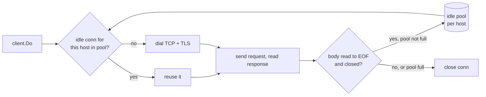
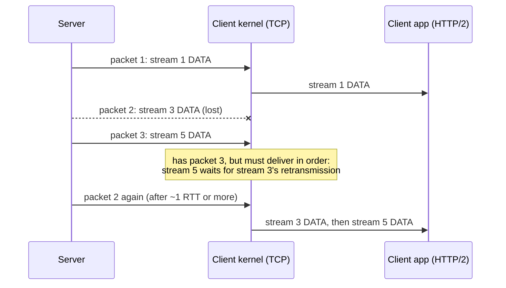
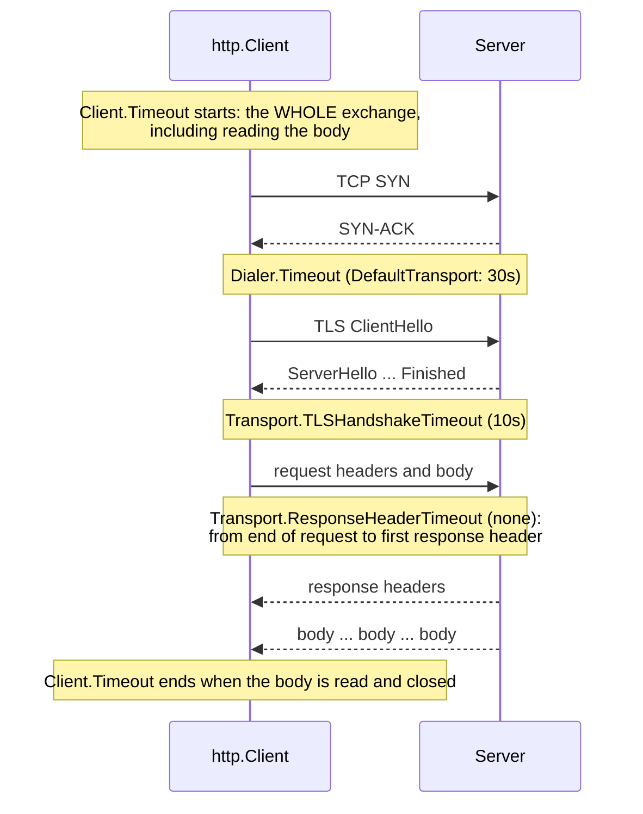

# HTTP/1.1, HTTP/2 and HTTP/3

## Why care?

Four tickets, all from services that "just make HTTP calls":

- "Under load, the order service fails with `connect: cannot assign requested address`. CPU is at 20%. The other service is fine."
- "One slow report endpoint makes every other call to the same backend slow."
- "The call hangs for exactly 30 seconds, then `i/o timeout`. Nobody in the team ever typed 30."
- "Memory and open files grow all day. A restart fixes it until tomorrow."

None of these is about your handler code. They are about **how HTTP uses connections**: how a message is framed on the wire, when a connection is reused, how many are kept, and how long each step may take. This page shows each of those with real bytes and real Go programs, so you can recognise the tickets above in a minute instead of a week.

The [TCP page](tcp.md) explained the connection and [TLS](tls.md) the encryption. Here we put HTTP on top.

## The idea: one phone line, three ways to use it

Think of a phone line between a shop (the client) and a warehouse (the server).

- **HTTP/1.1** is a polite phone call. You ask one question, wait for the full answer, then ask the next. You can keep the line open between questions (**keep-alive**), which saves dialling again. But while the warehouse is looking for a slow answer, you can't ask anything else on that line. Want two questions at once? Make a second call.
- **HTTP/2** is one line with **numbered conversations**. Every sentence starts with "about order 3: ..." or "about order 5: ...". Many questions are in flight at once, answers come back in any order, and you never need a second line. But it is still one line: if it crackles (a lost packet), **every** conversation waits.
- **HTTP/3** gives every conversation **its own lane** (QUIC streams over UDP). A crackle on lane 3 doesn't stop lane 5. It also dials faster.

The rest of the page is these three ideas, in bytes.

## Under the hood: HTTP/1.1 is text on a byte pipe

HTTP/1.1 is text you can type. Start [`ordersd`](../go/services.md) and talk to it with `nc`:

```console
$ ./ordersd -addr 127.0.0.1:19081 &
$ printf 'GET /healthz HTTP/1.1\r\nHost: localhost\r\nConnection: close\r\n\r\n' | nc -q 2 127.0.0.1 19081
HTTP/1.1 200 OK
Content-Type: application/json
X-Content-Type-Options: nosniff
X-Request-Id: 01a218b8-b173-756f-9167-9b41e2079092
Date: Thu, 26 Nov 2026 16:38:06 GMT
Content-Length: 16
Connection: close

{"status":"ok"}
```

That is the whole protocol for this request. Look at the bytes, with `od -c`:

```console
$ printf 'GET /healthz HTTP/1.1\r\nHost: localhost\r\nConnection: close\r\n\r\n' | nc -q 2 127.0.0.1 19081 | od -c | head -30
0000000   H   T   T   P   /   1   .   1       2   0   0       O   K  \r
0000020  \n   C   o   n   t   e   n   t   -   T   y   p   e   :       a
0000040   p   p   l   i   c   a   t   i   o   n   /   j   s   o   n  \r
0000060  \n   X   -   C   o   n   t   e   n   t   -   T   y   p   e   -
0000100   O   p   t   i   o   n   s   :       n   o   s   n   i   f   f
0000120  \r  \n   X   -   R   e   q   u   e   s   t   -   I   d   :
0000140   0   1   a   2   1   8   b   8   -   a   9   9   e   -   7   9
0000160   5   3   -   8   a   9   2   -   a   b   4   6   a   8   6   1
0000200   3   f   6   6  \r  \n   D   a   t   e   :       T   h   u   ,
0000220       2   6       N   o   v       2   0   2   6       1   6   :
0000240   3   8   :   0   4       G   M   T  \r  \n   C   o   n   t   e
0000260   n   t   -   L   e   n   g   t   h   :       1   6  \r  \n   C
0000300   o   n   n   e   c   t   i   o   n   :       c   l   o   s   e
0000320  \r  \n  \r  \n   {   "   s   t   a   t   u   s   "   :   "   o
0000340   k   "   }  \n
0000344
```

An HTTP/1.1 message is always the same four parts:

1. A **start line**: `GET /healthz HTTP/1.1` for a request, `HTTP/1.1 200 OK` for a response.
2. **Header lines**, `Name: value`, each ending in `\r\n` (CRLF).
3. An **empty line**: `\r\n\r\n` at offset `0000322` marks the end of the headers.
4. The **body**: exactly 16 bytes here, because `Content-Length: 16` said so.

`Host` is the only header a request must have. It tells the server which site you want, because many sites can share one IP address.

What does a real Go client send? Point `orderctl` at `nc -l` instead of `ordersd` and look:

```console
$ timeout 3 nc -l 127.0.0.1 19140 > captured.req &
$ orderctl -server http://127.0.0.1:19140 -timeout 1s create -customer c-42 -item MUG:1:899
orderctl: create order: send request: Post "http://127.0.0.1:19140/v1/orders": context deadline exceeded
$ cat -A captured.req
POST /v1/orders HTTP/1.1^M$
Host: 127.0.0.1:19140^M$
User-Agent: orderctl/(devel)^M$
Content-Length: 77^M$
Accept: application/json^M$
Content-Type: application/json^M$
Accept-Encoding: gzip^M$
^M$
{"customer_id":"c-42","items":[{"sku":"MUG","quantity":1,"price_cents":899}]}
```

(`^M$` is how `cat -A` shows `\r\n`.) The headers `orderctl` set in [`internal/client`](../go/cli.md#the-client-package) are there, plus two that Go adds: `Content-Length` and `Accept-Encoding: gzip`. Go asks for gzip and **unzips the body for you**, unless you set `Accept-Encoding` yourself. `nc` never answered, so the client gave up after its 1 second timeout.

### Where does the body end?

TCP is a stream of bytes with no message borders (see [TCP](tcp.md)). So both sides must agree where one message stops and the next starts. HTTP/1.1 has exactly three ways:

| Framing                      | How the reader knows the end                       | Used when                                  |
| ---------------------------- | -------------------------------------------------- | ------------------------------------------ |
| `Content-Length: N`          | Read exactly N bytes                               | The sender knows the size up front         |
| `Transfer-Encoding: chunked` | Each chunk starts with its size in hex; `0` = done | Streaming, or the size is not known yet    |
| Close the connection         | Read until EOF                                     | Old servers, `Connection: close` responses |

A request body can be chunked too. Here is an order sent in two chunks of `0x19` (25) and `0x37` (55) bytes, with a `0` chunk at the end:

```console
$ cat -A chunked.req
POST /v1/orders HTTP/1.1^M$
Host: localhost^M$
Content-Type: application/json^M$
Transfer-Encoding: chunked^M$
Connection: close^M$
^M$
19^M$
{"customer_id":"c-7","ite^M$
37^M$
ms":[{"sku":"BOOK-1","quantity":2,"price_cents":1250}]}^M$
0^M$
^M$
$ nc -q 1 127.0.0.1 19081 < chunked.req
HTTP/1.1 201 Created
Content-Type: application/json
Location: /v1/orders/01a218b8-f87d-7fae-ac90-aa0d2d03cd11
X-Content-Type-Options: nosniff
X-Request-Id: 01a218b8-f87d-7ec0-acd6-0392b0a5806b
Date: Thu, 26 Nov 2026 16:38:25 GMT
Content-Length: 209
Connection: close

{"id":"01a218b8-f87d-7fae-ac90-aa0d2d03cd11","customer_id":"c-7","items":[{"sku":"BOOK-1","quantity":2,"price_cents":1250}],"status":"pending","total_cents":2500,"created_at":"2026-11-26T16:38:25.149982094Z"}
```

The handler never saw chunks. `net/http` removed the framing and gave it one clean body. (A first try with a wrong chunk size gave `400 Bad Request: malformed JSON: ... invalid character '\r'`: the server read the CRLF as part of the JSON. Framing is exact.)

### When does Go send chunked?

You never choose it directly in Go. The server decides from what your handler does:

```go
// Command chunky shows when net/http sends Content-Length and when it
// switches to chunked transfer encoding.
package main

import (
	"fmt"
	"net/http"
	"strings"
	"time"
)

func main() {
	mux := http.NewServeMux()
	mux.HandleFunc("GET /small", func(w http.ResponseWriter, r *http.Request) {
		fmt.Fprint(w, "hello\n") // fits in the buffer: Content-Length
	})
	mux.HandleFunc("GET /big", func(w http.ResponseWriter, r *http.Request) {
		fmt.Fprint(w, strings.Repeat("x", 5000)) // > 2048 bytes: chunked
	})
	mux.HandleFunc("GET /size/{n}", func(w http.ResponseWriter, r *http.Request) {
		var n int
		fmt.Sscan(r.PathValue("n"), &n)
		w.Write([]byte(strings.Repeat("x", n)))
	})
	mux.HandleFunc("GET /stream", func(w http.ResponseWriter, r *http.Request) {
		for i := range 3 {
			fmt.Fprintf(w, "event %d\n", i)
			http.NewResponseController(w).Flush() // send now: chunked
			time.Sleep(300 * time.Millisecond)
		}
	})
	srv := &http.Server{Addr: "127.0.0.1:19090", Handler: mux, ReadHeaderTimeout: 5 * time.Second}
	panic(srv.ListenAndServe())
}
```

```console
$ printf "GET /small HTTP/1.1\r\nHost: x\r\nConnection: close\r\n\r\n" | nc -q 2 127.0.0.1 19090 | cat -A
HTTP/1.1 200 OK^M$
Date: Thu, 26 Nov 2026 16:38:40 GMT^M$
Content-Length: 6^M$
Content-Type: text/plain; charset=utf-8^M$
Connection: close^M$
^M$
hello$
$ printf "GET /stream HTTP/1.1\r\nHost: x\r\nConnection: close\r\n\r\n" | nc -q 2 127.0.0.1 19090 | cat -A
HTTP/1.1 200 OK^M$
Date: Thu, 26 Nov 2026 16:38:42 GMT^M$
Content-Type: text/plain; charset=utf-8^M$
Connection: close^M$
Transfer-Encoding: chunked^M$
^M$
8^M$
event 0$
^M$
8^M$
event 1$
^M$
8^M$
event 2$
^M$
0^M$
^M$
$ printf "GET /big HTTP/1.1\r\nHost: x\r\nConnection: close\r\n\r\n" | nc -q 2 127.0.0.1 19090 | cut -c1-60 | cat -A
HTTP/1.1 200 OK^M$
Date: Thu, 26 Nov 2026 16:38:45 GMT^M$
Content-Type: text/plain; charset=utf-8^M$
Connection: close^M$
Transfer-Encoding: chunked^M$
^M$
1388^M$
xxxxxxxxxxxxxxxxxxxxxxxxxxxxxxxxxxxxxxxxxxxxxxxxxxxxxxxxxxxx$
0^M$
^M$
```

The rule in `net/http`'s server:

- The handler returns **before writing more than the buffer** (2048 bytes): the server knows the size and sends `Content-Length`. `/small` and all `ordersd` responses (which [marshal first, then write](../go/services.md#errors-to-http-one-place)).
- The handler writes **more**, or calls **`Flush`**: headers must go out before the size is known, so it switches to `chunked`. `0x1388` is 5000.
- You set `Content-Length` yourself: it uses yours, and complains if you write a different number of bytes.

Each `event` arrived 300 ms apart: that is how Server-Sent Events and other streams work over HTTP/1.1.

### Keep-alive: many messages, one connection

HTTP/1.1 keeps the connection open by default. Two requests in one `nc` session, the second one asking to close:

```console
$ printf 'GET /healthz HTTP/1.1\r\nHost: x\r\n\r\nGET /readyz HTTP/1.1\r\nHost: x\r\n\r\n' | nc -q 1 127.0.0.1 19081
HTTP/1.1 200 OK
Content-Type: application/json
X-Content-Type-Options: nosniff
X-Request-Id: 01a218b9-63fd-7304-b92d-e2d166a48341
Date: Thu, 26 Nov 2026 16:38:52 GMT
Content-Length: 16

{"status":"ok"}
HTTP/1.1 200 OK
Content-Type: application/json
X-Content-Type-Options: nosniff
X-Request-Id: 01a218b9-63fd-743c-8aaf-fac3fa44fe54
Date: Thu, 26 Nov 2026 16:38:52 GMT
Content-Length: 19

{"status":"ready"}
```

Two responses on one TCP connection. That only works **because** of the framing: the client knows the first body is 16 bytes, so byte 17 is the start of the next response. No framing, no reuse.

Sending the second request before the first answer arrives, as here, is called **pipelining**. It is legal, but the answers must come back **in order**. Hold that thought until [head-of-line blocking](#head-of-line-blocking-three-kinds).

## Connection reuse in Go

Why care about reuse? A new connection costs a TCP handshake (1 round trip), a TLS handshake (1 more round trip with TLS 1.3, see [TLS](tls.md)), a file descriptor, and on the client side a local port that stays in `TIME_WAIT` for 60 seconds after closing. Reuse costs nothing.

`http.Transport` keeps a **pool** of idle connections per host. Every request asks the pool first:



A connection only goes back to the pool when Go knows **where the response ended**: the body has been read to the end, and closed. `net/http/httptrace` lets you watch the decision. `GotConn` fires when a request gets its connection:

```go
// Command reuse shows when http.Transport reuses a TCP connection.
package main

import (
	"fmt"
	"io"
	"net/http"
	"net/http/httptrace"
	"os"
)

func get(url, mode string) {
	trace := &httptrace.ClientTrace{
		GotConn: func(info httptrace.GotConnInfo) {
			fmt.Printf("%-14s local=%s reused=%-5v wasIdle=%v\n",
				mode, info.Conn.LocalAddr(), info.Reused, info.WasIdle)
		},
	}
	req, _ := http.NewRequest("GET", url, nil)
	req = req.WithContext(httptrace.WithClientTrace(req.Context(), trace))
	resp, err := http.DefaultClient.Do(req)
	if err != nil {
		panic(err)
	}
	switch mode {
	case "drain+close":
		io.Copy(io.Discard, resp.Body)
		resp.Body.Close()
	case "close-only":
		resp.Body.Close()
	case "no-close":
		// leak: neither read nor closed
	}
}

func main() {
	url := os.Args[1]
	for _, mode := range []string{"drain+close", "drain+close", "close-only", "close-only", "no-close", "no-close", "drain+close"} {
		get(url, mode)
	}
}
```

```console
$ ./reuse http://127.0.0.1:19081/healthz
drain+close    local=127.0.0.1:45199 reused=false wasIdle=false
drain+close    local=127.0.0.1:45199 reused=true  wasIdle=true
close-only     local=127.0.0.1:45199 reused=true  wasIdle=true
close-only     local=127.0.0.1:45199 reused=true  wasIdle=true
no-close       local=127.0.0.1:45199 reused=true  wasIdle=true
no-close       local=127.0.0.1:45213 reused=false wasIdle=false
drain+close    local=127.0.0.1:45229 reused=false wasIdle=false
```

Read it by the local port. Port 45199 serves five requests. Then a request **does not close** its body: the connection is stuck with it, so the next request needs a new connection (45213), and that one is leaked too (45229). Each leaked body is one TCP connection and one file descriptor, held until the server's idle timeout or forever. That is the fourth ticket; see [File descriptors](../linux/file-descriptors.md) for how to count them.

### Do you still have to drain?

`close-only` was reused above. Older advice says it shouldn't be. The source explains why: `Body.Close` now drains the rest for you, within limits (`net/http/transport.go`, Go 1.27.4):

```go
// maxPostCloseReadBytes is the max number of bytes that a client is willing to
// read when draining the response body of any unread bytes after it has been
// closed. This number is chosen for consistency with maxPostHandlerReadBytes.
const maxPostCloseReadBytes = 256 << 10

// maxPostCloseReadTime defines the maximum amount of time that a client is
// willing to spend on draining a response body of any unread bytes after it
// has been closed.
const maxPostCloseReadTime = 50 * time.Millisecond
```

So test it with bodies of growing size (lines 3 and 4 of the output are the two `close-only` requests):

```console
$ for n in 4000 10000 100000 300000 1000000; do echo "== $n"; ./reuse http://127.0.0.1:19090/size/$n | sed -n 3,4p; done
== 4000
close-only     local=127.0.0.1:48527 reused=true  wasIdle=true
close-only     local=127.0.0.1:48527 reused=true  wasIdle=true
== 10000
close-only     local=127.0.0.1:48551 reused=true  wasIdle=true
close-only     local=127.0.0.1:48551 reused=true  wasIdle=false
== 100000
close-only     local=127.0.0.1:48591 reused=true  wasIdle=true
close-only     local=127.0.0.1:48607 reused=false wasIdle=false
== 300000
close-only     local=127.0.0.1:48629 reused=true  wasIdle=true
close-only     local=127.0.0.1:48635 reused=false wasIdle=false
== 1000000
close-only     local=127.0.0.1:48667 reused=true  wasIdle=true
close-only     local=127.0.0.1:48683 reused=false wasIdle=false
```

Above 256 KiB, the connection after a `close-only` is **always** new. At 100000 bytes it was new this time, but reused in an earlier run. Three more runs of just the second `close-only` line:

```console
$ for r in 1 2 3; do for n in 4000 100000 300000; do echo "$n: $(./reuse http://127.0.0.1:19090/size/$n | sed -n 4p)"; done; done
4000: close-only     local=127.0.0.1:48703 reused=true  wasIdle=false
100000: close-only     local=127.0.0.1:44619 reused=true  wasIdle=false
300000: close-only     local=127.0.0.1:44657 reused=false wasIdle=false
4000: close-only     local=127.0.0.1:44693 reused=true  wasIdle=true
100000: close-only     local=127.0.0.1:44707 reused=true  wasIdle=false
300000: close-only     local=127.0.0.1:44749 reused=false wasIdle=false
4000: close-only     local=127.0.0.1:44793 reused=true  wasIdle=false
100000: close-only     local=127.0.0.1:44835 reused=false wasIdle=false
300000: close-only     local=127.0.0.1:44859 reused=false wasIdle=false
```

The drain runs **in the background** after `Close` returns (`go doc net/http.Response` says "read to completion asynchronously, up to a conservative limit"). If the next request comes before the drain is done, the connection is not back in the pool yet, and the request dials a new one. `wasIdle=false` with `reused=true` is the same race won by a hair: the request was already waiting when the connection came back.

Up to 256 KiB, `Close` is usually enough. Above it, or if the rest takes longer than 50 ms to arrive, Go closes the connection instead. The rules that always work:

1. **Always `defer resp.Body.Close()`**, on every path, including error statuses. This is the non-negotiable one.
2. If the body may be big and you stop early, **drain with a limit**, as `internal/client` does: `io.Copy(io.Discard, io.LimitReader(resp.Body, maxResponseBytes))`. Draining 10 MiB to save one handshake is a bad trade; the limit decides when to give up.

### The pool settings, and the `TIME_WAIT` storm

`http.DefaultTransport` (from `go doc net/http.DefaultTransport`):

```go
var DefaultTransport RoundTripper = &Transport{
	Proxy: ProxyFromEnvironment,
	DialContext: defaultTransportDialContext(&net.Dialer{
		Timeout:   30 * time.Second,
		KeepAlive: 30 * time.Second,
	}),
	ForceAttemptHTTP2:     true,
	MaxIdleConns:          100,
	IdleConnTimeout:       90 * time.Second,
	TLSHandshakeTimeout:   10 * time.Second,
	ExpectContinueTimeout: 1 * time.Second,
}
```

There's the third ticket's 30 seconds: the **dial timeout** of the default transport. And here are the pool knobs:

| Field                 | Default           | Meaning                                                                |
| --------------------- | ----------------- | ---------------------------------------------------------------------- |
| `MaxIdleConns`        | 100               | Idle connections kept in total, all hosts                              |
| `MaxIdleConnsPerHost` | **2** (`0` = 2)   | Idle connections kept **per host**. Extra ones are closed after use    |
| `MaxConnsPerHost`     | 0 (no limit)      | Active + idle per host. When reached, requests **wait** for a free one |
| `IdleConnTimeout`     | 90s (0 in a `{}`) | Close a connection that sat idle this long                             |
| `DisableKeepAlives`   | false             | One connection per request. Almost never what you want                 |

`MaxIdleConnsPerHost = 2` is the trap. Picture 50 goroutines calling one backend. 50 connections are busy. When they finish, the pool keeps **2** and closes 48. The next round dials 48 new ones. Each closed connection leaves its client port in `TIME_WAIT` for 60 seconds (see [TCP](tcp.md)). This program measures it:

```go
// Command storm sends many concurrent requests through one http.Client
// and counts how many TCP connections it had to open.
package main

import (
	"context"
	"flag"
	"fmt"
	"io"
	"net"
	"net/http"
	"sync"
	"sync/atomic"
	"time"
)

func main() {
	url := flag.String("url", "http://127.0.0.1:19081/healthz", "target")
	workers := flag.Int("workers", 50, "concurrent goroutines")
	perHost := flag.Int("per-host", 0, "MaxIdleConnsPerHost (0 means the default, 2)")
	dur := flag.Duration("d", 2*time.Second, "how long to run")
	flag.Parse()

	var dials, reqs, errs atomic.Int64
	var lastErr atomic.Value
	d := &net.Dialer{Timeout: 5 * time.Second}
	tr := http.DefaultTransport.(*http.Transport).Clone()
	tr.MaxIdleConnsPerHost = *perHost
	tr.DialContext = func(ctx context.Context, network, addr string) (net.Conn, error) {
		dials.Add(1)
		return d.DialContext(ctx, network, addr)
	}
	client := &http.Client{Transport: tr, Timeout: 5 * time.Second}

	deadline := time.Now().Add(*dur)
	var wg sync.WaitGroup
	for range *workers {
		wg.Go(func() {
			for time.Now().Before(deadline) {
				resp, err := client.Get(*url)
				if err != nil {
					errs.Add(1)
					lastErr.Store(err.Error())
					continue
				}
				io.Copy(io.Discard, resp.Body)
				resp.Body.Close()
				reqs.Add(1)
			}
		})
	}
	wg.Wait()
	fmt.Printf("MaxIdleConnsPerHost=%d: %d ok, %d errors, %d dials\n", *perHost, reqs.Load(), errs.Load(), dials.Load())
	if e := lastErr.Load(); e != nil {
		fmt.Println("last error:", e)
	}
}
```

The dial counter wraps `DialContext`. (`GotConn` alone undercounts: when an idle connection frees up while a dial is in progress, the request takes the idle one and the fresh connection goes to the pool, or straight to the bin.)

```console
$ cat /proc/sys/net/ipv4/ip_local_port_range
44619	48715
$ ./storm -d 2s; ss -tan state time-wait '( dport = :19081 )' | tail -n +2 | wc -l
MaxIdleConnsPerHost=0: 21981 ok, 768 errors, 9981 dials
last error: Get "http://127.0.0.1:19081/healthz": dial tcp 127.0.0.1:19081: connect: cannot assign requested address
4096
$ ./storm -d 2s -per-host 50; ss -tan state time-wait '( dport = :19081 )' | tail -n +2 | wc -l
MaxIdleConnsPerHost=50: 43153 ok, 0 errors, 66 dials
66
```

There's the first ticket, reproduced:

- With the default, **9981 dials in 2 seconds** and 4096 sockets in `TIME_WAIT`. This WSL machine has only 4097 local ports (44619 to 48715), so the client **ran out of ports**: `cannot assign requested address` is `EADDRNOTAVAIL` from `connect()`. Most Linux machines have about 28,000 ports (32768 to 60999); that buys you a few more seconds, not a fix.
- With `MaxIdleConnsPerHost: 50`, **66 dials** (a few extra from the dial race above), zero errors, and **twice the throughput**, because no request waits for a handshake. The 66 `TIME_WAIT` entries appear when the program exits and closes its pool.

The fix is configuration, not kernel tuning:

```go
tr := http.DefaultTransport.(*http.Transport).Clone()
tr.MaxIdleConnsPerHost = 64 // about your peak concurrency to one host
tr.MaxConnsPerHost = 128    // optional cap, protects the backend
client := &http.Client{Transport: tr, Timeout: 10 * time.Second}
```

And create that client **once**, at start-up, and share it. A new `http.Transport` per request is a new, empty pool per request: every call dials, and every old pool leaks its connections until they time out.

!!! tip "Clone the default; don't start from `&http.Transport{}`"

    A zero `Transport{}` has no dial timeout, no TLS handshake timeout, `IdleConnTimeout` 0 (idle
    connections are never closed), no proxy support, and no HTTP/2 when you set a custom
    `TLSClientConfig`. `http.DefaultTransport.(*http.Transport).Clone()` keeps the good defaults and
    lets you change one field.

## HTTP/2: binary frames on one connection

HTTP/2 keeps the **meaning** of HTTP (methods, status codes, headers) and replaces the **framing**. Everything is a binary **frame** with a 9-byte header:

```text
+-----------------------------------------------+
|                 Length (24)                   |
+---------------+---------------+---------------+
|   Type (8)    |   Flags (8)   |
+-+-------------+---------------+-------------------------------+
|R|                 Stream Identifier (31)                      |
+=+=============================================================+
|                   Frame Payload (Length bytes)                |
+---------------------------------------------------------------+
```

The main frame types:

| Type            | Code | Carries                                              |
| --------------- | ---- | ---------------------------------------------------- |
| `DATA`          | 0x0  | Body bytes of one stream                             |
| `HEADERS`       | 0x1  | Compressed headers; opens a stream                   |
| `RST_STREAM`    | 0x3  | Cancel **one** stream, keep the connection           |
| `SETTINGS`      | 0x4  | Connection parameters (window sizes, max streams...) |
| `PING`          | 0x6  | Liveness and round-trip time                         |
| `GOAWAY`        | 0x7  | "No new streams on this connection, please"          |
| `WINDOW_UPDATE` | 0x8  | Flow control: "you may send N more bytes"            |

A **stream** is one request and its response. Each has a number: clients use odd numbers (1, 3, 5...). Frames of different streams **interleave** on the connection, and the stream ID says where each frame belongs. That is the "about order 3: ..." from the phone analogy.

### Raw bytes: the connection preface

The server below accepts HTTP/2 without TLS (more on that soon), so we can send the start of an HTTP/2 connection by hand: the fixed **preface** string `PRI * HTTP/2.0\r\n\r\nSM\r\n\r\n`, then an empty `SETTINGS` frame (length 0, type 4, flags 0, stream 0):

```console
$ { printf 'PRI * HTTP/2.0\r\n\r\nSM\r\n\r\n'; printf '\x00\x00\x00\x04\x00\x00\x00\x00\x00'; sleep 0.5; } | nc -q 1 127.0.0.1 19444 | xxd | head
00000000: 0000 2404 0000 0000 0000 0500 1000 0000  ..$.............
00000010: 0300 0000 fa00 0600 1001 4000 0100 0010  ..........@.....
00000020: 0000 0400 1000 0000 0900 0000 0100 0000  ................
00000030: 0401 0000 0000 0000 0408 0000 0000 0000  ................
00000040: 0f00 01                                  ...
```

Decode it by hand. It is three frames:

| Bytes                                      | Field                              | Value                                   |
| ------------------------------------------ | ---------------------------------- | --------------------------------------- |
| `00 00 24` `04` `00` `00000000`            | length, type, flags, stream        | 36 bytes, `SETTINGS`, none, stream 0    |
| `0005 00100000`                            | setting 5 `MAX_FRAME_SIZE`         | 1048576                                 |
| `0003 000000fa`                            | setting 3 `MAX_CONCURRENT_STREAMS` | 250                                     |
| `0006 00100140`                            | setting 6 `MAX_HEADER_LIST_SIZE`   | 1048896                                 |
| `0001 00001000`                            | setting 1 `HEADER_TABLE_SIZE`      | 4096                                    |
| `0004 00100000`                            | setting 4 `INITIAL_WINDOW_SIZE`    | 1048576                                 |
| `0009 00000001`                            | setting 9 `NO_RFC7540_PRIORITIES`  | 1                                       |
| `00 00 00` `04` `01` `00000000`            | second frame                       | `SETTINGS` with flag `ACK`: "got yours" |
| `00 00 04` `08` `00` `00000000` `000f0001` | third frame                        | `WINDOW_UPDATE` on stream 0, +983041    |

Go's server allows **250 streams at once** per connection and a 1 MiB receive window per stream. No text anywhere. You can't debug HTTP/2 with `nc`, which is why the next tool matters.

### Watching Go speak HTTP/2

A TLS server and a client that sends three requests at once. The server is the plain `ListenAndServeTLS`: Go turns on HTTP/2 automatically for TLS servers.

```go
// Command h2srv serves the same handler over TLS (h2 via ALPN) and over
// cleartext TCP (HTTP/1.1 and h2c on one port).
package main

import (
	"fmt"
	"log"
	"net/http"
	"time"
)

func main() {
	h := http.HandlerFunc(func(w http.ResponseWriter, r *http.Request) {
		if d, err := time.ParseDuration(r.URL.Query().Get("sleep")); err == nil {
			time.Sleep(d) // a slow handler
		}
		fmt.Fprintf(w, "proto=%s path=%s\n", r.Proto, r.URL.Path)
	})

	tlsSrv := &http.Server{Addr: "127.0.0.1:19443", Handler: h, ReadHeaderTimeout: 5 * time.Second}
	go func() { log.Fatal(tlsSrv.ListenAndServeTLS("cert.pem", "key.pem")) }()

	var p http.Protocols
	p.SetHTTP1(true)
	p.SetUnencryptedHTTP2(true) // h2c: HTTP/2 without TLS
	plain := &http.Server{Addr: "127.0.0.1:19444", Handler: h, Protocols: &p, ReadHeaderTimeout: 5 * time.Second}
	log.Fatal(plain.ListenAndServe())
}
```

```go
// Command h2cli sends three concurrent requests over one HTTP/2 connection.
package main

import (
	"crypto/tls"
	"crypto/x509"
	"fmt"
	"io"
	"net/http"
	"os"
	"sync"
)

func main() {
	pem, err := os.ReadFile("cert.pem")
	if err != nil {
		panic(err)
	}
	roots := x509.NewCertPool()
	roots.AppendCertsFromPEM(pem)

	tr := http.DefaultTransport.(*http.Transport).Clone() // ForceAttemptHTTP2 is true
	tr.TLSClientConfig = &tls.Config{RootCAs: roots}
	client := &http.Client{Transport: tr}

	var wg sync.WaitGroup
	for i := range 3 {
		wg.Go(func() {
			resp, err := client.Get(fmt.Sprintf("https://localhost:19443/req/%d", i))
			if err != nil {
				panic(err)
			}
			defer resp.Body.Close()
			body, _ := io.ReadAll(resp.Body)
			fmt.Printf("%s ALPN=%q -> %s", resp.Proto, resp.TLS.NegotiatedProtocol, body)
		})
	}
	wg.Wait()
}
```

`cert.pem` is a self-signed certificate for `localhost` made with `openssl req -x509` (see [TLS](tls.md)). The client trusts exactly that certificate; no `InsecureSkipVerify`.

```console
$ ./h2cli
HTTP/2.0 ALPN="h2" -> proto=HTTP/2.0 path=/req/1
HTTP/2.0 ALPN="h2" -> proto=HTTP/2.0 path=/req/2
HTTP/2.0 ALPN="h2" -> proto=HTTP/2.0 path=/req/0
```

`GODEBUG=http2debug=2` makes Go's HTTP/2 code log every frame. Here only the frame lines, with the timestamp and framer address cut off:

```console
$ GODEBUG=http2debug=2 ./h2cli 2>&1 | grep -E "Framer|^HTTP" | sed -E 's/^[0-9/]+ [0-9:]+ http2: Framer 0x[0-9a-f]+: //'
wrote SETTINGS len=24, settings: ENABLE_PUSH=0, INITIAL_WINDOW_SIZE=4194304, MAX_FRAME_SIZE=1048576, MAX_HEADER_LIST_SIZE=10485760
wrote WINDOW_UPDATE len=4 (conn) incr=1073741824
wrote HEADERS flags=END_STREAM|END_HEADERS stream=1 len=42
wrote HEADERS flags=END_STREAM|END_HEADERS stream=3 len=12
wrote HEADERS flags=END_STREAM|END_HEADERS stream=5 len=12
read SETTINGS len=36, settings: MAX_FRAME_SIZE=1048576, MAX_CONCURRENT_STREAMS=250, MAX_HEADER_LIST_SIZE=1048896, HEADER_TABLE_SIZE=4096, INITIAL_WINDOW_SIZE=1048576, NO_RFC7540_PRIORITIES=1
wrote SETTINGS flags=ACK len=0
read SETTINGS flags=ACK len=0
read WINDOW_UPDATE len=4 (conn) incr=983041
read HEADERS flags=END_HEADERS stream=1 len=50
read DATA flags=END_STREAM stream=1 len=27 data="proto=HTTP/2.0 path=/req/0\n"
read HEADERS flags=END_HEADERS stream=3 len=4
read DATA flags=END_STREAM stream=3 len=27 data="proto=HTTP/2.0 path=/req/2\n"
read HEADERS flags=END_HEADERS stream=5 len=4
HTTP/2.0 ALPN="h2" -> proto=HTTP/2.0 path=/req/0
read DATA flags=END_STREAM stream=5 len=27 data="proto=HTTP/2.0 path=/req/1\n"
HTTP/2.0 ALPN="h2" -> proto=HTTP/2.0 path=/req/2
HTTP/2.0 ALPN="h2" -> proto=HTTP/2.0 path=/req/1
```

What to notice:

- **One connection, three streams** (1, 3, 5), all sent before the first answer. No pool of connections needed.
- The client sends its three `HEADERS` frames **before** it has read the server's `SETTINGS`. HTTP/2 allows that; it saves a round trip.
- **`END_STREAM`** on the request `HEADERS` means "no body follows" (a GET). On the response `DATA` it means "this response is complete". This flag replaces `Content-Length` and chunking as the framing.
- **Flow control.** Both sides announce a window (`INITIAL_WINDOW_SIZE`) and top it up with `WINDOW_UPDATE`. A slow reader stops one stream without stopping the others. Go's client asks for a huge connection window (`incr=1073741824`, 1 GiB) so that the per-stream windows are the only limit.

### HPACK: why the second request is 12 bytes

Look at the `len=` of the three request `HEADERS` frames: **42, 12, 12**. The responses: **50, 4, 4**. That is **HPACK**, HTTP/2's header compression. With `http2debug=1` you see what went into the first one:

```console
$ GODEBUG=http2debug=1 ./h2cli 2>&1 | head -12 | cut -c21-
http2: Transport failed to get client conn for localhost:19443: http2: no cached connection was available
http2: Transport failed to get client conn for localhost:19443: http2: no cached connection was available
http2: Transport failed to get client conn for localhost:19443: http2: no cached connection was available
http2: Transport creating client conn 0x2e00e2990000 to 127.0.0.1:19443
http2: Transport encoding header ":authority" = "localhost:19443"
http2: Transport encoding header ":method" = "GET"
http2: Transport encoding header ":path" = "/req/0"
http2: Transport encoding header ":scheme" = "https"
http2: Transport encoding header "accept-encoding" = "gzip"
http2: Transport encoding header "user-agent" = "Go-http-client/2.0"
http2: Transport encoding header ":authority" = "localhost:19443"
http2: Transport encoding header ":method" = "GET"
```

(The three "no cached connection" lines are the three goroutines finding an empty pool; then one connection is created for all of them.) The request line became **pseudo-headers**: `:method`, `:path`, `:scheme` and `:authority` (the old `Host`). All header names are lower case.

HPACK keeps two tables on **each side** of the connection:

- A **static table** of 61 common entries, fixed by the standard: `:method: GET` is entry 2, `:scheme: https` is entry 7. One byte each.
- A **dynamic table** (here 4096 bytes, the `HEADER_TABLE_SIZE` setting) that both sides fill as headers are sent. The first request sends `user-agent: Go-http-client/2.0` once, as text (Huffman-coded). Both sides store it. Later requests send only its index.

So request 2 only needs a few bytes for "same as before, but `:path` is `/req/2`". Responses shrink from 50 to 4 bytes the same way. On an API with big cookies or auth tokens, this saves a lot.

The cost: the dynamic table is **state shared by the whole connection**. Header blocks must be decoded in the exact order they were sent. Remember that for HTTP/3.

### How the two sides agree on HTTP/2: ALPN and h2c

Both sides must know they speak HTTP/2 before the first byte. There are two ways:

- **Over TLS: ALPN.** The client lists protocols in its TLS `ClientHello` (`h2`, `http/1.1`), the server picks one in its reply. No extra round trip. `resp.TLS.NegotiatedProtocol` showed `"h2"` above. See [TLS](tls.md) for the handshake.
- **Without TLS: h2c with prior knowledge.** The client just starts with the preface, as `nc` did. It must **know** the server speaks h2c. Inside a cluster, behind a proxy that terminates TLS, this is common (gRPC does it).

`http.Protocols` (Go 1.24+) configures both sides. `h2srv` above serves HTTP/1.1 **and** h2c on one port. `curl` can test both:

```console
$ curl -sv --http2-prior-knowledge http://127.0.0.1:19444/h2c 2>&1 | grep -v "^\* *$"
*   Trying 127.0.0.1:19444...
* Established connection to 127.0.0.1 (127.0.0.1 port 19444) from 127.0.0.1 port 47737
* using HTTP/2
* [HTTP/2] [1] OPENED stream for http://127.0.0.1:19444/h2c
* [HTTP/2] [1] [:method: GET]
* [HTTP/2] [1] [:scheme: http]
* [HTTP/2] [1] [:authority: 127.0.0.1:19444]
* [HTTP/2] [1] [:path: /h2c]
* [HTTP/2] [1] [user-agent: curl/8.23.0]
* [HTTP/2] [1] [accept: */*]
> GET /h2c HTTP/2
> Host: 127.0.0.1:19444
> User-Agent: curl/8.23.0
> Accept: */*
>
* Request completely sent off
< HTTP/2 200
< content-type: text/plain; charset=utf-8
< content-length: 25
< date: Thu, 26 Nov 2026 16:40:58 GMT
<
{ [25 bytes data]
* Connection #0 to host 127.0.0.1:19444 left intact
proto=HTTP/2.0 path=/h2c
```

The old way to start h2c was an HTTP/1.1 `Upgrade: h2c` request. `curl --http2` on an `http://` URL tries it. Go's server ignores it and answers in HTTP/1.1:

```console
$ curl -sv --http2 http://127.0.0.1:19444/upgrade 2>&1 | grep -E "^[<>] (GET|Upgrade|HTTP)|^proto"
> GET /upgrade HTTP/1.1
> Upgrade: h2c
> HTTP2-Settings: AAMAAABkAAQAAQAAAAIAAAAA
< HTTP/1.1 200 OK
proto=HTTP/1.1 path=/upgrade
```

The client side in Go:

```go
// Command h2cclient talks h2c (HTTP/2 without TLS) to an http:// URL.
package main

import (
	"fmt"
	"io"
	"net/http"
	"os"
)

func main() {
	var p http.Protocols
	p.SetUnencryptedHTTP2(true) // only h2c: http:// URLs use HTTP/2 with prior knowledge
	tr := http.DefaultTransport.(*http.Transport).Clone()
	tr.Protocols = &p
	client := &http.Client{Transport: tr}

	resp, err := client.Get(os.Args[1])
	if err != nil {
		panic(err)
	}
	defer resp.Body.Close()
	body, _ := io.ReadAll(resp.Body)
	fmt.Printf("%s -> %s", resp.Proto, body)
}
```

```console
$ ./h2cclient http://127.0.0.1:19444/from-go
HTTP/2.0 -> proto=HTTP/2.0 path=/from-go
```

!!! warning "A hand-made Transport may quietly lose HTTP/2"

    `go doc net/http.Transport.Protocols`: "If Protocols is nil, the default is usually HTTP/1 only.
    If ForceAttemptHTTP2 is true ... the default is HTTP/1 and HTTP/2." `DefaultTransport` sets
    `ForceAttemptHTTP2`; a `&http.Transport{TLSClientConfig: ...}` does not. Change only the first
    line of `h2cli` to `tr := &http.Transport{}` and the output becomes:

    ```console
    $ ./h2plain
    HTTP/1.1 ALPN="" -> proto=HTTP/1.1 path=/req/0
    ```

## Head-of-line blocking, three kinds

"Head-of-line blocking" means: the thing at the front of the queue is slow, so everything behind it waits. It happens at three levels.

**1. HTTP/1.1, per connection.** Responses on one connection come back in request order. Two pipelined requests, the first one slow:

```console
$ echo "sent at $(date +%S.%3N)"; printf 'GET /slow?sleep=2s HTTP/1.1\r\nHost: x\r\n\r\nGET /fast HTTP/1.1\r\nHost: x\r\nConnection: close\r\n\r\n' | nc -q 3 127.0.0.1 19444 | while IFS= read -r l; do printf '%s %s\n' "$(date +%S.%3N)" "$l"; done | grep -E "proto="
sent at 57.980
00.010 proto=HTTP/1.1 path=/slow
00.018 proto=HTTP/1.1 path=/fast
```

`/fast` needs no time at all, and still arrives after 2 seconds. Browsers solve this by opening up to 6 connections per host; Go's client solves it by dialing more connections (the pool above). Both cost handshakes. That is the second ticket: a slow endpoint holding connections that fast calls need.

**2. HTTP/2 fixes it at the HTTP level.** Same two requests over h2c, in parallel:

```console
$ curl -sv --parallel --http2-prior-knowledge -w '%{url} done after %{time_total}s\n' -o /dev/null 'http://127.0.0.1:19444/slow?sleep=2s' -o /dev/null http://127.0.0.1:19444/fast 2>&1 | grep -E "done after|Connection #|multiplex|Trying|OPENED"
*   Trying 127.0.0.1:19444...
* Connection #0 is not open enough, cannot reuse
* Waiting on connection to negotiate possible multiplexing.
* [HTTP/2] [1] OPENED stream for http://127.0.0.1:19444/slow?sleep=2s
* [HTTP/2] [3] OPENED stream for http://127.0.0.1:19444/fast
* Connection #0 to host 127.0.0.1:19444 left intact
http://127.0.0.1:19444/fast done after 0.001251s
http://127.0.0.1:19444/slow?sleep=2s done after 1.936992s
```

One connection, streams 1 and 3. `/fast` is done in 1 ms while `/slow` is still working.

**3. TCP, below HTTP/2.** HTTP/2 multiplexes streams over **one TCP connection**, and TCP delivers bytes **in order**. If one packet is lost, the kernel holds back **every** byte after it until the retransmission arrives, even bytes that belong to other streams (see [TCP](tcp.md)):



On a clean data-centre network, this rarely matters. On a lossy mobile network, one lost packet can stall all of a page's requests, and HTTP/2 can then be slower than HTTP/1.1 with 6 connections. (This machine has no `netem` qdisc to simulate loss, so there is no demo here.) Fixing this needs a transport that knows about streams. That is QUIC.

## HTTP/3 and QUIC

**QUIC** is a transport protocol on top of **UDP**. It does the work of TCP and TLS together, in user space:

- **Streams are part of the transport.** A lost packet only stalls the streams whose data it carried.
- **TLS 1.3 is built in.** The QUIC handshake and the TLS handshake are one exchange: 1 round trip to a new server, 0 for a resumed one.
- **Connection IDs** instead of the 4-tuple. A phone that moves from Wi-Fi to 4G gets a new IP address; a TCP connection dies, a QUIC connection can continue.
- Everything except a few header bits is **encrypted**, so middleboxes can't meddle with it (and you can't easily inspect it either).

**HTTP/3** is HTTP over QUIC. Same frames idea as HTTP/2, but each request is a QUIC stream, and header compression is **QPACK**: HPACK changed so that header blocks don't have to be decoded in strict order.

The `curl` here is built with HTTP/3 support (`ngtcp2` and `nghttp3`). Talk to a real server:

```console
$ curl -sv --http3-only -o /dev/null https://cloudflare.com/ 2>&1 | grep -E "^\* (Trying|SSL connection|using|\[HTTP/3\] \[0\] OPENED)|^[<>] (GET|HTTP|alt-svc)"
* SSL connection using TLSv1.3 / TLS_AES_256_GCM_SHA384 / X25519MLKEM768 / id-ecPublicKey
* using HTTP/3
* [HTTP/3] [0] OPENED stream for https://cloudflare.com/
> GET / HTTP/3
< HTTP/3 301
< alt-svc: h3=":443"; ma=86400
```

(The `Trying` line didn't match: `curl` writes it as `*   Trying` with three spaces. In the unfiltered output it read `*   Trying 104.16.133.229:443...` and, a few lines later, `* Established connection to cloudflare.com (104.16.133.229 port 443)`.)

- **Port 443**, but **UDP** port 443.
- **TLS 1.3**, always. QUIC has no unencrypted mode. `X25519MLKEM768` is the post-quantum hybrid key exchange.
- **Stream 0**: the first client stream in QUIC.

How does a client know a server speaks HTTP/3, if the first contact is TCP? The server says so in a header, **`Alt-Svc`**:

```console
$ curl -sI --http2 https://cloudflare.com/ | grep -i -E "^HTTP|alt-svc"
HTTP/2 301
alt-svc: h3=":443"; ma=86400
```

"HTTP/3 is available on port 443 of this host, remember that for 86400 seconds." Browsers then race QUIC against TCP on the next visit. (A newer way is the `HTTPS` DNS record, see [DNS](dns.md).) UDP is blocked on some corporate networks, so a client **must** always be able to fall back to TCP.

Is it faster? Three runs each, from this machine:

```console
$ for v in --http1.1 --http2 --http3-only; do for i in 1 2 3; do curl -s -o /dev/null $v -w "$v connect=%{time_connect} tls=%{time_appconnect} first_byte=%{time_starttransfer} http=%{http_version}\n" https://cloudflare.com/; done; done
--http1.1 connect=0.022344 tls=0.036959 first_byte=0.054075 http=1.1
--http1.1 connect=0.022919 tls=0.041614 first_byte=0.069584 http=1.1
--http1.1 connect=0.022173 tls=0.035589 first_byte=0.059237 http=1.1
--http2 connect=0.013482 tls=0.029157 first_byte=0.046050 http=2
--http2 connect=0.021970 tls=0.038099 first_byte=0.053308 http=2
--http2 connect=0.023736 tls=0.039396 first_byte=0.055672 http=2
--http3-only connect=0.025037 tls=0.027399 first_byte=0.040891 http=3
--http3-only connect=0.026943 tls=0.029552 first_byte=0.046047 http=3
--http3-only connect=0.027285 tls=0.029504 first_byte=0.046969 http=3
```

Look at the gap between `connect` and `tls`. Over TCP, TLS needs its own round trip **after** the TCP handshake: about 15 ms here. Over QUIC, `connect` already **includes** the TLS handshake, so `tls` comes 2 ms later. One round trip saved on every new connection. On a 15 ms network that is small; on a 200 ms mobile link it is the difference users notice.

### HTTP/3 in Go 1.27

Not in the standard library, as a public API. `go doc net/http Protocols` lists exactly three: `HTTP1`, `HTTP2` and `UnencryptedHTTP2`. The Go 1.27.4 source has unexported hooks, though:

```console
$ grep -n "HTTP3" $(go env GOROOT)/src/net/http/server.go | head -2
3936:			return errors.New("http: Server.Protocols contains HTTP3, but Server does not support HTTP/3")
$ go list std | grep -i -E "quic|http3"
vendor/golang.org/x/net/http3
vendor/golang.org/x/net/internal/http3
vendor/golang.org/x/net/internal/quic/quicwire
vendor/golang.org/x/net/quic
```

So the Go team is building HTTP/3 in `golang.org/x/net` (`quic` and an `internal/http3` package) and wiring `net/http` to it, but you can't switch it on in Go 1.27 without linkname tricks. `crypto/tls` does export the building block, `tls.QUICConn`, since Go 1.21. If you need HTTP/3 in Go today, the common choice is the third-party `quic-go` module. Most services don't: HTTP/3 matters most between browsers or phones and the **edge** (a CDN or load balancer), and the hops behind it stay on HTTP/1.1 or HTTP/2.

## `http.Client` timeouts

[Building a service](../go/services.md#server-timeouts) covered the **server** timeouts. The client has its own, and each covers a different phase:



This program triggers each one, against servers that misbehave in each phase:

```go
// Command timeouts triggers each http.Client timeout in turn.
package main

import (
	"errors"
	"fmt"
	"io"
	"net"
	"net/http"
	"os"
	"syscall"
	"time"
)

// fullListener listens with a backlog of 0, never calls accept, and
// fills the accept queue. The kernel drops every new SYN from now on.
func fullListener(port int) {
	fd, _ := syscall.Socket(syscall.AF_INET, syscall.SOCK_STREAM, 0)
	syscall.Bind(fd, &syscall.SockaddrInet4{Port: port, Addr: [4]byte{127, 0, 0, 1}})
	syscall.Listen(fd, 0)
	for range 2 {
		net.DialTimeout("tcp", fmt.Sprintf("127.0.0.1:%d", port), 200*time.Millisecond)
	}
}

func main() {
	fullListener(19097)
	// A server that accepts TCP connections and then says nothing.
	silent, _ := net.Listen("tcp", "127.0.0.1:19095")
	go func() {
		var conns []net.Conn // keep them open, never answer
		for {
			c, err := silent.Accept()
			if err != nil {
				return
			}
			conns = append(conns, c)
		}
	}()
	// A server that is slow to answer, and slower to send the body.
	mux := http.NewServeMux()
	mux.HandleFunc("/slow-headers", func(w http.ResponseWriter, r *http.Request) {
		time.Sleep(2 * time.Second)
	})
	mux.HandleFunc("/slow-body", func(w http.ResponseWriter, r *http.Request) {
		for range 20 {
			w.Write([]byte("."))
			http.NewResponseController(w).Flush()
			time.Sleep(500 * time.Millisecond)
		}
	})
	go http.ListenAndServe("127.0.0.1:19096", mux)
	time.Sleep(100 * time.Millisecond)

	tr := &http.Transport{
		DialContext:           (&net.Dialer{Timeout: 1 * time.Second}).DialContext,
		TLSHandshakeTimeout:   1 * time.Second,
		ResponseHeaderTimeout: 1 * time.Second,
	}
	client := &http.Client{Transport: tr, Timeout: 3 * time.Second}

	for _, url := range os.Args[1:] {
		start := time.Now()
		resp, err := client.Get(url)
		if err == nil {
			_, err = io.Copy(io.Discard, resp.Body)
			resp.Body.Close()
		}
		ne, ok := errors.AsType[net.Error](err)
		timeout := ok && ne.Timeout()
		fmt.Printf("%.1fs timeout=%v\n  %v\n", time.Since(start).Seconds(), timeout, err)
	}
}
```

```console
$ ./timeouts http://127.0.0.1:19097/ https://127.0.0.1:19095/ http://127.0.0.1:19096/slow-headers http://127.0.0.1:19096/slow-body
1.0s timeout=true
  Get "http://127.0.0.1:19097/": dial tcp 127.0.0.1:19097: i/o timeout
1.0s timeout=true
  Get "https://127.0.0.1:19095/": net/http: TLS handshake timeout
1.0s timeout=true
  Get "http://127.0.0.1:19096/slow-headers": net/http: timeout awaiting response headers
3.0s timeout=true
  context deadline exceeded (Client.Timeout or context cancellation while reading body)
```

Each error message names its phase, so you can tell them apart in logs:

| Setting                           | Message                                       | Typical cause                                       |
| --------------------------------- | --------------------------------------------- | --------------------------------------------------- |
| `net.Dialer.Timeout`              | `dial tcp ...: i/o timeout`                   | Firewall drops SYNs, host down, accept queue full   |
| `Transport.TLSHandshakeTimeout`   | `net/http: TLS handshake timeout`             | Talking TLS to a non-TLS port, overloaded server    |
| `Transport.ResponseHeaderTimeout` | `net/http: timeout awaiting response headers` | Slow handler, slow database behind it               |
| `Client.Timeout`                  | `(Client.Timeout ... while reading body)`     | Slow download, or any phase if the others are unset |
| `ctx` deadline per request        | `context deadline exceeded`                   | Your own per-call budget                            |

The `fullListener` trick deserves a note: when a listener's **accept queue is full**, Linux drops new SYNs silently, and the client retries the SYN until its timeout. From outside, an overloaded server looks exactly like a firewall. (See the backlog section of [TCP](tcp.md).)

How to set them:

- **Always set a total budget.** `http.DefaultClient` has **no** timeout: one stuck server hangs your goroutine forever. That is why `internal/client` uses `&http.Client{Timeout: DefaultTimeout}`.
- **Prefer a context deadline per request** over a fixed `Client.Timeout` when different calls need different budgets. Both work together; the shorter wins. A context also carries the caller's deadline down, so a request whose caller already gave up stops at once.
- **Set `ResponseHeaderTimeout`** when you call services that might hang; it catches "connected but silent" much sooner than the total budget.
- **Streaming responses** (downloads, event streams) can't have a short `Client.Timeout`, because it includes the body. Use `ResponseHeaderTimeout` plus an idle check of your own while reading.

## Traps

- **Not closing `resp.Body`.** One leaked connection and file descriptor per call. Close on every path, including non-2xx responses.
- **A new `http.Client` or `http.Transport` per request.** An empty pool every time: a handshake per call and leaked idle connections. Build one at start-up and share it; it is safe for concurrent use.
- **`MaxIdleConnsPerHost` left at 2** for a service that makes many concurrent calls to one host. A `TIME_WAIT` storm and port exhaustion. Set it near your concurrency.
- **`http.DefaultClient` in production.** No timeout. The 30 second dial timeout of `DefaultTransport` is the only limit, and only for the dial.
- **`&http.Transport{}` from scratch.** No timeouts, idle connections never expire, no HTTP/2 with a custom `TLSClientConfig`. Clone `DefaultTransport`.
- **Both `Content-Length` and `Transfer-Encoding` in one message.** Two parsers that disagree on where a body ends are the root of **request smuggling**. Never forward such messages; let `net/http` build the framing.
- **Assuming HTTP/2 solves head-of-line blocking.** It solves it at the HTTP level only. On lossy networks one TCP connection stalls everything.
- **Expecting `GotConn` to count dials.** It reports which connection a request got, not how many were dialed. Count in `DialContext`.

## Check yourself

??? question "1. A response has no `Content-Length` and no `Transfer-Encoding`. How does the client know where the body ends, and what does that mean for the connection?"

    It reads until the server closes the connection. So the connection can't be reused: closing it
    was the only end marker.

??? question "2. Your Go handler writes a 10 KB JSON document with three `w.Write` calls and never sets `Content-Length`. What framing does the client see? What if the document were 1 KB?"

    10 KB is more than the server's 2048-byte buffer, so headers must go out before the size is known:
    `Transfer-Encoding: chunked`. A 1 KB document fits in the buffer, and the server adds
    `Content-Length: 1024` (or whatever the size is) for you.

??? question "3. A service makes 200 concurrent calls to one backend with `http.DefaultTransport`. What do you expect to see in `ss -tan state time-wait`, and why?"

    Thousands of entries to the backend's port, on the client side. Only 2 idle connections per host
    are kept, so after every burst about 198 are closed by the client, and each closed connection stays
    in `TIME_WAIT` for 60 seconds. Eventually `connect: cannot assign requested address`. Fix:
    raise `MaxIdleConnsPerHost` to about 200.

??? question "4. Why is the second request's `HEADERS` frame much smaller than the first on the same HTTP/2 connection, and why does that make HTTP/2 headers order-sensitive?"

    HPACK. The first request adds headers like `user-agent` to a dynamic table on both sides; later
    requests send just the index. Because the table is connection-wide state that changes with every
    header block, the blocks must be decoded in the order they were sent. QPACK in HTTP/3 relaxes this.

??? question "5. An HTTP/2 client and an HTTP/1.1 client both download 20 small files over a network with 2% packet loss. Why can the HTTP/2 client be slower?"

    HTTP/2 puts all 20 streams on one TCP connection. Every lost packet stops delivery of every
    stream until the retransmission arrives (TCP head-of-line blocking). The HTTP/1.1 client uses
    several connections, so a loss only stalls the one it happened on. HTTP/3 avoids this with QUIC streams.

??? question "6. A call fails with `net/http: timeout awaiting response headers`. Is the problem the network, TLS, or the server's handler?"

    Probably the handler (or what it waits for). The dial and TLS handshake already succeeded and the
    request was written; the server simply didn't send a status line in time.

## Recap

- **HTTP/1.1** is text: start line, headers, empty line, body. The body ends by `Content-Length`, by `chunked` framing, or by closing the connection. Framing is what makes keep-alive possible.
- **Go's client pools connections.** A connection returns to the pool only after its body is read and closed. In Go 1.27, `Close` drains up to 256 KiB in the background; always close, and drain big bodies yourself, with a limit.
- **`MaxIdleConnsPerHost` defaults to 2.** Under concurrency that means dial, close, `TIME_WAIT`, port exhaustion. Clone `DefaultTransport`, raise it, share one client.
- **HTTP/2** is binary frames and numbered streams on one connection, HPACK-compressed headers, and flow control. It is negotiated with ALPN over TLS, or used as h2c with prior knowledge. `GODEBUG=http2debug=2` shows every frame.
- **Head-of-line blocking** exists in HTTP/1.1 (per connection), is fixed by HTTP/2 at the HTTP level, and remains in TCP.
- **HTTP/3** runs on QUIC over UDP: per-stream loss recovery, TLS 1.3 built in, one round trip less. Discovered with `Alt-Svc`. Not public in Go 1.27's standard library.
- **Client timeouts** cover phases: dial, TLS handshake, response headers, and `Client.Timeout` or a context for the whole exchange, body included. The default client has none.

Next: what sits between your client and the server. [Load balancers and proxies](load-balancers.md).
