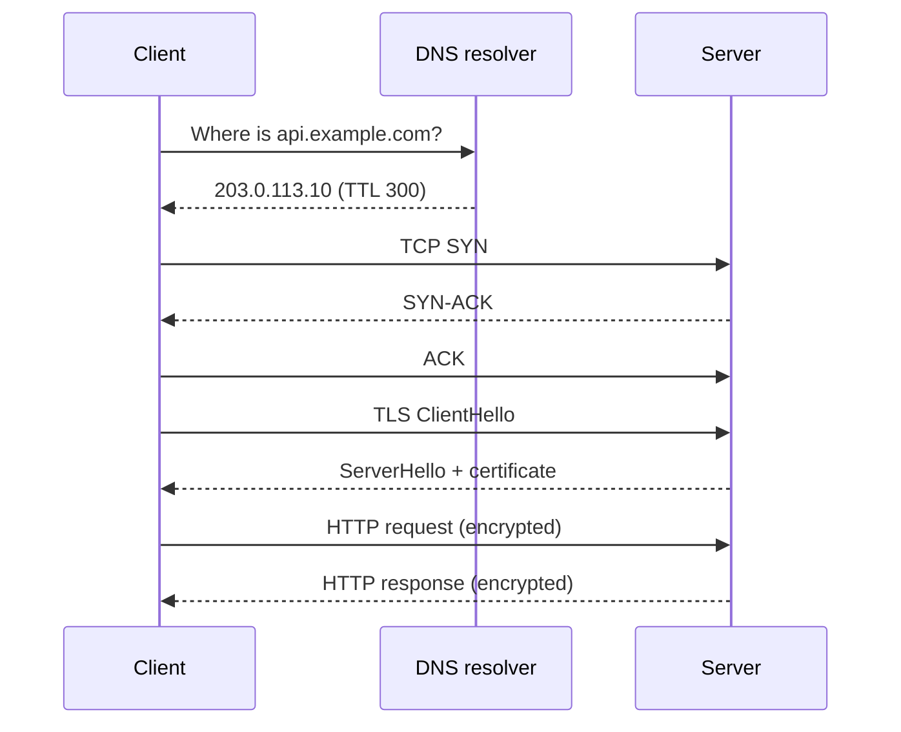

# Networking

What really happens between `client.Do(req)` and the response: packets, connections, names and certificates.

## Why go deeper?

Your service talks to the network all day. When it works, you never look. When it breaks, the errors are vague:

- `connection reset by peer`, but only sometimes, and only behind the load balancer.
- `i/o timeout` after exactly 30 seconds, and nobody set 30 seconds.
- `x509: certificate signed by unknown authority` on one machine, not on another.
- A DNS change was made an hour ago, and half the traffic still goes to the old server.
- The service is fast in tests and slow in production, and the slow part is "before the handler runs".

Each one has a clear cause, one layer below HTTP. This chapter walks down the layers so you can find it.

## The big picture

1. **A name becomes an address** (DNS).
2. **An address becomes a connection** (TCP, or QUIC for HTTP/3).
3. **A connection becomes private** (TLS).
4. **Only then** does HTTP send your request. Each step costs round trips, and each step can fail on its own.

## Reading order

!!! note "Planned chapter"

    This section is a roadmap. The pages below are written in later sessions and linked here when they land.

| #   | Page                        | You will learn                                                                           |
| --- | --------------------------- | ---------------------------------------------------------------------------------------- |
| 1   | Layers and packets          | IP addresses, subnets, routing, ports, MTU, and reading a packet in `tcpdump`            |
| 2   | TCP                         | Handshakes, sequence numbers, windows, congestion, `TIME_WAIT`, keep-alives, resets      |
| 3   | DNS                         | Resolvers, record types, TTLs and caching, `ndots`, how Go resolves names                |
| 4   | TLS and certificates        | Keys, certificate chains, the TLS 1.3 handshake, SNI, mTLS, why clocks matter            |
| 5   | HTTP/1.1, HTTP/2 and HTTP/3 | Framing, connection reuse, multiplexing, head-of-line blocking, QUIC, Go's `http.Client` |
| 6   | Load balancers and proxies  | L4 vs L7, reverse proxies, health checks, timeouts at every hop, `X-Forwarded-For`       |
| 7   | Debugging the network       | `dig`, `curl -v`, `ss`, `tcpdump`, Wireshark, and a checklist for "it can't connect"     |

## How each page works

The same shape as the [Fundamentals](../fundamentals/index.md): **Why care?**, **The idea**, **Under the hood**, **Try it**, **Traps** and **Check yourself**. We capture real traffic between `orderctl` and `ordersd` from the [Go chapter](../go/index.md), so every packet on these pages is one you can make yourself.
