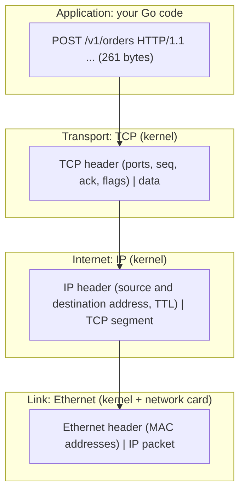

# Layers and packets

## Why care?

Four tickets that are all "the network":

- "The service works on my laptop. In the cluster, small requests work and big ones hang forever."
- "We added a VPN for the new office. Now half the pods can't reach the database."
- "The load test fails after about 4,000 requests with `connect: cannot assign requested address`."
- "`curl localhost:8080` works. The same call from another container says `connection refused`."

None of them is a bug in your Go code. Each one is a fact about **addresses, routes, ports or packet sizes**: an MTU too big for a tunnel, two subnets that overlap, a client that ran out of ports, a server bound to the wrong address. This page gives you those facts, and then captures a real packet and reads it byte by byte.

## The idea: each layer wraps the one above

Data travels inside layers of headers, one inside the other. This is called **encapsulation**. It works like envelopes inside envelopes, each with its own address.

- Your program writes the **data**, for example an HTTP request.
- **TCP** puts a header in front of the data. The header holds a **port**: the number that picks which program on the destination machine gets the data.
- **IP** puts a header in front of that. It holds the **IP address** of the destination machine. The IP address stays the same for the whole trip.
- The **link layer** (Ethernet, Wi-Fi) puts a header in front of that. It holds a **MAC address**: the hardware address of the next device on the path. A packet usually passes several routers, and each router only knows the next hop. So the MAC address changes at every hop.

Each router reads only the outer headers. It removes the link header, reads the IP address, picks the next hop, and adds a new link header. Only the destination machine reads the TCP header and the data. This is the core rule of networking: **each layer reads only its own header.**

## Under the hood: four layers, not seven

You may have learned the seven-layer OSI model. Real networks, and the Linux kernel, use four:



| Layer       | Unit                 | Address                     | Who reads it         | Linux tools           |
| ----------- | -------------------- | --------------------------- | -------------------- | --------------------- |
| Application | message, request     | URL, host name              | your program         | `curl`, your logs     |
| Transport   | **segment** (TCP)    | **port** (16 bits)          | the two end hosts    | `ss`                  |
| Internet    | **packet** (IP)      | **IP address** (32/128 bit) | every router on path | `ip addr`, `ip route` |
| Link        | **frame** (Ethernet) | **MAC address** (48 bits)   | the next hop only    | `ip link`, `ip neigh` |

When people say "L4 load balancer" or "L7 proxy" (see [Load balancers and proxies](load-balancers.md)), they use OSI numbers: **L3 = IP, L4 = TCP/UDP, L7 = HTTP**. OSI layers 5 and 6 don't exist as separate things in practice; TLS sits somewhere between 4 and 7, and it does not fit cleanly into one of them.

Two things to keep in mind:

1. **Everything below the application is in the kernel.** Your `conn.Write` is a system call (see [System calls up close](../linux/system-calls.md)). The kernel adds the TCP, IP and Ethernet headers. Your program never sees them, which is why we need a special socket to look at them later.
2. **Every layer adds bytes.** A 6-byte `hello\n` leaves the machine as a 72-byte frame. For small messages, headers are most of the traffic.

## IP addresses

An **IPv4 address** is 32 bits, written as four bytes in decimal: `192.168.4.119`. An **IPv6 address** is 128 bits, written as eight groups of 16 bits in hex: `fe80::9e91:5f30:80f2:841f`. Here are the addresses on the test machine (WSL2 on Windows):

```console
$ ip -br addr
lo               UNKNOWN        127.0.0.1/8 10.255.255.254/32 ::1/128
eth0             DOWN
loopback0        UP
eth1             UP             192.168.4.119/24 fe80::9e91:5f30:80f2:841f/64
docker0          DOWN           172.17.0.1/16
```

Read it per interface:

- **`lo`** is loopback: traffic that never leaves the machine. `127.0.0.1/8` means the whole range `127.0.0.0` to `127.255.255.255` is "this machine". `10.255.255.254` is the `nameserver` in `/etc/resolv.conf` here: WSL's DNS proxy. `::1` is IPv6 loopback.
- **`eth1`** is the real network card. `192.168.4.119/24` is the address **and** the size of the local network (the `/24`, explained next). The `fe80::` address is IPv6 **link-local**: every IPv6 interface has one, and it only works on the local link.
- **`docker0`** is Docker's bridge, with no containers running (`DOWN`).
- An interface can have many addresses. An address belongs to an interface, not to the machine.

The long form shows more:

```console
$ ip -4 addr show eth1
4: eth1: <BROADCAST,MULTICAST,UP,LOWER_UP> mtu 1500 qdisc mq state UP group default qlen 1000
    inet 192.168.4.119/24 brd 192.168.4.255 scope global noprefixroute eth1
       valid_lft forever preferred_lft forever
```

`mtu 1500` is the biggest packet this link carries (more below). `brd` is the broadcast address of the subnet. `scope global` means the address is valid beyond this link; `scope host` (as on `lo`) means only inside this machine.

### Addresses with a special meaning

You will meet these ranges in every config file, so learn them once:

| Range                                                                | Meaning                                                           |
| -------------------------------------------------------------------- | ----------------------------------------------------------------- |
| `10.0.0.0/8`, `172.16.0.0/12`, `192.168.0.0/16`                      | **Private** (RFC 1918). Not routed on the internet; needs NAT     |
| `127.0.0.0/8`, `::1`                                                 | Loopback: this machine                                            |
| `169.254.0.0/16`, `fe80::/10`                                        | Link-local. `169.254.169.254` is the cloud metadata service       |
| `100.64.0.0/10`                                                      | Carrier-grade NAT, also used by some VPNs and Kubernetes networks |
| `0.0.0.0`, `::`                                                      | "Any address" when you **listen**; "no address" elsewhere         |
| `192.0.2.0/24`, `198.51.100.0/24`, `203.0.113.0/24`, `2001:db8::/32` | Reserved for documentation. Use them in examples                  |
| `fc00::/7`                                                           | IPv6 unique local: the IPv6 version of "private"                  |

The `0.0.0.0` line is the "connection refused from another container" ticket. A server that listens on `127.0.0.1:8080` only accepts connections **to** `127.0.0.1`, which is only reachable from inside the same network namespace. Listen on `:8080` (Go's short form for "port 8080 on every address, IPv4 and IPv6") to accept on every interface.

### IPv6 basics

- **Notation:** groups of 4 hex digits, leading zeros dropped, and **one** run of zero groups replaced with `::`. So `2001:0db8:0000:0000:0000:0000:0000:0001` is `2001:db8::1`.
- **In URLs and `host:port`**, IPv6 needs brackets: `[::1]:8080`. Use `net.JoinHostPort`, never `host + ":" + port`; it adds the brackets for you.
- **No ARP**, no broadcast, and routers never fragment. The minimum MTU is 1280 bytes.
- **A /64 per network** is normal. One subnet has 2^64 addresses: too many to scan, and no network runs out of addresses.

Go's `net/netip` package has the modern address types: `netip.Addr` (an IP) and `netip.Prefix` (a CIDR). They are small values you can compare with `==` and use as map keys, unlike the older `net.IP`, which is a byte slice.

## CIDR: the slash number

`192.168.4.119/24` means: **the first 24 bits are the network, the remaining 8 bits are the host.** All addresses with the same first 24 bits are on the same local network and can talk directly, without a router.

Do one by hand, with a less round number. Is `10.20.32.0` in `10.20.30.40/20`? (For a refresher on binary, see [Bits and bytes](../fundamentals/bits-and-bytes.md).)

```text
10.20.30.40  =  00001010.00010100.0001|1110.00101000
/20 mask     =  11111111.11111111.1111|0000.00000000   = 255.255.240.0
network      =  00001010.00010100.0001|0000.00000000   = 10.20.16.0
last         =  00001010.00010100.0001|1111.11111111   = 10.20.31.255
10.20.32.0   =  00001010.00010100.0010|0000.00000000   → network bits differ: outside
```

The rules:

- **Network address:** set the host bits to 0. **Last address:** set them to 1 (in IPv4 that is the broadcast address).
- **Size:** 2^(32 − prefix). A `/24` has 256 addresses, a `/20` has 4,096, a `/16` has 65,536, a `/32` is one address.
- **Smaller number, bigger network.** `/8` is huge, `/30` is four addresses.
- **Two prefixes overlap** if the shorter one contains the start of the longer one. This is the VPN ticket: the office VPN routed `10.0.0.0/8`, the cluster used `10.20.0.0/16`, and the more specific route won for some destinations and lost for others.

Go does the bit work for you. This program prints what a prefix covers:

```go
// Command cidr prints what a CIDR prefix covers, and whether some
// addresses fall inside it.
//
// Usage: cidr <prefix> [address...]
package main

import (
	"fmt"
	"math/big"
	"net/netip"
	"os"
)

func main() {
	p, err := netip.ParsePrefix(os.Args[1])
	if err != nil {
		fmt.Println(err)
		os.Exit(1)
	}
	network := p.Masked() // set all host bits to 0
	first := network.Addr()

	// The last address: set all host bits to 1.
	b := first.AsSlice()
	for i := p.Bits(); i < len(b)*8; i++ {
		b[i/8] |= 0x80 >> (i % 8)
	}
	last, _ := netip.AddrFromSlice(b)

	hostBits := first.BitLen() - p.Bits()
	size := new(big.Int).Lsh(big.NewInt(1), uint(hostBits))
	fmt.Printf("prefix   %s (you wrote %s)\n", network, p)
	fmt.Printf("bits     %d network + %d host = %s addresses\n", p.Bits(), hostBits, size)
	fmt.Printf("first    %s\nlast     %s\n", first, last)
	for _, s := range os.Args[2:] {
		a := netip.MustParseAddr(s)
		fmt.Printf("contains %-15s %v\n", a, network.Contains(a))
	}
}
```

```console
$ ./cidr 192.168.4.119/24 192.168.4.1 192.168.5.1
prefix   192.168.4.0/24 (you wrote 192.168.4.119/24)
bits     24 network + 8 host = 256 addresses
first    192.168.4.0
last     192.168.4.255
contains 192.168.4.1     true
contains 192.168.5.1     false
$ ./cidr 10.20.30.40/20 10.20.16.7 10.20.32.0
prefix   10.20.16.0/20 (you wrote 10.20.30.40/20)
bits     20 network + 12 host = 4096 addresses
first    10.20.16.0
last     10.20.31.255
contains 10.20.16.7      true
contains 10.20.32.0      false
$ ./cidr 2001:db8:abcd:12::/64 2001:db8:abcd:12::1 2001:db8:abcd:13::1
prefix   2001:db8:abcd:12::/64 (you wrote 2001:db8:abcd:12::/64)
bits     64 network + 64 host = 18446744073709551616 addresses
first    2001:db8:abcd:12::
last     2001:db8:abcd:12:ffff:ffff:ffff:ffff
contains 2001:db8:abcd:12::1 true
contains 2001:db8:abcd:13::1 false
```

`math/big` is there because a `/64` has 2^64 addresses, one more than a `uint64` can hold.

## Routing: picking the interface and next hop

For every packet it sends, the kernel asks one question: **which interface, and which next hop?** The answer comes from the routing table:

```console
$ ip route
default via 192.168.4.1 dev eth1 proto kernel metric 30
172.17.0.0/16 dev docker0 proto kernel scope link src 172.17.0.1 linkdown
192.168.4.0/24 dev eth1 proto kernel scope link metric 286
192.168.4.1 dev eth1 proto kernel scope link metric 30
```

Each line is "for destinations in this prefix, go here":

- **`192.168.4.0/24 dev eth1 scope link`**: these addresses are **on the link**. Send straight to them on `eth1`. This route appeared by itself when the `/24` address was added.
- **`default via 192.168.4.1`**: everything else goes to the **router** (gateway) `192.168.4.1`. `default` is `0.0.0.0/0`, a prefix that matches every address.
- **`linkdown`**: the route exists but is unusable right now.

The rule that picks a line is **longest prefix match**: of all routes that contain the destination, the most specific wins. `192.168.4.50` matches both `/24` and `/0`; the `/24` wins. `metric` only breaks ties between routes of the same length.

You don't have to do this in your head. `ip route get` asks the kernel which route it **would** use:

```console
$ ip route get 1.1.1.1
1.1.1.1 via 192.168.4.1 dev eth1 src 192.168.4.119 uid 1000
    cache
$ ip route get 192.168.4.50
192.168.4.50 dev eth1 src 192.168.4.119 uid 1000
    cache
```

The first goes **via** the router. The second has no `via`: it is on the link. And `src` is the source address the kernel will put on the packet. This is the command to run when "the service connects from the wrong IP" and the firewall on the other side rejects it.

!!! note "Policy routing on this machine"

    `ip route` shows only the `main` table. Linux has several tables, and **rules** (`ip rule`) pick which one to use.
    WSL's mirrored networking mode adds rules so that TCP and UDP to `127.0.0.1` go through its `loopback0`
    interface, which is how Linux and Windows share `localhost`:

    ```console
    $ ip rule | grep 'lookup 12[78]'
    1:	from all ipproto tcp lookup 127
    1:	from all ipproto udp lookup 127
    1:	from all ipproto tcp lookup 128
    1:	from all ipproto udp lookup 128
    $ ip route get 127.0.0.1 ipproto tcp
    127.0.0.1 via 169.254.73.152 dev loopback0 table 127 src 127.0.0.1 uid 1000
        cache
    $ ip route get 127.0.0.1 ipproto icmp
    local 127.0.0.1 dev lo table local src 127.0.0.1 uid 1000
        cache <local>
    ```

    So on this machine, `ping 127.0.0.1` and `curl 127.0.0.1` take different paths. Kubernetes nodes and VPN clients
    also use policy routing. When `ip route` doesn't explain what you see, check `ip rule` and `ip route show table all`.

## The next hop: ARP and the neighbour table

The route said "send to `192.168.4.1` on `eth1`". But Ethernet does not understand IP addresses; it delivers frames to **MAC addresses**. So the kernel needs one more lookup: which MAC address has `192.168.4.1`? It asks the whole link with an **ARP** broadcast ("who has `192.168.4.1`? tell `192.168.4.119`"), and remembers the answer in the **neighbour table**:

```console
$ ip neigh show dev eth1
192.168.4.1 lladdr 00:00:5e:00:53:01 REACHABLE
```

That is the router's MAC. (We replaced the real one with `00:00:5e:00:53:01`, a MAC address reserved for documentation.) Note what is **not** in the table: `1.1.1.1`. For a destination behind a router, the frame goes to the **router's** MAC, with `1.1.1.1` in the IP header. MAC addresses change at every hop; IP addresses don't (unless NAT rewrites them). Each router replaces the link header and keeps the IP header.

States you will see: `REACHABLE` (confirmed recently; here for about 30 seconds, `net.ipv4.neigh.default.base_reachable_time_ms`), `STALE` (still used, but checked again on next use), `FAILED` (nobody answered: the host is down or not on this link), `PERMANENT` (set by hand). IPv6 does the same job with ICMPv6 "neighbour solicitation" instead of ARP, and `ip neigh` shows both.

### Try it: watch ARP happen

To see ARP for real, we need a link with two ends and real MAC addresses. We can build one without root. `unshare -Urn` makes a user namespace and a network namespace, where we are root (see [Namespaces and cgroups](../linux/namespaces-and-cgroups.md#network-namespaces-a-separate-network-stack)). Inside, we start a second network namespace and connect the two with a **veth pair**, a virtual cable:

```sh
#!/bin/sh
# Run with: unshare -Urn ./veth.sh
# Two network namespaces joined by a virtual cable (a veth pair).
set -e
ip link set lo up
unshare -n sleep 300 & peer=$!
sleep 0.2
ip link add veth0 type veth peer name veth1
ip link set veth1 netns $peer
ip addr add 10.0.0.1/24 dev veth0
ip link set veth0 up
nsenter -t $peer -n sh -c 'ip link set lo up; ip addr add 10.0.0.2/24 dev veth1; ip link set veth1 up'
echo '$ ip -br link'; ip -br link
echo '$ ip route'; ip route
echo '$ ip neigh'; ip neigh
nsenter -t $peer -n ./bin/hello serve 10.0.0.2:9000 & srv=$!
./bin/sniff -i veth0 -port 9000 -c 5 -x > cap2.txt & snf=$!
sleep 0.3
echo '$ ./hello 10.0.0.2:9000'; ./bin/hello dial 10.0.0.2:9000
sleep 0.3
echo '$ ip neigh'; ip neigh
echo '$ ip route get 10.0.0.2'; ip route get 10.0.0.2
echo '$ ping -c1 -M do -s 1472 10.0.0.2'; ping -c1 -M do -s 1472 10.0.0.2 | head -2
echo '$ ping -c1 -M do -s 1473 10.0.0.2'; ping -c1 -M do -s 1473 10.0.0.2 2>&1 | head -2 || true
kill $srv $snf $peer 2>/dev/null || true
```

`hello` and `sniff` are two small Go programs from the "Try it" section below: a TCP client and server, and a packet capturer. The output:

```console
$ unshare -Urn ./veth.sh
$ ip -br link
lo               UNKNOWN        00:00:00:00:00:00 <LOOPBACK,UP,LOWER_UP>
veth0@if2        UP             76:b4:de:f3:e9:a8 <BROADCAST,MULTICAST,UP,LOWER_UP>
$ ip route
10.0.0.0/24 dev veth0 proto kernel scope link src 10.0.0.1
$ ip neigh
$ ./hello 10.0.0.2:9000
client 10.0.0.1:55518 -> 10.0.0.2:9000
server got: hello
client got: hi
$ ip neigh
10.0.0.2 dev veth0 lladdr 12:9f:2a:df:9f:9f REACHABLE
$ ip route get 10.0.0.2
10.0.0.2 dev veth0 src 10.0.0.1 uid 0
    cache
$ ping -c1 -M do -s 1472 10.0.0.2
PING 10.0.0.2 (10.0.0.2) 1472(1500) bytes of data.
1480 bytes from 10.0.0.2: icmp_seq=1 ttl=64 time=0.053 ms
$ ping -c1 -M do -s 1473 10.0.0.2
PING 10.0.0.2 (10.0.0.2) 1473(1501) bytes of data.
ping: local error: message too long, mtu=1500
```

The neighbour table was empty before the connection and has the peer's MAC after it. The capture shows how it got there, **before** the first TCP packet:

```console
$ head -13 cap2.txt
 0.000000 ARP who-has 10.0.0.2 tell 10.0.0.1
00000000  ff ff ff ff ff ff 76 b4  de f3 e9 a8 08 06 00 01  |......v.........|
00000010  08 00 06 04 00 01 76 b4  de f3 e9 a8 0a 00 00 01  |......v.........|
00000020  00 00 00 00 00 00 0a 00  00 02                    |..........|
 0.000072 ARP 10.0.0.2 is-at 12:9f:2a:df:9f:9f
00000000  76 b4 de f3 e9 a8 12 9f  2a df 9f 9f 08 06 00 01  |v.......*.......|
00000010  08 00 06 04 00 02 12 9f  2a df 9f 9f 0a 00 00 02  |........*.......|
00000020  76 b4 de f3 e9 a8 0a 00  00 01                    |v.........|
 0.000114 10.0.0.1:55518 > 10.0.0.2:9000 [SYN] seq=1937908193 win=64240 len=0 opts=[mss 1460 sackOK TS val 1007612676 ecr 0 nop wscale 7]
00000000  12 9f 2a df 9f 9f 76 b4  de f3 e9 a8 08 00 45 00  |..*...v.......E.|
00000010  00 3c 9a 57 40 00 40 06  8c 62 0a 00 00 01 0a 00  |.<.W@.@..b......|
00000020  00 02 d8 de 23 28 73 82  21 e1 00 00 00 00 a0 02  |....#(s.!.......|
00000030  fa f0 14 31 00 00 02 04  05 b4 04 02 08 0a 3c 0e  |...1..........<.|
```

- The request goes to **`ff:ff:ff:ff:ff:ff`**, the broadcast MAC: everyone on the link gets it. Bytes 12-13, `08 06`, say "ARP inside". Then: hardware type 1 (Ethernet), protocol `08 00` (IPv4), address sizes 6 and 4, **opcode 1 (request)**, sender MAC and IP, an empty target MAC, and the target IP `0a 00 00 02` (10.0.0.2).
- The reply goes **only to us**, opcode 2, and fills in the MAC.
- The SYN that follows goes to `12:9f:2a:df:9f:9f` with EtherType `08 00`: IPv4. Its destination MAC is the first 6 bytes, its source MAC the next 6: destination comes first. 72 µs for the ARP round trip, paid once per neighbour, not per packet.

## Ports and the 4-tuple

The IP address gets the packet to the machine. The **port**, a 16-bit number (0 to 65535), gets it to the right socket. A server **listens** on a fixed, well-known port. A client gets a random **ephemeral port** from the kernel when it connects.

A TCP connection is identified by **four** values: source IP, source port, destination IP, destination port. That is the **4-tuple**. Three clients connected to one server, inside a namespace:

```console
$ ss -tna
State  Recv-Q Send-Q Local Address:Port  Peer Address:Port Process
LISTEN 0      128        127.0.0.1:9000       0.0.0.0:*
ESTAB  0      0          127.0.0.1:9000     127.0.0.1:40234
ESTAB  0      0          127.0.0.1:9000     127.0.0.1:40248
ESTAB  0      0          127.0.0.1:40248    127.0.0.1:9000
ESTAB  0      0          127.0.0.1:40234    127.0.0.1:9000
ESTAB  0      0          127.0.0.1:9000     127.0.0.1:40220
ESTAB  0      0          127.0.0.1:40220    127.0.0.1:9000
```

Client and server are on the same machine, so each connection shows up twice, once from each end. The server side of all three uses **the same local port 9000**. They are different connections only because the client port differs. That is why a server can have a million connections on one port: only the 4-tuple must be unique.

The client side is the limit. To one server address and port, a client machine can have at most one connection per **ephemeral port**, and the range is set by a sysctl:

```console
$ sysctl net.ipv4.ip_local_port_range
net.ipv4.ip_local_port_range = 44619	48715
$ unshare -Urn sysctl net.ipv4.ip_local_port_range
net.ipv4.ip_local_port_range = 32768	60999
```

The Linux default (in the fresh namespace) is 32768 to 60999: about 28,000 ports. WSL narrows the host to 4,097 ports, presumably so Linux and Windows don't hand out the same ones in mirrored mode. Either way, a client that opens a **new** connection per request to the same server runs through these quickly, because closed connections keep their port for a while (`TIME_WAIT`, see [TCP](tcp.md)). That is the "cannot assign requested address after 4,000 requests" ticket. The fix is not a bigger range. It is **connection reuse**: one `http.Client` for the whole program.

Two more port facts:

- **Ports below 1024 need privileges.** `net.ipv4.ip_unprivileged_port_start` is 1024 here, so:

  ```console
  $ ./bin/hello serve 127.0.0.1:80
  panic: listen tcp 127.0.0.1:80: bind: permission denied
  ```

  Containers and systemd grant `CAP_NET_BIND_SERVICE` for this, or you listen on 8080 and let a load balancer use 443.

- **Names for ports** live in `/etc/services`: `getent services https` prints `https 443/tcp`. Go's `net.LookupPort("tcp", "https")` reads the same file.

## MTU, MSS and fragmentation

Every link has a **maximum transmission unit**: the biggest IP packet it carries in one frame. Ethernet: **1500 bytes**. Loopback: 65536. Tunnels (VPN, VXLAN, WireGuard, IPsec) wrap your packet inside another one, so their MTU is smaller: 1450, 1420, 1400, depending on the tunnel.

```console
$ ip link show lo
1: lo: <LOOPBACK,UP,LOWER_UP> mtu 65536 qdisc noqueue state UNKNOWN mode DEFAULT group default qlen 1000
    link/loopback 00:00:00:00:00:00 brd 00:00:00:00:00:00
```

The `ping -M do` lines in the veth run measured it. `-M do` sets the **Don't Fragment** bit. `-s 1472` is the ICMP payload; plus 8 bytes ICMP header and 20 bytes IP header, that's exactly 1500, and it worked. One byte more, and the kernel refused: `message too long, mtu=1500`.

What happens to a packet that is too big for a link on the way?

- **Without DF:** the router **fragments** it into pieces that fit, and the receiver puts them back together. Slow, fragile (lose one piece, lose all), and many firewalls drop fragments.
- **With DF:** the router drops it and sends back an ICMP "fragmentation needed" message with the smaller MTU. The sender remembers that (**path MTU discovery**) and sends smaller packets. **Linux sets DF on all TCP packets** (you'll see the bit in the hex dump below). IPv6 has no router fragmentation at all.

TCP avoids most of this by never making packets too big in the first place. In the SYN, each side announces its **MSS**, maximum segment size: the most TCP payload it wants per packet. MSS = MTU − 20 (IP header) − 20 (TCP header). The veth capture above shows `mss 1460` = 1500 − 40.

Each side announces its own MSS, and each **sends** no more than the other side announced. The next run gives the server's link a smaller MTU than the client's. It uses the same veth setup, but with `ip link set veth1 mtu 1400` on the server side, and a connection that stays open:

```console
$ unshare -Urn ./mss.sh
 0.000072 10.0.0.1:48930 > 10.0.0.2:9000 [SYN] seq=3758192659 win=64240 len=0 opts=[mss 1460 sackOK TS val 1008548842 ecr 0 nop wscale 7]
 0.000085 10.0.0.2:9000 > 10.0.0.1:48930 [SYN,ACK] seq=4289554334 ack=3758192660 win=64704 len=0 opts=[mss 1360 sackOK TS val 3321164033 ecr 1008548842 nop wscale 7]
$ ss -tni state established
mss:1348 pmtu:1500 rcvmss:536 advmss:1448
```

The client offers 1460, the server answers 1360 (= 1400 − 40). The client's `mss` is now 1348: 1360 minus 12 bytes for the timestamp option that rides in every packet. `advmss:1448` is what the client announced, minus the same 12.

This explains the "big requests hang" ticket. MSS only knows the MTU **at both ends**. If a tunnel **in the middle** has a smaller MTU, and the ICMP "fragmentation needed" messages are blocked by a firewall, you get a **PMTU black hole**: the handshake and small requests work (small packets fit), and the first full-size packet is lost, with no error. TCP retransmits it, at the same size, until it gives up. The fixes: allow ICMP type 3 code 4 through firewalls, lower the MTU on the tunnel's ends, or **clamp the MSS** on the router (rewrite the MSS option in SYNs that pass through). Linux can also search for the path MTU itself with `net.ipv4.tcp_mtu_probing=1`; it is `0` (off) here.

## Loopback is not a wire

`lo` is a shortcut inside the kernel: a packet "sent" on `lo` is handed straight to the receive path. Some consequences you will notice:

- **No MAC addresses.** Frames on `lo` have all-zero MACs.
- **Every packet passes twice** at the capture point: once going out, once coming in. Our capturer keeps only one.
- **No checksums.** The kernel knows that memory doesn't flip bits on the way, so the TCP checksum is never filled in (more on that in the hex dump).
- **Each network namespace has its own `lo`.** `127.0.0.1` in a container is the container, not the host. That's the "works with `curl localhost`" ticket from the other side.
- **The big MTU** (65536) means one TCP segment can carry almost 64 KiB. Benchmarks over loopback look much better than any real network.

## Try it: capture a real packet

`tcpdump` isn't installed here, and needs root anyway. But a **packet socket** (`AF_PACKET`) receives every frame on an interface, headers and all. It needs `CAP_NET_RAW`, which we have inside `unshare -Urn`. Here is a small capturer that decodes Ethernet, ARP, IPv4 and TCP itself, so you can see how each field is read from the bytes:

```go
// Command sniff prints the TCP packets on one network interface,
// decoded from the raw bytes. It needs CAP_NET_RAW: run it inside
// "unshare -Urn", where you are root of your own network namespace.
package main

import (
	"encoding/binary"
	"encoding/hex"
	"flag"
	"fmt"
	"net"
	"net/netip"
	"os"
	"strings"
	"syscall"
	"time"
)

const ethPAll = 0x0003 // ETH_P_ALL: every protocol

func htons(v uint16) uint16 { return v<<8 | v>>8 }

func main() {
	ifname := flag.String("i", "lo", "interface")
	port := flag.Int("port", 0, "only packets to or from this TCP port")
	count := flag.Int("c", 0, "stop after this many packets (0 = never)")
	dump := flag.Bool("x", false, "also print the frame in hex")
	flag.Parse()

	ifi, err := net.InterfaceByName(*ifname)
	if err != nil {
		fatal(err)
	}
	// One socket that receives whole frames, Ethernet header included.
	fd, err := syscall.Socket(syscall.AF_PACKET, syscall.SOCK_RAW|syscall.SOCK_CLOEXEC, int(htons(ethPAll)))
	if err != nil {
		fatal(err)
	}
	if err := syscall.Bind(fd, &syscall.SockaddrLinklayer{Protocol: htons(ethPAll), Ifindex: ifi.Index}); err != nil {
		fatal(err)
	}

	buf := make([]byte, 65536)
	var start time.Time
	for seen := 0; *count == 0 || seen < *count; {
		n, from, err := syscall.Recvfrom(fd, buf, 0)
		if err != nil {
			fatal(err)
		}
		// On lo, every packet passes twice: once leaving, once arriving. Keep one.
		if ll := from.(*syscall.SockaddrLinklayer); ll.Pkttype == syscall.PACKET_OUTGOING && ifi.Flags&net.FlagLoopback != 0 {
			continue
		}
		line, ok := decode(buf[:n], *port)
		if !ok {
			continue
		}
		if start.IsZero() {
			start = time.Now()
		}
		seen++
		fmt.Printf("%9.6f %s\n", time.Since(start).Seconds(), line)
		if *dump {
			fmt.Print(hex.Dump(buf[:n]))
		}
	}
}

// decode reads Ethernet, then ARP or IPv4, then TCP. It returns false
// for anything else, or for TCP that doesn't match the port filter.
func decode(frame []byte, port int) (string, bool) {
	if len(frame) < 14 {
		return "", false
	}
	switch binary.BigEndian.Uint16(frame[12:14]) { // EtherType
	case 0x0806: // ARP
		return arp(frame[14:]), true
	case 0x0800: // IPv4
	default:
		return "", false
	}
	ip := frame[14:]
	ihl := int(ip[0]&0x0f) * 4       // header length, in 32-bit words
	if ip[0]>>4 != 4 || ip[9] != 6 { // version 4, protocol 6 = TCP
		return "", false
	}
	total := int(binary.BigEndian.Uint16(ip[2:4]))
	src, _ := netip.AddrFromSlice(ip[12:16])
	dst, _ := netip.AddrFromSlice(ip[16:20])

	tcp := ip[ihl:total]
	sport := binary.BigEndian.Uint16(tcp[0:2])
	dport := binary.BigEndian.Uint16(tcp[2:4])
	if port != 0 && int(sport) != port && int(dport) != port {
		return "", false
	}
	seq := binary.BigEndian.Uint32(tcp[4:8])
	ack := binary.BigEndian.Uint32(tcp[8:12])
	doff := int(tcp[12]>>4) * 4 // TCP header length
	win := binary.BigEndian.Uint16(tcp[14:16])
	payload := len(tcp) - doff

	s := fmt.Sprintf("%s:%d > %s:%d [%s] seq=%d", src, sport, dst, dport, flags(tcp[13]), seq)
	if tcp[13]&0x10 != 0 {
		s += fmt.Sprintf(" ack=%d", ack)
	}
	s += fmt.Sprintf(" win=%d len=%d", win, payload)
	if opts := options(tcp[20:doff]); opts != "" {
		s += " opts=[" + opts + "]"
	}
	return s, true
}

// arp decodes an ARP request ("who has this IP?") or reply ("I do").
func arp(a []byte) string {
	sender, _ := netip.AddrFromSlice(a[14:18])
	target, _ := netip.AddrFromSlice(a[24:28])
	if binary.BigEndian.Uint16(a[6:8]) == 1 {
		return fmt.Sprintf("ARP who-has %s tell %s", target, sender)
	}
	return fmt.Sprintf("ARP %s is-at %s", sender, net.HardwareAddr(a[8:14]))
}

func flags(b byte) string {
	var f []string
	for i, name := range []string{"FIN", "SYN", "RST", "PSH", "ACK", "URG", "ECE", "CWR"} {
		if b&(1<<i) != 0 {
			f = append(f, name)
		}
	}
	return strings.Join(f, ",")
}

// options decodes the TCP options: kind, length, value.
func options(o []byte) string {
	var out []string
	for i := 0; i < len(o); {
		switch kind := o[i]; kind {
		case 0: // end of list
			return strings.Join(out, " ")
		case 1: // no-op, used as padding
			out = append(out, "nop")
			i++
			continue
		default:
			l := int(o[i+1])
			v := o[i+2 : i+l]
			switch kind {
			case 2:
				out = append(out, fmt.Sprintf("mss %d", binary.BigEndian.Uint16(v)))
			case 3:
				out = append(out, fmt.Sprintf("wscale %d", v[0]))
			case 4:
				out = append(out, "sackOK")
			case 8:
				out = append(out, fmt.Sprintf("TS val %d ecr %d", binary.BigEndian.Uint32(v), binary.BigEndian.Uint32(v[4:])))
			default:
				out = append(out, fmt.Sprintf("kind %d", kind))
			}
			i += l
		}
	}
	return strings.Join(out, " ")
}

func fatal(err error) {
	fmt.Fprintln(os.Stderr, "sniff:", err)
	os.Exit(1)
}
```

Things to notice in the code:

- **`htons`**: network byte order is **big-endian** (see [Endianness](../fundamentals/encodings.md#endianness-which-byte-goes-first)). The protocol number in `socket()` and `bind()` must be big-endian, and x86 is little-endian, so we swap the two bytes. `binary.BigEndian` does the same job for reading header fields.
- **No library for parsing.** Every field is "bytes N to M", read with `binary.BigEndian`. Headers are just structs laid out in memory, and the RFC tells you the offsets.
- **`decode` drops everything that isn't IPv4 TCP or ARP.** On a busy interface, that's where you'd add filters. (`tcpdump` compiles its filter to BPF and runs it in the kernel, so it never copies the rest.)

And the traffic: the smallest TCP client and server.

```go
// Command hello is the smallest TCP client and server: the client
// sends "hello\n", the server answers "hi\n", and both close.
//
// Usage: hello serve|dial [address]
package main

import (
	"bufio"
	"fmt"
	"net"
	"os"
)

func main() {
	addr := "127.0.0.1:9000"
	if len(os.Args) > 2 {
		addr = os.Args[2]
	}
	if len(os.Args) > 1 && os.Args[1] == "serve" {
		serve(addr)
		return
	}
	conn, err := net.Dial("tcp", addr)
	if err != nil {
		fmt.Println(err)
		os.Exit(1)
	}
	defer conn.Close()
	fmt.Println("client", conn.LocalAddr(), "->", conn.RemoteAddr())
	fmt.Fprint(conn, "hello\n")
	reply, _ := bufio.NewReader(conn).ReadString('\n')
	fmt.Print("client got: ", reply)
}

func serve(addr string) {
	ln, err := net.Listen("tcp", addr)
	if err != nil {
		panic(err)
	}
	for {
		conn, err := ln.Accept()
		if err != nil {
			panic(err)
		}
		line, _ := bufio.NewReader(conn).ReadString('\n')
		fmt.Print("server got: ", line)
		fmt.Fprint(conn, "hi\n")
		conn.Close()
	}
}
```

Build both into `./bin` (`go build -o bin/ .` in each directory) and run them together in a fresh namespace:

```sh
#!/bin/sh
# Run with: unshare -Urn ./cap1.sh
ip link set lo up
./bin/hello serve & srv=$!
./bin/sniff -i lo -port 9000 -c 20 -x > cap1.txt & snf=$!
sleep 0.3
./bin/hello dial
sleep 0.5
kill $srv $snf
```

```console
$ unshare -Urn ./cap1.sh
client 127.0.0.1:35620 -> 127.0.0.1:9000
server got: hello
client got: hi
$ grep -v '^0000' cap1.txt
 0.000000 127.0.0.1:35620 > 127.0.0.1:9000 [SYN] seq=1170981950 win=65495 len=0 opts=[mss 65495 sackOK TS val 3066455657 ecr 0 nop wscale 7]
 0.000095 127.0.0.1:9000 > 127.0.0.1:35620 [SYN,ACK] seq=1788997206 ack=1170981951 win=65483 len=0 opts=[mss 65495 sackOK TS val 3066455657 ecr 3066455657 nop wscale 7]
 0.000112 127.0.0.1:35620 > 127.0.0.1:9000 [ACK] seq=1170981951 ack=1788997207 win=512 len=0 opts=[nop nop TS val 3066455657 ecr 3066455657]
 0.000125 127.0.0.1:35620 > 127.0.0.1:9000 [PSH,ACK] seq=1170981951 ack=1788997207 win=512 len=6 opts=[nop nop TS val 3066455657 ecr 3066455657]
 0.000140 127.0.0.1:9000 > 127.0.0.1:35620 [ACK] seq=1788997207 ack=1170981957 win=512 len=0 opts=[nop nop TS val 3066455657 ecr 3066455657]
 0.000156 127.0.0.1:9000 > 127.0.0.1:35620 [PSH,ACK] seq=1788997207 ack=1170981957 win=512 len=3 opts=[nop nop TS val 3066455657 ecr 3066455657]
 0.000247 127.0.0.1:35620 > 127.0.0.1:9000 [ACK] seq=1170981957 ack=1788997210 win=512 len=0 opts=[nop nop TS val 3066455657 ecr 3066455657]
 0.000281 127.0.0.1:9000 > 127.0.0.1:35620 [FIN,ACK] seq=1788997210 ack=1170981957 win=512 len=0 opts=[nop nop TS val 3066455657 ecr 3066455657]
 0.000312 127.0.0.1:35620 > 127.0.0.1:9000 [FIN,ACK] seq=1170981957 ack=1788997211 win=512 len=0 opts=[nop nop TS val 3066455657 ecr 3066455657]
 0.000330 127.0.0.1:9000 > 127.0.0.1:35620 [ACK] seq=1788997211 ack=1170981958 win=512 len=0 opts=[nop nop TS val 3066455657 ecr 3066455657]
```

Ten packets to move 9 bytes of data. Three to open (`SYN`, `SYN,ACK`, `ACK`), four for the data and its acknowledgements, three to close. The [TCP](tcp.md) page walks through every one of them. Here, we take the very first packet apart.

### The SYN, byte by byte

```text
00000000  00 00 00 00 00 00 00 00  00 00 00 00 08 00 45 00  |..............E.|
00000010  00 3c 60 92 40 00 40 06  dc 27 7f 00 00 01 7f 00  |.<`.@.@..'......|
00000020  00 01 8b 24 23 28 45 cb  c4 3e 00 00 00 00 a0 02  |...$#(E..>......|
00000030  ff d7 fe 30 00 00 02 04  ff d7 04 02 08 0a b6 c6  |...0............|
00000040  66 69 00 00 00 00 01 03  03 07                    |fi........|
```

74 bytes (`0x4a`): 14 of Ethernet, 20 of IP, 40 of TCP, 0 of data.

**Ethernet header, bytes 0-13:**

| Bytes | Hex                 | Field           | Value                            |
| ----- | ------------------- | --------------- | -------------------------------- |
| 0-5   | `00 00 00 00 00 00` | destination MAC | none: this is loopback           |
| 6-11  | `00 00 00 00 00 00` | source MAC      | none                             |
| 12-13 | `08 00`             | EtherType       | `0x0800`: an IPv4 packet follows |

**IPv4 header, bytes 14-33:**

| Bytes | Hex           | Field                          | Value                                                         |
| ----- | ------------- | ------------------------------ | ------------------------------------------------------------- |
| 14    | `45`          | version (4 bits), IHL (4 bits) | version **4**; header is **5** × 4 = 20 bytes (no options)    |
| 15    | `00`          | DSCP / ECN                     | normal priority, no congestion marks                          |
| 16-17 | `00 3c`       | total length                   | 60 bytes: IP header + TCP header, no data                     |
| 18-19 | `60 92`       | identification                 | 24722; only used to put fragments back together               |
| 20-21 | `40 00`       | flags, fragment offset         | `0x4000`: the **DF** (Don't Fragment) bit, offset 0           |
| 22    | `40`          | TTL                            | 64 hops left. Each router subtracts 1; at 0 the packet dies   |
| 23    | `06`          | protocol                       | 6 = **TCP** (17 is UDP, 1 is ICMP)                            |
| 24-25 | `dc 27`       | header checksum                | correct: the 16-bit sum over the header comes out as `0xffff` |
| 26-29 | `7f 00 00 01` | source address                 | 127.0.0.1                                                     |
| 30-33 | `7f 00 00 01` | destination address            | 127.0.0.1                                                     |

**TCP header, bytes 34-73:**

| Bytes | Hex                             | Field                    | Value                                                              |
| ----- | ------------------------------- | ------------------------ | ------------------------------------------------------------------ |
| 34-35 | `8b 24`                         | source port              | 35620: the client's ephemeral port                                 |
| 36-37 | `23 28`                         | destination port         | 9000                                                               |
| 38-41 | `45 cb c4 3e`                   | sequence number          | 1170981950: the client's random starting point                     |
| 42-45 | `00 00 00 00`                   | acknowledgement number   | unused: the ACK flag is not set                                    |
| 46    | `a0`                            | data offset (4 bits)     | `a` = 10 × 4 = **40-byte** header, so 20 bytes of options          |
| 47    | `02`                            | flags                    | `0000 0010`: only **SYN**                                          |
| 48-49 | `ff d7`                         | window                   | 65495: how much the client can receive right now                   |
| 50-51 | `fe 30`                         | checksum                 | **not** a real checksum (see below)                                |
| 52-53 | `00 00`                         | urgent pointer           | unused                                                             |
| 54-57 | `02 04 ff d7`                   | option kind 2, length 4  | **MSS** 65495                                                      |
| 58-59 | `04 02`                         | option kind 4, length 2  | **SACK permitted**: "you may tell me exactly which pieces you got" |
| 60-69 | `08 0a b6 c6 66 69 00 00 00 00` | option kind 8, length 10 | **timestamps**: my clock 3066455657, your clock (none yet)         |
| 70    | `01`                            | option kind 1            | **no-op**, padding so the next option is aligned                   |
| 71-73 | `03 03 07`                      | option kind 3, length 3  | **window scale** 7: "multiply my window by 2^7 from now on"        |

Three details to note:

1. **MSS 65495 on loopback.** The biggest IPv4 packet is 65,535 bytes (the 16-bit total length field). Take off 20 bytes of IP and 20 of TCP header and you get 65,495. On the veth link it was 1460, from the 1500-byte MTU.
2. **The window field is only 16 bits**, so it can't say more than 65,535 bytes. The window scale option fixes that: after the handshake, every window value is shifted left by 7. In the later packets, `win=512` means 512 × 128 = **65,536 bytes**. Your capture tool must have seen the SYN to know the scale. A capture started mid-connection shows windows that look far too small.
3. **The TCP checksum `fe30` is not valid, and this is expected.** The TCP checksum covers the header, the data, and a "pseudo-header" of the IP addresses and length. Normally the network card fills it in (**checksum offload**): the kernel writes only the pseudo-header's part, and the card finishes the job. Loopback has no card and nothing can get corrupted, so nobody ever finishes it. `0xfe30` is exactly the pseudo-header part. On a real NIC, `tcpdump` on the sending host shows the same "bad" checksums, and that is normal.

### A real HTTP request

Run [`ordersd`](../go/services.md) in a namespace, capture port 8080, and create an order with `orderctl`. The fourth packet carries the request, and the ASCII column on the right shows that HTTP/1.1 really is just text in a TCP segment:

```console
$ ./orderctl -server http://127.0.0.1:8080 create -customer c-1 -item BOOK-1:2:1250
ID                                    CUSTOMER  STATUS   ITEMS  TOTAL  CREATED
01a218c8-4333-764f-9d39-0b4d00b12d42  c-1       pending  1      25.00  2026-11-26 16:55:07
```

```text
 0.000250 127.0.0.1:60752 > 127.0.0.1:8080 [PSH,ACK] seq=4107012521 ack=1902607401 win=512 len=261 opts=[nop nop TS val 3067360238 ecr 3067360238]
00000000  00 00 00 00 00 00 00 00  00 00 00 00 08 00 45 00  |..............E.|
00000010  01 39 5b 3c 40 00 40 06  e0 80 7f 00 00 01 7f 00  |.9[<@.@.........|
00000020  00 01 ed 50 1f 90 f4 cc  09 a9 71 67 7c 29 80 18  |...P......qg|)..|
00000030  02 00 ff 2d 00 00 01 01  08 0a b6 d4 33 ee b6 d4  |...-........3...|
00000040  33 ee 50 4f 53 54 20 2f  76 31 2f 6f 72 64 65 72  |3.POST /v1/order|
00000050  73 20 48 54 54 50 2f 31  2e 31 0d 0a 48 6f 73 74  |s HTTP/1.1..Host|
00000060  3a 20 31 32 37 2e 30 2e  30 2e 31 3a 38 30 38 30  |: 127.0.0.1:8080|
00000070  0d 0a 55 73 65 72 2d 41  67 65 6e 74 3a 20 6f 72  |..User-Agent: or|
00000080  64 65 72 63 74 6c 2f 28  64 65 76 65 6c 29 0d 0a  |derctl/(devel)..|
00000090  43 6f 6e 74 65 6e 74 2d  4c 65 6e 67 74 68 3a 20  |Content-Length: |
000000a0  38 30 0d 0a 41 63 63 65  70 74 3a 20 61 70 70 6c  |80..Accept: appl|
000000b0  69 63 61 74 69 6f 6e 2f  6a 73 6f 6e 0d 0a 43 6f  |ication/json..Co|
000000c0  6e 74 65 6e 74 2d 54 79  70 65 3a 20 61 70 70 6c  |ntent-Type: appl|
000000d0  69 63 61 74 69 6f 6e 2f  6a 73 6f 6e 0d 0a 41 63  |ication/json..Ac|
000000e0  63 65 70 74 2d 45 6e 63  6f 64 69 6e 67 3a 20 67  |cept-Encoding: g|
000000f0  7a 69 70 0d 0a 0d 0a 7b  22 63 75 73 74 6f 6d 65  |zip....{"custome|
00000100  72 5f 69 64 22 3a 22 63  2d 31 22 2c 22 69 74 65  |r_id":"c-1","ite|
00000110  6d 73 22 3a 5b 7b 22 73  6b 75 22 3a 22 42 4f 4f  |ms":[{"sku":"BOO|
00000120  4b 2d 31 22 2c 22 71 75  61 6e 74 69 74 79 22 3a  |K-1","quantity":|
00000130  32 2c 22 70 72 69 63 65  5f 63 65 6e 74 73 22 3a  |2,"price_cents":|
00000140  31 32 35 30 7d 5d 7d                              |1250}]}|
```

`01 39` is a total length of 313 bytes, `1f 90` is port 8080, and the 261 bytes of data start right after the 32-byte TCP header (data offset `8` × 4: 12 bytes of options, the two `nop`s and the timestamps). Everything your `http.Client` sends is visible to anyone on the path. That is what [TLS](tls.md) is for.

## Traps

- **Listening on `127.0.0.1` in a container.** Nothing outside the container's network namespace can reach it. Listen on `:8080`.
- **Overlapping private ranges.** Office VPN, cloud VPC, Docker's `172.17.0.0/16` and Kubernetes pod and service CIDRs must not overlap. Check with `ip route get <address>` from the machine that fails.
- **Assuming the source address.** On a host with several interfaces, the source IP depends on the route. `ip route get` shows the `src` the kernel picks.
- **Blocking all ICMP "for security".** It breaks path MTU discovery: big packets vanish, small ones work. Allow "fragmentation needed" (IPv4) and "packet too big" (ICMPv6).
- **A new TCP connection per request.** Each one costs a handshake and, after closing, holds an ephemeral port for a minute. Reuse connections.
- **Building `host:port` with string concatenation.** It breaks for IPv6. Use `net.JoinHostPort` and `net.SplitHostPort`.
- **Benchmarking over loopback.** 64 KiB segments, no real latency, no loss. The numbers don't transfer to a real network.
- **Reading windows in a capture without the SYN.** Without the window scale from the handshake, `win=512` looks like 512 bytes. It may be 64 KiB.

## Check yourself

??? question "1. A host has `10.1.2.3/22`. Is `10.1.4.1` on the same subnet? What are the first and last addresses?"

    No. A `/22` leaves 10 host bits, so the network covers 1,024 addresses: the third byte keeps its
    top 6 bits. 2 is `000000|10`, so the network is `10.1.0.0` and the last address is `10.1.3.255`.
    4 is `000001|00`: a different network. The packet goes to the router.

??? question "2. The routing table has `default via 10.0.0.1`, `10.0.0.0/16 dev eth0` and `10.0.5.0/24 dev wg0`. Which interface does a packet to `10.0.5.9` use? And to `10.0.6.9`?"

    `10.0.5.9` matches all three; the longest prefix, `/24`, wins: `wg0`. `10.0.6.9` matches the `/16`
    and the default; the `/16` wins: `eth0`, directly, without the router. Check with `ip route get`.

??? question "3. Why does a frame to `1.1.1.1` carry the router's MAC address and not the MAC of `1.1.1.1`?"

    MAC addresses only mean something on one link. `1.1.1.1` is not on our link, so the kernel looks up
    the route, finds `via 192.168.4.1`, and uses ARP to get the **router's** MAC. The IP header keeps
    `1.1.1.1` as destination; each router on the way puts a new Ethernet header around it.

??? question "4. The SYN says `mss 1460` and the SYN-ACK says `mss 1360`. What is the biggest TCP payload each side sends? What MTU does the server probably have?"

    Each side sends no more than what the **other** side announced: the client sends at most 1360-byte
    segments, the server at most 1460. With timestamps on, 12 bytes of each go to the option, so the
    data per packet is 1348 and 1448. The server's MTU is probably 1400 (1360 + 40).

??? question "5. In the hex dump, the IP header starts with `45` and the TCP header has `a0` at byte 12. What do they tell you?"

    `4` is IP version 4. `5` is the header length in 32-bit words: 20 bytes, so no IP options. In TCP,
    the top four bits of byte 12, `a` = 10, are the header length in words: 40 bytes, so 20 bytes of
    options come before the data.

## Recap

- Four layers: **link** (MAC, next hop only), **IP** (addresses, end to end), **transport** (ports), **application**. Each reads only its own header. All but the last live in the kernel.
- An address with a **prefix** (`/24`) says which addresses are local. Size is 2^(32 − prefix). Learn the private and special ranges.
- The kernel picks a route by **longest prefix match**. `ip route get` tells you the interface, next hop and source address it will use. `ip rule` shows the policy routing on top.
- **ARP** (IPv4) and neighbour discovery (IPv6) turn the next hop's IP into a MAC. `ip neigh` shows the cache.
- A connection is a **4-tuple**. Servers share one port; clients need one ephemeral port per connection to the same server, from a limited range.
- **MTU** is the largest packet on a link; **MSS** = MTU − 40 is the largest TCP payload. Linux sets DF and relies on path MTU discovery, which breaks when ICMP is blocked.
- With an `AF_PACKET` socket inside `unshare -Urn`, Go can capture and decode real frames. Headers are fixed byte offsets in big-endian order.

Next: what those ten packets do. [TCP](tcp.md).
