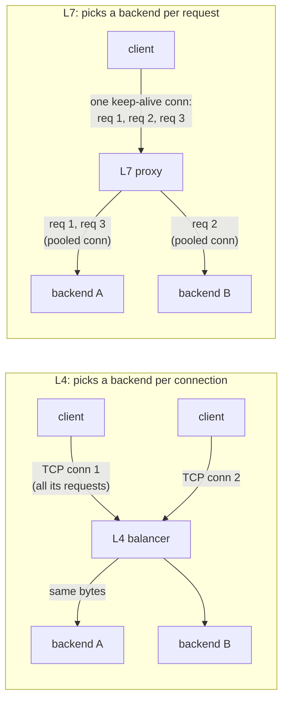
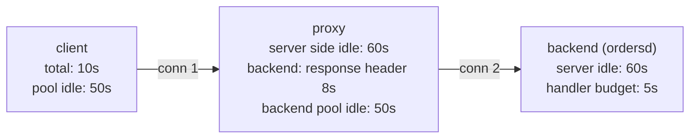
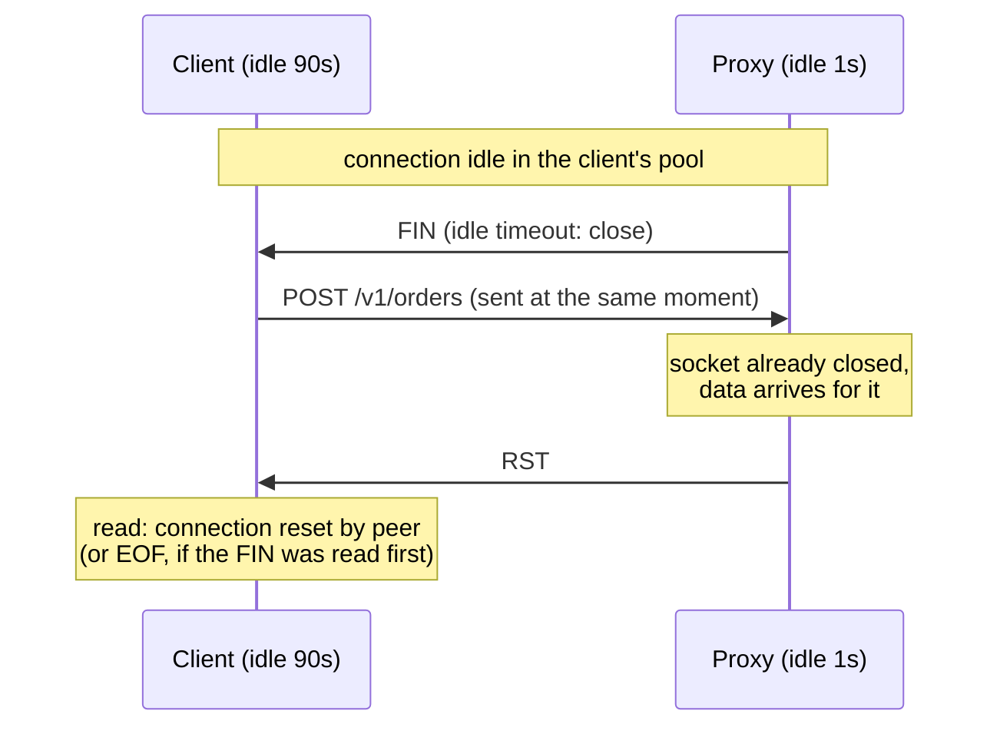

# Load balancers and proxies

## Why care?

In production, your client almost never talks to your server directly. Something sits in between: a cloud load balancer, an ingress controller, a service mesh sidecar, an API gateway. Often two or three of them. Tickets from that middle layer look like this:

- "About one request in a thousand fails with `connection reset by peer` or `EOF`. Only behind the load balancer. Never in tests."
- "Every deploy gives a handful of `502 Bad Gateway`s."
- "The access log says every request comes from `10.0.3.17`." And a month later: "A user bypassed our IP rate limit by sending a fake header."
- "I created an order, then listed my orders, and it wasn't there. I listed again, and it was."
- "We have 10 gRPC backends. One is at 100% CPU, nine are idle."

Each of these is a proxy doing exactly what it was configured to do. This page builds a load balancer in Go, puts it in front of two `ordersd` instances, and reproduces every ticket above for real.

## The idea: the switchboard and the mail room

Two ways to stand in the middle of a conversation:

- **The switchboard operator (layer 4).** A call comes in. The operator picks a free line, connects the two wires, and stops listening. Fast, cheap, works for any language. But the operator has no idea what is said. A caller who stays on the line for an hour stays on **that** line for an hour.
- **The mail room (layer 7).** Every letter is opened, read, and sent to the right desk. The mail room can send each letter to a different desk, add a note ("received from: front door"), refuse letters, retry a lost one. But it must understand the language, and reading every letter costs time.

"Layer 4" and "layer 7" are the transport layer (TCP, UDP) and the application layer (HTTP) of the OSI model; see [Layers and packets](layers-and-packets.md).

## Under the hood: L4 vs L7



|                          | L4 (TCP/UDP)                                            | L7 (HTTP)                                                       |
| ------------------------ | ------------------------------------------------------- | --------------------------------------------------------------- |
| Unit of balancing        | Connection                                              | Request                                                         |
| Sees                     | IPs and ports                                           | Method, path, headers, cookies, body                            |
| TLS                      | Passes it through (the backend has the certificate)     | Usually terminates it (the proxy has the certificate)           |
| Connections              | One client connection = one backend connection          | Two separate pools: client side and backend side                |
| Can add headers, retry   | No                                                      | Yes                                                             |
| Client IP at the backend | Lost, unless NAT keeps it or the PROXY protocol adds it | In `X-Forwarded-For` / `Forwarded`                              |
| Examples                 | AWS NLB, Linux IPVS, kube-proxy for Services            | AWS ALB, nginx, HAProxy in HTTP mode, Envoy, Kubernetes ingress |

### Try it: an L4 balancer in 40 lines

An L4 balancer is just "accept, dial, copy both ways":

```go
// Command l4 is a TCP (layer 4) load balancer: it picks a backend per
// connection and copies bytes both ways. It never looks inside.
package main

import (
	"io"
	"log"
	"net"
	"sync/atomic"
)

func main() {
	backends := []string{"127.0.0.1:19211", "127.0.0.1:19212"}
	var next atomic.Uint64

	ln, err := net.Listen("tcp", "127.0.0.1:19130")
	if err != nil {
		log.Fatal(err)
	}
	for {
		client, err := ln.Accept()
		if err != nil {
			log.Fatal(err)
		}
		target := backends[next.Add(1)%uint64(len(backends))]
		go func() {
			defer client.Close()
			server, err := net.Dial("tcp", target)
			if err != nil {
				log.Print(err)
				return
			}
			defer server.Close()
			log.Printf("%s -> %s", client.RemoteAddr(), target)
			go io.Copy(server, client) // client -> backend
			io.Copy(client, server)    // backend -> client
		}()
	}
}
```

The two backends are a small test server, `whoami`, that reports its name and what it sees (full code [further down](#who-is-the-client-x-forwarded-for)). One is called `fast`, one `slow`. `curl` with three URLs sends three requests on **one** keep-alive connection. Through the L4 balancer, and through the L7 proxy we build next (on port 19110):

```console
$ ./whoami -addr 127.0.0.1:19211 -name fast -delay 10ms &
$ ./whoami -addr 127.0.0.1:19212 -name slow -delay 200ms &
$ ./l4 &
$ curl -s localhost:19130/1 localhost:19130/2 localhost:19130/3 | grep backend
backend=slow remote=127.0.0.1:45761
backend=slow remote=127.0.0.1:45761
backend=slow remote=127.0.0.1:45761
$ curl -s localhost:19110/1 localhost:19110/2 localhost:19110/3 | grep backend
backend=slow remote=127.0.0.1:45767
backend=fast remote=127.0.0.1:45095
backend=slow remote=127.0.0.1:45767
```

L4: all three requests went to `slow`, because they shared a connection. L7: they alternate. This is the gRPC ticket. gRPC uses HTTP/2, which sends **everything** over one long-lived connection (see [HTTP/2](http.md#http2-binary-frames-on-one-connection)). Behind an L4 balancer (a plain Kubernetes `Service`, for example), each client is glued to one backend for hours. Ten backends, a few clients, one hot pod. You need an L7 balancer that understands HTTP/2 streams, or client-side balancing.

And what does the backend see? One request through each, with `curl` sending from the address `127.0.0.5`:

```console
$ curl -s --interface 127.0.0.5 localhost:19130/
backend=fast remote=127.0.0.1:46829
  X-Forwarded-For=""
  naive client IP=""
  right-most untrusted="127.0.0.1"
$ curl -s --interface 127.0.0.5 localhost:19110/
backend=fast remote=127.0.0.1:45095
  X-Forwarded-For="127.0.0.5"
  naive client IP="127.0.0.5"
  right-most untrusted="127.0.0.5"
```

Through our L4 balancer, the client is gone: the backend only sees the balancer's own address. The L7 proxy added `X-Forwarded-For`. Real L4 balancers keep the client IP by rewriting packets instead of opening a new connection (NAT, direct server return), or by sending a small **PROXY protocol** header with the original addresses before the client's bytes.

## A reverse proxy in Go

`net/http/httputil.ReverseProxy` does the hard parts of an L7 proxy: it removes hop-by-hop headers, copies bodies in both directions, handles streaming and protocol upgrades, and uses an `http.Transport` with a connection pool to the backends. We add the parts that make it a **load balancer**: a list of backends, a way to pick one, and health checks.

```go
// Command lb is a small L7 load balancer built on httputil.ReverseProxy.
package main

import (
	"context"
	"errors"
	"flag"
	"log"
	"net"
	"net/http"
	"net/http/httputil"
	"net/url"
	"strings"
	"sync/atomic"
	"time"
)

type backend struct {
	url      *url.URL
	healthy  atomic.Bool
	inflight atomic.Int64
}

type pool struct {
	backends  []*backend
	next      atomic.Uint64
	leastConn bool
}

// pick returns a healthy backend, or nil if there is none.
func (p *pool) pick() *backend {
	var best *backend
	n := uint64(len(p.backends))
	start := p.next.Add(1)
	for i := range n {
		b := p.backends[(start+i)%n]
		if !b.healthy.Load() {
			continue
		}
		if !p.leastConn {
			return b // round robin: first healthy one after the last pick
		}
		if best == nil || b.inflight.Load() < best.inflight.Load() {
			best = b
		}
	}
	return best
}

// check is the active health check: GET /readyz on every backend.
func (p *pool) check(ctx context.Context, every time.Duration) {
	client := &http.Client{Timeout: every}
	for {
		for _, b := range p.backends {
			resp, err := client.Get(b.url.JoinPath("/readyz").String())
			ok := err == nil && resp.StatusCode == http.StatusOK
			if resp != nil {
				resp.Body.Close()
			}
			if b.healthy.Swap(ok) != ok {
				log.Printf("health: %s healthy=%v", b.url.Host, ok)
			}
		}
		select {
		case <-ctx.Done():
			return
		case <-time.After(every):
		}
	}
}

type ctxKey struct{}

func main() {
	listen := flag.String("listen", "127.0.0.1:19100", "listen address")
	targets := flag.String("backends", "http://127.0.0.1:19081,http://127.0.0.1:19082", "comma-separated backend URLs")
	algo := flag.String("algo", "rr", "rr (round robin) or lc (least connections)")
	health := flag.Duration("health", time.Second, "active health check interval (0 = off)")
	idle := flag.Duration("idle", 60*time.Second, "IdleTimeout for client connections")
	keepXFF := flag.Bool("keep-xff", false, "append to the client's X-Forwarded-For instead of replacing it")
	flag.Parse()

	p := &pool{leastConn: *algo == "lc"}
	for _, t := range strings.Split(*targets, ",") {
		u, err := url.Parse(t)
		if err != nil {
			log.Fatal(err)
		}
		b := &backend{url: u}
		b.healthy.Store(true)
		p.backends = append(p.backends, b)
	}
	if *health > 0 {
		go p.check(context.Background(), *health)
	}

	tr := http.DefaultTransport.(*http.Transport).Clone()
	tr.MaxIdleConnsPerHost = 100
	tr.ResponseHeaderTimeout = 10 * time.Second

	proxy := &httputil.ReverseProxy{
		Transport: tr,
		Rewrite: func(r *httputil.ProxyRequest) {
			b := r.In.Context().Value(ctxKey{}).(*backend)
			r.SetURL(b.url)
			if *keepXFF {
				r.Out.Header["X-Forwarded-For"] = r.In.Header["X-Forwarded-For"]
			}
			r.SetXForwarded()
		},
		ModifyResponse: func(resp *http.Response) error {
			resp.Header.Set("X-Backend", resp.Request.URL.Host)
			return nil
		},
		ErrorHandler: func(w http.ResponseWriter, r *http.Request, err error) {
			b := r.Context().Value(ctxKey{}).(*backend)
			var op *net.OpError
			if errors.As(err, &op) && op.Op == "dial" {
				b.healthy.Store(false) // passive health check: it refused us
				log.Printf("passive: %s marked unhealthy: %v", b.url.Host, err)
			}
			log.Printf("proxy error: %s %s via %s: %v", r.Method, r.URL.Path, b.url.Host, err)
			w.WriteHeader(http.StatusBadGateway)
		},
	}

	h := http.HandlerFunc(func(w http.ResponseWriter, r *http.Request) {
		b := p.pick()
		if b == nil {
			http.Error(w, "no healthy backend", http.StatusServiceUnavailable)
			return
		}
		b.inflight.Add(1)
		defer b.inflight.Add(-1)
		proxy.ServeHTTP(w, r.WithContext(context.WithValue(r.Context(), ctxKey{}, b)))
	})

	srv := &http.Server{
		Addr:              *listen,
		Handler:           h,
		ReadHeaderTimeout: 5 * time.Second,
		IdleTimeout:       *idle,
	}
	log.Printf("lb on %s, algo=%s, idle=%s", *listen, *algo, *idle)
	log.Fatal(srv.ListenAndServe())
}
```

The parts of `ReverseProxy` it uses:

- **`Rewrite`** turns the incoming request (`r.In`) into the outgoing one (`r.Out`). `SetURL` points it at the backend; `SetXForwarded` adds `X-Forwarded-For`, `-Host` and `-Proto`. Before `Rewrite` runs, `ReverseProxy` has already **removed** hop-by-hop headers (`Connection`, `Keep-Alive`, `Upgrade`...) and any `Forwarded` / `X-Forwarded-*` headers the client sent.
- **`Director`**, the older hook, is deprecated. Its doc says why: a client can name any header in `Connection:` to have it deleted **after** your Director added it, and Director keeps the client's `X-Forwarded-For`, which "can permit IP spoofing". Use `Rewrite`.
- **`ModifyResponse`** sees every backend response. Ours adds `X-Backend` so we can watch the balancing. (Don't do that in production; it tells strangers your internal addresses.)
- **`ErrorHandler`** runs when the backend could not be reached or did not answer. The default writes a bare `502 Bad Gateway`.

### Two `ordersd` behind the proxy

```console
$ ./ordersd -addr 127.0.0.1:19081 -log-level warn &
$ ./ordersd -addr 127.0.0.1:19082 -log-level warn &
$ ./lb &
$ for i in 1 2 3 4; do curl -s -o /dev/null -w '%{http_code} %header{x-backend}\n' localhost:19100/healthz; done
200 127.0.0.1:19082
200 127.0.0.1:19081
200 127.0.0.1:19082
200 127.0.0.1:19081
```

Round robin. Now the fourth ticket, with `orderctl`:

```console
$ export ORDERS_SERVER=http://127.0.0.1:19100
$ orderctl create -customer c-42 -item MUG:1:899
ID                                    CUSTOMER  STATUS   ITEMS  TOTAL  CREATED
01a218be-fe8c-74b2-8053-db5dd582a193  c-42      pending  1      8.99   2026-11-26 16:44:59
$ orderctl list
ID  CUSTOMER  STATUS  ITEMS  TOTAL  CREATED
$ orderctl list
ID                                    CUSTOMER  STATUS   ITEMS  TOTAL  CREATED
01a218be-fe8c-74b2-8053-db5dd582a193  c-42      pending  1      8.99   2026-11-26 16:44:59
```

The order exists, and then it doesn't, and then it does. Each `ordersd` keeps orders **in its own memory**. The create went to one instance, the first list to the other. Load balancing assumes the backends are **interchangeable**: any of them can answer any request. State belongs in a shared database, not in the process. (That is exactly why `ordersd` has a `Repository` interface: swap the memory store for PostgreSQL and the problem is gone. See [Building a service](../go/services.md#what-a-database-store-would-look-like).)

## Choosing a backend

Round robin is fair to the **backends' turn**, not to their **load**. If one backend is slower, requests pile up there. Least connections sends each request to the backend with the fewest requests in flight right now. The two `whoami` backends from before: `fast` takes 10 ms per request, `slow` takes 200 ms. 20 concurrent clients for 3 seconds, through a round-robin proxy (port 19110) and a least-connections proxy (port 19111):

```console
$ ./lb -listen 127.0.0.1:19110 -algo rr -backends http://127.0.0.1:19211,http://127.0.0.1:19212 &
$ ./lb -listen 127.0.0.1:19111 -algo lc -backends http://127.0.0.1:19211,http://127.0.0.1:19212 &
$ ./load -url http://127.0.0.1:19110/ -c 20 -d 3s
   289  200 from 127.0.0.1:19211
   289  200 from 127.0.0.1:19212
$ ./load -url http://127.0.0.1:19111/ -c 20 -d 3s
  2518  200 from 127.0.0.1:19211
   150  200 from 127.0.0.1:19212
```

`load` is a small test client: workers send requests in a loop and count the results by status and `X-Backend` (and by error message). Its code is at the end of the [idle-timeout section](#reproduce-it).

Round robin: a perfect 50/50 split, and **578** requests in total. The slow backend sets the pace for everyone: each worker spends most of its time waiting on its `slow` turn. Least connections: **2668** requests, 4.6 times more, because `slow` gets a new request only when it has fewer in flight than `fast`, which is rarely.

Other choices you will meet:

| Algorithm                 | Picks                                            | Good for                                           |
| ------------------------- | ------------------------------------------------ | -------------------------------------------------- |
| Round robin               | Next in the list                                 | Equal backends, equal requests                     |
| Least connections         | Fewest in-flight requests                        | Requests of very different cost                    |
| Power of two choices      | Two at random, then the less loaded of the two   | Many proxies, each with a partial view of the load |
| Consistent hashing        | By a key (user ID, path): same key, same backend | Caches; stickiness that survives adding a backend  |
| Weighted versions of each | More traffic to bigger machines or to a canary   | Mixed hardware, gradual rollouts                   |

## Health checks: active and passive

A balancer must stop sending traffic to a backend that can't handle it. It finds out in two ways:

- **Active**: it asks. `lb` sends `GET /readyz` to every backend every second. That is what `ordersd`'s [readiness endpoint](../go/services.md#health-checks-liveness-vs-readiness) is for. Finds problems even with no traffic, but only as often as it checks.
- **Passive**: it watches real traffic. `lb`'s `ErrorHandler` marks a backend down when a dial fails. Instant, but a real request has to fail first.

Real balancers use both: passive to react within one request, active to notice recovery. (In `lb`, only the active check marks a backend healthy again.) Two rules for what to check:

1. **Check readiness, not just "the process is alive".** A backend that is shutting down, or warming its cache, is alive and should get no traffic.
2. **Don't fail the check because a shared dependency is down.** If every backend checks the same database, a database outage marks **all** of them unhealthy, and the balancer returns "no healthy backend" for requests that didn't need the database at all.

!!! note "Health checks through a proxy cascade"

    While building the next demo I chained two `lb` processes: the outer one health-checked the inner
    one's `/readyz`, which the inner one proxied to its backend. When the backend restarted, the inner
    proxy answered `503 no healthy backend`, so the outer proxy marked the inner one unhealthy too, and
    both needed extra check intervals to recover. A proxy should answer its own health check, not
    forward it.

## Who is the client? `X-Forwarded-For`

After an L7 proxy, the backend's `r.RemoteAddr` is the **proxy**. The original client is only in a header. Two exist:

- **`X-Forwarded-For: client, proxy1, proxy2`**: not a formal standard, but what everyone uses. Each proxy **appends** the address it received the connection from.
- **`Forwarded: for=192.0.2.60;proto=https;by=203.0.113.43`**: the standard version (RFC 7239). Same idea, more structure, less support.

The danger: a header is just text the client can write. This is `whoami`, the test backend:

```go
// Command whoami is a test backend. It reports who it is, who connected
// to it, and which client IP it would believe.
package main

import (
	"flag"
	"fmt"
	"log"
	"net"
	"net/http"
	"net/netip"
	"slices"
	"strings"
	"time"
)

// Our own proxies. In production: the load balancer's subnet.
var trusted = []netip.Prefix{netip.MustParsePrefix("127.0.0.1/32")}

func isTrusted(a netip.Addr) bool {
	return slices.ContainsFunc(trusted, func(p netip.Prefix) bool { return p.Contains(a) })
}

// clientIP walks the chain from the right (the closest hop first) and
// returns the first address that is not one of our own proxies.
func clientIP(r *http.Request) string {
	peer, _, _ := net.SplitHostPort(r.RemoteAddr)
	var chain []string // left-most XFF entry ... TCP peer
	for h := range strings.SplitSeq(r.Header.Get("X-Forwarded-For"), ",") {
		if h = strings.TrimSpace(h); h != "" {
			chain = append(chain, h)
		}
	}
	chain = append(chain, peer)
	for i := len(chain) - 1; i > 0; i-- {
		a, err := netip.ParseAddr(chain[i])
		if err != nil || !isTrusted(a) {
			return chain[i]
		}
	}
	return chain[0]
}

func main() {
	addr := flag.String("addr", "127.0.0.1:19201", "listen address")
	name := flag.String("name", "a", "backend name")
	delay := flag.Duration("delay", 0, "time to spend on each request")
	flag.Parse()

	h := func(w http.ResponseWriter, r *http.Request) {
		time.Sleep(*delay)
		xff := r.Header.Get("X-Forwarded-For")
		naive, _, _ := strings.Cut(xff, ",") // WRONG: trusts the left-most entry
		fmt.Fprintf(w, "backend=%s remote=%s\n  X-Forwarded-For=%q\n  naive client IP=%q\n  right-most untrusted=%q\n",
			*name, r.RemoteAddr, xff, strings.TrimSpace(naive), clientIP(r))
	}
	srv := &http.Server{Addr: *addr, Handler: http.HandlerFunc(h), ReadHeaderTimeout: 5 * time.Second}
	log.Fatal(srv.ListenAndServe())
}
```

Four proxies in front of it: two single proxies, and two chains of an **edge** proxy (the one the internet talks to) in front of an **inner** one:

```sh
./whoami -addr 127.0.0.1:19201 -name a &
./lb -listen 127.0.0.1:19101 -backends http://127.0.0.1:19201 &            # replaces XFF
./lb -listen 127.0.0.1:19102 -keep-xff -backends http://127.0.0.1:19201 &  # appends to the client's XFF
./lb -listen 127.0.0.1:19103 -backends http://127.0.0.1:19101 &            # edge (replace) -> inner (replace)
./lb -listen 127.0.0.1:19104 -backends http://127.0.0.1:19102 &            # edge (replace) -> inner (keep)
```

An attacker at `127.0.0.5` claims to be `6.6.6.6`:

```console
$ curl -s --interface 127.0.0.5 -H 'X-Forwarded-For: 6.6.6.6' localhost:19102/
backend=a remote=127.0.0.1:46085
  X-Forwarded-For="6.6.6.6, 127.0.0.5"
  naive client IP="6.6.6.6"
  right-most untrusted="127.0.0.5"
```

A proxy that **keeps** the client's header, plus a backend that takes the **left-most** entry: the attacker chose their own IP. Rate limits, IP allow-lists, audit logs and geo-blocking are all fooled. The right-most-untrusted rule is not: it walks from the right, skips our own proxy, and finds the address that actually connected.

Now the edge proxy **replaces** the header (Go's `Rewrite` default):

```console
$ curl -s --interface 127.0.0.5 -H 'X-Forwarded-For: 6.6.6.6' localhost:19101/
backend=a remote=127.0.0.1:46101
  X-Forwarded-For="127.0.0.5"
  naive client IP="127.0.0.5"
  right-most untrusted="127.0.0.5"
```

The fake entry is gone. But replacing everywhere breaks chains. Edge replaces, inner replaces too:

```console
$ curl -s --interface 127.0.0.5 -H 'X-Forwarded-For: 6.6.6.6' localhost:19103/
backend=a remote=127.0.0.1:46101
  X-Forwarded-For="127.0.0.1"
  naive client IP="127.0.0.1"
  right-most untrusted="127.0.0.1"
```

The inner proxy threw away what the edge had written, and the real client is lost. The working setup: **the edge replaces, inner proxies append**:

```console
$ curl -s --interface 127.0.0.5 -H 'X-Forwarded-For: 6.6.6.6' localhost:19104/
backend=a remote=127.0.0.1:46085
  X-Forwarded-For="127.0.0.5, 127.0.0.1"
  naive client IP="127.0.0.5"
  right-most untrusted="127.0.0.5"
```

The rules:

1. **The edge proxy never trusts incoming `X-Forwarded-For`.** It replaces the header with the connecting address.
2. **Inner proxies append**, because their peer is a proxy you control.
3. **The application reads from the right** and skips a configured list of its own proxies. Make that list configuration, and make it as tight as possible.
4. **The backend must only be reachable through the proxy.** If an attacker can reach the backend directly, they write the whole header and every rule above is moot. Use a firewall or a network policy.

## Timeouts at every hop

With a proxy in the middle, one request has **two** connections, and each has its own timeouts on both ends:



Two rules, one for each kind of timeout:

1. **Request timeouts shrink as you go inward.** The client waits longer than the proxy, the proxy longer than the backend's own budget. Then the **innermost** layer gives up first, cleanly, with a real error, and the outer layers see that error. The other way round, the client times out while the backend still works on a request nobody is waiting for, and every layer logs a different error for it. (Go's `ReverseProxy` turns a client that went away into a cancelled backend request, because the outgoing request carries `r.Context()`.)
2. **On each connection, the client side must close idle connections before the server side does.** The side that **sends** requests on a connection must have the **shorter** idle timeout. Ignore this and you get the first ticket. Let's reproduce it.

### The idle-timeout mismatch

Picture the connection between a client and the proxy, idle in the client's pool. The proxy's `IdleTimeout` is 1 second. The client's `IdleConnTimeout` is 90 seconds, so the client thinks the connection is fine. At about 1 second:



The FIN and the request **cross on the wire**. The client wrote its request into a connection the other side had already decided to close. The kernel on the proxy side answers data for a closed socket with a reset. Which error the client sees depends on timing by microseconds: `EOF` if it read the FIN first, `connection reset by peer` if the RST came first, `http: server closed idle connection` if Go noticed just before sending.

### Reproduce it

`lb` on port 19120 with `-idle 1s`. Twenty clients each send a `POST`, wait **1 second**, and repeat. That lands each request right at the proxy's idle deadline:

```console
$ ./lb -listen 127.0.0.1:19120 -idle 1s &
$ B='{"customer_id":"c-1","items":[{"sku":"MUG","quantity":1,"price_cents":899}]}'
$ ./load -url http://127.0.0.1:19120/v1/orders -method POST -body "$B" -c 20 -d 10s -pause 1s
   189  201 from 127.0.0.1:19081
     8  error: Post "http://127.0.0.1:19120/v1/orders": EOF
     3  error: Post "http://127.0.0.1:19120/v1/orders": read tcp 127.0.0.1:*->127.0.0.1:19120: read: connection reset by peer
```

11 failures in 200 requests. Both error messages from the ticket. (`load` replaces the client port numbers with `*` so that equal errors are counted together.) An earlier run, before `load` did that, swept the pause around the deadline and shows how narrow the race is, and a third flavour of the same error:

```console
$ for p in 990ms 1000ms 1010ms; do echo "== pause $p"; ./load -url http://127.0.0.1:19120/v1/orders -method POST -body "$B" -c 20 -d 10s -pause $p; done
== pause 990ms
   220  201 from 127.0.0.1:19081
== pause 1000ms
   162  201 from 127.0.0.1:19081
    20  error: Post "http://127.0.0.1:19120/v1/orders": EOF
     2  error: Post "http://127.0.0.1:19120/v1/orders": http: server closed idle connection
     1  error: Post "http://127.0.0.1:19120/v1/orders": read tcp 127.0.0.1:47799->127.0.0.1:19120: read: connection reset by peer
     1  error: Post "http://127.0.0.1:19120/v1/orders": read tcp 127.0.0.1:47807->127.0.0.1:19120: read: connection reset by peer
     1  error: Post "http://127.0.0.1:19120/v1/orders": read tcp 127.0.0.1:47819->127.0.0.1:19120: read: connection reset by peer
     1  error: Post "http://127.0.0.1:19120/v1/orders": read tcp 127.0.0.1:47827->127.0.0.1:19120: read: connection reset by peer
     1  error: Post "http://127.0.0.1:19120/v1/orders": read tcp 127.0.0.1:47845->127.0.0.1:19120: read: connection reset by peer
     1  error: Post "http://127.0.0.1:19120/v1/orders": read tcp 127.0.0.1:47911->127.0.0.1:19120: read: connection reset by peer
     1  error: Post "http://127.0.0.1:19120/v1/orders": read tcp 127.0.0.1:47939->127.0.0.1:19120: read: connection reset by peer
     1  error: Post "http://127.0.0.1:19120/v1/orders": read tcp 127.0.0.1:47995->127.0.0.1:19120: read: connection reset by peer
     1  error: Post "http://127.0.0.1:19120/v1/orders": read tcp 127.0.0.1:48013->127.0.0.1:19120: read: connection reset by peer
     1  error: Post "http://127.0.0.1:19120/v1/orders": read tcp 127.0.0.1:48049->127.0.0.1:19120: read: connection reset by peer
     1  error: Post "http://127.0.0.1:19120/v1/orders": read tcp 127.0.0.1:48063->127.0.0.1:19120: read: connection reset by peer
     1  error: Post "http://127.0.0.1:19120/v1/orders": read tcp 127.0.0.1:48099->127.0.0.1:19120: read: connection reset by peer
     1  error: Post "http://127.0.0.1:19120/v1/orders": read tcp 127.0.0.1:48177->127.0.0.1:19120: read: connection reset by peer
     1  error: Post "http://127.0.0.1:19120/v1/orders": read tcp 127.0.0.1:48207->127.0.0.1:19120: read: connection reset by peer
     1  error: Post "http://127.0.0.1:19120/v1/orders": read tcp 127.0.0.1:48213->127.0.0.1:19120: read: connection reset by peer
     1  error: Post "http://127.0.0.1:19120/v1/orders": read tcp 127.0.0.1:48215->127.0.0.1:19120: read: connection reset by peer
== pause 1010ms
   199  201 from 127.0.0.1:19081
     1  error: Post "http://127.0.0.1:19120/v1/orders": EOF
```

With a pause of 990 ms, every request beats the proxy's deadline: 0 errors. At 1000 ms, 39 errors (one in five). At 1010 ms the proxy has closed the connection long enough ago that Go's client usually notices before reusing it: 1 error.

In production the timeouts are 60 seconds, not 1, and traffic is irregular. So the race hits a tiny fraction of requests, at random, mostly at quiet times when connections sit idle long enough. That is why it never shows up in tests.

Now the same test with a `GET`, and then the `POST` with the client's idle timeout **shorter** than the proxy's:

```console
$ ./load -url http://127.0.0.1:19120/v1/orders -c 20 -d 10s -pause 1s
   200  200 from 127.0.0.1:19081
$ ./load -url http://127.0.0.1:19120/v1/orders -method POST -body "$B" -c 20 -d 10s -pause 1s -idle 500ms
   200  201 from 127.0.0.1:19081
```

Zero errors both times, for two different reasons:

- **The `GET` hit the same race but Go retried it.** `net/http` retries a request on a new connection when it failed on a **reused** connection and the request is safe to repeat (`shouldRetryRequest` in `transport.go`). A `POST` is not retried, because sending it twice could create two orders.

- **The fixed `POST`**: with `IdleConnTimeout: 500ms`, the client closes idle connections before the proxy does. The race is gone, not just hidden.

What counts as "safe to repeat" is in `request.go` (Go 1.27.4):

```go
func (r *Request) isReplayable() bool {
	if r.Body == nil || r.Body == NoBody || r.GetBody != nil {
		switch valueOrDefault(r.Method, "GET") {
		case "GET", "HEAD", "OPTIONS", "TRACE":
			return true
		}
		// The Idempotency-Key, while non-standard, is widely used to
		// mean a POST or other request is idempotent. See
		// https://golang.org/issue/19943#issuecomment-421092421
		if r.Header.has("Idempotency-Key") || r.Header.has("X-Idempotency-Key") {
			return true
		}
	}
	return false
}
```

The `Idempotency-Key` rule is easy to test: `load -idem` sets a new key on each request.

```console
$ ./load -url http://127.0.0.1:19120/v1/orders -method POST -body "$B" -c 20 -d 10s -pause 1s -idem
   200  201 from 127.0.0.1:19081
```

No errors: Go retried the `POST`s. That is only correct if the **server** really deduplicates by that key. `ordersd` doesn't. Here no request had reached the handler before the connection died, so nothing was doubled, but in general a client that sends `Idempotency-Key` to a server that ignores it gets duplicates on retries. See [Retries and idempotency](#retries-and-idempotency).

The `load` client used in all these runs:

```go
// Command load sends requests from several workers and counts the
// results per backend (X-Backend header) and per error.
package main

import (
	"flag"
	"fmt"
	"io"
	"maps"
	"net/http"
	"regexp"
	"slices"
	"strings"
	"sync"
	"time"
	"uuid"
)

// ports hides the client port numbers, so equal errors are counted together.
var ports = regexp.MustCompile(`:\d+->`)

func main() {
	url := flag.String("url", "http://127.0.0.1:19100/healthz", "target URL")
	workers := flag.Int("c", 10, "concurrent workers")
	dur := flag.Duration("d", 3*time.Second, "how long to run")
	method := flag.String("method", "GET", "GET or POST")
	body := flag.String("body", "", "request body (sent as JSON)")
	pause := flag.Duration("pause", 0, "pause between requests in each worker")
	idem := flag.Bool("idem", false, "send an Idempotency-Key header")
	idle := flag.Duration("idle", 90*time.Second, "client IdleConnTimeout")
	flag.Parse()

	tr := http.DefaultTransport.(*http.Transport).Clone()
	tr.MaxIdleConnsPerHost = *workers
	tr.IdleConnTimeout = *idle
	client := &http.Client{Transport: tr, Timeout: 10 * time.Second}

	var mu sync.Mutex
	counts := map[string]int{}
	add := func(k string) { mu.Lock(); counts[k]++; mu.Unlock() }

	deadline := time.Now().Add(*dur)
	var wg sync.WaitGroup
	for range *workers {
		wg.Go(func() {
			for time.Now().Before(deadline) {
				req, _ := http.NewRequest(*method, *url, strings.NewReader(*body))
				if *body != "" {
					req.Header.Set("Content-Type", "application/json")
				}
				if *idem {
					req.Header.Set("Idempotency-Key", uuid.NewV7().String())
				}
				resp, err := client.Do(req)
				if err != nil {
					add("error: " + ports.ReplaceAllString(err.Error(), ":*->"))
				} else {
					io.Copy(io.Discard, resp.Body)
					resp.Body.Close()
					add(fmt.Sprintf("%d from %s", resp.StatusCode, resp.Header.Get("X-Backend")))
				}
				time.Sleep(*pause)
			}
		})
	}
	wg.Wait()
	for _, k := range slices.Sorted(maps.Keys(counts)) {
		fmt.Printf("%6d  %s\n", counts[k], k)
	}
}
```

### Fixing it in real systems

The same race happens on **both** connections: client to load balancer, and load balancer to backend. The most common production case is the second one: the load balancer keeps idle connections to your backend **longer** than your backend keeps them open. Then the load balancer gets the reset and turns it into a `502` for the client.

- **Backend `IdleTimeout` > the load balancer's idle timeout** for its backend connections. Find the balancer's value in its documentation. AWS's Application Load Balancer, for example, has a 60 second idle timeout by default, which makes `ordersd`'s `IdleTimeout: 60s` a coin toss; 75 or 120 seconds is safe.
- **Client `IdleConnTimeout` < the server's idle timeout** for every client you own, including the `http.Transport` inside your proxy.
- **Make retries safe** so that the remaining races (there is always a deploy, a crash, a network blip) are harmless. Next sections.

## Connection draining during deploys

During a deploy, an instance must stop getting new requests **before** it stops serving. [Graceful shutdown](../go/services.md#graceful-shutdown) built that into `ordersd`: on `SIGTERM` it reports not-ready, keeps serving for `ShutdownDelay`, then finishes in-flight requests. Here is why each step matters. Five clients send requests through `lb` (active check every second), and after one second one backend gets `SIGTERM`.

`ordersd` on port 19082 with **no** delay (the default, 0):

```console
$ ./load -url http://127.0.0.1:19100/v1/orders -c 5 -d 4s -pause 5ms &
$ sleep 1; kill -TERM $ORDERSD_19082_PID
  2570  200 from 127.0.0.1:19081
   372  200 from 127.0.0.1:19082
     3  502 from
$ cat lb.log
2026/11/26 17:46:27 passive: 127.0.0.1:19082 marked unhealthy: dial tcp 127.0.0.1:19082: connect: connection refused
2026/11/26 17:46:27 proxy error: GET /v1/orders via 127.0.0.1:19082: dial tcp 127.0.0.1:19082: connect: connection refused
2026/11/26 17:46:27 passive: 127.0.0.1:19082 marked unhealthy: dial tcp 127.0.0.1:19082: connect: connection refused
2026/11/26 17:46:27 passive: 127.0.0.1:19082 marked unhealthy: dial tcp 127.0.0.1:19082: connect: connection refused
2026/11/26 17:46:27 proxy error: GET /v1/orders via 127.0.0.1:19082: dial tcp 127.0.0.1:19082: connect: connection refused
2026/11/26 17:46:27 proxy error: GET /v1/orders via 127.0.0.1:19082: dial tcp 127.0.0.1:19082: connect: connection refused
```

`srv.Shutdown` closes the listener at once. The balancer still thinks the backend is healthy (its next active check is up to a second away), so requests are sent there, and the dial is refused. Three requests, in flight at the same moment, each failed and each marked the backend down (passive check). Three `502`s per deploy, per instance: the second ticket.

With `ORDERS_SHUTDOWN_DELAY=3s`:

```console
$ ORDERS_SHUTDOWN_DELAY=3s ./ordersd -addr 127.0.0.1:19082 -log-level warn &
$ ./load -url http://127.0.0.1:19100/v1/orders -c 5 -d 6s -pause 5ms &
$ sleep 1; kill -TERM $ORDERSD_19082_PID
  3867  200 from 127.0.0.1:19081
   553  200 from 127.0.0.1:19082
$ cat lb.log
2026/11/26 17:46:45 lb on 127.0.0.1:19100, algo=rr, idle=1m0s
2026/11/26 17:46:48 health: 127.0.0.1:19082 healthy=false
```

Zero errors. `/readyz` turned 503, the active check saw it within a second, traffic moved away, and only then did `ordersd` close its listener. The delay must be **longer than the time the balancer needs to notice**: check interval × failures-before-unhealthy, plus some margin. In Kubernetes, also add the time for the endpoint change to reach every node's kube-proxy and the ingress controllers.

Draining has a second half: **long-lived connections**. `Shutdown` closes idle keep-alive connections and waits for active requests, but its doc says it "does not attempt to close nor wait for hijacked connections such as WebSockets". Those need their own shutdown signal (`Server.RegisterOnShutdown`), and clients that reconnect.

## Sticky sessions

The `orderctl list` surprise has a tempting fix: **sticky sessions** (session affinity). The balancer sends all requests of one client to the same backend, usually by setting a cookie on the first response (or by hashing the client IP). The order would "always be there".

It hides the problem instead of fixing it:

- **The state still dies with the instance.** A deploy, a crash or a scale-down, and every user glued to that instance loses their data.
- **Load is uneven.** One heavy client, or many clients behind one corporate NAT (one IP!), make one backend hot. Least connections can't help: the choice is already made.
- **Draining takes forever**, because sticky clients keep coming back to the old instance.

Use stickiness as an **optimisation** (a warm cache on the backend that served you last time), never for **correctness**. For correctness, the state goes into a shared store. When you do need affinity, **consistent hashing** on a meaningful key (user ID, tenant) is better than cookies: it survives proxy restarts and moves only a small part of the keys when a backend is added.

## Retries and idempotency

Proxies, clients and libraries all love to retry. Retries turn a short glitch (the idle race, a deploy, one dropped connection) into a slow success instead of an error. They also have two dangers:

1. **Doubling side effects.** A `POST` that timed out may have succeeded. Retrying it creates a second order. Only retry what is **idempotent** (doing it twice equals doing it once): `GET`, `PUT` of a full resource, `DELETE`, or a `POST` that carries an **idempotency key** the server stores and checks.
2. **Retry storms.** A backend is slow because it is overloaded. Every layer retries 3 times: client, proxy, sidecar. One request becomes 27, exactly when the backend can least afford it. Retry at **one** layer, with exponential backoff and jitter, and a **retry budget** (for example: retries may add at most 10% to the traffic).

What Go does for you, as we saw: `http.Transport` retries **once**, only on a **reused** connection that failed before the response started, and only for replayable requests. `httputil.ReverseProxy` itself does not retry at all; its `ErrorHandler` gets the error, and you decide. That is a sensible default. If you add retries to a proxy, retry only on errors where the request clearly never reached the backend (a refused dial, a reset before any byte was written), and only for idempotent requests.

The full story (idempotency keys, at-least-once delivery, exactly-once myths) is in [Distributed systems](../distributed-systems/index.md).

## Traps

- **Backends with state in memory behind a balancer.** Interchangeable backends are the whole assumption. Put state in a shared store; don't paper over it with sticky sessions.
- **Trusting the left-most `X-Forwarded-For`.** Anyone can write it. Replace at the edge, append inside, read from the right with a list of trusted proxies.
- **Using `ReverseProxy.Director`.** Deprecated; keeps the client's `X-Forwarded-*` and lets clients delete your headers via `Connection`. Use `Rewrite`.
- **Backend idle timeout ≤ the load balancer's idle timeout.** Random `502`s and resets at quiet times. The side that sends requests must give up idle connections first.
- **Shutting down without a readiness delay.** A few `502`s on every deploy. Turn not-ready, wait longer than the balancer's detection time, then close.
- **Timeouts that grow inward.** The client gives up first and the backend keeps working for nobody. Inner layers get the shorter budgets.
- **Retries at every layer.** Multiplied load during an incident. One layer, with backoff, jitter and a budget, and only for idempotent requests.
- **L4 balancing for HTTP/2 or gRPC.** One connection carries everything, so one backend gets it all. Use L7, or client-side balancing.
- **Health checks that check shared dependencies, or go through another proxy.** A database blip or one proxy restart marks everything unhealthy.
- **Leaking backend details.** Headers like our `X-Backend`, or the default `502` page of some proxies, tell attackers your internal layout.

## Check yourself

??? question "1. Behind an L4 balancer with 4 backends, a service gets traffic from 3 gRPC clients. Two backends are busy, two are idle. Why?"

    gRPC uses HTTP/2, which sends all requests of a client over one long-lived TCP connection. An L4
    balancer picks a backend per connection, so each client is glued to one backend: three clients,
    at most three busy backends, here two (two clients landed on the same one). Use an L7 balancer that
    balances HTTP/2 streams, or client-side balancing.

??? question "2. A request reaches your backend with `X-Forwarded-For: 203.0.113.9, 198.51.100.4, 10.0.0.12` and `RemoteAddr` 10.0.0.13. Your proxies are in 10.0.0.0/24. What is the client IP?"

    Walk from the right: 10.0.0.13 (the TCP peer) is ours, 10.0.0.12 is ours, 198.51.100.4 is not.
    The client is 198.51.100.4. Everything to its left (203.0.113.9) was written by the client or by
    proxies you don't control, and can't be trusted.

??? question "3. The load balancer's idle timeout to backends is 60s. Your Go service has `IdleTimeout: 30s`. What do you expect, and what is the fix?"

    Occasional `502`s from the load balancer, mostly at quiet times: the backend closes idle
    connections that the balancer still considers usable, and a request sometimes crosses the FIN on
    the wire. Fix: set the backend's `IdleTimeout` above 60s, for example 75s.

??? question "4. `ordersd` gets `SIGTERM` and calls `srv.Shutdown` at once. The balancer health-checks every 5 seconds and needs 2 failures to mark a backend down. Roughly how long should `ShutdownDelay` be?"

    Longer than the balancer needs to notice: up to 5s until the next check, plus another 5s for the
    second failure, so more than 10s; 12–15s is reasonable. (And the orchestrator's grace period must
    be longer than the delay plus `ShutdownTimeout`.)

??? question "5. Your Go client sends `POST /v1/payments` with an `Idempotency-Key` header. A request fails with `EOF` on a reused connection, and Go retries it automatically. When is that a bug?"

    When the server ignores the key. If the first attempt reached the handler before the connection
    died, the retry charges the customer twice. The header promises the server will deduplicate; only
    send it to servers that do.

??? question "6. Round robin or least connections, for a service where most requests take 5 ms and a few reports take 10 seconds?"

    Least connections. Round robin keeps sending its fair share of new requests to a backend that is
    stuck on reports; least connections sees the in-flight count and sends new requests elsewhere.

## Recap

- **L4** balances connections and never looks inside; **L7** balances requests, can rewrite headers and retry, and keeps two separate connection pools.
- `httputil.ReverseProxy` with **`Rewrite`** is a solid L7 core in Go: it removes hop-by-hop headers and the client's `X-Forwarded-*`, and `SetXForwarded` adds trustworthy ones.
- Backends must be **interchangeable**. State in memory plus round robin means "the order is gone, then it's back".
- **Least connections** adapts to slow backends; round robin doesn't. We measured 4.6 times the throughput.
- **Active** health checks notice recovery; **passive** ones react within a request. Check readiness, not shared dependencies.
- **`X-Forwarded-For`** is client-controlled text. Replace at the edge, append inside, read from the right.
- **Request timeouts shrink inward; idle timeouts must be shorter on the side that sends requests.** The idle-timeout mismatch causes random `EOF` and `connection reset by peer`; we reproduced it in about 1 request in 20.
- **Draining** = not-ready, wait for the balancer to notice, then close. Zero `502`s instead of three per instance.
- **Retries** need idempotency, one layer, backoff and a budget. Go's transport retries only safe requests on reused connections; `ReverseProxy` never retries.

Next: putting it all together when something doesn't connect. [Debugging the network](debugging.md).
