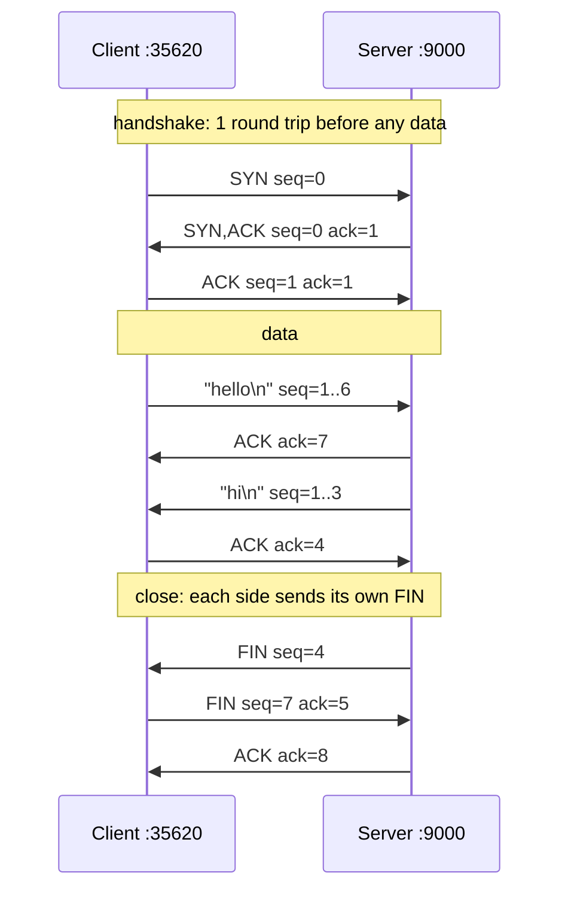
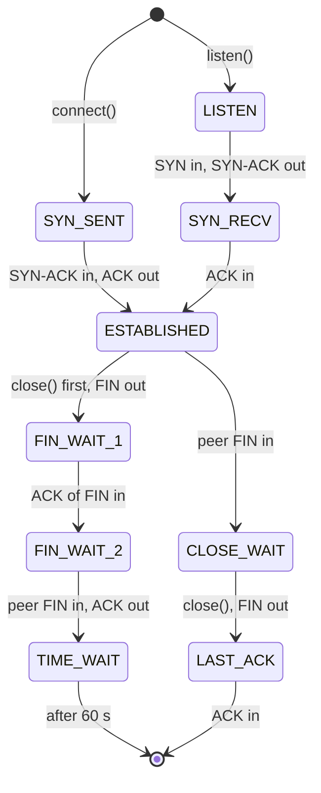
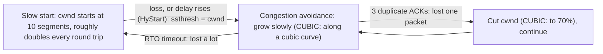
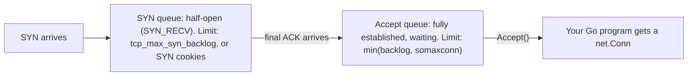

# TCP

## Why care?

Five tickets, all from services that "just use HTTP":

- "Every call to the pricing service takes 40 ms more than it should. The handler takes 1 ms."
- "Under a traffic burst, new connections time out after exactly 1 and 3 seconds. CPU is fine."
- "After a firewall failover, our workers hang for 15 minutes before they notice."
- "The load test dies with `cannot assign requested address`. `ss` shows 28,000 sockets in `TIME-WAIT`."
- "`read: connection reset by peer`, a few times an hour, only on the first request after a quiet period."

Each one is TCP doing exactly what it was designed to do. TCP turns an unreliable network that loses, duplicates and reorders packets into a reliable, ordered **byte stream**. To do that it keeps state on both ends, waits on timers, and holds back data on purpose. This page shows that state and those timers, with real packets from the capturer of [Layers and packets](layers-and-packets.md#try-it-capture-a-real-packet), so you can recognise each ticket when you see it.

## The idea: numbered bytes, acknowledgements and windows

IP delivers packets one by one. Packets can be lost, duplicated or arrive out of order. TCP builds a reliable, ordered byte stream on top of that with a few mechanisms:

- **Sequence numbers.** TCP numbers every byte it sends. The receiver uses the numbers to put data in order and to find gaps.
- **Acknowledgements (ACKs).** The receiver reports back: "I have everything up to byte N." If the sender gets no ACK for some data in time, it sends that data again. This is **retransmission**.
- **The receive window.** Each ACK also says how much more data the receiver can buffer right now. The sender never sends more than that.
- **Congestion control.** The sender does not know how busy the network is. It starts by sending a little, sends more each time everything arrives, and sends less when packets are lost.
- **The handshake and the close.** Before any data, the two sides exchange their starting sequence numbers. This is the **handshake**. At the end, each side says separately that it has nothing more to send (**FIN**), because the other side may still be sending.

The rest of this page covers the details. The tickets above come from those details.

## Under the hood: a connection from start to end

Here is the capture from the previous page again: `hello dial` sends `hello\n` (6 bytes), the server answers `hi\n` (3 bytes), both close. Real sequence numbers are random, so the right-hand column shows them **relative** to each side's first number (client 1170981950, server 1788997206), the way Wireshark does:

```text
 0.000000 127.0.0.1:35620 > 127.0.0.1:9000 [SYN] seq=1170981950 win=65495 len=0        seq 0
 0.000095 127.0.0.1:9000 > 127.0.0.1:35620 [SYN,ACK] seq=1788997206 ack=1170981951 ...   seq 0, ack 1
 0.000112 127.0.0.1:35620 > 127.0.0.1:9000 [ACK] seq=1170981951 ack=1788997207 ...       seq 1, ack 1
 0.000125 127.0.0.1:35620 > 127.0.0.1:9000 [PSH,ACK] seq=1170981951 ack=1788997207 len=6 seq 1, ack 1
 0.000140 127.0.0.1:9000 > 127.0.0.1:35620 [ACK] seq=1788997207 ack=1170981957 ...       seq 1, ack 7
 0.000156 127.0.0.1:9000 > 127.0.0.1:35620 [PSH,ACK] seq=1788997207 ack=1170981957 len=3 seq 1, ack 7
 0.000247 127.0.0.1:35620 > 127.0.0.1:9000 [ACK] seq=1170981957 ack=1788997210 ...       seq 7, ack 4
 0.000281 127.0.0.1:9000 > 127.0.0.1:35620 [FIN,ACK] seq=1788997210 ack=1170981957 ...   seq 4, ack 7
 0.000312 127.0.0.1:35620 > 127.0.0.1:9000 [FIN,ACK] seq=1170981957 ack=1788997211 ...   seq 7, ack 5
 0.000330 127.0.0.1:9000 > 127.0.0.1:35620 [ACK] seq=1788997211 ack=1170981958 ...       seq 5, ack 8
```

(The lines are shortened; the full ones, with window and options, are on the previous page.)



Line by line, the capture shows these rules:

1. **The SYN carries the client's random starting number** (the ISN, initial sequence number). It is random so that an attacker can't guess it and inject packets, and so that packets from an old connection with the same 4-tuple don't fit into a new one.
2. **The SYN-ACK does two jobs:** it acknowledges the client's SYN (`ack = ISN + 1`) and carries the server's own SYN. **A SYN counts as one byte** of sequence space, even though it carries no data. So does a FIN.
3. **The third packet (ACK)** completes the handshake. The client may now send. That's **one full round trip** before the first byte of your request. On a 30 ms path, every new connection costs 30 ms before HTTP even starts, and TLS adds more (see [TLS](tls.md)).
4. **An ACK number means "I have everything before this byte, send me this one next."** The client sent bytes 1 to 6; the server answers `ack 7`. It is **cumulative**: one ACK covers everything before it.
5. **`PSH`** means "this is the end of a write, hand it to the application now." Linux sets it on the last segment of each write. You can mostly ignore it.
6. **Each direction closes on its own.** Here the server called `Close` first (its FIN, `seq 4`), and the client answered with its own FIN. Ten packets total; the last three are the close.

Options from the SYNs are agreed for the whole connection: **MSS** (largest segment), **window scale** (multiply windows by 2^7 = 128), **SACK** (receivers may say "I have 1-100 and 200-300", so only the gap is resent), and **timestamps** (for measuring round-trip time and telling old packets from new ones after the sequence number wraps around).

### The flags

| Flag  | Name           | Meaning                                                                                   |
| ----- | -------------- | ----------------------------------------------------------------------------------------- |
| `SYN` | synchronise    | "Let's start; here is my starting sequence number." Only in the first packet of each side |
| `ACK` | acknowledgment | The ACK number is valid. Set on every packet after the first SYN                          |
| `FIN` | finish         | "I have nothing more to send." The other side may still send                              |
| `RST` | reset          | "This connection does not exist (anymore). Stop." No reply, no goodbye                    |
| `PSH` | push           | Deliver to the application without waiting for more                                       |
| `URG` | urgent         | Out-of-band data. Practically unused                                                      |
| `ECE` | ECN echo       | "A router told me the path is congested" (Explicit Congestion Notification)               |
| `CWR` | window reduced | "I heard you, and slowed down"                                                            |

### Lost packets and retransmission

Every segment sent stays in the sender's buffer until it is acknowledged. If no ACK comes within the **retransmission timeout** (RTO), the segment goes again, and the RTO doubles (**exponential backoff**). Linux keeps the RTO at least 200 ms (`ss` shows `rto:210` on a loopback connection). A faster path to recovery: when the receiver gets segments after a gap, it repeats its last ACK, and after **three duplicate ACKs** the sender retransmits at once (**fast retransmit**), without waiting for the timer. SACK then says exactly what is missing.

The same doubling applies to the SYN. If nobody answers a SYN, Linux resends it after 1 s, then 2 s, 4 s, and so on, `net.ipv4.tcp_syn_retries = 6` times. That's the "connections time out after exactly 1 and 3 seconds" ticket: a dropped SYN, retried at 1 s and at 1 + 2 = 3 s. The listen backlog section below drops one on purpose.

### Connection states

`ss` shows each socket's state. The ones that matter:



- **The side that closes first** goes through `FIN-WAIT-1`, `FIN-WAIT-2` and ends in **`TIME-WAIT`**.
- **The side that closes second** goes through `CLOSE-WAIT` (the peer is done, **we** haven't called `Close` yet) and `LAST-ACK`.

`CLOSE-WAIT` is the state to worry about, because only **your program** can end it. Here, three clients connect to a server that never calls `Close` (the `keepalive serve` program from later on this page), and are killed after 0.3 s:

```console
$ ss -tan
State      Recv-Q Send-Q Local Address:Port  Peer Address:Port Process
LISTEN     0      128        127.0.0.1:9000       0.0.0.0:*
CLOSE-WAIT 7      0          127.0.0.1:9000     127.0.0.1:46836
FIN-WAIT-2 0      0          127.0.0.1:46852    127.0.0.1:9000
FIN-WAIT-2 0      0          127.0.0.1:46836    127.0.0.1:9000
CLOSE-WAIT 7      0          127.0.0.1:9000     127.0.0.1:46868
CLOSE-WAIT 7      0          127.0.0.1:9000     127.0.0.1:46852
FIN-WAIT-2 0      0          127.0.0.1:46868    127.0.0.1:9000
```

The server has 7 bytes waiting in each `Recv-Q`: the 6 bytes of `hello\n` it never read, plus 1 for the FIN. These sockets stay in `CLOSE-WAIT` until the process closes them or exits: a **leak**. In Go, a growing number of `CLOSE-WAIT` sockets almost always means a missing `resp.Body.Close()` or `conn.Close()` on some error path. The clients' ends are stuck in `FIN-WAIT-2`, but those belong to a dead process, so the kernel cleans them up after `net.ipv4.tcp_fin_timeout` (60 s here). That sysctl is **only** for this case; it does not change `TIME-WAIT`.

## The receive window: back-pressure built in

Every ACK carries a **window**: how many more bytes the receiver can buffer right now. The sender never has more unacknowledged bytes in flight than that. When the application doesn't read, the kernel's receive buffer fills, the window shrinks, and at **zero** the sender must stop. That's back-pressure, the same idea as the pipe buffer in [File descriptors](../linux/file-descriptors.md#pipes-a-buffer-with-two-ends), but across the network.

See it with a server that accepts and then never reads:

```go
// Command window fills a TCP connection whose reader never reads,
// and reports how many bytes fit before Write blocks.
package main

import (
	"errors"
	"fmt"
	"net"
	"os"
	"time"
)

func main() {
	ln, err := net.Listen("tcp", "127.0.0.1:9000")
	if err != nil {
		panic(err)
	}
	go func() {
		c, _ := ln.Accept()
		defer c.Close()
		time.Sleep(time.Hour) // accept, then never read
	}()

	conn, err := net.Dial("tcp", "127.0.0.1:9000")
	if err != nil {
		panic(err)
	}
	chunk := make([]byte, 64<<10)
	total := 0
	for {
		conn.SetWriteDeadline(time.Now().Add(time.Second))
		n, err := conn.Write(chunk)
		total += n
		if errors.Is(err, os.ErrDeadlineExceeded) {
			fmt.Printf("Write blocked after %d bytes (%d KiB)\n", total, total>>10)
			break
		}
		if err != nil {
			panic(err)
		}
	}
	time.Sleep(time.Hour) // keep both ends open for ss
}
```

```sh
#!/bin/sh
# Run with: unshare -Urn ./window.sh
ip link set lo up
./bin/sniff -port 9000 > window-cap.txt & snf=$!
sleep 0.2
./bin/window & w=$!
sleep 2
echo '$ ss -tnmi state established'
ss -tnmi state established
sleep 1
kill $snf $w
```

```console
$ unshare -Urn ./window.sh
Write blocked after 2586593 bytes (2525 KiB)
$ ss -tnmi state established
Recv-Q Send-Q  Local Address:Port  Peer Address:Port Process
0      2505185     127.0.0.1:40346    127.0.0.1:9000
	 skmem:(r0,rb131072,t0,tb2626560,f1311,w2603745,o0,bl0,d0) cubic wscale:7,7 rto:210 backoff:3 rtt:5.747/11.367 mss:32741 pmtu:65535 rcvmss:536 advmss:65483 cwnd:10 bytes_sent:81462 bytes_retrans:54 bytes_acked:81409 segs_out:10 segs_in:6 data_segs_out:5 send 455764747bps lastsnd:1710 lastrcv:1990 lastack:190 pacing_rate 911509664bps delivery_rate 2672734688bps delivered:6 busy:1990ms rwnd_limited:1990ms(100.0%) retrans:0/1 dsack_dups:1 rcv_space:65495 rcv_ssthresh:65495 notsent:2505185 minrtt:0.06
81408  0           127.0.0.1:9000     127.0.0.1:40346
	 skmem:(r85248,rb131072,t0,tb2626560,f768,w0,o0,bl0,d4) cubic wscale:7,7 rto:210 rtt:0.017/0.008 ato:80 mss:32768 pmtu:65535 rcvmss:32741 advmss:65483 cwnd:10 bytes_received:81408 segs_out:5 segs_in:10 data_segs_in:5 send 154202352941bps lastsnd:1990 lastrcv:1710 lastack:1710 pacing_rate 308404705880bps delivered:1 app_limited rcv_rtt:1 rcv_space:65483 rcv_ssthresh:65483 minrtt:0.017 snd_wnd:65536
```

`Write` accepted 2.5 MB before it blocked. Where are those bytes? Exactly in two queues:

- **81,408 bytes** in the server's `Recv-Q`: received and acknowledged by the kernel, never read by the program. The server's receive buffer is `rb131072` (128 KiB, from `net.ipv4.tcp_rmem`), and Linux advertises about half of it as window.
- **2,505,185 bytes** in the client's `Send-Q`, all of it `notsent`: they never left the machine. The send buffer grew to `tb2626560` (2.5 MiB) by itself; Linux **autotunes** buffers up to the maximum in `tcp_wmem`.
- 81,408 + 2,505,185 = 2,586,593. Every byte `Write` accepted is accounted for. `Write` returning means "the kernel has it", **not** "the peer has it".
- `rwnd_limited:1990ms(100.0%)`: the sender spent the whole time limited by the receiver's window. When a transfer is slow, this field tells you whether the receiver is the bottleneck.

The capture shows the window closing:

```text
 0.000000 127.0.0.1:40346 > 127.0.0.1:9000 [SYN] seq=2021650820 win=65495 len=0
 0.000056 127.0.0.1:9000 > 127.0.0.1:40346 [SYN,ACK] seq=1291261563 ack=2021650821 win=65483 len=0
 0.000096 127.0.0.1:40346 > 127.0.0.1:9000 [ACK] seq=2021650821 ack=1291261564 win=512 len=0
 0.000114 127.0.0.1:40346 > 127.0.0.1:9000 [ACK] seq=2021650821 ack=1291261564 win=512 len=32741
 0.000122 127.0.0.1:9000 > 127.0.0.1:40346 [ACK] seq=1291261564 ack=2021683562 win=380 len=0
 0.000132 127.0.0.1:40346 > 127.0.0.1:9000 [PSH,ACK] seq=2021683562 ack=1291261564 win=512 len=32741
 0.000140 127.0.0.1:40346 > 127.0.0.1:9000 [PSH,ACK] seq=2021716303 ack=1291261564 win=512 len=54
 0.011652 127.0.0.1:40346 > 127.0.0.1:9000 [PSH,ACK] seq=2021716303 ack=1291261564 win=512 len=54
 0.051910 127.0.0.1:9000 > 127.0.0.1:40346 [ACK] seq=1291261564 ack=2021716357 win=124 len=0
 0.271746 127.0.0.1:40346 > 127.0.0.1:9000 [PSH,ACK] seq=2021716357 ack=1291261564 win=512 len=15872
 0.271787 127.0.0.1:9000 > 127.0.0.1:40346 [ACK] seq=1291261564 ack=2021732229 win=0 len=0
 0.491420 127.0.0.1:40346 > 127.0.0.1:9000 [ACK] seq=2021732228 ack=1291261564 win=512 len=0
 0.491452 127.0.0.1:9000 > 127.0.0.1:40346 [ACK] seq=1291261564 ack=2021732229 win=0 len=0
 0.921904 127.0.0.1:40346 > 127.0.0.1:9000 [ACK] seq=2021732228 ack=1291261564 win=512 len=0
 1.792195 127.0.0.1:40346 > 127.0.0.1:9000 [ACK] seq=2021732228 ack=1291261564 win=512 len=0
 1.792231 127.0.0.1:9000 > 127.0.0.1:40346 [ACK] seq=1291261564 ack=2021732229 win=0 len=0
```

(Produced with `sed 's/ opts=.*//' window-cap.txt` to drop the options.)

- The server's window goes **512 → 380 → 124 → 0** (× 128 for the scale: 64 KiB → 47.5 → 15.5 → 0). Each number is what's left in its buffer.
- The 54-byte segment is sent twice, 11 ms apart: the receiver's buffer was momentarily full and it **dropped** it (`d4` in its `skmem`: 4 drops). TCP recovered on its own, and the application saw no error.
- After `win=0`, the client sends **zero-window probes** at 0.49 s, 0.92 s, 1.79 s: an ACK with `seq` one below what the server expects (…228 instead of …229), which forces an answer. The gap doubles each time (the `backoff:3` in `ss`). The probe at 0.92 s got no reply in the capture, most likely because Linux limits answers to such out-of-window segments to one per 500 ms (`net.ipv4.tcp_invalid_ratelimit`).
- The connection is **healthy**, just stuck. It waits forever, unless something above it has a timeout. That's why every Go server needs `WriteTimeout` and every client a deadline: a slow reader on the other side otherwise holds your goroutine, buffer and fd indefinitely.

### How big should the window be?

To keep a path full, the window must cover the **bandwidth-delay product**: bandwidth × round-trip time. At 1 Gbit/s and 10 ms, that's 125 MB/s × 0.01 s = 1.25 MB in flight. A 64 KiB window on that path caps you at 64 KiB per 10 ms = 6.5 MB/s, whatever the link speed.

Linux grows the receive buffer by itself as it measures the rate (`net.ipv4.tcp_moderate_rcvbuf = 1`), between the limits in `tcp_rmem`:

```console
$ sysctl net.ipv4.tcp_rmem net.ipv4.tcp_wmem net.ipv4.tcp_window_scaling
net.ipv4.tcp_rmem = 4096	131072	6291456
net.ipv4.tcp_wmem = 4096	16384	4194304
net.ipv4.tcp_window_scaling = 1
```

(Minimum, default, maximum, in bytes.) Watch it during a real 70 MB download from the internet, sampling `ss` on curl's socket every 70 ms:

```console
$ curl -s -o /dev/null -w 'curl: %{size_download} bytes in %{time_total}s\n' https://dl.google.com/go/go1.27.4.linux-amd64.tar.gz &
$ for i in $(seq 1 14); do ss -tnpi state established | grep -A1 '"curl"' | tail -1 | grep -oE ' (rtt|cwnd|rcv_space|bytes_received|minrtt):[^ ]*' | tr -d '\n'; echo; sleep 0.07; done
 rtt:9.233/2.303 cwnd:10 bytes_received:91378 rcv_space:47600 minrtt:8.023
 rtt:9.233/2.303 cwnd:10 bytes_received:3410778 rcv_space:1132733 minrtt:8.023
 rtt:9.233/2.303 cwnd:10 bytes_received:5769778 rcv_space:1132733 minrtt:8.023
 rtt:9.736/2.735 cwnd:10 bytes_received:11325170 rcv_space:2291135 minrtt:8.023
 rtt:9.736/2.735 cwnd:10 bytes_received:15974570 rcv_space:2291135 minrtt:8.023
 rtt:9.736/2.735 cwnd:10 bytes_received:20703770 rcv_space:2291135 minrtt:8.023
 rtt:10.494/3.567 cwnd:10 bytes_received:25388170 rcv_space:2291135 minrtt:8.023
 rtt:10.494/3.567 cwnd:10 bytes_received:30036170 rcv_space:2291135 minrtt:8.023
 rtt:11.023/3.733 cwnd:10 bytes_received:34686970 rcv_space:2291135 minrtt:8.023
 rtt:11.023/3.733 cwnd:10 bytes_received:39221570 rcv_space:2291135 minrtt:8.023
 rtt:11.158/3.07 cwnd:10 bytes_received:43928370 rcv_space:2291135 minrtt:8.023
 rtt:11.158/3.07 cwnd:10 bytes_received:48479770 rcv_space:2291135 minrtt:8.023
 rtt:11.158/3.07 cwnd:10 bytes_received:53227170 rcv_space:2291135 minrtt:8.023
curl: 70680823 bytes in 1.240133s
```

`rcv_space` (the receiver's estimate of what it needs) grew from 47 KB to 2.3 MB in about a quarter of a second. The round trip is about 9 ms; at 2.3 MB per 9 ms the window allows ~250 MB/s, more than this link delivers (57 MB/s). `cwnd:10` is **our** sending side, which only sends ACKs here; the server's congestion window is the one that mattered.

!!! warning "Setting buffer sizes turns autotuning off"

    `conn.SetReadBuffer(n)` and `SetWriteBuffer(n)` call `setsockopt(SO_RCVBUF/SO_SNDBUF)`. On Linux that **fixes** the
    buffer size for that socket and disables autotuning for it. A "tuned" 256 KiB buffer is slower than the default on
    any fast, long path. Don't set them unless you have measured.

## Congestion control: limiting data in flight

The receive window protects the **receiver**. Nothing so far protects the **network** in between: a router with a full queue just drops packets. So the sender keeps a second limit, the **congestion window (`cwnd`)**, counted in segments. It may have at most `min(cwnd, receive window)` in flight.



- **Slow start** grows quickly, despite its name: cwnd starts at 10 segments (about 14 KB) and doubles each round trip. That is why a new connection, or one that sat idle (`net.ipv4.tcp_slow_start_after_idle = 1`), can't use the full bandwidth for its first few round trips, and another reason to reuse connections.
- **`ssthresh`** (slow start threshold) is where slow start stopped. Above it, growth is careful.
- **The algorithm is pluggable.** This kernel has two:

```console
$ sysctl net.ipv4.tcp_congestion_control net.ipv4.tcp_available_congestion_control
net.ipv4.tcp_congestion_control = cubic
net.ipv4.tcp_available_congestion_control = reno cubic
```

**CUBIC** has been the Linux default for many years. It treats loss as the signal. **BBR** (not compiled into this kernel) instead measures bandwidth and round-trip time and paces to them; it does much better on lossy long-distance links, and many big services use it on their servers. The algorithm runs on the **sender**, so for downloads the server's choice is what counts.

Watch cwnd during a 3-second bulk transfer over the veth cable from [Layers and packets](layers-and-packets.md#try-it-watch-arp-happen). `bulk serve` reads and discards; `bulk send` writes 64 KiB chunks as fast as it can:

```go
// Command bulk sends as fast as it can for 3 seconds. The server
// reads and throws everything away.
//
// Usage: bulk serve|send address
package main

import (
	"fmt"
	"io"
	"net"
	"os"
	"time"
)

func main() {
	mode, addr := os.Args[1], os.Args[2]
	if mode == "serve" {
		ln, err := net.Listen("tcp", addr)
		if err != nil {
			panic(err)
		}
		for {
			c, _ := ln.Accept()
			go io.Copy(io.Discard, c)
		}
	}

	c, err := net.Dial("tcp", addr)
	if err != nil {
		panic(err)
	}
	chunk := make([]byte, 64<<10)
	sent, start := 0, time.Now()
	for time.Since(start) < 3*time.Second {
		n, err := c.Write(chunk)
		sent += n
		if err != nil {
			panic(err)
		}
	}
	fmt.Printf("sent %d MiB in 3s\n", sent>>20)
}
```

The script sets up the two namespaces as before, starts `bulk serve 10.0.0.2:9000` on the far side, `bulk send` on this side, and samples `ss` every half second:

```console
$ unshare -Urn ./cwnd.sh
 rtt:0.038/0.006 cwnd:340 ssthresh:199
 rtt:0.027/0.012 cwnd:357 ssthresh:199
 rtt:0.013/0.004 cwnd:477 ssthresh:199
 rtt:0.029/0.008 cwnd:477 ssthresh:199
 rtt:0.012/0.004 cwnd:501 ssthresh:199
sent 12028 MiB in 3s
#kernel
TcpRetransSegs                  0                  0.0
```

- `rtt` is in **milliseconds**: 0.03 ms, a virtual cable. (`smoothed/variation`.)
- Slow start ended at **199 segments, without a single lost packet** (`TcpRetransSegs 0`). That is **HyStart**, part of CUBIC in Linux: it ends slow start early when round-trip times start to rise, before the queues overflow.
- After that, cwnd keeps growing (340 → 501), slowly, along CUBIC's curve.
- 12 GiB in 3 s: 4 GiB/s. The cable has no real bandwidth limit; the CPU is the limit. Real numbers need a real path.

## Nagle's algorithm, delayed ACKs, and Go's `TCP_NODELAY`

Two old optimisations. Each makes sense alone. Together they cause long delays:

- **Nagle's algorithm** (sender): "If I have unacknowledged data in flight, don't send a new **small** segment; collect small writes until the ACK arrives or a full segment is ready." It was made for terminals sending one keystroke per packet.
- **Delayed ACK** (receiver): "Don't ACK every segment at once; wait a bit (Linux: at least 40 ms), maybe I can piggyback the ACK on a reply."

**Go turns Nagle off by default** on every TCP connection, `net.Dial` and `Accept` alike: it sets `TCP_NODELAY`. You can check:

```go
// Command nagle writes 10 small pieces to a TCP connection, with
// Go's default (TCP_NODELAY on) and with Nagle's algorithm turned
// back on, and reports the TCP_NODELAY setting it found.
package main

import (
	"fmt"
	"io"
	"net"
	"os"
	"syscall"
	"time"
)

func main() {
	ln, err := net.Listen("tcp", "127.0.0.1:9000")
	if err != nil {
		panic(err)
	}
	go func() {
		for {
			c, err := ln.Accept()
			if err != nil {
				return
			}
			go io.Copy(io.Discard, c)
		}
	}()

	nagle := len(os.Args) > 1 && os.Args[1] == "nagle"
	conn, err := net.Dial("tcp", "127.0.0.1:9000")
	if err != nil {
		panic(err)
	}
	tcp := conn.(*net.TCPConn)
	if nagle {
		tcp.SetNoDelay(false) // turn Nagle's algorithm back on
	}
	raw, _ := tcp.SyscallConn()
	raw.Control(func(fd uintptr) {
		v, _ := syscall.GetsockoptInt(int(fd), syscall.IPPROTO_TCP, syscall.TCP_NODELAY)
		fmt.Println("TCP_NODELAY =", v)
	})
	for range 10 {
		conn.Write([]byte("x")) // 10 tiny writes in a row, like a chatty protocol
	}
	time.Sleep(100 * time.Millisecond)
	conn.Close()
}
```

```sh
#!/bin/sh
# Run with: unshare -Urn ./nagle.sh
ip link set lo up
for mode in default nagle; do
  ./bin/sniff -i lo -port 9000 > nagle-$mode.txt & snf=$!
  sleep 0.2
  ./bin/nagle $mode
  sleep 0.2; kill $snf
  echo "$mode: $(grep -c 'len=[1-9]' nagle-$mode.txt) data packets"
  grep 'len=[1-9]' nagle-$mode.txt | grep '> 127.0.0.1:9000' | sed 's/ opts=.*//'
done
```

```console
$ unshare -Urn ./nagle.sh
TCP_NODELAY = 1
default: 10 data packets
 0.000183 127.0.0.1:41160 > 127.0.0.1:9000 [PSH,ACK] seq=3859005516 ack=839059275 win=512 len=1
 0.000209 127.0.0.1:41160 > 127.0.0.1:9000 [PSH,ACK] seq=3859005517 ack=839059275 win=512 len=1
 0.000224 127.0.0.1:41160 > 127.0.0.1:9000 [PSH,ACK] seq=3859005518 ack=839059275 win=512 len=1
 0.000240 127.0.0.1:41160 > 127.0.0.1:9000 [PSH,ACK] seq=3859005519 ack=839059275 win=512 len=1
 0.000255 127.0.0.1:41160 > 127.0.0.1:9000 [PSH,ACK] seq=3859005520 ack=839059275 win=512 len=1
 0.000270 127.0.0.1:41160 > 127.0.0.1:9000 [PSH,ACK] seq=3859005521 ack=839059275 win=512 len=1
 0.000277 127.0.0.1:41160 > 127.0.0.1:9000 [PSH,ACK] seq=3859005522 ack=839059275 win=512 len=1
 0.000292 127.0.0.1:41160 > 127.0.0.1:9000 [PSH,ACK] seq=3859005523 ack=839059275 win=512 len=1
 0.000308 127.0.0.1:41160 > 127.0.0.1:9000 [PSH,ACK] seq=3859005524 ack=839059275 win=512 len=1
 0.000329 127.0.0.1:41160 > 127.0.0.1:9000 [PSH,ACK] seq=3859005525 ack=839059275 win=512 len=1
TCP_NODELAY = 0
nagle: 6 data packets
 0.000065 127.0.0.1:41162 > 127.0.0.1:9000 [PSH,ACK] seq=148797642 ack=1619516448 win=512 len=1
 0.000084 127.0.0.1:41162 > 127.0.0.1:9000 [PSH,ACK] seq=148797643 ack=1619516448 win=512 len=1
 0.000102 127.0.0.1:41162 > 127.0.0.1:9000 [PSH,ACK] seq=148797644 ack=1619516448 win=512 len=1
 0.000120 127.0.0.1:41162 > 127.0.0.1:9000 [PSH,ACK] seq=148797645 ack=1619516448 win=512 len=1
 0.000139 127.0.0.1:41162 > 127.0.0.1:9000 [PSH,ACK] seq=148797646 ack=1619516448 win=512 len=4
 0.000157 127.0.0.1:41162 > 127.0.0.1:9000 [PSH,ACK] seq=148797650 ack=1619516448 win=512 len=2
```

With Go's default, ten 1-byte writes are ten packets. With Nagle on, later writes wait for ACKs and get merged: `len=4`, `len=2`. On loopback, ACKs come back in microseconds, so here it only saves packets. The trouble starts when the receiver **delays** its ACK. The classic pattern is **write, write, read**: send a header, send a body, wait for the reply:

```go
// Command wwr times a write-write-read exchange (a small header, a
// small body, then wait for the answer) with and without Nagle.
package main

import (
	"fmt"
	"io"
	"net"
	"time"
)

func main() {
	ln, err := net.Listen("tcp", "127.0.0.1:9000")
	if err != nil {
		panic(err)
	}
	go func() {
		for {
			c, err := ln.Accept()
			if err != nil {
				return
			}
			go func() { // read a 4-byte request, answer with 1 byte
				buf := make([]byte, 4)
				for {
					if _, err := io.ReadFull(c, buf); err != nil {
						return
					}
					c.Write([]byte("k"))
				}
			}()
		}
	}()

	for _, noDelay := range []bool{true, false} {
		conn, err := net.Dial("tcp", "127.0.0.1:9000")
		if err != nil {
			panic(err)
		}
		conn.(*net.TCPConn).SetNoDelay(noDelay)
		const rounds = 20
		start := time.Now()
		for range rounds {
			conn.Write([]byte("HD")) // header
			conn.Write([]byte("BD")) // body
			io.ReadFull(conn, make([]byte, 1))
		}
		fmt.Printf("TCP_NODELAY=%-5v %d requests in %v (%v each)\n",
			noDelay, rounds, time.Since(start).Round(time.Microsecond),
			(time.Since(start) / rounds).Round(time.Microsecond))
		conn.Close()
	}
}
```

```console
$ unshare -Urn sh -c 'ip link set lo up; ./bin/wwr'
TCP_NODELAY=true  20 requests in 696µs (35µs each)
TCP_NODELAY=false 20 requests in 964.46ms (48.223ms each)
```

**35 µs versus 48 ms per request: 1,400 times slower**, on loopback, with no load at all. That's the 40 ms ticket. The capture of the Nagle connection shows why (options dropped):

```text
 0.000953 127.0.0.1:9000 > 127.0.0.1:51832 [PSH,ACK] seq=3539046480 ack=1683396589 win=512 len=1
 0.000966 127.0.0.1:51832 > 127.0.0.1:9000 [ACK] seq=1683396589 ack=3539046481 win=512 len=0
 0.000974 127.0.0.1:51832 > 127.0.0.1:9000 [PSH,ACK] seq=1683396589 ack=3539046481 win=512 len=2
 0.057019 127.0.0.1:9000 > 127.0.0.1:51832 [ACK] seq=3539046481 ack=1683396591 win=512 len=0
 0.057050 127.0.0.1:51832 > 127.0.0.1:9000 [PSH,ACK] seq=1683396591 ack=3539046481 win=512 len=2
 0.057067 127.0.0.1:9000 > 127.0.0.1:51832 [ACK] seq=3539046481 ack=1683396593 win=512 len=0
 0.057081 127.0.0.1:9000 > 127.0.0.1:51832 [PSH,ACK] seq=3539046481 ack=1683396593 win=512 len=1
```

At 0.000974 the client sends the header `HD` (2 bytes). Nagle now holds the body `BD`: there is unacknowledged data. The server has half a request, so it has nothing to reply with, and **delays its ACK**. Both wait. 56 ms later the server's delayed-ACK timer fires, the ACK arrives, Nagle releases `BD` (0.057050), and the reply follows in microseconds. (The first two requests on the connection were fast: Linux ACKs at once at the start of a connection, "quick ACK" mode, and then switches to delaying.)

Go's default avoids this. You still meet it when:

- **Some other stack** has Nagle on: a client in another language, a proxy, a database driver.
- **You turned it off** with `SetNoDelay(false)` to "save packets".
- **Your code does many small writes** even without Nagle: then you pay one packet and one system call per write. The fix is the same for both: **buffer**, and write once per message (`bufio.Writer` + `Flush`, or build the message in a `bytes.Buffer`).

## The listen backlog: two queues before `Accept`

The handshake happens **in the kernel**, before your program calls `Accept`. Connections wait in two queues on the listening socket:



- **SYN queue:** a SYN came in, the SYN-ACK went out, the final ACK hasn't arrived. Under a SYN flood this fills up; with `net.ipv4.tcp_syncookies = 1` (on here) Linux then stops storing state and encodes it in the SYN-ACK's sequence number (a **SYN cookie**) instead.
- **Accept queue:** handshake done, waiting for your `Accept()`. Its length is the `backlog` argument of `listen()`, capped by `net.core.somaxconn`. If it is full, Linux **drops new SYNs** (and with `tcp_abort_on_overflow = 0`, the default, it also ignores final ACKs) so the client retries later.

```console
$ sysctl net.core.somaxconn net.ipv4.tcp_max_syn_backlog net.ipv4.tcp_syncookies net.ipv4.tcp_abort_on_overflow
net.core.somaxconn = 4096
net.ipv4.tcp_max_syn_backlog = 1024
net.ipv4.tcp_syncookies = 1
net.ipv4.tcp_abort_on_overflow = 0
```

Go doesn't let you choose the backlog: `net.Listen` reads `/proc/sys/net/core/somaxconn` once and passes that. In `ss`, a listener's `Send-Q` is that backlog, and `Recv-Q` is how many connections wait in the accept queue right now:

```console
$ ./bin/hello serve 127.0.0.1:19999 & sleep 0.3; ss -tln 'sport = :19999'
State  Recv-Q Send-Q Local Address:Port  Peer Address:PortProcess
LISTEN 0      4096       127.0.0.1:19999      0.0.0.0:*
$ unshare -Urn sh -c 'ip link set lo up; ./bin/hello serve & sleep 0.3; ss -tln; kill $!'
State  Recv-Q Send-Q Local Address:Port Peer Address:PortProcess
LISTEN 0      128        127.0.0.1:9000      0.0.0.0:*
```

Look at the second one: **128, not 4096**. In a network namespace owned by a non-root user namespace (what `unshare -Urn` and rootless containers create), this kernel hides `net.core.somaxconn`, so Go can't read it and falls back to `syscall.SOMAXCONN`, which is 128. A rootless container can quietly get a 32 times smaller accept queue.

To see a full queue, we bypass `net.Listen`, ask for a backlog of 2, and never call `accept`:

```go
// Command backlog listens with a tiny backlog, never calls accept,
// and dials until connecting stops working.
package main

import (
	"fmt"
	"net"
	"os"
	"os/exec"
	"syscall"
	"time"
)

func main() {
	// net.Listen always asks for somaxconn. To pick the backlog
	// ourselves, we make the system calls by hand.
	fd, err := syscall.Socket(syscall.AF_INET, syscall.SOCK_STREAM, 0)
	if err != nil {
		panic(err)
	}
	if err := syscall.Bind(fd, &syscall.SockaddrInet4{Port: 9000, Addr: [4]byte{127, 0, 0, 1}}); err != nil {
		panic(err)
	}
	if err := syscall.Listen(fd, 2); err != nil { // backlog 2, and no accept() ever
		panic(err)
	}

	var conns []net.Conn
	for i := 1; i <= 5; i++ {
		start := time.Now()
		c, err := net.DialTimeout("tcp", "127.0.0.1:9000", 3*time.Second)
		fmt.Printf("dial %d: err=%v after %v\n", i, err, time.Since(start).Round(time.Millisecond))
		if c != nil {
			conns = append(conns, c)
		}
	}
	out, _ := exec.Command("ss", "-tn", "-a", "sport = :9000 or dport = :9000").CombinedOutput()
	os.Stdout.Write(out)
}
```

```console
$ unshare -Urn sh -c 'ip link set lo up; ./bin/sniff -port 9000 > backlog-cap.txt & s=$!; sleep 0.2; ./bin/backlog; nstat -az TcpExtListenOverflows TcpExtListenDrops TcpExtTCPReqQFullDrop; kill $s'
dial 1: err=<nil> after 0s
dial 2: err=<nil> after 0s
dial 3: err=<nil> after 0s
dial 4: err=dial tcp 127.0.0.1:9000: i/o timeout after 3.005s
dial 5: err=dial tcp 127.0.0.1:9000: i/o timeout after 3.001s
State  Recv-Q Send-Q Local Address:Port  Peer Address:Port Process
LISTEN 3      2          127.0.0.1:9000       0.0.0.0:*
ESTAB  0      0          127.0.0.1:9000     127.0.0.1:50408
ESTAB  0      0          127.0.0.1:50408    127.0.0.1:9000
ESTAB  0      0          127.0.0.1:9000     127.0.0.1:50380
ESTAB  0      0          127.0.0.1:50396    127.0.0.1:9000
ESTAB  0      0          127.0.0.1:50380    127.0.0.1:9000
ESTAB  0      0          127.0.0.1:9000     127.0.0.1:50396
#kernel
TcpExtListenOverflows           4                  0.0
TcpExtListenDrops               4                  0.0
TcpExtTCPReqQFullDrop           0                  0.0
```

The capture, from the third connection on (`sed 's/ opts=.*//' backlog-cap.txt`; the first two handshakes look the same):

```text
 0.000162 127.0.0.1:50408 > 127.0.0.1:9000 [SYN] seq=4162530230 win=65495 len=0
 0.000176 127.0.0.1:9000 > 127.0.0.1:50408 [SYN,ACK] seq=2553095478 ack=4162530231 win=65483 len=0
 0.000184 127.0.0.1:50408 > 127.0.0.1:9000 [ACK] seq=4162530231 ack=2553095479 win=512 len=0
 0.000283 127.0.0.1:50412 > 127.0.0.1:9000 [SYN] seq=395908915 win=65495 len=0
 1.039526 127.0.0.1:50412 > 127.0.0.1:9000 [SYN] seq=395908915 win=65495 len=0
 3.005169 127.0.0.1:50422 > 127.0.0.1:9000 [SYN] seq=932708216 win=65495 len=0
 4.080763 127.0.0.1:50422 > 127.0.0.1:9000 [SYN] seq=932708216 win=65495 len=0
 6.010876 127.0.0.1:50408 > 127.0.0.1:9000 [FIN,ACK] seq=4162530231 ack=2553095479 win=512 len=0
 6.010897 127.0.0.1:50396 > 127.0.0.1:9000 [FIN,ACK] seq=738033354 ack=1411105994 win=512 len=0
 6.010905 127.0.0.1:50380 > 127.0.0.1:9000 [FIN,ACK] seq=1097699569 ack=3005057263 win=512 len=0
 6.010912 127.0.0.1:9000 > 127.0.0.1:50380 [RST,ACK] seq=3005057263 ack=1097699570 win=512 len=0
 6.010919 127.0.0.1:9000 > 127.0.0.1:50396 [RST,ACK] seq=1411105994 ack=738033355 win=512 len=0
 6.010926 127.0.0.1:9000 > 127.0.0.1:50408 [RST,ACK] seq=2553095479 ack=4162530232 win=512 len=0
```

- **Three** connections got in with a backlog of **2**: Linux only calls the queue full when it holds **more** than the backlog. `LISTEN 3 2`: 3 waiting, limit 2.
- **`net.Dial` succeeded for all three**, though nobody ever called `Accept`. "Connected" means "the kernel did the handshake", not "the server program is alive". This is how a frozen server keeps accepting connections that then time out (incident 4 in [Debugging a Linux box](../linux/debugging.md)).
- Dial 4's SYN got **no answer at all**: no SYN-ACK, no RST. The client resent it after 1 s, would have again at 3 s, and the 3-second timeout won. A full accept queue looks exactly like packet loss. `nstat` counts each dropped SYN as a `ListenOverflow`. If those counters grow in production, your server doesn't `Accept` fast enough: it's overloaded or stuck, not the network.
- At exit, the **listener closed with three connections never accepted**, and the kernel answered their FINs with **RST**. This is another source of resets.

## `TIME_WAIT`: the side that closes first waits

After the last ACK, the side that **closed first** keeps the connection in `TIME_WAIT` for 60 seconds (fixed in Linux; `tcp_fin_timeout` does not change it). Two reasons:

1. **The last ACK may get lost.** Then the other side resends its FIN, and somebody must still be there to ACK it again, instead of answering with RST.
2. **Old packets may still be on the way.** A delayed duplicate from this connection must not land in a **new** connection with the same 4-tuple. Waiting lets them die out.

In `hello`, the server closed first (its FIN came first in the capture), so the **server** got the `TIME_WAIT`. That surprises people: `TIME_WAIT` is not a client thing. To see it at scale, `churn` opens and closes many short connections, and you choose which side closes first:

```go
// Command churn opens and closes many short TCP connections, the way
// a client without connection reuse does. Either the client or the
// server closes first.
//
// Usage: churn client|server <connections>
package main

import (
	"fmt"
	"io"
	"net"
	"os"
	"strconv"
	"time"
)

func main() {
	clientFirst := os.Args[1] == "client"
	n, _ := strconv.Atoi(os.Args[2])

	ln, err := net.Listen("tcp", "127.0.0.1:9000")
	if err != nil {
		panic(err)
	}
	go func() {
		for {
			c, err := ln.Accept()
			if err != nil {
				return
			}
			go func() {
				defer c.Close()
				c.Write([]byte("hi"))
				if clientFirst {
					io.Copy(io.Discard, c) // wait for the client's FIN, then close
				}
			}()
		}
	}()

	start := time.Now()
	for i := range n {
		c, err := net.Dial("tcp", "127.0.0.1:9000")
		if err != nil {
			fmt.Printf("dial %d failed: %v\n", i, err)
			os.Exit(1)
		}
		io.ReadFull(c, make([]byte, 2))
		if !clientFirst {
			io.Copy(io.Discard, c) // wait for the server's FIN, then close
		}
		c.Close()
	}
	fmt.Printf("%d connections in %v\n", n, time.Since(start).Round(time.Millisecond))
	time.Sleep(100 * time.Millisecond) // let the last FINs and ACKs arrive
}
```

Inside `unshare -Urn`, with 70 seconds between the two runs so the first batch is gone:

```console
$ ./bin/churn server 5000
5000 connections in 934ms
$ ss -tan state time-wait | awk 'NR > 1 {print ($3 ~ /:9000$/) ? "server side" : "client side"}' | sort | uniq -c
   4592 server side
$ ss -tano state time-wait | head -3
Recv-Q Send-Q Local Address:Port Peer Address:Port Process
0      0          127.0.0.1:9000    127.0.0.1:51112 timer:(timewait,59sec,0)
0      0          127.0.0.1:9000    127.0.0.1:57010 timer:(timewait,59sec,0)
$ ./bin/churn client 5000
5000 connections in 867ms
$ ss -tan state time-wait | awk 'NR > 1 {print ($3 ~ /:9000$/) ? "server side" : "client side"}' | sort | uniq -c
   4852 client side
$ ss -tano state time-wait | head -3
Recv-Q Send-Q Local Address:Port  Peer Address:PortProcess
0      0          127.0.0.1:36682    127.0.0.1:9000 timer:(timewait,59sec,0)
0      0          127.0.0.1:45252    127.0.0.1:9000 timer:(timewait,59sec,0)
$ nstat -a | grep -i -E "TW|PAWS|Estab|ActiveOpens|PassiveOpens"
TcpActiveOpens                  10000              0.0
TcpPassiveOpens                 10000              0.0
TcpExtTW                        9444               0.0
TcpExtTWRecycled                148                0.0
```

- **Whoever calls `Close` first gets the `TIME_WAIT`.** Server first: 4,592 on the server side (local port 9000), none on the client. Client first: all on the client side. `-o` shows the 60-second timer counting down. (In a separate run, sampling every 2 s, the count dropped from 4,588 to 0 between 62 and 64 seconds: the timer is 60 s, the clean-up a little later.)
- Not quite 5,000 either way. (The `nstat` line ran after the second batch had expired too: `TcpExtTW` counts finished `TIME_WAIT`s, and 4,592 + 4,852 = 9,444.) On the client side, 148 were reused for new connections (`TWRecycled`, see `tcp_tw_reuse` below). On the server side, the kernel may accept a new SYN for a 4-tuple that is still in `TIME_WAIT` when its sequence number or timestamp shows it is new, and that ends the old entry early.
- **Server-side `TIME_WAIT` is mostly harmless.** Each one is a small kernel struct, and the 4-tuples differ by client port. Linux caps them at `net.ipv4.tcp_max_tw_buckets` (65,536 here).

**Client-side `TIME_WAIT` is the dangerous one**, because each holds an ephemeral port toward that server for a minute. With 28,000 ports, a client that opens new connections to one server address faster than ~470 per second (28,000 / 60) runs out. Make it happen with a range of only 100 ports:

```console
$ sysctl -w net.ipv4.ip_local_port_range="50000 50099" net.ipv4.tcp_tw_reuse=0
net.ipv4.ip_local_port_range = 50000 50099
net.ipv4.tcp_tw_reuse = 0
$ ./bin/churn client 200
dial 100 failed: dial tcp 127.0.0.1:9000: connect: cannot assign requested address
$ ss -tan state time-wait | tail -n +2 | wc -l
100
$ sysctl -w net.ipv4.tcp_tw_reuse=1; sleep 2; ./bin/churn client 200
net.ipv4.tcp_tw_reuse = 1
dial 99 failed: dial tcp 127.0.0.1:9000: connect: cannot assign requested address
```

`EADDRNOTAVAIL`, "cannot assign requested address": all 100 ports are in `TIME_WAIT`. With `tcp_tw_reuse = 1`, a new **outgoing** connection may take over a `TIME_WAIT` port if timestamps prove it is safe and the old entry is **at least one second old**. The second run reused the 100 old ports and then failed again, because its own fresh entries were too young. The default here is `tcp_tw_reuse = 2`: reuse only for loopback traffic.

What to do about it:

- **Reuse connections.** One long-lived `http.Client` (its `Transport` keeps idle connections), one `*sql.DB`, one gRPC `ClientConn`. This is the real fix, and it removes the handshake and slow start too.
- **Set `MaxIdleConnsPerHost`.** Go's default is 2 idle connections per host. A client with 50 concurrent requests to one host opens 50, keeps 2, closes 48, and creates 48 `TIME_WAIT`s per burst. See [HTTP](http.md).
- **Don't use `SO_LINGER 0` to "fix" it.** It skips `TIME_WAIT` by ending every connection with a reset (next section). The peer sees errors, and data still in flight is lost.
- `tcp_tw_recycle` was removed from Linux in 4.12, because it broke clients behind NAT. Old blog posts still recommend it.

## Keep-alive: detecting a dead peer

An idle TCP connection sends **nothing**. If the other side loses power, or a firewall or NAT box in the middle forgets the connection (they usually drop idle entries after a few minutes), your side doesn't notice. A `Read` waits forever. The "15 minutes after failover" ticket is the related case where you **do** have unacknowledged data: Linux retransmits `net.ipv4.tcp_retries2 = 15` times with backoff, about 15 minutes, before giving up.

**TCP keep-alive** sends an empty probe after a period of silence. A live peer ACKs it. A dead peer doesn't, and after a few unanswered probes, the kernel kills the connection, and your `Read` returns an error. (This is not HTTP keep-alive, which only means "reuse the connection for the next request".)

Linux's own default is 2 hours of silence before the first probe (`tcp_keepalive_time = 7200`). **Go enables keep-alive on every TCP connection with its own, shorter settings.** `net.Dialer.KeepAliveConfig` (Go 1.23+) sets all three knobs:

```go
// Command keepalive dials with short TCP keep-alive settings and waits
// for the server to say something. It never will.
//
// Usage: keepalive serve|dial|default address
package main

import (
	"fmt"
	"net"
	"os"
	"syscall"
	"time"
)

func main() {
	mode, addr := os.Args[1], os.Args[2]
	if mode == "serve" {
		ln, err := net.Listen("tcp", addr)
		if err != nil {
			panic(err)
		}
		var held []net.Conn
		for { // hold every connection open, and say nothing
			c, _ := ln.Accept()
			held = append(held, c)
		}
	}

	var d net.Dialer // mode "default": Go's defaults
	if mode == "dial" {
		d.KeepAliveConfig = net.KeepAliveConfig{
			Enable:   true,
			Idle:     2 * time.Second, // quiet this long, then probe
			Interval: 1 * time.Second, // probe this often
			Count:    3,               // give up after this many unanswered probes
		}
	}
	c, err := d.Dial("tcp", addr)
	if err != nil {
		panic(err)
	}
	raw, _ := c.(*net.TCPConn).SyscallConn()
	raw.Control(func(fd uintptr) {
		get := func(level, opt int) int { v, _ := syscall.GetsockoptInt(int(fd), level, opt); return v }
		fmt.Printf("SO_KEEPALIVE=%d TCP_KEEPIDLE=%ds TCP_KEEPINTVL=%ds TCP_KEEPCNT=%d\n",
			get(syscall.SOL_SOCKET, syscall.SO_KEEPALIVE),
			get(syscall.IPPROTO_TCP, syscall.TCP_KEEPIDLE),
			get(syscall.IPPROTO_TCP, syscall.TCP_KEEPINTVL),
			get(syscall.IPPROTO_TCP, syscall.TCP_KEEPCNT))
	})
	start := time.Now()
	_, err = c.Read(make([]byte, 1)) // blocks: the server never writes
	fmt.Printf("read after %v: %v\n", time.Since(start).Round(time.Second), err)
}
```

The server runs on the far side of the veth cable. After 5.5 seconds, we delete its IP address: from then on, packets to it are silently dropped, like a machine that lost power:

```sh
#!/bin/sh
# Run with: unshare -Urn ./ka.sh
# (namespace and veth setup as in veth.sh, then:)
nsenter -t $peer -n ./bin/keepalive serve 10.0.0.2:9000 & srv=$!
sleep 0.3
echo '$ ./keepalive default 10.0.0.2:9000'
timeout 1 ./bin/keepalive default 10.0.0.2:9000 || true
./bin/sniff -i veth0 -port 9000 > ka-cap.txt & snf=$!
sleep 0.2
echo '$ ./keepalive dial 10.0.0.2:9000'
./bin/keepalive dial 10.0.0.2:9000 & cli=$!
sleep 1
echo '$ ss -tno state established'
ss -tno state established
sleep 4.5
nsenter -t $peer -n ip addr del 10.0.0.2/24 dev veth1  # the server "vanishes"
echo "server gone at $(date +%T)"
wait $cli
kill $snf $srv $peer 2>/dev/null || true
```

```console
$ unshare -Urn ./ka.sh
$ ./keepalive default 10.0.0.2:9000
SO_KEEPALIVE=1 TCP_KEEPIDLE=15s TCP_KEEPINTVL=15s TCP_KEEPCNT=9
$ ./keepalive dial 10.0.0.2:9000
SO_KEEPALIVE=1 TCP_KEEPIDLE=2s TCP_KEEPINTVL=1s TCP_KEEPCNT=3
$ ss -tno state established
Recv-Q Send-Q Local Address:Port  Peer Address:PortProcess
0      0           10.0.0.1:52782     10.0.0.2:9000 timer:(keepalive,1sec,0)
server gone at 17:44:46
read after 9s: read tcp 10.0.0.1:52782->10.0.0.2:9000: read: connection timed out
```

```text
 0.000000 10.0.0.1:52782 > 10.0.0.2:9000 [SYN] seq=1284043990 win=64240 len=0
 0.000045 10.0.0.2:9000 > 10.0.0.1:52782 [SYN,ACK] seq=2922905838 ack=1284043991 win=65160 len=0
 0.000056 10.0.0.1:52782 > 10.0.0.2:9000 [ACK] seq=1284043991 ack=2922905839 win=502 len=0
 2.008673 10.0.0.1:52782 > 10.0.0.2:9000 [ACK] seq=1284043990 ack=2922905839 win=502 len=0
 2.010448 10.0.0.2:9000 > 10.0.0.1:52782 [ACK] seq=2922905839 ack=1284043991 win=510 len=0
 4.088767 10.0.0.1:52782 > 10.0.0.2:9000 [ACK] seq=1284043990 ack=2922905839 win=502 len=0
 4.088830 10.0.0.2:9000 > 10.0.0.1:52782 [ACK] seq=2922905839 ack=1284043991 win=510 len=0
 6.168369 10.0.0.1:52782 > 10.0.0.2:9000 [ACK] seq=1284043990 ack=2922905839 win=502 len=0
 7.210143 10.0.0.1:52782 > 10.0.0.2:9000 [ACK] seq=1284043990 ack=2922905839 win=502 len=0
 8.248288 10.0.0.1:52782 > 10.0.0.2:9000 [ACK] seq=1284043990 ack=2922905839 win=502 len=0
 9.291043 10.0.0.1:52782 > 10.0.0.2:9000 [RST,ACK] seq=1284043991 ack=2922905839 win=502 len=0
```

- **Go's defaults: 15 s idle, 15 s between probes, 9 probes.** A dead peer is detected after 15 + 9 × 15 = 150 s. On the server side, `net.ListenConfig` and `http.Server` use the same defaults for accepted connections.
- **A probe is an ACK with `seq` one below the real one** (…990 instead of …991), carrying no data. The peer must answer it with an ACK. At 2 s and 4 s it did.
- **After the server vanished**, probes at 6.2, 7.2 and 8.2 s got no answer. After the third, the kernel gave up, sent a RST (which nobody received), and `Read` returned **`connection timed out`** (`ETIMEDOUT`), 9 s after it started waiting.
- `ss -o` shows the keep-alive timer: `timer:(keepalive,1sec,0)` is "next probe in 1 s".

Choose `Idle` shorter than the idle timeout of any NAT, firewall or load balancer in the path (AWS NLB: 350 s; many corporate firewalls: less), so the probes keep the entry alive. Keep-alive does **not** help while you have unacknowledged data in flight; for that case, `TCP_USER_TIMEOUT` (set through `SyscallConn`) bounds how long data may stay unacknowledged.

## RST: "connection reset by peer"

A **RST** says "this connection doesn't exist here." It is not acknowledged and not retransmitted: the connection is simply gone, and any unread data with it. Your next system call on it gets an error. Here are four ways to get one, reproduced:

```go
// Command reset ends TCP connections with RST in four ways, and
// prints the errors the client sees each time.
package main

import (
	"errors"
	"fmt"
	"io"
	"net"
	"syscall"
	"time"
)

const addr = "127.0.0.1:9000"

func main() {
	ln, err := net.Listen("tcp", addr)
	if err != nil {
		panic(err)
	}
	defer ln.Close()

	fmt.Println("--- 1. server closes with unread data")
	go func() {
		c, _ := ln.Accept()
		time.Sleep(50 * time.Millisecond) // the request arrives, nobody reads it
		c.Close()
	}()
	exchange(dial(addr))

	fmt.Println("--- 2. server sets SO_LINGER to 0")
	go func() {
		c, _ := ln.Accept()
		c.(*net.TCPConn).SetLinger(0) // close() now means "abort"
		c.Close()
	}()
	exchange(dial(addr))

	fmt.Println("--- 3. client sends on a connection the server closed")
	go func() {
		c, _ := ln.Accept()
		c.Close() // nothing unread: a normal FIN
	}()
	c := dial(addr)
	time.Sleep(50 * time.Millisecond) // the FIN arrives while the client is idle
	exchange(c)

	fmt.Println("--- 4. nobody listens on the port")
	dial("127.0.0.1:9001")
}

func dial(addr string) net.Conn {
	c, err := net.Dial("tcp", addr)
	report("dial", err)
	return c
}

// exchange sends a request, waits, reads the answer, sends again.
func exchange(c net.Conn) {
	defer c.Close()
	_, err := c.Write([]byte("GET / HTTP/1.1\r\n\r\n"))
	report("write", err)
	time.Sleep(100 * time.Millisecond)
	_, err = c.Read(make([]byte, 100))
	report("read", err)
	_, err = c.Write([]byte("more"))
	report("write", err)
}

func report(op string, err error) {
	var name string
	switch {
	case err == nil:
		fmt.Printf("  %-5s ok\n", op)
		return
	case errors.Is(err, io.EOF):
		name = "EOF"
	case errors.Is(err, syscall.ECONNRESET):
		name = "ECONNRESET"
	case errors.Is(err, syscall.ECONNREFUSED):
		name = "ECONNREFUSED"
	case errors.Is(err, syscall.EPIPE):
		name = "EPIPE"
	}
	fmt.Printf("  %-5s %-12s %v\n", op, name, err)
}
```

```console
$ unshare -Urn sh -c 'ip link set lo up; ./bin/sniff > reset-cap.txt & s=$!; sleep 0.2; ./bin/reset; sleep 0.2; kill $s'
--- 1. server closes with unread data
  dial  ok
  write ok
  read  ECONNRESET   read tcp 127.0.0.1:54882->127.0.0.1:9000: read: connection reset by peer
  write EPIPE        write tcp 127.0.0.1:54882->127.0.0.1:9000: write: broken pipe
--- 2. server sets SO_LINGER to 0
  dial  ok
  write ECONNRESET   write tcp 127.0.0.1:57498->127.0.0.1:9000: write: connection reset by peer
  read  EOF          EOF
  write EPIPE        write tcp 127.0.0.1:57498->127.0.0.1:9000: write: broken pipe
--- 3. client sends on a connection the server closed
  dial  ok
  write ok
  read  EOF          EOF
  write EPIPE        write tcp 127.0.0.1:57508->127.0.0.1:9000: write: broken pipe
--- 4. nobody listens on the port
  dial  ECONNREFUSED dial tcp 127.0.0.1:9001: connect: connection refused
```

And what went over the wire (`sed 's/ opts=.*//' reset-cap.txt`):

```text
 0.000056 127.0.0.1:54882 > 127.0.0.1:9000 [PSH,ACK] seq=4055699993 ack=1696251682 win=512 len=18
 0.000065 127.0.0.1:9000 > 127.0.0.1:54882 [ACK] seq=1696251682 ack=4055700011 win=512 len=0
 0.050562 127.0.0.1:9000 > 127.0.0.1:54882 [RST,ACK] seq=1696251682 ack=4055700011 win=512 len=0
 ...
 0.101237 127.0.0.1:57498 > 127.0.0.1:9000 [ACK] seq=2305720394 ack=3542468258 win=512 len=0
 0.101246 127.0.0.1:9000 > 127.0.0.1:57498 [RST,ACK] seq=3542468258 ack=2305720394 win=512 len=0
 ...
 0.203015 127.0.0.1:9000 > 127.0.0.1:57508 [FIN,ACK] seq=3918874836 ack=1314941680 win=512 len=0
 0.206076 127.0.0.1:57508 > 127.0.0.1:9000 [ACK] seq=1314941680 ack=3918874837 win=512 len=0
 0.253944 127.0.0.1:57508 > 127.0.0.1:9000 [PSH,ACK] seq=1314941680 ack=3918874837 win=512 len=18
 0.253971 127.0.0.1:9000 > 127.0.0.1:57508 [RST] seq=3918874837 win=0 len=0
 0.355637 127.0.0.1:60922 > 127.0.0.1:9001 [SYN] seq=2900689482 win=65495 len=0
 0.355663 127.0.0.1:9001 > 127.0.0.1:60922 [RST,ACK] seq=0 ack=2900689483 win=0 len=0
```

(`...` marks where the handshakes were left out.)

1. **Closing with unread data sends RST, not FIN.** The kernel ACKed our 18-byte request; the server program never read it and called `Close`. Linux then **must** reset, because a normal FIN would tell the client "everything you sent was processed", and it wasn't. This is the most common source of `connection reset by peer`: a server that answers (or errors out) **without reading the whole request body**, then closes. Go's `http.Server` reads up to 256 KiB of a leftover body to avoid exactly this.
2. **`SO_LINGER` 0** turns `Close` into "abort": RST right away, no `TIME_WAIT`, unsent data thrown away. Load balancers and proxies sometimes do this on purpose.
3. **Sending on a connection the other side closed.** The server's FIN arrived while the client was idle, the client didn't notice (nobody was reading) and sent a request. The **write succeeded**: it only means the kernel took the data. The server's kernel has no connection anymore and answers RST. Here the client's `Read` saw the FIN first, so it got `EOF`; on another run, or with a slower FIN, it is `ECONNRESET`. **This is the "first request after a quiet period" ticket**: a pooled HTTP connection that the server (or a load balancer) closed for being idle, reused by the client a moment later. Fix it by making the client's idle timeout shorter than the server's, see [Load balancers and proxies](load-balancers.md).
4. **Nobody listening:** the SYN gets a RST back, and `Dial` returns `connection refused`. This is fast and clear. Compare a firewall that **drops** the SYN: then `Dial` hangs until its timeout (`i/o timeout`).

Two more details from the output:

- The error is reported **once**. After the RST, the socket is dead: the next `Read` returns `EOF`, the next `Write` returns `EPIPE` (`broken pipe`). Don't match on one exact error; use `errors.Is(err, syscall.ECONNRESET)` and treat `EOF` and `EPIPE` as "the connection is gone" too.
- Other RST sources covered earlier on this page: a listener closed with connections still in its accept queue, and keep-alive giving up.

## Traps

- **"`Write` returned, so the server has it."** It means the kernel copied it into the send buffer. Only an answer from the application proves it was processed. Make retried requests idempotent.
- **No deadlines.** A peer that stops reading (window 0) or vanishes (no keep-alive answers yet) blocks `Read` and `Write` for minutes or forever. Use `SetDeadline`, `http.Server` timeouts and `http.Client.Timeout`.
- **A new connection per request.** Handshake, slow start, and a `TIME_WAIT` port each time. Reuse one `http.Client`, raise `MaxIdleConnsPerHost`.
- **Growing `CLOSE-WAIT`.** Your process doesn't close connections the peer already closed. Look for a missing `resp.Body.Close()` or `conn.Close()`.
- **Closing without reading the request.** It turns your answer into a reset at the client. Drain or limit the body before closing.
- **Many small writes.** One packet and one system call each, and a 40 ms stall wherever Nagle is on. Buffer, then write once.
- **Setting `SetReadBuffer`/`SetWriteBuffer` "for speed".** It disables autotuning on that socket.
- **`SO_LINGER 0` or `tcp_tw_recycle` against `TIME_WAIT`.** One loses data, the other no longer exists. Reuse connections instead.
- **Ignoring `ListenOverflows`.** A full accept queue looks like packet loss from outside: SYN retries at 1 s and 3 s.
- **Idle timeouts that don't line up.** Client idle timeout ≥ server's means the client sometimes reuses a connection the server just closed: resets.

## Check yourself

??? question "1. A SYN has `seq=1000`. The SYN-ACK has `seq=5000`. The client then sends 100 bytes. What are the seq and ack numbers on that data segment, and on the server's ACK for it?"

    Client data: `seq=1001` (the SYN used 1000), `ack=5001` (the server's SYN used 5000). Server's ACK:
    `ack=1101`, "send me byte 1101 next".

??? question "2. `ss` shows `ESTAB` with `Send-Q` growing to megabytes and the peer's window at 0. Whose fault is it, and what happens without timeouts?"

    The **peer** doesn't read: its receive buffer is full, so its window is 0. Our kernel probes and
    waits; the connection stays healthy but stuck. Our `Write` blocks forever unless it has a
    deadline. Check the peer's `Recv-Q`, and set write timeouts.

??? question "3. Every request from a Java client to your Go service takes about 40 ms extra, but `curl` is fast. What's your first guess?"

    Nagle on the Java side plus delayed ACK on the Go side: the client writes headers and body in two
    small writes, Nagle holds the second until the first is ACKed, and the server delays its ACK. Set
    `TCP_NODELAY` on the client, or make it write the request in one go.

??? question "4. After a load test, the **server** has 20,000 sockets in `TIME-WAIT`. Is that a problem? What would be?"

    The server closed those connections first (for example `Connection: close`, or idle timeouts), so
    it holds the `TIME_WAIT`. On the server side that is cheap: different client ports make unique
    4-tuples, and nothing runs out. The problem would be the same on a **client** talking to one
    server address: each holds an ephemeral port for 60 s, and `connect` starts failing with
    `cannot assign requested address`.

??? question "5. Name three causes of `connection reset by peer`, and say which one you'd suspect for errors on the first request after an idle period."

    The peer closed with unread data in its receive buffer; the peer aborted with `SO_LINGER` 0 (or
    a proxy did); we sent on a connection the peer had already closed. After an idle period, the
    last one: a pooled connection that the server or a load balancer closed for idleness. Make the
    client's idle timeout shorter than the server's.

??? question "6. Why did the fourth `Dial` in the backlog experiment time out instead of failing with `connection refused`?"

    The accept queue was full, so Linux **dropped** the SYN without answering. No RST means no
    `connection refused`; the client just retried the SYN (at 1 s, then 3 s) until its 3-second
    timeout. `nstat TcpExtListenOverflows` counted the drops.

## Recap

- TCP numbers every **byte**. SYN and FIN each use one number. An ACK says "everything before this byte arrived". Lost segments are resent after a timeout or three duplicate ACKs.
- The handshake costs **one round trip** before data. Closing is **two one-way FINs**.
- The **receive window** is back-pressure: a reader that doesn't read stops the sender at window 0. `Write` returning means only that the kernel took the data. Linux autotunes buffers; `SetReadBuffer` turns that off.
- **Congestion control** (CUBIC here) limits data in flight to `cwnd`, which starts at 10 segments and grows. `ss -ti` shows `cwnd`, `ssthresh`, `rtt`, and whether you're `rwnd_limited`.
- **Go sets `TCP_NODELAY`.** Nagle plus delayed ACK costs ~40 ms per write-write-read; buffer your writes anyway.
- Connections wait in the **SYN queue** and the **accept queue**, before `Accept`. A full accept queue drops SYNs silently. Go uses `somaxconn` as its backlog, and 128 where it can't read it.
- The side that **closes first** gets `TIME_WAIT` for 60 s. On clients it uses up ephemeral ports. Reuse connections.
- Go enables **keep-alive** (15 s / 15 s / 9) on all TCP connections; `net.KeepAliveConfig` tunes it. A dead peer then gives `connection timed out`.
- **RST** comes from closing with unread data, `SO_LINGER 0`, sending to a closed connection, a closed port, or a closed listener. The error shows once; after that it is `EOF` or `EPIPE`.

Next: how `api.example.com` becomes an address in the first place. [DNS](dns.md).
